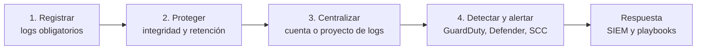

---
tags:
  - seguridad
  - cloud
  - aws
  - azure
  - gcp
  - observabilidad
  - logs
---

# Seguridad de logging y detección

> Qué logs tienen que estar activos sí o sí en AWS, Azure y Google Cloud, cómo protegerlos para que nadie los borre, dónde centralizarlos, qué servicios de detección activar y qué alertas mínimas configurar.

!!! info "Antes de leer"
    En el [Shared Responsibility Model](../fundamentos/responsabilidad-compartida.md), el proveedor **genera** buena parte de los logs, pero **activarlos, retenerlos, protegerlos y revisarlos** es tarea tuya: muchos (data events, Data Access audit logs, resource logs) vienen apagados por defecto. Conviene haber leído [Observabilidad nativa](../operacion-y-gobierno/observabilidad-nativa.md) (CloudWatch, Azure Monitor, Cloud Logging) y la parte de cuentas centrales de [Gobernanza](../operacion-y-gobierno/gobernanza.md).

## ¿Por qué importa?

Sin logs no hay investigación posible: no sabrás **qué** pasó, **desde cuándo** ni **qué datos** se vieron afectados. Y unos logs que el atacante puede borrar o que nadie mira son casi igual de inútiles. Esta nota cubre cuatro preguntas:



## Logs que deben estar activos sí o sí

| Tipo | AWS | Azure | Google Cloud |
| --- | --- | --- | --- |
| Acciones de administración sobre la nube **(I)** | **CloudTrail**: *organization trail* multi-región con *management events* de lectura y escritura | **Activity Log** de cada suscripción, exportado con *diagnostic settings* | **Admin Activity audit logs** (siempre activos, no se pueden desactivar) |
| Identidad **(I)** | Eventos de IAM, STS e IAM Identity Center en CloudTrail | **Sign-in logs** (interactivos, no interactivos, de service principals y managed identities) y **audit logs** de Microsoft Entra ID, exportados con diagnostic settings de Entra | Incluidos en Cloud Audit Logs; logs de inicio de sesión de Cloud Identity / Workspace |
| Acceso a datos | CloudTrail **data events** (S3, Lambda, DynamoDB…), **selectivos** | **Resource logs** de cada servicio vía diagnostic settings (Key Vault, Storage, SQL…) | **Data Access audit logs** (desactivados salvo en BigQuery), **selectivos** |
| Configuración | AWS Config en todas las regiones | Azure Policy + Azure Resource Graph | Cloud Asset Inventory |
| Red | VPC Flow Logs, Route 53 Resolver query logs | VNet flow logs (Network Watcher), Azure Firewall logs | VPC Flow Logs, Firewall Rules Logging, Cloud DNS logging |
| Accesos del proveedor | — | Customer Lockbox | **Access Transparency** |

!!! warning "Los Data Access logs y los data events cuestan"
    Activarlos para **todo** puede multiplicar la factura de logging. Actívalos de forma **selectiva**: buckets y tablas con datos sensibles, Key Vault/KMS/Secret Manager (lectura de secretos), y servicios críticos. En AWS usa *advanced event selectors* para filtrar por bucket o por tipo de recurso. Ver [FinOps y costos](../fundamentos/finops-costos.md).

=== "AWS"

    - Un **organization trail** creado desde la management account (o el administrador delegado de CloudTrail) registra **todas las cuentas** de la organización; las cuentas miembro no pueden modificarlo ni borrarlo.
    - El **Event history** de 90 días es gratuito pero no sustituye al trail: no se exporta ni se protege.
    - **CloudTrail Insights** detecta picos anómalos de llamadas a la API; **network activity events** registran el tráfico que pasa por VPC endpoints.
    - **CloudTrail Lake** es una alternativa al bucket S3 para guardar y consultar con SQL.

=== "Azure"

    - El Activity Log guarda **90 días**; para retener más y alertar hay que crear un **diagnostic setting** a nivel de **suscripción** hacia un Log Analytics workspace (y opcionalmente una storage account).
    - Los logs de Entra ID se exportan con los **diagnostic settings de Microsoft Entra ID** (exportar sign-in logs requiere licencia Entra ID P1 o P2).
    - Los **resource logs** no se recogen hasta que creas un diagnostic setting en cada recurso: usa las iniciativas integradas de **Azure Policy** (`DeployIfNotExists`) para desplegarlos en todo un management group.

=== "Google Cloud"

    - Cloud Logging guarda los Admin Activity, System Event y Policy Denied logs en el bucket **`_Required`** (400 días, no configurable) y el resto en **`_Default`** (30 días por defecto).
    - Los **Data Access audit logs** se activan con la **audit config** de la allow policy a nivel de organización, folder o proyecto (`DATA_READ`, `DATA_WRITE`, `ADMIN_READ`).
    - Un **aggregated sink** a nivel de organización (`include_children`) envía los logs de todos los proyectos a un destino central.

## Integridad y retención

Un atacante con privilegios intentará **borrar o detener** los logs para ocultar su rastro. Los logs de seguridad deben ser **inmutables** durante su periodo de retención.

| Control | AWS | Azure | Google Cloud |
| --- | --- | --- | --- |
| Verificar que no se alteraron | **Log file validation** de CloudTrail (digest firmados con SHA-256) | — (inmutabilidad del almacenamiento) | — (inmutabilidad del bucket) |
| Almacenamiento inmutable **(I)** | **S3 Object Lock** en modo *compliance* en el bucket de la cuenta Log Archive | **Immutable storage** para Blob (*time-based retention policy* bloqueada) | **Locked retention** en el log bucket o **Bucket Lock** en Cloud Storage |
| Cifrado | SSE-KMS con CMK en el trail | Cifrado del workspace/storage, CMK opcional | Default encryption o CMEK en el log bucket |
| Retención larga | Lifecycle del bucket a S3 Glacier; retención de CloudTrail Lake | Retención interactiva y *long-term retention* del workspace; storage con lifecycle | `retention_days` del log bucket; Cloud Storage con clases frías |
| Impedir que se detengan | SCP que deniega `cloudtrail:StopLogging`, `DeleteTrail`, `UpdateTrail`… | RBAC restringido y *resource locks* en workspace y storage; Azure Policy que despliega los diagnostic settings | Sinks y buckets en un proyecto con IAM restringido; bucket con retención bloqueada |

!!! tip "¿Cuánto retener?"
    Depende de tu [cumplimiento](../../devsecops/gobierno-y-respuesta/cumplimiento.md) (PCI DSS pide al menos un año con tres meses disponibles de inmediato; otros marcos o leyes locales pueden pedir más). Una regla práctica: **90 días "calientes"** para investigar rápido y **1 año o más "fríos"** e inmutables.

## Cuenta o proyecto de logs centralizado

| | AWS | Azure | Google Cloud |
| --- | --- | --- | --- |
| Destino | Cuenta **Log Archive** (Control Tower) con el bucket del organization trail, AWS Config y otros logs | Suscripción de *management* con un **Log Analytics workspace** central (y storage inmutable) | **Proyecto de logging** con log buckets que reciben el aggregated sink |
| Quién escribe | Los servicios (CloudTrail, Config) con bucket policy que solo permite su principal | Diagnostic settings de cada suscripción y recurso | El *writer identity* del sink con `roles/logging.bucketWriter` |
| Quién lee | Equipo de seguridad (rol de solo lectura) y el SIEM | Equipo de seguridad y Microsoft Sentinel | Equipo de seguridad y Google Security Operations |
| Quién **no** puede borrar | Nadie de las cuentas de workload; SCP y Object Lock | Nadie fuera del equipo de plataforma; locks y RBAC | Nadie fuera del equipo de plataforma; retención bloqueada |

Los mismos principios aplican a los hallazgos de seguridad: una **cuenta o proyecto de seguridad** con el administrador delegado de la detección y del CSPM (ver [Fundamentos de seguridad en la nube](fundamentos-seguridad-cloud.md)).

## Registro de configuración

Los audit logs dicen **quién hizo un cambio**; el **registro de configuración** dice **cómo está configurado cada recurso ahora y cómo estaba antes**. Sirve para inventario, para detectar *drift* (desvíos respecto a lo esperado) y para evaluar reglas de cumplimiento de forma continua. Actívalo en todas las regiones que uses.

| | AWS Config | Azure | Cloud Asset Inventory (GCP) |
| --- | --- | --- | --- |
| Inventario de recursos | *Configuration items* | **Azure Resource Graph** (consultas KQL) | Asset inventory y búsqueda de recursos |
| Historial de cambios | Configuration timeline | Change analysis en Resource Graph | Historial de assets (5 semanas) y exportaciones |
| Reglas de cumplimiento | **AWS Config rules** y *conformance packs* | **Azure Policy** (efectos `Audit`, `Deny`, `DeployIfNotExists`…) | Security Health Analytics (SCC) y Organization Policy |
| Remediación automática | Remediation con SSM Automation | `DeployIfNotExists` / `Modify` con tareas de remediación | Mediante Cloud Functions o Workflows propios |

## Detección

| | Amazon GuardDuty | Microsoft Defender for Cloud | Security Command Center |
| --- | --- | --- | --- |
| Fuentes base | CloudTrail management events, VPC Flow Logs, logs de DNS (no necesitas activarlos tú para GuardDuty) | Activity Log, señales de la plataforma y de los recursos con plan activo | Cloud Audit Logs, VPC Flow Logs, DNS y señales de la plataforma |
| Protecciones adicionales | S3 Protection, EKS Protection, **Runtime Monitoring** (EC2, EKS, ECS/Fargate), Malware Protection (EC2 y S3), RDS Protection, Lambda Protection | Planes **Defender for Servers**, Storage, Databases, Containers, App Service, Key Vault, Resource Manager, APIs, AI services… | **Event Threat Detection**, Container Threat Detection, VM Threat Detection, Cloud Run Threat Detection… (tier Premium) |
| Correlación | **Extended Threat Detection** (secuencias de ataque) y el nuevo AWS Security Hub | Alertas e incidentes de Defender XDR; Microsoft Sentinel | Attack exposure, Google Security Operations |
| Multi-cuenta | Administrador delegado + *auto-enable* para toda la organización | Planes asignados por suscripción (con Azure Policy a nivel de management group) | Activación a nivel de organización |

!!! info "Activa la detección en todas las regiones"
    GuardDuty es **regional**: si solo lo activas en tu región principal, un atacante que lance instancias para minar criptomonedas en otra región no generará alertas. Actívalo en todas las regiones habilitadas y bloquea las que no uses con una SCP.

Lo que pasa **después** de la alerta (SIEM, triage, playbooks, forense) se trata en [Detección y respuesta](../../devsecops/gobierno-y-respuesta/deteccion-respuesta.md).

## Alertas mínimas recomendadas

Además de los hallazgos de los servicios de detección, configura alertas propias sobre los eventos que **siempre** merecen que alguien mire. Esta lista sigue los controles de monitoreo de los CIS Foundations Benchmarks.

| Evento | AWS (CloudTrail) | Azure (Activity Log / Entra) | Google Cloud (Cloud Audit Logs) |
| --- | --- | --- | --- |
| Uso de root / break-glass | `userIdentity.type = Root` | Sign-in de las emergency access accounts | Inicio de sesión de Super Admins de emergencia |
| Inicio de sesión sin MFA | `ConsoleLogin` con `additionalEventData.MFAUsed = No` | Sign-ins sin MFA (Entra ID Protection / Conditional Access insights) | — (2SV forzado en Cloud Identity) |
| Cambios en IAM | `Put*Policy`, `Attach*Policy`, `CreateAccessKey`, `CreateUser` | `Microsoft.Authorization/roleAssignments/write`, cambios en roles de Entra | `SetIamPolicy` con cambios de `roles/owner`; cambios en custom roles |
| Desactivar o cambiar logs | `StopLogging`, `DeleteTrail`, `UpdateTrail`, `PutEventSelectors` | Borrado de diagnostic settings; `Microsoft.Insights/diagnosticSettings/delete` | `SetIamPolicy` con cambios de `auditConfigs`; borrado o cambio de sinks |
| Desactivar la detección | `DeleteDetector`, `DisassociateFromAdministratorAccount` (GuardDuty), `DisableSecurityHub` | Cambio de plan de Defender a *Free* (`Microsoft.Security/pricings/write`) | Desactivación de servicios de SCC |
| Claves | `DisableKey`, `ScheduleKeyDeletion` | Borrado o purga de claves en Key Vault | `DestroyCryptoKeyVersion`, `DisableCryptoKeyVersion` |
| Políticas de guardrail | Cambios en SCPs (`organizations:*Policy`) | `Microsoft.Authorization/policyAssignments/delete` | Cambios en Organization Policy |
| Red | Cambios en security groups, NACLs, route tables, gateways | Creación/borrado de NSG y reglas | Cambios en firewall rules, rutas y redes VPC |

Envía las alertas a un canal con **dueño y guardia** (on-call), no a un buzón que nadie lee.

## Riesgos típicos

| Riesgo | Ejemplo o incidente conocido | Control que lo evita |
| --- | --- | --- |
| No hay logs del periodo del ataque | Incidentes descubiertos meses después, con la retención por defecto (90 días) ya vencida | Trail/sink central con retención larga |
| El atacante borra o detiene los logs | Técnica habitual tras escalar privilegios (MITRE ATT&CK T1562.008, *Disable or Modify Cloud Logs*) | SCP, Object Lock / retención bloqueada, alerta |
| Logs de acceso a datos desactivados | Storm-0558 (2023): muchos clientes no tenían el nivel de licencia con los logs que permitían detectar el acceso; Microsoft amplió después los logs disponibles por defecto | Activar logs de acceso a datos en servicios sensibles |
| Detección activa solo en una región | Minería de criptomonedas lanzada en regiones no vigiladas | GuardDuty en todas las regiones + SCP de regiones |
| Alertas sin dueño | Hallazgos de GuardDuty o Defender que nadie revisa durante semanas | Integración con SIEM/ticketing, SLA por severidad |
| Logs centralizados en una cuenta con acceso amplio | Cualquier administrador de una workload puede borrar sus propios rastros | Cuenta de logs separada con acceso mínimo |

## Controles por proveedor

**(I)** = imprescindible.

| Control | AWS | Azure | Google Cloud |
| --- | --- | --- | --- |
| Audit logs de toda la organización **(I)** | Organization trail multi-región | Diagnostic settings del Activity Log en todas las suscripciones (por Azure Policy) | Aggregated sink de organización |
| Logs de identidad **(I)** | CloudTrail (IAM, STS, Identity Center) | Diagnostic settings de Microsoft Entra ID | Cloud Audit Logs + logs de Cloud Identity |
| Acceso a datos sensibles | Data events selectivos | Resource logs (Key Vault, Storage, SQL) | Data Access audit logs selectivos |
| Integridad **(I)** | Log file validation + S3 Object Lock | Immutable storage | Locked retention / Bucket Lock |
| Cuenta de logs central **(I)** | Log Archive | Workspace central | Proyecto de logging |
| Detección de amenazas **(I)** | GuardDuty en todas las regiones y cuentas | Defender for Cloud con planes por tipo de recurso | Security Command Center Premium |
| Alertas mínimas **(I)** | Metric filters + CloudWatch alarms o reglas de EventBridge | Activity log alerts y alertas de log search | Log-based alerts en Cloud Monitoring |
| SIEM | Amazon Security Lake + SIEM; AWS Security Hub | Microsoft Sentinel | Google Security Operations |

## Buenas prácticas

1. **Primero el organization trail / diagnostic settings / aggregated sink**, antes que cualquier otra cosa: sin eso no puedes investigar nada de lo que pase después.
2. **Centraliza en una cuenta o proyecto de logs** al que los equipos de aplicación no tengan acceso de escritura ni de borrado.
3. **Haz los logs inmutables** con retención definida por cumplimiento.
4. **Activa la detección en toda la organización** con administrador delegado y alta automática de cuentas nuevas.
5. **Activa logs de acceso a datos de forma selectiva** según la clasificación de los datos.
6. **Configura las alertas mínimas** y pruébalas (provoca el evento en una cuenta de pruebas y verifica que llega).
7. **Protege la configuración de logging** con guardrails y alerta sobre cualquier cambio.
8. **Integra con un SIEM** y define SLA de triage por severidad.
9. **Sincroniza la hora**: usa siempre las marcas de tiempo del proveedor (UTC) para correlacionar.
10. **Revisa el costo**: filtros de exclusión para logs ruidosos y de poco valor (pero nunca sobre audit logs de administración).

## Cómo verificarlo

Comandos de solo lectura.

=== "AWS"

    ```bash
    # Trails: de organización, multi-región, validación, cifrado
    aws cloudtrail describe-trails --query 'trailList[].{trail:Name, org:IsOrganizationTrail, multi:IsMultiRegionTrail, validacion:LogFileValidationEnabled, kms:KmsKeyId, bucket:S3BucketName}'

    # ¿Está registrando? ¿Hay errores de entrega?
    aws cloudtrail get-trail-status --name <trail> \
      --query '{registrando:IsLogging, error:LatestDeliveryError}'

    # Qué eventos captura (management y data events)
    aws cloudtrail get-event-selectors --trail-name <trail>

    # Verificar la integridad de los logs de un periodo
    aws cloudtrail validate-logs --trail-arn <arn> --start-time 2026-10-01T00:00:00Z

    # Object Lock del bucket de logs (en la cuenta Log Archive)
    aws s3api get-object-lock-configuration --bucket <bucket-logs>

    # GuardDuty: detector, protecciones y administrador delegado
    aws guardduty list-detectors
    aws guardduty get-detector --detector-id <id> --query 'Features[].{feature:Name, estado:Status}'
    aws guardduty list-organization-admin-accounts

    # AWS Config: cumplimiento por regla
    aws configservice describe-compliance-by-config-rule

    # Alarmas y metric filters del log group del trail
    aws logs describe-metric-filters --log-group-name <log-group> \
      --query 'metricFilters[].{filtro:filterName, patron:filterPattern}'
    ```

=== "Azure"

    ```bash
    # Diagnostic settings del Activity Log de la suscripción
    az monitor diagnostic-settings subscription list --query "value[].{nombre:name, workspace:workspaceId, storage:storageAccountId}"

    # Diagnostic settings de Microsoft Entra ID
    az rest --method get \
      --url "https://management.azure.com/providers/microsoft.aadiam/diagnosticSettings?api-version=2017-04-01"

    # Retención del workspace central
    az monitor log-analytics workspace show -g <rg> -n <workspace> --query retentionInDays

    # Política de inmutabilidad del contenedor de logs
    az storage container immutability-policy show --account-name <cuenta> --container-name <contenedor>

    # Planes de Defender for Cloud activos
    az security pricing list --query "value[].{plan:name, tier:pricingTier}" -o table

    # Inventario con Resource Graph: storage accounts y acceso público a blobs
    az graph query -q "Resources | where type =~ 'microsoft.storage/storageaccounts' | project name, properties.allowBlobPublicAccess"

    # Activity log alerts configuradas
    az monitor activity-log alert list --query "[].{alerta:name, activa:enabled}" -o table
    ```

=== "Google Cloud"

    ```bash
    # Sinks de la organización (aggregated sinks)
    gcloud logging sinks list --organization=<org-id> \
      --format="table(name, destination, includeChildren, filter)"

    # Inventario con Cloud Asset Inventory: buckets de un proyecto
    gcloud asset search-all-resources --scope=projects/<proyecto> \
      --asset-types=storage.googleapis.com/Bucket

    # Retención y bloqueo de los log buckets del proyecto de logging
    gcloud logging buckets list --project=<proyecto-logs> --location=global \
      --format="table(name.basename(), retentionDays, locked)"

    # Data Access audit logs configurados en la organización
    gcloud organizations get-iam-policy <org-id> --format="json(auditConfigs)"

    # Log-based metrics y políticas de alerta
    gcloud logging metrics list --project=<proyecto> --format="table(name, filter)"
    gcloud monitoring policies list --project=<proyecto> --format="table(displayName, enabled)"

    # Findings de logging en Security Command Center
    gcloud scc findings list organizations/<org-id> --location=global \
      --filter='state="ACTIVE" AND (category="AUDIT_LOGGING_DISABLED" OR category="LOG_NOT_EXPORTED" OR category="LOCKED_RETENTION_POLICY_NOT_SET")' \
      --format="table(finding.category, finding.resourceName)"
    ```

    Si tu versión de gcloud no tiene `gcloud monitoring policies`, usa `gcloud alpha monitoring policies list`.

| Control imprescindible | AWS (Security Hub CSPM) | Azure (MCSB / Defender for Cloud) | Google Cloud (SCC) |
| --- | --- | --- | --- |
| Audit logs activos | `CloudTrail.1`, `CloudTrail.3` | `LT-3` | `AUDIT_LOGGING_DISABLED` |
| Integridad y cifrado | `CloudTrail.4`, `CloudTrail.2` | `LT-6` | `LOCKED_RETENTION_POLICY_NOT_SET` |
| Logs exportados / centralizados | `CloudTrail.5` | `LT-5` | `LOG_NOT_EXPORTED` |
| Bucket de logs protegido | `CloudTrail.6`, `CloudTrail.7` | — | — |
| Logs de red | `EC2.6` (*VPC flow logging should be enabled in all VPCs*) | `LT-4` | `FLOW_LOGS_DISABLED` |
| Detección activa | `GuardDuty.1` (y `GuardDuty.5`–`GuardDuty.13` para protecciones) | `LT-1`, `LT-2` | Event Threat Detection habilitado |
| Alertas mínimas | `CloudWatch.1` a `CloudWatch.14` (CIS) | Activity log alerts (CIS Azure) | `AUDIT_CONFIG_NOT_MONITORED`, `OWNER_NOT_MONITORED`, `CUSTOM_ROLE_NOT_MONITORED`, `BUCKET_IAM_NOT_MONITORED` |

!!! note "Los controles CloudWatch.x son exigentes"
    Security Hub CSPM evalúa `CloudWatch.1`–`CloudWatch.14` con los **patrones exactos** de CIS: si tu metric filter añade un campo, el control falla aunque la alerta funcione. Muchos equipos los sustituyen por reglas de EventBridge o por el SIEM y documentan la excepción.

## Configuración segura con IaC

Los fragmentos de Terraform con estos controles (y los guardrails de organización, cuando aplican) están en las páginas por proveedor: [AWS](terraform/aws.md#logging-y-deteccion), [Azure](terraform/azure.md#logging-y-deteccion) y [Google Cloud](terraform/google-cloud.md#logging-y-deteccion).

## Errores comunes

- **Trail por cuenta en lugar de organization trail**: cada equipo puede detener el suyo, y las cuentas nuevas nacen sin trail.
- **Bucket de logs en la misma cuenta que la carga de trabajo**, con el mismo administrador que podría borrarlo.
- **Activar todos los Data Access logs o data events** sin filtros: factura inesperada y luego se desactivan todos, incluido lo importante.
- **Olvidar los logs de Entra ID**: el Activity Log no registra inicios de sesión; sin los sign-in logs no verás el compromiso de una cuenta.
- **Retención por defecto** (90 días en CloudTrail Event history y Activity Log, 30 días en `_Default`) asumida como suficiente.
- **Bloquear la retención sin pensarlo**: el bloqueo de un log bucket o Object Lock en modo compliance **no se puede deshacer** ni acortar; prueba primero con periodos cortos en una cuenta de pruebas.
- **Detección activa pero sin alertas enrutadas**: los hallazgos se quedan en la consola.
- **Alertas que nadie probó**: un metric filter con un error de sintaxis nunca dispara.

## Relación con otras secciones

| Enfoque | Qué se mira desde ahí | Nota |
| --- | --- | --- |
| Cloud (el control) | Observabilidad; cuentas centrales; identidades y red | [Observabilidad nativa](../operacion-y-gobierno/observabilidad-nativa.md), [Gobernanza](../operacion-y-gobierno/gobernanza.md), [Seguridad de identidades](seguridad-identidades.md), [Seguridad de redes](seguridad-redes.md) |
| DevOps (la automatización) | Centralizar logs y alertas como código; observabilidad y guardias | [Observabilidad](../../devops/operacion/observabilidad.md), [Operación y fiabilidad (SRE)](../../devops/operacion/operacion-sre.md), [Infrastructure as Code](../../devops/iac/infraestructura-como-codigo.md) |
| DevSecOps (la verificación) | SIEM, triage, playbooks y forense; auditoría continua y retención por cumplimiento | [Detección y respuesta](../../devsecops/gobierno-y-respuesta/deteccion-respuesta.md), [Cumplimiento y gobierno](../../devsecops/gobierno-y-respuesta/cumplimiento.md), [CSPM](../../devsecops/escaneos/cspm.md) |
| Networking (la base) | Flow logs y herramientas para investigar tráfico | [Troubleshooting de red](../../networking/avanzado/troubleshooting-red.md) |
| Laboratorios (la práctica) | Practicar esto paso a paso | [Lab 16: Auditar tu cuenta cloud con Prowler (CSPM)](../../laboratorios/devsecops/cspm-prowler.md) |

## Referencias

- [Creating a trail for an organization (AWS CloudTrail)](https://docs.aws.amazon.com/awscloudtrail/latest/userguide/creating-trail-organization.html)
- [Logging data events con advanced event selectors](https://docs.aws.amazon.com/awscloudtrail/latest/userguide/logging-data-events-with-cloudtrail.html)
- [CloudTrail log file integrity validation](https://docs.aws.amazon.com/es_es/awscloudtrail/latest/userguide/cloudtrail-log-file-validation-intro.html)
- [Security Hub CSPM controls for CloudTrail](https://docs.aws.amazon.com/securityhub/latest/userguide/cloudtrail-controls.html) y [for CloudWatch](https://docs.aws.amazon.com/securityhub/latest/userguide/cloudwatch-controls.html)
- [Amazon GuardDuty: multi-account](https://docs.aws.amazon.com/guardduty/latest/ug/guardduty_organizations.html)
- [AWS Config](https://docs.aws.amazon.com/es_es/config/latest/developerguide/WhatIsConfig.html)
- [Información general de Azure Resource Graph](https://learn.microsoft.com/es-es/azure/governance/resource-graph/overview)
- [Cloud Asset Inventory](https://cloud.google.com/asset-inventory/docs/overview)
- [Registro de actividad de Azure: diagnostic settings](https://learn.microsoft.com/es-es/azure/azure-monitor/platform/activity-log)
- [Integrar los logs de Microsoft Entra con Azure Monitor](https://learn.microsoft.com/es-es/entra/identity/monitoring-health/howto-integrate-activity-logs-with-azure-monitor-logs)
- [Almacenamiento inmutable para Azure Blob Storage](https://learn.microsoft.com/es-es/azure/storage/blobs/immutable-storage-overview)
- [Planes de Microsoft Defender for Cloud](https://learn.microsoft.com/es-es/azure/defender-for-cloud/defender-for-cloud-introduction)
- [MCSB v2: Logging and Threat Detection](https://learn.microsoft.com/en-us/security/benchmark/azure/mcsb-v2-logging-threat-detection)
- [Cloud Audit Logs](https://cloud.google.com/logging/docs/audit)
- [Aggregated sinks](https://cloud.google.com/logging/docs/export/aggregated_sinks)
- [Log buckets y retención bloqueada](https://cloud.google.com/logging/docs/buckets)
- [Event Threat Detection](https://cloud.google.com/security-command-center/docs/concepts-event-threat-detection-overview)
- [Log-based alerts](https://cloud.google.com/logging/docs/alerting/log-based-alerts)
