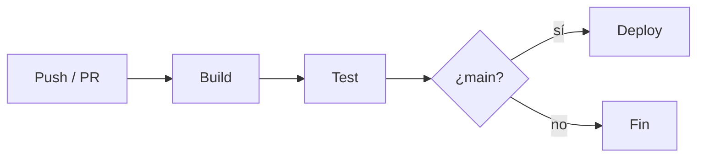

---
tags:
  - ci-cd
  - github-actions
---

# Pipeline CI/CD con GitHub Actions

> Workflow básico para construir, testear y desplegar en cada push.

## Contexto

Automatiza build + test en cada `push` y `pull_request`, y despliega solo desde `main`.

## Workflow

```yaml title=".github/workflows/ci.yml"
name: CI

on:
  push:
    branches: [main]
  pull_request:

jobs:
  build-test:
    runs-on: ubuntu-latest
    steps:
      - uses: actions/checkout@v7
      - uses: actions/setup-node@v4
        with:
          node-version: 20
          cache: npm
      - run: npm ci
      - run: npm test
```

## Diagrama de flujo



## Buenas prácticas

- [x] Cachear dependencias para acelerar los jobs.
- [x] Fijar versiones de las actions (`@v4`, no `@main`).
- [x] Separar el deploy en un job con `needs:` y `environment:`.

Para los conceptos generales (etapas, artefactos, registries, comparación con otras herramientas) ver [Integración continua](integracion-continua.md); para estrategias de despliegue y environments, [Despliegue continuo](despliegue-continuo.md).

## Relación con otras secciones

| Enfoque | Qué se mira desde ahí | Nota |
| --- | --- | --- |
| Cloud (el control) | Rol que asume el workflow en la nube (OIDC) y dónde se despliega | [IAM: AWS, Azure y GCP](../../cloud/fundamentos/iam-comparativa.md), [Contenedores gestionados](../../cloud/computo/contenedores-gestionados.md) |
| DevOps (la automatización) | Conceptos de CI/CD y flujo de ramas que dispara el workflow | [Integración continua](integracion-continua.md), [Despliegue continuo](despliegue-continuo.md), [Git y control de versiones](../fundamentos/git-control-versiones.md) |
| DevSecOps (la verificación) | Escaneos dentro del workflow, permisos mínimos del `GITHUB_TOKEN` y actions fijadas por SHA | [Escaneo en el pipeline](../../devsecops/escaneos/escaneo-en-pipeline.md), [Seguridad del pipeline](../../devsecops/identidades-y-pipeline/seguridad-pipeline.md), [Secretos e identidades](../../devsecops/identidades-y-pipeline/secretos-identidades.md) |
| Laboratorios (la práctica) | Practicar esto paso a paso | [Lab 07: Pipeline de CI con GitHub Actions](../../laboratorios/devops/github-actions-ci.md), [Lab 12: Escaneos de seguridad en el pipeline](../../laboratorios/devsecops/escaneos-en-pipeline.md), [Lab 13: Desplegar en AWS desde GitHub Actions con OIDC (sin llaves)](../../laboratorios/devsecops/oidc-github-aws.md), [Lab 15: DAST con OWASP ZAP sobre OWASP Juice Shop](../../laboratorios/devsecops/dast-zap-juice-shop.md) |

## Referencias

- [Documentación de GitHub Actions](https://docs.github.com/actions)
