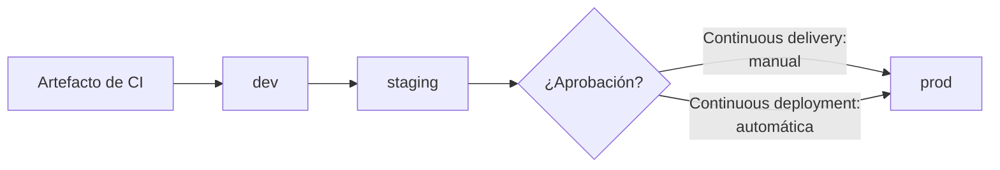
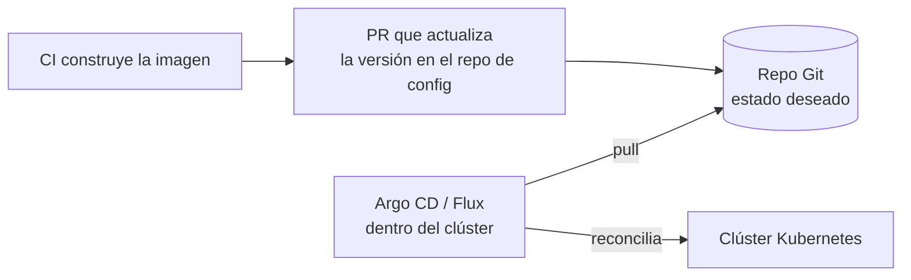

---
tags:
  - ci-cd
  - devops
  - gitops
  - kubernetes
  - aws
  - azure
  - gcp
---

# Despliegue continuo (CD) y estrategias

> Diferencia entre continuous delivery y continuous deployment, estrategias de despliegue (rolling, blue/green, canary, recreate), feature flags, rollbacks, environments y GitOps con Argo CD y Flux.

## ¿Qué es?

La **CD** cubre lo que pasa después de la [integración continua](integracion-continua.md): llevar el artefacto ya probado hasta producción de forma **automática, repetible y segura**. Las siglas tienen dos significados que conviene distinguir:

| | **Continuous delivery** (entrega continua) | **Continuous deployment** (despliegue continuo) |
| --- | --- | --- |
| Qué se automatiza | Todo hasta dejar el cambio **listo** para producción | Todo, **incluida** la salida a producción |
| Paso a producción | Una persona aprueba (un clic) | Automático si pasan todas las verificaciones |
| Requisito | Pipeline fiable y entornos parecidos a producción | Además, tests muy sólidos, monitoreo y rollback automático |
| Típico en | Entornos regulados, equipos que empiezan | Servicios web maduros con despliegues frecuentes |



En los dos casos se despliega **el mismo artefacto** en cada entorno (*build once, deploy many*); solo cambia la configuración.

## Estrategias de despliegue

=== "Recreate"

    **Recreate** (recrear): se detiene la versión anterior por completo y luego se arranca la nueva. Es la más simple, pero hay **tiempo sin servicio** (*downtime*). Sirve para entornos de desarrollo o cuando dos versiones no pueden convivir (por ejemplo, por un cambio incompatible en la base de datos).

=== "Rolling update"

    **Rolling update** (actualización gradual): se reemplazan las instancias de a poco (por ejemplo, de una en una o un 25 % cada vez) y se comprueba la salud de cada tanda. Es la estrategia **por defecto de un Deployment de Kubernetes** y de los grupos de autoescalado. Durante el despliegue conviven las dos versiones, así que deben ser compatibles.

=== "Blue/green"

    **Blue/green** (azul/verde): se levanta un entorno completo con la nueva versión (*green*) junto al actual (*blue*). Cuando *green* está verificado, el *load balancer* o el DNS cambia **todo el tráfico** de golpe. El rollback es inmediato: volver a apuntar a *blue*. El costo es tener el doble de capacidad durante el despliegue.

=== "Canary"

    **Canary** (canario): la nueva versión recibe primero un **porcentaje pequeño del tráfico** (1 %, 5 %, 25 %…). Si las métricas (errores, latencia) se mantienen bien, se aumenta hasta el 100 %; si empeoran, se retira. Es la estrategia que mejor limita el impacto de un fallo, pero necesita buena **observabilidad** y control fino del tráfico (*service mesh*, *ingress* o *load balancer* con pesos).

| Estrategia | Downtime | Riesgo para usuarios | Costo de infraestructura | Velocidad de rollback | Complejidad |
| --- | --- | --- | --- | --- | --- |
| **Recreate** | Sí | Alto (todos a la vez) | Bajo | Lenta (redesplegar) | Baja |
| **Rolling update** | No | Medio (crece por tandas) | Bajo (algunas instancias extra) | Media (otro rolling hacia atrás) | Baja |
| **Blue/green** | No | Alto si falla, pero se revierte al instante | Alto (doble entorno) | Inmediata (cambiar el tráfico) | Media |
| **Canary** | No | Bajo (solo un % lo ve) | Bajo a medio | Rápida (retirar el canary) | Alta |

!!! tip "La base de datos es lo difícil"
    En rolling, blue/green y canary conviven dos versiones de la app con **la misma base de datos**. Haz cambios de esquema compatibles hacia atrás con el patrón **expand/contract** (ampliar y contraer): primero añades columnas nuevas sin quitar las viejas, despliegas, migras datos y solo en un despliegue posterior eliminas lo antiguo.

### Equivalentes nativos

| Proveedor | Servicio | Estrategias que ofrece |
| --- | --- | --- |
| AWS | **AWS CodeDeploy** | *In-place* y *blue/green* en EC2; *canary*, *linear* y *all-at-once* para Lambda y Amazon ECS |
| AWS | **Lambda aliases** con pesos | Repartir tráfico entre dos versiones de una función |
| Azure | **Deployment slots** de Azure App Service | Desplegar en un slot (p. ej. `staging`), probar y hacer **swap** con producción (blue/green); enviar un % del tráfico a un slot (canary) |
| Azure | **Azure Container Apps** revisions | Reparto de tráfico entre revisiones |
| Google Cloud | **Cloud Deploy** | Pipelines de entrega con promoción entre *targets*, aprobaciones y estrategia *canary* para GKE y Cloud Run |
| Google Cloud | **Cloud Run** revisions | Reparto de tráfico por porcentaje entre revisiones |
| Kubernetes (cualquier nube) | Deployment (`RollingUpdate` / `Recreate`), **Argo Rollouts**, **Flagger** | Rolling nativo; blue/green y canary con análisis automático de métricas |

Más detalle por tipo de cómputo en [Máquinas virtuales](../../cloud/computo/maquinas-virtuales.md), [Contenedores gestionados](../../cloud/computo/contenedores-gestionados.md) y [Serverless](../../cloud/computo/serverless.md).

## Feature flags

Un **feature flag** (interruptor de funcionalidad, también *feature toggle*) permite **desplegar código sin activarlo**. La funcionalidad queda escondida detrás de una condición que se cambia en tiempo de ejecución, sin redesplegar.

Esto separa dos cosas que antes iban juntas: **deploy** (el código llega a producción) y **release** (los usuarios lo ven).

Usos típicos:

- Integrar trabajo a medias en `main` sin que se vea (clave en *trunk-based development*).
- Activar una función solo para el equipo interno, para un % de usuarios o para una región.
- **Kill switch** (interruptor de apagado): desactivar al instante una función que causa problemas.
- Pruebas A/B.

| Herramienta | Tipo |
| --- | --- |
| **LaunchDarkly** | SaaS comercial |
| **Unleash** | Open source (con versión SaaS) |
| **OpenFeature** | Estándar abierto de la CNCF: una API común para usar cualquier proveedor de flags sin atarte a uno |
| **AWS AppConfig** | Servicio nativo de AWS (feature flags y configuración dinámica) |
| **Azure App Configuration** | Servicio nativo de Azure (*feature manager*) |

!!! warning "Los flags son deuda técnica"
    Cada flag añade una rama más al código. Ponles dueño y fecha de retiro, y bórralos cuando la función esté al 100 %. Un flag olvidado que alguien activa por error puede causar un incidente.

## Rollbacks

Un **rollback** (reversión) devuelve el sistema a la última versión que funcionaba. Opciones, de más rápida a más lenta:

1. **Apagar el feature flag** (segundos).
2. **Cambiar el tráfico** de vuelta: swap de slots, volver a *blue*, retirar el canary.
3. **Redesplegar el artefacto anterior** (por eso los artefactos deben ser inmutables y estar versionados): `kubectl rollout undo`, volver a ejecutar el pipeline con la versión previa o, en GitOps, hacer `git revert`.
4. **Roll forward** (arreglar hacia adelante): publicar una corrección. Válido si es rápido, pero no debería ser el único plan.

!!! danger "Prueba el rollback antes de necesitarlo"
    Un rollback que nunca se ensayó suele fallar justo durante el incidente. Automatízalo (rollback automático si fallan los *health checks* o suben los errores) y documenta cuándo se activa. El tiempo que tardas en recuperarte es una métrica DORA: ver [Cultura DevOps y métricas DORA](../fundamentos/cultura-metricas-dora.md).

## Environments y approvals

Un **environment** (entorno) es un destino de despliegue (`dev`, `staging`, `prod`) con su propia configuración, secretos y reglas. Las plataformas de CI/CD permiten añadirles **protection rules** (reglas de protección):

- **Required reviewers / approvals** (aprobaciones): una persona o equipo debe aprobar antes de desplegar en `prod`.
- **Wait timer**: esperar un tiempo antes de continuar.
- **Restricción de ramas**: solo `main` o tags `v*` pueden desplegar en producción.
- **Secretos por entorno**: el job de `dev` no puede leer los secretos de `prod`.

| Plataforma | Dónde se configura |
| --- | --- |
| GitHub Actions | *Environments* del repositorio (`environment: prod` en el job) |
| GitLab CI/CD | *Environments* y *protected environments* |
| Azure Pipelines | *Environments* con *approvals and checks* |
| AWS CodePipeline | Acción de tipo *Manual approval* |
| Google Cloud Deploy | `requireApproval` en el target |

El diseño seguro de aprobaciones y aislamiento de entornos está en [Seguridad del pipeline](../../devsecops/identidades-y-pipeline/seguridad-pipeline.md).

## GitOps

**GitOps** es un modelo de operación en el que **Git es la fuente de verdad del estado deseado** del sistema, y un agente dentro del entorno se encarga de que la realidad coincida con lo que dice Git. Se usa sobre todo con Kubernetes.

### Principios de OpenGitOps

El proyecto **OpenGitOps** (CNCF) define cuatro principios:

| Principio | Qué significa |
| --- | --- |
| **Declarative** (declarativo) | El estado deseado se describe (manifiestos YAML, Helm, Kustomize), no se programa paso a paso |
| **Versioned and immutable** (versionado e inmutable) | Ese estado se guarda en un sistema que conserva el historial completo, como Git |
| **Pulled automatically** (extraído automáticamente) | Agentes dentro del entorno **descargan** el estado deseado; el CI no empuja cambios al clúster |
| **Continuously reconciled** (reconciliado continuamente) | Los agentes comparan sin parar el estado real con el deseado y corrigen las diferencias (*drift*) |



Ventajas: el historial de Git es la auditoría de cada cambio, el rollback es un `git revert`, el CI **no necesita credenciales del clúster** y cualquier cambio manual se detecta y se revierte.

### Argo CD y Flux

| | **Argo CD** | **Flux** |
| --- | --- | --- |
| Proyecto | CNCF *graduated* | CNCF *graduated* |
| Interfaz | UI web completa, CLI y API | CLI y CRDs; sin UI propia (hay UIs de terceros) |
| Unidad principal | `Application` / `ApplicationSet` | `GitRepository` + `Kustomization` / `HelmRelease` |
| Multi-clúster | Una instancia central gestiona muchos clústeres | Normalmente un Flux por clúster |
| Helm y Kustomize | Sí | Sí (controladores dedicados) |
| Entrega progresiva | Con **Argo Rollouts** | Con **Flagger** |
| Ideal para | Equipos que quieren visibilidad y una UI | Enfoque minimalista y muy "Kubernetes nativo" |

```yaml title="argocd/miapp-prod.yaml"
apiVersion: argoproj.io/v1alpha1
kind: Application
metadata:
  name: miapp-prod
  namespace: argocd
spec:
  project: default
  source:
    repoURL: https://github.com/mi-org/miapp-config.git
    targetRevision: main
    path: overlays/prod
  destination:
    server: https://kubernetes.default.svc
    namespace: miapp
  syncPolicy:
    automated:
      prune: true      # borra del clúster lo que ya no está en Git
      selfHeal: true   # revierte cambios manuales (drift)
    syncOptions:
      - CreateNamespace=true
```

Algunos proveedores integran GitOps en su Kubernetes gestionado: por ejemplo, la extensión **GitOps (Flux v2)** de AKS y Azure Arc, o **Config Sync** en GKE. La oferta cambia a menudo, así que revisa la de tu proveedor antes de instalar Argo CD o Flux por tu cuenta. Para los recursos de Kubernetes ver [Kubernetes](../contenedores/kubernetes.md).

!!! tip "Policy as code en GitOps"
    Como todo cambio pasa por un PR, puedes validar los manifiestos en el CI y en el clúster con **policy as code** (OPA/Gatekeeper, Kyverno) antes de que se apliquen. Ver [Seguridad de IaC](../../devsecops/infraestructura-y-contenedores/seguridad-iac.md) y [Seguridad de Kubernetes](../../devsecops/infraestructura-y-contenedores/seguridad-kubernetes.md).

## Relación con otras secciones

| Enfoque | Qué se mira desde ahí | Nota |
| --- | --- | --- |
| Cloud (el control) | Dónde se despliega y qué estrategias soporta cada tipo de cómputo | [Máquinas virtuales](../../cloud/computo/maquinas-virtuales.md), [Contenedores gestionados](../../cloud/computo/contenedores-gestionados.md), [Serverless](../../cloud/computo/serverless.md), [Resiliencia](../../cloud/operacion-y-gobierno/resiliencia.md) |
| DevOps (la automatización) | El artefacto que llega de CI, la infraestructura de destino y las métricas para decidir un rollback | [Integración continua](integracion-continua.md), [Kubernetes](../contenedores/kubernetes.md), [Observabilidad](../operacion/observabilidad.md) |
| DevSecOps (la verificación) | Aprobaciones, aislamiento de entornos y policy as code antes de aplicar cambios | [Seguridad del pipeline](../../devsecops/identidades-y-pipeline/seguridad-pipeline.md), [Seguridad de IaC](../../devsecops/infraestructura-y-contenedores/seguridad-iac.md), [Seguridad de Kubernetes](../../devsecops/infraestructura-y-contenedores/seguridad-kubernetes.md) |
| Laboratorios (la práctica) | Practicar esto paso a paso | [Lab 06: Desplegar una app en Kubernetes local con kind](../../laboratorios/devops/kubernetes-local-kind.md), [Lab 07: Pipeline de CI con GitHub Actions](../../laboratorios/devops/github-actions-ci.md), [Lab 13: Desplegar en AWS desde GitHub Actions con OIDC (sin llaves)](../../laboratorios/devsecops/oidc-github-aws.md), [Lab 20: Google Cloud: desplegar un contenedor en Cloud Run](../../laboratorios/cloud/gcp-cloud-run.md), [Lab 21: Game day: incidente simulado, troubleshooting y postmortem](../../laboratorios/operacion/game-day-incidente.md) |

## Referencias

- [Martin Fowler: Continuous Delivery](https://martinfowler.com/bliki/ContinuousDelivery.html)
- [Martin Fowler: Feature Toggles](https://martinfowler.com/articles/feature-toggles.html)
- [Kubernetes: Deployments (estrategias)](https://kubernetes.io/es/docs/concepts/workloads/controllers/deployment/)
- [OpenGitOps: principios](https://opengitops.dev/)
- [Argo CD](https://argo-cd.readthedocs.io/)
- [Flux](https://fluxcd.io/flux/)
- [OpenFeature](https://openfeature.dev/)
- [AWS CodeDeploy: configuraciones de despliegue](https://docs.aws.amazon.com/codedeploy/latest/userguide/deployment-configurations.html)
- [Azure App Service: entornos de ensayo (deployment slots)](https://learn.microsoft.com/es-es/azure/app-service/deploy-staging-slots)
- [Google Cloud Deploy](https://cloud.google.com/deploy/docs)
- [GitHub Actions: environments para despliegue](https://docs.github.com/es/actions/managing-workflow-runs-and-deployments/managing-deployments/managing-environments-for-deployment)
