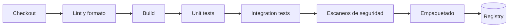
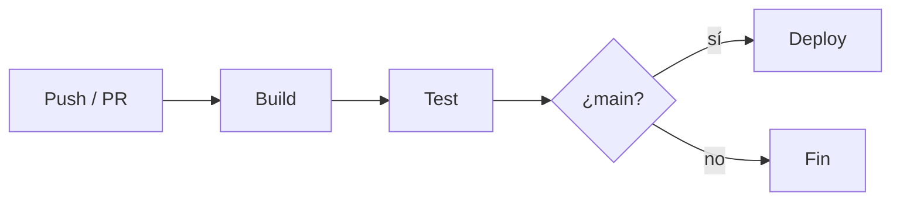

---
tags:
  - ci-cd
  - devops
  - github-actions
  - contenedores
---

# Integración continua (CI)

> Qué es la integración continua, qué etapas tiene un pipeline de CI, cómo se versionan y guardan los artefactos, y cómo se comparan GitHub Actions, GitLab CI, Jenkins y los servicios nativos de cada nube.

## ¿Qué es?

La **continuous integration** (CI, integración continua) es la práctica de **integrar los cambios en la rama principal con frecuencia** (al menos a diario) y comprobar cada integración de forma **automática**: compilar, ejecutar tests y validar calidad. Si algo se rompe, el equipo lo sabe en minutos y lo arregla antes de seguir.

La CI tiene dos partes:

1. **Práctica**: ramas cortas, commits pequeños, `main` siempre en verde, arreglar un build roto es la prioridad.
2. **Herramienta**: un servidor o servicio que ejecuta el **pipeline** (secuencia automatizada de pasos) en cada `push` o *pull request*.

Sin la práctica, la herramienta solo es "un servidor que compila". Ver la estrategia de ramas en [Git y control de versiones](../fundamentos/git-control-versiones.md).

### Términos que conviene conocer

| Término | Qué significa |
| --- | --- |
| **Pipeline** | El flujo completo automatizado (en GitHub Actions se llama *workflow*) |
| **Stage** (etapa) | Grupo de pasos con un objetivo: build, test, publicar |
| **Job** (trabajo) | Conjunto de pasos que corre en un mismo *runner*; varios jobs pueden ir en paralelo |
| **Runner** / **agent** (ejecutor) | La máquina o contenedor que ejecuta los jobs; puede ser del proveedor (*hosted*) o propio (*self-hosted*) |
| **Artifact** (artefacto) | El resultado del build que se va a desplegar: binario, paquete, imagen de contenedor |
| **Trigger** (disparador) | El evento que inicia el pipeline: push, PR, tag, horario, manual |

## Etapas típicas de un pipeline de CI



| Etapa | Qué hace | Ejemplos |
| --- | --- | --- |
| **Checkout** | Descarga el código del commit que disparó el pipeline | `actions/checkout@v7`, `git clone --depth 1` |
| **Lint** (análisis estático de estilo) | Revisa formato y errores comunes sin ejecutar el código | ESLint, Ruff, `terraform fmt -check`, ShellCheck, hadolint |
| **Build** (compilación) | Instala dependencias y compila | `npm ci`, `mvn package`, `go build` |
| **Unit tests** (pruebas unitarias) | Prueban funciones aisladas; rápidas, muchas | Jest, pytest, JUnit |
| **Integration tests** (pruebas de integración) | Prueban piezas juntas: app + base de datos, app + API | Contenedores de servicio, Testcontainers |
| **Escaneos de seguridad** | SAST, secretos, dependencias, IaC, imagen | Ver la sección más abajo |
| **Empaquetado** (*packaging*) | Genera el artefacto final y lo publica | `docker build` + `docker push`, `npm publish` |

!!! tip "Rápido primero"
    Ordena las etapas de **la más rápida y barata a la más lenta**: si el lint falla en 10 segundos, no tiene sentido esperar 8 minutos de tests de integración. Un pipeline de CI debería dar feedback en **menos de 10 minutos**; si tarda más, la gente deja de esperar el resultado.

## Artifacts y versionado

El principio clave es **build once, deploy many** (construir una vez, desplegar muchas): el mismo artefacto que pasó los tests es el que se promueve a `staging` y a `prod`. Nunca recompiles por entorno; lo que cambia entre entornos es la **configuración**, no el artefacto.

Cómo etiquetar los artefactos:

| Etiqueta | Ejemplo | Para qué |
| --- | --- | --- |
| SHA del commit | `miapp:3f9c2a1` | Trazabilidad exacta: cada imagen apunta a un commit |
| Versión semántica | `miapp:1.5.0` | Releases publicadas (desde un tag de Git) |
| Rama | `miapp:main` | Cómoda para desarrollo, pero se sobrescribe |
| `latest` | `miapp:latest` | Evítala para desplegar: no sabes qué versión es |

!!! warning "Las etiquetas se pueden mover; el digest no"
    Una etiqueta como `1.5.0` puede reasignarse a otra imagen. Para despliegues reproducibles, referencia la imagen por su **digest** (`miapp@sha256:...`) o activa la **inmutabilidad de etiquetas** en el registry (ECR y Artifact Registry lo permiten como opción).

## Registries

Un **registry** (registro de artefactos) almacena y versiona los artefactos para que el despliegue los descargue.

| Tipo | AWS | Azure | Google Cloud | Independientes |
| --- | --- | --- | --- | --- |
| **Container registry** (imágenes OCI/Docker) | Amazon ECR | Azure Container Registry (ACR) | Artifact Registry | GitHub Container Registry (`ghcr.io`), Docker Hub, GitLab Container Registry, Harbor |
| **Package registry** (npm, Maven, PyPI, NuGet…) | AWS CodeArtifact | Azure Artifacts | Artifact Registry | GitHub Packages, GitLab Package Registry, JFrog Artifactory, Sonatype Nexus |

!!! info "Elegir registry"
    Guarda las imágenes **en la misma nube y región** donde se despliegan: la descarga es más rápida, suele no tener costo de transferencia de salida y puedes dar acceso con IAM nativo en vez de usuario y contraseña. Docker Hub aplica **límites de descargas** (*rate limits*) a usuarios anónimos y gratuitos, lo que puede romper pipelines; revisa las condiciones vigentes.

## Caché

La **caché** reutiliza entre ejecuciones lo que no cambió, normalmente las dependencias descargadas y las capas de Docker.

- **Dependencias**: la clave de la caché se calcula a partir del *lockfile* (`package-lock.json`, `poetry.lock`, `go.sum`). Si el lockfile no cambia, se reutiliza.
- **Capas de Docker**: con BuildKit (`docker buildx`) puedes exportar la caché a un registry o al backend de caché del CI (`--cache-from` / `--cache-to`).
- **Caché ≠ artefacto**: la caché puede desaparecer en cualquier momento y el pipeline debe funcionar sin ella; los artefactos se guardan a propósito.

## Herramientas de CI/CD

=== "Plataformas generales"

    | | GitHub Actions | GitLab CI/CD | Jenkins |
    | --- | --- | --- | --- |
    | Modelo | SaaS integrado en GitHub (también GitHub Enterprise Server) | Integrado en GitLab (SaaS o *self-managed*) | Servidor open source que tú instalas y operas |
    | Definición | `.github/workflows/*.yml` | `.gitlab-ci.yml` | `Jenkinsfile` (Groovy, declarativo o *scripted*) |
    | Runners | GitHub-hosted o self-hosted | GitLab-hosted o self-managed (GitLab Runner) | Agentes que gestionas tú |
    | Reutilización | Actions del Marketplace, *reusable workflows* | `include`, plantillas, CI/CD components | Plugins y *shared libraries* |
    | Fortaleza | Ecosistema enorme, cero mantenimiento | Todo en una plataforma (repo, CI, registry, seguridad) | Máxima flexibilidad, entornos *on-premises* |
    | Punto débil | Riesgo de *actions* de terceros sin fijar | Funciones avanzadas en planes de pago | Mantenimiento, plugins y seguridad a tu cargo |

=== "Nativos de cada nube"

    | | AWS | Azure | Google Cloud |
    | --- | --- | --- | --- |
    | Build / CI | AWS CodeBuild | Azure Pipelines (Azure DevOps) | Cloud Build |
    | Orquestación del pipeline | AWS CodePipeline | Azure Pipelines (multi-stage YAML) | Cloud Build triggers + Cloud Deploy |
    | Despliegue | AWS CodeDeploy | Azure Pipelines (*environments*, *deployment jobs*) | Cloud Deploy |
    | Definición | `buildspec.yml` | `azure-pipelines.yml` | `cloudbuild.yaml` |

    Tienen sentido cuando quieres que todo quede dentro de la cuenta y la red del proveedor, con permisos IAM nativos. Muchos equipos combinan: CI en GitHub Actions o GitLab y despliegue con el servicio nativo o con GitOps.

## Ejemplos de pipeline

El flujo más habitual: cada `push` y *pull request* pasa por build y test, y solo los cambios que llegan a `main` siguen hasta el despliegue.



=== "GitHub Actions"

    Workflow mínimo de build y test en cada `push` a `main` y en cada *pull request*, con caché de dependencias de npm:

    ```yaml title=".github/workflows/ci.yml"
    name: CI

    on:
      push:
        branches: [main]
      pull_request:

    jobs:
      build-test:
        runs-on: ubuntu-latest
        steps:
          - uses: actions/checkout@v7
          - uses: actions/setup-node@v4
            with:
              node-version: 20
              cache: npm
          - run: npm ci
          - run: npm test
    ```

    - El deploy va en **otro job** con `needs: build-test` (solo corre si el anterior pasó) y `environment:` (aprobaciones y secretos por entorno; ver [Despliegue continuo](despliegue-continuo.md)).
    - Workflow completo comentado línea por línea (permisos, matrix, environments, OIDC, reusable workflows): [Anatomía de los workflows de GitHub Actions](../../recursos/anatomia/github-actions.md#workflow-principal-comentado-linea-por-linea). Chuleta rápida: [sintaxis de GitHub Actions](../../recursos/sintaxis/github-actions.md).

=== "GitLab CI"

    El equivalente en GitLab, añadiendo la construcción de una imagen y su publicación en el registry del proyecto:

    ```yaml title=".gitlab-ci.yml"
    stages:
      - test
      - package

    variables:
      IMAGE: $CI_REGISTRY_IMAGE:$CI_COMMIT_SHORT_SHA

    test:
      stage: test
      image: node:20
      cache:
        key:
          files: [package-lock.json]
        paths: [.npm/]
      script:
        - npm ci --cache .npm --prefer-offline
        - npm run lint
        - npm test

    package:
      stage: package
      image: docker:27
      services: [docker:27-dind]
      rules:
        - if: $CI_COMMIT_BRANCH == $CI_DEFAULT_BRANCH
      script:
        - echo "$CI_REGISTRY_PASSWORD" | docker login -u "$CI_REGISTRY_USER" --password-stdin "$CI_REGISTRY"
        - docker build -t "$IMAGE" .
        - docker push "$IMAGE"
    ```

    - `$CI_REGISTRY_*` y `$CI_COMMIT_SHORT_SHA` son **variables predefinidas** de GitLab.
    - La imagen se etiqueta con el SHA del commit (trazabilidad) y solo se publica desde la rama por defecto.
    - Para construir la imagen ver [Docker](../contenedores/docker.md).

## Dónde se insertan los escaneos de seguridad

La CI es el lugar natural para el **shift-left** (mover la seguridad al principio del ciclo): cada cambio se verifica antes de llegar a `main`.

| Momento | Qué se escanea | Ejemplos | Nota |
| --- | --- | --- | --- |
| Antes del commit (en local) | Secretos, formato | pre-commit hooks, gitleaks | [Seguridad del código](../../devsecops/codigo-y-dependencias/seguridad-codigo.md) |
| En el PR, junto al lint | Código fuente (**SAST**) y secretos | Semgrep, CodeQL, SonarQube, gitleaks | [Seguridad del código](../../devsecops/codigo-y-dependencias/seguridad-codigo.md) |
| Tras instalar dependencias | Dependencias (**SCA**), licencias, SBOM | Dependabot, Snyk, Trivy | [Software supply chain](../../devsecops/codigo-y-dependencias/cadena-suministro.md) |
| Si el repo tiene IaC | Terraform, Kubernetes, CloudFormation | Checkov, `trivy config` | [Seguridad de IaC](../../devsecops/infraestructura-y-contenedores/seguridad-iac.md) |
| Tras construir la imagen | Vulnerabilidades del SO y librerías de la imagen; firma | Trivy, Grype, cosign | [Seguridad de contenedores](../../devsecops/infraestructura-y-contenedores/seguridad-contenedores.md) |

Ejemplo práctico con Trivy: [Escaneo de seguridad en el pipeline](../../devsecops/escaneos/escaneo-en-pipeline.md).

!!! tip "Que falle el build"
    Un escaneo que solo genera un informe que nadie lee no protege nada. Configura un **umbral** (por ejemplo, fallar con vulnerabilidades `CRITICAL` que tengan corrección disponible) y empieza en modo informativo si el proyecto tiene mucha deuda, para endurecerlo después.

## Identidad del pipeline: OIDC en vez de llaves

El pipeline necesita permisos para publicar en el registry o desplegar en la nube. En lugar de guardar **llaves de acceso de larga duración** como secretos del CI, usa **OIDC** (*OpenID Connect*): el proveedor de CI emite un token firmado para cada ejecución y la nube lo cambia por **credenciales temporales** de un rol con permisos mínimos.

| Nube | Qué se configura |
| --- | --- |
| AWS | IAM OIDC identity provider + IAM role con *trust policy* limitada al repo y la rama |
| Azure | Microsoft Entra ID: app registration o user-assigned managed identity con **federated identity credential** |
| Google Cloud | **Workload Identity Federation** (workload identity pool + provider) asociada a una service account |

Ver [IAM: AWS, Azure y GCP](../../cloud/fundamentos/iam-comparativa.md) y [Secretos e identidades](../../devsecops/identidades-y-pipeline/secretos-identidades.md).

## Buenas prácticas

- [x] `main` siempre en verde; si se rompe, arreglarlo es lo primero.
- [x] Pipeline como código, versionado junto a la aplicación.
- [x] Mismo artefacto para todos los entornos, etiquetado con el SHA.
- [x] Fijar versiones de imágenes base, herramientas y *actions* (por SHA las de terceros).
- [x] Permisos mínimos para el pipeline y credenciales temporales vía OIDC.
- [x] Medir la duración del pipeline y mantenerla baja (influye en el *lead time* de las [métricas DORA](../fundamentos/cultura-metricas-dora.md)).

## Relación con otras secciones

| Enfoque | Qué se mira desde ahí | Nota |
| --- | --- | --- |
| Cloud (el control) | Rol del pipeline y registries nativos | [IAM: AWS, Azure y GCP](../../cloud/fundamentos/iam-comparativa.md), [Contenedores gestionados](../../cloud/computo/contenedores-gestionados.md) |
| DevOps (la automatización) | De dónde vienen los cambios y a dónde va el artefacto | [Git y control de versiones](../fundamentos/git-control-versiones.md), [Anatomía de GitHub Actions](../../recursos/anatomia/github-actions.md), [Despliegue continuo](despliegue-continuo.md), [Docker](../contenedores/docker.md) |
| DevSecOps (la verificación) | Escaneos en el pipeline y seguridad del propio pipeline | [Seguridad del código](../../devsecops/codigo-y-dependencias/seguridad-codigo.md), [Software supply chain](../../devsecops/codigo-y-dependencias/cadena-suministro.md), [Escaneo en el pipeline](../../devsecops/escaneos/escaneo-en-pipeline.md), [Seguridad de IaC](../../devsecops/infraestructura-y-contenedores/seguridad-iac.md), [Seguridad de contenedores](../../devsecops/infraestructura-y-contenedores/seguridad-contenedores.md), [Seguridad del pipeline](../../devsecops/identidades-y-pipeline/seguridad-pipeline.md), [Secretos e identidades](../../devsecops/identidades-y-pipeline/secretos-identidades.md) |
| Laboratorios (la práctica) | Practicar esto paso a paso | [Lab 03: Script en Python para analizar logs](../../laboratorios/fundamentos/python-analizar-logs.md), [Lab 04: Flujo Git con ramas, pull requests y code review](../../laboratorios/devops/git-flujo-pull-request.md), [Lab 05: Imagen multi-stage y Docker Compose](../../laboratorios/devops/docker-multistage-compose.md), [Lab 07: Pipeline de CI con GitHub Actions](../../laboratorios/devops/github-actions-ci.md), [Lab 12: Escaneos de seguridad en el pipeline](../../laboratorios/devsecops/escaneos-en-pipeline.md), [Lab 13: Desplegar en AWS desde GitHub Actions con OIDC (sin llaves)](../../laboratorios/devsecops/oidc-github-aws.md), [Lab 15: DAST con OWASP ZAP sobre OWASP Juice Shop](../../laboratorios/devsecops/dast-zap-juice-shop.md), [Lab 20: Google Cloud: desplegar un contenedor en Cloud Run](../../laboratorios/cloud/gcp-cloud-run.md) |

## Referencias

- [Martin Fowler: Continuous Integration](https://martinfowler.com/articles/continuousIntegration.html)
- [DORA: continuous integration](https://dora.dev/capabilities/continuous-integration/)
- [Documentación de GitHub Actions](https://docs.github.com/es/actions)
- [GitLab CI/CD](https://docs.gitlab.com/ci/)
- [Jenkins Pipeline](https://www.jenkins.io/doc/book/pipeline/)
- [AWS CodeBuild](https://docs.aws.amazon.com/codebuild/)
- [Azure Pipelines](https://learn.microsoft.com/es-es/azure/devops/pipelines/)
- [Cloud Build](https://cloud.google.com/build/docs)
- [Configurar OIDC en GitHub Actions](https://docs.github.com/es/actions/security-for-github-actions/security-hardening-your-deployments/about-security-hardening-with-openid-connect)
