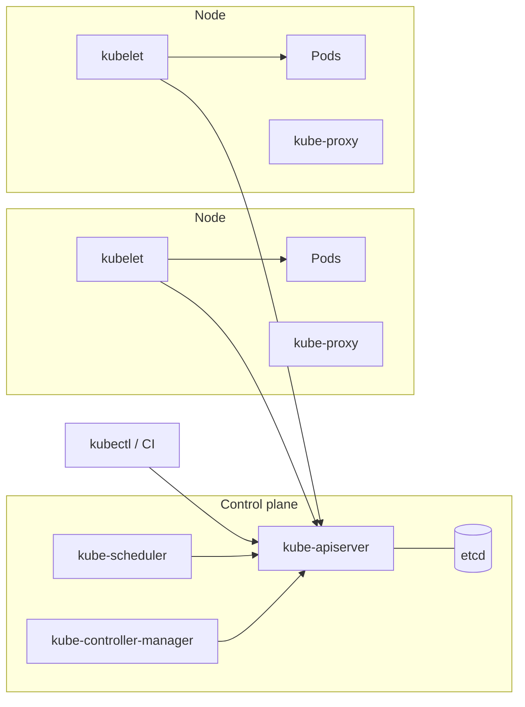

---
tags:
  - contenedores
  - kubernetes
  - aws
  - azure
  - gcp
---

# Kubernetes: pods, deployments, services, Helm y Kustomize

> Arquitectura de Kubernetes, los objetos que más vas a usar, cómo empaquetar manifiestos con Helm o Kustomize y qué ofrecen EKS, AKS y GKE.

## ¿Qué es?

**Kubernetes** (K8s) es un **container orchestrator** (orquestador de contenedores): decide en qué servidor corre cada contenedor, lo reinicia si falla, reparte el tráfico, escala según la carga y hace despliegues graduales. Tú le dices **qué** quieres (por ejemplo, "3 réplicas de la API con esta imagen") en archivos YAML llamados **manifests** (manifiestos), y Kubernetes trabaja continuamente para que la realidad coincida con eso.

Ese ciclo de "comparar lo deseado con lo real y corregir" se llama **reconciliation loop** (bucle de reconciliación) y es la idea central de Kubernetes. Para construir las imágenes, ver [Docker](docker.md).

## Arquitectura



| Componente | Dónde | Qué hace |
| --- | --- | --- |
| **kube-apiserver** | Control plane | Puerta de entrada: todo (kubectl, nodos, controladores) habla con la API |
| **etcd** | Control plane | Base de datos clave-valor con el estado del clúster |
| **kube-scheduler** | Control plane | Elige en qué node se ejecuta cada Pod nuevo |
| **kube-controller-manager** | Control plane | Ejecuta los **controllers** (controladores) que reconcilian Deployments, ReplicaSets, nodos… |
| **kubelet** | Cada node | Agente que arranca los contenedores de los Pods asignados y reporta su estado |
| **kube-proxy** | Cada node | Programa las reglas de red para que los Services funcionen (algunos plugins de red lo sustituyen) |
| **Container runtime** | Cada node | Ejecuta los contenedores (containerd, CRI-O) |

En Kubernetes gestionado (EKS, AKS, GKE) el proveedor opera el **control plane** y tú te ocupas de los **nodes** (o tampoco, en los modos totalmente gestionados).

## Objetos principales

| Objeto | Para qué |
| --- | --- |
| **Pod** | La unidad mínima: uno o varios contenedores que comparten red y volúmenes. Es efímero |
| **ReplicaSet** | Mantiene N copias de un Pod. No se crea a mano: lo gestiona el Deployment |
| **Deployment** | Gestiona ReplicaSets para hacer **rolling updates** (actualizaciones graduales) y *rollbacks* |
| **Service** | Dirección estable (nombre DNS e IP) delante de un grupo de Pods que cambian |
| **Ingress** / **Gateway API** | Entrada HTTP(S) desde fuera del clúster con reglas por dominio y ruta |
| **ConfigMap** / **Secret** | Configuración y datos sensibles separados de la imagen |
| **Namespace** | Separación lógica dentro del clúster (por equipo o entorno) |
| **HorizontalPodAutoscaler** (HPA) | Ajusta el número de réplicas según CPU, memoria u otras métricas |

Otros que aparecen pronto: **StatefulSet** (aplicaciones con identidad y disco propios, como bases de datos), **DaemonSet** (un Pod por node, como agentes de logs), **Job** y **CronJob** (tareas que terminan).

### Deployment con probes y recursos

Lo esencial de un Deployment: cuántas réplicas, qué Pods gestiona (`selector`) y la plantilla de esos Pods, con sus recursos y probes.

```yaml title="deployment.yaml"
apiVersion: apps/v1
kind: Deployment
metadata:
  name: api
  namespace: tienda
spec:
  replicas: 3
  selector:
    matchLabels:
      app: api
  template:
    metadata:
      labels:
        app: api
    spec:
      containers:
        - name: api
          image: registry.ejemplo.com/tienda/api:1.4.2
          resources:
            requests: { cpu: 250m, memory: 256Mi }
            limits: { memory: 512Mi }
          readinessProbe:
            httpGet: { path: /ready, port: 8080 }
          livenessProbe:
            httpGet: { path: /health, port: 8080 }
```

Versión completa (puertos con nombre, `envFrom`, `startupProbe`, `securityContext`, estrategia de rolling update) comentada línea por línea en [Anatomía de los manifiestos de Kubernetes: Deployment](../../recursos/anatomia/kubernetes.md#deployment-comentado-linea-por-linea).

**Probes** (sondas):

| Probe | Pregunta | Si falla |
| --- | --- | --- |
| **readinessProbe** | ¿Puede recibir tráfico ya? | Se saca del Service (no recibe peticiones), no se reinicia |
| **livenessProbe** | ¿Sigue vivo o se colgó? | El kubelet **reinicia** el contenedor |
| **startupProbe** | ¿Terminó de arrancar? | Mientras no pase, las otras probes esperan (útil para apps lentas al iniciar) |

**Requests y limits**:

- **requests**: lo que el Pod tiene reservado. El scheduler lo usa para decidir dónde cabe.
- **limits**: el máximo. Si supera el límite de **memoria**, el contenedor se mata (*OOMKilled*); si supera el de **CPU**, se le frena (*throttling*).

!!! tip "Pon siempre requests"
    Sin requests el scheduler no sabe cuánto ocupa el Pod, el HPA por CPU no funciona y los nodes se pueden saturar. Muchos equipos fijan `limits` de memoria pero no de CPU, para evitar *throttling* innecesario.

### Service

```yaml title="service.yaml"
apiVersion: v1
kind: Service
metadata:
  name: api
  namespace: tienda
spec:
  type: ClusterIP
  selector:
    app: api        # envía tráfico a los Pods con esta etiqueta
  ports:
    - port: 80
      targetPort: 8080
```

| Tipo | Accesible desde | Uso |
| --- | --- | --- |
| **ClusterIP** (por defecto) | Solo dentro del clúster (`api.tienda.svc.cluster.local`) | Comunicación entre servicios |
| **NodePort** | Un puerto (30000–32767) en cada node | Pruebas o integraciones concretas |
| **LoadBalancer** | Internet o la red privada, mediante un load balancer de la nube | Exponer un servicio TCP/UDP directamente |

Service comentado: [Anatomía: Service](../../recursos/anatomia/kubernetes.md#service-comentado-linea-por-linea).

### Ingress y Gateway API

Un **Ingress** define reglas HTTP (dominio, ruta, TLS) y necesita un **Ingress controller** instalado que las aplique. La **Gateway API** es su evolución: separa roles (quien opera la infraestructura define el `Gateway`, cada equipo define sus `HTTPRoute`), es más expresiva (cabeceras, pesos para *canary*) y es la opción que recomienda hoy el proyecto Kubernetes para instalaciones nuevas.

Los manifiestos (`GatewayClass`, `Gateway`, `HTTPRoute` y el `Ingress` clásico con TLS) están comentados en [Anatomía: Gateway y HTTPRoute](../../recursos/anatomia/kubernetes.md#gateway-y-httproute-comentados-linea-por-linea) e [Ingress (clásico)](../../recursos/anatomia/kubernetes.md#ingress-clasico).

!!! warning "Ingress NGINX se retiró"
    El controller comunitario **Ingress NGINX** (`kubernetes/ingress-nginx`) dejó de mantenerse en marzo de 2026, según anunció el proyecto Kubernetes. Las instalaciones existentes siguen funcionando, pero sin parches de seguridad. Para clústeres nuevos, usa Gateway API o el controller del proveedor.

### ConfigMap y Secret

```yaml title="config.yaml"
apiVersion: v1
kind: ConfigMap
metadata:
  name: api-config
  namespace: tienda
data:
  LOG_LEVEL: info
  FEATURE_PAGOS: "true"
```

!!! danger "Un Secret no está cifrado por defecto"
    Los Secrets se guardan en **base64**, que es una codificación, no cifrado. Activa el cifrado de etcd (en los servicios gestionados suele ser una opción con KMS), limita con RBAC quién puede leerlos y no subas Secrets a Git en claro: usa External Secrets Operator, el CSI driver del gestor de secretos de tu nube o Sealed Secrets. Ver [Secretos e identidades](../../devsecops/identidades-y-pipeline/secretos-identidades.md).

ConfigMap y Secret comentados (`data` frente a `stringData`, cómo se consumen): [Anatomía: ConfigMap](../../recursos/anatomia/kubernetes.md#configmap-comentado-linea-por-linea) y [Secret](../../recursos/anatomia/kubernetes.md#secret-comentado-linea-por-linea).

### HorizontalPodAutoscaler

El HPA se define con un objetivo (`scaleTargetRef`, normalmente un Deployment), un rango (`minReplicas`–`maxReplicas`) y una métrica, por ejemplo **70 % de uso de CPU medido sobre los requests**. Por eso necesita que el Deployment tenga `requests` y que el clúster tenga metrics-server. Manifiesto comentado: [Anatomía: HorizontalPodAutoscaler](../../recursos/anatomia/kubernetes.md#horizontalpodautoscaler-comentado-linea-por-linea).

El HPA añade **Pods**; para añadir **nodes** cuando no caben se usa Cluster Autoscaler o Karpenter (o el modo automático del proveedor).

## Helm y Kustomize

Con varios entornos, copiar los YAML y cambiarlos a mano no escala. Hay dos enfoques principales:

**Helm** es el gestor de paquetes de Kubernetes. Un **chart** es un paquete de plantillas (Go templates) con un archivo `values.yaml` de valores por defecto; cada instalación es un **release** con historial de revisiones para hacer `rollback`.

```bash
helm install api ./charts/api -n tienda -f values-prod.yaml
helm upgrade api ./charts/api -n tienda -f values-prod.yaml --set image.tag=1.4.3
```

Un chart completo (`Chart.yaml`, `values.yaml`, plantillas y helpers) comentado: [Anatomía de un chart de Helm](../../recursos/anatomia/helm.md).

**Kustomize** no usa plantillas: parte de YAML válido (**base**) y aplica *patches* (parches) por entorno (**overlays**). Viene integrado en kubectl (`kubectl apply -k`).

```text
k8s/
├── base/
│   ├── deployment.yaml
│   ├── service.yaml
│   └── kustomization.yaml
└── overlays/
    ├── dev/kustomization.yaml
    └── prod/kustomization.yaml
```

```yaml title="k8s/overlays/prod/kustomization.yaml"
apiVersion: kustomize.config.k8s.io/v1beta1
kind: Kustomization
namespace: tienda
resources:
  - ../../base
images:
  - name: registry.ejemplo.com/tienda/api
    newTag: "1.4.2"
patches:
  - target:
      kind: Deployment
      name: api
    patch: |-
      - op: replace
        path: /spec/replicas
        value: 5
```

Todos los campos de `kustomization.yaml` (`labels`, generadores de ConfigMap, tipos de parche): [Anatomía: kustomization.yaml](../../recursos/anatomia/kubernetes.md#kustomizationyaml-comentado-linea-por-linea).

| | Helm | Kustomize |
| --- | --- | --- |
| Enfoque | Plantillas con variables | YAML plano + patches |
| Distribución | Charts en repositorios o registries OCI | Carpetas en Git |
| Historial y rollback | Sí, por release | No propio (lo da Git o la herramienta de GitOps) |
| Curva de aprendizaje | Mayor (sintaxis de plantillas) | Menor |
| Ideal para | Instalar software de terceros (ingress, monitoring) y apps con muchas opciones | Tus propias apps con pocas diferencias entre entornos |

Se combinan a menudo: Helm para componentes de terceros y Kustomize para las apps propias. Las herramientas de **GitOps** (Argo CD, Flux) entienden ambos; ver [Despliegue continuo](../ci-cd/despliegue-continuo.md).

## Kubernetes gestionado

| | AWS | Azure | Google Cloud |
| --- | --- | --- | --- |
| Servicio | **Amazon EKS** | **Azure Kubernetes Service** (AKS) | **Google Kubernetes Engine** (GKE) |
| Modo con nodes gestionados por el proveedor | EKS Auto Mode, AWS Fargate | AKS Automatic | GKE Autopilot |
| Grupos de nodes | Managed node groups, Karpenter | Node pools | Node pools |
| Identidad de los Pods hacia la nube | EKS Pod Identity, IRSA | Microsoft Entra Workload ID | Workload Identity Federation for GKE |
| Registry | Amazon ECR | Azure Container Registry | Artifact Registry |
| Crear un clúster | `eksctl create cluster` | `az aks create` | `gcloud container clusters create-auto` |

Los precios del control plane y los niveles de soporte cambian con frecuencia: revísalos en la página de cada servicio. Más detalle en [Contenedores gestionados](../../cloud/computo/contenedores-gestionados.md).

Comandos frecuentes en las guías de [kubectl](../../recursos/comandos/kubectl.md) y [Helm](../../recursos/comandos/helm.md).

## Relación con otras secciones

| Enfoque | Qué se mira desde ahí | Nota |
| --- | --- | --- |
| Cloud (el control) | EKS, AKS y GKE, registries, redes del clúster | [Contenedores gestionados](../../cloud/computo/contenedores-gestionados.md), [Redes en la nube](../../cloud/redes-y-datos/redes.md) |
| DevOps (la automatización) | Imágenes, despliegues graduales y GitOps, métricas del clúster | [Docker](docker.md), [Despliegue continuo](../ci-cd/despliegue-continuo.md), [Observabilidad](../operacion/observabilidad.md) |
| DevSecOps (la verificación) | RBAC, Pod Security Standards, network policies, admission control | [Seguridad de Kubernetes](../../devsecops/infraestructura-y-contenedores/seguridad-kubernetes.md), [Seguridad de contenedores](../../devsecops/infraestructura-y-contenedores/seguridad-contenedores.md) |
| Laboratorios (la práctica) | Practicar esto paso a paso | [Lab 00 (parte 1): Herramientas locales](../../laboratorios/fundamentos/preparar-entorno.md), [Lab 02: Plan de direccionamiento IP para una VPC](../../laboratorios/fundamentos/subnetting-plan-ips.md), [Lab 06: Desplegar una app en Kubernetes local con kind](../../laboratorios/devops/kubernetes-local-kind.md), [Lab 14: Endurecer un clúster: Pod Security, NetworkPolicy y Kyverno](../../laboratorios/devsecops/seguridad-kubernetes.md) |

## Referencias

- [Documentación de Kubernetes (español)](https://kubernetes.io/es/docs/home/)
- [Componentes de Kubernetes](https://kubernetes.io/docs/concepts/overview/components/)
- [Probes](https://kubernetes.io/docs/concepts/configuration/liveness-readiness-startup-probes/)
- [Gateway API](https://gateway-api.sigs.k8s.io/)
- [Retiro de Ingress NGINX](https://kubernetes.io/blog/2025/11/11/ingress-nginx-retirement/)
- [Horizontal Pod Autoscaling](https://kubernetes.io/docs/concepts/workloads/autoscaling/horizontal-pod-autoscale/)
- [Helm](https://helm.sh/docs/)
- [Kustomize](https://kubectl.docs.kubernetes.io/references/kustomize/)
- [Amazon EKS](https://docs.aws.amazon.com/eks/latest/userguide/what-is-eks.html)
- [Azure Kubernetes Service](https://learn.microsoft.com/es-es/azure/aks/what-is-aks)
- [Google Kubernetes Engine](https://cloud.google.com/kubernetes-engine/docs/concepts/kubernetes-engine-overview)
