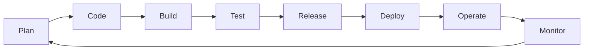

---
tags:
  - devops
  - cultura
  - metricas
  - dora
---

# Cultura DevOps y métricas DORA

> Qué es DevOps de verdad (una forma de trabajar, no un puesto ni una herramienta), el modelo CALMS y cómo medir el desempeño de entrega de software con las métricas DORA.

## ¿Qué es?

**DevOps** es una **cultura** y un conjunto de prácticas que unen a quienes desarrollan software (*Development*) con quienes lo operan (*Operations*) para entregar cambios **más rápido y con menos fallos**. La idea central es que el mismo equipo es responsable del software desde que se escribe hasta que funciona en producción ("*you build it, you run it*").

!!! warning "Lo que DevOps no es"
    - **No es un puesto**: el cargo "DevOps Engineer" existe en el mercado, pero DevOps no se "contrata". Si un equipo de desarrollo le pasa el código a una sola persona "de DevOps" para que lo despliegue, se recrea el mismo muro de antes con otro nombre.
    - **No es una herramienta**: usar Jenkins, Kubernetes o Terraform no te hace DevOps. Las herramientas apoyan las prácticas; sin cambio de cultura solo automatizas el desorden.
    - **No es solo velocidad**: el objetivo es velocidad **y** estabilidad a la vez. La investigación de DORA muestra que los mejores equipos mejoran ambas.

### El problema que resuelve

Tradicionalmente, desarrollo quería cambiar cosas rápido y operaciones quería estabilidad. El resultado eran **silos** (equipos aislados), entregas grandes y poco frecuentes, despliegues manuales de fin de semana y culpas cruzadas cuando algo fallaba. DevOps ataca ese problema con:

- Lotes de cambio **pequeños y frecuentes** (menos riesgo por cambio).
- **Automatización** de lo repetitivo: build, tests, despliegue, infraestructura.
- **Feedback** rápido: saber en minutos si un cambio rompió algo.
- Responsabilidad compartida y **postmortems sin culpa** (*blameless postmortems*).

El ciclo de arriba (el famoso "infinito" de DevOps) resume el flujo: cada etapa entrega información a la siguiente, y lo que se observa en producción vuelve a la planificación.

## CALMS

**CALMS** es un modelo para evaluar si una organización está adoptando DevOps de verdad. Empezó como **CAMS** (propuesto por Damon Edwards y John Willis) y Jez Humble le añadió la L de *Lean*.

| Letra | Pilar | Qué significa en la práctica |
| --- | --- | --- |
| **C** | **Culture** (cultura) | Colaboración entre equipos, confianza, aprender de los errores sin buscar culpables |
| **A** | **Automation** (automatización) | CI/CD, *Infrastructure as Code*, tests automáticos, entornos reproducibles |
| **L** | **Lean** (eficiencia, eliminar desperdicio) | Lotes pequeños, limitar el trabajo en curso (WIP), reducir esperas y traspasos |
| **M** | **Measurement** (medición) | Medir el flujo y la estabilidad (métricas DORA, SLOs) para decidir con datos |
| **S** | **Sharing** (compartir) | Compartir conocimiento, herramientas, *runbooks* y aprendizajes de incidentes |

!!! tip "La C va primero por algo"
    Si tienes que priorizar, la cultura pesa más que la herramienta. Un pipeline perfecto no sirve si nadie se atreve a desplegar un viernes porque "siempre se rompe algo" y nadie investiga por qué.

## DevOps y agile

**Agile** (desarrollo ágil) organiza **cómo se planifica y construye** el software en ciclos cortos; DevOps extiende esa idea **hasta producción** (cómo se integra, despliega y opera). Se complementan:

- **Scrum**: trabajo en **sprints** (iteraciones de 1 a 4 semanas) con roles definidos (*Product Owner*, *Scrum Master*, equipo) y ceremonias (*planning*, *daily*, *review*, *retrospective*).
- **Kanban**: flujo continuo sin iteraciones fijas; el trabajo se ve en un tablero y se **limita el WIP** (*work in progress*, trabajo en curso) para que las tareas terminen en vez de acumularse.

Muchos equipos de plataforma y operación prefieren Kanban, porque el trabajo llega sin aviso (incidentes, peticiones) y no encaja bien en sprints cerrados.

## Métricas DORA

**DORA** (*DevOps Research and Assessment*) es un programa de investigación, hoy parte de Google Cloud, que publica cada año el informe **Accelerate State of DevOps**. De esa investigación salen las **métricas DORA**: un conjunto pequeño de indicadores que predicen el desempeño de entrega de software.

### Las cuatro clásicas (*four keys*)

| Métrica | Pregunta que responde | Tipo |
| --- | --- | --- |
| **Deployment frequency** (frecuencia de despliegue) | ¿Cada cuánto desplegamos a producción? | Throughput (rendimiento, velocidad) |
| **Lead time for changes** (tiempo de entrega de cambios; DORA hoy lo llama *change lead time*) | ¿Cuánto tarda un cambio desde el commit hasta estar en producción? | Throughput |
| **Change failure rate** (tasa de fallos por cambio) | ¿Qué porcentaje de despliegues requiere intervención inmediata (rollback, hotfix)? | Instability (inestabilidad) |
| **Failed deployment recovery time** (tiempo de recuperación de un despliegue fallido) | ¿Cuánto tardamos en recuperarnos de un despliegue que falló? | Throughput |

!!! info "De MTTR a failed deployment recovery time"
    La cuarta métrica se llamaba **MTTR** (*Mean Time To Restore*, tiempo medio de restauración) o *time to restore service*. En el informe de **2023** DORA la renombró y redefinió como **failed deployment recovery time**, porque la definición anterior mezclaba fallos causados por un cambio con fallos externos (por ejemplo, una caída del proveedor). La nueva solo mide la recuperación de fallos **provocados por un despliegue**. Vas a ver ambos nombres en artículos y herramientas.

### La quinta: rework rate

En el informe de **2024** DORA añadió una quinta métrica, **deployment rework rate** (tasa de retrabajo de despliegues): la proporción de despliegues **no planificados** que se hacen para corregir un incidente en producción. Junto con el *change failure rate* forma el grupo de **instability**.

| Grupo | Métricas |
| --- | --- |
| **Throughput** | Change lead time, deployment frequency, failed deployment recovery time |
| **Instability** | Change failure rate, deployment rework rate |

!!! note "Velocidad y estabilidad no se oponen"
    Un hallazgo repetido de DORA es que los equipos con mejor *throughput* suelen tener también **menos** inestabilidad. Desplegar seguido obliga a hacer cambios pequeños, y los cambios pequeños fallan menos y se arreglan antes.

## Cómo medirlas en la práctica

No necesitas una herramienta cara para empezar. Los datos ya están en tu control de versiones, tu CI/CD y tu gestión de incidentes:

| Métrica | De dónde sale el dato |
| --- | --- |
| Deployment frequency | Ejecuciones exitosas del job de *deploy* a producción (GitHub Actions, GitLab, Argo CD…) |
| Change lead time | Fecha del commit (o del merge del PR) vs. fecha del despliegue que lo incluyó |
| Change failure rate | Despliegues seguidos de rollback, hotfix o incidente / total de despliegues |
| Failed deployment recovery time | Hora del despliegue fallido vs. hora en que se restauró el servicio (del sistema de incidentes) |
| Deployment rework rate | Despliegues no planificados (hotfixes) / total de despliegues |

Pasos para empezar:

1. **Define qué es "un despliegue" y qué es "un fallo"** en tu equipo y escríbelo. Sin una definición común los números no se pueden comparar en el tiempo.
2. **Etiqueta los despliegues** con el commit SHA y la hora (por ejemplo, usando *environments* y *deployments* de GitHub o GitLab).
3. **Relaciona incidentes con despliegues**: en el postmortem, anota qué despliegue lo causó.
4. Empieza con una **hoja de cálculo o un dashboard simple**; más adelante puedes usar herramientas como el proyecto open source **Four Keys** de Google (archivado, pero útil como referencia), los *insights* de GitLab (*DORA metrics* en GitLab Ultimate) o plataformas de *engineering intelligence*.
5. Mira **tendencias** (mes a mes), no el valor de un día.

DORA ofrece además un **quick check** en su web para que un equipo compare su desempeño con los resultados del informe.

## Errores comunes

!!! danger "Usarlas para comparar personas o equipos"
    Las métricas DORA miden **el sistema de entrega** (proceso, herramientas, arquitectura), no a las personas. Usarlas para evaluar el desempeño individual o hacer *rankings* entre equipos con contextos distintos destruye la confianza y provoca que la gente "juegue" con los números.

- **Ley de Goodhart**: "cuando una medida se convierte en objetivo, deja de ser una buena medida". Si premias la frecuencia de despliegue, aparecerán despliegues vacíos.
- **Mirar una sola métrica**: subir la frecuencia mientras el *change failure rate* se dispara no es una mejora. Míralas siempre juntas.
- **Medir sin actuar**: las métricas sirven para preguntar "¿qué nos frena?" y elegir una mejora (por ejemplo, tests más rápidos o PRs más pequeños), no para decorar un dashboard.
- **Compararse con la industria sin contexto**: un sistema regulado o embebido no va a desplegar varias veces al día, y no pasa nada. Compárate contigo misma en el tiempo.
- **Olvidar la experiencia de las personas**: DORA también estudia el bienestar (*burnout*) y la cultura; un equipo que mejora las métricas a costa de agotarse no es sostenible.

## Relación con otras secciones

| Enfoque | Qué se mira desde ahí | Nota |
| --- | --- | --- |
| Cloud (el control) | Los pilares de excelencia operativa y fiabilidad; dónde se miden los incidentes | [Well-Architected Framework](../../cloud/fundamentos/well-architected.md), [Observabilidad nativa](../../monitoreo/nube/observabilidad-nativa.md) |
| DevOps (la automatización) | De dónde salen los datos de deployment frequency y lead time; cómo se recupera un fallo | [Integración continua](../ci-cd/integracion-continua.md), [Despliegue continuo](../ci-cd/despliegue-continuo.md), [Operación y fiabilidad (SRE)](../operacion/operacion-sre.md) |
| DevSecOps (la verificación) | Integrar la seguridad sin frenar el flujo (*shift-left*) | [Fundamentos DevSecOps](../../devsecops/fundamentos-devsecops.md) |
| Negocio TI (el porqué) | Cómo se convierten las métricas en KPIs y OKRs y cómo presentarlas a negocio | [Métricas, KPIs y OKRs](../../negocio/metricas-kpis-okrs.md) |
| Laboratorios (la práctica) | Practicar esto paso a paso | [Lab 04: Flujo Git con ramas, pull requests y code review](../../laboratorios/devops/git-flujo-pull-request.md), [Lab 07: Pipeline de CI con GitHub Actions](../../laboratorios/devops/github-actions-ci.md) |

## Referencias

- [DORA: métricas de entrega de software](https://dora.dev/guides/dora-metrics/)
- [DORA: historia de las métricas (MTTR, rework rate)](https://dora.dev/guides/dora-metrics/history/)
- [DORA Quick Check](https://dora.dev/quickcheck/)
- [Informes Accelerate State of DevOps](https://dora.dev/research/)
- [¿Qué es DevOps? (AWS)](https://aws.amazon.com/es/devops/what-is-devops/)
- [¿Qué es DevOps? (Microsoft)](https://learn.microsoft.com/es-es/devops/what-is-devops)
- [The Scrum Guide](https://scrumguides.org/)
