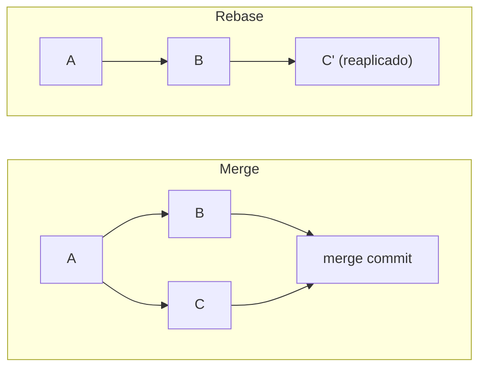
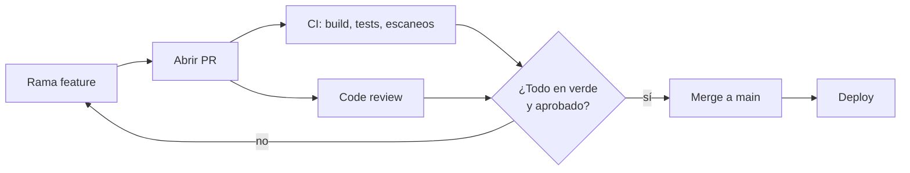

---
tags:
  - devops
  - git
  - ci-cd
---

# Git y control de versiones

> Los conceptos de Git que importan en DevOps, cómo elegir una estrategia de ramas (trunk-based, GitFlow, GitHub Flow) y cómo trabajar con pull requests, code review, Conventional Commits y versionado semántico.

## ¿Qué es?

El **version control** (control de versiones) guarda el historial de cambios de un proyecto: quién cambió qué, cuándo y por qué. **Git** es el sistema estándar, y en DevOps es mucho más que un lugar donde guardar código: es la **fuente de verdad** de la aplicación, la infraestructura (IaC), la configuración y hasta el estado deseado de los clústeres (GitOps).

Todo pipeline de CI/CD empieza con un evento de Git: un *push*, un *pull request* o un *tag*.

!!! note "Comandos"
    Esta nota explica conceptos y flujos. La guía de comandos está en [Git](../../recursos/comandos/git.md).

## Conceptos clave

| Concepto | Qué es |
| --- | --- |
| **Repository** (repositorio) | El proyecto con todo su historial |
| **Commit** | Una "foto" del proyecto con un mensaje, autor y un identificador único (el **SHA**). Es inmutable |
| **Branch** (rama) | Un puntero móvil a un commit; permite trabajar en paralelo sin tocar la rama principal |
| **HEAD** | El commit (o rama) en el que estás ahora |
| **Remote** (remoto) | Copia del repositorio en un servidor (GitHub, GitLab, Bitbucket, Azure Repos). Por convención se llama `origin` |
| **Tag** (etiqueta) | Nombre fijo para un commit concreto, normalmente una versión (`v1.4.0`) |
| **Merge** (fusión) | Integrar los cambios de una rama en otra |
| **Rebase** | Reaplicar tus commits encima de otra base, como si hubieras empezado desde ahí |

### Merge vs rebase



| | Merge | Rebase |
| --- | --- | --- |
| Historial | Conserva cómo ocurrió (ramas visibles, commit de merge) | Lineal y limpio |
| Reescribe commits | No | Sí (los commits reaplicados tienen SHA nuevo) |
| Riesgo | Bajo | Conflictos al reescribir algo que otros ya descargaron |
| Uso típico | Integrar un PR en `main` | Actualizar tu rama local con `main` antes de abrir o actualizar el PR |

!!! danger "Regla de oro del rebase"
    No hagas rebase (ni `push --force`) sobre una rama **compartida** que otras personas ya descargaron, y nunca sobre `main`. Si necesitas forzar en tu propia rama, usa `git push --force-with-lease`, que se niega a sobrescribir cambios ajenos.

Comandos de merge, rebase y reescritura de historial (`rebase -i`, `cherry-pick`, `--autosquash`) en la guía de comandos: [Ramas y navegación](../../recursos/comandos/git.md#4-ramas-y-navegacion) y [Reescritura de historial](../../recursos/comandos/git.md#8-reescritura-de-historial). Para deshacer cambios (`revert` frente a `reset`, rollback de una release): [Volver atrás y rollback](../../recursos/comandos/git.md#7-volver-atras-y-rollback).

En la interfaz de GitHub o GitLab al aceptar un PR puedes elegir **merge commit**, **squash merge** (todos los commits del PR se aplastan en uno) o **rebase merge**. Muchos equipos usan *squash* para que cada PR sea un solo commit en `main`.

## Estrategias de branching

Una **branching strategy** (estrategia de ramas) define qué ramas existen, cuánto viven y cómo llegan los cambios a producción.

=== "Trunk-based development"

    Todo el mundo integra en una sola rama principal (**trunk**, normalmente `main`) al menos una vez al día. Las ramas, si existen, viven horas o un par de días. Lo que no está terminado se esconde con **feature flags** (ver [Despliegue continuo](../ci-cd/despliegue-continuo.md)). `main` está siempre lista para desplegar.

=== "GitHub Flow"

    Una rama `main` siempre desplegable. Para cada cambio: creas una rama, abres un **pull request**, pasa CI y revisión, haces merge y despliegas. Es *trunk-based* con ramas cortas y PR obligatorio; es lo que usa la mayoría de equipos en GitHub o GitLab.

=== "GitFlow"

    Dos ramas permanentes (`main` con lo publicado y `develop` con lo integrado) más ramas de apoyo: `feature/*`, `release/*` y `hotfix/*`. Pensado para software con **versiones planificadas** y varias versiones mantenidas a la vez. Su propio autor (Vincent Driessen) añadió en 2020 una nota recomendando un flujo más simple, como GitHub Flow, para software que se entrega de forma continua.

| | Trunk-based | GitHub Flow | GitFlow |
| --- | --- | --- | --- |
| Ramas de larga vida | Solo `main` | Solo `main` | `main` y `develop` |
| Vida de una rama de trabajo | Horas, máximo 1–2 días | Días | Días o semanas |
| Frecuencia de despliegue | Muy alta (varias al día) | Alta | Baja, por *releases* |
| Conflictos de merge | Pocos y pequeños | Pocos | Frecuentes y grandes |
| Requisitos | CI muy sólido, buenos tests, feature flags | CI y revisión de PR | Disciplina con muchas ramas |
| Encaja con | CI/CD, servicios web, equipos con experiencia | La mayoría de proyectos web y de infraestructura | Apps móviles, software instalable, librerías con varias versiones soportadas |

!!! tip "Cuál elegir"
    Para un servicio que se despliega en la nube, empieza con **GitHub Flow** y avanza hacia **trunk-based** a medida que mejoren tus tests. DORA asocia el trunk-based development con mejor desempeño de entrega (ver [Cultura DevOps y métricas DORA](cultura-metricas-dora.md)). Usa **GitFlow** solo si de verdad mantienes varias versiones publicadas a la vez.

## Pull requests y merge requests

Un **pull request** (PR, en GitHub, Bitbucket y Azure Repos) o **merge request** (MR, en GitLab) es una propuesta para integrar una rama en otra. Es el punto donde se juntan:

- La **revisión** de otra persona (*code review*).
- Los **checks** automáticos del pipeline: build, tests, lint y escaneos de seguridad.
- La **discusión** y el registro de por qué se hizo el cambio.



Las **branch protection rules** (reglas de protección de rama; en GitHub también *rulesets*) hacen obligatorio este flujo en `main`: exigir PR, aprobaciones mínimas, checks en verde y prohibir `push --force`. Se tratan en [Seguridad del pipeline](../../devsecops/identidades-y-pipeline/seguridad-pipeline.md).

## Code review

### Qué revisar

- **Corrección**: ¿hace lo que dice el PR? ¿Hay casos borde sin cubrir?
- **Tests**: ¿hay tests para el cambio y prueban algo útil?
- **Diseño y legibilidad**: ¿se entiende sin que el autor lo explique? ¿Nombres claros?
- **Seguridad**: secretos en el código, entradas sin validar, permisos excesivos (por ejemplo `"Action": "*"` en una política IAM de Terraform).
- **Operación**: ¿logs y métricas suficientes? ¿Cómo se hace rollback? ¿Cambia algo de infraestructura o de costos?

Lo que puede verificar una máquina (formato, estilo, *linters*, escaneos) déjalo al pipeline y a los **pre-commit hooks**; la revisión humana es para lo que requiere criterio.

### Tamaño del PR

Los PRs **pequeños** se revisan mejor y más rápido, fallan menos y son fáciles de revertir. Como referencia práctica, apunta a **unos pocos cientos de líneas como máximo** y a un solo propósito por PR. Si un cambio es grande, pártelo (por ejemplo: primero la refactorización, luego la funcionalidad detrás de un *feature flag*).

### CODEOWNERS

El archivo **`CODEOWNERS`** asigna responsables por ruta. Con la protección de rama adecuada, un PR que toca esas rutas necesita la aprobación de sus dueños. Existe en GitHub, GitLab (*Code Owners*) y Bitbucket.

```text title=".github/CODEOWNERS"
# La última regla que coincide gana
*                     @mi-org/desarrollo
/infra/               @mi-org/plataforma
/.github/workflows/   @mi-org/plataforma @mi-org/seguridad
```

## Conventional Commits

**Conventional Commits** es una convención para escribir mensajes de commit con estructura, de forma que herramientas puedan generar *changelogs* y calcular la siguiente versión automáticamente.

```text
<tipo>[ámbito opcional][!]: <descripción>

[cuerpo opcional]

[footer opcional]
```

| Tipo | Uso | Efecto en la versión |
| --- | --- | --- |
| `feat` | Nueva funcionalidad | Sube MINOR |
| `fix` | Corrección de un error | Sube PATCH |
| `docs`, `chore`, `ci`, `refactor`, `test`, `build`, `perf`, `style` | Otros cambios (convención común, no obligatoria) | Ninguno por sí solos |
| `!` tras el tipo o footer `BREAKING CHANGE:` | Cambio incompatible | Sube MAJOR |

```text
feat(api): añadir endpoint de exportación a CSV
fix: corregir timeout en el health check
ci: fijar actions de terceros por SHA
feat!: eliminar soporte para la API v1
```

Se puede validar con un hook `commit-msg` (ver [Hooks útiles en DevOps](../../recursos/comandos/git.md#15-hooks-utiles-en-devops); por ejemplo con **commitlint**) y automatizar las versiones con herramientas como **semantic-release** o **release-please**.

## Tags y versionado semántico

**Semantic Versioning** (SemVer, versionado semántico) usa el formato **`MAJOR.MINOR.PATCH`**:

| Parte | Cuándo sube | Ejemplo |
| --- | --- | --- |
| **MAJOR** | Cambios incompatibles con la versión anterior | `1.4.2 → 2.0.0` |
| **MINOR** | Funcionalidad nueva compatible | `1.4.2 → 1.5.0` |
| **PATCH** | Correcciones compatibles | `1.4.2 → 1.4.3` |

Además admite **pre-releases** (`2.0.0-rc.1`) y metadatos de build (`1.4.2+abc1234`). Mientras la versión empiece con `0.` se considera desarrollo inicial y la API puede cambiar en cualquier momento.

En Git, cada versión publicada se marca con un **tag anotado** (`git tag -a v1.5.0 -m "..."`), y ese tag suele disparar el pipeline de *release*: construir el artefacto, etiquetar la imagen con `1.5.0` y publicar las notas de versión. Ver [Integración continua](../ci-cd/integracion-continua.md); comandos de tags en [Tags y releases](../../recursos/comandos/git.md#9-tags-y-releases-versionado-para-cicd).

!!! tip "Versiones inmutables"
    Nunca muevas ni reutilices un tag publicado. Si `v1.5.0` tenía un error, publica `v1.5.1`. Lo mismo aplica a las imágenes de contenedor y los paquetes.

## Relación con otras secciones

| Enfoque | Qué se mira desde ahí | Nota |
| --- | --- | --- |
| Cloud (el control) | Quién puede cambiar la infraestructura: los cambios llegan por PR y no desde la consola | [Gobernanza](../../cloud/operacion-y-gobierno/gobernanza.md) |
| DevOps (la automatización) | El PR y el tag como disparadores del pipeline; Git como fuente de verdad en GitOps | [Integración continua](../ci-cd/integracion-continua.md), [Despliegue continuo](../ci-cd/despliegue-continuo.md), [Infrastructure as Code](../iac/infraestructura-como-codigo.md) |
| DevSecOps (la verificación) | Branch protection, commits firmados, aprobaciones obligatorias; pre-commit hooks y detección de secretos antes del commit | [Seguridad del pipeline](../../devsecops/identidades-y-pipeline/seguridad-pipeline.md), [Seguridad del código](../../devsecops/codigo-y-dependencias/seguridad-codigo.md) |
| Laboratorios (la práctica) | Practicar esto paso a paso | [Lab 00: Preparar el entorno de laboratorio](../../laboratorios/fundamentos/preparar-entorno.md), [Lab 04: Flujo Git con ramas, pull requests y code review](../../laboratorios/devops/git-flujo-pull-request.md), [Lab 07: Pipeline de CI con GitHub Actions](../../laboratorios/devops/github-actions-ci.md) |

## Referencias

- [Pro Git (libro oficial, en español)](https://git-scm.com/book/es/v2)
- [Trunk Based Development](https://trunkbaseddevelopment.com/)
- [GitHub Flow](https://docs.github.com/es/get-started/using-github/github-flow)
- [A successful Git branching model (GitFlow)](https://nvie.com/posts/a-successful-git-branching-model/)
- [DORA: trunk-based development](https://dora.dev/capabilities/trunk-based-development/)
- [Acerca de los propietarios de código (CODEOWNERS)](https://docs.github.com/es/repositories/managing-your-repositorys-settings-and-features/customizing-your-repository/about-code-owners)
- [Conventional Commits 1.0.0 (en español)](https://www.conventionalcommits.org/es/v1.0.0/)
- [Versionado semántico 2.0.0 (en español)](https://semver.org/lang/es/)
