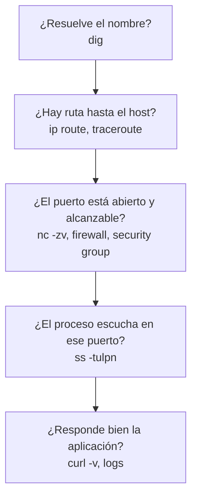

---
tags:
  - devops
  - linux
  - redes
  - scripting
  - bash
---

# Linux, redes y scripting

> Nota puente: qué necesita un perfil DevOps de Bash, Python, systemd, SSH, DNS, HTTP y el diagnóstico de red, con lo esencial de cada tema y enlaces a las notas que lo explican a fondo.

## ¿Qué es?

Casi todo en la nube termina corriendo sobre **Linux**: VMs, nodos de Kubernetes, contenedores, *runners* de CI. Y casi todo problema en producción termina siendo **de red** (DNS que no resuelve, un puerto cerrado, un certificado vencido). Cada tema tiene su nota propia; aquí está el mínimo que usas a diario y a dónde ir para profundizar.

| Tema | Qué necesitas en DevOps | Nota a fondo |
| --- | --- | --- |
| Bash | Scripts de pipeline y de mantenimiento que fallen bien | [Shell / Bash](../../recursos/sintaxis/shell.md) |
| Python | Automatización con lógica, APIs y SDKs de nube | [Python](../../python/index.md), [Automatización cloud con SDKs](../../python/scripting/automatizacion-cloud.md) |
| systemd | Levantar un servicio y leer sus logs | [Linux Server: servicios con systemd](../../servidores/linux/linux-fundamentos-servidor.md#servicios-con-systemd) |
| SSH | Entrar a servidores, saltar por un bastion, hacer túneles | [Redes en Linux Server: SSH](../../servidores/linux/linux-redes-servidor.md#ssh-del-lado-servidor) |
| DNS | Saber qué registro tocar y comprobar qué responde | [Servicios de red: DNS en profundidad](../../networking/intermedio/servicios-red.md#dns-en-profundidad) |
| HTTP | Leer códigos de estado y probar endpoints con `curl` | [Protocolos de aplicación](../../networking/intermedio/protocolos-aplicacion.md#http) |
| Red | Diagnosticar un "no conecta" capa por capa | [Troubleshooting de red](../../networking/avanzado/troubleshooting-red.md) |

!!! note "Guías de comandos y de sintaxis"
    Tablas de comandos en [Linux](../../recursos/comandos/linux.md), [Shell / Bash](../../recursos/sintaxis/shell.md) y [Puertos comunes](../../recursos/puertos.md).

## Bash

**Bash** es el *shell* (intérprete de comandos) por defecto en la mayoría de distribuciones y en los runners de CI. Sirve para **pegar comandos**: automatizar pasos que harías a mano en la terminal.

Lo mínimo para que un script no haga daño en silencio:

- Empieza con `#!/usr/bin/env bash` y `set -euo pipefail` (cortar ante errores, variables sin definir y fallos en tuberías).
- Valida argumentos (`"${1:?Uso: $0 <dir>}"`), escribe los logs en *stderr* (`>&2`) y limpia temporales con `trap ... EXIT`.
- Pon **siempre comillas** en las variables (`"$VAR"`) y pásale **ShellCheck** en CI.

Script de ejemplo completo (backup con reintentos y limpieza): [Shell / Bash: ejemplo de referencia](../../recursos/sintaxis/shell.md#12-ejemplo-de-referencia).

### Exit codes (códigos de salida)

Todo comando devuelve un número al terminar: **`0` = éxito**, cualquier otro valor = error. Los pipelines de CI usan exactamente esto para decidir si un paso pasó o falló.

```bash
grep -q "ERROR" app.log
echo $?          # 0 si encontró "ERROR", 1 si no, 2 si hubo un error (p. ej. no existe el archivo)

comando_a && comando_b   # b solo se ejecuta si a tuvo éxito
comando_a || exit 1      # si a falla, sal con error
```

## Python para automatización

Bash es ideal para encadenar comandos, pero se vuelve frágil cuando hay lógica. Pasa a **Python** cuando trabajas con JSON/YAML o APIs, el script supera ~50–100 líneas o necesitas manejo de errores fino y tests (comparación completa en [¿Python o Bash?](../../python/scripting/sistema-procesos.md#python-o-bash)).

Para hablar con la nube se usa el **SDK** de cada proveedor: **boto3** (AWS), **azure-sdk-for-python** (Azure), **google-cloud-python** (Google Cloud). Toman las credenciales de la cadena estándar del proveedor (sesión de la CLI, rol de la VM o del pipeline): nunca las escribas en el código. Ejemplos en las tres nubes en [Automatización cloud con SDKs](../../python/scripting/automatizacion-cloud.md).

## systemd

**systemd** es el sistema de inicio y gestor de servicios de casi todas las distribuciones modernas. Arranca procesos, los reinicia si fallan y centraliza sus logs en el **journal**.

- Una **unit** (unidad) describe algo que systemd gestiona: `.service` (un proceso), `.timer` (tarea programada, alternativa a cron), `.socket`, `.mount`.
- **`systemctl`** controla las units y **`journalctl`** lee sus logs:

```bash
sudo systemctl daemon-reload          # recargar tras crear o editar la unit
sudo systemctl enable --now miapp     # habilitar al arranque e iniciar ya
systemctl status miapp
journalctl -u miapp -f                # seguir los logs en vivo
```

!!! tip "Usuario dedicado"
    Ejecuta cada servicio con un **usuario propio sin privilegios** (`User=miapp`), nunca como `root`. systemd también ofrece opciones de *hardening* como `NoNewPrivileges=yes` o `ProtectSystem=strict`.

Unit file comentado, drop-ins y journald: [Linux Server: fundamentos de administración](../../servidores/linux/linux-fundamentos-servidor.md#servicios-con-systemd). Timers: [systemd timers](../../servidores/linux/linux-procesos-rendimiento.md#systemd-timers).

## SSH

**SSH** (*Secure Shell*) es la forma estándar de conectarse a servidores Linux. Usa **llaves** (*key pairs*, par de claves) en vez de contraseñas: la **privada** se queda en tu equipo y la **pública** va en `~/.ssh/authorized_keys` del servidor.

```bash
ssh-keygen -t ed25519 -C "dani@laptop"    # generar llaves (ed25519 es el tipo recomendado hoy)
ssh-copy-id usuario@servidor              # copiar la pública al servidor
eval "$(ssh-agent -s)" && ssh-add         # cargar la llave en el agente (no repites la passphrase)
ssh -J bastion usuario@10.0.2.15          # saltar por un bastion (servidor de salto)
ssh -L 5433:db.interna:5432 bastion       # túnel: localhost:5433 -> base de datos privada
```

`~/.ssh/config` con `ProxyJump`, túneles, `scp`/`rsync` y permisos del lado servidor: [Redes en Linux Server: SSH del lado servidor](../../servidores/linux/linux-redes-servidor.md#ssh-del-lado-servidor). El protocolo por dentro: [Protocolos de aplicación: SSH](../../networking/intermedio/protocolos-aplicacion.md#ssh).

!!! info "En la nube, mejor sin puertos abiertos"
    Los tres proveedores ofrecen acceso sin exponer el puerto 22 a internet: **Session Manager** (AWS), **Azure Bastion** y **IAP TCP forwarding** (Google Cloud). Ver [Máquinas virtuales](../../cloud/computo/maquinas-virtuales.md).

## DNS

**DNS** (*Domain Name System*) traduce nombres (`api.ejemplo.com`) a direcciones IP. Los registros que más vas a tocar:

| Registro | Para qué sirve | Ejemplo |
| --- | --- | --- |
| **A** | Nombre → dirección IPv4 | `api.ejemplo.com → 203.0.113.10` |
| **AAAA** | Nombre → dirección IPv6 | `api.ejemplo.com → 2001:db8::10` |
| **CNAME** | Alias de otro nombre (no se puede usar en el dominio raíz) | `www.ejemplo.com → ejemplo.github.io` |
| **MX** | Servidores de correo del dominio, con prioridad | `10 mail.ejemplo.com` |
| **TXT** | Texto libre: verificación de dominio, SPF, DKIM, DMARC | `"v=spf1 include:_spf.google.com ~all"` |
| **NS** | Servidores autoritativos de la zona | `ns1.proveedor-dns.com` |

El **TTL** (*time to live*) indica cuántos segundos se puede guardar en caché una respuesta: bájalo con tiempo antes de una migración.

```bash
dig api.ejemplo.com AAAA +short  # solo la respuesta
dig @8.8.8.8 api.ejemplo.com     # preguntar a un resolver concreto
dig +trace api.ejemplo.com       # seguir la resolución desde la raíz
```

Jerarquía, resolución paso a paso, otros registros (SOA, PTR, SRV, CAA), TTL y cómo leer `dig`: [Servicios de red: DNS en profundidad](../../networking/intermedio/servicios-red.md#dns-en-profundidad).

## HTTP

**HTTP** es el protocolo de casi todas las APIs y aplicaciones web (con **HTTPS** cuando va cifrado con TLS).

| Método | Uso |
| --- | --- |
| `GET` | Leer un recurso |
| `POST` | Crear un recurso o ejecutar una acción |
| `PUT` / `PATCH` | Reemplazar / modificar parcialmente un recurso |
| `DELETE` | Borrar un recurso |

| Código | Significado | Pista típica |
| --- | --- | --- |
| `2xx` (200, 201, 204) | Éxito | — |
| `3xx` (301, 302, 304) | Redirección | Revisa el header `Location` |
| `400` | Petición mal formada | Revisa el cuerpo o los parámetros |
| `401` / `403` | No autenticado / sin permiso | Token, credenciales, IAM |
| `404` | No existe | Ruta, *host* o *ingress* mal configurado |
| `429` | Demasiadas peticiones | *Rate limiting* |
| `500` | Error interno de la aplicación | Logs de la app |
| `502` / `503` / `504` | Error en el *proxy* o *load balancer*: backend caído, sin capacidad o lento | *Health checks*, *timeouts* |

```bash
curl -i https://api.ejemplo.com/health                  # respuesta con headers
curl -sS -o /dev/null -w "%{http_code} %{time_total}s\n" https://api.ejemplo.com/health
curl -X POST -H "Content-Type: application/json" -d '{"nombre":"dani"}' https://api.ejemplo.com/usuarios
curl -v --resolve api.ejemplo.com:443:10.0.1.20 https://api.ejemplo.com/   # probar contra una IP concreta
```

Petición y respuesta por dentro, versiones, semántica de los métodos, headers y TLS: [Protocolos de aplicación](../../networking/intermedio/protocolos-aplicacion.md#http).

## Puertos y troubleshooting de red

Ante un "no conecta", recorre las capas en orden:



- `ss -tulpn`: `127.0.0.1:8000` solo acepta conexiones locales; `0.0.0.0:8000`, de cualquier interfaz.
- `ping` fallido no prueba nada: muchas nubes bloquean ICMP por defecto.

Herramientas y cómo leer su salida: [Troubleshooting de red](../../networking/avanzado/troubleshooting-red.md#herramientas); `ss` en un servidor: [Puertos y sockets con ss](../../servidores/linux/linux-redes-servidor.md#puertos-y-sockets-con-ss); puertos bien conocidos: [Puertos comunes](../../recursos/puertos.md).

!!! warning "En la nube, el firewall está fuera de la VM"
    Si `ss` muestra que el proceso escucha pero desde fuera no conecta, revisa el **security group / NSG / VPC firewall rule**, las tablas de rutas de la subred y los *network ACLs*, además del firewall del sistema operativo. Ver [Redes en la nube](../../cloud/redes-y-datos/redes.md).

## Relación con otras secciones

| Enfoque | Qué se mira desde ahí | Nota |
| --- | --- | --- |
| Networking (la base) | DNS, DHCP y NTP en profundidad; HTTP, TLS y SSH por dentro; metodología y casos de troubleshooting de red | [Servicios de red](../../networking/intermedio/servicios-red.md), [Protocolos de aplicación](../../networking/intermedio/protocolos-aplicacion.md), [Troubleshooting de red](../../networking/avanzado/troubleshooting-red.md) |
| Servidores (la administración) | systemd, journald, SSH del lado servidor, red y rendimiento del host | [Linux Server: fundamentos](../../servidores/linux/linux-fundamentos-servidor.md), [Redes en Linux Server](../../servidores/linux/linux-redes-servidor.md), [Procesos y rendimiento](../../servidores/linux/linux-procesos-rendimiento.md) |
| Cloud (el control) | VPC, subredes, rutas, security groups, DNS gestionado y load balancers sobre los que aplicas todo esto | [Redes en la nube](../../cloud/redes-y-datos/redes.md), [Máquinas virtuales](../../cloud/computo/maquinas-virtuales.md) |
| DevOps (la automatización) | Scripts que se convierten en pasos de pipeline o en configuración gestionada | [Integración continua](../ci-cd/integracion-continua.md), [Ansible](../iac/ansible.md), [Observabilidad](../operacion/observabilidad.md) |
| DevSecOps (la verificación) | Hardening del host, acceso sin llaves expuestas, puertos abiertos a `0.0.0.0/0` | [Secretos e identidades](../../devsecops/identidades-y-pipeline/secretos-identidades.md), [Cumplimiento y gobierno](../../devsecops/gobierno-y-respuesta/cumplimiento.md) |
| Laboratorios (la práctica) | Practicar esto paso a paso | [Lab 00: Preparar el entorno de laboratorio](../../laboratorios/fundamentos/preparar-entorno.md), [Lab 01: Diagnóstico de red desde Linux](../../laboratorios/fundamentos/linux-red-diagnostico.md), [Lab 10: Configurar servidores con Ansible](../../laboratorios/devops/ansible-configuracion.md), [Lab 22: Endurecer un servidor Linux con Ansible y medirlo con Lynis y OpenSCAP](../../laboratorios/devsecops/hardening-linux-ansible.md) |

## Referencias

- [GNU Bash Reference Manual](https://www.gnu.org/software/bash/manual/bash.html)
- [ShellCheck](https://www.shellcheck.net/)
- [Boto3 documentation](https://boto3.amazonaws.com/v1/documentation/api/latest/index.html)
- [systemd.service (man page)](https://www.freedesktop.org/software/systemd/man/latest/systemd.service.html)
- [OpenSSH manual pages](https://www.openssh.com/manual.html)
- [MDN: códigos de estado de respuesta HTTP](https://developer.mozilla.org/es/docs/Web/HTTP/Status)
- [MDN: métodos de petición HTTP](https://developer.mozilla.org/es/docs/Web/HTTP/Methods)
- [Cloudflare: ¿Qué es el DNS?](https://www.cloudflare.com/es-es/learning/dns/what-is-dns/)
