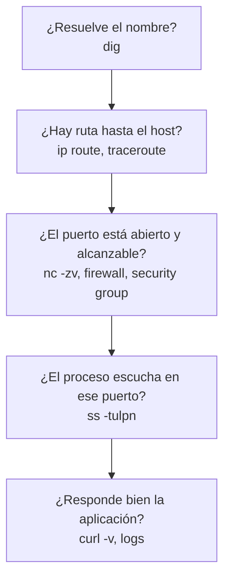

---
tags:
  - devops
  - linux
  - redes
  - scripting
  - bash
---

# Linux, redes y scripting

> Lo esencial que un perfil DevOps usa a diario: scripts en Bash y Python, servicios con systemd, SSH, DNS, HTTP y cómo diagnosticar problemas de red.

## ¿Qué es?

Casi todo en la nube termina corriendo sobre **Linux**: VMs, nodos de Kubernetes, contenedores, *runners* de CI. Y casi todo problema en producción termina siendo **de red** (DNS que no resuelve, un puerto cerrado, un certificado vencido). Esta nota reúne lo que necesitas entender, no una lista exhaustiva de comandos.

!!! note "Para las chuletas de comandos"
    Esta nota explica conceptos y da ejemplos. Para tablas de comandos ver [Linux](../../recursos/comandos/linux.md), [Shell / Bash](../../recursos/sintaxis/shell.md) y [Puertos comunes](../../recursos/puertos.md).

## Bash

**Bash** es el *shell* (intérprete de comandos) por defecto en la mayoría de distribuciones y en los runners de CI. Sirve para **pegar comandos**: automatizar pasos que harías a mano en la terminal.

### Estructura de un script robusto

```bash title="backup.sh"
#!/usr/bin/env bash
# Comprime un directorio y lo copia a un bucket. Uso: ./backup.sh <directorio>
set -euo pipefail

readonly ORIGEN="${1:?Uso: $0 <directorio>}"
readonly DESTINO="${BACKUP_BUCKET:-s3://mi-bucket-backups}"
readonly ARCHIVO="/tmp/backup-$(date +%Y%m%d-%H%M%S).tar.gz"

log() {
  echo "[$(date +%H:%M:%S)] $*" >&2
}

limpiar() {
  rm -f "$ARCHIVO"
}
trap limpiar EXIT

if [[ ! -d "$ORIGEN" ]]; then
  log "ERROR: $ORIGEN no es un directorio"
  exit 1
fi

log "Comprimiendo $ORIGEN"
tar -czf "$ARCHIVO" -C "$ORIGEN" .

for intento in 1 2 3; do
  if aws s3 cp "$ARCHIVO" "$DESTINO/"; then
    log "Backup subido"
    exit 0
  fi
  log "Fallo en intento $intento, reintentando..."
  sleep 5
done

log "ERROR: no se pudo subir el backup"
exit 2
```

| Pieza | Para qué sirve |
| --- | --- |
| `#!/usr/bin/env bash` | **Shebang**: indica qué intérprete ejecuta el script (busca `bash` en el `PATH`) |
| `set -e` | Termina el script si un comando falla (código distinto de 0) |
| `set -u` | Falla si usas una variable no definida (evita `rm -rf "$DIR/"` con `DIR` vacío) |
| `set -o pipefail` | Una tubería (`a \| b`) falla si falla cualquier comando, no solo el último |
| `"${1:?mensaje}"` | Exige un argumento y muestra el mensaje si falta |
| `"${VAR:-defecto}"` | Valor por defecto si la variable no existe |
| `[[ ... ]]` | Condicional de Bash (más seguro que `[ ... ]`) |
| `trap ... EXIT` | Ejecuta limpieza al salir, haya error o no |
| `>&2` | Escribe en *stderr* (salida de errores), así no ensucias la salida útil |

!!! tip "Siempre comillas en las variables"
    Escribe `"$VAR"`, no `$VAR`. Sin comillas, un valor con espacios se parte en varias palabras y un valor vacío desaparece. Usa **ShellCheck** (`shellcheck script.sh`) para detectar estos errores; se integra fácil en CI.

### Exit codes (códigos de salida)

Todo comando devuelve un número al terminar: **`0` = éxito**, cualquier otro valor = error. Los pipelines de CI usan exactamente esto para decidir si un paso pasó o falló.

```bash
grep -q "ERROR" app.log
echo $?          # 0 si encontró "ERROR", 1 si no, 2 si hubo un error (p. ej. no existe el archivo)

comando_a && comando_b   # b solo se ejecuta si a tuvo éxito
comando_a || exit 1      # si a falla, sal con error
```

## Python para automatización

Bash es ideal para encadenar comandos, pero se vuelve frágil cuando hay lógica. Prefiere **Python** cuando:

- Trabajas con **JSON/YAML**, APIs o estructuras de datos (listas, diccionarios).
- El script pasa de ~50–100 líneas o tiene mucha lógica condicional.
- Necesitas manejo de errores fino, tests o reutilizar código.
- Vas a usar el **SDK** de una nube: **boto3** (AWS), **azure-sdk-for-python** (Azure), **google-cloud-python** (Google Cloud).

Ejemplo: listar las instancias EC2 en ejecución que **no** tienen la etiqueta `owner` (útil para gobernanza y costos):

```python title="ec2_sin_owner.py"
import boto3

ec2 = boto3.client("ec2", region_name="us-east-1")
paginator = ec2.get_paginator("describe_instances")

filtros = [{"Name": "instance-state-name", "Values": ["running"]}]
for pagina in paginator.paginate(Filters=filtros):
    for reserva in pagina["Reservations"]:
        for instancia in reserva["Instances"]:
            tags = {t["Key"]: t["Value"] for t in instancia.get("Tags", [])}
            if "owner" not in tags:
                print(instancia["InstanceId"], instancia["InstanceType"])
```

!!! note "Credenciales"
    boto3 toma las credenciales de la cadena estándar de AWS (variables de entorno, perfil de `~/.aws`, rol de la VM o del pipeline). Nunca las escribas en el código. Ver [IAM: AWS, Azure y GCP](../../cloud/identidad-y-seguridad/iam-comparativa.md).

## systemd

**systemd** es el sistema de inicio y gestor de servicios de casi todas las distribuciones modernas. Arranca procesos, los reinicia si fallan y centraliza sus logs en el **journal**.

- Una **unit** (unidad) describe algo que systemd gestiona. Las más comunes: `.service` (un proceso), `.timer` (tarea programada, alternativa a cron), `.socket`, `.mount`.
- **`systemctl`** controla las units: `start`, `stop`, `restart`, `enable` (arrancar con el sistema), `status`.
- **`journalctl`** lee los logs: `journalctl -u miapp -f` sigue los logs de un servicio en vivo.

```ini title="/etc/systemd/system/miapp.service"
[Unit]
Description=API de ejemplo
After=network-online.target
Wants=network-online.target

[Service]
Type=simple
User=miapp
WorkingDirectory=/opt/miapp
EnvironmentFile=/etc/miapp/env
ExecStart=/opt/miapp/venv/bin/gunicorn -b 0.0.0.0:8000 app:app
Restart=on-failure
RestartSec=5

[Install]
WantedBy=multi-user.target
```

```bash
sudo systemctl daemon-reload          # recargar tras crear o editar la unit
sudo systemctl enable --now miapp     # habilitar al arranque e iniciar ya
systemctl status miapp
journalctl -u miapp --since "10 min ago"
```

!!! tip "Usuario dedicado"
    Ejecuta cada servicio con un **usuario propio sin privilegios** (`User=miapp`), nunca como `root`. systemd también ofrece opciones de *hardening* como `NoNewPrivileges=yes` o `ProtectSystem=strict`.

## SSH

**SSH** (*Secure Shell*) es la forma estándar de conectarse a servidores Linux. Usa **llaves** (*key pairs*, par de claves) en vez de contraseñas: la **privada** se queda en tu equipo y la **pública** va en `~/.ssh/authorized_keys` del servidor.

```bash
ssh-keygen -t ed25519 -C "dani@laptop"    # generar llaves (ed25519 es el tipo recomendado hoy)
ssh-copy-id usuario@servidor              # copiar la pública al servidor
eval "$(ssh-agent -s)" && ssh-add         # cargar la llave en el agente (no repites la passphrase)
```

El archivo `~/.ssh/config` evita recordar IPs, usuarios y llaves:

```text title="~/.ssh/config"
Host bastion
    HostName 203.0.113.10
    User ubuntu
    IdentityFile ~/.ssh/id_ed25519

Host app-privada
    HostName 10.0.2.15
    User ubuntu
    ProxyJump bastion
```

Con eso, `ssh app-privada` salta por el **bastion** (servidor de salto) hasta una VM en una subred privada.

**SSH tunneling** (túneles SSH) reenvía puertos a través de la conexión cifrada:

```bash
# Local forwarding: localhost:5433 -> base de datos privada a través del bastion
ssh -L 5433:db.interna:5432 bastion
# Ahora: psql -h localhost -p 5433
```

!!! info "En la nube, mejor sin puertos abiertos"
    Los tres proveedores ofrecen acceso sin exponer el puerto 22 a internet: **Session Manager** (AWS), **Azure Bastion** y **IAP TCP forwarding** (Google Cloud). Ver [Máquinas virtuales](../../cloud/computo/maquinas-virtuales.md).

## DNS

**DNS** (*Domain Name System*) traduce nombres (`api.ejemplo.com`) a direcciones IP. Los registros que más vas a tocar:

| Registro | Para qué sirve | Ejemplo |
| --- | --- | --- |
| **A** | Nombre → dirección IPv4 | `api.ejemplo.com → 203.0.113.10` |
| **AAAA** | Nombre → dirección IPv6 | `api.ejemplo.com → 2001:db8::10` |
| **CNAME** | Alias de otro nombre (no se puede usar en el dominio raíz) | `www.ejemplo.com → ejemplo.github.io` |
| **MX** | Servidores de correo del dominio, con prioridad | `10 mail.ejemplo.com` |
| **TXT** | Texto libre: verificación de dominio, SPF, DKIM, DMARC | `"v=spf1 include:_spf.google.com ~all"` |
| **NS** | Servidores autoritativos de la zona | `ns1.proveedor-dns.com` |

El **TTL** (*time to live*) indica cuántos segundos se puede guardar en caché una respuesta. Antes de una migración, baja el TTL con tiempo para que el cambio se propague rápido.

```bash
dig api.ejemplo.com              # registro A
dig api.ejemplo.com AAAA +short  # solo la respuesta
dig ejemplo.com MX
dig @8.8.8.8 api.ejemplo.com     # preguntar a un resolver concreto
dig +trace api.ejemplo.com       # seguir la resolución desde la raíz
```

## HTTP

**HTTP** es el protocolo de casi todas las APIs y aplicaciones web (con **HTTPS** cuando va cifrado con TLS).

| Método | Uso |
| --- | --- |
| `GET` | Leer un recurso |
| `POST` | Crear un recurso o ejecutar una acción |
| `PUT` / `PATCH` | Reemplazar / modificar parcialmente un recurso |
| `DELETE` | Borrar un recurso |

| Código | Significado | Pista típica |
| --- | --- | --- |
| `2xx` (200, 201, 204) | Éxito | — |
| `3xx` (301, 302, 304) | Redirección | Revisa el header `Location` |
| `400` | Petición mal formada | Revisa el cuerpo o los parámetros |
| `401` / `403` | No autenticado / sin permiso | Token, credenciales, IAM |
| `404` | No existe | Ruta, *host* o *ingress* mal configurado |
| `429` | Demasiadas peticiones | *Rate limiting* |
| `500` | Error interno de la aplicación | Logs de la app |
| `502` / `503` / `504` | Error en el *proxy* o *load balancer*: backend caído, sin capacidad o lento | *Health checks*, *timeouts* |

Headers (cabeceras) que conviene reconocer: `Host`, `Authorization`, `Content-Type`, `Cache-Control`, `X-Forwarded-For` (IP original detrás de un *load balancer*).

```bash
curl -i https://api.ejemplo.com/health                  # respuesta con headers
curl -sS -o /dev/null -w "%{http_code} %{time_total}s\n" https://api.ejemplo.com/health
curl -X POST -H "Content-Type: application/json" -d '{"nombre":"dani"}' https://api.ejemplo.com/usuarios
curl -v --resolve api.ejemplo.com:443:10.0.1.20 https://api.ejemplo.com/   # probar contra una IP concreta
```

## Puertos y troubleshooting de red

Ante un "no conecta", recorre las capas en orden:



| Comando | Qué te dice |
| --- | --- |
| `ip a` / `ip route` | IPs de las interfaces y la tabla de rutas (reemplazan a `ifconfig`/`route`) |
| `ss -tulpn` | Qué puertos escuchan y qué proceso los usa. Ojo: `127.0.0.1:8000` solo acepta conexiones locales, `0.0.0.0:8000` acepta de cualquier interfaz |
| `nc -zv host 443` | Si un puerto remoto acepta conexiones |
| `traceroute host` / `mtr host` | Por qué saltos pasa el tráfico y dónde se corta |
| `ping host` | Conectividad básica (muchas nubes bloquean ICMP por defecto, así que un *ping* fallido no prueba nada) |
| `tcpdump -i any port 443` | Captura de paquetes para casos difíciles |

!!! warning "En la nube, el firewall está fuera de la VM"
    Si `ss` muestra que el proceso escucha pero desde fuera no conecta, revisa el **security group / NSG / VPC firewall rule**, las tablas de rutas de la subred y los *network ACLs*, además del firewall del sistema operativo. Ver [Redes en la nube](../../cloud/redes-y-datos/redes.md).

## Relación con otras secciones

| Enfoque | Qué se mira desde ahí | Nota |
| --- | --- | --- |
| Networking (la base) | DNS, DHCP y NTP en profundidad; HTTP, TLS y SSH por dentro; metodología y casos de troubleshooting de red | [Servicios de red](../../networking/intermedio/servicios-red.md), [Protocolos de aplicación](../../networking/intermedio/protocolos-aplicacion.md), [Troubleshooting de red](../../networking/avanzado/troubleshooting-red.md) |
| Cloud (el control) | VPC, subredes, rutas, security groups, DNS gestionado y load balancers sobre los que aplicas todo esto | [Redes en la nube](../../cloud/redes-y-datos/redes.md), [Máquinas virtuales](../../cloud/computo/maquinas-virtuales.md) |
| DevOps (la automatización) | Scripts que se convierten en pasos de pipeline o en configuración gestionada | [Integración continua](../ci-cd/integracion-continua.md), [Ansible](../iac/ansible.md), [Observabilidad](../operacion/observabilidad.md) |
| DevSecOps (la verificación) | Hardening del host, acceso sin llaves expuestas, puertos abiertos a `0.0.0.0/0` | [Secretos e identidades](../../devsecops/identidades-y-pipeline/secretos-identidades.md), [Cumplimiento y gobierno](../../devsecops/gobierno-y-respuesta/cumplimiento.md) |
| Laboratorios (la práctica) | Practicar esto paso a paso | [Lab 00: Preparar el entorno de laboratorio](../../laboratorios/fundamentos/preparar-entorno.md), [Lab 01: Diagnóstico de red desde Linux](../../laboratorios/fundamentos/linux-red-diagnostico.md), [Lab 10: Configurar servidores con Ansible](../../laboratorios/devops/ansible-configuracion.md), [Lab 22: Endurecer un servidor Linux con Ansible y medirlo con Lynis y OpenSCAP](../../laboratorios/devsecops/hardening-linux-ansible.md) |

## Referencias

- [GNU Bash Reference Manual](https://www.gnu.org/software/bash/manual/bash.html)
- [ShellCheck](https://www.shellcheck.net/)
- [Boto3 documentation](https://boto3.amazonaws.com/v1/documentation/api/latest/index.html)
- [systemd.service (man page)](https://www.freedesktop.org/software/systemd/man/latest/systemd.service.html)
- [OpenSSH manual pages](https://www.openssh.com/manual.html)
- [MDN: códigos de estado de respuesta HTTP](https://developer.mozilla.org/es/docs/Web/HTTP/Status)
- [MDN: métodos de petición HTTP](https://developer.mozilla.org/es/docs/Web/HTTP/Methods)
- [Cloudflare: ¿Qué es el DNS?](https://www.cloudflare.com/es-es/learning/dns/what-is-dns/)
