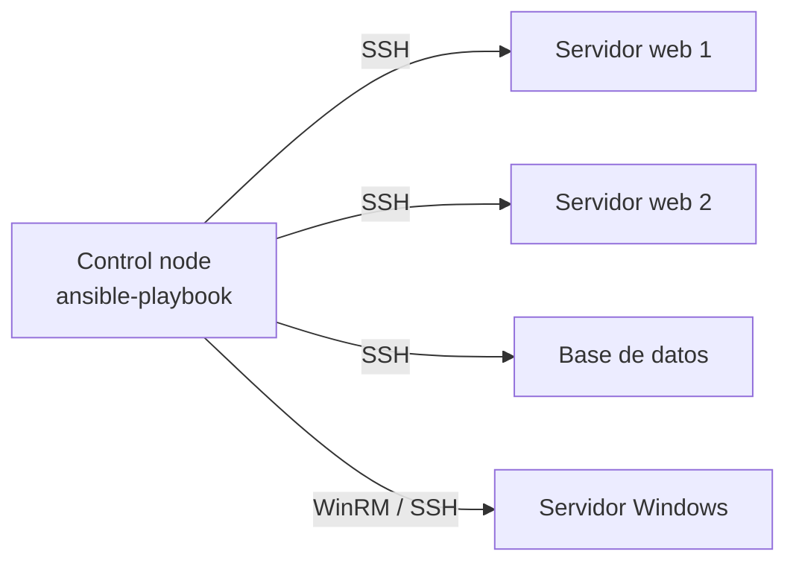

---
tags:
  - iac
  - ansible
  - configuration-management
---

# Configuration management con Ansible

> Cómo configurar servidores de forma repetible con Ansible: inventarios, playbooks, roles, idempotencia y Ansible Vault.

## ¿Qué es?

**Configuration management** (gestión de la configuración) es mantener los servidores en un estado conocido y reproducible: qué paquetes tienen instalados, qué archivos de configuración, qué usuarios, qué servicios están activos. En lugar de entrar por SSH y ejecutar comandos a mano, lo describes en código y una herramienta lo aplica a uno o a cien servidores.

**Ansible** (Red Hat) es la herramienta más usada para esto. Escribes **playbooks** en YAML que describen el estado deseado, y Ansible se conecta a los servidores y lo aplica.

## Ansible vs Terraform

No compiten, se complementan:

| | Terraform / OpenTofu | Ansible |
| --- | --- | --- |
| Para qué | **Crear** infraestructura: VPC, VMs, bases de datos, IAM | **Configurar** lo que hay dentro: paquetes, archivos, servicios, usuarios |
| Estilo | Declarativo con **state** | Declarativo por tarea, **sin state**: consulta el servidor en cada ejecución |
| Momento | *Day 0/1* (crear) | *Day 1/2* (configurar y mantener) |

Flujo típico: Terraform crea las VMs y les pone **tags** (etiquetas), y Ansible usa un **dynamic inventory** (inventario dinámico) que encuentra esas VMs por sus tags y las configura. Ver [Infrastructure as Code: panorama y herramientas](infraestructura-como-codigo.md).

!!! note "Ansible también puede crear recursos en la nube"
    Hay módulos para AWS, Azure y Google Cloud, pero sin state es más difícil detectar qué sobra o qué hay que borrar. Para crear infraestructura, lo habitual es Terraform; Ansible para lo de dentro.

## Arquitectura agentless

Ansible es **agentless** (sin agente): no instalas nada en los servidores gestionados.



- **Control node** (nodo de control): la máquina donde ejecutas Ansible (tu portátil, un runner de CI).
- **Managed nodes** (nodos gestionados): los servidores. Solo necesitan SSH y Python (en Windows, WinRM o SSH con PowerShell).
- En cada tarea, Ansible copia un pequeño programa (el *module*) al servidor, lo ejecuta y lo borra.

## Inventory (inventario)

El **inventory** es la lista de servidores y cómo se agrupan.

```ini title="inventory/hosts.ini"
[web]
web1.ejemplo.com
web2.ejemplo.com

[db]
db1.ejemplo.com ansible_user=admin

[produccion:children]
web
db
```

El mismo inventario se puede escribir en YAML (recomendado para proyectos nuevos). Los dos formatos comentados línea por línea, con variables de host y de grupo, `group_vars/` y `host_vars/`: [Anatomía de los archivos de Ansible: inventario](../../recursos/anatomia/ansible.md#inventario-comentado-linea-por-linea).

### Dynamic inventory (inventario dinámico)

En la nube los servidores aparecen y desaparecen, así que se usan **inventory plugins** que preguntan a la API del proveedor: `amazon.aws.aws_ec2`, `azure.azcollection.azure_rm`, `google.cloud.gcp_compute`.

```yaml title="inventory/aws_ec2.yml"
plugin: amazon.aws.aws_ec2
regions:
  - eu-west-1
filters:
  tag:Entorno: prod
  instance-state-name: running
use_deprecated_tags: false   # la variable "tags" está obsoleta: usa "ec2_tags"
keyed_groups:
  # Crea grupos como rol_web a partir del tag "Rol"
  - key: ec2_tags.Rol
    prefix: rol
```

Más casos de inventario dinámico (Azure, Google Cloud, `hostnames`, `compose`) en [Casos de uso en flotas mixtas](../../servidores/ansible/ansible-casos-uso.md).

```bash
ansible-inventory -i inventory/aws_ec2.yml --graph
```

## Playbooks, tasks y modules

- **Module** (módulo): unidad de trabajo (`ansible.builtin.apt`, `ansible.builtin.copy`, `ansible.builtin.service`…). Cada uno sabe comprobar si ya está en el estado deseado.
- **Task** (tarea): una llamada a un module con sus parámetros.
- **Play**: un conjunto de tasks aplicadas a un grupo de hosts.
- **Playbook**: archivo YAML con uno o varios plays.
- **Handler** (manejador): task que solo se ejecuta si otra la **notifica** porque hizo un cambio; típico para reiniciar un servicio.

```yaml title="site.yml"
- name: Configurar servidores web
  hosts: web
  become: true            # ejecutar con sudo

  tasks:
    - name: Instalar nginx
      ansible.builtin.apt:
        name: nginx
        state: present

    - name: Copiar la configuración del sitio
      ansible.builtin.template:
        src: templates/sitio.conf.j2
        dest: /etc/nginx/conf.d/sitio.conf
      notify: Recargar nginx

  handlers:
    - name: Recargar nginx
      ansible.builtin.service:
        name: nginx
        state: reloaded
```

Playbook completo (`vars_files`, `pre_tasks`, roles, `register`, condiciones, bucles) y el orden en que se ejecutan las secciones de un play: [Anatomía: playbook comentado](../../recursos/anatomia/ansible.md#playbook-comentado-linea-por-linea).

!!! tip "Usa el FQCN"
    Escribe los modules con su **FQCN** (*Fully Qualified Collection Name*, nombre completo con la colección): `ansible.builtin.copy` en lugar de `copy`. Evita ambigüedades y es lo que recomienda `ansible-lint`.

## Variables y precedencia

Las variables pueden venir de muchos sitios. Ansible tiene más de 20 niveles de precedencia; en la práctica basta con recordar esta versión resumida (de menor a mayor prioridad):

1. `defaults/main.yml` de un role (valores por defecto, fáciles de sobrescribir).
2. Variables del inventory: `group_vars/all`, `group_vars/<grupo>`, `host_vars/<host>`.
3. `vars:` del play y `vars_files`.
4. `vars/main.yml` de un role.
5. `set_fact` y variables registradas con `register`.
6. **Extra vars** en la línea de comandos (`-e "nginx_port=8080"`): **siempre ganan**.

!!! tip "Dónde poner cada cosa"
    Valores que el usuario del role debe poder cambiar → `defaults/`. Diferencias por entorno o grupo → `group_vars/`. Evita depender de `-e` para cosas permanentes.

## Roles

Un **role** empaqueta tasks, handlers, plantillas y variables para reutilizarlos. `ansible-galaxy role init nginx` crea la estructura: `defaults/` (variables por defecto, prioridad baja), `vars/` (variables internas, prioridad alta), `tasks/`, `handlers/`, `templates/` (Jinja2), `files/` y `meta/`; muchos equipos añaden `molecule/` para sus pruebas (ver [Pruebas de infraestructura](pruebas-infraestructura.md#molecule-para-roles-de-ansible)). Cada archivo de un role comentado: [Anatomía: role comentado](../../recursos/anatomia/ansible.md#role-comentado).

Se usa desde un playbook:

```yaml title="site.yml"
- name: Servidores web
  hosts: web
  become: true
  roles:
    - role: nginx
      vars:
        nginx_port: 8080
```

## Ansible Galaxy y collections

- **Ansible Galaxy** es el repositorio público de roles y collections.
- Una **collection** (colección) agrupa modules, plugins y roles bajo un *namespace* (por ejemplo, `amazon.aws`, `community.general`, `ansible.posix`).
- Declara las dependencias en un `requirements.yml` y fíjalas por versión (ejemplo comentado en [Anatomía: requirements.yml](../../recursos/anatomia/ansible.md#requirementsyml-comentado)); se instalan con `ansible-galaxy install -r requirements.yml`.

## Idempotencia

**Idempotencia** (*idempotency*) significa que ejecutar el playbook una o diez veces deja el servidor igual. La segunda ejecución debería reportar `changed=0`.

Los modules ya son idempotentes (`apt` no reinstala si el paquete está). Se rompe cuando usas `command` o `shell`, que siempre se ejecutan:

```yaml
# Mal: se ejecuta en cada corrida y siempre marca "changed"
- name: Crear directorio
  ansible.builtin.shell: mkdir -p /opt/app

# Bien: module idempotente
- name: Crear directorio
  ansible.builtin.file:
    path: /opt/app
    state: directory
    mode: "0755"

# Si no hay module, controla tú cuándo ejecutar y cuándo hay cambio
- name: Inicializar la base de datos
  ansible.builtin.command: /opt/app/bin/init-db
  args:
    creates: /opt/app/.db-inicializada
```

Cómo comprobarlo:

- `ansible-playbook site.yml --check --diff`: **check mode** (modo simulación) muestra qué cambiaría y el **diff** de los archivos, sin tocar nada.
- Ejecuta el playbook **dos veces** seguidas: la segunda debe terminar con `changed=0`. Molecule automatiza esta prueba (*idempotence test*); ver [Pruebas de infraestructura](pruebas-infraestructura.md).

!!! warning "Check mode no es perfecto"
    Las tasks que dependen del resultado de otra (por ejemplo, instalar un paquete y luego configurar su servicio) pueden fallar o mostrar resultados incompletos en `--check`, porque el paso previo no se ejecutó de verdad.

## Ansible Vault

**Ansible Vault** cifra archivos o valores con secretos (contraseñas, claves de API) para poder guardarlos en Git:

```bash
ansible-vault create group_vars/prod/vault.yml   # crear archivo cifrado
ansible-vault edit group_vars/prod/vault.yml     # editarlo
ansible-playbook site.yml --ask-vault-pass        # o --vault-password-file
```

!!! tip "Convención útil"
    Guarda los secretos cifrados como `vault_db_password` en `vault.yml` y referéncialos desde un archivo sin cifrar (`db_password: "{{ vault_db_password }}"`). Así se ve qué variables existen sin descifrar nada. Ejemplo completo en [Anatomía: archivo cifrado con Ansible Vault](../../recursos/anatomia/ansible.md#archivo-cifrado-con-ansible-vault).

Para equipos grandes, mejor leer los secretos en tiempo de ejecución desde un gestor central (HashiCorp Vault, AWS Secrets Manager, Azure Key Vault, Google Secret Manager) con los lookups de las collections correspondientes. Ver [Secretos e identidades](../../devsecops/identidades-y-pipeline/secretos-identidades.md).

## Buenas prácticas

- Pasa `ansible-lint` en CI.
- Usa roles pequeños con una responsabilidad clara.
- Marca con `no_log: true` las tasks que manejan secretos para que no aparezcan en la salida.
- Prueba los roles con Molecule antes de aplicarlos en producción.
- Para **hardening** (endurecimiento) del sistema operativo, aplica roles basados en los **CIS Benchmarks** y ejecútalos de forma periódica para corregir desviaciones. Ver [Cumplimiento y gobierno](../../devsecops/gobierno-y-respuesta/cumplimiento.md).

Comandos frecuentes en la [guía de comandos de Ansible](../../recursos/comandos/ansible.md).

## Relación con otras secciones

| Enfoque | Qué se mira desde ahí | Nota |
| --- | --- | --- |
| Cloud (el control) | Las VMs que Ansible configura y el acceso a ellas | [Máquinas virtuales](../../cloud/computo/maquinas-virtuales.md) |
| DevOps (la automatización) | Crear la infraestructura antes de configurarla y probar los roles | [Infrastructure as Code](infraestructura-como-codigo.md), [Terraform](terraform-basico.md), [Pruebas de infraestructura](pruebas-infraestructura.md) |
| DevSecOps (la verificación) | Secretos fuera del código y hardening CIS automatizado | [Secretos e identidades](../../devsecops/identidades-y-pipeline/secretos-identidades.md), [Cumplimiento y gobierno](../../devsecops/gobierno-y-respuesta/cumplimiento.md) |
| Laboratorios (la práctica) | Practicar esto paso a paso | [Lab 00: Preparar el entorno de laboratorio](../../laboratorios/fundamentos/preparar-entorno.md), [Lab 10: Configurar servidores con Ansible](../../laboratorios/devops/ansible-configuracion.md), [Lab 22: Endurecer un servidor Linux con Ansible y medirlo con Lynis y OpenSCAP](../../laboratorios/devsecops/hardening-linux-ansible.md) |

## Referencias

- [Documentación de Ansible](https://docs.ansible.com/)
- [Inventarios](https://docs.ansible.com/ansible/latest/inventory_guide/intro_inventory.html)
- [Precedencia de variables](https://docs.ansible.com/ansible/latest/playbook_guide/playbooks_variables.html#understanding-variable-precedence)
- [Roles](https://docs.ansible.com/ansible/latest/playbook_guide/playbooks_reuse_roles.html)
- [Inventory plugin `amazon.aws.aws_ec2`](https://docs.ansible.com/ansible/latest/collections/amazon/aws/aws_ec2_inventory.html)
- [Ansible Vault](https://docs.ansible.com/ansible/latest/vault_guide/index.html)
- [Ansible Galaxy](https://galaxy.ansible.com/)
- [ansible-lint](https://ansible.readthedocs.io/projects/lint/)
- [Guía de comandos de Ansible](../../recursos/comandos/ansible.md)
