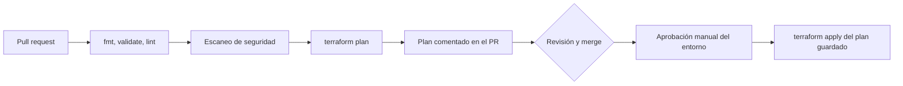

---
tags:
  - iac
  - terraform
  - aws
  - azure
  - gcp
  - ci-cd
---

# Infrastructure as Code: panorama y herramientas

> Qué es IaC, en qué se diferencia de *configuration management* y cómo se comparan Terraform/OpenTofu, Terragrunt, CloudFormation, Bicep, Infrastructure Manager y Pulumi.

## ¿Qué es?

**Infrastructure as Code** (IaC, infraestructura como código) es definir la infraestructura (redes, VMs, bases de datos, permisos, clústeres…) en **archivos de texto versionados en Git**, en lugar de crearla a mano desde la consola del proveedor. Una herramienta lee esos archivos y se encarga de llamar a las APIs de la nube para que la realidad coincida con el código.

Lo que ganas:

- **Reproducibilidad**: el mismo código crea `dev`, `staging` y `prod` de forma consistente.
- **Revisión**: cada cambio pasa por un **pull request** (solicitud de cambio) y se ve el impacto antes de aplicarlo.
- **Trazabilidad**: el historial de Git dice quién cambió qué y por qué.
- **Recuperación**: si se pierde un entorno, se vuelve a crear desde el código.
- **Seguridad verificable**: el código se puede escanear antes de desplegarlo (ver [Seguridad de IaC](../../devsecops/infraestructura-y-contenedores/seguridad-iac.md)).

## Declarativo vs imperativo

| | **Declarativo** (*declarative*) | **Imperativo** (*imperative*) |
| --- | --- | --- |
| Qué describes | El **estado final** que quieres | Los **pasos** para llegar a él |
| Quién calcula los cambios | La herramienta (compara deseado vs real) | Tú, en el orden de tus comandos |
| Ejecutarlo dos veces | No cambia nada si ya está en el estado deseado | Puede duplicar recursos si no lo controlas |
| Ejemplos | Terraform, CloudFormation, Bicep, Kubernetes YAML | Scripts con `aws`/`az`/`gcloud`, Bash |

!!! note "Pulumi y CDK: código imperativo, resultado declarativo"
    Pulumi y AWS CDK usan lenguajes de programación (bucles, funciones, clases), pero lo que producen es un **modelo declarativo** de recursos que luego un motor compara con lo existente. Escribes como programador, la herramienta sigue funcionando de forma declarativa.

La propiedad que buscas en ambos casos es la **idempotencia** (*idempotency*): aplicar lo mismo varias veces deja el mismo resultado.

## IaC vs configuration management

| | Aprovisionamiento (*provisioning*) | **Configuration management** (gestión de la configuración) |
| --- | --- | --- |
| Qué gestiona | Los recursos de la nube: VPC, VMs, buckets, IAM | Lo que hay **dentro** de los servidores: paquetes, archivos, servicios |
| Herramientas | Terraform/OpenTofu, CloudFormation, Bicep, Pulumi | Ansible, Chef, Puppet, Salt |
| Estado | Normalmente guarda un **state** | Normalmente no: consulta el servidor en cada ejecución |

Se complementan: Terraform crea la VM y Ansible la configura. Ver [Configuration management con Ansible](ansible.md).

!!! tip "Con contenedores, menos configuration management"
    Si tu aplicación corre en contenedores o *serverless*, gran parte de la configuración del servidor se mueve al `Dockerfile` (ver [Docker](../contenedores/docker.md)) y a la **immutable infrastructure** (infraestructura inmutable): en vez de modificar servidores, los reemplazas por otros nuevos.

## Herramientas

### Terraform y OpenTofu

**Terraform** (HashiCorp) es la herramienta más extendida: lenguaje **HCL**, miles de *providers* (AWS, Azure, Google Cloud, Kubernetes, GitHub, Datadog…) y un **state** que guarda lo que gestiona. **OpenTofu** es su *fork* *open source* en la Linux Foundation, compatible en la mayoría de los casos (comando `tofu`).

Ver [Infrastructure as Code con Terraform](terraform-basico.md) y [Terraform workspaces](terraform-workspaces.md).

### Terragrunt

**Terragrunt** (Gruntwork) es un *wrapper* (envoltorio) sobre Terraform/OpenTofu para aplicar **DRY** (*Don't Repeat Yourself*, no te repitas) cuando tienes muchos entornos y componentes:

- Define el **backend una sola vez** y genera la `key` de cada state según la carpeta.
- Llama a **modules** (módulos) pasándoles `inputs` por entorno, sin copiar `providers.tf` ni `backend.tf` en cada directorio.
- Ejecuta varios componentes respetando dependencias (`terragrunt run --all plan`; en versiones antiguas, `run-all`).

```hcl title="root.hcl"
# Configuración común a todos los entornos
remote_state {
  backend = "s3"
  generate = {
    path      = "backend.tf"
    if_exists = "overwrite_terragrunt"
  }
  config = {
    bucket       = "mi-empresa-terraform-state"
    key          = "${path_relative_to_include()}/terraform.tfstate"
    region       = "eu-west-1"
    encrypt      = true
    use_lockfile = true
  }
}
```

```hcl title="envs/dev/app/terragrunt.hcl"
include "root" {
  path = find_in_parent_folders("root.hcl")
}

terraform {
  source = "../../../modules/app"
}

inputs = {
  entorno       = "dev"
  instance_type = "t4g.micro"
}
```

El state de este componente queda en `envs/dev/app/terraform.tfstate` dentro del bucket, sin escribirlo a mano.

### IaC nativo de cada nube

Cada proveedor tiene su propia herramienta. No necesitas gestionar el state: lo guarda el servicio.

=== "AWS"

    **AWS CloudFormation** usa plantillas YAML/JSON. Cada despliegue es un **stack**; los cambios se previsualizan con **change sets**. **AWS CDK** (*Cloud Development Kit*) permite escribir la infraestructura en TypeScript, Python, Java, C# o Go y la *sintetiza* a CloudFormation.

    ```yaml title="bucket.yaml"
    AWSTemplateFormatVersion: "2010-09-09"
    Parameters:
      Entorno:
        Type: String
        AllowedValues: [dev, staging, prod]
    Resources:
      Notas:
        Type: AWS::S3::Bucket
        Properties:
          VersioningConfiguration:
            Status: Enabled
          PublicAccessBlockConfiguration:
            BlockPublicAcls: true
            BlockPublicPolicy: true
            IgnorePublicAcls: true
            RestrictPublicBuckets: true
    ```

=== "Azure"

    **Bicep** es el lenguaje declarativo de Azure; se compila a plantillas **ARM** (*Azure Resource Manager*) en JSON, que son lo que realmente procesa Azure. `az deployment group what-if` muestra los cambios antes de aplicarlos. Las **deployment stacks** permiten gestionar un conjunto de recursos como unidad.

    ```bicep title="storage.bicep"
    param location string = resourceGroup().location
    param entorno string

    resource sa 'Microsoft.Storage/storageAccounts@2023-05-01' = {
      name: 'stnotas${entorno}${uniqueString(resourceGroup().id)}'
      location: location
      sku: { name: 'Standard_LRS' }
      kind: 'StorageV2'
      properties: {
        allowBlobPublicAccess: false
        minimumTlsVersion: 'TLS1_2'
      }
    }
    ```

=== "Google Cloud"

    **Infrastructure Manager** (Infra Manager) es el servicio gestionado de Google Cloud que ejecuta **Terraform** por ti: subes tu configuración HCL (desde un bucket, un repositorio Git o local) y el servicio hace el `plan`/`apply` y guarda el state. Es el sucesor de **Cloud Deployment Manager** (plantillas YAML con Jinja/Python), cuyo soporte terminó el 31 de marzo de 2026 según el aviso oficial de Google.

    ```bash
    gcloud infra-manager deployments apply \
      projects/mi-proyecto/locations/us-central1/deployments/notas-dev \
      --service-account=projects/mi-proyecto/serviceAccounts/infra@mi-proyecto.iam.gserviceaccount.com \
      --local-source=./infra \
      --input-values=entorno=dev
    ```

### Pulumi

**Pulumi** define la infraestructura con lenguajes de programación generales (TypeScript, Python, Go, C#, Java y también YAML). Tiene su propio state (en Pulumi Cloud o en un bucket propio) y un ciclo parecido a Terraform: `pulumi preview` y `pulumi up`.

```python title="__main__.py"
import pulumi
import pulumi_aws as aws

entorno = pulumi.get_stack()  # dev, staging, prod

bucket = aws.s3.Bucket("notas", bucket=f"cuaderno-notas-{entorno}-ejemplo")
pulumi.export("bucket_arn", bucket.arn)
```

Encaja bien en equipos de desarrollo que quieren usar su lenguaje, sus tests unitarios y su IDE.

## Comparativa

| Herramienta | Multi-cloud | Lenguaje | State | Quién lo gestiona |
| --- | --- | --- | --- | --- |
| **Terraform** | Sí | HCL | Archivo de state en un backend (S3, Azure Storage, GCS, HCP Terraform) | Tú (o HCP Terraform) |
| **OpenTofu** | Sí | HCL | Igual que Terraform (añade cifrado del state) | Tú |
| **Terragrunt** | Sí (envuelve Terraform/OpenTofu) | HCL | El de Terraform/OpenTofu | Tú |
| **AWS CloudFormation / CDK** | No, solo AWS | YAML/JSON; CDK: TS, Python, Java, C#, Go | Lo guarda AWS en el stack | AWS |
| **Bicep / ARM** | No, solo Azure | Bicep (compila a ARM JSON) | No hay state: Azure Resource Manager es la fuente de verdad | Azure |
| **Infrastructure Manager** | Terraform por debajo, pensado para Google Cloud | HCL | Lo guarda el servicio | Google Cloud |
| **Pulumi** | Sí | TypeScript, Python, Go, C#, Java, YAML | Pulumi Cloud o backend propio | Tú (o Pulumi Cloud) |

!!! tip "¿Cuál elegir?"
    - Trabajas con varias nubes o con muchos servicios SaaS (GitHub, Datadog, Cloudflare): **Terraform/OpenTofu**.
    - Todo está en una nube y quieres cero gestión de state: la herramienta **nativa**.
    - El equipo es de desarrollo y quiere tests y abstracciones en su lenguaje: **Pulumi** o **CDK**.
    - Muchos entornos y componentes con Terraform: añade **Terragrunt**.

## Estructura de un repositorio de IaC

Un patrón muy usado: **modules** reutilizables y un directorio por entorno (ver la comparación con workspaces en [Terraform workspaces](terraform-workspaces.md)).

```text
infra/
├── modules/
│   ├── red/           # VPC/VNet, subnets, NAT
│   ├── app/           # cómputo, load balancer
│   └── iam-pipeline/  # rol que usa el pipeline de despliegue
├── envs/
│   ├── dev/
│   │   ├── main.tf        # llama a los modules con valores de dev
│   │   └── backend.tf
│   ├── staging/
│   └── prod/              # state y credenciales propias
├── tests/                 # terraform test, Terratest
└── .github/workflows/
    └── terraform.yml
```

- Separa el state por **entorno** y por **componente** (red, datos, aplicación): un error en uno no arrastra a los demás.
- Versiona los modules compartidos (etiquetas de Git o un registry privado) para que `prod` no cambie sin querer.

## Flujo en CI/CD

El patrón estándar: **plan en el pull request, apply tras aprobación**.



1. En el PR: `fmt -check`, `validate`, lint y escaneo (Checkov, `trivy config`); después `plan`, que se publica como comentario.
2. Tras el merge: un **environment** con aprobación obligatoria (por ejemplo, GitHub Environments) protege `prod`.
3. `apply` aplica el plan revisado (`-out=plan.tfplan`).
4. El pipeline se autentica con **OIDC** (*OpenID Connect*) y un rol con permisos acotados, sin claves de larga duración.

Ver [Pipeline CI/CD con GitHub Actions](../ci-cd/ci-cd-github-actions.md), [Pruebas de infraestructura](pruebas-infraestructura.md) y [Seguridad del pipeline](../../devsecops/identidades-y-pipeline/seguridad-pipeline.md).

!!! warning "Drift"
    Si alguien cambia recursos a mano en la consola, el código deja de reflejar la realidad (**drift**, desviación). Programa un `plan` periódico (por ejemplo, diario) que avise si hay diferencias.

## Relación con otras secciones

| Enfoque | Qué se mira desde ahí | Nota |
| --- | --- | --- |
| Cloud (el control) | Qué recursos aprovisiona IaC: cuentas y políticas organizativas, redes, roles y políticas | [Gobernanza](../../cloud/operacion-y-gobierno/gobernanza.md), [Redes en la nube](../../cloud/redes-y-datos/redes.md), [IAM: AWS, Azure y GCP](../../cloud/identidad-y-seguridad/iam-comparativa.md) |
| DevOps (la automatización) | Terraform en detalle, entornos, configuración de servidores, pruebas y pipeline | [Terraform](terraform-basico.md), [Terraform workspaces](terraform-workspaces.md), [Ansible](ansible.md), [Pruebas de infraestructura](pruebas-infraestructura.md), [Integración continua](../ci-cd/integracion-continua.md) |
| DevSecOps (la verificación) | Escaneo de IaC, policy as code y detección de drift | [Seguridad de IaC](../../devsecops/infraestructura-y-contenedores/seguridad-iac.md) |
| Laboratorios (la práctica) | Practicar esto paso a paso | [Lab 00: Preparar el entorno de laboratorio](../../laboratorios/fundamentos/preparar-entorno.md), [Lab 02: Plan de direccionamiento IP para una VPC](../../laboratorios/fundamentos/subnetting-plan-ips.md), [Lab 08: Terraform sin nube: providers locales y workspaces](../../laboratorios/devops/terraform-local-workspaces.md), [Lab 09: Terraform en AWS con remote state en S3](../../laboratorios/devops/terraform-aws-backend-remoto.md), [Lab 10: Configurar servidores con Ansible](../../laboratorios/devops/ansible-configuracion.md), [Lab 17: AWS: VPC con subnets públicas y privadas y una EC2](../../laboratorios/cloud/aws-vpc-ec2.md), [Lab 18: AWS: API serverless con Lambda, API Gateway y DynamoDB](../../laboratorios/cloud/aws-serverless-api.md), [Lab 19: Azure: VNet, NSG y una VM con Azure CLI](../../laboratorios/cloud/azure-vnet-vm.md) |

## Referencias

- [Terraform](https://developer.hashicorp.com/terraform/docs)
- [OpenTofu](https://opentofu.org/docs/)
- [Terragrunt](https://terragrunt.gruntwork.io/docs/)
- [AWS CloudFormation](https://docs.aws.amazon.com/es_es/AWSCloudFormation/latest/UserGuide/Welcome.html)
- [AWS CDK](https://docs.aws.amazon.com/cdk/v2/guide/home.html)
- [Bicep](https://learn.microsoft.com/es-es/azure/azure-resource-manager/bicep/overview)
- [Infrastructure Manager](https://cloud.google.com/infrastructure-manager/docs/overview)
- [Deployment Manager: avisos de baja](https://cloud.google.com/deployment-manager/docs/deprecations)
- [Pulumi](https://www.pulumi.com/docs/)
