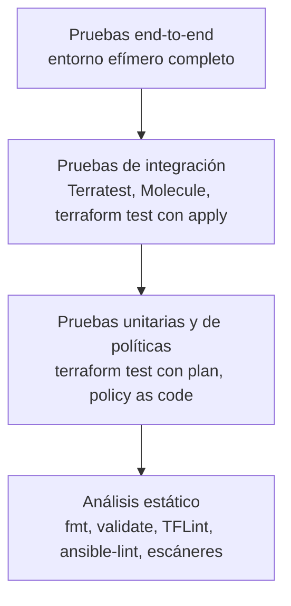

---
tags:
  - iac
  - terraform
  - ansible
  - testing
  - ci-cd
---

# Pruebas de infraestructura

> Cómo probar código de infraestructura por capas: formato y lint, `terraform test`, Terratest, Molecule, políticas y entornos efímeros.

## ¿Qué es?

El código de infraestructura también tiene *bugs*: un CIDR que se solapa, una regla de firewall de más, un role de Ansible que no es idempotente. **Probar la infraestructura** es comprobar, de forma automática y antes de llegar a producción, que el código hace lo que debe.

La diferencia con las pruebas de una aplicación es que muchas pruebas útiles **necesitan crear recursos reales** en la nube, lo que cuesta tiempo y dinero. Por eso se organizan en una pirámide: muchas pruebas baratas abajo y pocas caras arriba.

## Pirámide de pruebas para IaC



| Nivel | Qué detecta | Crea recursos | Tiempo | Cuándo |
| --- | --- | --- | --- | --- |
| **Static analysis** (análisis estático) | Sintaxis, estilo, errores evidentes, malas configuraciones | No | Segundos | En cada commit y en *pre-commit hooks* |
| **Unit tests** (pruebas unitarias) | Lógica de variables, condiciones, nombres | No (sobre el `plan`) | Segundos | En cada PR |
| **Policy tests** (pruebas de políticas) | Incumplimiento de reglas de la organización | No | Segundos | En cada PR |
| **Integration tests** (pruebas de integración) | Que el recurso se crea y funciona de verdad | Sí | Minutos | En PRs a modules, o de noche |
| **End-to-end** (de extremo a extremo) | Que todo el entorno funciona junto | Sí | Decenas de minutos | Antes de releases o en entornos efímeros |

## Análisis estático

```bash
terraform fmt -check -recursive   # formato (falla si hay archivos sin formatear)
terraform validate                # sintaxis y referencias (requiere init)
tflint --recursive                # lint: buenas prácticas y errores del proveedor
```

**TFLint** detecta lo que `validate` no ve: tipos de instancia que no existen, variables declaradas y no usadas, convenciones de nombres. Con sus *plugins* (*rulesets*) para AWS, Azure y Google Cloud conoce los valores válidos de cada proveedor.

```hcl title=".tflint.hcl"
plugin "terraform" {
  enabled = true
  preset  = "recommended"
}

plugin "aws" {
  enabled = true
  version = "0.40.0"   # revisa la última versión del ruleset
  source  = "github.com/terraform-linters/tflint-ruleset-aws"
}
```

Para Ansible, el equivalente es `ansible-lint`. Los escáneres de seguridad (Checkov, `trivy config`) también son análisis estático; se ven en [Seguridad de IaC](../../devsecops/infraestructura-y-contenedores/seguridad-iac.md).

## terraform test

Desde **Terraform 1.6** existe un *framework* de pruebas nativo: `terraform test`. Las pruebas se escriben en HCL en archivos `.tftest.hcl` (normalmente en `tests/`). Cada bloque `run` ejecuta un `plan` o un `apply` y comprueba condiciones con `assert`. Al terminar, destruye lo que creó.

```hcl title="tests/bucket.tftest.hcl"
variables {
  entorno = "dev"
}

# Prueba unitaria: solo plan, no crea nada
run "nombre_incluye_entorno" {
  command = plan

  assert {
    condition     = aws_s3_bucket.notas.bucket == "cuaderno-notas-dev-ejemplo"
    error_message = "El nombre del bucket no incluye el entorno."
  }
}

# Validación de variables: se espera que falle
run "rechaza_entorno_invalido" {
  command = plan

  variables {
    entorno = "pruebas"
  }

  expect_failures = [var.entorno]
}
```

```bash
terraform test
```

!!! tip "Mocks para no tocar la nube"
    Desde Terraform 1.7, `mock_provider` permite simular un provider y probar con `command = apply` sin credenciales ni recursos reales. Es útil para pruebas unitarias de modules; los valores calculados por la nube (ARN, IDs) se generan de forma ficticia.

OpenTofu tiene el mismo comando (`tofu test`).

## Terratest

**Terratest** (Gruntwork) es una biblioteca de **Go** para pruebas de integración: despliega el código de verdad, comprueba el resultado (llamando a la API, haciendo peticiones HTTP, conectándose por SSH) y destruye todo al final.

```go title="test/bucket_test.go"
package test

import (
    "testing"

    "github.com/gruntwork-io/terratest/modules/terraform"
    "github.com/stretchr/testify/assert"
)

func TestBucket(t *testing.T) {
    opts := terraform.WithDefaultRetryableErrors(t, &terraform.Options{
        TerraformDir: "../examples/bucket",
        Vars: map[string]interface{}{
            "entorno": "dev",
        },
    })

    // Se ejecuta al final, aunque la prueba falle
    defer terraform.Destroy(t, opts)

    terraform.InitAndApply(t, opts)

    arn := terraform.Output(t, opts, "bucket_arn")
    assert.Contains(t, arn, "arn:aws:s3:::cuaderno-notas-dev")
}
```

```bash
cd test && go test -v -timeout 30m
```

| | `terraform test` | Terratest |
| --- | --- | --- |
| Lenguaje | HCL | Go |
| Curva de aprendizaje | Baja | Media (hay que saber algo de Go) |
| Comprobaciones | Sobre valores de Terraform | Cualquier cosa: HTTP, SSH, APIs, Kubernetes |
| Ideal para | Pruebas unitarias y de contrato de modules | Integración y end-to-end |

!!! warning "Usa una cuenta de pruebas"
    Las pruebas de integración crean recursos reales. Ejecútalas en una cuenta/suscripción/proyecto **aislado**, con presupuesto y alertas de costo, y un proceso que borre recursos huérfanos si una prueba se interrumpe (por ejemplo, `aws-nuke` o `cloud-nuke` programados).

## Molecule para roles de Ansible

**Molecule** prueba roles de Ansible: levanta una instancia temporal (normalmente un contenedor Docker o Podman), aplica el role, comprueba el resultado y la destruye.

```bash
molecule init scenario     # dentro del role
molecule test              # ciclo completo
```

`molecule test` ejecuta una secuencia, entre otras: `create` → `converge` (aplicar el role) → **`idempotence`** (aplicarlo otra vez y fallar si algo marca `changed`) → `verify` → `destroy`. Así se comprueba automáticamente la idempotencia que se explica en [Configuration management con Ansible](ansible.md).

```yaml title="roles/nginx/molecule/default/verify.yml"
- name: Verificar
  hosts: all
  gather_facts: false
  tasks:
    - name: Comprobar que nginx responde
      ansible.builtin.uri:
        url: http://localhost
        status_code: 200
```

## Policy tests

Las **policy tests** (pruebas de políticas) comprueban que el código cumple reglas de la organización: "ningún bucket público", "todo recurso con tag `Entorno`", "solo regiones permitidas". Se escriben con **policy as code** (políticas como código): OPA/Conftest, Sentinel, Checkov con reglas propias. Se evalúan sobre el código o sobre el plan en JSON:

```bash
terraform plan -out=plan.tfplan
terraform show -json plan.tfplan > plan.json
conftest test plan.json
```

El detalle está en [Seguridad de IaC](../../devsecops/infraestructura-y-contenedores/seguridad-iac.md).

## Entornos efímeros

Un **ephemeral environment** (entorno efímero) es una copia del entorno que se crea para un pull request y se destruye al cerrarlo. Permite probar el cambio completo antes del merge.

Dos formas de aislarlos:

- **Workspaces**: un workspace por PR (`pr-123`) con el mismo código; es su mejor uso (ver [Terraform workspaces](terraform-workspaces.md)).
- **Directorio o key de state propia**: el pipeline genera la `key` del backend con el número de PR.

```yaml title=".github/workflows/efimero.yml (fragmento)"
on:
  pull_request:
    types: [opened, synchronize, reopened, closed]

jobs:
  efimero:
    runs-on: ubuntu-latest
    steps:
      - uses: actions/checkout@v7
      - uses: hashicorp/setup-terraform@v3
      - run: terraform init
      - run: terraform workspace select -or-create pr-${{ github.event.number }}
      - name: Crear o actualizar
        if: github.event.action != 'closed'
        run: terraform apply -auto-approve -var="entorno=pr-${{ github.event.number }}"
      - name: Destruir al cerrar el PR
        if: github.event.action == 'closed'
        run: terraform destroy -auto-approve -var="entorno=pr-${{ github.event.number }}"
```

!!! note "Detalles del ejemplo"
    Se omiten la autenticación con la nube (OIDC) y los permisos del job. La variable `entorno` debe aceptar valores `pr-*` (ajusta su `validation`), y tras el `destroy` puedes borrar el workspace con `terraform workspace select default && terraform workspace delete pr-<n>`.

Buenas prácticas:

- **Destrucción automática**: al cerrar el PR y, además, un *job* programado que borre entornos con más de N horas (por si el destroy falla).
- **Tags** con el número de PR y la fecha de creación para encontrar huérfanos.
- Tamaños mínimos (instancias pequeñas, una sola zona) para reducir costos.

## Costos

Las pruebas que crean recursos cuestan dinero. Para mantenerlo bajo control:

- Usa la pirámide: la mayoría de errores se atrapan en estático y unitario, que son gratis.
- Estima el costo del cambio en el PR con herramientas como **Infracost**, que comenta en el PR cuánto subirá o bajará la factura.
- Pon **budgets** (presupuestos) y alertas en la cuenta de pruebas.
- Ejecuta las pruebas de integración solo cuando cambian los modules afectados o de forma programada.

## Relación con otras secciones

| Enfoque | Qué se mira desde ahí | Nota |
| --- | --- | --- |
| Cloud (el control) | Probar que la arquitectura resiste fallos (zonas, réplicas, recuperación) | [Resiliencia](../../cloud/operacion-y-gobierno/resiliencia.md) |
| DevOps (la automatización) | El código que se prueba y el pipeline que ejecuta las pruebas | [Infrastructure as Code](infraestructura-como-codigo.md), [Terraform workspaces](terraform-workspaces.md), [Ansible](ansible.md), [Integración continua](../ci-cd/integracion-continua.md) |
| DevSecOps (la verificación) | Escáneres y policy as code como parte de las pruebas | [Seguridad de IaC](../../devsecops/infraestructura-y-contenedores/seguridad-iac.md) |
| Laboratorios (la práctica) | Practicar esto paso a paso | [Lab 08: Terraform sin nube: providers locales y workspaces](../../laboratorios/devops/terraform-local-workspaces.md), [Lab 10: Configurar servidores con Ansible](../../laboratorios/devops/ansible-configuracion.md), [Lab 15: DAST con OWASP ZAP sobre OWASP Juice Shop](../../laboratorios/devsecops/dast-zap-juice-shop.md), [Lab 22: Endurecer un servidor Linux con Ansible y medirlo con Lynis y OpenSCAP](../../laboratorios/devsecops/hardening-linux-ansible.md) |

## Referencias

- [Terraform tests](https://developer.hashicorp.com/terraform/language/tests)
- [Mocks en terraform test](https://developer.hashicorp.com/terraform/language/tests/mocking)
- [TFLint](https://github.com/terraform-linters/tflint)
- [Terratest](https://terratest.gruntwork.io/)
- [Molecule](https://ansible.readthedocs.io/projects/molecule/)
- [Conftest](https://www.conftest.dev/)
- [Infracost](https://www.infracost.io/docs/)
