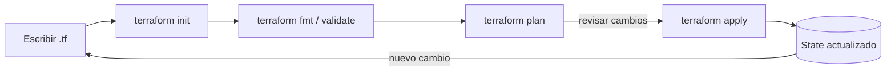

---
tags:
  - iac
  - terraform
  - aws
---

# Infrastructure as Code con Terraform

> Conceptos clave, estructura mínima, *remote state* (estado remoto) y comandos del *workflow* (ciclo de trabajo) de Terraform.

## ¿Qué es?

**Terraform** es una herramienta de **Infrastructure as Code** (IaC, infraestructura como código) creada por HashiCorp. Describes la infraestructura que quieres (redes, servidores, buckets, permisos…) en archivos de texto con el lenguaje **HCL**, y Terraform se encarga de crearla, modificarla o eliminarla en el proveedor cloud.

Es **declarativo** (*declarative*): no le dices *cómo* crear las cosas paso a paso, sino *qué estado final* quieres. Terraform compara ese estado deseado con lo que ya existe y calcula los cambios necesarios.

Para compararlo con otras herramientas (CloudFormation, Bicep, Pulumi, Terragrunt) ver [Infrastructure as Code: panorama y herramientas](infraestructura-como-codigo.md).

Ventajas frente a crear recursos a mano en la consola:

- **Reproducible**: el mismo código crea el mismo entorno (dev, staging, prod).
- **Versionado**: los cambios de infraestructura pasan por Git y por *pull requests* (solicitudes de cambio revisadas).
- **Revisable**: `terraform plan` muestra qué va a cambiar antes de tocar nada.
- **Multi-cloud** (varias nubes): funciona con AWS, Azure, GCP, Kubernetes, GitHub y cientos de providers más.

!!! info "Terraform y OpenTofu"
    En 2023 HashiCorp cambió la licencia de Terraform a BSL (*Business Source License*). La comunidad creó **OpenTofu**, un *fork* (copia independiente del proyecto) *open source* bajo la Linux Foundation que es compatible con la mayoría del código HCL (el comando es `tofu` en lugar de `terraform`).

## Conceptos clave

| Concepto | Qué es | Ejemplo |
| --- | --- | --- |
| **Provider** (proveedor) | Plugin que habla con la API de un servicio | `hashicorp/aws`, `hashicorp/azurerm`, `hashicorp/google` |
| **Resource** (recurso) | Un objeto de infraestructura que Terraform crea y gestiona | `aws_s3_bucket`, `aws_instance` |
| **Data source** (fuente de datos) | Lee información de algo que ya existe, sin gestionarlo | `data "aws_ami"` para buscar la última AMI |
| **Variable** | Parámetro de entrada para no repetir valores fijos | `var.region`, `var.entorno` |
| **Output** (salida) | Valor que Terraform muestra al terminar (o comparte con otros modules) | ARN de un bucket, IP de un servidor |
| **State** (estado) | Archivo (`terraform.tfstate`) donde Terraform guarda qué recursos creó y su estado real | Local o en un *remote backend* |
| **Backend** | Dónde se guarda el state | `local`, `s3`, `azurerm`, `gcs`, HCP Terraform |
| **Module** (módulo) | Carpeta de archivos `.tf` reutilizable | Un module `vpc` usado en varios entornos |

## Estructura de archivos

Terraform lee **todos** los `.tf` de la carpeta en la que se ejecuta; los nombres son una convención, no una obligación.

```text
proyecto/
├── main.tf            # recursos principales
├── providers.tf       # bloque terraform {} y providers
├── variables.tf       # declaración de variables
├── outputs.tf         # outputs (valores de salida)
├── terraform.tfvars   # valores de las variables (no se sube a Git si tiene datos sensibles)
└── .terraform.lock.hcl  # lock file: versiones exactas de providers (SÍ se sube a Git)
```

## Workflow (ciclo de trabajo)

HashiCorp resume el *core workflow* en tres pasos: **Write → Plan → Apply** (escribir, planificar, aplicar).

```bash
terraform init      # descarga providers, configura el backend e inicializa
terraform fmt       # formatea el código
terraform validate  # valida la sintaxis y la coherencia
terraform plan      # muestra los cambios previstos
terraform apply     # aplica los cambios
terraform destroy   # elimina la infraestructura
```



!!! tip "Guarda el plan y aplica exactamente ese plan"
    En pipelines CI/CD usa `terraform plan -out=plan.tfplan` y luego `terraform apply plan.tfplan`. Así se aplica justo lo que se revisó, sin sorpresas si algo cambió entre medias.

Cómo leer la salida de `plan`:

| Símbolo | Significado |
| --- | --- |
| `+` | Se crea el recurso |
| `-` | Se elimina el recurso |
| `~` | Se modifica *in-place* (en el sitio, sin recrearlo) |
| `-/+` | *Replace*: se destruye y se vuelve a crear (revisar con cuidado: puede haber pérdida de datos) |

## Ejemplo mínimo

Un S3 bucket privado, con *versioning* (versionado) y parametrizado con variables.

```hcl title="providers.tf"
terraform {
  required_version = ">= 1.10"

  required_providers {
    aws = {
      source  = "hashicorp/aws"
      version = "~> 6.0"
    }
  }
}

provider "aws" {
  region = var.region

  # Tags (etiquetas) que se aplican a todos los recursos
  default_tags {
    tags = {
      Proyecto = "cuaderno-notas"
      Entorno  = var.entorno
      Gestion  = "terraform"
    }
  }
}
```

```hcl title="variables.tf"
variable "region" {
  description = "Región de AWS donde se despliega"
  type        = string
  default     = "eu-west-1"
}

variable "entorno" {
  description = "Nombre del entorno (dev, staging, prod)"
  type        = string
  default     = "dev"

  validation {
    condition     = contains(["dev", "staging", "prod"], var.entorno)
    error_message = "El entorno debe ser dev, staging o prod."
  }
}
```

```hcl title="main.tf"
resource "aws_s3_bucket" "notas" {
  # Los nombres de bucket son únicos a nivel mundial
  bucket = "cuaderno-notas-${var.entorno}-ejemplo"
}

resource "aws_s3_bucket_versioning" "notas" {
  bucket = aws_s3_bucket.notas.id

  versioning_configuration {
    status = "Enabled"
  }
}

resource "aws_s3_bucket_public_access_block" "notas" {
  bucket = aws_s3_bucket.notas.id

  block_public_acls       = true
  block_public_policy     = true
  ignore_public_acls      = true
  restrict_public_buckets = true
}
```

```hcl title="outputs.tf"
output "bucket_arn" {
  description = "ARN del bucket creado"
  value       = aws_s3_bucket.notas.arn
}
```

!!! note "Referencias entre recursos"
    `aws_s3_bucket.notas.id` hace que Terraform sepa que el versionado depende del bucket y lo cree después. No hace falta indicar el orden a mano.

### Dar valor a las variables

En orden de prioridad (la última gana):

1. `default` en `variables.tf`.
2. Variables de entorno: `export TF_VAR_entorno=staging`.
3. Archivo `terraform.tfvars` o `*.auto.tfvars` (se cargan automáticamente).
4. Archivo indicado con `-var-file=prod.tfvars`.
5. Línea de comandos: `terraform apply -var="entorno=prod"`.

Para valores sensibles (contraseñas, tokens) marca la variable con `sensitive = true` para que no aparezca en la salida de `plan` y `apply`. Aun así, **el valor queda guardado en el state**.

## Remote state (estado remoto)

Por defecto el state se guarda en un archivo local `terraform.tfstate`. Eso no sirve para trabajar en equipo ni en CI/CD: cada persona tendría su propia copia y se podrían pisar cambios.

La solución es un **remote backend** (backend remoto) con **state locking** (bloqueo del estado), para que solo una ejecución pueda modificar el state a la vez.

```hcl title="backend.tf"
terraform {
  backend "s3" {
    bucket       = "mi-empresa-terraform-state"
    key          = "cuaderno-notas/dev/terraform.tfstate"
    region       = "eu-west-1"
    encrypt      = true
    use_lockfile = true # bloqueo nativo en S3 (Terraform >= 1.10)
  }
}
```

!!! warning "DynamoDB para el locking está deprecated (obsoleto)"
    Antes se usaba una tabla DynamoDB (`dynamodb_table`) para el locking. Desde Terraform 1.10 el backend S3 puede bloquear con un archivo `.tflock` en el propio bucket (`use_lockfile = true`) y la opción de DynamoDB está marcada como *deprecated* (obsoleta: se eliminará en una versión futura).

Buenas prácticas para el bucket del state:

- Activar **versioning** (versionado, para recuperar un state corrupto o borrado).
- Activar **encryption** (cifrado) y **Block Public Access** (bloqueo de acceso público).
- Restringir con IAM quién puede leerlo: el state contiene valores sensibles en texto plano.
- Crearlo **fuera** del proyecto que lo usa (a mano o con un proyecto Terraform aparte), para no tener el problema del huevo y la gallina (*chicken-and-egg problem*).

Equivalentes en otras nubes: backend `azurerm` (Azure Storage) y `gcs` (Google Cloud Storage), ambos con bloqueo incluido.

## Qué subir a Git

```gitignore title=".gitignore"
# Carpeta local de providers y módulos
.terraform/

# State y sus copias de seguridad
*.tfstate
*.tfstate.*

# Variables con posibles secretos
*.tfvars
*.tfvars.json

# Planes guardados (pueden contener secretos)
*.tfplan

# Logs de fallos
crash.log
crash.*.log

# Overrides locales
override.tf
override.tf.json
*_override.tf
*_override.tf.json
```

!!! danger "Nunca subas el state ni credenciales"
    El state y los `.tfvars` pueden contener contraseñas, claves y datos internos. Las credenciales del proveedor tampoco van en el código: usa *profiles* (perfiles) de AWS CLI, variables de entorno o, en CI/CD, **OIDC** (*OpenID Connect*) con roles temporales.

!!! tip "El lock file sí se sube"
    El *dependency lock file* (archivo de bloqueo de dependencias) `.terraform.lock.hcl` fija las versiones exactas de los providers. Subirlo a Git garantiza que todo el equipo y el pipeline usen las mismas versiones. Se actualiza con `terraform init -upgrade`.

## Modules (módulos)

Un module es una carpeta con archivos `.tf` que se reutiliza pasándole variables. Se pueden usar modules propios o del [Terraform Registry](https://registry.terraform.io/browse/modules).

```hcl
module "vpc" {
  source  = "terraform-aws-modules/vpc/aws"
  version = "~> 6.0"

  name = "vpc-${var.entorno}"
  cidr = "10.0.0.0/16"

  azs             = ["eu-west-1a", "eu-west-1b"]
  private_subnets = ["10.0.1.0/24", "10.0.2.0/24"]
  public_subnets  = ["10.0.101.0/24", "10.0.102.0/24"]
}
```

Fija siempre la `version` de los modules externos, igual que la de los providers, para evitar cambios inesperados.

## Import (importar recursos existentes)

Si un recurso se creó a mano en la consola, se puede traer a Terraform con un bloque `import` (Terraform >= 1.5), que pasa por `plan` como cualquier otro cambio:

```hcl
import {
  to = aws_s3_bucket.notas
  id = "cuaderno-notas-dev-ejemplo"
}
```

`terraform plan -generate-config-out=generado.tf` puede generar el código HCL del recurso importado como punto de partida.

## Errores comunes

- **Cambiar recursos a mano en la consola**: el state deja de coincidir con la realidad: es lo que se llama **drift** (desviación). `terraform plan` lo detecta y lo intentará revertir.
- **No revisar el `plan`**: un `-/+` en una base de datos puede significar borrarla y crearla de nuevo.
- **Renombrar un recurso en el código**: Terraform lo interpreta como "borrar el viejo y crear uno nuevo". Usa un bloque `moved` para indicarle que es el mismo:

    ```hcl
    moved {
      from = aws_s3_bucket.notas
      to   = aws_s3_bucket.cuaderno
    }
    ```

- **No hacer *version pinning*** (fijar las versiones de los providers): una nueva versión mayor puede romper el código.
- **Un solo state gigante para todo**: cuanto más grande, más lento y más riesgo en cada cambio. Separa por entorno y por componente.

## Seguridad

Antes de aplicar, conviene escanear el código en busca de *misconfigurations* (malas configuraciones) (buckets públicos, puertos abiertos, cifrado desactivado):

- **Checkov**: `checkov -d .`
- **Trivy** (incluye las reglas de tfsec, que ya no recibe desarrollo nuevo): `trivy config .`

Ver más en [Escaneo de seguridad en el pipeline](../../devsecops/escaneos/escaneo-en-pipeline.md) y en los [comandos de seguridad](../../recursos/comandos/seguridad.md).

## Relación con otras secciones

| Enfoque | Qué se mira desde ahí | Nota |
| --- | --- | --- |
| Cloud (el control) | Los recursos que Terraform crea: redes, VMs, roles y políticas de IAM, estructura de cuentas | [Redes en la nube](../../cloud/redes-y-datos/redes.md), [Máquinas virtuales](../../cloud/computo/maquinas-virtuales.md), [IAM: AWS, Azure y GCP](../../cloud/fundamentos/iam-comparativa.md), [Gobernanza](../../cloud/operacion-y-gobierno/gobernanza.md) |
| DevOps (la automatización) | Otras herramientas de IaC, entornos, pruebas y el pipeline que aplica los cambios; el rol de cada pipeline también se define con Terraform | [Infrastructure as Code: panorama y herramientas](infraestructura-como-codigo.md), [Terraform workspaces](terraform-workspaces.md), [Pruebas de infraestructura](pruebas-infraestructura.md), [Pipeline CI/CD con GitHub Actions](../ci-cd/ci-cd-github-actions.md) |
| DevSecOps (la verificación) | Escaneo del código Terraform, policy as code, drift y OIDC desde el pipeline | [Seguridad de IaC](../../devsecops/infraestructura-y-contenedores/seguridad-iac.md), [Secretos e identidades](../../devsecops/identidades-y-pipeline/secretos-identidades.md) |
| Laboratorios (la práctica) | Practicar esto paso a paso | [Lab 08: Terraform sin nube: providers locales y workspaces](../../laboratorios/devops/terraform-local-workspaces.md), [Lab 09: Terraform en AWS con remote state en S3](../../laboratorios/devops/terraform-aws-backend-remoto.md), [Lab 13: Desplegar en AWS desde GitHub Actions con OIDC (sin llaves)](../../laboratorios/devsecops/oidc-github-aws.md), [Lab 16: Auditar tu cuenta cloud con Prowler (CSPM)](../../laboratorios/devsecops/cspm-prowler.md), [Lab 17: AWS: VPC con subnets públicas y privadas y una EC2](../../laboratorios/cloud/aws-vpc-ec2.md), [Lab 18: AWS: API serverless con Lambda, API Gateway y DynamoDB](../../laboratorios/cloud/aws-serverless-api.md) |

## Referencias

- [Documentación de Terraform](https://developer.hashicorp.com/terraform/docs)
- [Terraform Registry](https://registry.terraform.io/)
- [Tutoriales oficiales: Get Started with AWS](https://developer.hashicorp.com/terraform/tutorials/aws-get-started)
- [Backend S3](https://developer.hashicorp.com/terraform/language/backend/s3)
- [Provider AWS](https://registry.terraform.io/providers/hashicorp/aws/latest/docs)
- [OpenTofu](https://opentofu.org/)
- [Guía de comandos de Terraform](../../recursos/comandos/terraform.md)
