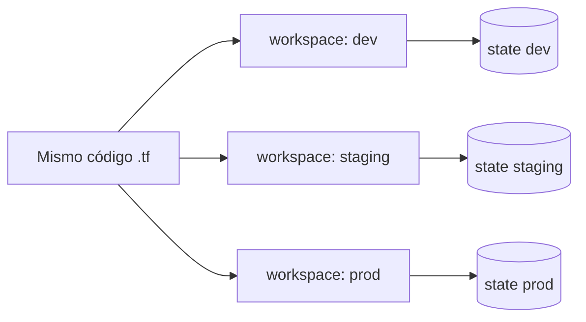

---
tags:
  - iac
  - terraform
---

# Terraform workspaces

> Cómo usar *workspaces* (espacios de trabajo) para tener varios *states* con el mismo código, cuándo conviene y cuándo es mejor separar los entornos de otra forma.

## ¿Qué es un workspace?

En Terraform, un **workspace** es un **state** (estado) independiente asociado a la misma configuración. Con un único conjunto de archivos `.tf` puedes tener, por ejemplo, un state para `dev`, otro para `staging` y otro para `prod`, y cada uno gestiona su propia copia de la infraestructura.

Todo proyecto empieza en un workspace llamado **`default`**, que no se puede borrar.



!!! warning "CLI workspaces ≠ HCP Terraform workspaces"
    Esta nota trata los **CLI workspaces** (los del comando `terraform workspace`). En **HCP Terraform** (antes *Terraform Cloud*) un *workspace* es otra cosa: una unidad completa con su propia configuración, variables, permisos, historial de *runs* (ejecuciones) y state. Comparten nombre pero no funcionan igual.

Para los conceptos básicos de Terraform (*state*, *backend*, *modules*…) ver [Infrastructure as Code con Terraform](terraform-basico.md).

## Comandos

| Comando | Descripción |
| --- | --- |
| `terraform workspace show` | Muestra el workspace activo |
| `terraform workspace list` | Lista los workspaces (el activo aparece con `*`) |
| `terraform workspace new <nombre>` | Crea un workspace y cambia a él |
| `terraform workspace select <nombre>` | Cambia a un workspace existente |
| `terraform workspace select -or-create <nombre>` | Cambia al workspace y lo crea si no existe (Terraform >= 1.4) |
| `terraform workspace delete <nombre>` | Borra un workspace (su state debe estar vacío) |

También se puede elegir el workspace con la variable de entorno `TF_WORKSPACE`, útil en pipelines CI/CD:

```bash
export TF_WORKSPACE=staging
terraform plan
```

## Dónde se guarda cada state

Cada workspace tiene su propio archivo de state dentro del mismo *backend*:

| Backend | Ruta del state del workspace `dev` |
| --- | --- |
| `local` | `terraform.tfstate.d/dev/terraform.tfstate` |
| `s3` | `env:/dev/<key>` (el prefijo se cambia con `workspace_key_prefix`) |
| `azurerm` | `<key>env:dev` |
| `gcs` | `<prefix>/dev.tfstate` |

El workspace `default` usa la ruta normal del backend (por ejemplo, el `key` tal cual en S3).

!!! note "Mismo backend para todos"
    Todos los workspaces comparten el **mismo backend** y, por lo tanto, las **mismas credenciales** de acceso al state. Quien puede leer el state de `dev` también puede leer el de `prod`. Esto es clave para decidir si usar workspaces o no (ver más abajo).

## Usar el workspace en el código

El nombre del workspace activo está disponible como `terraform.workspace`. Lo habitual es usarlo para:

- Poner nombres únicos a los recursos.
- Elegir valores distintos por entorno con un *map* (mapa) en `locals`.

```hcl title="main.tf"
locals {
  entorno = terraform.workspace

  config = {
    dev = {
      instance_type  = "t4g.micro"
      instance_count = 1
    }
    staging = {
      instance_type  = "t4g.small"
      instance_count = 1
    }
    prod = {
      instance_type  = "m7g.large"
      instance_count = 3
    }
  }

  # Falla con un error claro si el workspace no está en el mapa
  actual = local.config[local.entorno]
}

# Última AMI de Amazon Linux 2023 para ARM (Graviton)
data "aws_ami" "al2023" {
  most_recent = true
  owners      = ["amazon"]

  filter {
    name   = "name"
    values = ["al2023-ami-*-arm64"]
  }
}

resource "aws_instance" "app" {
  count         = local.actual.instance_count
  ami           = data.aws_ami.al2023.id
  instance_type = local.actual.instance_type

  tags = {
    Name    = "app-${local.entorno}-${count.index}"
    Entorno = local.entorno
  }
}
```

!!! tip "Bloquea el workspace `default`"
    Si nadie debería desplegar en `default`, añade una validación para evitar despliegues por accidente:

    ```hcl
    resource "terraform_data" "workspace_valido" {
      lifecycle {
        precondition {
          condition     = terraform.workspace != "default"
          error_message = "Selecciona un workspace (dev, staging o prod) antes de aplicar."
        }
      }
    }
    ```

### Un archivo de variables por workspace

Otra opción es mantener un `.tfvars` por entorno y elegirlo según el workspace activo:

```text
proyecto/
├── main.tf
├── variables.tf
├── dev.tfvars
├── staging.tfvars
└── prod.tfvars
```

```bash
terraform workspace select dev
terraform plan -var-file="$(terraform workspace show).tfvars"
```

## Flujo de trabajo típico

```bash
terraform init                         # una sola vez por carpeta
terraform workspace new dev            # crear el entorno
terraform plan -out=dev.tfplan
terraform apply dev.tfplan

terraform workspace select prod        # cambiar de entorno
terraform workspace show               # comprobar SIEMPRE antes de aplicar
terraform plan -out=prod.tfplan
terraform apply prod.tfplan
```

### En un pipeline CI/CD

En CI/CD el workspace se selecciona **siempre de forma explícita**, nunca se confía en el que quedó activo:

```yaml title=".github/workflows/terraform.yml (fragmento)"
jobs:
  plan:
    runs-on: ubuntu-latest
    strategy:
      matrix:
        entorno: [dev, staging]
    steps:
      - uses: actions/checkout@v7
      - uses: hashicorp/setup-terraform@v3
      - run: terraform init
      - run: terraform workspace select -or-create ${{ matrix.entorno }}
      - run: terraform plan -var-file=${{ matrix.entorno }}.tfvars
```

Ver también [Integración continua](../ci-cd/integracion-continua.md) y el workflow comentado en [Anatomía de los workflows de GitHub Actions](../../recursos/anatomia/github-actions.md).

## ¿Cuándo usar workspaces?

HashiCorp indica que los CLI workspaces **no son adecuados** para separar entornos que necesitan **credenciales o controles de acceso distintos**, como `dev` y `prod` en cuentas diferentes.

| Situación | ¿Workspaces? |
| --- | --- |
| Entornos casi idénticos en la misma cuenta, misma gente con acceso | Sí |
| Entornos temporales (*ephemeral environments*) por rama o por *pull request* | Sí, es su mejor uso |
| Probar un cambio sin tocar el state principal | Sí |
| `dev` y `prod` en **cuentas o suscripciones distintas** | Mejor no |
| `prod` debe tener permisos más restringidos que `dev` | Mejor no |
| Los entornos tienen **arquitecturas diferentes** (no solo tamaños) | Mejor no: el código se llena de condicionales |

### Alternativa: un directorio por entorno

La alternativa más usada en equipos es tener **un directorio por entorno** (`envs/dev/`, `envs/prod/`) que reutiliza los mismos *modules*, cada uno con su propio backend: el state de `prod` puede estar en otra cuenta y con permisos propios. La estructura completa del repositorio está en [Infrastructure as Code: estructura de un repositorio de IaC](infraestructura-como-codigo.md#estructura-de-un-repositorio-de-iac).

| | CLI workspaces | Directorio por entorno |
| --- | --- | --- |
| Código duplicado | Ninguno | Poco (solo la llamada a los modules) |
| Backend y credenciales por entorno | No, compartidos | Sí |
| Diferencias entre entornos | Con `locals` o condicionales | Explícitas en cada directorio |
| Riesgo de aplicar en el entorno equivocado | Alto si no se revisa el workspace activo | Bajo: estás en otra carpeta |
| Ideal para | Entornos temporales y casi idénticos | Entornos permanentes, sobre todo `prod` |

Herramientas como **Terragrunt** automatizan este patrón de directorios para evitar repetir la configuración del backend (ver [Infrastructure as Code: panorama y herramientas](infraestructura-como-codigo.md#terragrunt)).

## Errores comunes

- **Aplicar en el workspace equivocado**: `terraform apply` no avisa de en qué workspace estás. Revisa con `terraform workspace show` o muestra el workspace en el *prompt* (indicador de la terminal).
- **Olvidar que `default` existe**: si nunca seleccionas un workspace, despliegas en `default` sin darte cuenta.
- **Nombres de recursos repetidos**: si no incluyes `terraform.workspace` en los nombres, dos workspaces intentarán crear recursos con el mismo nombre (por ejemplo, un S3 bucket) y fallará.
- **Borrar un workspace con recursos**: `terraform workspace delete` se niega si el state no está vacío. Primero ejecuta `terraform destroy` en ese workspace. Con `-force` se borra igual, pero los recursos quedan **huérfanos** (*orphaned*): siguen existiendo y cobrándose, sin que Terraform los gestione.
- **Usar workspaces como única barrera entre `dev` y `prod`**: comparten backend y credenciales; un error de permisos afecta a todos.

## Relación con otras secciones

| Enfoque | Qué se mira desde ahí | Nota |
| --- | --- | --- |
| Cloud (el control) | Separar entornos en cuentas, suscripciones o proyectos distintos con sus propios permisos | [Gobernanza](../../cloud/operacion-y-gobierno/gobernanza.md), [IAM: AWS, Azure y GCP](../../cloud/fundamentos/iam-comparativa.md) |
| DevOps (la automatización) | Conceptos de Terraform, alternativas como Terragrunt y entornos efímeros por pull request | [Terraform](terraform-basico.md), [Infrastructure as Code: panorama y herramientas](infraestructura-como-codigo.md), [Pruebas de infraestructura](pruebas-infraestructura.md) |
| DevSecOps (la verificación) | Aislamiento de entornos y credenciales distintas para `prod` en el pipeline | [Seguridad del pipeline](../../devsecops/identidades-y-pipeline/seguridad-pipeline.md), [Seguridad de IaC](../../devsecops/infraestructura-y-contenedores/seguridad-iac.md) |
| Laboratorios (la práctica) | Practicar esto paso a paso | [Lab 08: Terraform sin nube: providers locales y workspaces](../../laboratorios/devops/terraform-local-workspaces.md), [Lab 09: Terraform en AWS con remote state en S3](../../laboratorios/devops/terraform-aws-backend-remoto.md) |

## Referencias

- [Workspaces (documentación de Terraform)](https://developer.hashicorp.com/terraform/language/state/workspaces)
- [Comando `terraform workspace`](https://developer.hashicorp.com/terraform/cli/commands/workspace)
- [HCP Terraform workspaces](https://developer.hashicorp.com/terraform/cloud-docs/workspaces)
- [Backend S3: `workspace_key_prefix`](https://developer.hashicorp.com/terraform/language/backend/s3)
- [Infrastructure as Code con Terraform](terraform-basico.md)
- [Guía de comandos de Terraform](../../recursos/comandos/terraform.md)
