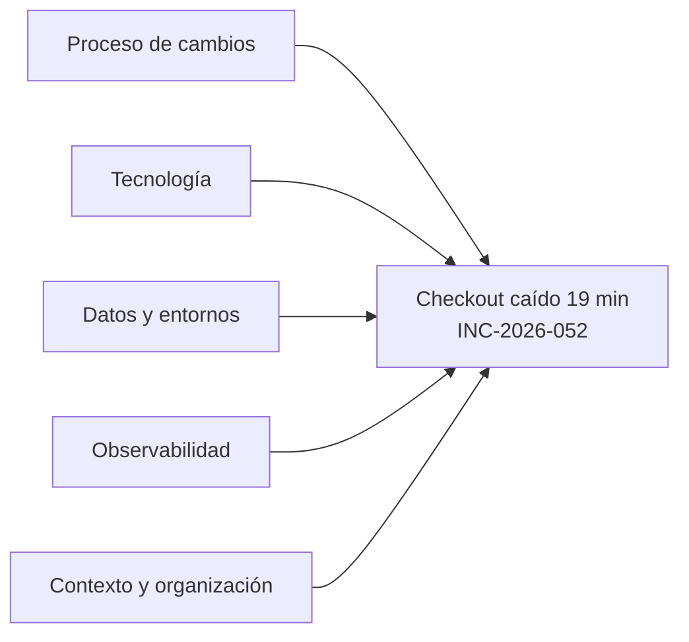
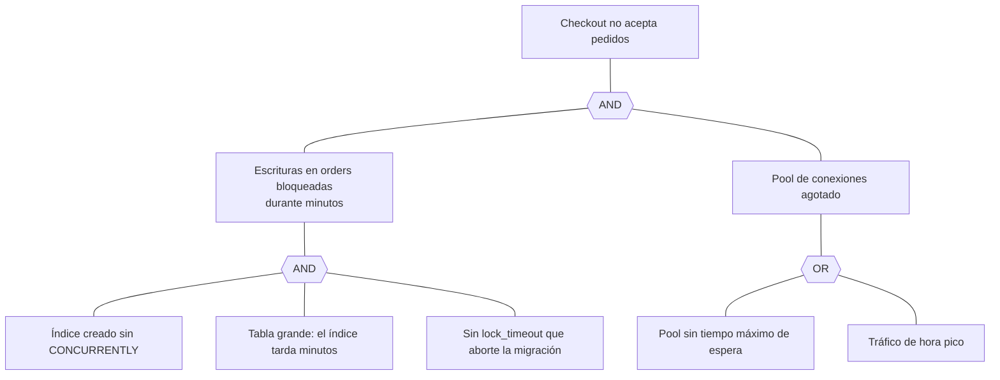
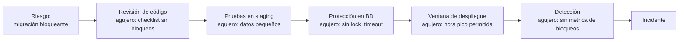

---
tags:
  - sre
  - incidentes
  - postmortem
  - rca
---

# Análisis de causa raíz (RCA)

> Por qué "la causa raíz" casi nunca es una sola, y cómo usar 5 porqués, Ishikawa, fault tree, timeline analysis, change analysis y el modelo del queso suizo sobre un mismo incidente, evitando los sesgos más comunes.

## ¿Qué es?

**RCA** (*Root Cause Analysis*, análisis de causa raíz) es el conjunto de técnicas para entender **por qué** ocurrió un incidente, más allá del síntoma, con el fin de decidir qué cambiar. Es la parte analítica del [postmortem](postmortem.md): el postmortem documenta y comparte; el RCA investiga.

Durante el incidente **no** se hace RCA: primero se mitiga (ver [Operación y fiabilidad (SRE)](operacion-sre.md#ciclo-de-vida)). Para el diagnóstico en caliente, ver [Troubleshooting](troubleshooting.md).

## Por qué "una sola causa raíz" es una simplificación

El nombre sugiere que existe **una** causa y que, si la arreglas, el problema desaparece. En sistemas de software modernos casi nunca es así.

Richard Cook, médico e investigador de seguridad, lo resumió en *How Complex Systems Fail* (1998), un texto corto de 18 puntos que se cita mucho en SRE. Algunos de ellos:

- Los sistemas complejos **siempre** contienen fallos latentes; funcionan "en modo degradado" casi todo el tiempo.
- Un desastre requiere **varios fallos** combinados; cada defensa por separado suele bastar para evitarlo.
- Atribuir el accidente a "una causa raíz" es **fundamentalmente incorrecto**: hay varias contribuciones, cada una necesaria pero solo suficientes **juntas**.
- La **retrospectiva sesga** la evaluación del desempeño humano: después todo parece obvio.
- Las personas operadoras **crean** la seguridad cada día, adaptándose; no son solo fuente de errores.

Por eso muchos equipos hablan de **contributing factors** (factores contribuyentes) en vez de *root cause*. John Allspaw lo llama "cada uno necesario, pero solo conjuntamente suficiente".

!!! note "¿Entonces sobra el término RCA?"
    No: es el nombre que vas a ver en ITIL, en contratos y en herramientas. Úsalo sabiendo que el resultado es una **lista de factores**, no una única frase.

## El incidente de ejemplo

Todas las técnicas se aplican al mismo incidente ficticio:

!!! example "INC-2026-052: el checkout no acepta pedidos durante 19 minutos"
    Un martes a las 17:40 UTC (hora pico) el pipeline despliega una versión que incluye una migración de base de datos: `CREATE INDEX idx_orders_customer ON orders (customer_id);` sobre una tabla PostgreSQL de 40 millones de filas. Un `CREATE INDEX` sin `CONCURRENTLY` toma un bloqueo que **impide escribir** en la tabla mientras se construye el índice. Los `INSERT` de pedidos se quedan esperando, ocupan todas las conexiones del pool de la aplicación y, al agotarse el pool, también fallan las lecturas. El checkout devuelve errores 503 durante 19 minutos, hasta que el índice termina. En staging la misma migración tardó 1 segundo, porque la tabla tenía 10 000 filas.

## 5 porqués

La técnica más conocida (viene del sistema de producción de Toyota): preguntar "¿por qué?" sucesivamente partiendo del problema.

| # | Pregunta | Respuesta |
| --- | --- | --- |
| 1 | ¿Por qué falló el checkout? | Porque la aplicación no tenía conexiones libres a la base de datos |
| 2 | ¿Por qué no tenía conexiones? | Porque todas estaban esperando para escribir en `orders` |
| 3 | ¿Por qué esperaban? | Porque una migración creaba un índice con un bloqueo que impide escribir |
| 4 | ¿Por qué se creó el índice así? | Porque la migración no usaba `CONCURRENTLY` y nada en el proceso lo detectó |
| 5 | ¿Por qué nada lo detectó? | Porque en staging la tabla es pequeña y la revisión de migraciones no incluye el riesgo de bloqueos |

### Límites de los 5 porqués

- Produce **una cadena lineal**, y el incidente tiene varias ramas: ¿por qué se desplegó en hora pico? ¿Por qué el pool sin límite de espera tumbó también las lecturas? ¿Por qué no había `lock_timeout`?
- El resultado depende de **quién pregunta**: cada persona sigue la rama que conoce.
- Es fácil **parar en una persona** ("porque el desarrollador no puso `CONCURRENTLY`"), lo que no deja nada que arreglar en el sistema.
- El número 5 es orientativo: a veces bastan 3, a veces hacen falta 7.

!!! tip "Úsalo en ramas"
    Haz varios 5 porqués, uno por cada factor del Ishikawa o del timeline, en vez de una sola cadena.

## Diagrama de Ishikawa (fishbone)

El **diagrama de Ishikawa** (también *fishbone*, espina de pescado, o diagrama de causa-efecto), de Kaoru Ishikawa, organiza los factores por categorías. Las clásicas de manufactura (las "6M": método, máquina, material, mano de obra, medición, medio ambiente) se adaptan bien a software:

| Categoría | Factores contribuyentes |
| --- | --- |
| **Proceso de cambios** | Las migraciones se ejecutan automáticamente en cada despliegue; la checklist de revisión no menciona bloqueos; no hay ventana para migraciones pesadas |
| **Tecnología** | `CREATE INDEX` sin `CONCURRENTLY`; sin `lock_timeout` en la sesión de migraciones; pool de conexiones sin tiempo máximo de espera |
| **Datos y entornos** | Staging con 10 000 filas frente a 40 millones en producción; no se prueba con volumen realista |
| **Observabilidad** | No hay métrica de bloqueos ni de conexiones esperando; la alerta llegó por la tasa de errores, 4 minutos después |
| **Contexto y organización** | Despliegue en hora pico porque el equipo despliega al terminar el día; nueva persona en el equipo sin onboarding sobre migraciones |

## Fault tree analysis

El **fault tree analysis** (FTA, análisis por árbol de fallos) parte del evento no deseado y lo descompone con puertas lógicas: **AND** (hacen falta todas las condiciones) y **OR** (basta una). Muestra qué combinaciones producen el fallo y, por tanto, dónde una sola defensa lo habría evitado.

Lectura: bajo una puerta **AND**, basta con eliminar **una** condición para cortar esa rama. Con `lock_timeout` o con `CONCURRENTLY` no habría habido bloqueo largo. Por eso el FTA es útil para elegir acciones baratas y efectivas. Se usa mucho en ingeniería de seguridad física (aviación, nuclear), donde además se asignan probabilidades a cada hoja; en software basta con la versión cualitativa.

## Timeline analysis

Ordenar los hechos con hora exacta (UTC) y marcar los **huecos**: tiempo en que no pasó nada útil.

| Hora (UTC) | Evento | Hueco o pregunta |
| --- | --- | --- |
| 17:38 | Pipeline aprobado y en marcha | ¿Por qué se despliega en hora pico? |
| 17:40 | Empieza la migración; las escrituras se bloquean | Sin señal de bloqueos |
| 17:41 | Pool agotado; primeros 503 | |
| 17:44 | Alerta de burn rate del SLO de checkout | 4 min sin detectar |
| 17:47 | Guardia reconoce la alerta | |
| 17:47–17:55 | Se revisa el último despliegue de la app; parece sano | 8 min mirando la app, no la base de datos |
| 17:55 | Alguien consulta `pg_stat_activity` y ve el `CREATE INDEX` | ¿Había runbook de bloqueos? No |
| 17:56 | Se decide no cancelarlo porque está "casi terminado" | Decisión con información incompleta: no se sabía cuánto faltaba |
| 17:59 | Termina el índice; las escrituras se liberan | |

El análisis del timeline suele revelar factores que no aparecen en ningún porqué: aquí, la falta de un runbook de bloqueos y la ausencia de información para decidir si cancelar. Para reconstruirlo, ver [Cómo leer logs](leer-logs.md).

## Change analysis: ¿qué cambió?

La mayoría de incidentes empiezan con un cambio: despliegue, configuración, datos, tráfico, dependencia. El **change analysis** (análisis de cambios) compara la situación que falló con la última que funcionó:

| Aspecto | Antes (funcionaba) | Durante el incidente | ¿Relevante? |
| --- | --- | --- | --- |
| Versión de la app | 3.14.0 | 3.15.0 | Sí: incluye la migración |
| Migraciones | Ninguna pesada en meses | Índice sobre `orders` | Sí |
| Tamaño de `orders` | 25 M filas hace un año | 40 M filas | Sí: el mismo patrón antes era más rápido |
| Hora del despliegue | Normalmente mañanas | 17:40, hora pico | Sí |
| Infraestructura | Sin cambios | Sin cambios | No |

Fuentes para responder "¿qué cambió?": historial del pipeline, commits, cambios de configuración, logs de auditoría del proveedor cloud y el registro de cambios de ITSM. Por eso conviene registrar los despliegues automáticamente (ver [Gestión de servicios (ITSM) e ITIL](../../negocio/gestion-servicios-itil.md#itil-devops-y-sre)).

## Modelo del queso suizo

El **Swiss cheese model** (modelo del queso suizo), de James Reason, representa las defensas de un sistema como lonchas de queso: cada una tiene agujeros (debilidades) y el incidente ocurre cuando los agujeros de **varias** lonchas se alinean.

Su valor práctico: cada loncha es un lugar donde poner una acción. No hace falta tapar todos los agujeros; con cerrar bien dos o tres, la alineación se vuelve muy improbable. Distingue también entre **fallos activos** (lo que ocurre en el momento) y **condiciones latentes** (decisiones de diseño y de proceso tomadas mucho antes).

## Comparativa de técnicas

| Técnica | Sirve para | Limitación |
| --- | --- | --- |
| **5 porqués** | Profundizar rápido en una rama | Lineal; depende de quién pregunta |
| **Ishikawa** | Ver todas las categorías de factores | No muestra relaciones ni orden |
| **Fault tree** | Ver combinaciones AND/OR y elegir la defensa más barata | Laborioso en incidentes grandes |
| **Timeline analysis** | Encontrar huecos de detección y decisiones | Necesita buenos datos con hora |
| **Change analysis** | Encontrar el desencadenante | El cambio no siempre es la condición de fondo |
| **Queso suizo** | Explicar por qué fallaron varias defensas | Modelo explicativo, no un método paso a paso |

En la práctica se combinan: timeline y change analysis para los hechos, Ishikawa para no olvidar categorías, 5 porqués en cada rama, y el queso suizo para comunicar el resultado.

## Resultado del análisis: acciones

| Factor | Acción | Tipo |
| --- | --- | --- |
| Índice sin `CONCURRENTLY` | Linter de migraciones en CI que falle si un `CREATE INDEX` no es concurrente en tablas grandes | Prevenir |
| Sin `lock_timeout` | `SET lock_timeout = '5s'` y `statement_timeout` en la sesión de migraciones | Mitigar |
| Datos pequeños en staging | Probar migraciones contra una copia anonimizada de producción | Prevenir |
| Despliegue en hora pico | Migraciones pesadas fuera de hora pico o desacopladas del despliegue de la app | Proceso |
| Sin señal de bloqueos | Métrica y alerta de sesiones esperando bloqueos | Detectar |
| Sin runbook | Runbook "bloqueos en PostgreSQL" con la consulta para identificar y cancelar | Mitigar |

Observa que ninguna acción es "formar a la persona": el linter y el `lock_timeout` protegen a cualquiera que escriba la siguiente migración.

## Sesgos a evitar

| Sesgo | Qué es | Cómo se nota | Antídoto |
| --- | --- | --- | --- |
| **Hindsight bias** (sesgo retrospectivo) | Conociendo el final, todo parece obvio | "Era evidente que el índice iba a bloquear" | Reconstruir qué se sabía **en cada momento** |
| **Outcome bias** (sesgo de resultado) | Juzgar una decisión por su resultado | La misma decisión de no cancelar se habría elogiado si terminaba en 1 minuto | Evaluar la decisión con la información disponible |
| **Confirmation bias** (sesgo de confirmación) | Buscar datos que confirman la primera hipótesis | 8 minutos revisando solo la app | Formular hipótesis alternativas y buscar datos que las refuten |
| **"Error humano" como conclusión** | Parar el análisis en una persona | "Causa raíz: el desarrollador olvidó `CONCURRENTLY`" | Preguntar qué hacía fácil el error y difícil detectarlo |
| **Counterfactuals** (contrafácticos) | Describir lo que no pasó | "Si hubiera revisado…", "debería haber…" | Describir lo que pasó y por qué tenía sentido |

!!! danger "Error humano no es una causa"
    Si la conclusión es "error humano", el análisis no terminó. Una persona distinta, en las mismas condiciones, habría cometido el mismo error. Cambia las condiciones.

## Problem management: RCA como proceso

En ITIL, el RCA es parte de **problem management** (gestión de problemas): identificar la causa de uno o varios incidentes, registrar **known errors** (errores conocidos) y **workarounds** (soluciones temporales), y lanzar los cambios que los eliminan. Ver [Gestión de servicios (ITSM) e ITIL](../../negocio/gestion-servicios-itil.md#incidente-problema-y-solicitud).

| Gestión de incidentes | Gestión de problemas (RCA) |
| --- | --- |
| Restablecer el servicio rápido | Que no vuelva a ocurrir |
| Minutos u horas | Días o semanas |
| Workaround aceptable | Busca el arreglo definitivo |
| Un incidente | Uno o varios incidentes con patrón común |

Un RCA también se puede abrir **sin** incidente grave: cuando la biblioteca de postmortems muestra un patrón (varios SEV3 por la misma causa) o tras un *near miss* (ver [Prácticas para aprender de incidentes](practicas-aprendizaje.md)).

## Relación con otras secciones

| Enfoque | Qué se mira desde ahí | Nota |
| --- | --- | --- |
| Cloud (el control) | Logs de auditoría y métricas nativas para reconstruir hechos y cambios | [Observabilidad nativa](../../cloud/operacion-y-gobierno/observabilidad-nativa.md), [Almacenamiento y datos](../../cloud/redes-y-datos/almacenamiento-datos.md) |
| DevOps (la automatización) | El postmortem que recoge el análisis; cambios y migraciones en el pipeline | [Postmortem](postmortem.md), [Troubleshooting](troubleshooting.md), [Cómo leer logs](leer-logs.md), [Despliegue continuo](../ci-cd/despliegue-continuo.md), [Observabilidad](observabilidad.md) |
| DevSecOps (la verificación) | Análisis posterior a incidentes de seguridad y controles en el pipeline | [Detección y respuesta](../../devsecops/gobierno-y-respuesta/deteccion-respuesta.md), [Seguridad del pipeline](../../devsecops/identidades-y-pipeline/seguridad-pipeline.md) |
| Negocio TI (el porqué) | Problem management, known errors y registro de riesgos | [Gestión de servicios (ITSM) e ITIL](../../negocio/gestion-servicios-itil.md), [Gobierno y riesgo de TI](../../negocio/gobierno-riesgo-ti.md) |
| Laboratorios (la práctica) | Practicar esto paso a paso | [Lab 21: Game day: incidente simulado, troubleshooting y postmortem](../../laboratorios/operacion/game-day-incidente.md) |

## Referencias

- [Richard Cook: How Complex Systems Fail](https://how.complexsystems.fail/)
- [John Allspaw: Each necessary, but only jointly sufficient](https://www.kitchensoap.com/2012/02/10/each-necessary-but-only-jointly-sufficient/)
- [Google SRE Book: Postmortem Culture](https://sre.google/sre-book/postmortem-culture/)
- [Google SRE Workbook: Postmortem Culture](https://sre.google/workbook/postmortem-culture/)
- [Atlassian Incident Handbook: Postmortems](https://www.atlassian.com/incident-management/handbook/postmortems)
- [Etsy: Debriefing Facilitation Guide (PDF)](https://extfiles.etsy.com/DebriefingFacilitationGuide.pdf)
- [Learning from Incidents in Software](https://www.learningfromincidents.io/)
- [PostgreSQL: CREATE INDEX (construcción concurrente)](https://www.postgresql.org/docs/current/sql-createindex.html#SQL-CREATEINDEX-CONCURRENTLY)
- [PostgreSQL: lock_timeout](https://www.postgresql.org/docs/current/runtime-config-client.html#GUC-LOCK-TIMEOUT)
