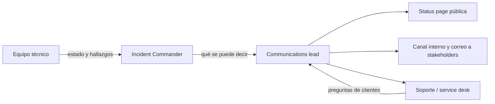

---
tags:
  - sre
  - incidentes
  - comunicacion
---

# Comunicación durante incidentes

> Roles durante un incidente, quién comunica, por qué canales y con qué frecuencia; status page pública e interna; plantillas para clientes y para stakeholders internos en cada fase; qué no decir; incidentes de seguridad y relación con los SLA.

## ¿Qué es?

Durante un incidente hay dos trabajos en paralelo: **arreglar** el problema y **contar** lo que pasa. Si nadie se encarga de lo segundo, ocurren dos cosas: los clientes y el resto de la empresa se enteran por redes sociales o por soporte, y las personas que están arreglando el problema reciben decenas de mensajes de "¿cómo va?", que las interrumpen.

Una buena comunicación de incidentes es **proactiva** (avisas antes de que pregunten), **regular** (con una cadencia conocida), **honesta** (lo que sabes y lo que no) y **consistente** (un único origen de la verdad).

Las severidades y el ciclo de vida de un incidente están en [Operación y fiabilidad (SRE)](operacion-sre.md#incident-management-gestion-de-incidentes). Esta nota recoge los roles del incidente y se centra en la comunicación.

## Roles

| Rol | Qué hace |
| --- | --- |
| **Incident Commander** (IC, responsable del incidente) | Coordina, decide y asigna tareas; **no** arregla el problema con sus manos: mantiene la visión global. Decide la severidad, aprueba qué se comunica y cuándo se declara resuelto. No redacta los mensajes en incidentes grandes |
| **Operations lead** / responsables técnicos | Investigan y aplican la mitigación |
| **Communications lead** (responsable de comunicación) | Redacta y publica las actualizaciones para *stakeholders* (partes interesadas), soporte y clientes (status page) con una cadencia fija, y filtra las preguntas de fuera para que no lleguen a quienes investigan |
| **Customer Liaison** (enlace con clientes) | En el modelo de PagerDuty: status page pública, soporte y clientes con contratos especiales |
| **Internal Liaison** (enlace interno) | En el modelo de PagerDuty: dirección, ventas, soporte y otros equipos internos |
| **Scribe** (escriba) | Registra la línea de tiempo, las decisiones y las horas; su registro alimenta las actualizaciones y el [postmortem](postmortem.md) |

En incidentes pequeños una misma persona cubre varios roles (en un SEV3 el IC suele hacer todo); lo importante es que esté claro quién es el IC. En un SEV1 conviene separar al menos IC y communications lead.



## Canales

| Canal | Para qué | Buenas prácticas |
| --- | --- | --- |
| **Canal de chat dedicado** (Slack, Teams) | Coordinación técnica y registro escrito | Uno por incidente, con nombre predecible (`#inc-2026-052-checkout`); fijar arriba el resumen, el IC y el enlace a la status page |
| **War room** / **bridge** (sala de crisis, llamada permanente) | Hablar en tiempo real en SEV1/SEV2 | Enlace fijo en el canal; el IC modera; las decisiones se escriben también en el chat |
| **Canal de anuncios de incidentes** | Avisar a toda la empresa de que hay un incidente y dónde seguirlo | Solo declaraciones y cambios de estado, sin conversación |
| **Status page interna** | Estado para empleados (incluye servicios internos) | Evita que soporte y ventas pregunten en el canal técnico |
| **Status page pública** | Clientes y usuarios | Única fuente oficial hacia fuera |
| **Correo o mensaje directo** | Clientes clave, dirección, reguladores | Basado en el mismo texto que la status page |

!!! tip "Separa coordinación de conversación"
    El canal técnico es para quienes trabajan en el incidente. Las preguntas de otros equipos van a un hilo o canal aparte que atiende el communications lead.

## Status page

Una **status page** (página de estado) muestra el estado de cada componente y el historial de incidentes. Las herramientas suelen usar estos estados (la nomenclatura es la de **Atlassian Statuspage**, que se ha vuelto un estándar de facto):

| Estado del incidente | Significado |
| --- | --- |
| **Investigating** (investigando) | Sabemos que hay un problema y lo estamos mirando |
| **Identified** (identificado) | Sabemos qué lo causa y estamos aplicando una solución |
| **Monitoring** (monitoreando) | Aplicamos la solución y vigilamos que funcione |
| **Resolved** (resuelto) | El servicio funciona con normalidad |

| Estado del componente | Ejemplo |
| --- | --- |
| Operational | Todo normal |
| Degraded performance | Lento, pero funciona |
| Partial outage | Falla para parte de los usuarios o regiones |
| Major outage | Caído para todos |
| Under maintenance | Mantenimiento programado |

Herramientas:

| Tipo | Ejemplos |
| --- | --- |
| SaaS | **Atlassian Statuspage**; muchas plataformas de incidentes y de monitoreo incluyen su propia status page |
| Open source / autoalojadas | **Cachet**, **Uptime Kuma** (monitoreo con status pages), **cState** (página estática generada con Hugo) |

!!! warning "La status page no puede depender de lo que se cae"
    Alójala fuera de tu infraestructura principal (otro proveedor, otra región o un SaaS). Una status page caída junto con el servicio no sirve.

También conviene que el equipo conozca las páginas de estado de sus proveedores: **AWS Health Dashboard**, **Azure Service Health** (y la página pública de estado de Azure) y **Google Cloud Service Health**. Ver [Observabilidad nativa](../../monitoreo/nube/observabilidad-nativa.md).

## Cadencia de actualizaciones

Una actualización regular, aunque diga "seguimos investigando", calma más que el silencio. Indica **siempre** cuándo será la siguiente.

| Severidad | Primera comunicación | Actualizaciones | Canales |
| --- | --- | --- | --- |
| SEV1 | En los primeros 5–10 min tras declarar | Cada 15–30 min | Status page pública, interna, dirección, clientes clave |
| SEV2 | En los primeros 15–30 min | Cada 30–60 min | Status page (pública si el cliente lo nota), interna |
| SEV3 | Si el cliente lo nota | Al cambiar de estado | Interna; pública opcional |
| SEV4 | No aplica | No aplica | Ticket |

Como referencia, PagerDuty publica un aviso inicial en los **5 minutos** siguientes a abrir la llamada del incidente, una actualización de alcance otros 5 minutos después, y luego actualiza **al menos cada 20 minutos** durante las dos primeras horas. Los números exactos son una decisión de cada organización: acuérdalos antes y escríbelos en el proceso.

## Plantillas de mensajes

Prepáralas **antes** del incidente: bajo presión nadie redacta bien.

### Para clientes (status page)

=== "Investigando"

    ```text
    Investigando: errores al confirmar pedidos
    Estamos investigando un problema que impide a algunos usuarios confirmar pedidos en la web y la app.
    Los pedidos ya confirmados no se ven afectados.
    Próxima actualización: 18:05 UTC o antes si hay novedades.
    ```

=== "Identificado"

    ```text
    Identificado: errores al confirmar pedidos
    Identificamos la causa del problema y estamos aplicando una solución.
    Mientras tanto, es posible que los pedidos fallen o tarden más de lo normal; si ves un error, vuelve a intentarlo en unos minutos.
    Próxima actualización: 18:10 UTC.
    ```

=== "Monitoreando"

    ```text
    Monitoreando: errores al confirmar pedidos
    Aplicamos una solución y los pedidos se están confirmando con normalidad desde las 17:59 UTC.
    Seguimos vigilando el servicio.
    Próxima actualización: 18:30 UTC.
    ```

=== "Resuelto"

    ```text
    Resuelto: errores al confirmar pedidos
    Entre las 17:40 y las 17:59 UTC no fue posible confirmar pedidos en la web ni en la app.
    El servicio funciona con normalidad. No se perdieron datos ni se realizaron cobros duplicados.
    Publicaremos un resumen del análisis en los próximos días. Disculpa las molestias.
    ```

### Para stakeholders internos

```text title="actualizacion-interna.txt"
[SEV1] INC-2026-052 · Checkout · Estado: Identificado · 17:57 UTC
Impacto: el checkout falla para ~100 % de los pedidos desde las 17:41 UTC. Web y app.
Clientes: status page actualizada a las 17:56; soporte tiene el mensaje para responder.
Qué sabemos: una migración de base de datos bloquea las escrituras en la tabla de pedidos.
Qué estamos haciendo: esperando a que termine (estimación 5 min) y preparando su cancelación si no.
Qué necesitamos: nada de momento.
Decisiones pendientes: ninguna.
IC: guardia de plataforma · Comunicación: <nombre> · Canal: #inc-2026-052-checkout
Próxima actualización: 18:10 UTC.
```

La estructura interna fija (impacto, qué sabemos, qué hacemos, qué necesitamos, próxima actualización) permite a dirección leer en 20 segundos.

## Qué no decir

| No digas | Por qué | Mejor |
| --- | --- | --- |
| "Fue culpa de AWS / del proveedor X" | Probablemente no lo sabes aún; además, tu cliente contrató contigo | "Un problema en un componente de infraestructura" (y lo detallas en el postmortem si se confirma) |
| "Un empleado cometió un error" | Culpa a una persona y daña la confianza en el equipo | Describe el impacto, no a quién |
| "Creemos que es la base de datos" (en público) | Especular: si cambia, pierdes credibilidad | Comunica hipótesis solo cuando estén confirmadas |
| "Estará resuelto en 10 minutos" | Un compromiso que no controlas | "Próxima actualización a las 18:30" |
| "No hay pérdida de datos" sin comprobarlo | Si resulta falso, el daño es mucho mayor | "Estamos verificando si hay datos afectados" |
| Detalles técnicos internos (nombres de hosts, IPs, versiones) | No aportan al cliente y pueden ayudar a un atacante | Lenguaje del usuario: qué funciona y qué no |
| Minimizar ("un pequeño problema") | El cliente que no puede pagar no lo vive como pequeño | Describe el impacto con precisión |

!!! danger "Nunca contradigas a la status page"
    Soporte, ventas y redes sociales repiten el mensaje oficial. Si cada uno improvisa, aparecen versiones distintas del mismo incidente.

## Incidentes de seguridad

Cuando el incidente es (o podría ser) de seguridad, la comunicación cambia:

- **Círculo reducido**: el canal es privado y solo entra quien lo necesita; puede haber un atacante leyendo los canales habituales si una cuenta está comprometida.
- **Legal, privacidad y seguridad deciden** qué se comunica, a quién y cuándo. Puede haber **plazos legales de notificación** a autoridades y a afectados (por ejemplo, el RGPD de la Unión Europea exige notificar ciertas brechas de datos personales a la autoridad de control en un máximo de 72 horas). Revisa la normativa que aplica a tu organización.
- **Cuidado con los detalles**: no publiques vectores de ataque ni vulnerabilidades sin corregir.
- **Preserva la evidencia**: lo que se escribe en el canal puede formar parte de una investigación.

El ciclo de respuesta, los playbooks y el marco NIST SP 800-61r3 están en [Detección y respuesta](../../devsecops/gobierno-y-respuesta/deteccion-respuesta.md#respuesta-a-incidentes).

## Cierre y comunicación del postmortem

1. **Mensaje de resolución** en todos los canales donde se informó, con la ventana de impacto en UTC y si hubo pérdida de datos.
2. **Archivar** el canal del incidente (no borrarlo): es fuente del timeline.
3. **Postmortem interno** en el plazo acordado (ver [Postmortem](postmortem.md)).
4. **Resumen público** para incidentes con impacto en clientes: qué pasó, impacto, qué se hizo y qué se va a cambiar, sin culpar a nadie y sin detalles sensibles. Publícalo en la status page o en el blog, normalmente en unos días.
5. **Comunicación directa** a clientes clave: el account manager con el resumen y, si aplica, los créditos.

## Relación con los SLA y los créditos

La comunicación tiene consecuencias contractuales:

- La **ventana de impacto** que publicas (inicio y fin en UTC) es la que tus clientes usarán para calcular si incumpliste el **SLA** y reclamar **service credits** (créditos de servicio). Sé preciso y coherente con tus métricas.
- Si tu SLA incluye **tiempos de respuesta** ("primera comunicación en menos de 30 minutos para incidentes críticos"), la cadencia de comunicación es una obligación, no una cortesía.
- Al revés, si el incidente lo causó un **proveedor**, guarda las evidencias (horas, mensajes de su status page, ID del caso de soporte) para reclamar tus créditos dentro del plazo.

Cómo se calculan los créditos y qué cubren se ve en [Niveles de servicio](../../negocio/niveles-de-servicio.md#creditos-y-penalizaciones-de-sla).

## Relación con otras secciones

| Enfoque | Qué se mira desde ahí | Nota |
| --- | --- | --- |
| Cloud (el control) | Estado de los proveedores (Health Dashboard, Service Health) y alertas nativas | [Observabilidad nativa](../../monitoreo/nube/observabilidad-nativa.md), [Resiliencia](../../cloud/operacion-y-gobierno/resiliencia.md) |
| DevOps (la automatización) | Proceso de incidentes, postmortem y simulacros donde se practica la comunicación | [Operación y fiabilidad (SRE)](operacion-sre.md), [Postmortem](postmortem.md), [Prácticas para aprender de incidentes](practicas-aprendizaje.md) |
| DevSecOps (la verificación) | Comunicación restringida y obligaciones legales en incidentes de seguridad | [Detección y respuesta](../../devsecops/gobierno-y-respuesta/deteccion-respuesta.md), [Cumplimiento y gobierno](../../devsecops/gobierno-y-respuesta/cumplimiento.md) |
| Negocio TI (el porqué) | SLAs, créditos, continuidad y comunicación con clientes y dirección | [Niveles de servicio](../../negocio/niveles-de-servicio.md), [Continuidad de negocio](../../negocio/continuidad-negocio.md), [Gestión de servicios (ITSM) e ITIL](../../negocio/gestion-servicios-itil.md) |
| Laboratorios (la práctica) | Practicar esto paso a paso | [Lab 21: Game day: incidente simulado, troubleshooting y postmortem](../../laboratorios/operacion/game-day-incidente.md) |

## Referencias

- [PagerDuty Incident Response: roles](https://response.pagerduty.com/before/different_roles/)
- [PagerDuty Incident Response: External Communication Guidelines](https://response.pagerduty.com/during/external_communication_guidelines/)
- [Atlassian: incident communication](https://www.atlassian.com/incident-management/incident-communication)
- [Atlassian Incident Handbook: incident response](https://www.atlassian.com/incident-management/handbook/incident-response)
- [Atlassian Statuspage](https://www.atlassian.com/software/statuspage)
- [Google SRE Book: Managing Incidents](https://sre.google/sre-book/managing-incidents/)
- [Google SRE Workbook: Incident Response](https://sre.google/workbook/incident-response/)
- [NIST SP 800-61 Rev. 3](https://csrc.nist.gov/pubs/sp/800/61/r3/final)
- [Cachet](https://github.com/cachethq/cachet) · [Uptime Kuma](https://github.com/louislam/uptime-kuma) · [cState](https://github.com/cstate/cstate)
