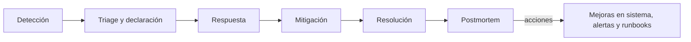

---
tags:
  - sre
  - observabilidad
  - incidentes
---

# Operación y fiabilidad (SRE)

> Principios de *Site Reliability Engineering*, cómo gestionar un incidente, guardias sostenibles, postmortems sin culpables, runbooks, capacity planning y chaos engineering.

## ¿Qué es?

**SRE** (*Site Reliability Engineering*, ingeniería de fiabilidad de sitios) es la forma en que Google empezó a operar sus servicios en producción: tratar la operación como un problema de **ingeniería de software**. Ben Treynor Sloss, que lo creó, lo resume como "lo que pasa cuando le pides a un ingeniero de software que diseñe un equipo de operaciones".

DevOps describe una cultura y unas prácticas; SRE es una forma concreta de llevarlas a cabo, con métricas (SLOs), límites (error budget) y prácticas definidas. Google lo expresa como *"class SRE implements interface DevOps"*. Ver [Cultura DevOps y métricas DORA](../fundamentos/cultura-metricas-dora.md).

## Principios

Los principios del libro *Site Reliability Engineering* de Google (disponible gratis en su web):

- **Embracing risk** (aceptar el riesgo): el 100 % de fiabilidad no es un objetivo realista ni deseable. Cada "nueve" extra cuesta mucho más y el usuario no lo nota (su wifi o su móvil fallan más que tu servicio).
- **Service Level Objectives**: la fiabilidad se define con SLIs y SLOs medibles desde el punto de vista del usuario (ver [Observabilidad](observabilidad.md)).
- **Error budget** (presupuesto de errores): `100 % − SLO` es el margen que se puede "gastar" en cambios, experimentos y fallos. Equilibra velocidad y estabilidad con datos, no con opiniones.
- **Eliminating toil** (eliminar el trabajo repetitivo): **toil** es el trabajo manual, repetitivo, automatizable, reactivo y que crece con el servicio sin aportar valor duradero (reiniciar un servicio a mano cada semana, crear usuarios uno a uno). Google propone que el toil no supere el **50 %** del tiempo de un SRE.
- **Automation** (automatización): lo que se hace más de dos veces se automatiza; la automatización es más rápida, consistente y no se cansa.
- **Simplicity** (simplicidad): los sistemas simples fallan menos y se arreglan antes.

### Política de error budget

Acordarla **antes** de necesitarla, entre producto y ingeniería:

| Situación | Qué se hace |
| --- | --- |
| Queda presupuesto | Se despliega con normalidad; se pueden asumir riesgos (migraciones, experimentos) |
| Presupuesto agotado | Se congelan los cambios no urgentes y el equipo trabaja en fiabilidad hasta recuperarlo |
| Un solo incidente se come más del 20 % del presupuesto | Postmortem obligatorio con acciones prioritarias |

## Incident management (gestión de incidentes)

Un **incident** (incidente) es un evento que degrada o interrumpe el servicio y requiere una respuesta coordinada.

### Severidades

Cada organización define las suyas; un esquema típico:

| Severidad | Criterio | Respuesta |
| --- | --- | --- |
| **SEV1** | Servicio caído o pérdida de datos para muchos usuarios | Todo el equipo de guardia, comunicación pública, 24/7 |
| **SEV2** | Degradación importante o función crítica caída para parte de los usuarios | Guardia inmediata, comunicación interna |
| **SEV3** | Impacto menor o con alternativa | En horario laboral |
| **SEV4** | Sin impacto visible para el usuario | Ticket |

!!! tip "Ante la duda, sube la severidad"
    Es más barato declarar un SEV2 que resulta ser SEV3 que tardar en movilizar gente en un SEV1 real.

### Roles

| Rol | Responsabilidad |
| --- | --- |
| **Incident Commander** (IC, responsable del incidente) | Coordina, decide, asigna tareas. **No** arregla el problema con sus manos: mantiene la visión global |
| **Operations lead** / responsables técnicos | Investigan y aplican la mitigación |
| **Communications lead** (responsable de comunicación) | Informa a *stakeholders* (partes interesadas), soporte y clientes (página de estado) con frecuencia fija |
| **Scribe** (escriba) | Registra la línea de tiempo y las decisiones para el postmortem |

En incidentes pequeños una misma persona cubre varios roles; lo importante es que esté claro quién es el IC.

### Ciclo de vida



1. **Detección**: idealmente por una alerta sobre síntomas, no por un cliente.
2. **Triage** (clasificación): evaluar el impacto, asignar severidad, nombrar al IC y abrir un canal dedicado.
3. **Respuesta**: investigar con métricas, logs y trazas; comunicar el estado.
4. **Mitigación**: **parar el daño primero**, aunque no sepas la causa: *rollback*, desactivar un *feature flag*, desviar tráfico, escalar. Ver [Despliegue continuo](../ci-cd/despliegue-continuo.md).
5. **Resolución**: arreglar la causa y confirmar que el servicio está normal.
6. **Postmortem**: aprender del incidente.

!!! note "Mitigar antes que entender"
    El objetivo durante el incidente es reducir el impacto, no encontrar la causa raíz. La investigación profunda viene después, con calma, en el postmortem.

Las métricas típicas de esta fase son **MTTD** (*Mean Time To Detect*, tiempo medio hasta detectar) y **MTTR** (*Mean Time To Restore/Recover*, tiempo medio hasta restablecer). El tiempo para restablecer el servicio también es una de las métricas DORA.

## On-call (guardias) sostenible

- **Rotaciones** con suficiente gente: el SRE Book sugiere un mínimo de 8 personas para una rotación en un solo lugar (o 6 por sitio en dos zonas horarias), para que nadie esté de guardia más de una semana de cada varias.
- **Follow-the-sun** (seguir al sol): equipos en distintas zonas horarias para que nadie haga guardia de noche.
- **Pocas alertas y buenas**: Google sugiere como máximo unos 2 incidentes por turno de 12 horas; más que eso genera **alert fatigue** (fatiga de alertas) y errores.
- **Escalado claro**: primario, secundario y a quién llamar si no responden. Herramientas como PagerDuty u Opsgenie, o las de la propia plataforma de alertas, gestionan rotaciones y escalados.
- **Compensación y descanso** después de una noche con incidentes.
- Revisión periódica de las alertas: cada alerta que no requirió acción se ajusta o se elimina.

## Postmortems blameless

Un **blameless postmortem** (postmortem sin culpables) analiza el incidente buscando **qué falló en el sistema y en los procesos**, no a quién culpar. Si la gente teme las consecuencias, oculta información y no se aprende nada. Una persona que ejecutó un comando equivocado revela un sistema que permitía ejecutarlo sin protección.

!!! tip "En profundidad"
    Esta sección es un resumen. Para la guía completa, con plantilla, ejemplo y seguimiento de acciones, ver [Postmortem](postmortem.md); para las técnicas de análisis, [Análisis de causa raíz](analisis-causa-raiz.md); y para comunicar durante el incidente, [Comunicación de incidentes](comunicacion-incidentes.md).

```markdown title="postmortem-plantilla.md"
# Postmortem: <título breve>

**Fecha:** 2026-10-24 · **Severidad:** SEV2 · **Duración:** 47 min · **Autoras/es:** …
**Estado:** borrador | revisado

## Resumen
Qué pasó, en dos o tres frases, y su impacto en usuarios.

## Impacto
- Usuarios afectados, peticiones fallidas, error budget consumido, impacto económico.

## Línea de tiempo (UTC)
- 14:02 Despliegue de la versión 1.4.3
- 14:05 Alerta de burn rate en la API de pagos
- 14:09 Se declara SEV2, IC: …
- 14:21 Rollback a 1.4.2
- 14:49 Métricas normales, se cierra el incidente

## Causa raíz y factores contribuyentes
Qué condiciones técnicas y de proceso lo permitieron (no "error humano").

## Qué funcionó y qué no
Detección, comunicación, herramientas, runbooks.

## Acciones
| Acción | Tipo (prevenir/detectar/mitigar) | Responsable | Fecha |
| --- | --- | --- | --- |
```

Las **acciones** son lo importante: con responsable, fecha y seguimiento. Un postmortem sin acciones cerradas no sirve.

## Runbooks

Un **runbook** (manual de operación) describe paso a paso cómo diagnosticar y resolver un problema concreto. Cada alerta debería enlazar al suyo.

Un buen runbook incluye:

- Qué significa la alerta y qué impacto tiene en usuarios.
- Paneles y consultas para diagnosticar (enlaces directos).
- Pasos de mitigación con los comandos exactos.
- Cuándo y a quién escalar.

El siguiente paso es convertir el runbook en automatización (por ejemplo, con AWS Systems Manager Automation, Azure Automation o un job de CI), lo que reduce el toil y los errores manuales. Plantilla, ejemplo y automatización en detalle: [Runbooks y playbooks](runbooks-playbooks.md).

## Capacity planning (planificación de capacidad)

Asegurar que habrá recursos suficientes para la demanda futura sin pagar de más:

1. **Medir** el uso actual y su relación con la demanda (por ejemplo, CPU por cada 1000 peticiones por segundo).
2. **Pronosticar** el crecimiento orgánico y los eventos previsibles (campañas, temporadas, lanzamientos).
3. **Probar** con **load testing** (pruebas de carga) para saber dónde está el límite real.
4. **Dejar margen** (*headroom*) para picos y para perder una zona entera (N+1, N+2).
5. Revisar los **quotas** (cuotas) y límites del proveedor: muchos incidentes ocurren porque se alcanzó un límite de la cuenta, no del hardware.

El autoscaling ayuda, pero no sustituye la planificación: tiene límites, tarda en reaccionar y depende de que haya capacidad y cuota disponibles. Ver [Resiliencia](../../cloud/operacion-y-gobierno/resiliencia.md) y [FinOps y costos](../../cloud/fundamentos/finops-costos.md).

## Chaos engineering

**Chaos engineering** (ingeniería del caos) es provocar fallos **a propósito y de forma controlada** para comprobar que el sistema resiste como esperas: apagar instancias, añadir latencia, cortar una dependencia, simular la caída de una zona.

Pasos:

1. Define el **steady state** (estado estable) con métricas: por ejemplo, el SLI de éxito de peticiones.
2. Formula una hipótesis: "si cae una zona, el SLI no baja del 99,9 %".
3. Inyecta el fallo empezando por un **blast radius** (radio de impacto) pequeño, en un entorno de pruebas y luego, con cuidado, en producción.
4. Compara con el steady state y corrige lo que falle.

Herramientas: **AWS Fault Injection Service**, **Azure Chaos Studio**, y *open source* como **Chaos Mesh** o **LitmusChaos** para Kubernetes. Los **game days** (simulacros) practican además la respuesta del equipo. Más contexto en [Resiliencia](../../cloud/operacion-y-gobierno/resiliencia.md); game days, pre-mortems, Wheel of Misfortune y otras prácticas en [Prácticas de aprendizaje](practicas-aprendizaje.md).

## Relación con otras secciones

| Enfoque | Qué se mira desde ahí | Nota |
| --- | --- | --- |
| Cloud (el control) | Alta disponibilidad, disaster recovery, RTO/RPO y costos de la capacidad | [Resiliencia](../../cloud/operacion-y-gobierno/resiliencia.md), [FinOps y costos](../../cloud/fundamentos/finops-costos.md) |
| DevOps (la automatización) | SLOs y alertas que disparan los incidentes, rollbacks y métricas de entrega | [Observabilidad](observabilidad.md), [Cultura DevOps y métricas DORA](../fundamentos/cultura-metricas-dora.md), [Despliegue continuo](../ci-cd/despliegue-continuo.md), [Troubleshooting](troubleshooting.md), [Postmortem](postmortem.md), [Análisis de causa raíz](analisis-causa-raiz.md), [Runbooks y playbooks](runbooks-playbooks.md), [Comunicación de incidentes](comunicacion-incidentes.md), [Prácticas de aprendizaje](practicas-aprendizaje.md) |
| DevSecOps (la verificación) | Incidentes de seguridad: mismo ciclo de respuesta, con playbooks y SIEM | [Detección y respuesta](../../devsecops/gobierno-y-respuesta/deteccion-respuesta.md) |
| Negocio TI (el porqué) | SLAs, OLAs y créditos; incidentes, problemas y cambios en el lenguaje de ITIL | [Niveles de servicio](../../negocio/niveles-de-servicio.md), [Gestión de servicios (ITSM) e ITIL](../../negocio/gestion-servicios-itil.md) |
| Laboratorios (la práctica) | Practicar esto paso a paso | [Lab 11: Observabilidad con Prometheus y Grafana](../../laboratorios/devops/observabilidad-prometheus-grafana.md), [Lab 21: Game day: incidente simulado, troubleshooting y postmortem](../../laboratorios/operacion/game-day-incidente.md) |

## Referencias

- [Google SRE Book](https://sre.google/sre-book/table-of-contents/)
- [Google SRE Workbook](https://sre.google/workbook/table-of-contents/)
- [SRE Book: Eliminating Toil](https://sre.google/sre-book/eliminating-toil/)
- [SRE Book: Being On-Call](https://sre.google/sre-book/being-on-call/)
- [SRE Book: Postmortem Culture](https://sre.google/sre-book/postmortem-culture/)
- [SRE Workbook: Incident Response](https://sre.google/workbook/incident-response/)
- [PagerDuty Incident Response](https://response.pagerduty.com/)
- [Principles of Chaos Engineering](https://principlesofchaos.org/)
- [AWS Fault Injection Service](https://docs.aws.amazon.com/fis/latest/userguide/what-is.html)
- [Azure Chaos Studio](https://learn.microsoft.com/es-es/azure/chaos-studio/chaos-studio-overview)
