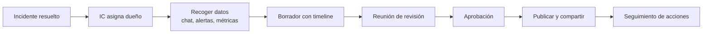

---
tags:
  - sre
  - incidentes
  - postmortem
  - observabilidad
---

# Postmortem y post-incident review

> Cómo escribir un postmortem sin culpables que sirva de verdad: cuándo hacerlo, quién y en qué plazo, plantilla completa, timeline, lenguaje blameless, reunión de revisión, seguimiento de acciones y un ejemplo completo.

## ¿Qué es?

Un **postmortem** (análisis posterior al incidente), también llamado **post-incident review** o **PIR** (revisión posterior al incidente), es un documento escrito y una reunión en los que el equipo reconstruye qué pasó durante un incidente, por qué el sistema se comportó así y qué se va a cambiar.

Su objetivo es **aprender**, no buscar culpables. Un buen postmortem responde a tres preguntas:

1. ¿Qué pasó y qué impacto tuvo? (hechos, no opiniones)
2. ¿Por qué tenía sentido, para las personas implicadas, actuar como actuaron con la información que tenían?
3. ¿Qué cambiamos para que este tipo de incidente sea menos probable, se detecte antes o duela menos?

La nota [Operación y fiabilidad (SRE)](operacion-sre.md#postmortems-blameless) presenta la idea y una plantilla corta. Aquí se profundiza en el proceso completo. Cómo buscar las causas con técnicas concretas está en [Análisis de causa raíz](analisis-causa-raiz.md).

!!! info "Nombres que vas a ver"
    *Postmortem*, *post-incident review* (Atlassian, PagerDuty), *incident review*, *learning review*, *retrospectiva de incidente*, *RCA document*. Algunas organizaciones evitan "postmortem" porque suena a muerte; lo importante es el proceso, no el nombre.

## Cultura blameless y just culture

**Blameless** (sin culpables) significa que el análisis asume que las personas actuaron de buena fe con la información, las herramientas y la presión que tenían en ese momento. Si alguien ejecutó un comando que borró datos, la pregunta útil no es "¿quién fue?", sino "¿por qué el sistema permitía ejecutarlo sin confirmación ni protección?".

**Just culture** (cultura justa), término que viene de la aviación y la sanidad y que Sidney Dekker popularizó, matiza la idea: no castigar los errores honestos ni las decisiones razonables, pero sí distinguir los casos raros de imprudencia temeraria o mala fe. En la práctica, casi todos los incidentes de software entran en la primera categoría.

| Cultura de culpa | Cultura blameless / just culture |
| --- | --- |
| La gente oculta errores y *near misses* | La gente reporta pronto, incluso lo que casi pasó |
| Conclusión típica: "error humano, formar a la persona" | Conclusión típica: "el sistema permitía este error; añadimos una protección" |
| Se aprende poco y el incidente se repite | Se arreglan las condiciones, no solo el síntoma |
| Las personas con más contexto callan en la reunión | Las personas implicadas son la mejor fuente de información |

!!! warning "Blameless no es sin responsabilidad"
    Sin culpables no significa que nadie sea responsable de nada: cada **action item** tiene un dueño y una fecha. La responsabilidad se pone en **mejorar el sistema**, no en castigar a quien estaba de guardia.

## Cuándo escribir uno

Define los criterios **antes** de que pasen los incidentes, para que no dependa de quién tenga ganas. El *SRE Book* de Google propone estos disparadores:

- Caída o degradación visible para usuarios por encima de un umbral.
- Pérdida de datos de cualquier tipo.
- Intervención de la persona de guardia (rollback, desvío de tráfico…).
- Tiempo de resolución por encima de un umbral.
- Fallo del monitoreo (el incidente se descubrió a mano o por un cliente).

Una forma práctica de concretarlo por severidad (las severidades están en [Operación y fiabilidad (SRE)](operacion-sre.md#severidades)):

| Severidad o situación | ¿Postmortem? |
| --- | --- |
| SEV1 | Obligatorio, con reunión de revisión |
| SEV2 | Obligatorio (PagerDuty lo exige para todo SEV1 y SEV2) |
| SEV3 | Opcional; recomendable si es nuevo o se repite |
| Un incidente consume más del 20 % del error budget | Obligatorio (ver la política de error budget en [Operación y fiabilidad (SRE)](operacion-sre.md#politica-de-error-budget)) |
| **Near miss** (casi incidente): algo que pudo causar impacto y no lo hizo por suerte | Recomendable, en formato corto |
| Lo pide cualquier persona o un *stakeholder* (parte interesada) | Sí: pedir un postmortem no se discute |

!!! tip "Los near misses son baratos"
    Un casi incidente enseña lo mismo que un incidente real, sin clientes enfadados. Si un certificado estuvo a 2 días de caducar y alguien lo vio de casualidad, eso merece un postmortem corto. Más en [Prácticas para aprender de incidentes](practicas-aprendizaje.md).

## Quién lo escribe y en qué plazo

- **Dueño del postmortem** (*postmortem owner*): lo designa el **Incident Commander** al cerrar el incidente o justo después. Suele ser alguien que participó en la respuesta, no necesariamente el IC. Es quien coordina, no quien escribe todo solo: las personas implicadas aportan su parte del timeline.
- **Plazos de referencia**:
    - Borrador en los primeros días, mientras la memoria está fresca. Atlassian recomienda celebrar la revisión en las **24–48 horas** siguientes a la resolución y no más tarde de **cinco días hábiles**.
    - PagerDuty pide agendar la reunión en **3 días naturales** para un SEV1 y **5 días hábiles** para un SEV2, y publicar el borrador unas **24 horas antes** de la reunión.
- **Aprobación**: un responsable del servicio (manager o *tech lead*) revisa que el análisis sea completo y que las acciones tengan sentido. En Atlassian los managers de entrega y operaciones aprueban los postmortems.



## Estructura de un buen postmortem

| Sección | Qué contiene | Error típico |
| --- | --- | --- |
| **Resumen** | Qué pasó, impacto y duración en 3–4 frases. Lo que leería un director | Escribir la historia completa aquí |
| **Impacto** | Cuantificado: usuarios, peticiones fallidas, error budget, dinero, SLA | "Algunos usuarios tuvieron problemas" |
| **Timeline (UTC)** | Hechos con hora exacta, desde el primer cambio relevante hasta el cierre | Mezclar zonas horarias o interpretar en vez de describir |
| **Detección** | Cómo nos enteramos y cuánto tardamos (MTTD) | Omitirlo cuando avisó un cliente |
| **Respuesta y mitigación** | Qué se probó, qué funcionó, cuánto tardó | Contar solo lo que salió bien |
| **Factores contribuyentes** | Condiciones técnicas, de proceso y organizativas que se combinaron | Una sola "causa raíz" o "error humano" |
| **Qué funcionó / qué no / dónde tuvimos suerte** | Lo que hay que conservar, lo que falló y lo que pudo ser peor | Saltarse "dónde tuvimos suerte" |
| **Action items** | Acciones con dueño, prioridad, tipo y fecha, enlazadas a tickets | "Tener más cuidado" |
| **Glosario y enlaces** | Paneles, tickets, canal del incidente, PRs | Enlaces a dashboards que caducan |

### Plantilla

Copia la plantilla con el botón de copiar del bloque y guárdala en tu repositorio de postmortems:

```markdown title="postmortem-plantilla.md"
# Postmortem: <título descriptivo, sin nombres de personas>

| Campo | Valor |
| --- | --- |
| ID del incidente | INC-AAAA-NNN |
| Fecha (UTC) | AAAA-MM-DD |
| Severidad | SEV1 / SEV2 / SEV3 |
| Duración del impacto | HH:MM (de inicio de impacto a resolución) |
| Incident Commander | … |
| Dueño del postmortem | … |
| Estado | Borrador / En revisión / Aprobado |
| Tickets relacionados | … |

## Resumen
Qué pasó, a quién afectó, cuánto duró y cómo se resolvió (3–4 frases).

## Impacto
- Usuarios o clientes afectados: …
- Peticiones fallidas / transacciones perdidas: …
- SLO afectado: … (objetivo …, valor en la ventana: …)
- Error budget consumido: … % del presupuesto de 30 días
- SLA / créditos: ¿se incumplió algún SLA? ¿hay créditos que pagar?
- Impacto económico estimado: …
- Pérdida de datos: sí / no

## Timeline (todas las horas en UTC)
| Hora | Evento | Fuente |
| --- | --- | --- |
| HH:MM | … | alerta / chat / log / deploy |

## Detección
- ¿Cómo se detectó? (alerta, cliente, casualidad)
- Tiempo hasta detectar (MTTD): …
- ¿Debió detectarse antes? ¿Con qué señal?

## Respuesta y mitigación
- Tiempo hasta reconocer (MTTA): … · Tiempo hasta mitigar: …
- Qué se intentó, en orden, y qué resultado dio.
- ¿Había runbook? ¿Sirvió?

## Factores contribuyentes
- Técnicos: …
- De proceso: …
- Organizativos / de contexto: …
(Análisis detallado: 5 porqués, Ishikawa, etc., si aplica)

## Qué funcionó
- …

## Qué no funcionó
- …

## Dónde tuvimos suerte
- …

## Action items
| Acción | Tipo | Prioridad | Dueño | Fecha | Ticket |
| --- | --- | --- | --- | --- | --- |
| … | prevenir / detectar / mitigar / proceso | P1 / P2 / P3 | … | AAAA-MM-DD | … |

## Lecciones aprendidas
Dos o tres ideas que otros equipos deberían conocer.

## Anexos
Enlaces a paneles (con capturas, porque los enlaces caducan), canal del incidente, PRs.
```

## Cuantificar el impacto

"Hubo errores durante un rato" no permite priorizar. Expresa el impacto en las unidades que usan el SLO y el negocio (ver [Observabilidad](observabilidad.md#sli-slo-sla-y-error-budget) y [Niveles de servicio](../../negocio/niveles-de-servicio.md)):

```text
SLO de disponibilidad del checkout: 99,9 % en 30 días
Peticiones esperadas en 30 días: 6 000 000 → error budget = 6 000 peticiones fallidas
Peticiones fallidas en el incidente: 2 700
Error budget consumido: 2 700 / 6 000 = 45 %
```

Un 45 % del presupuesto en un solo incidente supera el umbral del 20 % de la política de error budget: postmortem obligatorio y acciones prioritarias.

## Cómo escribir un buen timeline

El timeline es la columna vertebral: casi todo el análisis sale de ahí.

- **Todo en UTC**, con fecha si el incidente cruza la medianoche. Si el equipo está en varios países, nadie tiene que convertir horas.
- **Reconstruye desde fuentes**, no de memoria: canal del incidente, historial de alertas, despliegues del pipeline, logs de auditoría (CloudTrail, Activity Log, Cloud Audit Logs), métricas. Ver [Cómo leer logs](leer-logs.md).
- **Empieza antes del impacto**: el cambio que lo desencadenó suele ser horas o días antes (un despliegue, un cambio de configuración, una renovación que no ocurrió).
- **Describe, no expliques**: "14:05 la alerta `CheckoutErrorBudgetBurn` se dispara" en vez de "14:05 por fin nos dimos cuenta".
- **Incluye las decisiones y lo que se sabía en ese momento**: "14:12 se descarta la base de datos porque las métricas de conexiones son normales". Esto explica por qué se tardó, sin culpar.
- **Marca los hitos**: inicio del impacto, detección, declaración, mitigación, resolución. De ahí salen MTTD, MTTA y MTTR (ver [Niveles de servicio](../../negocio/niveles-de-servicio.md#mtbf-mttr-mtta-y-mttd)).

## Lenguaje blameless

| En vez de… | Escribe… | Por qué |
| --- | --- | --- |
| "Juan desplegó sin probar" | "El despliegue llegó a producción sin pasar por staging porque el pipeline permitía saltarse esa etapa" | Describe la condición, no a la persona |
| "Error humano" | "El comando no pedía confirmación y apuntaba a producción por defecto" | "Error humano" es el inicio de la investigación, no la conclusión |
| "Debería haber revisado el panel" | "El panel relevante no estaba enlazado desde la alerta" | El *should have* es sesgo retrospectivo |
| "Por un descuido no se renovó" | "La renovación dependía de un recordatorio en el calendario de una persona" | Apunta a un proceso frágil |
| "El equipo de redes rompió el DNS" | "Un cambio en la zona DNS interna eliminó el registro del servicio" | Sin equipos culpables tampoco |
| "Tardamos mucho en reaccionar" | "Pasaron 25 minutos entre la primera alerta y la declaración del incidente; la alerta llegó a un canal sin guardia" | Hechos medibles |

!!! tip "Nombres de personas"
    Muchos equipos no ponen nombres en el análisis ni en el timeline, solo roles ("la persona de guardia", "IC"). Los nombres van en los dueños de las acciones.

## Reunión de revisión

La reunión no es para escribir el documento, sino para **contrastarlo y completarlo**.

1. **Antes**: el borrador circula 24 h antes; los asistentes lo leen.
2. **Facilitación**: alguien que **no** estuvo en el incidente modera (la guía de Etsy recomienda facilitadores formados). Recuerda al inicio que la reunión es blameless.
3. **Recorrer el timeline**: las personas implicadas cuentan qué veían, qué pensaban y por qué decidieron lo que decidieron. Preguntas útiles: "¿qué te hizo pensar que era la base de datos?", "¿qué información te faltaba?".
4. **Factores contribuyentes**: se completan con lo que salga (ver [Análisis de causa raíz](analisis-causa-raiz.md)).
5. **Acciones**: se acuerdan dueño y prioridad; si no da tiempo, se priorizan después, pero no se cierra la reunión sin dueños.
6. **Duración**: 30–60 minutos suelen bastar.

## Action items y su seguimiento

Las acciones son lo que convierte el aprendizaje en cambio. Clasifícalas para no poner todo en "prevenir":

| Tipo | Objetivo | Ejemplo |
| --- | --- | --- |
| **Prevenir** | Que no vuelva a ocurrir | Renovación automática de certificados |
| **Detectar** | Enterarnos antes | Alerta a 21 días de la caducidad |
| **Mitigar** | Que duela menos o dure menos | Runbook de renovación manual de emergencia |
| **Proceso** | Mejorar la respuesta | Añadir el servicio al inventario con dueño |

Buenas acciones son **concretas, verificables y acotadas** ("añadir alerta `CertExpiringSoon` a 21 y 7 días en los 4 balanceadores públicos") y no "mejorar el monitoreo".

### Por qué se quedan sin hacer

| Causa | Remedio |
| --- | --- |
| Compiten con trabajo de producto y nadie las prioriza | Acordar un SLO para acciones prioritarias (Atlassian usa **4 u 8 semanas** según el servicio) |
| Son demasiado grandes o vagas | Partirlas en tickets pequeños; una acción = un ticket |
| No tienen dueño o el dueño es "el equipo" | Una persona por acción |
| Viven en el documento y no en el backlog | Crear el ticket durante la reunión y enlazarlo |
| Nadie revisa el estado | Revisarlas en la reunión semanal de operaciones (ver [Prácticas para aprender de incidentes](practicas-aprendizaje.md)) |

## Compartir y crear una biblioteca

Un postmortem que solo lee el equipo afectado desperdicia la mitad de su valor.

- **Publícalo** en un sitio común (wiki, repositorio Git con Markdown, herramienta de incidentes) con un formato y unas etiquetas consistentes: servicio, severidad, tipo de causa, fecha.
- **Biblioteca buscable**: con el tiempo permite encontrar patrones ("5 incidentes en un año por certificados", "la mitad empiezan con un cambio de configuración").
- **Comparte hacia fuera del equipo**: Google describe un "postmortem del mes" en un boletín interno y clubes de lectura de postmortems.
- **Versión pública**: si afectó a clientes, publica una versión resumida (ver [Comunicación durante incidentes](comunicacion-incidentes.md#cierre-y-comunicacion-del-postmortem)).
- **Inspírate** en postmortems públicos de otras empresas (hay recopilaciones como `dastergon/postmortems` en GitHub).

## Métricas del proceso

| Métrica | Qué indica |
| --- | --- |
| % de incidentes SEV1/SEV2 con postmortem publicado | Si el proceso se cumple |
| Días desde la resolución hasta la publicación | Si se escribe con la memoria fresca |
| % de acciones prioritarias cerradas en plazo | Si el aprendizaje se convierte en cambio |
| Incidentes repetidos (misma causa o mismo tipo) | Si las acciones atacan lo correcto |
| MTTD y MTTR por trimestre | Si mejoran la detección y la respuesta |

!!! warning "No conviertas el número de incidentes en objetivo"
    Si premias "menos incidentes", la gente dejará de declararlos. Mide el proceso de aprendizaje, no la cantidad de incidentes reportados.

## Ejemplo completo: certificado TLS caducado

Incidente ficticio, con datos inventados pero realistas.

```markdown title="postmortem-INC-2026-041.md"
# Postmortem: la API pública dejó de aceptar conexiones HTTPS por un certificado TLS caducado

| Campo | Valor |
| --- | --- |
| ID del incidente | INC-2026-041 |
| Fecha (UTC) | 2026-09-14 |
| Severidad | SEV1 |
| Duración del impacto | 1 h 38 min (00:00 – 01:38 UTC) |
| Estado | Aprobado |

## Resumen
El 14 de septiembre a las 00:00 UTC caducó el certificado TLS de api.ejemplo.com, instalado a mano
en el balanceador de carga público. Las apps móviles y las integraciones de clientes rechazaron
la conexión durante 1 h 38 min. Se mitigó importando un certificado nuevo emitido de urgencia.
No hubo pérdida de datos.

## Impacto
- 100 % de las llamadas a la API pública fallaron (≈ 41 000 peticiones); la web no se vio afectada.
- 312 clientes B2B con integraciones afectadas; 1 200 tickets de soporte en 3 horas.
- SLO de disponibilidad de la API (99,9 % en 30 días): error budget consumido al 100 % y 
  sobrepasado; la API cerró el mes en 99,76 %.
- SLA contractual (99,5 % mensual) cumplido; no hay créditos que pagar.

## Timeline (UTC)
| Hora | Evento | Fuente |
| --- | --- | --- |
| 2025-09-12 | Se importa a mano el certificado (validez 1 año) en el balanceador | Log de auditoría |
| 2026-08-15 | Llega un correo de aviso de caducidad a un buzón de una persona que ya no está en la empresa | Correo |
| 09-14 00:00 | Caduca el certificado; empiezan los errores de handshake TLS | Logs del balanceador |
| 00:00 | El health check interno (HTTP sin TLS) sigue en verde | Monitoreo |
| 00:22 | Un cliente abre un ticket urgente: "certificate has expired" | Service desk |
| 00:31 | El service desk escala a la guardia de plataforma | Herramienta de guardias |
| 00:36 | La guardia reconoce el aviso y confirma el error con openssl s_client | Canal del incidente |
| 00:40 | Se declara SEV1; IC asignado; se publica "Investigando" en la status page | Status page |
| 00:52 | Se descubre que el certificado no está en el servicio gestionado de certificados | Canal |
| 01:20 | Se emite un certificado nuevo con validación DNS | Consola del proveedor |
| 01:31 | Se asocia el certificado al listener HTTPS | Log de auditoría |
| 01:38 | Errores a cero; se pasa a "Monitoreando" | Métricas |
| 02:10 | Se cierra el incidente; status page "Resuelto" | Status page |

## Detección
- Detectado por un cliente 22 minutos después del inicio (MTTD 22 min).
- No existía alerta de caducidad de certificados, y el health check no usaba HTTPS.

## Respuesta y mitigación
- MTTA: 5 min desde el escalado. Mitigación: 58 min desde la declaración.
- No había runbook; 28 min se fueron en averiguar cómo se había instalado el certificado.

## Factores contribuyentes
- El certificado se gestionó fuera de IaC y fuera del servicio gestionado con renovación automática.
- El aviso de caducidad iba a un buzón personal, no a una lista del equipo.
- El monitoreo comprobaba el servicio por HTTP interno, no la experiencia real del usuario (HTTPS).
- No había inventario de certificados con fecha de caducidad y dueño.
- La caducidad ocurrió a medianoche UTC de un domingo, con guardia mínima.

## Qué funcionó
- El service desk escaló rápido y con la información correcta (mensaje de error exacto).
- La status page se actualizó cada 20 minutos.

## Qué no funcionó
- La detección dependió de un cliente.
- La emisión de urgencia requirió permisos que solo tenían dos personas.

## Dónde tuvimos suerte
- La web usaba otro certificado, renovado automáticamente; si hubiera sido el mismo, el impacto se duplicaba.
- Una persona con permisos DNS respondió al teléfono a la 01:00.

## Action items
| Acción | Tipo | Prioridad | Dueño | Fecha | Ticket |
| --- | --- | --- | --- | --- | --- |
| Migrar todos los certificados públicos al servicio gestionado con renovación automática, vía IaC | Prevenir | P1 | Plataforma | 2026-10-15 | PLAT-881 |
| Sonda sintética HTTPS externa contra la API que valide el certificado | Detectar | P1 | SRE | 2026-09-30 | SRE-412 |
| Alerta de caducidad a 30, 14 y 7 días para todos los certificados | Detectar | P1 | SRE | 2026-09-30 | SRE-413 |
| Runbook "certificado TLS caducado o a punto de caducar" | Mitigar | P2 | Plataforma | 2026-09-25 | PLAT-882 |
| Enviar avisos de proveedores a listas de equipo, no a buzones personales | Proceso | P2 | Gobierno TI | 2026-10-31 | GOV-77 |

## Lecciones aprendidas
- Lo que no está en IaC ni en un inventario, no tiene dueño.
- Monitorea lo que ve el usuario (HTTPS desde fuera), no solo lo que ve el servidor.
```

Fíjate en que el ejemplo no menciona a ninguna persona como causa, cuantifica el impacto con el SLO y el SLA, y que cada factor contribuyente tiene al menos una acción asociada.

## Relación con otras secciones

| Enfoque | Qué se mira desde ahí | Nota |
| --- | --- | --- |
| Cloud (el control) | Logs de auditoría para reconstruir el timeline; servicios de certificados y alarmas nativas | [Observabilidad nativa](../../cloud/operacion-y-gobierno/observabilidad-nativa.md), [Seguridad base en la nube](../../cloud/identidad-y-seguridad/seguridad-base.md), [Resiliencia](../../cloud/operacion-y-gobierno/resiliencia.md) |
| DevOps (la automatización) | Proceso de incidentes, SLOs, análisis de causas, runbooks y comunicación | [Operación y fiabilidad (SRE)](operacion-sre.md), [Análisis de causa raíz](analisis-causa-raiz.md), [Runbooks y playbooks](runbooks-playbooks.md), [Comunicación durante incidentes](comunicacion-incidentes.md), [Prácticas para aprender de incidentes](practicas-aprendizaje.md), [Observabilidad](observabilidad.md) |
| DevSecOps (la verificación) | Lecciones aprendidas de incidentes de seguridad (NIST SP 800-61r3) | [Detección y respuesta](../../devsecops/gobierno-y-respuesta/deteccion-respuesta.md) |
| Negocio TI (el porqué) | Problem management, SLAs y créditos, métricas MTx | [Gestión de servicios (ITSM) e ITIL](../../negocio/gestion-servicios-itil.md), [Niveles de servicio](../../negocio/niveles-de-servicio.md) |
| Laboratorios (la práctica) | Practicar esto paso a paso | [Lab 21: Game day: incidente simulado, troubleshooting y postmortem](../../laboratorios/operacion/game-day-incidente.md) |

## Referencias

- [Google SRE Book: Postmortem Culture: Learning from Failure](https://sre.google/sre-book/postmortem-culture/)
- [Google SRE Book: Example Postmortem](https://sre.google/sre-book/example-postmortem/)
- [Google SRE Workbook: Postmortem Culture](https://sre.google/workbook/postmortem-culture/)
- [PagerDuty Incident Response: Postmortem Process](https://response.pagerduty.com/after/post_mortem_process/)
- [PagerDuty Postmortem Documentation](https://postmortems.pagerduty.com/)
- [Atlassian Incident Handbook: Postmortems](https://www.atlassian.com/incident-management/handbook/postmortems)
- [Atlassian: Blameless postmortems](https://www.atlassian.com/incident-management/postmortem/blameless)
- [Atlassian: plantillas de postmortem](https://www.atlassian.com/incident-management/postmortem/templates)
- [Etsy: Debriefing Facilitation Guide (PDF)](https://extfiles.etsy.com/DebriefingFacilitationGuide.pdf)
- [Learning from Incidents in Software](https://www.learningfromincidents.io/)
- [Recopilación de postmortems públicos (dastergon/postmortems)](https://github.com/dastergon/postmortems)
