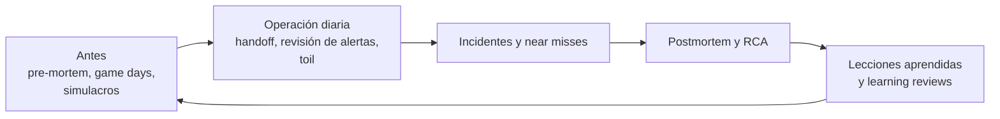
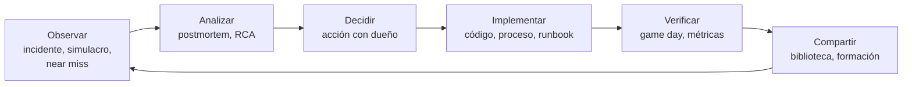

---
tags:
  - sre
  - incidentes
  - postmortem
  - on-call
---

# Prácticas para aprender de incidentes

> Pre-mortem, game days, chaos engineering, Wheel of Misfortune, tabletop exercises, retrospectivas, traspaso de guardia, revisión semanal de alertas, medición del toil, near misses y learning reviews: cómo aprender antes, durante y después de que algo falle.

## ¿Qué es?

El [postmortem](postmortem.md) aprende de un incidente que ya pasó. Pero un equipo que solo aprende de sus incidentes aprende **tarde** y **caro**. Las prácticas de esta nota buscan aprender:

- **Antes** de que falle algo: pre-mortem, game days, chaos engineering, simulacros.
- **Del día a día**: traspaso de guardia, revisión de alertas, medición del toil.
- **De lo que casi pasó**: near misses.
- **Del conjunto** de incidentes: learning reviews y lecciones aprendidas que se aplican de verdad.



El [chaos engineering](#chaos-engineering) (inyección controlada de fallos) también es una práctica de aprendizaje; aplicado a disaster recovery, se ve en [Resiliencia](../../cloud/operacion-y-gobierno/resiliencia.md#probar-el-dr-game-days-y-chaos-engineering).

## Pre-mortem

Un **pre-mortem** (análisis previo) es una sesión **antes** de un proyecto, lanzamiento o cambio grande en la que el equipo imagina que ya fracasó y explica por qué. Lo propuso el psicólogo Gary Klein (*Harvard Business Review*, 2007).

Funciona porque cambia la pregunta: "¿qué podría salir mal?" invita al optimismo; "**salió mal, ¿qué pasó?**" da permiso para decir lo que nadie quiere decir. Klein cita investigaciones según las cuales imaginar que el evento ya ocurrió (*prospective hindsight*) aumenta en torno a un 30 % la capacidad de identificar las razones de un resultado.

### Guía de sesión (45–60 minutos)

1. **Preparar** (5 min): la persona facilitadora presenta el plan (por ejemplo, "migrar la base de datos de pedidos a un servicio gestionado el 15 de noviembre").
2. **Imaginar el fracaso** (2 min): "Es 16 de noviembre. La migración fue un desastre. Ha habido un SEV1 y clientes enfadados".
3. **Escribir en silencio** (5–10 min): cada persona anota **por separado** todas las razones que se le ocurren. En silencio, para que no domine la persona con más rango.
4. **Ronda** (15 min): cada persona comparte una razón por turno, hasta agotar la lista. Se agrupan las repetidas.
5. **Priorizar** (10 min): votar por probabilidad e impacto.
6. **Acciones** (10 min): para las 3–5 principales, una acción con dueño (una prueba, un plan de rollback, una alerta, un cambio de fecha).

| Razón imaginada | Acción |
| --- | --- |
| "La réplica no estaba sincronizada y perdimos pedidos del corte" | Verificar el lag de replicación como criterio de go/no-go |
| "El rollback tardó horas porque nadie lo había probado" | Ensayar el rollback en staging con datos realistas |
| "Las conexiones se agotaron con el nuevo endpoint" | Prueba de carga previa; revisar límites del pool |
| "Nadie sabía quién decidía abortar" | Nombrar IC y criterios de abortar antes del cambio |

## Game days

Un **game day** (día de simulacro) es un ejercicio planificado en el que el equipo provoca o simula un fallo realista y practica la respuesta completa: detección, escalado, runbooks, comunicación y recuperación.

Qué pone a prueba:

- Que las **alertas** saltan y llegan a la persona correcta.
- Que los **runbooks** se pueden seguir tal cual (ver [Runbooks y playbooks](runbooks-playbooks.md#mantener-los-runbooks-vivos)).
- Que los **permisos** y accesos de emergencia funcionan.
- Que el **RTO y RPO** reales coinciden con los objetivos (ver [Continuidad de negocio](../../negocio/continuidad-negocio.md#pruebas-de-continuidad)).

Cómo organizarlo:

1. **Objetivo e hipótesis**: "si cae la réplica primaria, el failover ocurre en menos de 2 minutos y la alerta llega a la guardia".
2. **Alcance y seguridad**: entorno (staging o producción con *blast radius*, radio de impacto, limitado), condición de parada, persona que puede abortar, aviso previo a soporte.
3. **Roles**: quien inyecta el fallo, quien responde (idealmente sin saber los detalles), quien observa y toma notas.
4. **Ejecución** con cronómetro.
5. **Debrief** inmediato y acciones, igual que un postmortem.

## Chaos engineering

**Chaos engineering** (ingeniería del caos) es provocar fallos **a propósito y de forma controlada** para comprobar que el sistema resiste como esperas: apagar instancias, añadir latencia, cortar una dependencia, simular la caída de una zona. Se centra en la resiliencia del sistema y a menudo se automatiza; los game days practican además la respuesta del equipo (ver la [comparativa de simulacros](#comparativa-de-simulacros)).

Pasos:

1. Define el **steady state** (estado estable) con métricas: por ejemplo, el SLI de éxito de peticiones (ver [Observabilidad](observabilidad.md#sli-slo-sla-y-error-budget)).
2. Formula una hipótesis: "si cae una zona, el SLI no baja del 99,9 %".
3. Inyecta el fallo empezando por un **blast radius** (radio de impacto) pequeño, en un entorno de pruebas y luego, con cuidado, en producción.
4. Compara con el steady state y corrige lo que falle.

Herramientas: **AWS Fault Injection Service**, **Azure Chaos Studio**, y *open source* como **Chaos Mesh** o **LitmusChaos** para Kubernetes. La comparativa por proveedor y su uso para probar el DR están en [Resiliencia](../../cloud/operacion-y-gobierno/resiliencia.md#probar-el-dr-game-days-y-chaos-engineering).

## Wheel of Misfortune

El **Wheel of Misfortune** (rueda de la desgracia), también llamado *disaster role playing*, es un juego de rol de guardia que Google describe en el *SRE Book*: una persona hace de "director de juego" y plantea un incidente (a menudo uno real del pasado), y otra hace de persona de guardia y explica qué haría paso a paso. El director responde con lo que "verían" los paneles y los logs.

| Ventaja | Detalle |
| --- | --- |
| No toca sistemas | Cero riesgo; se puede hacer cada semana |
| Ideal para onboarding | La persona nueva practica antes de su primera guardia real |
| Revela huecos | Runbooks que faltan, paneles que nadie encuentra, permisos que no se tienen |
| Reutiliza postmortems | Los incidentes pasados son el mejor guion |

Formato típico: 30–60 minutos, un escenario, y 10 minutos al final para anotar lo aprendido.

## Tabletop exercises

Un **tabletop exercise** (ejercicio de mesa) es una discusión guiada de un escenario, con varias áreas en la sala (técnica, dirección, soporte, legal, comunicación), sin tocar sistemas. Se centra en **decisiones y coordinación** más que en comandos: ¿quién decide activar el plan de DR? ¿Quién habla con clientes? ¿Qué pasa si el IC no contesta?

Es el formato habitual para incidentes de seguridad (ransomware, filtración de datos) y para planes de continuidad. Ver [Detección y respuesta](../../devsecops/gobierno-y-respuesta/deteccion-respuesta.md#playbooks) y [Continuidad de negocio](../../negocio/continuidad-negocio.md#pruebas-de-continuidad).

### Comparativa de simulacros

| Práctica | Toca sistemas | Participantes | Qué entrena |
| --- | --- | --- | --- |
| **Pre-mortem** | No | Equipo del proyecto | Anticipar riesgos de un cambio |
| **Wheel of Misfortune** | No | 2–6 ingenieros | Diagnóstico y uso de runbooks individual |
| **Tabletop exercise** | No | Varias áreas | Decisiones, roles y comunicación |
| **Game day** | Sí | Equipo técnico y observadores | Respuesta real de sistemas y personas |
| **Chaos engineering** | Sí, a menudo automatizado | Equipo técnico | Resiliencia del sistema ante fallos concretos |

## Retrospectivas de incidentes y retros de equipo

- **Retrospectiva de incidente**: es la reunión de revisión del postmortem (ver [Postmortem](postmortem.md#reunion-de-revision)). Mira un incidente concreto.
- **Retrospectiva de guardia** (al final de cada rotación o cada mes): ¿cuántas páginas hubo? ¿cuántas de noche? ¿qué alertas no sirvieron? ¿qué runbook faltó? ¿cómo está el equipo de cansancio?
- **Retro de equipo** (agile, cada sprint): incluye un punto fijo sobre operación: acciones de postmortems pendientes y toil de las últimas semanas. Así la fiabilidad compite en la misma lista que las funcionalidades (ver [Cultura DevOps y métricas DORA](../fundamentos/cultura-metricas-dora.md)).

## Traspaso de guardia (on-call handoff)

El **on-call handoff** (traspaso de guardia) es la nota y, si se puede, la conversación breve entre quien termina la guardia y quien empieza. El *SRE Workbook* describe que la persona saliente envía un resumen y la entrante lo lee al empezar. Evita que el siguiente turno redescubra los mismos problemas.

```markdown title="handoff-guardia.md"
# Traspaso de guardia: plataforma · 2026-10-19 → 2026-10-26

**Sale:** … · **Entra:** … · **Secundario:** …

## Resumen
- Páginas: 6 (2 fuera de horario) · Incidentes: 1 SEV2 (INC-2026-055), 0 SEV1
- Estado general: estable / con riesgo en …

## Incidentes y situaciones abiertas
- INC-2026-055 (resuelto): latencia en la API de búsqueda; postmortem en curso, dueño: …
- Pendiente: el nodo `worker-7` sigue drenado a la espera de reemplazo (ticket PLAT-910).

## Alertas ruidosas
- `QueueDepthHigh` saltó 4 veces sin impacto: propuesta de subir el umbral (SRE-430).

## Cambios previstos esta semana
- Martes 14:00 UTC: actualización del clúster de Kubernetes (ventana de 1 h).
- Jueves: migración de certificados al servicio gestionado.

## Cosas a vigilar
- El disco de `db-replica-2` crece ~3 %/día; queda ~9 días.

## Toil de la semana
- 3 h reiniciando el consumidor de la cola de facturas a mano (SRE-431 para automatizarlo).
```

## Revisión semanal de operaciones y de alertas

Una reunión corta (30 minutos) cada semana, con quien hizo guardia y el equipo:

1. **Métricas de la semana**: páginas totales y fuera de horario, incidentes por severidad, estado de los SLOs y del error budget.
2. **Revisión de alertas**: para cada alerta que paginó, ¿era urgente? ¿Era real? ¿Se pudo actuar? Si alguna respuesta es "no", se ajusta, se convierte en ticket o se elimina.
3. **Acciones de postmortems**: estado de las prioritarias y las vencidas.
4. **Cambios relevantes de la próxima semana**.

El objetivo es combatir el **alert fatigue** (fatiga de alertas): cuando la mayoría de alertas no requieren acción, las personas dejan de tomarlas en serio y las importantes se pierden.

| Indicador de la revisión | Señal de alerta |
| --- | --- |
| % de páginas sin acción necesaria | Más de 1 de cada 3 sugiere alertas mal ajustadas |
| Páginas por turno | Google sugiere como máximo unos 2 incidentes por turno de 12 horas |
| Páginas fuera de horario | Tendencia creciente = riesgo de agotamiento |
| Alertas sin runbook | Cualquier número mayor que cero |

Cómo escribir alertas accionables (síntomas, burn rate, varias ventanas) está en [Observabilidad](observabilidad.md#alertas-accionables).

## Medir y reducir el toil

El *SRE Book* define el **toil** como trabajo **manual, repetitivo, automatizable, táctico (reactivo), sin valor duradero** y que **crece linealmente** con el servicio. No todo trabajo operativo es toil: una investigación compleja o una reunión de planificación no lo son.

Cómo medirlo:

- **Etiquetar tickets y tareas** como toil en el sistema de seguimiento y sumar horas.
- **Registro en el handoff** de guardia (como en la plantilla anterior).
- **Encuesta periódica** al equipo: "¿qué porcentaje de tu tiempo fue toil este trimestre?".

Cómo reducirlo:

| Paso | Ejemplo |
| --- | --- |
| Identificar lo más frecuente y costoso | Reiniciar a mano el consumidor de facturas: 3 h/semana |
| Eliminar la necesidad | Arreglar la fuga de memoria que obliga a reiniciarlo |
| Si no se puede eliminar, automatizar | Runbook automatizado o autorremediación (ver [Runbooks y playbooks](runbooks-playbooks.md#runbook-automation)) |
| Autoservicio | Que los equipos creen sus propios accesos con una plantilla aprobada en vez de pedir un ticket |
| Medir de nuevo | Comprobar que bajó y que no apareció otro toil |

Google propone que el toil no supere el **50 %** del tiempo de un SRE; el resto debe ser trabajo de ingeniería que reduzca toil futuro o mejore el servicio.

## Lecciones aprendidas y su ciclo

Muchas organizaciones tienen documentos de "lecciones aprendidas" que nadie vuelve a leer. Para que una lección sea **aprendida** y no solo **anotada**, tiene que cerrar el ciclo:



Una lección está cerrada cuando: la acción está implementada, se **verificó** (un simulacro o un incidente posterior demuestra que funciona) y se **difundió** a otros equipos que podrían tener el mismo problema.

## Near-miss reporting

Un **near miss** (casi incidente) es un evento que pudo causar impacto y no lo hizo, a menudo por suerte: un certificado que alguien vio a punto de caducar, un `terraform apply` que iba a destruir una base de datos y se detuvo en la revisión del plan, un backup que resultó estar vacío en una prueba rutinaria.

- **Hazlo fácil**: un formulario o un canal (`#casi-incidentes`) con tres preguntas: qué pasó, qué pudo pasar, qué lo evitó.
- **Agradece cada reporte**: es la señal más clara de una cultura blameless (ver [Postmortem](postmortem.md#cultura-blameless-y-just-culture)).
- **Analiza los que tienen potencial alto** con un postmortem corto.
- **Busca patrones**: varios near misses del mismo tipo predicen el próximo incidente.

## Learning reviews

Una **learning review** (revisión de aprendizaje) es un análisis enfocado en **entender cómo funciona realmente el trabajo**, no solo qué falló. La comunidad **Learning from Incidents in Software** (LFI) y la guía de Etsy promueven este enfoque:

- Interesarse por **cómo las personas normalmente evitan** los incidentes (adaptaciones, conocimiento informal), no solo por el día en que no lo lograron.
- **Entrevistas individuales** antes de la reunión, para recoger perspectivas sin presión de grupo.
- Preferir **descripciones a explicaciones**: "¿qué estabas viendo?" en vez de "¿por qué no viste…?".
- Separar el **análisis** de la **lista de acciones**: si la reunión se convierte en una negociación de tickets, se deja de aprender.

También se puede hacer una revisión **transversal**: cada trimestre, leer juntos los postmortems del periodo y buscar temas comunes (los cambios de configuración, las dependencias de terceros, las migraciones) que ninguno muestra por separado.

## Relación con otras secciones

| Enfoque | Qué se mira desde ahí | Nota |
| --- | --- | --- |
| Cloud (el control) | Simulacros de DR, inyección de fallos y alarmas nativas | [Resiliencia](../../cloud/operacion-y-gobierno/resiliencia.md), [Observabilidad nativa](../../cloud/operacion-y-gobierno/observabilidad-nativa.md) |
| DevOps (la automatización) | Postmortems, RCA, runbooks, alertas accionables, chaos engineering y cultura | [Operación y fiabilidad (SRE)](operacion-sre.md), [Postmortem](postmortem.md), [Análisis de causa raíz](analisis-causa-raiz.md), [Runbooks y playbooks](runbooks-playbooks.md), [Comunicación durante incidentes](comunicacion-incidentes.md), [Observabilidad](observabilidad.md), [Cultura DevOps y métricas DORA](../fundamentos/cultura-metricas-dora.md) |
| DevSecOps (la verificación) | Tabletop exercises de incidentes de seguridad y lecciones aprendidas | [Detección y respuesta](../../devsecops/gobierno-y-respuesta/deteccion-respuesta.md) |
| Negocio TI (el porqué) | Pruebas de continuidad, métricas de fiabilidad y riesgo | [Continuidad de negocio](../../negocio/continuidad-negocio.md), [Niveles de servicio](../../negocio/niveles-de-servicio.md), [Gobierno y riesgo de TI](../../negocio/gobierno-riesgo-ti.md) |
| Laboratorios (la práctica) | Practicar esto paso a paso | [Lab 21: Game day: incidente simulado, troubleshooting y postmortem](../../laboratorios/operacion/game-day-incidente.md) |

## Referencias

- [Gary Klein: Performing a Project Premortem (HBR, 2007)](https://hbr.org/2007/09/performing-a-project-premortem)
- [Google SRE Book: Accelerating SREs to On-Call and Beyond (disaster role playing)](https://sre.google/sre-book/accelerating-sre-on-call/)
- [Google SRE Book: Being On-Call](https://sre.google/sre-book/being-on-call/)
- [Google SRE Workbook: On-Call](https://sre.google/workbook/on-call/)
- [Google SRE Book: Eliminating Toil](https://sre.google/sre-book/eliminating-toil/)
- [Google SRE Workbook: Eliminating Toil](https://sre.google/workbook/eliminating-toil/)
- [Google SRE Book: Postmortem Culture](https://sre.google/sre-book/postmortem-culture/)
- [Etsy: Debriefing Facilitation Guide (PDF)](https://extfiles.etsy.com/DebriefingFacilitationGuide.pdf)
- [Learning from Incidents in Software](https://www.learningfromincidents.io/)
- [PagerDuty Incident Response](https://response.pagerduty.com/)
- [Principles of Chaos Engineering](https://principlesofchaos.org/)
- [AWS Fault Injection Service](https://docs.aws.amazon.com/fis/latest/userguide/what-is.html)
- [Azure Chaos Studio](https://learn.microsoft.com/es-es/azure/chaos-studio/chaos-studio-overview)
