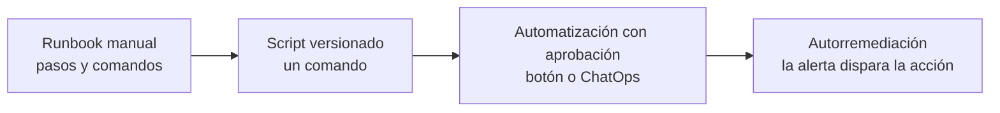

---
tags:
  - sre
  - incidentes
  - runbooks
  - automatizacion
---

# Runbooks y playbooks

> Diferencias entre runbook, playbook, SOP y checklist; estructura y plantilla de un buen runbook con un ejemplo de disco lleno; cómo enlazarlos desde las alertas, automatizarlos y mantenerlos vivos como código.

## ¿Qué es?

Un **runbook** (manual de operación) es un documento con los pasos para diagnosticar y resolver una situación operativa concreta, escrito para que lo pueda seguir cualquier persona de guardia a las 3 de la mañana, aunque no conozca el servicio a fondo.

La nota [Operación y fiabilidad (SRE)](operacion-sre.md#runbooks) introduce la idea. Aquí verás cómo distinguirlo de otros documentos parecidos, cómo escribir uno bueno, cómo automatizarlo y cómo evitar que quede obsoleto.

!!! info "Por qué importan"
    Un runbook reduce el **MTTR** (tiempo medio de recuperación) porque la persona no tiene que deducir los pasos bajo presión, y reduce la dependencia de "la única persona que sabe". Google observó que tener un *playbook* mejora el MTTR del orden de 3 veces frente a improvisar (*SRE Book*, capítulo *Introduction*).

## Runbook, playbook, SOP y checklist

Los términos se usan de forma inconsistente entre empresas. Esta es la distinción más habitual:

| Documento | Qué es | Alcance | Ejemplo |
| --- | --- | --- | --- |
| **Runbook** (manual de operación) | Pasos técnicos concretos para una tarea o alerta, con comandos exactos | Una alerta o tarea | "Disco lleno en un nodo", "Rotar la contraseña de la base de datos" |
| **Playbook** (guía de respuesta) | Estrategia para un **tipo** de situación: roles, decisiones, comunicación, y qué runbooks usar | Un escenario | "Respuesta a una caída de región", "Credencial filtrada" (ver [Detección y respuesta](../../devsecops/gobierno-y-respuesta/deteccion-respuesta.md#playbooks)) |
| **SOP** (*Standard Operating Procedure*, procedimiento operativo estándar) | Procedimiento formal y aprobado para una tarea rutinaria, a menudo exigido por auditoría | Una tarea repetitiva | "Alta de un usuario en producción", "Restaurar un backup mensual" |
| **Checklist** (lista de verificación) | Lista corta de comprobaciones sin explicación | Antes/después de una acción | "Checklist previa al despliegue", "Checklist de cierre de incidente" |

!!! tip "La regla práctica"
    Si responde a **"qué hago ahora con este síntoma"**, es un runbook. Si responde a **"cómo nos organizamos ante este tipo de crisis"**, es un playbook. Un playbook suele enlazar varios runbooks.

Google usa *playbook* para lo que aquí llamamos runbook. Cuando leas documentación externa, fíjate en el contenido, no en el nombre.

## Estructura de un buen runbook

| Sección | Qué responde |
| --- | --- |
| **Disparador** | Qué alerta o síntoma lleva a este runbook (nombre exacto de la alerta) |
| **Impacto** | Qué ve el usuario y con qué urgencia hay que actuar |
| **Diagnóstico** | Cómo confirmar el problema y encontrar la causa probable: paneles, consultas, comandos |
| **Mitigación** | Pasos numerados con comandos exactos, de menos a más arriesgado |
| **Verificación** | Cómo comprobar que el servicio volvió a la normalidad |
| **Rollback** | Cómo deshacer cada paso si empeora |
| **Escalado** | A quién llamar, cuándo y por qué canal |
| **Metadatos** | Dueño, fecha de última revisión, servicios afectados, enlace al código del servicio |

Principios de redacción:

- **Comandos copiables** con las variables marcadas (`<NODO>`), sin pasos implícitos ("entra al servidor" → con qué comando, desde dónde).
- **Primero lo seguro**: diagnóstico de solo lectura antes que cambios; acciones reversibles antes que destructivas.
- **Resultados esperados** después de cada comando: qué deberías ver si todo va bien.
- **Puntos de decisión claros**: "si X, ve al paso 5; si no, escala".
- **Corto**: si pasa de dos pantallas, probablemente son varios runbooks.

### Plantilla de runbook

```markdown title="runbook-plantilla.md"
# Runbook: <nombre de la alerta o situación>

| Campo | Valor |
| --- | --- |
| Alerta(s) | `NombreExactoDeLaAlerta` |
| Servicio | … |
| Dueño | equipo-… |
| Última revisión | AAAA-MM-DD (por …) |
| Severidad típica | SEV2 / SEV3 |

## Impacto
Qué ve el usuario y en cuánto tiempo empeora si no se actúa.

## Diagnóstico
1. Abre el panel: <enlace>
2. Comprueba … con: `comando`
   - Resultado esperado: …
   - Si …, la causa probable es … → ve a Mitigación A.

## Mitigación
### A. <caso más común>
1. …
### B. <caso alternativo>
1. …

## Verificación
- La alerta se resuelve sola en … minutos.
- El SLI … vuelve a …

## Rollback
Cómo deshacer cada paso de mitigación.

## Escalado
- Si no mejora en 15 min o no aplica ningún caso: escala a … (rotación …).
- Si hay pérdida de datos: declara SEV1.

## Historial
- AAAA-MM-DD: creado tras INC-…
```

## Ejemplo: disco lleno en un nodo Linux

Runbook para nodos Linux con métricas de `node_exporter` en Prometheus (ver [Observabilidad](observabilidad.md)). Los comandos de Linux se repasan en [Linux, redes y scripting](../fundamentos/linux-redes-scripting.md) y en la [chuleta de Linux](../../recursos/comandos/linux.md).

````markdown title="runbooks/nodo-disco-lleno.md"
# Runbook: NodeFilesystemAlmostFull

| Campo | Valor |
| --- | --- |
| Alerta(s) | `NodeFilesystemAlmostFull` (< 10 % libre), `NodeFilesystemFillingUp` (se llenará en < 4 h) |
| Servicio | Nodos de la plataforma (VMs y nodos de Kubernetes) |
| Dueño | equipo-plataforma |
| Última revisión | 2026-10-01 |

## Impacto
Con el disco al 100 % los procesos no pueden escribir: logs perdidos, bases de datos que se
detienen, pods desalojados (Kubernetes marca el nodo con DiskPressure). Actúa antes de llegar al 100 %.

## Diagnóstico
1. Confirma el uso y qué sistema de archivos es:
   ```bash
   df -h
   df -i    # inodos: un disco puede "llenarse" de archivos pequeños con espacio libre
   ```
2. Busca qué ocupa espacio (sin cruzar a otros sistemas de archivos):
   ```bash
   sudo du -xh --max-depth=1 / 2>/dev/null | sort -h | tail -n 15
   sudo du -xh --max-depth=1 /var/log | sort -h | tail
   ```
3. Archivos borrados que siguen abiertos (el espacio no se libera hasta cerrar el proceso):
   ```bash
   sudo lsof +L1
   ```
4. Clasifica:
   - Logs en /var/log o journal → Mitigación A
   - Imágenes y capas de contenedores en /var/lib/docker o /var/lib/containerd → Mitigación B
   - Archivo borrado pero abierto → Mitigación C
   - Datos de la aplicación (base de datos, uploads) → no borres nada: escala (ver Escalado)

## Mitigación
### A. Logs
```bash
sudo journalctl --disk-usage
sudo journalctl --vacuum-size=500M
sudo find /var/log -name "*.gz" -mtime +7 -print -delete
```
Resultado esperado: `df -h` muestra más del 20 % libre.

### B. Imágenes de contenedores
En un nodo de Kubernetes con containerd:
```bash
sudo crictl rmi --prune
```
No borres directorios dentro de /var/lib/containerd a mano.

### C. Archivo borrado y abierto
Reinicia el servicio que lo mantiene abierto (columna COMMAND de `lsof +L1`):
```bash
sudo systemctl restart <servicio>
```
Si es un pod en Kubernetes, desaloja el nodo en lugar de reiniciar procesos:
```bash
kubectl drain <NODO> --ignore-daemonsets --delete-emptydir-data
```

## Verificación
- `df -h` con más del 20 % libre y la alerta resuelta en 5–10 min.
- En Kubernetes: `kubectl describe node <NODO>` sin la condición DiskPressure; `kubectl uncordon <NODO>` si se drenó.

## Rollback
Los pasos A–C no se pueden deshacer (los archivos borrados no vuelven): por eso solo se borran
logs ya rotados e imágenes sin uso. Si drenaste el nodo, `kubectl uncordon <NODO>`.

## Escalado
- Datos de aplicación o base de datos: escala a la guardia del servicio dueño.
- Si se llena de nuevo en menos de 24 h: abre un ticket para revisar la rotación de logs y el tamaño
  del disco (posible ampliación del volumen).

## Historial
- 2026-10-01: añadido el caso de inodos tras INC-2026-047.
````

### Enlazar el runbook desde la alerta

Cada alerta debe llevar el enlace a su runbook, para que llegue con la notificación. En Prometheus se usa la anotación `runbook_url`:

```yaml title="alertas-nodo.yaml"
groups:
  - name: nodo-disco
    rules:
      - alert: NodeFilesystemFillingUp
        expr: |
          predict_linear(node_filesystem_avail_bytes{fstype!~"tmpfs|overlay"}[6h], 4 * 3600) < 0
          and
          node_filesystem_avail_bytes{fstype!~"tmpfs|overlay"} / node_filesystem_size_bytes < 0.2
        for: 15m
        labels:
          severity: warning
        annotations:
          summary: "El disco {{ $labels.mountpoint }} de {{ $labels.instance }} se llenará en menos de 4 h"
          runbook_url: "https://git.ejemplo.com/plataforma/runbooks/-/blob/main/nodo-disco-lleno.md"
```

Las alarmas nativas permiten lo mismo: incluir la URL en la descripción de la alarma de CloudWatch o de la alerta de Azure Monitor o Cloud Monitoring, que llega a la notificación (ver [Observabilidad nativa](../../cloud/operacion-y-gobierno/observabilidad-nativa.md)).

!!! warning "Alerta sin runbook = alerta a revisar"
    Si una alerta no tiene runbook, o nadie sabría qué hacer al recibirla, probablemente no debería despertar a nadie. Revísala en la revisión semanal de alertas (ver [Prácticas para aprender de incidentes](practicas-aprendizaje.md#revision-semanal-de-operaciones-y-de-alertas)).

## Runbook automation

El camino natural de un runbook es: **documento → script → automatización con aprobación → automatización completa**. Cada paso reduce el **toil** (trabajo manual repetitivo) y los errores al teclear bajo presión.



| Nivel | Cuándo | Riesgo |
| --- | --- | --- |
| Documento | Situación rara o que requiere juicio | Errores al copiar comandos |
| Script | Pasos repetidos idénticos | El script también debe probarse y versionarse |
| Con aprobación humana | Acción con impacto (reinicios, failover) | Bajo: una persona decide, la máquina ejecuta |
| Autorremediación | Acción segura, frecuente y bien entendida (limpiar logs, reiniciar un pod) | Puede ocultar problemas: registra y cuenta cada ejecución |

### Herramientas

| Herramienta | Qué hace |
| --- | --- |
| Scripts en el repositorio (Bash, Python) | Primer paso; ejecutados a mano o desde un job de CI. Ver [Python: sistema y procesos](../../python/scripting/sistema-procesos.md) |
| **Ansible** (playbooks) | Ejecutar los mismos pasos en muchos servidores de forma idempotente. Ver [Ansible](../iac/ansible.md) |
| **Rundeck** / **PagerDuty Runbook Automation** | Catálogo de "jobs" con permisos, auditoría y ejecución desde la consola o desde una alerta |
| **ChatOps** | Ejecutar acciones desde el chat del incidente (un bot o un comando) para que queden registradas en el canal |

En cada nube hay un servicio nativo:

=== "AWS"

    **Automation**, una herramienta de **AWS Systems Manager**, ejecuta **runbooks** (antes llamados *Automation documents*) escritos en YAML o JSON, con pasos de API, scripts y aprobaciones manuales. AWS publica runbooks predefinidos (por ejemplo `AWS-RestartEC2Instance`) y puedes crear los tuyos. Se lanzan a mano, desde EventBridge o desde una alarma de CloudWatch.

    AWS Systems Manager **Incident Manager** integraba response plans con estos runbooks, pero **ya no admite clientes nuevos**; quien empieza hoy suele usar Automation con EventBridge y una herramienta de guardias externa.

=== "Azure"

    **Azure Automation** ejecuta **runbooks** de PowerShell (versiones 5.1, 7.4 y 7.6 en el momento de escribir esto) y Python 3.10, en la nube o en **Hybrid Runbook Workers** dentro de tus servidores. Una alerta de Azure Monitor puede lanzar un runbook a través de un **action group**. Para flujos con lógica y conectores también se usa **Azure Logic Apps**.

=== "Google Cloud"

    No hay un servicio llamado "runbooks". Lo habitual es **Workflows** (orquestación de llamadas a APIs de Google Cloud y HTTP, definida en YAML o JSON), disparado por Eventarc o por una notificación de Cloud Monitoring vía Pub/Sub, y **Cloud Run functions** o **Cloud Run jobs** para la lógica en código.

!!! danger "Automatiza con permisos mínimos"
    Una automatización que puede reiniciar o borrar recursos es una identidad con mucho poder. Dale solo los permisos que necesita, registra cada ejecución y protege quién puede lanzarla. Ver [Secretos e identidades](../../devsecops/identidades-y-pipeline/secretos-identidades.md).

## Mantener los runbooks vivos

Un runbook desactualizado es peor que no tenerlo: da una falsa sensación de seguridad y lleva a ejecutar comandos que ya no aplican.

- **Dueño y fecha de última revisión** visibles al inicio. Revisión periódica (por ejemplo, trimestral) con un recordatorio automático.
- **Revisar tras cada incidente**: una acción estándar del [postmortem](postmortem.md) es "actualizar o crear el runbook". Pregunta en la revisión: ¿se usó? ¿sirvió? ¿qué faltaba?
- **Probarlos**: en game days y simulacros de guardia, alguien que no lo escribió lo sigue al pie de la letra (ver [Prácticas para aprender de incidentes](practicas-aprendizaje.md#game-days)).
- **Que los use la gente nueva**: el onboarding de guardia es el mejor test de claridad.
- **Medir su uso**: qué runbooks se abren durante incidentes y cuáles nunca; los que nunca se usan quizá sobran.

### Docs as code

**Docs as code** (documentación como código) significa tratar los runbooks como el código: Markdown en un repositorio Git, cambios por **pull request** con revisión, historial y CI que valida enlaces o formato. Ventajas:

- Viven **junto al código del servicio** (`/docs/runbooks/` en el mismo repositorio) y se actualizan en el mismo PR que cambia el comportamiento.
- El historial de Git responde "¿quién cambió este paso y por qué?".
- Se publican automáticamente en un sitio como este (MkDocs) o en la wiki.

!!! tip "Pero accesibles durante un incidente"
    Si el repositorio o la wiki dependen del mismo sistema que está caído (por ejemplo, el SSO o el clúster), nadie podrá leer el runbook. Ten una copia accesible fuera de esa dependencia para los runbooks críticos.

## Relación con otras secciones

| Enfoque | Qué se mira desde ahí | Nota |
| --- | --- | --- |
| Cloud (el control) | Alarmas nativas que enlazan runbooks y servicios de automatización | [Observabilidad nativa](../../cloud/operacion-y-gobierno/observabilidad-nativa.md), [Resiliencia](../../cloud/operacion-y-gobierno/resiliencia.md) |
| DevOps (la automatización) | Alertas que disparan runbooks, scripts y configuración idempotente | [Operación y fiabilidad (SRE)](operacion-sre.md), [Observabilidad](observabilidad.md), [Troubleshooting](troubleshooting.md), [Ansible](../iac/ansible.md), [Postmortem](postmortem.md) |
| DevSecOps (la verificación) | Playbooks de incidentes de seguridad y permisos de las automatizaciones | [Detección y respuesta](../../devsecops/gobierno-y-respuesta/deteccion-respuesta.md), [Secretos e identidades](../../devsecops/identidades-y-pipeline/secretos-identidades.md) |
| Negocio TI (el porqué) | Knowledge management y SOPs exigidos por auditoría | [Gestión de servicios (ITSM) e ITIL](../../negocio/gestion-servicios-itil.md) |
| Python (la herramienta) | Convertir pasos manuales en scripts | [Sistema y procesos](../../python/scripting/sistema-procesos.md) |
| Laboratorios (la práctica) | Practicar esto paso a paso | [Lab 11: Observabilidad con Prometheus y Grafana](../../laboratorios/devops/observabilidad-prometheus-grafana.md), [Lab 21: Game day: incidente simulado, troubleshooting y postmortem](../../laboratorios/operacion/game-day-incidente.md) |

## Referencias

- [Google SRE Book: Introduction (playbooks y MTTR)](https://sre.google/sre-book/introduction/)
- [Google SRE Workbook: Eliminating Toil](https://sre.google/workbook/eliminating-toil/)
- [AWS Well-Architected: usar runbooks para ejecutar procedimientos](https://docs.aws.amazon.com/wellarchitected/latest/operational-excellence-pillar/use-runbooks-to-perform-procedures.html)
- [AWS Systems Manager Automation](https://docs.aws.amazon.com/systems-manager/latest/userguide/systems-manager-automation.html)
- [Referencia de runbooks de AWS Systems Manager Automation](https://docs.aws.amazon.com/systems-manager-automation-runbooks/latest/userguide/automation-runbook-reference.html)
- [AWS Systems Manager Incident Manager: cambio de disponibilidad](https://docs.aws.amazon.com/incident-manager/latest/userguide/incident-manager-availability-change.html)
- [Azure Automation: tipos de runbooks](https://learn.microsoft.com/es-es/azure/automation/automation-runbook-types)
- [Google Cloud Workflows](https://cloud.google.com/workflows/docs/overview)
- [Rundeck](https://docs.rundeck.com/docs/)
- [Prometheus: alerting rules](https://prometheus.io/docs/prometheus/latest/configuration/alerting_rules/)
