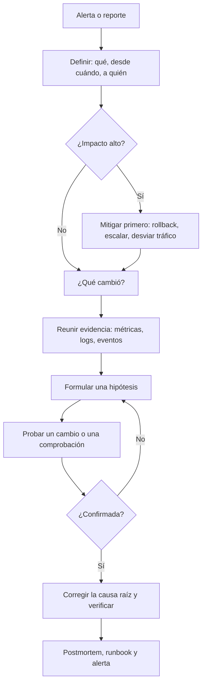

---
tags:
  - troubleshooting
  - observabilidad
  - sre
  - linux
  - contenedores
  - kubernetes
---

# Troubleshooting

> Método para diagnosticar fallos en cualquier capa (host, aplicación, contenedores, Kubernetes, nube, CI/CD, DNS y TLS): definir el problema, preguntar qué cambió, probar una hipótesis cada vez, y checklists con los comandos para empezar.

## ¿Qué es el troubleshooting?

**Troubleshooting** (diagnóstico y resolución de problemas) es encontrar **por qué** algo no se comporta como debería y arreglarlo. No es saberse todos los comandos: es tener un **método** que te lleve de "no funciona" a una causa comprobada sin dar vueltas.

Esta nota es transversal. Para leer la evidencia ver [Cómo leer logs](leer-logs.md); para los problemas de conectividad, [Troubleshooting de red](../../networking/avanzado/troubleshooting-red.md); para coordinar a un equipo durante una caída, la gestión de incidentes de [Operación y fiabilidad (SRE)](operacion-sre.md).

## Mentalidad y método

### 1. Define el problema

"La web no funciona" no se puede investigar. Antes de tocar nada, responde:

| Pregunta | Ejemplo de buena respuesta |
| --- | --- |
| **¿Qué** falla exactamente? | `POST /api/pagos` devuelve 502; el resto de la API responde bien |
| **¿Desde cuándo?** | Desde las 10:14 UTC |
| **¿A quién** afecta? | A todos los usuarios / solo a una región / solo a un cliente |
| **¿Siempre o a veces?** | El 100 % de las peticiones / 1 de cada 10 (intermitente) |
| **¿Qué cambió?** | Deploy de la versión 1.8.0 a las 10:13 |

### 2. Pregunta "¿qué cambió?"

La mayoría de los incidentes siguen a un cambio. Revisa en este orden:

- **Deploys** de la aplicación o de la infraestructura (pipeline, `kubectl rollout history`, `terraform` aplicado, historial de Git).
- **Configuración**: variables de entorno, ConfigMaps, feature flags, reglas de firewall, DNS.
- **Dependencias**: una librería actualizada, una imagen base nueva, una API externa que cambió su respuesta.
- **Certificados** y credenciales que **caducaron** (no cambió nada... salvo la fecha).
- **Cuotas y límites**: se llenó un disco, se alcanzó una cuota de la cuenta, se agotó un pool de conexiones.
- **Tráfico**: un pico, una campaña, un bot.
- **El calendario**: un cron que corre a fin de mes, el cambio de horario, un año bisiesto.

### 3. Reproduce, formula hipótesis y prueba de una en una

Es el **método científico** aplicado a sistemas:

1. **Observa** y **reproduce** el fallo (con `curl`, un test, el mismo input). Si no lo puedes reproducir, es difícil saber si lo arreglaste.
2. **Formula una hipótesis** concreta y comprobable: "el pod no conecta a la base de datos porque cambió el secret".
3. **Diseña una prueba** que la confirme o la descarte: "si desde el pod `nc -zv db 5432` conecta, no es la red".
4. **Cambia una sola cosa** cada vez y observa el resultado. Si cambias tres a la vez y se arregla, no sabes cuál fue (y puede que hayas roto otra).
5. Si la hipótesis se descarta, **anótalo** y pasa a la siguiente. Descartar también es avanzar.

### 4. Divide y vencerás

**Divide and conquer** (divide y vencerás): parte el camino de la petición por la mitad y comprueba en qué mitad está el fallo. Cliente → DNS → load balancer → aplicación → base de datos: si la aplicación responde bien llamándola directamente, el problema está antes. También sirve en el tiempo: `git bisect` busca el commit que introdujo un fallo partiendo el historial en mitades.

Los enfoques **bottom-up** (de abajo hacia arriba) y **top-down** (de arriba hacia abajo) por capas OSI se explican en [Troubleshooting de red](../../networking/avanzado/troubleshooting-red.md#metodologias); aquí se aplican a toda la pila.

### 5. Documenta mientras investigas

Abre un documento o un hilo y anota, con hora UTC, qué viste, qué probaste y qué resultado dio. Evita repetir pruebas, permite que otra persona continúe y es la base del postmortem.

```text
10:21 UTC  502 solo en /api/pagos; /api/productos OK
10:24 UTC  NGINX error.log: connect() failed (111) a 10.0.21.40:8081
10:27 UTC  En 10.0.21.40: ss -tlnp muestra pagos escuchando en 8082, no en 8081
10:29 UTC  Hipótesis: el deploy 1.8.0 cambió el puerto. Confirmado en el diff de config
```

## Flujo de diagnóstico



## Checklists por capa

### Host Linux

| Qué mirar | Comando | Qué buscar |
| --- | --- | --- |
| Carga y CPU | `uptime`, `top` (o `htop`) | Load average mayor que el número de CPU (`nproc`); un proceso al 100 % |
| CPU, memoria, I/O | `vmstat 1 5` | `wa` alto = espera de disco; `si`/`so` distintos de 0 = está usando swap |
| Memoria | `free -h` | Mira la columna `available`, no `free` (Linux usa la RAM libre como caché) |
| Disco | `df -h` | Sistemas de archivos al 100 % (`/var` lleno de logs es un clásico) |
| Inodos | `df -i` | 100 % de inodos con espacio libre: millones de archivos pequeños |
| Qué ocupa | `du -xh --max-depth=1 /var \| sort -h \| tail` | El directorio que crece |
| Procesos | `ps aux --sort=-%mem \| head` | Quién consume memoria o CPU |
| Servicios | `systemctl status miapp`, `systemctl --failed` | `failed`, reinicios en bucle, código de salida |
| Logs del servicio | `journalctl -u miapp -p err --since "30 min ago"` | El primer error antes del fallo |
| Kernel y OOM killer | `dmesg -T \| grep -iE 'oom\|killed process'` | `Out of memory: Killed process 4321 (java)`: el kernel mató el proceso por falta de memoria |
| File descriptors | `cat /proc/<PID>/limits \| grep 'open files'` y `ls /proc/<PID>/fd \| wc -l` | Errores `Too many open files`: sube `LimitNOFILE=` en la unit de systemd o busca la fuga de conexiones |

!!! tip "Disco lleno pero `du` no lo encuentra"
    Si `df` dice 100 % y `du` suma mucho menos, un proceso mantiene abierto un archivo **borrado** (por ejemplo, un log que se borró con `rm` en vez de rotarlo). `lsof +L1` lo muestra; el espacio se libera al reiniciar el proceso. Ver el caso práctico 2.

### Aplicación

- **Logs**: el primer error, no el último, y con el request ID de una petición fallida ([Cómo leer logs](leer-logs.md#metodo-para-leer-logs)).
- **Health checks**: `curl -s -o /dev/null -w '%{http_code}\n' http://localhost:8080/health`. Distingue *liveness* (el proceso vive) de *readiness* (puede atender: tiene base de datos, caché, configuración).
- **Dependencias**: prueba cada una **desde donde corre la app**, no desde tu portátil: `nc -zv db.interna 5432`, `curl -v https://api.proveedor.com`. Una dependencia lenta produce timeouts en cascada.
- **Configuración y variables de entorno**: compara la configuración de la versión que funciona con la que falla (`git diff v1.7.2 v1.8.0 -- config/`). En Kubernetes, `kubectl exec deploy/api -- env | sort` (cuidado: imprime secretos en tu terminal; no lo pegues en un ticket).
- **Versión**: confirma qué versión corre realmente (endpoint `/version`, tag de la imagen). "Ya lo desplegué" no siempre significa que esté corriendo.

### Contenedores

```bash
docker ps -a                                        # también los que ya terminaron, con su estado
docker logs --tail 100 --timestamps api             # logs del contenedor (aunque esté parado)
docker inspect --format '{{.State.ExitCode}} OOMKilled={{.State.OOMKilled}}' api
docker stats --no-stream                            # consumo de CPU y memoria
```

| Exit code | Significado | Causa típica |
| --- | --- | --- |
| `0` | Terminó bien | El proceso principal acabó (¿era un comando que no se queda corriendo?) |
| `1` | Error de la aplicación | Excepción no controlada: mira `docker logs` |
| `125` / `126` / `127` | Docker no pudo ejecutar / comando no ejecutable / comando no encontrado | `CMD` o `ENTRYPOINT` mal escritos, falta un binario en la imagen |
| `137` | 128 + 9 (**SIGKILL**) | **OOM**: superó el límite de memoria (`OOMKilled=true`), o se mató a la fuerza tras no parar a tiempo |
| `139` | 128 + 11 (**SIGSEGV**) | Segmentation fault: fallo de memoria en código nativo, librería incompatible con la imagen base |
| `143` | 128 + 15 (**SIGTERM**) | Se pidió parar (`docker stop`, escalado, deploy). Normal si fue intencional |

Más en [Docker](../contenedores/docker.md) y la [guía de comandos de Docker](../../recursos/comandos/docker.md).

### Kubernetes

Empieza siempre por `kubectl get pods -n <ns>` y luego `kubectl describe pod <pod>`: la sección **Events** al final y el bloque **Last State** del contenedor suelen dar la respuesta.

| Estado | Qué significa | Causa típica | Cómo diagnosticar |
| --- | --- | --- | --- |
| **CrashLoopBackOff** | El contenedor arranca, muere y Kubernetes espera cada vez más antes de reiniciarlo | Error al arrancar, configuración o secret incorrecto, liveness probe demasiado estricta | `kubectl logs <pod> --previous`; en `describe`, `Last State: Terminated` y su `Exit Code` |
| **ImagePullBackOff** / ErrImagePull | No puede descargar la imagen | Tag inexistente, registry privado sin `imagePullSecrets` o sin permisos del nodo, límite de descargas | Events de `describe`: `not found`, `unauthorized`, `toomanyrequests` |
| **Pending** | El scheduler no encuentra nodo | Requests mayores que lo disponible, taints sin tolerations, `nodeSelector` imposible, PVC sin volumen | Evento `FailedScheduling`: `0/3 nodes are available: 3 Insufficient memory` |
| **OOMKilled** | Superó su `limits.memory` | Límite demasiado bajo o fuga de memoria | `describe`: `Reason: OOMKilled`, `Exit Code: 137`; consumo real con `kubectl top pod` |
| **Evicted** | El kubelet lo expulsó del nodo | Presión de memoria o de disco efímero en el nodo | `describe`: `The node was low on resource: ephemeral-storage`; `kubectl describe node <nodo>` (Conditions) |
| **CreateContainerConfigError** | No puede montar la configuración | Falta el ConfigMap o Secret referenciado | Events: `configmap "api-config" not found` |

```bash
kubectl get events -n tienda --sort-by=.metadata.creationTimestamp | tail -20
kubectl rollout history deploy/api -n tienda          # ¿qué revisión se desplegó?
kubectl rollout undo deploy/api -n tienda             # mitigar volviendo a la anterior
```

Conceptos de probes, requests y limits en [Kubernetes](../contenedores/kubernetes.md#deployment-con-probes-y-recursos).

### Red

`Connection refused` frente a `timeout`, DNS, rutas, MTU, security groups y flow logs están desarrollados en [Troubleshooting de red](../../networking/avanzado/troubleshooting-red.md), con su propio flujo por capas. La regla corta: **refused mira el servidor, timeout mira el camino**.

### Nube

**Permisos: AccessDenied.** Lee el mensaje completo: casi siempre dice **quién** (principal), **qué acción**, **sobre qué recurso** y, a veces, **por qué**.

=== "AWS"

    ```text
    User: arn:aws:sts::111122223333:assumed-role/rol-ci/GitHubActions is not authorized to perform:
    s3:PutObject on resource: "arn:aws:s3:::artefactos-prod/app.zip"
    because no identity-based policy allows the s3:PutObject action
    ```

    - "no identity-based policy allows": falta un `Allow`. "with an explicit deny in a service control policy" (o en una *permissions boundary*, *resource-based policy*…): un `Deny` gana siempre, revisa esa política.
    - `aws sts get-caller-identity` confirma con qué identidad estás llamando (muchas veces no es la que crees).
    - `aws iam simulate-principal-policy --policy-source-arn <arn-del-rol> --action-names s3:PutObject --resource-arns <arn>` simula la evaluación.
    - Algunos servicios devuelven un mensaje codificado: `aws sts decode-authorization-message --encoded-message <mensaje>`.

=== "Azure"

    ```text
    AuthorizationFailed: The client '...' with object id '...' does not have authorization to perform
    action 'Microsoft.Storage/storageAccounts/listKeys/action' over scope
    '/subscriptions/.../resourceGroups/rg-prod/...' or the scope is invalid.
    ```

    - `az account show` confirma la suscripción e identidad activas.
    - `az role assignment list --assignee <object-id> --all -o table` muestra los roles y en qué *scope*.
    - Las asignaciones de rol nuevas pueden tardar unos minutos en aplicarse; renueva el token (`az login`) antes de seguir buscando.

=== "Google Cloud"

    ```text
    PERMISSION_DENIED: Permission 'storage.objects.create' denied on resource (or it may not exist).
    ```

    - `gcloud auth list` y `gcloud config list` confirman la cuenta y el proyecto activos.
    - **Policy Troubleshooter** explica qué política concede o deniega: `gcloud policy-troubleshoot iam //storage.googleapis.com/projects/_/buckets/mi-bucket --principal-email=<cuenta> --permission=storage.objects.create`.
    - Revisa también las *deny policies* y las restricciones de la organización.

Conceptos de cada modelo de permisos en [IAM: AWS, Azure y GCP](../../cloud/fundamentos/iam-comparativa.md).

**Cuotas y límites.** Errores como `LimitExceeded`, `QuotaExceeded`, `RESOURCE_EXHAUSTED`, `ThrottlingException` o HTTP `429` indican un límite de la cuenta o de la API, no un fallo del servicio. Consulta **Service Quotas** (AWS), **Usage + quotas** (Azure, o `az vm list-usage --location <región> -o table`) y la página **Quotas** de IAM & Admin (Google Cloud). Ante throttling, reintentos con backoff exponencial.

**Security groups y firewalls.** Si la instancia escucha pero no se llega a ella, revisa security groups, NSG o VPC firewall rules y NACLs con los analizadores de alcanzabilidad ([Troubleshooting de red](../../networking/avanzado/troubleshooting-red.md#en-la-nube)).

**Health checks del load balancer.** Si el balanceador devuelve 502/503 y los targets aparecen *unhealthy*:

- `aws elbv2 describe-target-health --target-group-arn <arn>` (motivos como `Target.ResponseCodeMismatch` o `Target.Timeout`), `az network application-gateway show-backend-health -g <rg> -n <appgw>`, `gcloud compute backend-services get-health <backend> --global`.
- Causas típicas: la ruta del health check devuelve 301/404, puerto equivocado, el security group no permite el tráfico del balanceador, la app tarda en arrancar más que el periodo de gracia. Ver [Balanceo y alta disponibilidad](../../networking/avanzado/balanceo-alta-disponibilidad.md#health-checks).

**Estado del proveedor.** Antes de pasar horas buscando en tu código, comprueba si el problema es del proveedor: **AWS Health Dashboard** (estado general y eventos de tu cuenta), **Azure Status** y **Service Health** en el portal, **Google Cloud Service Health** (y *Personalized Service Health*).

### CI/CD

| Síntoma | Causa probable | Qué hacer |
| --- | --- | --- |
| Falla a veces y al relanzar pasa (**flaky**, intermitente) | Tests que dependen del orden, de la hora o de servicios externos; condiciones de carrera | Identificar el test, aislarlo o arreglarlo; no normalizar "relanzar hasta que pase" |
| Falla tras cambiar dependencias o pasa con código roto | **Caché** obsoleta o con una clave mal calculada | Revisar la `key` de la caché (debe incluir el lockfile) y probar sin caché |
| `403 Resource not accessible by integration` | Permisos insuficientes del `GITHUB_TOKEN` | Declarar `permissions:` mínimos necesarios en el workflow |
| Funciona en local y falla en el runner | Versiones distintas, sistema de archivos sensible a mayúsculas, zona horaria (el runner está en UTC), variables o secretos ausentes (no se pasan a PRs desde forks) | Fijar versiones, reproducir con la misma imagen de contenedor del runner, imprimir versiones al inicio |
| No se puede asumir el rol en la nube por OIDC | El `sub` del token no coincide con la trust policy | Ver el caso práctico 3 |

```yaml title=".github/workflows/ci.yml (fragmento)"
permissions:
  contents: read
  id-token: write        # solo si el job usa OIDC hacia la nube
jobs:
  build:
    runs-on: ubuntu-latest
    steps:
      - uses: actions/checkout@v7
      - run: node --version && npm --version   # deja constancia de las versiones del runner
```

Más contexto en [Integración continua](../ci-cd/integracion-continua.md) y [Seguridad del pipeline](../../devsecops/identidades-y-pipeline/seguridad-pipeline.md).

### DNS y certificados TLS

Dos causas clásicas que se presentan como "la app no funciona":

- **DNS**: un registro cambiado que aún está en caché (TTL), una zona privada no asociada a la red, `/etc/hosts` con una entrada vieja. Compara `dig +short api.ejemplo.com` con `getent hosts api.ejemplo.com` (este último resuelve como lo hace la aplicación, incluido `/etc/hosts`). Detalle en [Servicios de red](../../networking/intermedio/servicios-red.md).
- **Certificado caducado**: en Linux, `curl: (60) SSL certificate problem: certificate has expired`. Compruébalo así:

```console
$ openssl s_client -connect example.com:443 -servername example.com </dev/null 2>/dev/null | openssl x509 -noout -subject -enddate
subject=CN=example.com
notAfter=Dec 25 22:56:35 2026 GMT

$ openssl s_client -connect expired.badssl.com:443 -servername expired.badssl.com </dev/null 2>/dev/null | openssl x509 -noout -enddate -checkend 0
notAfter=Apr 12 23:59:59 2015 GMT
Certificate will expire
```

`-checkend N` devuelve código de salida 1 si el certificado caduca en los próximos N segundos: útil en un script de monitoreo (`-checkend 2592000` = 30 días). Otras causas TLS: falta el certificado intermedio, el nombre no coincide (SNI) o el reloj del cliente va mal (NTP). Ver [Protocolos de aplicación](../../networking/intermedio/protocolos-aplicacion.md#certificados-y-cadena-de-confianza).

## Síntoma, causas probables y primer comando

| Síntoma | Causas probables | Primer comando |
| --- | --- | --- |
| 502/504 en el proxy o load balancer | Backend caído, puerto equivocado, health check fallando, timeout del backend | Error log del proxy; `describe-target-health` o equivalente |
| 500 en la aplicación | Excepción, dependencia caída, configuración | Logs de la app filtrando por `ERROR` y request ID |
| Todo lento | Dependencia lenta, CPU o I/O saturados, pool de conexiones agotado | Trazas o latencia por dependencia; `vmstat 1 5` |
| `Connection refused` | Servicio caído o escuchando en otro puerto/interfaz | `ss -tlnp` en el servidor |
| `Connection timed out` | Firewall, security group, ruta | `nc -zv host puerto`; flow logs |
| `Could not resolve host` | DNS, zona privada, `/etc/hosts` | `dig` y `getent hosts` |
| Error de certificado | Caducado, cadena incompleta, nombre | `openssl s_client ... \| openssl x509 -noout -enddate` |
| Pod en CrashLoopBackOff | Error al arrancar, config o secret | `kubectl logs <pod> --previous` |
| Pod en Pending | Recursos, taints, PVC | `kubectl describe pod <pod>` (Events) |
| Exit code 137 / OOMKilled | Límite de memoria | `kubectl describe pod` / `docker inspect`; `dmesg -T` en el host |
| `No space left on device` | Disco o inodos llenos, archivo borrado abierto | `df -h`, `df -i`, `lsof +L1` |
| `Too many open files` | Límite de file descriptors, fuga de conexiones | `cat /proc/<PID>/limits` |
| `AccessDenied` / `AuthorizationFailed` / `PERMISSION_DENIED` | Falta un permiso, deny explícito, identidad equivocada | `aws sts get-caller-identity` / `az account show` / `gcloud auth list` |
| `429` o `Throttling` | Límite de la API o cuota | Página de cuotas del proveedor |
| Job de CI que falla a veces | Test flaky, caché, dependencia externa | Comparar logs de una ejecución buena y una mala |

## Errores comunes al hacer troubleshooting

- **Cambiar varias cosas a la vez.** Si se arregla, no sabes por qué; si empeora, no sabes qué deshacer.
- **Confiar en suposiciones.** "La red está bien", "eso no lo tocó nadie": compruébalo con un comando.
- **Ignorar el primer error** y perseguir el último, que suele ser una consecuencia.
- **No revisar qué cambió.** Es la pregunta con mejor relación costo/beneficio.
- **Arreglar el síntoma**: reiniciar el servicio "y ya". Si vuelve a pasar, no encontraste la causa.
- **Investigar en lugar de mitigar** cuando hay usuarios afectados: primero rollback, después la causa.
- **No dejar rastro**: sin notas no hay postmortem, y la próxima vez se empieza de cero.
- **Hacer pruebas en producción sin avisar** o con comandos destructivos.

## Después de resolver

1. **Verifica** que el servicio está bien con los mismos datos que mostraban el fallo (métricas, la petición que fallaba).
2. **Postmortem** sin culpables, con causa raíz y acciones con responsable ([Postmortem](postmortem.md)).
3. **Runbook**: si el problema puede repetirse, escribe los pasos de diagnóstico y mitigación ([Runbooks y playbooks](runbooks-playbooks.md)).
4. **Alerta**: ¿qué señal lo habría detectado antes y desde el síntoma del usuario? Créala ([Alertas accionables](observabilidad.md#alertas-accionables)).
5. **Prevención**: un test de regresión, una validación en el pipeline, una alerta de caducidad de certificados.

## Casos prácticos

Las salidas de estos casos son ilustrativas, escritas en el formato real de cada herramienta.

??? example "Caso 1: la API cae tras un deploy (CrashLoopBackOff)"
    **Escenario.** A las 15:02 UTC se despliega la versión 1.4.3 de la API. A las 15:04 salta la alerta de errores 5xx.

    **Investigación.**

    1. ¿Qué cambió? Un deploy hace dos minutos. Como hay impacto, se mitiga primero: `kubectl rollout undo deploy/api -n tienda`. Los errores bajan y ahora hay tiempo para entender la causa en un entorno de staging con la misma versión.
    2. Estado de los Pods de la nueva versión:

        ```console
        $ kubectl get pods -n tienda -l app=api
        NAME                   READY   STATUS             RESTARTS      AGE
        api-6c9b7f5d4-k8w2n    0/1     CrashLoopBackOff   4 (30s ago)   2m
        ```

    3. El log actual está vacío porque el contenedor acaba de reiniciar; se mira el anterior:

        ```console
        $ kubectl logs api-6c9b7f5d4-k8w2n -n tienda --previous
        2026-10-26T15:02:41Z INFO  iniciando api version=1.4.3
        2026-10-26T15:02:41Z FATAL falta la variable de entorno obligatoria PAYMENTS_URL
        ```

    4. `git diff v1.4.2 v1.4.3` muestra que la 1.4.3 añadió `PAYMENTS_URL` como obligatoria, pero el ConfigMap del entorno no se actualizó.

    **Causa raíz.** El código y la configuración se despliegan por caminos distintos y nada comprobaba que estuvieran sincronizados.

    **Solución.** Añadir `PAYMENTS_URL` al ConfigMap y volver a desplegar. Acciones del postmortem: validar la configuración requerida en el pipeline antes del deploy y usar una readiness probe para que un Pod que no arranca nunca reciba tráfico ni sustituya a los sanos.

??? example "Caso 2: disco lleno que `du` no encuentra"
    **Escenario.** Una VM responde con errores `No space left on device`.

    **Investigación.**

    1. `df -h` muestra `/` al 100 %. `df -i` muestra inodos al 12 %: no es un problema de muchos archivos pequeños.
    2. `du -xh --max-depth=1 / | sort -h | tail` suma solo 9 GB en un disco de 30 GB. Falta espacio "invisible".
    3. Hipótesis: un archivo borrado que algún proceso mantiene abierto.

        ```console
        $ sudo lsof +L1
        COMMAND  PID  USER  FD  TYPE DEVICE    SIZE/OFF NLINK  NODE NAME
        java     901  app   5w  REG  259,1  21474836480     0 51234 /var/log/app/app.log (deleted)
        ```

    4. Confirmado: alguien borró `app.log` (20 GB) con `rm` para liberar espacio, pero el proceso `java` sigue escribiendo en él y el espacio no se libera.

    **Causa raíz.** No había rotación de logs configurada para la aplicación y el log creció sin límite; el `rm` manual empeoró la situación.

    **Solución.** Reiniciar el servicio (`systemctl restart miapp`) libera el espacio. Configurar `logrotate` (con `copytruncate` o con una señal para que la app reabra el archivo), enviar los logs a un sistema central y crear una alerta de disco al 85 %.

??? example "Caso 3: el deploy por OIDC deja de funcionar"
    **Escenario.** El job de deploy a AWS funcionaba ayer. Hoy, tras proteger el despliegue con un *environment* `production` en GitHub, falla:

    ```text
    Error: Could not assume role with OIDC: Not authorized to perform sts:AssumeRoleWithWebIdentity
    ```

    **Investigación.**

    1. ¿Qué cambió? El workflow ahora declara `environment: production` en el job.
    2. El error es al **asumir** el rol, no al usar S3: el problema está en la **trust policy** del rol, no en sus permisos.
    3. La trust policy exige `token.actions.githubusercontent.com:sub` igual a `repo:mi-org/tienda:ref:refs/heads/main`.
    4. Cuando un job usa un environment, GitHub emite el `sub` como `repo:mi-org/tienda:environment:production`. El evento `AssumeRoleWithWebIdentity` fallido en CloudTrail lo confirma.

    **Causa raíz.** El cambio de workflow alteró el claim `sub` del token OIDC y la trust policy no lo contemplaba.

    **Solución.** Actualizar la condición de la trust policy a `repo:mi-org/tienda:environment:production` (mejor que ampliarla con comodines). Acción preventiva: gestionar la trust policy como código junto al workflow y probar el cambio en un entorno no productivo. Ver [Secretos e identidades](../../devsecops/identidades-y-pipeline/secretos-identidades.md).

## Relación con otras secciones

| Enfoque | Qué se mira desde ahí | Nota |
| --- | --- | --- |
| Cloud (el control) | Permisos, cuotas, health checks y logs nativos de cada proveedor | [IAM: AWS, Azure y GCP](../../cloud/fundamentos/iam-comparativa.md), [Observabilidad nativa](../../cloud/operacion-y-gobierno/observabilidad-nativa.md), [Resiliencia](../../cloud/operacion-y-gobierno/resiliencia.md) |
| DevOps (la automatización) | Evidencia para diagnosticar, gestión del incidente, rollbacks y pipelines | [Cómo leer logs](leer-logs.md), [Observabilidad](observabilidad.md), [Operación y fiabilidad (SRE)](operacion-sre.md), [Kubernetes](../contenedores/kubernetes.md), [Despliegue continuo](../ci-cd/despliegue-continuo.md), [Linux, redes y scripting](../fundamentos/linux-redes-scripting.md) |
| DevSecOps (la verificación) | Permisos del pipeline, OIDC y cuándo un fallo es en realidad un incidente de seguridad | [Seguridad del pipeline](../../devsecops/identidades-y-pipeline/seguridad-pipeline.md), [Secretos e identidades](../../devsecops/identidades-y-pipeline/secretos-identidades.md), [Detección y respuesta](../../devsecops/gobierno-y-respuesta/deteccion-respuesta.md) |
| Networking (la base) | Metodología por capas y casos de conectividad, DNS y TLS | [Troubleshooting de red](../../networking/avanzado/troubleshooting-red.md), [Servicios de red](../../networking/intermedio/servicios-red.md), [Protocolos de aplicación](../../networking/intermedio/protocolos-aplicacion.md) |
| Negocio TI (el porqué) | Incident y problem management en ITIL: resolver hoy y eliminar la causa para mañana | [Gestión de servicios (ITSM) e ITIL](../../negocio/gestion-servicios-itil.md) |
| Laboratorios (la práctica) | Practicar esto paso a paso | [Lab 01: Diagnóstico de red desde Linux](../../laboratorios/fundamentos/linux-red-diagnostico.md), [Lab 03: Script en Python para analizar logs](../../laboratorios/fundamentos/python-analizar-logs.md), [Lab 05: Imagen multi-stage y Docker Compose](../../laboratorios/devops/docker-multistage-compose.md), [Lab 06: Desplegar una app en Kubernetes local con kind](../../laboratorios/devops/kubernetes-local-kind.md), [Lab 11: Observabilidad con Prometheus y Grafana](../../laboratorios/devops/observabilidad-prometheus-grafana.md), [Lab 12: Escaneos de seguridad en el pipeline](../../laboratorios/devsecops/escaneos-en-pipeline.md), [Lab 14: Endurecer un clúster: Pod Security, NetworkPolicy y Kyverno](../../laboratorios/devsecops/seguridad-kubernetes.md), [Lab 17: AWS: VPC con subnets públicas y privadas y una EC2](../../laboratorios/cloud/aws-vpc-ec2.md), [Lab 18: AWS: API serverless con Lambda, API Gateway y DynamoDB](../../laboratorios/cloud/aws-serverless-api.md), [Lab 19: Azure: VNet, NSG y una VM con Azure CLI](../../laboratorios/cloud/azure-vnet-vm.md), [Lab 20: Google Cloud: desplegar un contenedor en Cloud Run](../../laboratorios/cloud/gcp-cloud-run.md), [Lab 21: Game day: incidente simulado, troubleshooting y postmortem](../../laboratorios/operacion/game-day-incidente.md) |

## Referencias

- [Google SRE Book: Effective Troubleshooting](https://sre.google/sre-book/effective-troubleshooting/)
- [Brendan Gregg: The USE Method](https://www.brendangregg.com/usemethod.html)
- [Kubernetes: Debug Pods](https://kubernetes.io/docs/tasks/debug/debug-application/debug-pods/)
- [Kubernetes: Debug Running Pods](https://kubernetes.io/docs/tasks/debug/debug-application/debug-running-pod/)
- [Kubernetes: Node-pressure Eviction](https://kubernetes.io/docs/concepts/scheduling-eviction/node-pressure-eviction/)
- [Docker: docker container inspect](https://docs.docker.com/reference/cli/docker/container/inspect/)
- [systemd: journalctl](https://www.freedesktop.org/software/systemd/man/latest/journalctl.html)
- [OpenSSL: s_client](https://docs.openssl.org/master/man1/openssl-s_client/)
- [AWS: Troubleshoot access denied error messages](https://docs.aws.amazon.com/IAM/latest/UserGuide/troubleshoot_access-denied.html)
- [Azure RBAC: solución de problemas](https://learn.microsoft.com/es-es/azure/role-based-access-control/troubleshooting)
- [Google Cloud: Policy Troubleshooter](https://cloud.google.com/policy-intelligence/docs/troubleshoot-access)
- [AWS Health Dashboard](https://health.aws.amazon.com/health/status)
- [Azure Status](https://azure.status.microsoft/es-es/status)
- [Google Cloud Service Health](https://status.cloud.google.com/)
- [GitHub: OpenID Connect (claims del token)](https://docs.github.com/en/actions/security-for-github-actions/security-hardening-your-deployments/about-security-hardening-with-openid-connect)
