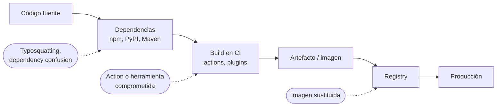

---
tags:
  - seguridad
  - sca
  - supply-chain
  - contenedores
  - github-actions
---

# Software supply chain

> Cómo proteger todo lo que entra en tu software sin que lo escribas tú: dependencias, imágenes base, actions y herramientas de build, con SCA, SBOM, firma de artefactos, SLSA y version pinning.

## ¿Qué es?

La **software supply chain** (cadena de suministro de software) es todo lo que interviene entre el código fuente y lo que corre en producción: librerías de terceros, imágenes base, el sistema de CI, sus plugins y actions, los registries y las herramientas de build. En una aplicación típica, la mayor parte del código que se despliega **no lo escribió tu equipo**.

**Software supply chain security** (seguridad de la cadena de suministro) es asegurar que cada pieza viene de donde dice venir, no fue manipulada y no tiene vulnerabilidades conocidas. Es tan importante que el OWASP Top 10:2025 le dedica una categoría propia, *A03:2025 Software Supply Chain Failures* (ver [Fundamentos de DevSecOps](../fundamentos-devsecops.md)).



## Ataques conocidos

| Ataque | Año | Qué pasó | Lección |
| --- | --- | --- | --- |
| **SolarWinds** (SUNBURST) | 2020 | Los atacantes comprometieron el sistema de build de SolarWinds Orion e insertaron una puerta trasera en actualizaciones firmadas que instalaron miles de organizaciones | Una firma válida no basta si el build está comprometido: hace falta proteger el build y generar provenance |
| **Codecov** | 2021 | Modificaron el script Bash Uploader que muchos pipelines descargaban y ejecutaban; enviaba las variables de entorno (con secretos) a un servidor de los atacantes | No ejecutes scripts remotos sin verificar su integridad; limita los secretos disponibles en CI |
| **Dependency confusion** (confusión de dependencias) | 2021 | Un investigador publicó en registries públicos paquetes con el mismo nombre que paquetes internos de grandes empresas; los gestores de paquetes descargaban el público por tener versión más alta | Usa *scopes* o namespaces privados y configura el registry para que los nombres internos no se busquen fuera |
| **Typosquatting** | Continuo | Paquetes maliciosos con nombres parecidos a otros populares (`reqeusts` en vez de `requests`) | Revisa los nombres al añadir dependencias; usa herramientas que alerten de paquetes nuevos o sospechosos |
| **xz utils** (CVE-2024-3094) | 2024 | Tras años ganándose la confianza como mantenedor, un atacante insertó una puerta trasera en los tarballs de xz/liblzma que afectaba a `sshd` en algunas distribuciones Linux. Se detectó antes de llegar a las versiones estables de la mayoría | Los proyectos *open source* con un solo mantenedor son un riesgo; lo que se compila desde un tarball puede no coincidir con el repositorio |
| **tj-actions/changed-files** (CVE-2025-30066) y **trivy-action** | 2025 y 2026 | Los atacantes movieron los **tags** de GitHub Actions muy usadas para que apuntaran a código malicioso que robaba los secretos del pipeline | Fija las actions por **SHA de commit**, no por tag (ver [Version pinning](#version-pinning)) |

## SCA

!!! tip "Escaneos en detalle"
    Escáneres vs bots de actualización, SBOM como insumo, reachability, licencias, pipeline y gestión de hallazgos: [SCA](../escaneos/sca.md).

El **SCA** (*Software Composition Analysis*, análisis de composición de software) inventaría las dependencias del proyecto (directas y **transitivas**, es decir, las dependencias de tus dependencias) y las compara con bases de datos de vulnerabilidades conocidas. Algunas herramientas también revisan las **licencias**.

| Herramienta | Tipo | Qué aporta |
| --- | --- | --- |
| **Dependabot** | Integrado en GitHub | Alertas de vulnerabilidades y *pull requests* automáticos para actualizar dependencias y actions |
| **Renovate** | *Open source* (Mend), multiplataforma | Actualizaciones automáticas muy configurables: agrupar, programar, automerge, fijar digests |
| **Snyk** | Comercial con plan gratuito | SCA, contenedores, IaC y SAST; sugiere la versión mínima que corrige |
| `npm audit` / `pip-audit` | CLI del ecosistema | Revisión rápida de un proyecto Node.js o Python |
| **OSV** (OSV.dev, OSV-Scanner) | Base de datos abierta de Google | Base de vulnerabilidades *open source* con formato común; `osv-scanner` la consulta |
| **Trivy** | *Open source* (Aqua) | SCA sobre el sistema de archivos y las imágenes (ver [Escaneo en el pipeline](../escaneos/escaneo-en-pipeline.md)) |

```bash
npm audit --audit-level=high          # falla si hay vulnerabilidades high o critical
pip-audit -r requirements.txt         # Python, usando la base de datos de PyPI/OSV
osv-scanner scan source -r .          # recorre los lockfiles del proyecto
```

```yaml title=".github/dependabot.yml"
version: 2
updates:
  - package-ecosystem: "npm"
    directory: "/"
    schedule:
      interval: "weekly"
  - package-ecosystem: "github-actions"   # también mantiene actualizados los SHA de las actions
    directory: "/"
    schedule:
      interval: "weekly"
```

!!! tip "Alertas que se puedan atender"
    El SCA genera mucho ruido: una dependencia transitiva vulnerable en una función que nunca llamas. Prioriza con el contexto (¿es una dependencia de producción o solo de desarrollo?, ¿está expuesta?) y con señales como EPSS o CISA KEV, como se explica en [gestión de riesgo](../fundamentos-devsecops.md#gestion-de-riesgo).

## SBOM

Un **SBOM** (*Software Bill of Materials*, lista de materiales del software) es el inventario formal de todos los componentes de un artefacto: nombre, versión, proveedor, licencia y relaciones entre ellos. Sirve para responder en minutos a la pregunta "¿estamos afectados por este CVE nuevo?" sin tener que reescanear todo, y cada vez más lo exigen clientes y reguladores.

| | SPDX | CycloneDX |
| --- | --- | --- |
| Origen | Linux Foundation | OWASP |
| Estandarización | ISO/IEC 5962:2021 | Ecma (ECMA-424) |
| Enfoque inicial | Licencias y cumplimiento | Seguridad y análisis de riesgos |
| Formatos | JSON, YAML, RDF, tag-value | JSON, XML, Protocol Buffers |
| Extras | — | VEX, servicios, hardware, modelos de ML |

Ambos son válidos; elige el que pidan tus clientes o tus herramientas. Las herramientas más usadas para generarlos son **Syft** (Anchore) y **Trivy**:

```bash
# Syft
syft mi-app:1.4.0 -o spdx-json=sbom.spdx.json
syft dir:. -o cyclonedx-json=sbom.cdx.json

# Trivy
trivy image --format cyclonedx --output sbom.cdx.json mi-app:1.4.0
trivy sbom sbom.cdx.json              # escanear vulnerabilidades a partir de un SBOM
```

!!! info "VEX"
    Un documento **VEX** (*Vulnerability Exploitability eXchange*) acompaña al SBOM e indica si una vulnerabilidad de un componente **afecta realmente** al producto ("not affected: el código vulnerable no se usa"). Reduce los falsos positivos para quien consume tu software.

## Firma de artefactos con Sigstore

Firmar un artefacto (una imagen, un binario, un SBOM) permite comprobar **quién** lo produjo y que **no cambió** desde entonces. Tradicionalmente eso exigía gestionar claves privadas; **Sigstore** lo simplifica con firma **keyless** (sin claves de larga duración):

1. **cosign** (el cliente) pide a la identidad OIDC del pipeline (GitHub Actions, GitLab CI, una cuenta de Google…) un token que demuestra quién eres.
2. **Fulcio** (la autoridad certificadora de Sigstore) emite un certificado de muy corta duración ligado a esa identidad.
3. cosign firma y registra la firma en **Rekor**, un *transparency log* (registro de transparencia) público e inmutable.
4. Quien verifica comprueba la firma, el certificado y la entrada en Rekor, y **exige una identidad concreta**.

```yaml title=".github/workflows/release.yml (fragmento)"
permissions:
  contents: read
  packages: write
  id-token: write      # necesario para obtener el token OIDC

steps:
  - uses: sigstore/cosign-installer@v3   # en un pipeline real, fíjala por SHA
  - name: Firmar la imagen (keyless)
    run: cosign sign --yes ghcr.io/mi-org/mi-app@${{ steps.build.outputs.digest }}
```

```bash
cosign verify ghcr.io/mi-org/mi-app@sha256:3f1c... \
  --certificate-identity "https://github.com/mi-org/mi-app/.github/workflows/release.yml@refs/heads/main" \
  --certificate-oidc-issuer "https://token.actions.githubusercontent.com"
```

!!! warning "Firma siempre por digest"
    Firma y verifica la imagen por **digest** (`@sha256:...`), no por tag: un tag puede moverse a otra imagen después de firmado. La verificación se suele hacer al desplegar, con un **admission controller** en Kubernetes (Kyverno, Sigstore policy-controller); ver [Seguridad de Kubernetes](../infraestructura-y-contenedores/seguridad-kubernetes.md).

Con cosign también se adjuntan **attestations** (atestaciones: afirmaciones firmadas sobre un artefacto), por ejemplo el SBOM:

```bash
cosign attest --yes --type cyclonedx --predicate sbom.cdx.json ghcr.io/mi-org/mi-app@sha256:3f1c...
```

## Provenance y SLSA

La **provenance** (procedencia) es una attestation que describe **cómo se construyó** un artefacto: desde qué repositorio y commit, con qué sistema de build, con qué parámetros. Permite comprobar que la imagen que vas a desplegar salió de tu pipeline y no del portátil de alguien.

**SLSA** (*Supply-chain Levels for Software Artifacts*, se pronuncia "salsa") es un framework de la OpenSSF que define niveles crecientes de garantía. La versión vigente de la especificación es la **v1.2**, que organiza los requisitos en **tracks** (vías):

| Build track | Requisito principal |
| --- | --- |
| Build L0 | Sin garantías (no es un nivel formal) |
| Build L1 | Existe provenance que describe cómo se construyó el artefacto |
| Build L2 | La provenance la genera y firma una plataforma de build alojada |
| Build L3 | Plataforma de build endurecida: builds aislados entre sí y el proceso de build no puede falsificar la provenance |

| Source track | Requisito principal |
| --- | --- |
| Source L1 | El código está en un sistema de control de versiones |
| Source L2 | Historial continuo e inmutable, con provenance de cada revisión |
| Source L3 | El sistema de control de versiones aplica los controles técnicos de la organización en las ramas protegidas |
| Source L4 | Revisión de dos personas para todo cambio en ramas protegidas |

En GitHub Actions puedes generar provenance firmada con Sigstore usando `actions/attest-build-provenance` (o el proyecto `slsa-github-generator`) y verificarla con la CLI de GitHub:

```bash
gh attestation verify oci://ghcr.io/mi-org/mi-app@sha256:3f1c... --owner mi-org
```

## Version pinning

**Version pinning** (fijar versiones) es usar referencias **inmutables** para todo lo que entra en el build, de modo que el mismo commit produzca siempre el mismo resultado y nadie pueda colarte un cambio moviendo una etiqueta.

| Qué fijar | Mal (mutable) | Bien (inmutable) |
| --- | --- | --- |
| Dependencias | `"express": "^4.0.0"` sin lockfile | `package-lock.json`, `poetry.lock`, `go.sum` versionados e instalados con `npm ci` |
| Imágenes de contenedor | `FROM python:3.12` | `FROM python:3.12-slim@sha256:<digest>` |
| GitHub Actions | `uses: org/action@v2` o `@main` | `uses: org/action@<SHA de 40 caracteres> # v2.3.1` |
| Herramientas descargadas | `curl ... \| bash` | Versión fija + verificación de checksum o firma |

```yaml
# El SHA es inmutable; el comentario dice a qué versión corresponde
# y Dependabot/Renovate lo actualizan junto con el SHA.
- uses: aquasecurity/trivy-action@ed142fd0673e97e23eac54620cfb913e5ce36c25 # v0.36.0
```

!!! note "Pinning sin actualizaciones es deuda"
    Fijar versiones congela también las vulnerabilidades. Combínalo siempre con Dependabot o Renovate, que proponen las actualizaciones (con su nuevo SHA o digest) como *pull requests* revisables.

Para la construcción de imágenes y los Dockerfiles, ver [Docker](../../devops/contenedores/docker.md); para el escaneo y el endurecimiento de esas imágenes, [Seguridad de contenedores](../infraestructura-y-contenedores/seguridad-contenedores.md).

## Registries por proveedor

Los registries gestionados de cada nube guardan imágenes y otros artefactos OCI (incluidas firmas y attestations de cosign) y ofrecen escaneo de vulnerabilidades. Ver [Contenedores gestionados](../../cloud/computo/contenedores-gestionados.md).

| | AWS | Azure | Google Cloud |
| --- | --- | --- | --- |
| Registry | Amazon ECR | Azure Container Registry (ACR) | Artifact Registry |
| Escaneo de imágenes | Amazon Inspector (enhanced scanning) | Microsoft Defender for Containers | Artifact Analysis |
| Tags inmutables / control de despliegue | Image tag immutability | Bloqueo de imágenes (*lock*) | Tags inmutables; Binary Authorization para exigir firmas al desplegar |

## Relación con otras secciones

| Enfoque | Qué se mira desde ahí | Nota |
| --- | --- | --- |
| Cloud (el control) | Los registries donde se guardan y escanean las imágenes y sus firmas | [Contenedores gestionados](../../cloud/computo/contenedores-gestionados.md) |
| DevOps (la automatización) | El build que produce los artefactos y los Dockerfiles que fijan la imagen base | [Integración continua](../../devops/ci-cd/integracion-continua.md), [Docker](../../devops/contenedores/docker.md) |
| DevSecOps (la verificación) | Escaneo de imágenes, verificación de firmas al desplegar y protección del pipeline | [Seguridad de contenedores](../infraestructura-y-contenedores/seguridad-contenedores.md), [Seguridad de Kubernetes](../infraestructura-y-contenedores/seguridad-kubernetes.md), [Seguridad del pipeline](../identidades-y-pipeline/seguridad-pipeline.md), [Escaneo de seguridad en el pipeline](../escaneos/escaneo-en-pipeline.md), [SCA](../escaneos/sca.md), [Seguridad del código](seguridad-codigo.md), [CVE de supply chain y CI/CD](../vulnerabilidades/cve-supply-chain-cicd.md) |
| Laboratorios (la práctica) | Practicar esto paso a paso | [Lab 05: Imagen multi-stage y Docker Compose](../../laboratorios/devops/docker-multistage-compose.md), [Lab 07: Pipeline de CI con GitHub Actions](../../laboratorios/devops/github-actions-ci.md), [Lab 12: Escaneos de seguridad en el pipeline](../../laboratorios/devsecops/escaneos-en-pipeline.md), [Lab 20: Google Cloud: desplegar un contenedor en Cloud Run](../../laboratorios/cloud/gcp-cloud-run.md) |

## Referencias

- [SLSA v1.2](https://slsa.dev/spec/v1.2/)
- [Sigstore: documentación de cosign](https://docs.sigstore.dev/cosign/signing/overview/)
- [Sigstore: verificar firmas](https://docs.sigstore.dev/cosign/verifying/verify/)
- [GitHub: usar attestations de artefactos](https://docs.github.com/es/actions/security-for-github-actions/using-artifact-attestations/using-artifact-attestations-to-establish-provenance-for-builds)
- [GitHub: fortalecimiento de seguridad para GitHub Actions](https://docs.github.com/es/actions/security-for-github-actions/security-guides/security-hardening-for-github-actions)
- [Dependabot](https://docs.github.com/es/code-security/dependabot)
- [Renovate](https://docs.renovatebot.com/)
- [OSV.dev](https://osv.dev/)
- [SPDX](https://spdx.dev/)
- [CycloneDX](https://cyclonedx.org/)
- [Syft](https://github.com/anchore/syft)
- [Trivy: SBOM](https://trivy.dev/latest/docs/supply-chain/sbom/)
- [Aqua: incidente de la cadena de suministro de Trivy (2026)](https://www.aquasec.com/blog/trivy-supply-chain-attack-what-you-need-to-know)
- [Guía de comandos de seguridad](../../recursos/comandos/seguridad.md)
