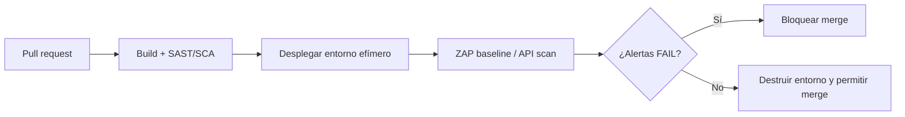

---
tags:
  - seguridad
  - dast
  - apis
  - ci-cd
---

# Pruebas dinámicas de seguridad

> Probar la aplicación en ejecución como lo haría un atacante: DAST con OWASP ZAP, fuzzing, seguridad de APIs y pentesting básico.

## ¿Qué es?

Las **pruebas dinámicas** analizan la aplicación **mientras corre**: envían peticiones reales y observan las respuestas. A diferencia del SAST (ver [Seguridad del código](seguridad-codigo.md)), no necesitan el código fuente y ven lo que de verdad está expuesto: cabeceras, cookies, configuración del servidor, autenticación, errores.

En el ciclo DevSecOps se ubican en la fase de **test**, sobre un entorno desplegado, y conectan el shift-left con el shift-right (ver [Fundamentos de DevSecOps](../fundamentos-devsecops.md)).

## DAST, SAST e IAST

| | SAST | DAST | IAST |
| --- | --- | --- | --- |
| Nombre | *Static Application Security Testing* | *Dynamic Application Security Testing* | *Interactive Application Security Testing* |
| Cómo funciona | Lee el código sin ejecutarlo | Ataca la aplicación desde fuera, como **black box** (caja negra) | Un agente dentro de la aplicación observa la ejecución mientras se prueba |
| Necesita | Código fuente | Una URL con la aplicación desplegada | Instrumentar la aplicación (agente en el runtime) |
| Cuándo | Commit, *pull request*, build | Test, en staging | Test, junto con las pruebas funcionales |
| Encuentra bien | Inyecciones en el código, secretos, criptografía débil | Configuración insegura, cabeceras, autenticación, fallos que solo aparecen en ejecución | Fallos con la línea de código exacta y menos falsos positivos |
| Limitación | Falsos positivos, no ve la configuración real | Más lento, no indica la línea de código, cobertura según lo que alcance a recorrer | Depende del lenguaje, añade carga, menos herramientas *open source* |

!!! tip "Se complementan"
    Ninguna sustituye a las otras. Lo habitual es SAST y SCA en cada *pull request* y DAST en cada despliegue a staging (un *baseline scan* rápido) más un análisis completo programado.

!!! tip "Escaneo en detalle"
    El detalle operativo del DAST (ZAP baseline, full y API scan, Nuclei, escaneo autenticado, umbrales y gestión de hallazgos) está en [DAST](../escaneos/dast.md).

## OWASP ZAP

**ZAP** (*Zed Attack Proxy*, ahora mantenido por Checkmarx bajo el nombre ZAP by Checkmarx) es el escáner DAST *open source* más usado. Funciona como un proxy entre el navegador y la aplicación y también como escáner automático. Para CI se usan sus **packaged scans** (análisis empaquetados) en Docker:

| Scan | Qué hace | Duración típica | Dónde usarlo |
| --- | --- | --- | --- |
| **Baseline scan** | Hace *spidering* (rastreo de las páginas) y solo **escaneo pasivo**: analiza las respuestas sin atacar | Minutos | En cada despliegue; es seguro en casi cualquier entorno |
| **Full scan** | Rastreo, más **escaneo activo**: envía ataques reales (inyecciones, XSS…) | De minutos a horas | En staging o en un entorno efímero, programado |
| **API scan** | Escaneo activo guiado por una definición OpenAPI, SOAP o GraphQL | Minutos | APIs sin interfaz web |

### Con Docker

```bash
# Baseline: el informe queda en el directorio actual
docker run --rm -v "$(pwd):/zap/wrk/:rw" -t ghcr.io/zaproxy/zaproxy:stable \
  zap-baseline.py -t https://staging.mi-app.example -r informe-baseline.html

# Full scan (ataca de verdad: solo contra entornos autorizados)
docker run --rm -v "$(pwd):/zap/wrk/:rw" -t ghcr.io/zaproxy/zaproxy:stable \
  zap-full-scan.py -t https://staging.mi-app.example -r informe-full.html
```

Códigos de salida: `0` sin problemas, `1` al menos un FAIL, `2` al menos un WARN (sin FAIL), `3` otro error. Por defecto todas las alertas son WARN; con un archivo de reglas (`-c reglas.tsv`) decides cuáles deben hacer fallar el pipeline y cuáles ignorar.

### Con GitHub Actions

```yaml title=".github/workflows/dast.yml"
name: DAST
on:
  workflow_run:
    workflows: ["Deploy staging"]
    types: [completed]

permissions:
  contents: read
  issues: write          # la action puede abrir un issue con el informe

jobs:
  zap-baseline:
    runs-on: ubuntu-latest
    steps:
      - uses: actions/checkout@v7
      - name: ZAP baseline scan
        uses: zaproxy/action-baseline@v0.15.0   # en un pipeline real, fíjala por SHA
        with:
          target: "https://staging.mi-app.example"
          rules_file_name: ".zap/rules.tsv"     # reglas a ignorar o a tratar como FAIL
          fail_action: true                     # falla el job si hay alertas
          allow_issue_writing: false
```

Para el escaneo completo existe `zaproxy/action-full-scan` y para APIs `zaproxy/action-api-scan`, con entradas parecidas.

!!! info "Escaneos con autenticación"
    Sin iniciar sesión, ZAP solo ve las páginas públicas. Para probar las zonas privadas hay que configurar la autenticación (un usuario de prueba, un token en una cabecera o el **Automation Framework** de ZAP con un plan en YAML). Usa siempre cuentas de prueba, nunca de usuarios reales.

## Dónde ejecutar las pruebas dinámicas

!!! danger "Nunca en producción sin permiso"
    Un escaneo activo crea, modifica y borra datos, envía formularios, dispara correos y puede tumbar un servicio. Ejecútalo contra **staging** o un **entorno efímero** con datos de prueba. En producción, como mucho un baseline pasivo y solo con autorización expresa de quien es responsable del sistema.

Los **entornos efímeros** (*ephemeral environments*: se crean para una rama o un *pull request* y se destruyen al terminar) son ideales para DAST: cada cambio se prueba aislado y no se contamina un staging compartido. Ver [Pruebas de infraestructura](../../devops/iac/pruebas-infraestructura.md) y [Despliegue continuo](../../devops/ci-cd/despliegue-continuo.md).



## Fuzzing

El **fuzzing** (pruebas con datos aleatorios o mutados) consiste en enviar a un programa grandes cantidades de entradas inesperadas, malformadas o aleatorias para provocar fallos: *crashes*, cuelgues, fugas de memoria, errores 500. Encuentra casos límite que nadie pensó al escribir las pruebas.

| Tipo | Qué hace | Herramientas |
| --- | --- | --- |
| **Coverage-guided fuzzing** (guiado por cobertura) | Muta entradas y prioriza las que recorren código nuevo; trabaja sobre el código compilado | libFuzzer, AFL++, `go test -fuzz` (Go nativo), Atheris (Python) |
| **Web fuzzing** | Prueba rutas, parámetros y valores en una aplicación web | ffuf, el *fuzzer* de ZAP |
| **API fuzzing** | Genera peticiones a partir de la especificación OpenAPI o GraphQL | Schemathesis, RESTler |

```bash
# ffuf: descubrir rutas ocultas en tu staging (FUZZ se sustituye por cada palabra)
ffuf -u https://staging.mi-app.example/FUZZ -w wordlist.txt -mc 200,301,302,403 -rate 50

# Schemathesis: probar una API a partir de su OpenAPI
schemathesis run https://staging.mi-app.example/openapi.json
```

**OSS-Fuzz** es un servicio gratuito de Google que hace fuzzing continuo de proyectos *open source* importantes; si mantienes una librería muy usada, puedes solicitar que la incluyan.

## Seguridad de APIs

Las APIs son hoy la principal superficie de ataque de muchas aplicaciones. OWASP mantiene una lista específica, el **OWASP API Security Top 10 2023**:

| Código | Riesgo | Ejemplo |
| --- | --- | --- |
| API1:2023 | Broken Object Level Authorization (BOLA) | Cambiar `/pedidos/1001` por `/pedidos/1002` y ver el pedido de otro cliente |
| API2:2023 | Broken Authentication | Tokens que no caducan o sin validar la firma |
| API3:2023 | Broken Object Property Level Authorization | La respuesta incluye campos internos, o el cliente puede modificar `es_admin` |
| API4:2023 | Unrestricted Resource Consumption | Sin límites de peticiones ni de tamaño de página |
| API5:2023 | Broken Function Level Authorization | Un usuario normal puede llamar a `/admin/usuarios` |
| API6:2023 | Unrestricted Access to Sensitive Business Flows | Bots que compran todo el stock automatizando el flujo de compra |
| API7:2023 | Server Side Request Forgery (SSRF) | La API descarga una URL que le pasa el usuario y llega a `169.254.169.254` |
| API8:2023 | Security Misconfiguration | CORS abierto, errores detallados, TLS mal configurado |
| API9:2023 | Improper Inventory Management | Versiones antiguas (`/v1`) o APIs de prueba olvidadas y expuestas |
| API10:2023 | Unsafe Consumption of APIs | Confiar sin validar en las respuestas de APIs de terceros |

Controles básicos:

- **Autenticación** con estándares (OAuth 2.0 / OpenID Connect, tokens JWT de vida corta con la firma y el `aud` validados), nunca con esquemas propios.
- **Autorización por objeto** en cada petición: comprobar que el recurso pedido pertenece a quien lo pide (es lo que evita BOLA, el riesgo número uno).
- **Rate limiting** (limitación de peticiones) y cuotas, normalmente en el API gateway o el WAF.
- **Inventario**: una especificación **OpenAPI** actualizada de cada API. Además de documentar, sirve para escanearla: ZAP (`zap-api-scan.py -t openapi.json -f openapi`) y Schemathesis la usan para generar las pruebas.

Para el API gateway, el WAF y la protección DDoS de cada proveedor, ver [Seguridad base en la nube](../../cloud/identidad-y-seguridad/seguridad-base.md).

## Pentesting básico

Un **pentest** (*penetration test*, prueba de penetración) es una evaluación manual, hecha por personas, que intenta explotar las vulnerabilidades para medir su impacto real. Complementa a las herramientas automáticas: encuentra fallos de lógica de negocio y encadena problemas pequeños en uno grave.

| Fase | Qué se hace |
| --- | --- |
| 1. Planificación y alcance | Definir objetivos, sistemas incluidos y excluidos, fechas, horarios, contactos y reglas |
| 2. Reconocimiento | Recopilar información: dominios, endpoints, tecnologías, versiones |
| 3. Análisis de vulnerabilidades | Escáneres y revisión manual para encontrar debilidades |
| 4. Explotación | Intentar aprovechar las vulnerabilidades, de forma controlada |
| 5. Post-explotación | Medir el impacto: hasta dónde se llega, qué datos se alcanzan |
| 6. Informe | Hallazgos con severidad, evidencias y recomendaciones; después, volver a probar lo corregido |

!!! danger "Autorización por escrito, siempre"
    Probar sistemas sin permiso es ilegal en la mayoría de países, aunque la intención sea buena. Antes de empezar, consigue una **autorización por escrito** del responsable del sistema con el **alcance** exacto (dominios, IPs, cuentas, tipos de prueba permitidos y prohibidos) y las fechas. Si algo no está en el alcance, no se toca.

### Políticas de los proveedores cloud

AWS, Azure y Google Cloud permiten hacer pruebas de penetración sobre **tus propios recursos** sin pedir aprobación previa para la mayoría de los servicios, pero cada uno tiene reglas que hay que revisar antes de empezar (servicios permitidos, actividades prohibidas como los ataques DoS o probar la infraestructura del propio proveedor o de otros clientes):

| Proveedor | Política |
| --- | --- |
| AWS | **Penetration Testing policy**: lista de servicios que se pueden probar sin aprobación previa; las simulaciones de DDoS tienen su propia política |
| Azure | **Penetration Testing Rules of Engagement** de Microsoft Cloud: no requiere aviso previo, pero hay que cumplir las reglas |
| Google Cloud | No hace falta avisar a Google; hay que cumplir la Acceptable Use Policy y los términos de servicio y afectar solo a tus propios proyectos |

Estas condiciones cambian: lee la versión vigente de cada política antes de cada pentest.

## Relación con otras secciones

| Enfoque | Qué se mira desde ahí | Nota |
| --- | --- | --- |
| Cloud (el control) | WAF, API gateway y protección DDoS que mitigan lo que encuentran las pruebas | [Seguridad base en la nube](../../cloud/identidad-y-seguridad/seguridad-base.md) |
| DevOps (la automatización) | Entornos de staging y efímeros donde se ejecuta el DAST dentro del pipeline | [Despliegue continuo](../../devops/ci-cd/despliegue-continuo.md), [Pruebas de infraestructura](../../devops/iac/pruebas-infraestructura.md) |
| DevSecOps (la verificación) | El análisis estático que complementa al dinámico y la gestión de los hallazgos | [Seguridad del código](seguridad-codigo.md), [Escaneo de seguridad en el pipeline](../escaneos/escaneo-en-pipeline.md), [DAST](../escaneos/dast.md), [Detección y respuesta](../gobierno-y-respuesta/deteccion-respuesta.md), [Fundamentos de DevSecOps](../fundamentos-devsecops.md) |
| Laboratorios (la práctica) | Practicar esto paso a paso | [Lab 15: DAST con OWASP ZAP sobre OWASP Juice Shop](../../laboratorios/devsecops/dast-zap-juice-shop.md), [Lab 18: AWS: API serverless con Lambda, API Gateway y DynamoDB](../../laboratorios/cloud/aws-serverless-api.md) |

## Referencias

- [ZAP: documentación](https://www.zaproxy.org/docs/)
- [ZAP: baseline scan](https://www.zaproxy.org/docs/docker/baseline-scan/)
- [ZAP: full scan](https://www.zaproxy.org/docs/docker/full-scan/)
- [ZAP: API scan](https://www.zaproxy.org/docs/docker/api-scan/)
- [GitHub Action: ZAP baseline](https://github.com/zaproxy/action-baseline)
- [OWASP API Security Top 10 2023](https://owasp.org/API-Security/editions/2023/en/0x11-t10/)
- [OWASP Web Security Testing Guide](https://owasp.org/www-project-web-security-testing-guide/)
- [ffuf](https://github.com/ffuf/ffuf)
- [Schemathesis](https://schemathesis.readthedocs.io/)
- [OSS-Fuzz](https://google.github.io/oss-fuzz/)
- [AWS: Penetration Testing](https://aws.amazon.com/security/penetration-testing/)
- [Microsoft Cloud: Penetration Testing Rules of Engagement](https://www.microsoft.com/en-us/msrc/pentest-rules-of-engagement)
- [Google Cloud: preguntas frecuentes sobre pruebas de penetración](https://support.google.com/cloud/answer/6262505)
