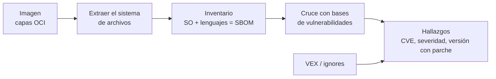

---
tags:
  - devsecops
  - escaneo
  - contenedores
  - vulnerabilidades
  - ci-cd
---

# Container image scanning

> Cómo encontrar vulnerabilidades conocidas en las imágenes de contenedor: qué capas se analizan, con qué herramientas, cómo se gatea el pipeline, cómo se re-escanean las imágenes ya publicadas y cómo se documenta lo que no es explotable con VEX.

!!! info "Dónde encaja"
    Corre en la fase de **build** (justo después de `docker build` y antes del `push`), en el **registry** (escaneo continuo de lo ya publicado) y, para las imágenes que están corriendo, en el clúster ([KSPM](kspm.md)). Analiza el **contenido** de la imagen: paquetes del sistema operativo y dependencias de la aplicación. El endurecimiento de la imagen (base mínima, no root, firma) está en la nota temática [Seguridad de contenedores](../infraestructura-y-contenedores/seguridad-contenedores.md); la visión de conjunto de todos los escaneos, en [Escaneo de seguridad en el pipeline](escaneo-en-pipeline.md).

## ¿Qué detecta?

Un **container image scanner** (escáner de imágenes) responde a una pregunta concreta: *¿esta imagen contiene software con vulnerabilidades públicas conocidas?* La mayoría de escáneres modernos añade además detección de secretos y de malas configuraciones dentro de la imagen.

| Detecta | No detecta |
| --- | --- |
| **CVEs** (*Common Vulnerabilities and Exposures*) en paquetes del sistema operativo (`apk`, `deb`, `rpm`) | Vulnerabilidades en **tu propio código** (eso es [SAST](sast.md)) |
| CVEs en dependencias de lenguaje dentro de la imagen (`package-lock.json`, `requirements.txt`, JARs, binarios Go) | Vulnerabilidades **zero-day** (de día cero) sin CVE publicada |
| Paquetes de una distribución en **end of life** (fin de soporte) | Si la función vulnerable **se llega a ejecutar** (para eso: análisis de alcanzabilidad o VEX) |
| Secretos dentro de las capas (`--scanners secret` en Trivy) | Comportamiento malicioso en ejecución (eso es runtime, Falco) |
| Malas configuraciones del Dockerfile embebido (usuario root, sin `HEALTHCHECK`) | Cómo se despliega la imagen (privilegios del pod, red): [KSPM](kspm.md) e [IaC scanning](iac-scanning.md) |

## Cómo funciona

El escaneo de imágenes es, en el fondo, **SCA aplicado a una imagen** (ver [SCA](sca.md)): primero se hace inventario y luego se cruza con bases de vulnerabilidades.



1. **Lee las capas** (*layers*) de la imagen, desde un daemon de Docker, un registry o un archivo `.tar`, sin ejecutarla.
2. **Identifica el sistema operativo** (por `/etc/os-release`) y lee la base de datos de paquetes del gestor (`/lib/apk/db/installed`, `/var/lib/dpkg/status`, la base de `rpm`).
3. **Identifica paquetes de lenguaje**: lockfiles y metadatos de paquetes instalados (`node_modules`, `site-packages`), JARs y la información de módulos embebida en binarios Go y Rust.
4. **Cruza** cada paquete y versión con bases de vulnerabilidades: los avisos de cada distribución (Debian, Alpine, Red Hat, Ubuntu…), el NVD y GitHub Advisory Database, entre otras.
5. **Clasifica** por severidad e indica si existe versión corregida (*fixed version*).

!!! warning "Los avisos de la distribución mandan para los paquetes del SO"
    Para un paquete `deb` o `rpm`, la severidad y el estado del parche que importan son los de la **distribución**, no los del NVD: la distribución puede haber aplicado el parche sin subir la versión, o considerar que no le afecta. Por eso dos escáneres pueden dar resultados distintos para la misma imagen.

### Vulnerabilidades sin parche (*unfixed*)

Muchas CVEs del sistema operativo aparecen con estado **affected** (afectado) pero sin versión corregida: el mantenedor aún no publicó parche, o decidió no hacerlo. Trivy distingue varios estados (`fixed`, `affected`, `will_not_fix`, `fix_deferred`, `end_of_life`, `under_investigation`).

| Opción | Qué hace |
| --- | --- |
| `trivy image --ignore-unfixed` | Muestra solo las que tienen versión corregida |
| `trivy image --ignore-status will_not_fix,end_of_life` | Oculta estados concretos |
| `grype --only-fixed` | Equivalente en Grype |
| `docker scout cves --only-fixed` | Equivalente en Docker Scout |

Ignorar las *unfixed* sirve para el **gate** (no bloquear por lo que no puedes arreglar), pero no para el **inventario**: si una sin parche es crítica, la salida suele ser cambiar de imagen base o quitar el paquete (ver [imágenes base mínimas](../infraestructura-y-contenedores/seguridad-contenedores.md#imagenes-base-minimas)).

## Herramientas

| Herramienta | Tipo | Targets | Notas |
| --- | --- | --- | --- |
| **Trivy** (Aqua Security) | Open source | Imágenes, filesystem, repos, SBOM, IaC, Kubernetes | La más usada en CI; también secretos y misconfigurations; soporta VEX |
| **Grype** (Anchore) | Open source | Imágenes, directorios, SBOM | Se combina con **Syft** (genera el SBOM); soporta VEX (OpenVEX) |
| **Docker Scout** | Comercial (con plan gratuito limitado) | Imágenes locales y de registries | Integrado en Docker Desktop y la CLI; recomienda bases actualizadas; revisa límites del plan |
| **Snyk Container** | Comercial (plan gratuito limitado) | Imágenes | Sugiere imágenes base alternativas con menos CVEs |
| **GitLab Container Scanning** | Nativa de GitLab (usa Trivy) | Imágenes del pipeline | Plantilla `Jobs/Container-Scanning.gitlab-ci.yml` |
| **Amazon ECR + Amazon Inspector** | Nativa AWS | Imágenes en ECR | *Enhanced scanning*: continuo, SO y lenguajes |
| **Microsoft Defender for Containers** | Nativa Azure | ACR (y ECR, Artifact Registry), contenedores en ejecución | Sin agente, re-escaneo diario |
| **Artifact Analysis** | Nativa Google Cloud | Imágenes en Artifact Registry | Escaneo automático al subir y *on-demand scanning* con `gcloud` |

## Ejecutarlo en local

=== "Trivy"

    ```bash
    # Imagen del daemon local, solo altas y críticas con parche disponible
    trivy image --severity HIGH,CRITICAL --ignore-unfixed mi-app:1.4.2

    # Solo paquetes del sistema operativo, o solo los de lenguaje
    trivy image --pkg-types os mi-app:1.4.2
    trivy image --pkg-types library mi-app:1.4.2

    # Desde un tar (por ejemplo, antes de cargarlo en el daemon)
    docker save mi-app:1.4.2 -o mi-app.tar
    trivy image --input mi-app.tar
    ```

    Salida resumida (los valores son ilustrativos):

    ```text
    mi-app:1.4.2 (debian 12.x)
    Total: 2 (HIGH: 1, CRITICAL: 1)

    │ Library │ Vulnerability  │ Severity │ Status │ Installed │ Fixed   │
    │ libssl3 │ CVE-XXXX-XXXXX │ CRITICAL │ fixed  │ 3.0.x-1   │ 3.0.y-1 │
    │ zlib1g  │ CVE-YYYY-YYYYY │ HIGH     │ fixed  │ 1:1.2.x   │ 1:1.2.y │
    ```

=== "Grype + Syft"

    ```bash
    # Escaneo directo
    grype mi-app:1.4.2 --only-fixed --fail-on high

    # Generar el SBOM una vez y escanearlo cuantas veces quieras
    syft mi-app:1.4.2 -o cyclonedx-json > mi-app.cdx.json
    grype sbom:mi-app.cdx.json
    ```

=== "Docker Scout"

    ```bash
    docker scout quickview mi-app:1.4.2            # resumen
    docker scout cves mi-app:1.4.2 \
      --only-severity critical,high --only-fixed \
      --exit-code                                  # sale con código 2 si hay CVEs
    docker scout recommendations mi-app:1.4.2      # bases alternativas
    ```

!!! tip "Distingue capas propias y de la base"
    Si casi todos los hallazgos vienen de la imagen base, la solución es **actualizar o cambiar la base**, no parchear paquete a paquete. Docker Scout tiene `--ignore-base` para ver solo lo que añadiste tú; con Trivy, compara el escaneo de tu imagen con el de la base.

## Integrarlo en el pipeline

Patrón: **build → escaneo → push solo si pasa**. Así una imagen con críticas nunca llega al registry. Las actions de terceros van fijadas por SHA (ver [Seguridad del pipeline](../identidades-y-pipeline/seguridad-pipeline.md#pinning-de-actions-por-sha)).

=== "GitHub Actions (Trivy)"

    ```yaml title=".github/workflows/container-scan.yml"
    name: container-scan
    on:
      pull_request:
      push:
        branches: [main]
    permissions:
      contents: read
    jobs:
      scan:
        runs-on: ubuntu-latest
        permissions:
          contents: read
          security-events: write # subir SARIF a code scanning
        steps:
          - uses: actions/checkout@3d3c42e5aac5ba805825da76410c181273ba90b1 # v7.0.1
          - name: Build
            run: docker build -t mi-app:${{ github.sha }} .

          # 1) Informe completo en SARIF (no falla)
          - name: Trivy (SARIF)
            uses: aquasecurity/trivy-action@ed142fd0673e97e23eac54620cfb913e5ce36c25 # v0.36.0
            with:
              scan-type: image
              image-ref: mi-app:${{ github.sha }}
              format: sarif
              output: trivy-image.sarif
              ignore-unfixed: true
              severity: HIGH,CRITICAL
              limit-severities-for-sarif: true
          - name: Subir a code scanning
            if: always()
            uses: github/codeql-action/upload-sarif@9b3254085494b55a0f7c4c2b3d2d52cc712ce370 # v4.39.1
            with:
              sarif_file: trivy-image.sarif
              category: trivy-image

          # 2) Gate: falla con críticas que tienen parche
          - name: Trivy (gate)
            uses: aquasecurity/trivy-action@ed142fd0673e97e23eac54620cfb913e5ce36c25 # v0.36.0
            with:
              scan-type: image
              image-ref: mi-app:${{ github.sha }}
              ignore-unfixed: true
              severity: CRITICAL
              exit-code: "1"
              skip-setup-trivy: true
          # 3) Solo si pasó: login al registry (OIDC) y push
    ```

=== "GitHub Actions (Grype)"

    ```yaml
          - name: Grype
            id: grype
            uses: anchore/scan-action@27805bf3b4e84b4a5c980df22ed233c00390a439 # v7.4.2
            with:
              image: mi-app:${{ github.sha }}
              only-fixed: true
              severity-cutoff: critical
              fail-build: true
              output-format: sarif
          - name: Subir a code scanning
            if: always()
            uses: github/codeql-action/upload-sarif@9b3254085494b55a0f7c4c2b3d2d52cc712ce370 # v4.39.1
            with:
              sarif_file: ${{ steps.grype.outputs.sarif }}
    ```

=== "GitLab CI"

    ```yaml title=".gitlab-ci.yml (fragmento)"
    include:
      - template: Jobs/Container-Scanning.gitlab-ci.yml

    container_scanning:
      variables:
        CS_IMAGE: $CI_REGISTRY_IMAGE:$CI_COMMIT_SHA
        CS_SEVERITY_THRESHOLD: HIGH
    ```

    El job está en todos los planes; el *vulnerability report* y las políticas de aprobación dependen del plan (revisa la documentación de GitLab).

!!! note "SARIF en repos privados"
    Subir SARIF a **code scanning** es gratis en repos públicos; en privados requiere GitHub Code Security (antes parte de GitHub Advanced Security). Si no lo tienes, guarda el informe como *artifact* del job o en tu plataforma de vulnerabilidades.

### Escaneo en el registry

El escaneo del pipeline es una foto del día del build. El registry gestionado re-escanea lo ya publicado cuando aparecen CVEs nuevas. La tabla de equivalencias está en [Software supply chain](../codigo-y-dependencias/cadena-suministro.md#registries-por-proveedor); aquí lo operativo:

=== "AWS"

    **Amazon ECR** ofrece *basic scanning* (solo SO, al hacer push o manual, con tecnología nativa de AWS) y *enhanced scanning* con **Amazon Inspector** (SO y lenguajes, al hacer push y **continuo**). Inspector deja de re-escanear una imagen tras una **duración configurable** contada desde el push, el último pull o el último uso en un clúster (*ECR re-scan duration*); revisa el valor por defecto de tu cuenta.

    ```bash
    # Activar enhanced scanning continuo en todos los repositorios
    aws ecr put-registry-scanning-configuration \
      --scan-type ENHANCED \
      --rules '[{"scanFrequency":"CONTINUOUS_SCAN","repositoryFilters":[{"filter":"*","filterType":"WILDCARD"}]}]'

    # Hallazgos de una imagen
    aws ecr describe-image-scan-findings --repository-name mi-app --image-id imageTag=1.4.2
    ```

    Inspector emite eventos a **EventBridge** cuando cambia un hallazgo: úsalos para abrir tickets o avisar al equipo dueño.

=== "Azure"

    **Microsoft Defender for Containers** hace *vulnerability assessment* **sin agente** de las imágenes de ACR (y también de ECR y Artifact Registry en multicloud), de los contenedores en ejecución y de los nodos, con **re-escaneo diario**, cobertura de paquetes de SO y de lenguaje e información de explotabilidad. Los hallazgos aparecen como recomendaciones en Microsoft Defender for Cloud y pueden usarse para **gated deployment** (auditar o bloquear despliegues en Kubernetes de imágenes que no cumplen tu política).

=== "Google Cloud"

    **Artifact Analysis** escanea cada imagen al subirla a Artifact Registry (una vez por digest: cambiar tags no re-escanea) y sigue actualizando los resultados **mientras la imagen se haya descargado en los últimos 30 días**. Pasado ese tiempo los datos quedan desactualizados; volver a hacer pull reactiva el análisis.

    ```bash
    # Escaneo bajo demanda (on-demand scanning), útil en el pipeline
    gcloud artifacts docker images scan \
      us-docker.pkg.dev/mi-proyecto/apps/mi-app:1.4.2 --remote
    gcloud artifacts docker images list-vulnerabilities <SCAN_ID>
    ```

### Re-escaneo continuo de imágenes publicadas

Aunque no uses un registry gestionado, puedes re-escanear tú. Lo más eficiente es **guardar el SBOM** de cada imagen publicada y re-escanear el SBOM (no hace falta descargar la imagen):

```yaml title=".github/workflows/rescan.yml (fragmento)"
on:
  schedule:
    - cron: "0 5 * * *" # cada día a las 05:00 UTC
# ...
      - run: trivy sbom --severity CRITICAL --exit-code 1 sboms/mi-app-1.4.2.cdx.json
```

Re-escanea al menos **lo que está desplegado** (por digest); para saber qué imágenes corren en el clúster, ver [KSPM](kspm.md) (Trivy Operator, Kubescape).

## Umbrales y cuándo fallar el build

Los criterios generales (severidad, `ignore-unfixed`, solo lo nuevo, KEV y EPSS) están en [Criterios comunes de gating](escaneo-en-pipeline.md#criterios-comunes-de-gating). Aplicados a imágenes:

| Severidad | Política habitual de ejemplo |
| --- | --- |
| Crítica con parche | Falla el build |
| Alta con parche | Falla en `main` o en release; aviso en PR (según madurez del equipo) |
| Crítica/alta **sin** parche | No falla; se reporta y se revisa la imagen base |
| Media y baja | Solo informe |

La misma CVE puede **aparecer de golpe** en todas las imágenes cuando se publica: ten previsto cómo desbloquear (actualizar la base, o excepción temporal documentada).

## Gestión de hallazgos

El ciclo general está en [Gestión de hallazgos](escaneo-en-pipeline.md#gestion-de-hallazgos). El flujo de triage para cada CVE de una imagen:

1. **¿Hay versión corregida?** Actualiza la base o la dependencia y reconstruye. Es lo más frecuente.
2. **¿Viene de la base o de lo que añadiste?** De la base: cambia o actualiza la base. Tuya: actualiza la dependencia (ver [SCA](sca.md)).
3. **¿Es explotable en tu contexto?** Si no lo es (el paquete está pero el código vulnerable no se usa), documéntalo con **VEX**.
4. **¿No hay parche y sí es explotable?** Mitiga (quita el paquete, cambia de base, control compensatorio) y registra una excepción con responsable y fecha de caducidad.

### Supresiones con fecha de expiración

Trivy acepta caducidad en sus archivos de supresión: cuando vence, la CVE vuelve a aparecer y obliga a revisarla. En el `.trivyignore` clásico se añade `exp:` a la línea; el formato `.trivyignore.yaml` (marcado como experimental) permite además filtrar por ruta o *purl* y dejar el motivo:

```text title=".trivyignore"
# Sin parche en Debian; no procesamos XML de terceros. Ticket SEC-123
CVE-XXXX-XXXXX exp:2026-12-31
```

```yaml title=".trivyignore.yaml"
vulnerabilities:
  - id: CVE-XXXX-XXXXX
    purls:
      - "pkg:deb/debian/libxml2"
    statement: "Sin parche en Debian; no procesamos XML de terceros. Ticket SEC-123"
    expired_at: 2026-12-31
```

```bash
trivy image --ignorefile .trivyignore.yaml mi-app:1.4.2   # el YAML hay que indicarlo explícitamente
```

### VEX: declarar lo que no es explotable

**VEX** (*Vulnerability Exploitability eXchange*, intercambio de explotabilidad de vulnerabilidades) es un documento que acompaña a la imagen y dice, para cada CVE, si el producto **está afectado o no**, con una justificación estándar. A diferencia de un ignore local, VEX es **portable**: lo pueden leer tus clientes, el registry y cualquier escáner compatible.

| Estado | Significado |
| --- | --- |
| `not_affected` | El componente está, pero la vulnerabilidad no es explotable (requiere justificación) |
| `affected` | Afectado; se espera una acción |
| `fixed` | Ya corregido en esta versión |
| `under_investigation` | Se está analizando |

Justificaciones de `not_affected` en OpenVEX: `component_not_present`, `vulnerable_code_not_present`, `vulnerable_code_not_in_execute_path`, `vulnerable_code_cannot_be_controlled_by_adversary`, `inline_mitigations_already_exist`.

```json title="mi-app.openvex.json"
{
  "@context": "https://openvex.dev/ns/v0.2.0",
  "@id": "https://example.com/vex/mi-app-1.4.2",
  "author": "Equipo de plataforma",
  "timestamp": "2026-10-24T10:00:00Z",
  "version": 1,
  "statements": [
    {
      "vulnerability": { "name": "CVE-XXXX-XXXXX" },
      "products": [
        {
          "@id": "pkg:oci/mi-app?repository_url=registry.example.com%2Fmi-app",
          "subcomponents": [{ "@id": "pkg:deb/debian/libxml2" }]
        }
      ],
      "status": "not_affected",
      "justification": "vulnerable_code_not_in_execute_path",
      "impact_statement": "La app no invoca el parser XML afectado."
    }
  ]
}
```

```bash
trivy image --vex mi-app.openvex.json mi-app:1.4.2
grype mi-app:1.4.2 --vex mi-app.openvex.json
docker scout cves mi-app:1.4.2 --vex-location ./vex/
```

El documento se puede generar con **vexctl** (OpenVEX) y adjuntar a la imagen como *attestation* firmada (ver [Software supply chain](../codigo-y-dependencias/cadena-suministro.md)). Artifact Analysis también admite subir declaraciones VEX.

!!! warning "VEX es una afirmación, no una excusa"
    Un `not_affected` es una declaración de tu equipo que otros van a creer. Debe tener justificación técnica revisada, autor y fecha, y revisarse cuando cambie el código. Para priorización y SLA de remediación, ver [Detección y respuesta](../gobierno-y-respuesta/deteccion-respuesta.md#sla-de-remediacion).

## Buenas prácticas y errores comunes

- **Escanea la imagen final**, la que se publica, por digest; no la etapa de build ni el `latest` del registry.
- **Escanea antes del push**, y re-escanea después: el build no basta.
- **Cachea la base de datos** de vulnerabilidades en CI (trivy-action lo hace por defecto); descargarla en cada job es lento y puede chocar con límites de descarga.
- **Reconstruye con regularidad** aunque tu código no cambie: es la forma de recibir los parches de la base. Dependabot o Renovate actualizan el `FROM`.
- **No confundas cero CVEs con imagen segura**: un escáner no ve el código propio, la configuración de ejecución ni los zero-days.
- Error común: comparar resultados de dos escáneres y pensar que uno "se equivoca". Usan fuentes y criterios distintos (ver el aviso de [Cómo funciona](#como-funciona)).

## Relación con otras secciones

| Enfoque | Qué se mira desde ahí | Nota |
| --- | --- | --- |
| Cloud (el control) | Registries gestionados y su escaneo nativo; dónde corren las imágenes | [Contenedores gestionados](../../cloud/computo/contenedores-gestionados.md), [Seguridad de contenedores y Kubernetes](../../cloud/seguridad/seguridad-contenedores-kubernetes.md) |
| DevOps (la automatización) | El build y el publish de la imagen donde se inserta el escaneo | [Docker](../../devops/contenedores/docker.md), [Integración continua](../../devops/ci-cd/integracion-continua.md) |
| DevSecOps (la verificación) | Endurecimiento de la imagen, SBOM y firma, imágenes en ejecución, gestión de vulnerabilidades | [Seguridad de contenedores](../infraestructura-y-contenedores/seguridad-contenedores.md), [SCA](sca.md), [KSPM](kspm.md), [Software supply chain](../codigo-y-dependencias/cadena-suministro.md), [Detección y respuesta](../gobierno-y-respuesta/deteccion-respuesta.md), [Escaneo de seguridad en el pipeline](escaneo-en-pipeline.md) |
| Laboratorios (la práctica) | Practicar esto paso a paso | [Lab 12: Escaneos de seguridad en el pipeline](../../laboratorios/devsecops/escaneos-en-pipeline.md) |

## Referencias

- [Trivy: escaneo de imágenes](https://trivy.dev/latest/docs/target/container_image/)
- [Trivy: VEX](https://trivy.dev/latest/docs/supply-chain/vex/)
- [Trivy: filtrar vulnerabilidades (`.trivyignore.yaml`)](https://trivy.dev/latest/docs/configuration/filtering/)
- [trivy-action](https://github.com/aquasecurity/trivy-action)
- [Grype](https://github.com/anchore/grype) y [Syft](https://github.com/anchore/syft)
- [anchore/scan-action](https://github.com/anchore/scan-action)
- [Docker Scout: `docker scout cves`](https://docs.docker.com/reference/cli/docker/scout/cves/)
- [GitLab: Container Scanning](https://docs.gitlab.com/user/application_security/container_scanning/)
- [GitHub: subir un archivo SARIF](https://docs.github.com/es/code-security/code-scanning/integrating-with-code-scanning/uploading-a-sarif-file-to-github)
- [Amazon ECR: escaneo de imágenes](https://docs.aws.amazon.com/AmazonECR/latest/userguide/image-scanning.html)
- [Amazon Inspector: ECR re-scan duration](https://docs.aws.amazon.com/inspector/latest/user/scanning_resources_configure_duration_setting_ecr.html)
- [Microsoft Defender for Containers](https://learn.microsoft.com/es-es/azure/defender-for-cloud/defender-for-containers-introduction)
- [Artifact Analysis: escaneo de contenedores](https://cloud.google.com/artifact-analysis/docs/container-scanning-overview)
- [OpenVEX](https://github.com/openvex/spec) y [vexctl](https://github.com/openvex/vexctl)
- [Comandos de seguridad](../../recursos/comandos/seguridad.md)
