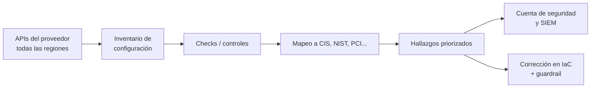

---
tags:
  - devsecops
  - escaneo
  - cspm
---

# CSPM

> Escanear la configuración de las cuentas, suscripciones y proyectos cloud contra benchmarks como CIS: Prowler, Steampipe/Powerpipe y los servicios nativos (AWS Security Hub CSPM, Microsoft Defender for Cloud, Security Command Center), y cómo llevar cada corrección a IaC.

!!! info "Dónde encaja"
    - **Fase**: **operación**. Corre de forma **continua** (servicios nativos) o **programada** (herramientas open source), sobre lo que ya está desplegado. Es el complemento *shift-right* del [IaC scanning](iac-scanning.md), que revisa el código antes del despliegue.
    - **Qué analiza**: la configuración de los recursos y de la propia cuenta, leída por las APIs del proveedor: IAM, almacenamiento, red, logs, cifrado.
    - **Nota temática**: los marcos (CIS, ISO 27001, SOC 2, NIST) y el panorama de CSPM están en [Cumplimiento y gobierno](../gobierno-y-respuesta/cumplimiento.md); los servicios base que el CSPM revisa, en [Fundamentos de seguridad cloud](../../cloud/seguridad/fundamentos-seguridad-cloud.md). Vista de conjunto: [Escaneo de seguridad en el pipeline](escaneo-en-pipeline.md).

## ¿Qué detecta?

Un **CSPM** (*Cloud Security Posture Management*, gestión de la postura de seguridad en la nube) responde a "¿mi nube está configurada de forma segura **ahora mismo**?", aunque los cambios se hayan hecho a mano en la consola, con un script o con IaC.

| Detecta | No detecta |
| --- | --- |
| Buckets o storage accounts públicos, snapshots compartidos | Vulnerabilidades en el código de tus aplicaciones ([SAST](sast.md), [DAST](dast.md)) |
| Security groups / NSG / firewall rules con `0.0.0.0/0` en puertos de administración | CVE en paquetes de las imágenes ([Container scanning](container-scanning.md)) o de las VMs (eso es gestión de vulnerabilidades, p. ej. Amazon Inspector) |
| Root o administradores sin MFA, access keys antiguas, políticas con `*:*` | Configuración **dentro** del clúster de Kubernetes ([KSPM](kspm.md)) |
| Logs de auditoría desactivados, sin multi-región o sin validación de integridad | Ataques en curso: eso es detección de amenazas (GuardDuty, Defender, SCC threat detection) |
| Cifrado en reposo ausente, claves sin rotación, TLS antiguo | Errores en IaC antes de desplegar ([IaC scanning](iac-scanning.md)) |
| Desvíos respecto a CIS Foundations, AWS FSBP o Microsoft cloud security benchmark | Si el control "existe en papel" pero nadie actúa sobre las alertas |

## Cómo funciona

1. **Inventario**: con una identidad de **solo lectura** recorre las APIs del proveedor en todas las regiones y guarda la configuración de cada recurso.
2. **Evaluación**: aplica cada **check** o **control** (una regla: "S3 Block Public Access activado a nivel de cuenta") y marca el recurso como `PASS` / `FAIL` (o `PASSED` / `FAILED`).
3. **Mapeo**: cada check se asocia a uno o varios marcos (CIS, NIST, PCI DSS, ISO 27001), así que un mismo hallazgo cuenta en todos.
4. **Priorización y salida**: severidad, puntuación (*secure score*), informes y envío a un agregador o SIEM.

Hay dos modos de evaluación:

| Modo | Cómo | Ejemplos | Ventaja / límite |
| --- | --- | --- | --- |
| **Programado** (*periodic*) | Lee el estado completo cada X horas | Prowler en un cron, controles *periodic* de Security Hub CSPM | Simple y sin agentes; entre dos ejecuciones no ves cambios |
| **Continuo** (*change-triggered*) | Reacciona a cada cambio de configuración registrado | AWS Config rules, controles *change triggered* de Security Hub CSPM, Azure Policy, Security Health Analytics | Detecta en minutos; necesita el registro de configuración activo (y tiene costo) |



Permisos típicos de solo lectura: en AWS, las políticas administradas `SecurityAudit` y `ViewOnlyAccess` (Prowler documenta permisos adicionales); en Azure, el rol `Reader` sobre las suscripciones más permisos de lectura en Microsoft Entra ID para los checks de identidad; en Google Cloud, `roles/viewer` o `roles/iam.securityReviewer` a nivel de organización o proyecto. Revisa la documentación de cada herramienta: los permisos exactos cambian con los checks.

### Benchmarks de referencia

| Benchmark | Nube | Quién lo mantiene |
| --- | --- | --- |
| **CIS Amazon Web Services Foundations Benchmark** | AWS | CIS |
| **CIS Microsoft Azure Foundations Benchmark** | Azure | CIS |
| **CIS Google Cloud Platform Foundation Benchmark** | Google Cloud | CIS |
| **AWS Foundational Security Best Practices** (FSBP) | AWS | AWS (estándar propio de Security Hub CSPM) |
| **Microsoft cloud security benchmark** (MCSB) | Azure (y AWS/GCP conectados) | Microsoft (estándar por defecto de Defender for Cloud) |

Los CIS Foundations tienen versiones que se actualizan cada cierto tiempo y cada herramienta soporta unas concretas: comprueba cuál ejecutas (`prowler aws --list-compliance`). Los niveles (Level 1 / Level 2) y la relación con otros marcos están en [Cumplimiento y gobierno](../gobierno-y-respuesta/cumplimiento.md#cis-benchmarks).

## Herramientas

| Herramienta | Tipo | Targets | Notas |
| --- | --- | --- | --- |
| **Prowler** | Open source (también Prowler Cloud, comercial) | AWS, Azure, Google Cloud, Kubernetes, Microsoft 365, GitHub y otros | CLI, interfaz web autoalojable y GitHub Action oficial; checks mapeados a CIS, NIST, ISO 27001, PCI DSS…; muy activo |
| **ScoutSuite** (NCC Group) | Open source | AWS, Azure, Google Cloud y otras | Informe HTML para revisión manual. Última release (5.14.0) de mayo de 2024 y últimos commits de finales de 2024; el repositorio no está archivado, pero no hay actividad. No lo elijas para algo nuevo |
| **Steampipe + Powerpipe** (Turbot) | Open source | AWS, Azure, Google Cloud y cientos de APIs | Steampipe expone las APIs como tablas SQL; Powerpipe ejecuta *benchmarks* (mods como `aws_compliance`, con CIS, NIST, PCI…) y dashboards. Ambos con releases activas en 2026 |
| **Cloud Custodian** | Open source | AWS, Azure, Google Cloud | Políticas en YAML que detectan **y remedian** (etiquetar, detener, cerrar acceso); útil como motor de remediación |
| **AWS Security Hub CSPM** + **AWS Config** | Nativa (AWS) | Cuentas AWS (y estándares multicloud mediante conectores) | Estándares FSBP, CIS AWS Foundations, NIST SP 800-53/800-171, PCI DSS; usa reglas de AWS Config, que debe estar grabando |
| **Microsoft Defender for Cloud** | Nativa (Azure) | Azure, AWS y Google Cloud conectados | **Foundational CSPM** gratis (MCSB, secure score, recomendaciones); **Defender CSPM** de pago (attack path analysis, cumplimiento regulatorio, security explorer) |
| **Security Command Center** | Nativa (Google Cloud) | Organizaciones y proyectos de Google Cloud | **Security Health Analytics** y cumplimiento en el tier **Premium**; el tier Enterprise (multicloud) está deprecado y se apaga el 21 de mayo de 2027 |
| **CNAPP comerciales** (Wiz, Prisma Cloud, Orca…) | Comercial | Multicloud | CSPM junto con CWPP, CIEM y escaneo de IaC e imágenes (ver [Cumplimiento y gobierno](../gobierno-y-respuesta/cumplimiento.md#cnapp)) |

!!! info "Nombres que cambiaron"
    En 2025 el Security Hub original pasó a llamarse **AWS Security Hub CSPM** y el nuevo **AWS Security Hub** correlaciona hallazgos de varios servicios. En Azure, "Azure Security Center" es el nombre antiguo de Defender for Cloud. Verás los dos nombres en documentación anterior.

## Ejecutarlo en local

### Prowler

```bash
pipx install prowler          # o: docker run prowlercloud/prowler:stable ...

# Con un perfil de AWS de solo lectura
prowler aws --profile auditoria --list-compliance
prowler aws --profile auditoria --compliance cis_6.0_aws \
  --severity critical high --status FAIL \
  --output-formats csv json-ocsf html --output-directory ./prowler

# Azure y Google Cloud
prowler azure --az-cli-auth
prowler gcp --project-ids mi-proyecto --compliance cis_4.0_gcp
```

Salida resumida (ilustrativa): una tabla por servicio con el número de checks `FAIL` por severidad, la puntuación de cada marco elegido y las rutas de los informes. Cada hallazgo incluye el ID del check, el recurso, la región y la recomendación:

```text
FAIL  iam_root_mfa_enabled                          critical  global     root account
FAIL  ec2_securitygroup_allow_ingress_from_internet_to_tcp_port_22  high  eu-west-1  sg-0a1b2c3d
FAIL  s3_account_level_public_access_blocks         high      global     111122223333
FAIL  cloudtrail_multi_region_enabled               high      global     111122223333
```

### Steampipe + Powerpipe

```bash
steampipe plugin install aws
steampipe service start                     # Powerpipe consulta a Steampipe por SQL
powerpipe mod init
powerpipe mod install github.com/turbot/steampipe-mod-aws-compliance
powerpipe benchmark list
powerpipe benchmark run aws_compliance.benchmark.cis_v400 --output csv > cis.csv
```

Con Steampipe también puedes hacer consultas sueltas, útiles en una investigación:

```sql
-- Security groups con SSH abierto a internet
select group_id, region, account_id
from aws_vpc_security_group_rule
where type = 'ingress' and cidr_ipv4 = '0.0.0.0/0'
  and from_port <= 22 and to_port >= 22;
```

### Servicios nativos

=== "AWS"

    ```bash
    # Estándares activos y resultados de un control
    aws securityhub get-enabled-standards
    aws securityhub get-findings --filters \
      '{"ComplianceStatus":[{"Value":"FAILED","Comparison":"EQUALS"}],"SeverityLabel":[{"Value":"CRITICAL","Comparison":"EQUALS"}]}' \
      --max-items 20
    aws configservice describe-compliance-by-config-rule --compliance-types NON_COMPLIANT
    ```

=== "Azure"

    ```bash
    # Secure score y recomendaciones no saludables
    az security secure-scores list -o table
    az graph query -q "securityresources
      | where type == 'microsoft.security/assessments'
      | where properties.status.code == 'Unhealthy'
      | project name=properties.displayName, severity=properties.metadata.severity, id=properties.resourceDetails.Id" --first 20
    ```

=== "Google Cloud"

    ```bash
    # Hallazgos activos de Security Health Analytics en la organización
    gcloud scc findings list organizations/<ORG_ID> --location=global \
      --filter='state="ACTIVE" AND category="OPEN_SSH_PORT"'
    ```

## Integrarlo en el pipeline

El CSPM no corre en cada PR (no hay nada desplegado que revisar), sino en tres momentos:

- **Continuo**: el servicio nativo activado en toda la organización, enviando hallazgos a la cuenta de seguridad.
- **Programado**: un workflow (o un job en la cuenta de seguridad) que ejecuta Prowler cada noche y guarda los informes.
- **Después de desplegar**: un Prowler acotado a los servicios que tocó el despliegue (`--services s3 ec2`), como verificación de que el cambio no abrió nada.

```yaml title=".github/workflows/cspm.yml"
name: CSPM nocturno
on:
  schedule:
    - cron: "0 2 * * *"
  workflow_dispatch:

permissions: {}

jobs:
  prowler-aws:
    runs-on: ubuntu-latest
    timeout-minutes: 90
    environment: auditoria          # solo este environment puede asumir el rol
    permissions:
      contents: read
      id-token: write               # OIDC hacia AWS, sin access keys guardadas
    steps:
      - uses: aws-actions/configure-aws-credentials@e1253824e5c10ff9df46874f81ed3ec929e19cfd # v6.3.0
        with:
          role-to-assume: arn:aws:iam::111122223333:role/prowler-readonly   # SecurityAudit + ViewOnlyAccess
          aws-region: eu-west-1
      - name: Prowler
        uses: prowler-cloud/prowler@bffc8844c1c9a3666e37a2ada4ee05f62e1446b0 # 5.45.0
        with:
          provider: aws
          image-tag: 5.45.0          # fija también la imagen, no "stable"
          output-formats: csv json-ocsf html
          flags: --compliance cis_6.0_aws --status FAIL
          extra-env: AWS_ACCESS_KEY_ID AWS_SECRET_ACCESS_KEY AWS_SESSION_TOKEN AWS_REGION
      - uses: actions/upload-artifact@b7c566a772e6b6bfb58ed0dc250532a479d7789f # v6.0.0
        if: ${{ !cancelled() }}
        with:
          name: prowler-${{ github.run_id }}
          path: output/
          retention-days: 30
```

- Los hallazgos de la nube no son "del repositorio", por eso aquí no se suben a code scanning (la action lo permite con `upload-sarif`). Lo natural es enviarlos a un agregador: Prowler puede publicarlos en Security Hub CSPM (`--security-hub`) o en su propia interfaz web.
- No hay plantilla oficial de GitLab; se ejecuta la imagen `prowlercloud/prowler` en un job programado (*scheduled pipeline*).

### Cuenta de seguridad centralizada

Activa el CSPM desde una cuenta dedicada y no desde cada equipo: así los equipos no pueden desactivarlo y tienes una sola vista (ver [Gobernanza](../../cloud/operacion-y-gobierno/gobernanza.md#cuentas-centrales-de-logs-y-seguridad)).

| | AWS | Azure | Google Cloud |
| --- | --- | --- | --- |
| Dónde se administra | Cuenta de seguridad como **delegated administrator** de Security Hub CSPM y AWS Config | Defender for Cloud a nivel de **management group** raíz | Security Command Center a nivel de **organización** |
| Cómo se extiende | **Central configuration** (políticas por OU) y **cross-Region aggregation** hacia una *home Region* | Azure Policy asigna los planes de Defender a todas las suscripciones | Se hereda en todos los proyectos de la organización |
| Herramientas open source | Rol de solo lectura en cada cuenta, asumible desde la cuenta de seguridad | Service principal con `Reader` en el management group | Service account con permisos de lectura en la organización |

## Umbrales y cuándo fallar el build

El CSPM mide **postura**, no un cambio concreto, así que casi nunca bloquea un PR (criterios generales en [Criterios comunes de gating](escaneo-en-pipeline.md#criterios-comunes-de-gating)). Los umbrales se expresan de otra forma:

- **Alertas inmediatas** para hallazgos críticos nuevos (root sin MFA, bucket público, SSH abierto a internet): notificación al canal de seguridad o a un ticket automático.
- **Objetivos de postura**: porcentaje de controles CIS en `PASS` por cuenta, *secure score* mínimo, cero críticos con más de N días.
- **Verificación post-despliegue**: el job acotado tras el despliegue sí puede fallar (`fail-on-findings: true` en la action de Prowler, que devuelve código 3) si aparece un `FAIL` crítico nuevo en los servicios desplegados, y disparar el rollback o bloquear la siguiente promoción.
- **Solo lo nuevo**: compara con la ejecución anterior o silencia lo aceptado (siguiente sección), para que la alerta signifique "algo cambió".

## Gestión de hallazgos

El ciclo general está en [Gestión de hallazgos](escaneo-en-pipeline.md#gestion-de-hallazgos). Lo propio del CSPM:

- **Triage**: confirma que el recurso es real y de quién es (por eso importa el *tagging*: `owner`, `environment`). Un bucket público puede ser correcto si sirve una web estática.
- **Excepciones** en cada herramienta:
    - Prowler: **mutelist** en YAML por cuenta, check, región, recurso o tag; usa `Description` para el motivo, el responsable y la fecha de revisión.
    - Security Hub CSPM: **automation rules** o el *workflow status* `SUPPRESSED`.
    - Defender for Cloud: **exemptions** (*waiver* o *mitigated*), que admiten fecha de expiración.
    - Security Command Center: **mute rules**.
- **Priorización**: los CNAPP y Defender CSPM combinan severidad del control, exposición a internet y sensibilidad de los datos (*attack paths*).

### Remediar con IaC

Corregir en la consola apaga la alerta hoy y la vuelve a encender en el siguiente `terraform apply`. El ciclo correcto es: **corregir en el código → desplegar por el pipeline → añadir un guardrail y una regla de IaC scanning** para que no vuelva.

| Hallazgo | Corrección en IaC | Guardrail para que no vuelva |
| --- | --- | --- |
| S3 Block Public Access desactivado a nivel de cuenta | `aws_s3_account_public_access_block` con los cuatro flags a `true` | SCP que deniega `s3:PutAccountPublicAccessBlock` |
| SSH (22) abierto a `0.0.0.0/0` | Quitar la regla; acceso con AWS Systems Manager Session Manager, Azure Bastion o IAP | Regla de IaC scanning + AWS Config rule / Azure Policy |
| CloudTrail sin trail multi-región | `aws_cloudtrail` con `is_multi_region_trail = true` y `enable_log_file_validation = true` (mejor un trail de organización) | SCP que deniega `cloudtrail:StopLogging` y `DeleteTrail` |
| Storage account que permite blobs públicos | `allow_nested_items_to_be_public = false` y `min_tls_version = "TLS1_2"` en `azurerm_storage_account` | Azure Policy con efecto `Deny` |
| Bucket de Cloud Storage sin prevención de acceso público | `public_access_prevention = "enforced"` y `uniform_bucket_level_access = true` | Organization Policy `storage.publicAccessPrevention` |
| Root sin MFA | No se gestiona con IaC: acción manual y documentada (y en AWS Organizations, gestión centralizada del root) | Alerta en cada uso del root |

```hcl title="s3-account.tf"
resource "aws_s3_account_public_access_block" "this" {
  block_public_acls       = true
  block_public_policy     = true
  ignore_public_acls      = true
  restrict_public_buckets = true
}
```

```hcl title="storage.tf"
resource "google_storage_bucket" "datos" {
  name                        = "mi-empresa-datos-prod"
  location                    = "US"
  uniform_bucket_level_access = true
  public_access_prevention    = "enforced"
}
```

La remediación **automática** (AWS Config remediation con SSM Automation, `DeployIfNotExists` en Azure Policy, Cloud Custodian) es útil para casos claros y de bajo riesgo, pero crea *drift* respecto al código: si la usas, abre también un PR o un ticket para corregir el IaC (ver [drift detection](../infraestructura-y-contenedores/seguridad-iac.md#drift-detection)).

## Buenas prácticas y errores comunes

| Buena práctica | Error común |
| --- | --- |
| Activar el CSPM en **todas** las cuentas y regiones, también las que "no se usan" | Revisar solo la región principal; el atacante usa la que nadie mira |
| Administración delegada en una cuenta de seguridad | Que cada equipo pueda desactivar el CSPM de su cuenta |
| Empezar por un benchmark (CIS Foundations) y los críticos | Activar todos los estándares a la vez y ahogarse en miles de hallazgos duplicados (en Security Hub CSPM, activa *consolidated control findings*) |
| Cada corrección en IaC más un guardrail | Arreglar en la consola y ver volver el hallazgo |
| Identidad de solo lectura con OIDC para el escáner | Ejecutar Prowler con credenciales de administrador guardadas en el CI |
| Revisar costos (AWS Config graba cada cambio; Defender CSPM y SCC Premium son de pago) | Activar grabación continua de todo sin estimar el costo |
| Verificar que una herramienta sigue mantenida (ScoutSuite) | Adoptar un escáner sin actividad que no conoce los servicios nuevos |

## Relación con otras secciones

| Enfoque | Qué se mira desde ahí | Nota |
| --- | --- | --- |
| Cloud (el control) | Los servicios y la configuración que el CSPM revisa; la cuenta de seguridad y los guardrails | [Fundamentos de seguridad cloud](../../cloud/seguridad/fundamentos-seguridad-cloud.md), [Gobernanza](../../cloud/operacion-y-gobierno/gobernanza.md), [IAM: AWS, Azure y GCP](../../cloud/fundamentos/iam-comparativa.md), [Redes en la nube](../../cloud/redes-y-datos/redes.md) |
| DevOps (la automatización) | El IaC donde se aplica cada corrección y el pipeline que la despliega | [Infrastructure as Code](../../devops/iac/infraestructura-como-codigo.md), [Terraform básico](../../devops/iac/terraform-basico.md) |
| DevSecOps (la verificación) | Marcos de cumplimiento, el escaneo previo de IaC y de Kubernetes, y la respuesta a hallazgos | [Cumplimiento y gobierno](../gobierno-y-respuesta/cumplimiento.md), [IaC scanning](iac-scanning.md), [KSPM](kspm.md), [Seguridad de IaC](../infraestructura-y-contenedores/seguridad-iac.md), [Detección y respuesta](../gobierno-y-respuesta/deteccion-respuesta.md), [Escaneo de seguridad en el pipeline](escaneo-en-pipeline.md) |
| Negocio TI (el porqué) | Riesgo aceptado, evidencia para auditorías y costo de las herramientas | [Gobierno y riesgo de TI](../../negocio/gobierno-riesgo-ti.md) |
| Laboratorios (la práctica) | Practicar esto paso a paso | [Lab 12: Escaneos de seguridad en el pipeline](../../laboratorios/devsecops/escaneos-en-pipeline.md), [Lab 16: Auditar tu cuenta cloud con Prowler (CSPM)](../../laboratorios/devsecops/cspm-prowler.md) |

## Referencias

- [Prowler: documentación](https://docs.prowler.com/)
- [Prowler: GitHub Action](https://github.com/marketplace/actions/prowler-security-scan)
- [ScoutSuite](https://github.com/nccgroup/ScoutSuite)
- [Steampipe](https://steampipe.io/docs)
- [Powerpipe](https://powerpipe.io/docs)
- [AWS Compliance mod (Powerpipe)](https://hub.powerpipe.io/mods/turbot/aws_compliance)
- [Cloud Custodian](https://cloudcustodian.io/docs/)
- [AWS Security Hub CSPM: estándares](https://docs.aws.amazon.com/securityhub/latest/userguide/standards-reference.html)
- [AWS Security Hub CSPM y AWS Config](https://docs.aws.amazon.com/securityhub/latest/userguide/securityhub-setup-prereqs.html)
- [Microsoft Defender for Cloud: CSPM](https://learn.microsoft.com/es-es/azure/defender-for-cloud/concept-cloud-security-posture-management)
- [Security Command Center: niveles de servicio](https://cloud.google.com/security-command-center/docs/service-tiers)
- [Security Health Analytics](https://cloud.google.com/security-command-center/docs/concepts-security-health-analytics)
- [CIS Benchmarks](https://www.cisecurity.org/cis-benchmarks)
