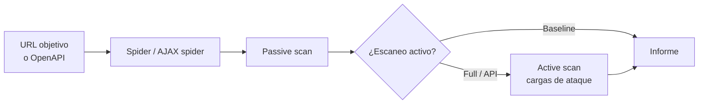

---
tags:
  - devsecops
  - escaneo
  - dast
---

# DAST

> Escanear la aplicación desplegada desde fuera, como lo haría un atacante: OWASP ZAP (baseline, full y API scan), Nuclei y Burp Suite, con escaneo autenticado, entornos efímeros y fuzzing como variantes.

!!! info "Dónde encaja"
    - **Fase**: después del despliegue a **staging** o a un **entorno efímero**, antes de promover a producción; además, un escaneo completo **programado** (nocturno o semanal).
    - **Qué analiza**: la aplicación **en ejecución** (HTML, JavaScript, cabeceras, cookies, APIs), sin mirar el código.
    - **Nota temática**: la teoría (DAST vs SAST vs IAST, OWASP API Security Top 10, pentesting) está en [Pruebas dinámicas](../codigo-y-dependencias/pruebas-dinamicas.md). Aquí va el detalle operativo. Vista de conjunto de todos los escaneos: [Escaneo de seguridad en el pipeline](escaneo-en-pipeline.md).

## ¿Qué detecta?

Un **DAST** (*Dynamic Application Security Testing*, pruebas dinámicas de seguridad de aplicaciones) envía peticiones HTTP reales a una URL y analiza las respuestas. Encuentra lo que **de verdad está expuesto** tras el despliegue, incluida la configuración del servidor, del proxy y del WAF, que el SAST no ve.

| Detecta | No detecta |
| --- | --- |
| Cabeceras de seguridad ausentes o mal configuradas (CSP, HSTS, `X-Content-Type-Options`, anti-clickjacking) | La línea de código exacta que causa el fallo |
| Cookies sin `Secure`, `HttpOnly` o `SameSite` | Rutas que el escáner no alcanza a descubrir (sin enlace, sin especificación OpenAPI) |
| Inyecciones (SQL injection, XSS reflejado, command injection) en los parámetros que recorre | La mayoría de fallos de **lógica de negocio** y de autorización entre usuarios (BOLA/IDOR) sin configuración específica |
| Errores verbosos, stack traces, listados de directorios, archivos expuestos (`.git/`, backups) | Vulnerabilidades en dependencias que no se manifiestan en las respuestas (eso es [SCA](sca.md)) |
| TLS débil, CORS demasiado abierto, redirecciones abiertas | Secretos en el repositorio ([Secret scanning](secret-scanning.md)) |
| CVE conocidas de productos expuestos (con plantillas tipo Nuclei) | Configuración de la cuenta cloud ([CSPM](cspm.md)) |

## Cómo funciona

1. **Crawling o spidering** (rastreo): descubre páginas y parámetros siguiendo enlaces. El **spider tradicional** lee el HTML; el **AJAX spider** maneja un navegador real para aplicaciones de una sola página (SPA) que construyen la interfaz con JavaScript. En APIs, el rastreo se sustituye por la **especificación** (OpenAPI, GraphQL, SOAP).
2. **Passive scan** (escaneo pasivo): analiza las respuestas obtenidas sin enviar nada nuevo. Es seguro: solo mira cabeceras, cookies, contenido.
3. **Active scan** (escaneo activo): por cada parámetro descubierto envía cargas de ataque (`' OR 1=1--`, `<script>`…) y busca evidencias en la respuesta. Es lo que crea, modifica o borra datos.
4. **Informe**: cada alerta con su riesgo, confianza, URL y evidencia.



Variantes del mismo enfoque:

| Variante | Qué cambia | Herramientas |
| --- | --- | --- |
| **Escaneo de APIs** | Las rutas y parámetros salen de la especificación, no del rastreo | ZAP API scan, Schemathesis |
| **Template-based scanning** (escaneo por plantillas) | En vez de atacar cada parámetro, comprueba firmas concretas: una CVE, un panel de administración expuesto, una mala configuración | Nuclei |
| **Fuzzing** (pruebas con datos mutados) | Envía muchas entradas aleatorias o malformadas y busca errores 500, cuelgues o respuestas que violan el contrato | Schemathesis, ffuf, RESTler |

## Herramientas

| Herramienta | Tipo | Targets | Notas |
| --- | --- | --- | --- |
| **ZAP** (ZAP by Checkmarx) | Open source | Web, SPA, APIs REST/SOAP/GraphQL | Packaged scans en Docker, Automation Framework (plan YAML) y actions oficiales para GitHub |
| **Nuclei** (ProjectDiscovery) | Open source | Web, APIs, DNS, TLS, red | Miles de plantillas YAML de la comunidad; muy rápido; plantillas DAST/fuzzing con `-dast` |
| **Schemathesis** | Open source | APIs OpenAPI y GraphQL | Genera casos a partir del esquema (property-based testing) |
| **ffuf** | Open source | Web | Fuzzing de rutas y parámetros |
| **Burp Suite Professional** (PortSwigger) | Comercial | Web, APIs | Herramienta manual de referencia para pentesting, con escáner incluido |
| **Burp Suite DAST** (antes *Enterprise Edition*, renombrado en 2025) | Comercial | Web, APIs | El mismo motor de escaneo que Professional, pensado para escanear de forma programada y desde CI/CD |
| **GitLab DAST** | Nativa (GitLab Ultimate) | Web y APIs | Analizador basado en navegador (DAST v5); el analizador *proxy-based* se eliminó en GitLab 17.3 |
| **Web Security Scanner** (Security Command Center) | Nativa de Google Cloud | Apps públicas en App Engine, GKE y Compute Engine | *Custom scans* y *managed scans* semanales (Premium); solo URLs públicas |

GitHub no tiene un DAST nativo: se usan las actions de ZAP o de terceros. AWS y Azure tampoco ofrecen un escáner DAST propio comparable; se usan ZAP u ofertas de terceros (por ejemplo, desde sus marketplaces).

## Ejecutarlo en local

!!! danger "Solo contra sistemas propios o autorizados"
    Un escaneo activo es un ataque real. Ejecútalo solo contra tus entornos de prueba o con autorización por escrito (ver [Pruebas dinámicas](../codigo-y-dependencias/pruebas-dinamicas.md#pentesting-basico)). Una forma segura de practicar es levantar en local una aplicación vulnerable a propósito, como **OWASP Juice Shop**.

```bash
# Aplicación de práctica en local
docker run --rm -d -p 3000:3000 --name juice bkimminich/juice-shop
```

### ZAP: baseline, full y API scan

```bash
# Baseline (rastreo + pasivo). -j añade el AJAX spider, -J guarda un informe JSON
docker run --rm --network host -v "$(pwd):/zap/wrk:rw" ghcr.io/zaproxy/zaproxy:stable \
  zap-baseline.py -t http://localhost:3000 -j -r baseline.html -J baseline.json

# Generar un archivo de reglas con todas las alertas en WARN, para editarlo
docker run --rm --network host -v "$(pwd):/zap/wrk:rw" ghcr.io/zaproxy/zaproxy:stable \
  zap-baseline.py -t http://localhost:3000 -g rules.tsv

# API scan guiado por OpenAPI (-f openapi | soap | graphql)
docker run --rm --network host -v "$(pwd):/zap/wrk:rw" ghcr.io/zaproxy/zaproxy:stable \
  zap-api-scan.py -t http://localhost:8080/openapi.json -f openapi -c rules.tsv -r api.html
```

Salida resumida de un baseline:

```text
WARN-NEW: Content Security Policy (CSP) Header Not Set [10038] x 12
WARN-NEW: X-Content-Type-Options Header Missing [10021] x 8
FAIL-NEW: 0     FAIL-INPROG: 0  WARN-NEW: 7     WARN-INPROG: 0  INFO: 3 IGNORE: 0       PASS: 52
```

Códigos de salida: `0` sin problemas, `1` al menos un FAIL, `2` al menos un WARN sin FAIL, `3` otro error. El archivo de reglas (separado por tabuladores) decide qué alerta es `IGNORE`, `INFO`, `WARN` o `FAIL`:

```text title=".zap/rules.tsv"
10021	FAIL	(X-Content-Type-Options Header Missing)
10038	WARN	(Content Security Policy (CSP) Header Not Set)
10096	IGNORE	(Timestamp Disclosure - Unix)
```

### Escaneo autenticado

Sin sesión, el escáner solo ve la parte pública. Opciones, de la más simple a la más completa:

- **Cabecera con token**: ZAP añade una cabecera a todas las peticiones si defines `ZAP_AUTH_HEADER_VALUE` (y opcionalmente `ZAP_AUTH_HEADER`, por defecto `Authorization`, y `ZAP_AUTH_HEADER_SITE` para limitarla a un dominio). Ideal para APIs con bearer token.
- **Context file y usuario** (`-n contexto.context -U usuario`) en los packaged scans.
- **Automation Framework**: un plan YAML con el entorno, la autenticación (formulario, navegador, script, OAuth2) y los trabajos a ejecutar.

```bash
# Token de una cuenta de prueba, leído de una variable (nunca escrito en el comando)
docker run --rm -v "$(pwd):/zap/wrk:rw" \
  -e ZAP_AUTH_HEADER_VALUE="Bearer $TOKEN_PRUEBAS" \
  -e ZAP_AUTH_HEADER_SITE="api.staging.mi-app.example" \
  ghcr.io/zaproxy/zaproxy:stable \
  zap-api-scan.py -t https://api.staging.mi-app.example/openapi.json -f openapi -r api.html
```

```yaml title=".zap/plan.yaml"
env:
  contexts:
    - name: staging
      urls:
        - https://staging.mi-app.example
jobs:
  - type: spider
  - type: spiderAjax
  - type: passiveScan-wait
  - type: activeScan
  - type: report
    parameters:
      template: sarif-json          # para subirlo a code scanning
      reportDir: /zap/wrk
      reportFile: zap.sarif
```

```bash
docker run --rm -v "$(pwd):/zap/wrk:rw" ghcr.io/zaproxy/zaproxy:stable \
  zap.sh -cmd -autorun /zap/wrk/.zap/plan.yaml
```

!!! warning "Cuentas de prueba y cuidado con el logout"
    Usa un usuario creado para el escaneo, con datos ficticios y sin privilegios de administración (o uno por rol, si quieres probar autorización). Excluye del rastreo las rutas de `logout`, borrado de cuenta o cambio de contraseña, o el escáner cerrará su propia sesión o romperá el usuario a mitad del escaneo.

### Nuclei

```bash
nuclei -update-templates
# Solo severidad alta y crítica, limitando a 20 peticiones por segundo
nuclei -u https://staging.mi-app.example -severity high,critical -rl 20 -se nuclei.sarif
# Por etiquetas: configuraciones incorrectas y paneles expuestos
nuclei -u https://staging.mi-app.example -tags misconfig,exposure -rl 20
```

## Integrarlo en el pipeline

El DAST necesita una URL viva, así que el job va **después del despliegue**. Lo habitual: baseline (o API scan) en cada despliegue a staging o a un entorno efímero por PR, y full scan programado.

```yaml title=".github/workflows/dast.yml"
name: DAST
on:
  workflow_run:
    workflows: ["Deploy staging"]
    types: [completed]
  schedule:
    - cron: "0 3 * * 1"       # full scan semanal, lunes 03:00 UTC

permissions: {}

jobs:
  zap-baseline:
    if: github.event_name == 'workflow_run' && github.event.workflow_run.conclusion == 'success'
    runs-on: ubuntu-latest
    timeout-minutes: 20
    permissions:
      contents: read          # leer .zap/rules.tsv
    steps:
      - uses: actions/checkout@3d3c42e5aac5ba805825da76410c181273ba90b1 # v7.0.1
        with:
          persist-credentials: false
      - name: ZAP baseline
        uses: zaproxy/action-baseline@de8ad967d3548d44ef623df22cf95c3b0baf8b25 # v0.15.0
        with:
          target: https://staging.mi-app.example
          rules_file_name: .zap/rules.tsv
          cmd_options: "-j"
          fail_action: true          # falla si hay alertas WARN o FAIL según las reglas
          allow_issue_writing: false # sin issues automáticos: no necesita issues: write

  zap-full:
    if: github.event_name == 'schedule'
    runs-on: ubuntu-latest
    timeout-minutes: 120
    permissions:
      contents: read
    steps:
      - uses: actions/checkout@3d3c42e5aac5ba805825da76410c181273ba90b1 # v7.0.1
        with:
          persist-credentials: false
      - name: ZAP full scan
        uses: zaproxy/action-full-scan@3c58388149901b9a03b7718852c5ba889646c27c # v0.13.0
        with:
          target: https://staging.mi-app.example
          rules_file_name: .zap/rules.tsv
          allow_issue_writing: false
```

- Para APIs, `zaproxy/action-api-scan` (v0.10.0, `5158fe4d9d8fcc75ea204db81317cce7f9e5453d`) acepta `target` con la URL de la especificación y `format: openapi`.
- Las tres actions suben el informe como artifact (`zap_scan`). Si quieres verlo en code scanning, genera el SARIF con el Automation Framework y súbelo con `github/codeql-action/upload-sarif` (ejemplo en el [hub](escaneo-en-pipeline.md#ejemplo-de-workflow-con-varios-escaneos)).
- Para Nuclei existe `projectdiscovery/nuclei-action` (v3.1.1, `cc153d0541e1adf8a42bbe31c0a4fb2376147538`), que recibe los argumentos en `args`.

En GitLab (Ultimate), la plantilla oficial se incluye así:

```yaml title=".gitlab-ci.yml"
include:
  - template: Security/DAST.gitlab-ci.yml

stages: [build, deploy, dast]

dast:
  variables:
    DAST_TARGET_URL: https://staging.mi-app.example
```

### Dónde correrlo

| Entorno | Qué escaneo | Por qué |
| --- | --- | --- |
| Entorno efímero por PR | Baseline o API scan | Aislado, datos de prueba, se destruye al terminar (ver [Pruebas de infraestructura](../../devops/iac/pruebas-infraestructura.md#entornos-efimeros)) |
| Staging | Baseline en cada despliegue, full programado | Se parece a producción; nadie depende de sus datos |
| Producción | Como mucho baseline pasivo, con autorización | El activo puede crear pedidos, enviar correos o tumbar el servicio |

!!! warning "Riesgos de escanear"
    - **Datos**: el active scan rellena formularios miles de veces; vacía o restaura la base de datos del entorno después, y nunca uses datos reales de clientes.
    - **Carga**: miles de peticiones por minuto pueden saturar un staging pequeño o disparar el autoscaling (y la factura). Limita la velocidad (`-rl` en Nuclei, hilos en ZAP) y escanea en horario acordado.
    - **Efectos colaterales**: correos, SMS, webhooks y pagos reales. Desactívalos o apúntalos a *sandboxes* en el entorno de escaneo.
    - **WAF**: si un WAF bloquea al escáner, mides el WAF, no la aplicación. Escanea por detrás del WAF o añade una excepción para la IP del runner (y otra pasada con WAF, para validarlo).

## Umbrales y cuándo fallar el build

Los criterios generales están en [Criterios comunes de gating](escaneo-en-pipeline.md#criterios-comunes-de-gating). En DAST:

- **Baseline en cada despliegue**: falla solo con las reglas marcadas `FAIL` en `rules.tsv` (por ejemplo, cabeceras críticas o cookies sin `Secure`). Empieza con todo en `WARN` y endurece regla a regla.
- **Full scan programado**: abre tickets con los hallazgos High y bloquea la **promoción** a producción si hay alguno sin triage.
- **Solo nuevos hallazgos**: el baseline de ZAP distingue `WARN-NEW` de `WARN-INPROG` con un *progress file* (`-p`), para que lo ya conocido y en curso no rompa cada ejecución.
- **Confianza**: ZAP asigna confianza (*Low*, *Medium*, *High*, *Confirmed*); una alerta High con confianza Low se revisa a mano antes de bloquear.

## Gestión de hallazgos

El ciclo general está en [Gestión de hallazgos](escaneo-en-pipeline.md#gestion-de-hallazgos). Lo propio del DAST:

- **Triage**: reproduce la alerta (la evidencia incluye la petición y la respuesta). Muchos falsos positivos del DAST son respuestas genéricas que el escáner interpreta como éxito.
- **Supresiones**: en `rules.tsv` (`IGNORE`) o en la configuración de la herramienta, con el motivo en el PR. Si la herramienta no admite fecha de expiración, revisa el archivo de reglas en cada ciclo de triage.
- **Corrección**: muchas alertas se resuelven en la configuración (cabeceras en el reverse proxy o el CDN, flags de cookies) y no en el código: localiza la capa correcta.
- **Prioridad**: las inyecciones confirmadas en endpoints públicos van primero.
- **Cierre**: tras volver a escanear, convierte el caso en una prueba (una regla `FAIL` o una plantilla propia de Nuclei) para que no reaparezca.

## Buenas prácticas y errores comunes

| Buena práctica | Error común |
| --- | --- |
| Escanear con autenticación y un usuario de prueba por rol | Escanear solo la página de login y dar por buena la aplicación |
| Dar al escáner la especificación OpenAPI de cada API | Confiar en el spider para descubrir endpoints de una API |
| Baseline rápido en cada despliegue y full programado | Meter un full scan de dos horas en cada PR |
| Entornos efímeros con datos sintéticos | Escanear un staging compartido que otro equipo está probando |
| Limitar la velocidad y avisar a quien opera el entorno | Saturar staging y "descubrir" un DoS propio |
| Complementar con pentest manual para lógica de negocio | Creer que un DAST limpio significa "sin vulnerabilidades" |

## Relación con otras secciones

| Enfoque | Qué se mira desde ahí | Nota |
| --- | --- | --- |
| Cloud (el control) | WAF, cabeceras en el CDN y Web Security Scanner de Google Cloud | [Seguridad de APIs y aplicaciones](../../cloud/seguridad/seguridad-apis-aplicaciones.md), [Integración y APIs](../../cloud/arquitectura/integracion-apis.md) |
| DevOps (la automatización) | Despliegue a staging y entornos efímeros donde corre el escaneo | [Despliegue continuo](../../devops/ci-cd/despliegue-continuo.md), [Pruebas de infraestructura](../../devops/iac/pruebas-infraestructura.md) |
| DevSecOps (la verificación) | Teoría de pruebas dinámicas, otros escaneos y gestión de vulnerabilidades | [Pruebas dinámicas](../codigo-y-dependencias/pruebas-dinamicas.md), [Escaneo de seguridad en el pipeline](escaneo-en-pipeline.md), [SAST](sast.md), [Seguridad del pipeline](../identidades-y-pipeline/seguridad-pipeline.md), [Detección y respuesta](../gobierno-y-respuesta/deteccion-respuesta.md) |
| Networking (la base) | HTTP, TLS y cabeceras que el escáner analiza | [Protocolos de aplicación](../../networking/intermedio/protocolos-aplicacion.md) |
| Laboratorios (la práctica) | Practicar esto paso a paso | [Lab 12: Escaneos de seguridad en el pipeline](../../laboratorios/devsecops/escaneos-en-pipeline.md), [Lab 15: DAST con OWASP ZAP sobre OWASP Juice Shop](../../laboratorios/devsecops/dast-zap-juice-shop.md) |

## Referencias

- [ZAP: packaged scans en Docker](https://www.zaproxy.org/docs/docker/)
- [ZAP: baseline scan](https://www.zaproxy.org/docs/docker/baseline-scan/)
- [ZAP: API scan](https://www.zaproxy.org/docs/docker/api-scan/)
- [ZAP: Automation Framework](https://www.zaproxy.org/docs/automate/automation-framework/)
- [ZAP: autenticación](https://www.zaproxy.org/docs/desktop/start/features/authentication/)
- [GitHub Action: ZAP baseline](https://github.com/zaproxy/action-baseline)
- [GitHub Action: ZAP full scan](https://github.com/zaproxy/action-full-scan)
- [GitHub Action: ZAP API scan](https://github.com/zaproxy/action-api-scan)
- [Nuclei](https://docs.projectdiscovery.io/tools/nuclei/overview)
- [Burp Suite DAST](https://portswigger.net/burp/dast)
- [GitLab DAST](https://docs.gitlab.com/user/application_security/dast/)
- [Web Security Scanner (Google Cloud)](https://cloud.google.com/security-command-center/docs/concepts-web-security-scanner-overview)
- [Schemathesis](https://schemathesis.readthedocs.io/)
- [OWASP Juice Shop](https://owasp.org/www-project-juice-shop/)
