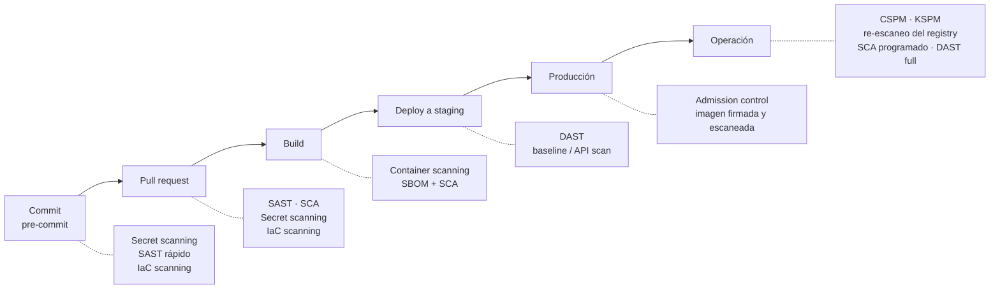

---
tags:
  - seguridad
  - sast
  - sca
  - escaneo
  - github-actions
---

# Escaneo de seguridad en el pipeline

> Mapa de los ocho escaneos de seguridad (SAST, SCA, secret scanning, container scanning, IaC scanning, DAST, KSPM y CSPM): qué analiza cada uno, en qué fase corre y cómo combinarlos en un mismo pipeline.

## ¿Qué es?

Cada escaneo mira **un tipo de artefacto distinto**: el código fuente, las dependencias, el historial de Git, la imagen de contenedor, el código de infraestructura, la aplicación en ejecución, el clúster o la cuenta cloud. Ninguno sustituye a otro: juntos forman capas que se cubren los huecos (*defense in depth*, defensa en profundidad).

La idea de **shift-left** (ver [Fundamentos de DevSecOps](../fundamentos-devsecops.md)) es mover cada escaneo lo más temprano posible, donde corregir es barato. Pero algunos solo tienen sentido sobre algo desplegado (DAST, KSPM, CSPM): son el *shift-right*. Esta nota es el punto de entrada del bloque; cada escaneo tiene su nota con el detalle operativo.

## Los ocho escaneos

| Escaneo | Qué analiza | Cuándo corre | Herramienta open source de ejemplo | Nota |
| --- | --- | --- | --- | --- |
| **SAST** (*Static Application Security Testing*) | Código fuente propio, sin ejecutarlo | Pre-commit (IDE), PR, build | Semgrep, CodeQL | [SAST](sast.md) |
| **SCA** (*Software Composition Analysis*) | Dependencias de terceros (CVE y licencias), a partir de manifests, lockfiles o SBOM | PR, build y **programado** (salen CVE nuevas sin que cambie el código) | Trivy, OSV-Scanner | [SCA](sca.md) |
| **Secret scanning** | Credenciales en archivos y en el historial de Git | Pre-commit, PR, push (y continuo en la plataforma) | Gitleaks, TruffleHog | [Secret scanning](secret-scanning.md) |
| **Container scanning** | Imagen construida: paquetes del sistema operativo y librerías, configuración | Build y **continuo** en el registry | Trivy, Grype | [Container scanning](container-scanning.md) |
| **IaC scanning** | Terraform, CloudFormation, Bicep, Dockerfiles, manifests de Kubernetes, Helm | Pre-commit, PR (y sobre el `plan`) | Checkov, Trivy (`trivy config`) | [IaC scanning](iac-scanning.md) |
| **DAST** (*Dynamic Application Security Testing*) | La aplicación desplegada, desde fuera | Deploy a staging o entorno efímero, y programado | OWASP ZAP, Nuclei | [DAST](dast.md) |
| **KSPM** (*Kubernetes Security Posture Management*) | El clúster en ejecución: configuración, RBAC, workloads | Programado y continuo (operación) | Kubescape, kube-bench, Trivy (`trivy k8s`) | [KSPM](kspm.md) |
| **CSPM** (*Cloud Security Posture Management*) | La configuración de las cuentas, suscripciones y proyectos cloud | Programado y continuo (operación) | Prowler, Steampipe/Powerpipe | [CSPM](cspm.md) |

## Cada escaneo en su fase



Regla práctica: **lo rápido y con pocos falsos positivos, lo más a la izquierda** (secretos y IaC en pre-commit); **lo lento, programado** (full DAST, CSPM completo); y **lo que depende de CVE nuevas, también programado** (SCA y re-escaneo de imágenes), porque una imagen limpia hoy puede tener una CVE crítica mañana.

## Ejemplo rápido con Trivy

**Trivy** cubre varios escaneos con una sola herramienta (dependencias, imágenes, IaC, secretos y clústeres), así que es una buena forma de empezar:

=== "Filesystem"

    ```bash
    # Dependencias (SCA) y secretos del repositorio
    trivy fs --scanners vuln,secret --severity HIGH,CRITICAL .
    ```

=== "Imagen Docker"

    ```bash
    trivy image --severity HIGH,CRITICAL --ignore-unfixed mi-app:1.4.2
    ```

=== "IaC"

    ```bash
    trivy config --severity HIGH,CRITICAL ./infra
    ```

=== "En GitHub Actions"

    ```yaml
    - name: Escaneo Trivy
      # Fijada por SHA de commit (inmutable), no por tag ni rama: en marzo de 2026
      # los atacantes movieron casi todos los tags de trivy-action a código que
      # robaba secretos. El comentario indica la versión; Dependabot/Renovate
      # actualizan SHA y comentario juntos.
      uses: aquasecurity/trivy-action@ed142fd0673e97e23eac54620cfb913e5ce36c25 # v0.36.0
      with:
        scan-type: fs
        severity: HIGH,CRITICAL
        exit-code: 1
    ```

!!! warning "Fail fast"
    Usa `exit-code: 1` para que el pipeline falle si hay vulnerabilidades críticas. Por qué fijar las actions por SHA: [Seguridad del pipeline](../identidades-y-pipeline/seguridad-pipeline.md#pinning-de-actions-por-sha).

## Ejemplo de workflow con varios escaneos

Un workflow para cada PR y cada push a `main` con cinco jobs en paralelo: secret scanning (Gitleaks), SAST (Semgrep), SCA, IaC y container scanning (Trivy). Cada job pide solo los permisos que necesita y sube su resultado en **SARIF** (*Static Analysis Results Interchange Format*, formato estándar de resultados) a **code scanning**, donde GitHub muestra las alertas en la pestaña *Security* y anotadas en el PR.

```yaml title=".github/workflows/security.yml"
name: security

on:
  pull_request:
  push:
    branches: [main]
  schedule:
    - cron: "0 5 * * 1"        # semanal: CVE nuevas sin cambios en el código

permissions: {}                # nada por defecto; cada job pide lo suyo

jobs:
  secrets:
    runs-on: ubuntu-latest
    timeout-minutes: 10
    permissions:
      contents: read
      security-events: write   # subir SARIF a code scanning
    steps:
      - uses: actions/checkout@3d3c42e5aac5ba805825da76410c181273ba90b1 # v7.0.1
        with:
          fetch-depth: 0       # historial completo: los secretos también viven en commits viejos
          persist-credentials: false
      - name: Gitleaks
        run: |
          docker run --rm -v "$PWD:/repo" ghcr.io/gitleaks/gitleaks:v8.30.1 \
            git /repo --redact --report-format sarif --report-path /repo/gitleaks.sarif
      - uses: github/codeql-action/upload-sarif@9b3254085494b55a0f7c4c2b3d2d52cc712ce370 # v4.39.1
        if: ${{ !cancelled() }}
        with:
          sarif_file: gitleaks.sarif
          category: gitleaks

  sast:
    runs-on: ubuntu-latest
    timeout-minutes: 15
    permissions:
      contents: read
      security-events: write
    steps:
      - uses: actions/checkout@3d3c42e5aac5ba805825da76410c181273ba90b1 # v7.0.1
        with:
          persist-credentials: false
      - name: Semgrep
        run: |
          docker run --rm -v "$PWD:/src" -w /src semgrep/semgrep:1.182.0 \
            semgrep scan --config p/default --sarif --output semgrep.sarif --error
      - uses: github/codeql-action/upload-sarif@9b3254085494b55a0f7c4c2b3d2d52cc712ce370 # v4.39.1
        if: ${{ !cancelled() }}
        with:
          sarif_file: semgrep.sarif
          category: semgrep

  sca:
    runs-on: ubuntu-latest
    timeout-minutes: 10
    permissions:
      contents: read
      security-events: write
    steps:
      - uses: actions/checkout@3d3c42e5aac5ba805825da76410c181273ba90b1 # v7.0.1
        with:
          persist-credentials: false
      - name: Trivy (dependencias)
        uses: aquasecurity/trivy-action@ed142fd0673e97e23eac54620cfb913e5ce36c25 # v0.36.0
        with:
          scan-type: fs
          scanners: vuln
          severity: HIGH,CRITICAL
          ignore-unfixed: true
          format: sarif
          output: trivy-sca.sarif
          limit-severities-for-sarif: true
          exit-code: 1
      - uses: github/codeql-action/upload-sarif@9b3254085494b55a0f7c4c2b3d2d52cc712ce370 # v4.39.1
        if: ${{ !cancelled() }}
        with:
          sarif_file: trivy-sca.sarif
          category: trivy-sca

  iac:
    runs-on: ubuntu-latest
    timeout-minutes: 10
    permissions:
      contents: read
      security-events: write
    steps:
      - uses: actions/checkout@3d3c42e5aac5ba805825da76410c181273ba90b1 # v7.0.1
        with:
          persist-credentials: false
      - name: Trivy (IaC)
        uses: aquasecurity/trivy-action@ed142fd0673e97e23eac54620cfb913e5ce36c25 # v0.36.0
        with:
          scan-type: config
          scan-ref: ./infra
          severity: HIGH,CRITICAL
          format: sarif
          output: trivy-iac.sarif
          limit-severities-for-sarif: true
          exit-code: 1
      - uses: github/codeql-action/upload-sarif@9b3254085494b55a0f7c4c2b3d2d52cc712ce370 # v4.39.1
        if: ${{ !cancelled() }}
        with:
          sarif_file: trivy-iac.sarif
          category: trivy-iac

  container:
    runs-on: ubuntu-latest
    timeout-minutes: 20
    permissions:
      contents: read
      security-events: write
    steps:
      - uses: actions/checkout@3d3c42e5aac5ba805825da76410c181273ba90b1 # v7.0.1
        with:
          persist-credentials: false
      - name: Build (sin publicar)
        run: docker build -t mi-app:${{ github.sha }} .
      - name: Trivy (imagen)
        uses: aquasecurity/trivy-action@ed142fd0673e97e23eac54620cfb913e5ce36c25 # v0.36.0
        with:
          scan-type: image
          image-ref: mi-app:${{ github.sha }}
          severity: HIGH,CRITICAL
          ignore-unfixed: true
          format: sarif
          output: trivy-image.sarif
          limit-severities-for-sarif: true
          exit-code: 1
      - uses: github/codeql-action/upload-sarif@9b3254085494b55a0f7c4c2b3d2d52cc712ce370 # v4.39.1
        if: ${{ !cancelled() }}
        with:
          sarif_file: trivy-image.sarif
          category: trivy-image
```

Detalles que importan:

- **`if: ${{ !cancelled() }}`** en la subida: si el escaneo falla por encontrar algo, el SARIF se sube igual (si no, el PR falla sin decir por qué).
- **`category`** distinta por herramienta, para que code scanning no mezcle ni sobrescriba resultados.
- **Imágenes de contenedor**: Gitleaks y Semgrep corren con una versión fija; en pipelines críticos fíjalas también por digest (`@sha256:...`), igual que las actions por SHA.
- **PRs desde forks**: el `GITHUB_TOKEN` de esos PRs es de solo lectura y la subida a code scanning falla; los escaneos siguen corriendo y fallando el check. No uses `pull_request_target` para "arreglarlo" (ver [Seguridad del pipeline](../identidades-y-pipeline/seguridad-pipeline.md)).
- **Code scanning en repositorios privados** requiere GitHub Code Security (antes parte de GitHub Advanced Security); en repositorios públicos es gratis.
- Los escaneos que necesitan algo desplegado van en otros workflows: [DAST](dast.md#integrarlo-en-el-pipeline) tras el despliegue a staging, [KSPM](kspm.md) y [CSPM](cspm.md#integrarlo-en-el-pipeline) programados.

## Criterios comunes de gating

El **gating** (bloqueo) es la decisión de qué hallazgos impiden el merge o el despliegue. Estos criterios valen para todos los escaneos; cada nota solo añade los flags y las particularidades de su herramienta.

| Criterio | Qué significa | Ejemplo |
| --- | --- | --- |
| **Por severidad** | Bloquear Critical y High; Medium y Low solo informan | `severity: HIGH,CRITICAL` + `exit-code: 1` |
| **Por confianza** | Una alerta de severidad alta pero confianza baja se revisa a mano antes de bloquear | Confianza de las reglas de Bandit o de las alertas de ZAP |
| **Solo con corrección disponible** | No bloquear por una CVE sin versión corregida (sí registrarla y vigilarla) | `ignore-unfixed: true` en Trivy |
| **Solo hallazgos nuevos** | Comparar con la rama base, con un *baseline* o, en los escaneos programados, con la ejecución anterior, para no heredar la deuda antigua en cada PR | Escaneo *diff-aware*, archivo baseline, alertas de code scanning en el PR |
| **Según la rama o el entorno** | Avisar en el PR y bloquear en `main`, en la release o antes de promover a producción | Umbral más estricto en el job de release |
| **Siempre bloquea** | Hallazgos sin "zona gris" | Un secreto verificado; una política IAM con `*:*` |
| **Programado no bloquea el cambio, abre tickets** | Lo que aparece sin cambio de código (CVE nuevas, CSPM, KSPM, DAST full). Como mucho, bloquea la **promoción** al siguiente entorno | Issue automático con SLA |
| **Check obligatorio** | El job de seguridad es un *required status check* en branch protection o rulesets (en GitLab, *merge request approval policies*) | [Seguridad del pipeline](../identidades-y-pipeline/seguridad-pipeline.md#branch-protection-y-rulesets) |

!!! tip "Empieza informando, luego bloquea"
    En un repositorio con historia, activar el bloqueo el primer día genera cientos de fallos y el equipo acaba desactivando el escaneo. Empieza en modo informativo (`exit-code: 0`, solo SARIF), limpia lo crítico, fija un baseline y después activa el bloqueo **solo para lo nuevo**. Amplía las reglas y baja el umbral a medida que el equipo resuelve lo existente.

Los umbrales concretos de cada escaneo están en su nota: [SAST](sast.md#umbrales-y-cuando-fallar-el-build), [SCA](sca.md#umbrales-y-cuando-fallar-el-build), [Secret scanning](secret-scanning.md#umbrales-y-cuando-fallar-el-build), [Container scanning](container-scanning.md#umbrales-y-cuando-fallar-el-build), [IaC scanning](iac-scanning.md#umbrales-y-cuando-fallar-el-build), [DAST](dast.md#umbrales-y-cuando-fallar-el-build), [KSPM](kspm.md#umbrales-y-cuando-fallar-el-build) y [CSPM](cspm.md#umbrales-y-cuando-fallar-el-build).

## Gestión de hallazgos

Con ocho escaneos, el problema deja de ser encontrar fallos y pasa a ser **gestionarlos**. El ciclo es el mismo para todos; cada nota solo añade la sintaxis de supresión y el triage propios de su herramienta.

- **Un solo lugar**: centraliza los resultados (code scanning de GitHub, el panel de seguridad de GitLab, OWASP DefectDojo o un ASPM comercial) en vez de leer ocho informes o los logs de CI.
- **Deduplicar**: la misma CVE aparece en SCA y en container scanning; el mismo bucket público, en IaC scanning y en CSPM. Cuenta el problema una vez y corrígelo en el origen. Por lo mismo, evita dos herramientas con reglas solapadas para el mismo escaneo: duplican hallazgos y supresiones.
- **Triage con dueño**: cada hallazgo tiene un responsable (CODEOWNERS, tags `owner` en la nube) que decide si es real y explotable en tu contexto o un falso positivo.
- **Corregir en el origen**: en el código, el IaC o el manifest, y desplegar por el pipeline. Lo que se arregla en la consola o con `kubectl edit` vuelve con el siguiente despliegue y crea *drift*.
- **Supresiones documentadas**: lo más cerca posible del hallazgo (la línea, el recurso o la CVE concreta, nunca para todo el repositorio), en el archivo de la herramienta, con motivo, quién lo aprobó y **fecha de expiración** o de revisión. Si la herramienta no admite caducidad, anota la fecha en el comentario y revísalas periódicamente: una supresión sin fecha se vuelve permanente. Si una regla da muchos falsos positivos, ajústala antes de desactivarla; nunca la desactives entera "porque molesta". Cada excepción es un riesgo aceptado: ver [Excepciones y riesgo aceptado](../gobierno-y-respuesta/deteccion-respuesta.md#excepciones-y-riesgo-aceptado).
- **Priorizar por riesgo real**: severidad + exposición (¿es accesible desde internet?) + explotabilidad (EPSS, catálogo KEV) + impacto (datos sensibles, acceso a secretos o a la nube). Ver [Priorizar con CVSS, EPSS y KEV](../gobierno-y-respuesta/deteccion-respuesta.md#priorizar-con-cvss-epss-y-kev).
- **SLA de remediación** según la severidad: ver [Detección y respuesta](../gobierno-y-respuesta/deteccion-respuesta.md#sla-de-remediacion).
- **Cerrar el ciclo**: vuelve a escanear para confirmar la corrección y convierte el hallazgo recurrente en un control preventivo (una regla que falle el build, una política de admission control, un guardrail en la nube) para que no reaparezca.

## Relación con otras secciones

| Enfoque | Qué se mira desde ahí | Nota |
| --- | --- | --- |
| Cloud (el control) | Escaneo nativo de imágenes en los registries y servicios CSPM nativos | [Contenedores gestionados](../../cloud/computo/contenedores-gestionados.md), [Fundamentos de seguridad cloud](../../cloud/seguridad/fundamentos-seguridad-cloud.md) |
| DevOps (la automatización) | El pipeline de CI donde se insertan los escaneos y los entornos donde corre el DAST | [Integración continua](../../devops/ci-cd/integracion-continua.md), [Pipeline CI/CD con GitHub Actions](../../devops/ci-cd/ci-cd-github-actions.md), [Despliegue continuo](../../devops/ci-cd/despliegue-continuo.md) |
| DevSecOps (la verificación) | Cada escaneo en detalle y las notas temáticas que los enmarcan | [SAST](sast.md), [SCA](sca.md), [Secret scanning](secret-scanning.md), [Container scanning](container-scanning.md), [IaC scanning](iac-scanning.md), [DAST](dast.md), [KSPM](kspm.md), [CSPM](cspm.md), [Fundamentos de DevSecOps](../fundamentos-devsecops.md), [Seguridad del código](../codigo-y-dependencias/seguridad-codigo.md), [Software supply chain](../codigo-y-dependencias/cadena-suministro.md), [Pruebas dinámicas](../codigo-y-dependencias/pruebas-dinamicas.md), [Seguridad de IaC](../infraestructura-y-contenedores/seguridad-iac.md), [Seguridad de contenedores](../infraestructura-y-contenedores/seguridad-contenedores.md), [Seguridad de Kubernetes](../infraestructura-y-contenedores/seguridad-kubernetes.md), [Cumplimiento y gobierno](../gobierno-y-respuesta/cumplimiento.md), [Seguridad del pipeline](../identidades-y-pipeline/seguridad-pipeline.md) |
| Laboratorios (la práctica) | Practicar esto paso a paso | [Lab 07: Pipeline de CI con GitHub Actions](../../laboratorios/devops/github-actions-ci.md), [Lab 12: Escaneos de seguridad en el pipeline](../../laboratorios/devsecops/escaneos-en-pipeline.md), [Lab 15: DAST con OWASP ZAP sobre OWASP Juice Shop](../../laboratorios/devsecops/dast-zap-juice-shop.md) |

## Referencias

- [Trivy](https://trivy.dev/)
- [OWASP DevSecOps Guideline](https://owasp.org/www-project-devsecops-guideline/)
- [GitHub: subir un archivo SARIF a code scanning](https://docs.github.com/es/code-security/code-scanning/integrating-with-code-scanning/uploading-a-sarif-file-to-github)
- [GitHub: soporte de SARIF en code scanning](https://docs.github.com/es/code-security/code-scanning/integrating-with-code-scanning/sarif-support-for-code-scanning)
- [Gitleaks](https://github.com/gitleaks/gitleaks)
- [Semgrep: ejecutar en CI](https://semgrep.dev/docs/deployment/oss-deployment)
- [OWASP DefectDojo](https://owasp.org/www-project-defectdojo/)
