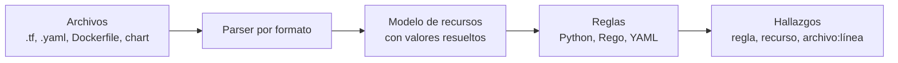

---
tags:
  - devsecops
  - escaneo
  - iac
  - terraform
  - kubernetes
  - ci-cd
---

# IaC scanning

> Cómo escanear el código de infraestructura (Terraform, CloudFormation, Bicep, Dockerfiles, manifests de Kubernetes y Helm charts) en busca de malas configuraciones, qué cambia entre escanear el código y el plan, y cómo llevarlo al pull request.

!!! info "Dónde encaja"
    Corre en el **editor o pre-commit**, en el **pull request** y, para Terraform, **después del `plan`** y antes del `apply`. Analiza archivos de configuración **sin desplegar nada**. Qué es la seguridad de IaC, los hallazgos típicos, *policy as code* y *drift detection* están en la nota temática [Seguridad de IaC](../infraestructura-y-contenedores/seguridad-iac.md); aquí va el detalle operativo del escaneo. Visión de conjunto en [Escaneo de seguridad en el pipeline](escaneo-en-pipeline.md).

## ¿Qué detecta?

Un **IaC scanner** busca **misconfigurations** (malas configuraciones) conocidas: reglas basadas en buenas prácticas de cada proveedor y en los CIS Benchmarks.

| Detecta | No detecta |
| --- | --- |
| Puertos abiertos a `0.0.0.0/0`, buckets públicos, cifrado desactivado, logs apagados | Si el recurso **ya existe** distinto en la nube (eso es drift o [CSPM](cspm.md)) |
| Políticas IAM con comodines (`*:*`) | Reglas propias de tu organización que no estén en su catálogo (para eso, *policy as code*) |
| Dockerfile con `USER root`, sin `HEALTHCHECK`, `ADD` desde URL | CVEs de los paquetes que instala el Dockerfile ([Container scanning](container-scanning.md)) |
| Pods privilegiados, sin `resources`, `hostPath`, sin `runAsNonRoot` en manifests | Lo que un *admission controller* o un operador cambie al aplicar ([KSPM](kspm.md)) |
| Secretos escritos en el código (algunos escáneres, p. ej. Checkov) | Secretos en el historial de git ([Secret scanning](secret-scanning.md)) |

## Cómo funciona



1. **Detecta el formato** de cada archivo (Terraform, CloudFormation, ARM/Bicep, Kubernetes, Helm, Dockerfile…).
2. **Lo convierte en un modelo de recursos**, resolviendo lo que pueda: variables con valor por defecto, `locals`, módulos locales y, si se le pide, módulos remotos.
3. **Evalúa reglas** sobre ese modelo. Algunas son por recurso ("este bucket no tiene cifrado") y otras de **grafo** entre recursos ("este bucket no tiene un `aws_s3_bucket_public_access_block` asociado"); Checkov destaca en estas últimas.
4. **Devuelve** el ID de la regla, severidad, recurso y la línea del archivo, para poder anotarlo en el pull request.

### Código vs plan de Terraform

El escáner no ejecuta Terraform: si un valor llega de una variable sin default, de un `data source` o de un módulo remoto, **no lo conoce** al leer el HCL. El **plan en JSON** sí tiene los valores finales.

| | Escanear el código (HCL) | Escanear el plan (JSON) |
| --- | --- | --- |
| Cuándo | En el editor, pre-commit, cualquier PR | Después de `terraform plan`, en el pipeline |
| Necesita credenciales | No | Sí (el plan consulta la nube) |
| Valores de variables y data sources | Parciales | Resueltos |
| Módulos remotos | Solo si se descargan (`--download-external-modules` en Checkov) | Expandidos |
| Rapidez | Segundos | Lo que tarde el plan |
| Línea del hallazgo | Archivo y línea exactos | Hace falta enriquecer con el código (`--repo-root-for-plan-enrichment` en Checkov) |
| Riesgo | Ninguno | El plan puede contener **valores sensibles**: no lo publiques como artifact |

En la práctica se usan **los dos**: el de código para feedback rápido, el del plan como control antes del `apply`. Los comandos básicos de ambos ya están en [Seguridad de IaC](../infraestructura-y-contenedores/seguridad-iac.md#comandos-basicos).

### Formatos que no son Terraform

| Formato | Cómo se escanea |
| --- | --- |
| **CloudFormation** | Directamente (Checkov, Trivy, KICS). Complementos de AWS: `cfn-lint` (validez) y CloudFormation Guard (reglas propias) |
| **Bicep** | Checkov lo lee directamente; para otras herramientas, compila a ARM con `az bicep build` y escanea el JSON. **PSRule for Azure** (open source de Microsoft) valida Bicep y ARM contra el Azure Well-Architected Framework |
| **Dockerfile** | Checkov, Trivy (`trivy config`), KICS; **Hadolint** añade lint de buenas prácticas y de los `RUN` con ShellCheck |
| **Manifests de Kubernetes** | Checkov, Trivy, KICS, Kubescape, Polaris |
| **Helm charts** | Hay que **renderizar** las plantillas: el escáner o tú con `helm template` |
| **Kustomize** | Renderiza con `kubectl kustomize` (o Checkov `--framework kustomize`) |

!!! warning "Helm: escanea con los values de cada entorno"
    Un chart es una plantilla; lo que se despliega depende de los `values`. `securityContext` puede estar bien en `values.yaml` y desactivado en `values-prod.yaml`. Escanea el render de **cada** entorno que despliegas, no solo el chart con sus valores por defecto.

## Herramientas

| Herramienta | Tipo | Formatos | Notas |
| --- | --- | --- | --- |
| **Checkov** (Prisma Cloud, Palo Alto Networks) | Open source | Terraform, plan JSON, CloudFormation, Bicep/ARM, Kubernetes, Helm, Kustomize, Dockerfile, GitHub Actions, GitLab CI y más | Reglas de grafo; políticas propias en Python o YAML; *baseline* |
| **Trivy** (`trivy config`) | Open source | Terraform, plan JSON y binario, CloudFormation, ARM, Kubernetes, Helm, Dockerfile, Ansible | Sucesor de **tfsec** (que ya no recibe desarrollo); misma CLI que el escaneo de imágenes |
| **KICS** (Checkmarx) | Open source | Terraform, CloudFormation, Ansible, Kubernetes, Helm, Docker, OpenAPI, Bicep y más | Reglas en Rego; base de la plantilla IaC de GitLab |
| **Hadolint** | Open source | Dockerfile | Lint de estilo y buenas prácticas |
| **Kubescape** / **Polaris** | Open source | Manifests y charts (y clúster vivo) | Ver [KSPM](kspm.md) |
| **GitLab IaC Scanning** | Nativa de GitLab (usa KICS) | Los de KICS | Plantilla `Jobs/SAST-IaC.gitlab-ci.yml` |
| **GitHub code scanning** | Nativa de GitHub | Cualquier escáner que exporte SARIF | Muestra los hallazgos como anotaciones en el PR |
| **CloudFormation Guard** / **PSRule for Azure** | Open source de AWS / Microsoft | CloudFormation (y JSON/YAML) / Bicep y ARM | Útiles si trabajas con el IaC nativo del proveedor |

Lo que el escáner **no** cubre (reglas propias de la organización con OPA/Conftest, Sentinel o guardrails de la nube) está en [Policy as code](../infraestructura-y-contenedores/seguridad-iac.md#policy-as-code).

## Ejecutarlo en local

=== "Checkov"

    ```bash
    # Varios frameworks a la vez, salida compacta
    checkov -d . --framework terraform,dockerfile,kubernetes --compact

    # Helm: Checkov renderiza el chart (necesita el binario helm)
    checkov -d charts/mi-app --framework helm

    # Plan de Terraform, con líneas del código original
    terraform show -json plan.tfplan > plan.json
    checkov -f plan.json --repo-root-for-plan-enrichment .
    ```

    Salida resumida:

    ```text
    terraform scan results:
    Passed checks: 41, Failed checks: 2, Skipped checks: 1

    Check: CKV_AWS_24: "Ensure no security groups allow ingress from 0.0.0.0:0 to port 22"
        FAILED for resource: aws_security_group.web
        File: /network.tf:12-27
    ```

=== "Trivy"

    ```bash
    # Todo el repo: Terraform, Dockerfile, manifests y charts
    trivy config --severity HIGH,CRITICAL .

    # Terraform con un tfvars concreto
    trivy config --tf-vars prod.tfvars infra/

    # Chart de Helm con los values de producción
    trivy config --helm-values charts/mi-app/values-prod.yaml charts/mi-app
    ```

=== "Render manual (Helm / Kustomize)"

    ```bash
    # Renderiza exactamente lo que se desplegará en prod y escanea el YAML
    helm template mi-app charts/mi-app -f charts/mi-app/values-prod.yaml > render-prod.yaml
    checkov -f render-prod.yaml --framework kubernetes
    trivy config render-prod.yaml

    kubectl kustomize overlays/prod > render-kustomize.yaml
    trivy config render-kustomize.yaml
    ```

    Renderizar tú tiene una ventaja: escaneas el **mismo** YAML que aplicará Argo CD o Flux, con las mismas versiones de chart y values (ver [Despliegue continuo](../../devops/ci-cd/despliegue-continuo.md)).

## Integrarlo en el pipeline

Dos jobs con propósitos distintos: escaneo del **código en cada PR** (rápido, sin credenciales) y escaneo del **plan** en el job de Terraform (con OIDC, ver [Secretos e identidades](../identidades-y-pipeline/secretos-identidades.md)). Actions de terceros fijadas por SHA (ver [Seguridad del pipeline](../identidades-y-pipeline/seguridad-pipeline.md#pinning-de-actions-por-sha)).

=== "GitHub Actions: PR"

    ```yaml title=".github/workflows/iac-scan.yml"
    name: iac-scan
    on:
      pull_request:
        paths: ["infra/**", "charts/**", "k8s/**", "**/Dockerfile"]
    permissions:
      contents: read
    jobs:
      checkov:
        runs-on: ubuntu-latest
        permissions:
          contents: read
          security-events: write # subir SARIF
        steps:
          - uses: actions/checkout@3d3c42e5aac5ba805825da76410c181273ba90b1 # v7.0.1
          - name: Checkov
            uses: bridgecrewio/checkov-action@c3e106d5f8f4253a6de5110efb41a080f83db294 # v12.3135.0
            with:
              directory: .
              framework: terraform,kubernetes,helm,dockerfile
              output_format: cli,sarif
              output_file_path: console,results.sarif
              hard_fail_on: HIGH,CRITICAL
          - name: Subir a code scanning
            if: success() || failure()
            uses: github/codeql-action/upload-sarif@9b3254085494b55a0f7c4c2b3d2d52cc712ce370 # v4.39.1
            with:
              sarif_file: results.sarif
              category: checkov
    ```

=== "GitHub Actions: plan"

    ```yaml
          # Dentro del job de Terraform, después de autenticarse con OIDC
          - run: terraform init -input=false
          - run: terraform plan -input=false -out=plan.tfplan
          - run: terraform show -json plan.tfplan > plan.json
          - name: Trivy sobre el plan
            uses: aquasecurity/trivy-action@ed142fd0673e97e23eac54620cfb913e5ce36c25 # v0.36.0
            with:
              scan-type: config
              scan-ref: plan.json
              severity: HIGH,CRITICAL
              exit-code: "1"
          # No subas plan.json como artifact: puede contener valores sensibles
    ```

=== "GitLab CI"

    ```yaml title=".gitlab-ci.yml (fragmento)"
    include:
      - template: Jobs/SAST-IaC.gitlab-ci.yml
    ```

    Añade el job `kics-iac-sast` (basado en KICS). Los hallazgos aparecen en el merge request; las vistas avanzadas dependen del plan de GitLab.

!!! note "Severidades en Checkov"
    En Checkov *open source* muchas reglas no traen severidad en la salida (la severidad viene de la plataforma comercial). Si `hard_fail_on: HIGH` no se comporta como esperas, decide por **lista de IDs** (`check` / `skip_check`) o usa Trivy, cuyas reglas sí tienen severidad. Comprueba el comportamiento con tu versión.

### Integración en el pull request

- **Anotaciones en el diff**: al subir SARIF, GitHub marca el hallazgo en la línea del PR. Sin code scanning, `output_format: github_failed_only` de Checkov genera un resumen en Markdown para un comentario.
- **Solo lo que cambia**: filtra el workflow por `paths` y, en monorepos, escanea solo los directorios modificados.
- **Branch protection**: marca el job como *required status check* para que no se pueda fusionar con hallazgos bloqueantes (ver [Seguridad del pipeline](../identidades-y-pipeline/seguridad-pipeline.md)).

## Umbrales y cuándo fallar el build

| Herramienta | Por defecto | Gating |
| --- | --- | --- |
| Checkov | Falla si hay algún check fallido | `--hard-fail-on`, `--soft-fail-on`, `--soft-fail`, `--check`, `--skip-check` |
| Trivy | Sale con 0 | `--exit-code 1` + `--severity` |
| KICS | Código de salida según severidad | `--fail-on high,critical` |

**Baseline** para repos con deuda: Checkov guarda los hallazgos actuales y luego solo falla por los nuevos.

```bash
checkov -d . --create-baseline          # crea .checkov.baseline (súbelo al repo)
checkov -d . --baseline .checkov.baseline
```

Política de ejemplo: en PR fallan los hallazgos **nuevos** altos y críticos; los heredados van a un backlog con plazo. Para el plan, falla con altos y críticos siempre: es la última barrera antes del `apply`.

## Gestión de hallazgos

1. **¿Es un error real?** Corrige en el código (no en la consola: el siguiente `apply` lo revertiría).
2. **¿Es intencional?** (bucket de un sitio estático, puerto 443 abierto en el load balancer). Suprime **solo en ese recurso**, con motivo; la sintaxis de los comentarios `#checkov:skip` y `#trivy:ignore` está en [Seguridad de IaC](../infraestructura-y-contenedores/seguridad-iac.md#fallar-el-build).
3. **¿Es un falso positivo del escáner?** (no resolvió una variable o un módulo). Escanea el plan para confirmarlo y, si persiste, suprime con referencia al issue de la herramienta.

Trivy admite **fecha de expiración** en la supresión en línea, útil para excepciones temporales:

```hcl
#trivy:ignore:aws-s3-enable-logging:exp:2026-12-31
resource "aws_s3_bucket" "temporal" {
  bucket = "migracion-datos-2026"
}
```

Checkov no tiene caducidad en `#checkov:skip`: añade la fecha y el ticket en el texto del motivo y revísalas periódicamente (`grep -rn "checkov:skip"`). Cada excepción debe tener responsable y plazo, como cualquier riesgo aceptado (ver [Detección y respuesta](../gobierno-y-respuesta/deteccion-respuesta.md#excepciones-y-riesgo-aceptado)).

## Buenas prácticas y errores comunes

- **Escanea lo que se despliega**: el render de Helm con los values de cada entorno y el plan de Terraform, no solo la plantilla.
- **Mismo escáner y versión en local y en CI** (pre-commit con la misma versión fijada), para que nadie descubra los fallos al abrir el PR.
- **Elige un escáner principal**: dos escáneres con reglas solapadas duplican hallazgos y supresiones. Un segundo solo si cubre formatos que el primero no.
- **Descarga módulos externos** (`--download-external-modules true` en Checkov) o escanea el plan; si no, los módulos remotos quedan sin revisar.
- Error común: corregir el hallazgo **en la consola** y no en el código. Lo arregla hasta el próximo `apply` y crea drift.
- Error común: subir `plan.json` o `tfplan` como artifact público del pipeline.
- Error común: suprimir una regla **globalmente** (`--skip-check` en todo el repo) para un caso puntual.

## Relación con otras secciones

| Enfoque | Qué se mira desde ahí | Nota |
| --- | --- | --- |
| Cloud (el control) | Los recursos que se validan: redes, IAM, cifrado | [Redes en la nube](../../cloud/redes-y-datos/redes.md), [IAM: AWS, Azure y GCP](../../cloud/identidad-y-seguridad/iam-comparativa.md), [Seguridad base](../../cloud/identidad-y-seguridad/seguridad-base.md) |
| DevOps (la automatización) | El código que se escanea: Terraform, Dockerfiles, manifests y charts | [Infrastructure as Code](../../devops/iac/infraestructura-como-codigo.md), [Infrastructure as Code con Terraform](../../devops/iac/terraform-basico.md), [Docker](../../devops/contenedores/docker.md), [Kubernetes](../../devops/contenedores/kubernetes.md) |
| DevSecOps (la verificación) | Policy as code y drift, configuración del clúster vivo y de las cuentas cloud | [Seguridad de IaC](../infraestructura-y-contenedores/seguridad-iac.md), [Seguridad de Kubernetes](../infraestructura-y-contenedores/seguridad-kubernetes.md), [KSPM](kspm.md), [CSPM](cspm.md), [Escaneo de seguridad en el pipeline](escaneo-en-pipeline.md) |
| Laboratorios (la práctica) | Practicar esto paso a paso | [Lab 12: Escaneos de seguridad en el pipeline](../../laboratorios/devsecops/escaneos-en-pipeline.md) |

## Referencias

- [Checkov: documentación](https://www.checkov.io/1.Welcome/What%20is%20Checkov.html)
- [Checkov: escaneo del plan de Terraform](https://www.checkov.io/7.Scan%20Examples/Terraform%20Plan%20Scanning.html)
- [Checkov: Helm](https://www.checkov.io/7.Scan%20Examples/Helm.html)
- [checkov-action](https://github.com/bridgecrewio/checkov-action)
- [Trivy: misconfiguration scanning](https://trivy.dev/latest/docs/scanner/misconfiguration/)
- [tfsec (migración a Trivy)](https://github.com/aquasecurity/tfsec)
- [KICS](https://docs.kics.io/)
- [Hadolint](https://github.com/hadolint/hadolint)
- [PSRule for Azure](https://azure.github.io/PSRule.Rules.Azure/)
- [GitLab: IaC scanning](https://docs.gitlab.com/user/application_security/iac_scanning/)
- [Helm: `helm template`](https://helm.sh/docs/helm/helm_template/)
- [Comandos de Helm](../../recursos/comandos/helm.md) y [comandos de seguridad](../../recursos/comandos/seguridad.md)
