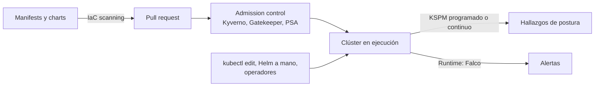

---
tags:
  - devsecops
  - escaneo
  - kubernetes
  - kspm
  - cumplimiento
---

# KSPM (Kubernetes Security Posture Management)

> Cómo escanear la postura de seguridad de un clúster de Kubernetes **en ejecución**: benchmarks CIS, frameworks NSA/CISA y MITRE, configuración de los workloads desplegados, RBAC y vulnerabilidades de lo que de verdad corre.

!!! info "Dónde encaja"
    Corre **después del despliegue**, de forma **programada o continua**, contra la API del clúster y sus nodos. Analiza lo que existe ahora en el clúster, venga de donde venga (pipeline, Helm a mano, `kubectl edit`, un operador). Los controles en sí (RBAC, Pod Security Standards, NetworkPolicies, admission control) están en la nota temática [Seguridad de Kubernetes](../infraestructura-y-contenedores/seguridad-kubernetes.md); visión de conjunto en [Escaneo de seguridad en el pipeline](escaneo-en-pipeline.md).

## ¿Qué detecta?

**KSPM** es al clúster lo que [CSPM](cspm.md) es a la cuenta cloud: un inventario continuo de **cómo está configurado** y en qué se desvía de un estándar.

| Detecta | No detecta |
| --- | --- |
| Configuración del plano de control, etcd y kubelet frente al **CIS Kubernetes Benchmark** | Ataques en curso (una shell en un contenedor, un minero): eso es runtime, Falco |
| Workloads desplegados con `privileged`, `hostPath`, sin `runAsNonRoot`, sin límites de recursos | Errores en el código de la aplicación ([SAST](sast.md), [DAST](dast.md)) |
| RBAC excesivo: `cluster-admin` a ServiceAccounts, comodines, acceso a `secrets` | Configuración de la cuenta cloud fuera del clúster (IAM, redes, buckets): [CSPM](cspm.md) |
| Namespaces sin NetworkPolicy o sin labels de Pod Security Admission | Manifests que **todavía no** se desplegaron ([IaC scanning](iac-scanning.md)) |
| CVEs en las imágenes **que están corriendo** y en componentes del clúster | |
| Versión de Kubernetes sin soporte, API deprecadas | |

### Manifests, clúster vivo y runtime

Son tres escaneos distintos y complementarios:

| | IaC scanning | KSPM | Runtime detection |
| --- | --- | --- | --- |
| Qué mira | Archivos YAML, charts, Kustomize | Objetos y configuración del clúster en ejecución | Comportamiento de procesos, red y archivos |
| Cuándo | Antes de desplegar (PR) | Después, programado o continuo | En tiempo real |
| Pregunta | ¿Este manifest es seguro? | ¿Lo que corre ahora cumple el estándar? | ¿Está pasando algo malicioso? |
| Ve cambios manuales | No | Sí | Sí (si generan actividad) |
| Herramientas | Checkov, Trivy, Kubescape (archivos) | kube-bench, Kubescape, Trivy k8s/Operator, Polaris | Falco, ofertas nativas de detección |
| Nota | [IaC scanning](iac-scanning.md) | Esta | [Runtime security con Falco](../infraestructura-y-contenedores/seguridad-kubernetes.md#runtime-security-con-falco) |



El *admission control* bloquea lo malo **al entrar**; KSPM encuentra lo que ya estaba antes de activar las políticas, lo que entra por excepciones y lo que cambia por otras vías.

## Cómo funciona

- **Lectura de la API**: el escáner lista los objetos (Pods, Deployments, Roles, NetworkPolicies, Namespaces…) con permisos de lectura y evalúa reglas sobre ellos, igual que un IaC scanner pero sobre el estado real.
- **Inspección de nodos**: para el CIS Benchmark hay que mirar **archivos y procesos del nodo** (permisos de `kubelet.conf`, flags del API server). Se hace con un pod o Job en cada nodo con acceso al sistema de archivos del host (kube-bench, el *node-collector* de Trivy).
- **Imágenes en ejecución**: se obtiene la lista de imágenes de los pods y se escanean (o se cruzan con escaneos ya hechos en el registry).
- **Modo puntual vs continuo**: una CLI lanzada desde tu equipo o un job programado da una foto; un **operador** instalado en el clúster escanea cada vez que cambia un recurso y guarda los resultados como objetos de Kubernetes (CRDs).

### Frameworks de referencia

| Framework | Qué es |
| --- | --- |
| **CIS Kubernetes Benchmark** | Guía de configuración segura del plano de control, etcd, kubelet y políticas; versiones específicas para EKS, AKS y GKE (ver [CIS Kubernetes Benchmark](../infraestructura-y-contenedores/seguridad-kubernetes.md#cis-kubernetes-benchmark)) |
| **NSA/CISA Kubernetes Hardening Guidance** | Guía de endurecimiento publicada por la NSA y CISA (EE. UU.) |
| **MITRE ATT&CK** (matriz de contenedores) | Técnicas de ataque; los escáneres mapean cada control a la técnica que mitiga |
| **Pod Security Standards** | Perfiles `baseline` y `restricted`; Trivy los evalúa como informe de cumplimiento |

## Herramientas

| Herramienta | Tipo | Qué cubre | Notas |
| --- | --- | --- | --- |
| **kube-bench** (Aqua Security) | Open source | CIS Kubernetes Benchmark en nodos y plano de control | Se ejecuta como Job; trae variantes para EKS, AKS y GKE |
| **Kubescape** (CNCF, *incubating*) | Open source | Frameworks NSA/CISA, MITRE, CIS; RBAC; imágenes; clúster, YAML y charts | CLI y operador en el clúster; puntuación de cumplimiento |
| **Trivy** (`trivy k8s`) | Open source | Misconfigurations, vulnerabilidades, secretos, RBAC; informes NSA, CIS, PSS | Foto puntual desde la CLI |
| **Trivy Operator** | Open source | Lo mismo, de forma continua | Guarda resultados como CRDs (`VulnerabilityReport`, `ConfigAuditReport`…) |
| **Polaris** (Fairwinds) | Open source | Buenas prácticas de workloads (seguridad, fiabilidad, eficiencia) | Dashboard, CLI y admission controller |
| **Microsoft Defender for Containers** | Nativa Azure (también EKS y GKE) | Postura del clúster, vulnerabilidades, detección en runtime | Ver pestañas abajo |
| **GKE security posture dashboard** | Nativa Google Cloud | Auditoría de configuración de workloads, boletines de seguridad | Algunas capacidades se retiraron; ver pestañas |
| **Security Hub CSPM** + **GuardDuty** + **Inspector** | Nativas AWS | Configuración del recurso EKS, detección de amenazas, CVEs de imágenes | No hay un único producto KSPM; ver pestañas |

### Ofertas nativas de cada nube

=== "AWS"

    AWS reparte la tarea entre varios servicios; para revisar la configuración **de los workloads dentro** del clúster lo habitual es complementar con una herramienta open source (Kubescape, Trivy Operator o kube-bench con `job-eks.yaml`).

    | Servicio | Qué aporta |
    | --- | --- |
    | **AWS Security Hub CSPM** | Controles sobre el recurso EKS: endpoint público (EKS.1), versión con soporte (EKS.2, EKS.9), audit logging (EKS.8)… |
    | **Amazon GuardDuty** | **EKS Protection**: detección de amenazas a partir de los audit logs de EKS (sin configuración extra); **Runtime Monitoring** para eventos de SO, red y archivos en los nodos |
    | **Amazon Inspector** | Vulnerabilidades de las imágenes en ECR y seguimiento de cuáles están **en uso** en clústeres (ver [Container scanning](container-scanning.md)) |

=== "Azure"

    **Microsoft Defender for Containers** cubre postura, vulnerabilidades y runtime en AKS (y en EKS, GKE y clústeres conectados con Azure Arc):

    - **Agentless discovery for Kubernetes**: inventario de clústeres, configuraciones y despliegues a través de la API, sin instalar nada.
    - **Control plane hardening**: compara la configuración del clúster con las iniciativas asignadas y genera recomendaciones.
    - **Kubernetes data plane hardening**: con el add-on **Azure Policy for Kubernetes** (basado en Gatekeeper), evalúa y, si quieres, bloquea workloads que incumplen buenas prácticas (p. ej. contenedores privilegiados).
    - Vulnerabilidades de imágenes y nodos sin agente, y detección en runtime con el **Defender sensor**, mapeada a MITRE ATT&CK.

=== "Google Cloud"

    El **GKE security posture dashboard** (*Kubernetes security posture*) incluye en el nivel estándar la **workload configuration auditing** (auditoría de configuración de workloads frente a Pod Security Standards y buenas prácticas) y la publicación de **boletines de seguridad** que afectan a tus clústeres.

    Varias capacidades se **retiraron**: el escaneo de vulnerabilidades de workloads (estándar y *Advanced Vulnerability Insights*), *GKE threat detection* y el *GKE Compliance dashboard*. Google recomienda Security Command Center para amenazas y cumplimiento, y Artifact Analysis para imágenes. Revisa la página de deprecaciones antes de diseñar sobre este dashboard.

## Ejecutarlo en local

Necesitas un `kubeconfig` con permisos de lectura sobre el clúster. Hazlo solo en clústeres propios o con autorización.

=== "kube-bench"

    ```bash
    # Job genérico (en EKS usa job-eks.yaml; hay variantes para AKS y GKE)
    kubectl apply -f https://raw.githubusercontent.com/aquasecurity/kube-bench/main/job-eks.yaml
    kubectl wait --for=condition=complete job/kube-bench --timeout=120s
    kubectl logs job/kube-bench
    kubectl delete job kube-bench
    ```

    Salida resumida (ilustrativa):

    ```text
    [INFO] 3 Worker Node Security Configuration
    [PASS] 3.1.1 Ensure that the kubeconfig file permissions are set to 644 or more restrictive
    [FAIL] 3.2.1 Ensure that the Anonymous Auth is Not Enabled
    == Summary node ==
    12 checks PASS
    1 checks FAIL
    ```

    Para clústeres gestionados, fija la URL del manifest a una versión concreta en lugar de `main` cuando lo automatices.

=== "Kubescape"

    ```bash
    # Clúster del contexto actual, frameworks concretos
    kubescape scan framework nsa
    kubescape scan framework mitre
    kubescape scan framework cis-v1.10.0 --include-namespaces prod

    # Falla si algún control de severidad alta o crítica falla
    kubescape scan --severity-threshold high

    # Informe para guardar o subir
    kubescape scan framework nsa --format sarif --output kubescape.sarif
    ```

    Kubescape usa los identificadores de framework de su catálogo (`kubescape list frameworks`); los de CIS cambian con la versión del benchmark.

=== "Trivy k8s"

    ```bash
    # Resumen de todo el clúster (vulnerabilidades, misconfig, secretos, RBAC)
    trivy k8s --report summary

    # Solo un namespace y solo configuración
    trivy k8s --include-namespaces prod --scanners misconfig --report all

    # Informes de cumplimiento
    trivy k8s --compliance k8s-nsa-1.0 --report summary
    trivy k8s --compliance k8s-pss-restricted-0.1 --report summary
    trivy k8s --compliance eks-cis-1.4 --report summary
    ```

    `trivy k8s` lanza un Job (*node-collector*) en los nodos para las comprobaciones de CIS; con `--disable-node-collector` se limita a leer la API.

=== "Polaris"

    ```bash
    polaris dashboard --port 8080      # dashboard local contra el clúster actual
    polaris audit --format=pretty      # informe en la terminal
    ```

### Modo continuo con Trivy Operator

```bash
helm repo add aqua https://aquasecurity.github.io/helm-charts/
helm repo update
helm install trivy-operator aqua/trivy-operator \
  --namespace trivy-system --create-namespace

# Los resultados son objetos de Kubernetes
kubectl get vulnerabilityreports -A -o wide
kubectl get configauditreports -A -o wide
kubectl get rbacassessmentreports -A -o wide
```

Como son CRDs, puedes exportarlos con Prometheus (el operador expone métricas) y alertar desde Grafana (ver [Observabilidad](../../devops/operacion/observabilidad.md)). Kubescape tiene un operador equivalente con su propio chart de Helm.

## Integrarlo en el pipeline

KSPM no va en el pipeline de cada PR (no hay clúster que escanear todavía), sino en dos sitios:

1. **En el PR**, la misma herramienta sobre los manifests, para que las reglas sean iguales antes y después de desplegar.
2. **Un job programado** contra el clúster, con una identidad de **solo lectura** obtenida por OIDC (ver [Secretos e identidades](../identidades-y-pipeline/secretos-identidades.md)).

=== "PR: Kubescape sobre manifests"

    ```yaml title=".github/workflows/kubescape-pr.yml"
    name: kubescape-pr
    on:
      pull_request:
        paths: ["k8s/**"]
    permissions:
      contents: read
    jobs:
      kubescape:
        runs-on: ubuntu-latest
        permissions:
          contents: read
          security-events: write
        steps:
          - uses: actions/checkout@3d3c42e5aac5ba805825da76410c181273ba90b1 # v7.0.1
          - uses: kubescape/github-action@c9749b84d138c0cbbb702b258774954f5463b82e # v3.0.21
            with:
              files: "k8s/*.yaml"
              frameworks: nsa,mitre
              format: sarif
              outputFile: results
              severityThreshold: high
          - name: Subir a code scanning
            if: success() || failure()
            uses: github/codeql-action/upload-sarif@9b3254085494b55a0f7c4c2b3d2d52cc712ce370 # v4.39.1
            with:
              sarif_file: results.sarif
    ```

=== "Programado: Trivy contra EKS"

    ```yaml title=".github/workflows/kspm-nightly.yml"
    name: kspm-nightly
    on:
      schedule:
        - cron: "0 4 * * *" # cada día a las 04:00 UTC
      workflow_dispatch:
    permissions:
      contents: read
      id-token: write # OIDC hacia AWS
    jobs:
      trivy-k8s:
        runs-on: ubuntu-latest
        environment: kspm-prod
        steps:
          - uses: aws-actions/configure-aws-credentials@e1253824e5c10ff9df46874f81ed3ec929e19cfd # v6.3.0
            with:
              role-to-assume: arn:aws:iam::111122223333:role/kspm-solo-lectura
              aws-region: us-east-1
          - run: aws eks update-kubeconfig --name prod --region us-east-1
          - uses: aquasecurity/setup-trivy@81e514348e19b6112ce2a7e3ecbafe19c1e1f567 # v0.3.1
            with:
              version: v0.70.0
          - name: Informe NSA/CISA
            run: trivy k8s --compliance k8s-nsa-1.0 --report summary --disable-node-collector --format json --output nsa.json
          - name: Gate de configuración crítica
            run: trivy k8s --scanners misconfig --severity CRITICAL --exit-code 1 --report summary --disable-node-collector
    ```

    El rol de IAM necesita una *access entry* en EKS con permisos de solo lectura en Kubernetes. Un job programado que falla no bloquea un despliegue: **avisa**. Conecta el fallo a una alerta o a un ticket.

## Umbrales y cuándo fallar el build

Criterios generales en [Criterios comunes de gating](escaneo-en-pipeline.md#criterios-comunes-de-gating). En KSPM "fallar" significa **alertar o abrir un ticket**, no bloquear, salvo en dos casos: el job de PR sobre manifests y una puerta antes de promover un entorno (por ejemplo, staging debe cumplir antes de desplegar en prod).

| Señal | Uso habitual |
| --- | --- |
| Severidad del control (`--severity-threshold` en Kubescape, `--severity` + `--exit-code` en Trivy) | Alerta inmediata con críticas: pod privilegiado nuevo, `cluster-admin` a un ServiceAccount |
| Puntuación de cumplimiento (`--compliance-threshold` en Kubescape) | Objetivo por equipo o namespace que sube con el tiempo (70 %, 80 %, 90 %) |
| Tendencia | Más útil que la foto: ¿el número de hallazgos sube o baja cada semana? |

Separa por **namespace**: `kube-system` y los agentes de seguridad necesitan privilegios que en `prod` serían un hallazgo crítico. Excluirlos sin más esconde problemas; mejor una excepción explícita por workload.

## Gestión de hallazgos

El ciclo general está en [Gestión de hallazgos](escaneo-en-pipeline.md#gestion-de-hallazgos). Lo propio del KSPM:

- **Corrige en el origen**: el arreglo va en el manifest o el chart del repositorio (GitOps), no con `kubectl edit` ni aplicando con `kubectl` la corrección que sugiere el informe; si no, el siguiente despliegue lo revierte (ver [Despliegue continuo](../../devops/ci-cd/despliegue-continuo.md)).
- **Convierte el hallazgo recurrente en política**: si KSPM encuentra pods privilegiados cada semana, la solución es una regla de [admission control](../infraestructura-y-contenedores/seguridad-kubernetes.md#admission-control) en `enforce`, no corregirlos a mano.
- **Excepciones**: Kubescape admite archivos de excepciones (`--exceptions`) por control y recurso; Trivy usa `.trivyignore` con `exp:` para la caducidad.
- **CIS en clústeres gestionados**: muchos controles del plano de control son responsabilidad del proveedor y no los puedes cambiar; usa el benchmark específico (EKS, AKS, GKE) para no perseguir hallazgos imposibles.

## Buenas prácticas y errores comunes

- **Identidad de solo lectura** para el escáner. Un escáner con `cluster-admin` es un objetivo valioso.
- **Escanea todos los clústeres**, también los de desarrollo: suelen ser la puerta de entrada.
- **Misma herramienta y reglas** en el PR (manifests) y en el clúster: si no, se pelean los resultados.
- **Continuo mejor que puntual** en producción (operador), y puntual (CLI) para auditorías y para empezar.
- Error común: tratar KSPM como **detección de amenazas**. Una postura perfecta no detecta un ataque en curso: para eso, runtime (Falco, GuardDuty, Defender).
- Error común: lanzar kube-bench genérico en EKS, AKS o GKE y abrir tickets por controles del plano de control que gestiona el proveedor.
## Relación con otras secciones

| Enfoque | Qué se mira desde ahí | Nota |
| --- | --- | --- |
| Cloud (el control) | EKS, AKS y GKE: qué gestiona el proveedor y qué tú; servicios nativos de postura y detección | [Contenedores gestionados](../../cloud/computo/contenedores-gestionados.md), [Responsabilidad compartida](../../cloud/fundamentos/responsabilidad-compartida.md), [Seguridad de contenedores y Kubernetes](../../cloud/seguridad/seguridad-contenedores-kubernetes.md) |
| DevOps (la automatización) | Los objetos que se evalúan y cómo llegan al clúster | [Kubernetes](../../devops/contenedores/kubernetes.md), [Despliegue continuo](../../devops/ci-cd/despliegue-continuo.md), [Observabilidad](../../devops/operacion/observabilidad.md) |
| DevSecOps (la verificación) | Controles del clúster, manifests antes de desplegar, imágenes, cuenta cloud y cumplimiento | [Seguridad de Kubernetes](../infraestructura-y-contenedores/seguridad-kubernetes.md), [IaC scanning](iac-scanning.md), [Container scanning](container-scanning.md), [CSPM](cspm.md), [Cumplimiento y gobierno](../gobierno-y-respuesta/cumplimiento.md), [Escaneo de seguridad en el pipeline](escaneo-en-pipeline.md) |
| Laboratorios (la práctica) | Practicar esto paso a paso | [Lab 12: Escaneos de seguridad en el pipeline](../../laboratorios/devsecops/escaneos-en-pipeline.md), [Lab 14: Endurecer un clúster: Pod Security, NetworkPolicy y Kyverno](../../laboratorios/devsecops/seguridad-kubernetes.md) |

## Referencias

- [kube-bench](https://github.com/aquasecurity/kube-bench)
- [CIS Kubernetes Benchmarks](https://www.cisecurity.org/benchmark/kubernetes)
- [Kubescape](https://kubescape.io/docs/) y [kubescape/github-action](https://github.com/kubescape/github-action)
- [Trivy: Kubernetes](https://trivy.dev/latest/docs/target/kubernetes/)
- [Trivy Operator](https://aquasecurity.github.io/trivy-operator/latest/)
- [Polaris](https://polaris.docs.fairwinds.com/)
- [NSA/CISA Kubernetes Hardening Guidance](https://www.cisa.gov/news-events/alerts/2022/03/15/updated-kubernetes-hardening-guide)
- [MITRE ATT&CK: matriz de contenedores](https://attack.mitre.org/matrices/enterprise/containers/)
- [AWS Security Hub CSPM: controles de Amazon EKS](https://docs.aws.amazon.com/securityhub/latest/userguide/eks-controls.html)
- [GuardDuty EKS Protection](https://docs.aws.amazon.com/guardduty/latest/ug/kubernetes-protection.html)
- [Microsoft Defender for Containers](https://learn.microsoft.com/es-es/azure/defender-for-cloud/defender-for-containers-introduction)
- [Azure Policy for Kubernetes](https://learn.microsoft.com/es-es/azure/governance/policy/concepts/policy-for-kubernetes)
- [GKE: security posture dashboard](https://cloud.google.com/kubernetes-engine/docs/concepts/about-security-posture-dashboard)
- [GKE: deprecaciones de posture management](https://cloud.google.com/kubernetes-engine/docs/deprecations/posture-management-deprecation)
- [Comandos de kubectl](../../recursos/comandos/kubectl.md) y [comandos de seguridad](../../recursos/comandos/seguridad.md)
