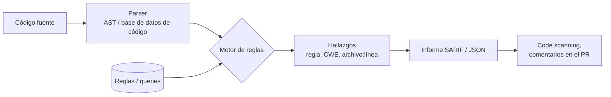

# SAST

> Análisis estático del código fuente para encontrar patrones vulnerables antes de ejecutarlo: herramientas, ejecución en local y en CI, SARIF, umbrales y gestión de hallazgos.

!!! info "Dónde encaja"
    El **SAST** (*Static Application Security Testing*, pruebas estáticas de seguridad de aplicaciones) corre en la fase de **código y build**: en el editor, en cada *pull request* y en la rama principal. Analiza el **código fuente** (o el bytecode) de tu aplicación **sin ejecutarla**. Por qué escribir reglas propias y qué es un quality gate están en [Seguridad del código](../codigo-y-dependencias/seguridad-codigo.md#sast); esta nota es el detalle operativo. Visión de conjunto de todos los escaneos: [Escaneo de seguridad en el pipeline](escaneo-en-pipeline.md).

## ¿Qué detecta?

El SAST busca en tu propio código construcciones que suelen acabar en una vulnerabilidad. Cada hallazgo suele venir con un identificador **CWE** (*Common Weakness Enumeration*, catálogo de tipos de debilidad), por ejemplo CWE-89 para SQL injection.

| Detecta | No detecta |
| --- | --- |
| Inyecciones: SQL, comandos del sistema, LDAP, XPath (CWE-89, CWE-78) | Vulnerabilidades en las **dependencias** de terceros (eso es [SCA](sca.md)) |
| Cross-site scripting (XSS) y salida sin escapar | Credenciales en el código de forma fiable (eso es [secret scanning](secret-scanning.md), aunque algunas reglas SAST avisan) |
| Path traversal, deserialización insegura, SSRF | Fallos de **lógica de negocio** y de autorización ("el usuario A ve pedidos de B") |
| Criptografía débil (MD5, SHA-1, modos inseguros), aleatoriedad no criptográfica | Problemas que solo aparecen en ejecución: configuración del servidor, cabeceras, TLS (eso es [DAST](../codigo-y-dependencias/pruebas-dinamicas.md)) |
| Uso peligroso de APIs: `eval`, `pickle.loads`, `subprocess` con `shell=True`, `yaml.load` sin loader seguro | Configuración de la nube, la red o IAM |
| Errores de calidad con impacto de seguridad (excepciones tragadas, recursos sin cerrar) | Vulnerabilidades en lenguajes o frameworks que la herramienta no soporta |

## Cómo funciona

Las herramientas SAST combinan varias técnicas, de la más simple a la más profunda:

1. **Coincidencia de patrones** (*pattern matching*): busca construcciones concretas sobre el **AST** (*Abstract Syntax Tree*, árbol de sintaxis abstracta), no sobre el texto. Por eso `cur.execute(f"...")` se detecta aunque cambien los espacios o el nombre de la variable. Es lo que hacen Bandit y las reglas básicas de Semgrep.
2. **Análisis de flujo de datos** (*data flow analysis*) y **taint analysis**: sigue un dato desde una **source** (la petición HTTP) hasta un **sink** (la consulta SQL) y comprueba si pasa por un **sanitizer** (función que lo limpia o valida).
3. **Análisis interprocedural**: sigue el dato a través de funciones y archivos distintos. Es más preciso pero más lento. CodeQL y las ediciones comerciales de Semgrep y SonarQube lo hacen.



### SARIF, el formato común

**SARIF** (*Static Analysis Results Interchange Format*) es un estándar de OASIS (versión 2.1.0) en JSON para los resultados de análisis estático. Casi todas las herramientas lo exportan, y GitHub code scanning (entre otras plataformas) lo importa. Así puedes ver los hallazgos de Semgrep, Bandit, CodeQL o Trivy en el mismo sitio, con deduplicación entre ejecuciones.

```json title="resultado.sarif (fragmento simplificado)"
{
  "version": "2.1.0",
  "runs": [{
    "tool": { "driver": { "name": "Bandit" } },
    "results": [{
      "ruleId": "B608",
      "level": "warning",
      "message": { "text": "Possible SQL injection vector through string-based query construction." },
      "locations": [{ "physicalLocation": {
        "artifactLocation": { "uri": "app/db.py" },
        "region": { "startLine": 12 }
      }}]
    }]
  }]
}
```

## Herramientas

| Herramienta | Tipo | Lenguajes o targets | Notas |
| --- | --- | --- | --- |
| **Semgrep** (Community Edition) | *Open source* (LGPL-2.1) | Más de 30 lenguajes | Reglas en YAML parecidas al código; análisis dentro de un archivo. La plataforma comercial (Semgrep AppSec Platform) añade análisis entre archivos, diff-aware gestionado y triage |
| **Opengrep** | *Open source* | Los de Semgrep CE | *Fork* comunitario de Semgrep creado en 2025 tras el cambio de licencia de las reglas de Semgrep |
| **CodeQL** | Nativa de GitHub | C/C++, C#, Go, Java/Kotlin, JavaScript/TypeScript, Python, Ruby, Swift, Rust, GitHub Actions | Consulta el código como una base de datos; flujo de datos interprocedural. Gratis en repos públicos; en privados requiere **GitHub Code Security** |
| **SonarQube Server** / **SonarQube Cloud** | Comercial; SonarQube **Community Build** gratuita | Más de 30 lenguajes e IaC | Calidad + seguridad, quality gates, *security hotspots*. SonarQube Cloud es gratis para proyectos públicos; el análisis de ramas y PR requiere edición de pago en Server |
| **Bandit** | *Open source* (PyCQA) | Solo Python | Rápida y sin configuración; reglas por patrones sobre el AST (IDs `B1xx`–`B7xx`) |
| **GitLab SAST** | Nativa de GitLab | Varios (analizadores basados sobre todo en Semgrep) | Plantilla `Jobs/SAST.gitlab-ci.yml` disponible en todos los planes; el informe de vulnerabilidades en el MR y **GitLab Advanced SAST** (interprocedural) requieren Ultimate |
| **Amazon Inspector** (code security) | Nativa de AWS | Repositorios de GitHub y GitLab | SAST, SCA e IaC sobre los repositorios conectados; GA desde junio de 2025 |
| **Microsoft Defender for Cloud** (DevOps security) | Nativa de Azure | Repos de Azure DevOps, GitHub y GitLab | Centraliza hallazgos de GitHub Advanced Security / GitHub Advanced Security for Azure DevOps y de la extensión Microsoft Security DevOps |
| Google Cloud | — | — | No tiene un SAST nativo de código fuente; su escaneo nativo está en imágenes y paquetes (Artifact Analysis). Usa una herramienta de terceros en Cloud Build |

!!! tip "Cuál elegir para empezar"
    En GitHub: **CodeQL** (default setup) para profundidad y **Semgrep** para reglas propias rápidas. En un proyecto solo Python, **Bandit** es la entrada más simple. Si el equipo ya usa SonarQube para calidad, aprovecha sus reglas de seguridad y su quality gate. Más herramientas no es más seguridad: dos motores con alertas duplicadas cansan al equipo.

## Ejecutarlo en local

=== "Semgrep"

    ```bash
    pipx install semgrep                     # o: docker run --rm -v "$PWD:/src" semgrep/semgrep semgrep scan ...
    semgrep scan --config p/default .        # conjunto de reglas por defecto del registro
    semgrep scan --config p/python --config .semgrep/ \
      --severity ERROR --error \
      --sarif --output semgrep.sarif .       # solo ERROR, exit code 1 si hay hallazgos, informe SARIF
    ```

    Salida abreviada de ejemplo:

    ```text
    ┌─────────────────┐
    │ 1 Code Finding  │
    └─────────────────┘

        app/db.py
       ❯❯❱ python-sql-con-fstring
              Consulta SQL construida con un f-string. Usa una consulta parametrizada.

               12┆ cur.execute(f"SELECT * FROM usuarios WHERE email = '{email}'")
    ```

=== "Bandit"

    ```bash
    pipx install "bandit[sarif,toml]"
    bandit -r app/                           # todo
    bandit -r app/ -ll -ii                   # solo severidad y confianza media o alta
    bandit -r app/ -f sarif -o bandit.sarif  # informe SARIF (requiere el extra [sarif])
    ```

    Salida abreviada de ejemplo:

    ```text
    >> Issue: [B608:hardcoded_sql_expressions] Possible SQL injection vector through string-based query construction.
       Severity: Medium   Confidence: Low
       CWE: CWE-89 (https://cwe.mitre.org/data/definitions/89.html)
       Location: app/db.py:12:16
    11      def buscar(email):
    12          cur.execute(f"SELECT * FROM usuarios WHERE email = '{email}'")
    ```

    Bandit lee su configuración de `pyproject.toml` (sección `[tool.bandit]`) si lo indicas con `-c pyproject.toml`.

=== "CodeQL CLI"

    ```bash
    codeql database create codeql-db --language=python --source-root .
    codeql database analyze codeql-db codeql/python-queries \
      --format=sarif-latest --output=codeql.sarif
    ```

    La CLI de CodeQL es gratuita para código *open source* e investigación; para analizar código privado necesitas la licencia de GitHub Code Security.

## Integrarlo en el pipeline

### GitHub Actions: Semgrep + CodeQL con SARIF

```yaml title=".github/workflows/sast.yml"
name: sast
on:
  pull_request:
  push:
    branches: [main]

permissions: {}                       # nada por defecto; cada job pide lo suyo

jobs:
  semgrep:
    runs-on: ubuntu-latest
    permissions:
      contents: read
      security-events: write          # subir SARIF a code scanning
    container:
      image: semgrep/semgrep:1.182.0  # en producción, fíjala también por digest (@sha256:...)
    steps:
      - uses: actions/checkout@3d3c42e5aac5ba805825da76410c181273ba90b1 # v7.0.1
        with:
          persist-credentials: false
      - run: semgrep scan --config p/default --sarif --output semgrep.sarif .
      - uses: github/codeql-action/upload-sarif@9b3254085494b55a0f7c4c2b3d2d52cc712ce370 # v4.39.1
        if: always()                  # sube el informe aunque haya hallazgos
        with:
          sarif_file: semgrep.sarif
          category: semgrep           # distingue este análisis de otros en code scanning

  codeql:
    runs-on: ubuntu-latest
    permissions:
      contents: read
      security-events: write
    steps:
      - uses: actions/checkout@3d3c42e5aac5ba805825da76410c181273ba90b1 # v7.0.1
        with:
          persist-credentials: false
      - uses: github/codeql-action/init@9b3254085494b55a0f7c4c2b3d2d52cc712ce370 # v4.39.1
        with:
          languages: python
          queries: security-extended  # más reglas de seguridad que el conjunto por defecto
      - uses: github/codeql-action/analyze@9b3254085494b55a0f7c4c2b3d2d52cc712ce370 # v4.39.1
```

Notas:

- `security-events: write` es el permiso necesario para subir SARIF ([permisos del token](../identidades-y-pipeline/seguridad-pipeline.md#permisos-minimos-del-github_token)). En repositorios privados, la documentación de GitHub pide además `actions: read`.
- Los SHA corresponden a las versiones del comentario a la fecha de esta nota; [Dependabot o Renovate](../identidades-y-pipeline/seguridad-pipeline.md#pinning-de-actions-por-sha) los mantienen al día.
- Con code scanning activo, el *pull request* muestra las alertas nuevas como anotaciones y puedes bloquear el merge con la regla *Require code scanning results* de los rulesets (*code scanning merge protection*).

### SonarQube

```yaml title=".github/workflows/sonar.yml (fragmento del job)"
    steps:
      - uses: actions/checkout@3d3c42e5aac5ba805825da76410c181273ba90b1 # v7.0.1
        with:
          fetch-depth: 0              # historial completo: mejora la detección de código nuevo
          persist-credentials: false
      - uses: SonarSource/sonarqube-scan-action@d209202bc7d53ff1cc128f7f907dac145c9d6ae9 # v8.3.0
        env:
          SONAR_TOKEN: ${{ secrets.SONAR_TOKEN }}
          SONAR_HOST_URL: ${{ vars.SONAR_HOST_URL }}   # solo para SonarQube Server
        with:
          args: >
            -Dsonar.qualitygate.wait=true
```

`sonar.qualitygate.wait=true` hace que el paso espere el resultado del **quality gate** y falle si no se cumple. La clave del proyecto va en `sonar-project.properties`.

### GitLab CI

```yaml title=".gitlab-ci.yml"
include:
  - template: Jobs/SAST.gitlab-ci.yml

stages: [test]

variables:
  SAST_EXCLUDED_PATHS: "spec, test, tests, tmp, node_modules"
```

La plantilla detecta los lenguajes del repositorio y lanza el analizador adecuado. Genera un informe `gl-sast-report.json` como artefacto; en Ultimate los hallazgos aparecen en el *merge request* y en el *vulnerability report*.

## Umbrales y cuándo fallar el build

Los criterios generales (informar primero, severidad, solo lo nuevo, check obligatorio) están en [Criterios comunes de gating](escaneo-en-pipeline.md#criterios-comunes-de-gating). En SAST se aplican así:

| Criterio | Cómo |
| --- | --- |
| **Solo informar** | Subir SARIF sin fallar el job (sin `--error` en Semgrep) |
| **Fallar por severidad** | `semgrep --severity ERROR --error`, `bandit -lll`; hazlo cuando el conjunto de reglas ya es de alta confianza |
| **Solo hallazgos nuevos** (diff-aware) | `semgrep scan --baseline-commit origin/main`; Bandit `-b baseline.json`; quality gate de SonarQube sobre *new code* |
| **Bloqueo en la plataforma** | Regla *Require code scanning results* en los rulesets de GitHub; *merge request approval policies* en GitLab |

```bash
# Solo hallazgos introducidos respecto a main (requiere el historial: fetch-depth: 0)
semgrep scan --config p/default --baseline-commit "$(git merge-base origin/main HEAD)" --error

# Bandit: generar una baseline una vez y comparar contra ella después
bandit -r app/ -f json -o bandit-baseline.json
bandit -r app/ -b bandit-baseline.json -ll
```

En SAST cuenta también la **confianza** de la regla: empieza fallando solo con severidad y confianza altas sobre código nuevo.

## Gestión de hallazgos

El ciclo general (dueño, supresiones con fecha, priorización, SLA) está en [Gestión de hallazgos](escaneo-en-pipeline.md#gestion-de-hallazgos). Lo propio del SAST:

1. **Triage**: mira si el dato realmente viene del usuario (*source*) y si llega al *sink* sin pasar por un *sanitizer*.
2. **Corregir** en el código (la opción por defecto), idealmente con el mismo patrón que propone el mensaje de la regla.
3. **Suprimir** en la línea del hallazgo, con el motivo y la fecha de revisión en el comentario:

    ```python
    # Valor constante, no viene del usuario. Revisado por @dani, expira 2027-03-31
    cur.execute(QUERY_FIJA % TABLA)  # nosec B608
    ```

    ```python
    resultado = eval(expr)  # nosemgrep: python.lang.security.audit.eval-detected
    ```

    En GitHub code scanning y SonarQube puedes cerrar la alerta como *false positive* / *won't fix* con un comentario. Ninguna de estas supresiones caduca sola.

!!! note "Ajusta la regla antes de desactivarla"
    Si una regla da muchos falsos positivos, excluye rutas de tests o añade el sanitizer de tu framework a la regla antes de desactivarla para todo el repositorio.

## Buenas prácticas y errores comunes

- **Haz SAST en el PR**, no solo en `main`: el feedback llega cuando quien escribió el código todavía tiene el contexto.
- **Escribe reglas propias** para los errores que ya cometió tu equipo (una función interna peligrosa, un patrón prohibido). Es lo que mejor rinde de Semgrep.
- **Excluye código generado, vendorizado y de terceros**: solo añade ruido; las dependencias se revisan con [SCA](sca.md).
- **Combina con revisión humana**: el SAST no ve la autorización ni la lógica de negocio.
- Error común: análisis de CodeQL para lenguajes compilados sin build correcto (usa `build-mode` adecuado); el resultado es un análisis incompleto sin aviso evidente.

## Relación con otras secciones

| Enfoque | Qué se mira desde ahí | Nota |
| --- | --- | --- |
| DevOps (la automatización) | El pipeline y el flujo de PR donde corre el SAST | [Integración continua](../../devops/ci-cd/integracion-continua.md), [Git y control de versiones](../../devops/fundamentos/git-control-versiones.md) |
| DevSecOps (la verificación) | El tema completo, los otros escaneos y el ciclo de remediación | [Seguridad del código](../codigo-y-dependencias/seguridad-codigo.md), [Escaneo de seguridad en el pipeline](escaneo-en-pipeline.md), [SCA](sca.md), [Secret scanning](secret-scanning.md), [Seguridad del pipeline](../identidades-y-pipeline/seguridad-pipeline.md), [Detección y respuesta](../gobierno-y-respuesta/deteccion-respuesta.md) |
| Python (la herramienta) | Bandit y Semgrep sobre tus propios scripts | [Calidad y seguridad de scripts](../../python/scripting/calidad-codigo.md) |
| Laboratorios (la práctica) | Practicar esto paso a paso | [Lab 12: Escaneos de seguridad en el pipeline](../../laboratorios/devsecops/escaneos-en-pipeline.md) |

## Referencias

- [OASIS SARIF 2.1.0](https://docs.oasis-open.org/sarif/sarif/v2.1.0/sarif-v2.1.0.html)
- [GitHub: soporte de SARIF para code scanning](https://docs.github.com/es/code-security/code-scanning/integrating-with-code-scanning/sarif-support-for-code-scanning)
- [GitHub: subir un archivo SARIF](https://docs.github.com/es/code-security/code-scanning/integrating-with-code-scanning/uploading-a-sarif-file-to-github)
- [CodeQL: documentación](https://codeql.github.com/docs/)
- [github/codeql-action](https://github.com/github/codeql-action)
- [Semgrep: documentación](https://semgrep.dev/docs/)
- [Semgrep: ignorar hallazgos](https://semgrep.dev/docs/ignoring-files-folders-code)
- [Opengrep](https://github.com/opengrep/opengrep)
- [Bandit](https://bandit.readthedocs.io/)
- [SonarQube Server: documentación](https://docs.sonarsource.com/sonarqube-server/latest/)
- [SonarQube Cloud: documentación](https://docs.sonarsource.com/sonarqube-cloud/)
- [SonarSource/sonarqube-scan-action](https://github.com/SonarSource/sonarqube-scan-action)
- [GitLab SAST](https://docs.gitlab.com/user/application_security/sast/)
- [Amazon Inspector: code security](https://docs.aws.amazon.com/inspector/latest/user/code-security-assessments.html)
- [Microsoft Defender for Cloud: DevOps security](https://learn.microsoft.com/es-es/azure/defender-for-cloud/defender-for-devops-introduction)
- [CWE](https://cwe.mitre.org/)
