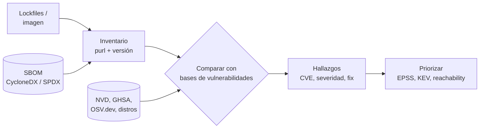

# SCA

> Análisis de las dependencias de terceros: vulnerabilidades conocidas, licencias y actualizaciones, desde el lockfile o el SBOM hasta el gate del pipeline.

!!! info "Dónde encaja"
    El **SCA** (*Software Composition Analysis*, análisis de composición de software) corre en el **PR**, en el **build** y de forma **programada** sobre lo que ya está en producción (salen CVE nuevos cada día para versiones que ayer estaban limpias). Analiza los **manifiestos y lockfiles** (`package-lock.json`, `poetry.lock`, `go.sum`…), un **SBOM** o los paquetes dentro de una imagen. La visión general de la cadena de suministro (ataques, SBOM, firma, SLSA, pinning) está en [Software supply chain](../codigo-y-dependencias/cadena-suministro.md#sca); esta nota es el detalle operativo. Visión de conjunto: [Escaneo de seguridad en el pipeline](escaneo-en-pipeline.md).

## ¿Qué detecta?

| Detecta | No detecta |
| --- | --- |
| Dependencias directas y **transitivas** con vulnerabilidades conocidas (CVE, GHSA, OSV) | Vulnerabilidades **todavía no publicadas** (*zero-days*) |
| La versión mínima que corrige cada vulnerabilidad | Paquetes **maliciosos** recién publicados sin advisory (eso requiere herramientas específicas de *malware* en paquetes) |
| **Licencias** de cada dependencia y conflictos con tu política | Fallos en **tu** código (eso es [SAST](sast.md)) |
| Dependencias abandonadas o muy desactualizadas (algunas herramientas) | Si la función vulnerable **se usa realmente**, salvo herramientas con *reachability* |
| Paquetes del sistema operativo dentro de una imagen (con Trivy o Grype) | Configuración insegura de la librería en tu aplicación |

## Cómo funciona

1. **Inventario**: la herramienta lee los manifiestos y, sobre todo, los **lockfiles** (que tienen las versiones exactas, incluidas las transitivas). Si no hay lockfile, el resultado es aproximado. El inventario también puede venir de un **SBOM** ya generado.
2. **Identificación**: cada componente se expresa como **purl** (*package URL*, p. ej. `pkg:pypi/requests@2.31.0`), el identificador común entre herramientas.
3. **Comparación** con bases de vulnerabilidades: **NVD** (NIST), **GitHub Advisory Database** (GHSA), **OSV.dev** (agrega advisories de muchos ecosistemas) y las bases de las distribuciones Linux.
4. **Enriquecimiento y priorización**: severidad CVSS, EPSS, presencia en CISA KEV, versión que corrige y, en algunas herramientas, *reachability*.



### El SBOM como insumo

Si generas el SBOM una vez en el build (con Syft o Trivy, ver [SBOM](../codigo-y-dependencias/cadena-suministro.md#sbom)), puedes **reescanearlo** cada día sin reconstruir nada y responder rápido a "¿estamos afectados por este CVE?":

```bash
syft dir:. -o cyclonedx-json=sbom.cdx.json   # una vez, en el build
grype sbom:./sbom.cdx.json                    # cada día, contra la base actualizada
trivy sbom sbom.cdx.json                      # alternativa con Trivy
```

### Reachability

La **reachability analysis** (análisis de alcanzabilidad) comprueba si tu código **llama** a la función vulnerable de la dependencia, cruzando el SCA con un análisis estático del código. Reduce mucho el ruido: la mayoría de las vulnerabilidades en transitivas no son alcanzables. Ejemplo libre y fiable: **govulncheck** para Go, que solo informa de las vulnerabilidades cuyos símbolos se usan:

```bash
govulncheck ./...
```

Otras herramientas comerciales (Snyk, GitLab dependency scanning, Semgrep Supply Chain, Endor Labs…) ofrecen *reachability* para algunos lenguajes; revisa qué ecosistemas cubre cada una.

## Herramientas

Conviene separar dos familias que se complementan:

| Herramienta | Familia | Tipo | Ecosistemas o targets | Notas |
| --- | --- | --- | --- | --- |
| **Dependabot** | Actualización + alertas | Nativa de GitHub | Los principales gestores de paquetes, Docker, GitHub Actions, Terraform | *Alerts*, *security updates* (PR para corregir) y *version updates* (PR periódicos) |
| **Renovate** | Actualización | *Open source* (Mend), también app alojada | Más de 90 gestores; GitHub, GitLab, Bitbucket, Azure DevOps | Muy configurable: agrupar, programar, automerge, fijar digests |
| **Trivy** (`trivy fs`) | Escáner | *Open source* (Aqua) | Lockfiles, imágenes, SBOM; también licencias | Un solo binario para SCA, imágenes e IaC |
| **Grype** | Escáner | *Open source* (Anchore) | Directorios, imágenes, SBOM de Syft | Pareja natural de Syft |
| **OSV-Scanner** | Escáner | *Open source* (Google) | Lockfiles, imágenes, SBOM | Usa OSV.dev; permite ignorar con fecha de expiración |
| **Snyk Open Source** | Escáner + PR de fix | Comercial con plan gratuito | Los principales lenguajes | Reachability en algunos lenguajes; recomienda la versión mínima que corrige |
| `npm audit` / `pip-audit` | Escáner | CLI del ecosistema | Node.js / Python | Rápidos, sin instalar nada extra (pip-audit es de PyPA) |
| **Dependency review** | Gate en PR | Nativa de GitHub | Cambios de dependencias en el PR | Bloquea el PR que **introduce** una dependencia vulnerable o con licencia no permitida |
| **GitLab dependency scanning** | Escáner | Nativa de GitLab (Ultimate) | Lockfiles; genera un SBOM CycloneDX | Plantilla `Jobs/Dependency-Scanning.v2.gitlab-ci.yml` (basada en SBOM) |
| **Amazon Inspector** / **Defender for Cloud** / **Artifact Analysis** | Escáner | Nativas de AWS / Azure / Google Cloud | Imágenes en el registry, funciones y (Inspector) repositorios | Ver [Container scanning](container-scanning.md) |

!!! note "Actualizar no es lo mismo que escanear"
    Dependabot y Renovate **proponen el cambio** (un PR con la nueva versión). Los escáneres **detectan el problema** y pueden fallar el build. Necesitas los dos: el escáner para no introducir riesgo y el bot de actualización para pagar la deuda continuamente.

## Ejecutarlo en local

=== "Trivy y Grype"

    ```bash
    trivy fs --scanners vuln --severity HIGH,CRITICAL .
    trivy fs --scanners vuln --ignore-unfixed --exit-code 1 .   # falla solo si hay fix disponible

    grype dir:. --fail-on high
    grype dir:. --only-fixed -o table
    ```

=== "OSV-Scanner"

    ```bash
    osv-scanner scan source -r .                 # recorre todos los lockfiles
    osv-scanner scan source --lockfile=poetry.lock
    osv-scanner scan image mi-app:1.4.0
    ```

=== "npm audit y pip-audit"

    ```bash
    npm audit --omit=dev --audit-level=high      # ignora devDependencies
    pip-audit -r requirements.txt
    pip-audit -r requirements.txt --fix --dry-run
    ```

    Salida de ejemplo de pip-audit (abreviada):

    ```text
    Found 1 known vulnerability in 1 package
    Name     Version ID                  Fix Versions
    -------- ------- ------------------- ------------
    requests 2.31.0  GHSA-9wx4-h78v-vm56 2.32.0
    ```

## Integrarlo en el pipeline

### GitHub Actions: dependency review en el PR + escaneo programado

```yaml title=".github/workflows/sca.yml"
name: sca
on:
  pull_request:
  schedule:
    - cron: "0 6 * * 1-5"           # de lunes a viernes: detecta CVE nuevos en lo que ya está en main

permissions: {}

jobs:
  dependency-review:
    if: github.event_name == 'pull_request'
    runs-on: ubuntu-latest
    permissions:
      contents: read
    steps:
      - uses: actions/checkout@3d3c42e5aac5ba805825da76410c181273ba90b1 # v7.0.1
        with:
          persist-credentials: false
      - uses: actions/dependency-review-action@a1d282b36b6f3519aa1f3fc636f609c47dddb294 # v5.0.0
        with:
          fail-on-severity: high
          fail-on-scopes: runtime
          allow-licenses: MIT, Apache-2.0, BSD-2-Clause, BSD-3-Clause, ISC

  trivy-fs:
    runs-on: ubuntu-latest
    permissions:
      contents: read
      security-events: write
    steps:
      - uses: actions/checkout@3d3c42e5aac5ba805825da76410c181273ba90b1 # v7.0.1
        with:
          persist-credentials: false
      - uses: aquasecurity/trivy-action@ed142fd0673e97e23eac54620cfb913e5ce36c25 # v0.36.0
        with:
          scan-type: fs
          scanners: vuln
          format: sarif
          output: trivy-sca.sarif
          severity: HIGH,CRITICAL
          limit-severities-for-sarif: true   # sin esto, el SARIF incluye todas las severidades
      - uses: github/codeql-action/upload-sarif@9b3254085494b55a0f7c4c2b3d2d52cc712ce370 # v4.39.1
        if: always()
        with:
          sarif_file: trivy-sca.sarif
          category: trivy-sca
```

- **Dependency review** es *diff-aware* por diseño: solo mira las dependencias que cambian en el PR. Es gratuito en repos públicos; en privados requiere GitHub Code Security. En v5, `deny-licenses` está marcado como obsoleto: usa `allow-licenses`.
- El escaneo programado no falla nada: alimenta la pestaña Security para que el equipo lo trate como deuda con SLA.
- Recuerda que `trivy-action` sufrió un ataque de cadena de suministro en 2026: fíjala por SHA (ver [Seguridad del pipeline](../identidades-y-pipeline/seguridad-pipeline.md#pinning-de-actions-por-sha)).

### Renovate

```json title="renovate.json"
{
  "$schema": "https://docs.renovatebot.com/renovate-schema.json",
  "extends": ["config:recommended"],
  "osvVulnerabilityAlerts": true,
  "packageRules": [
    {
      "matchUpdateTypes": ["patch"],
      "matchDepTypes": ["devDependencies"],
      "automerge": true
    }
  ]
}
```

`osvVulnerabilityAlerts` hace que Renovate cree PR de seguridad a partir de OSV.dev, también fuera de GitHub. La configuración equivalente de Dependabot está en [Software supply chain](../codigo-y-dependencias/cadena-suministro.md#sca).

### GitLab CI

```yaml title=".gitlab-ci.yml"
include:
  - template: Jobs/Dependency-Scanning.v2.gitlab-ci.yml
```

Por defecto corre en los pipelines de *merge request*, necesita un lockfile compatible y produce un SBOM CycloneDX como artefacto.

## Licencias

Cada dependencia trae una **licencia** con obligaciones. El riesgo depende de cómo distribuyes tu software (SaaS, binario que entregas a clientes, librería que publicas). Las licencias se identifican con su **SPDX identifier** (`MIT`, `Apache-2.0`, `GPL-3.0-only`).

| Tipo | Ejemplos | Obligación principal | Riesgo típico para software propietario |
| --- | --- | --- | --- |
| **Permisivas** (*permissive*) | MIT, Apache-2.0, BSD-2-Clause, BSD-3-Clause, ISC | Mantener el aviso de copyright y la licencia; Apache-2.0 añade aviso de cambios y una licencia de patentes | Bajo |
| **Copyleft débil** (*weak copyleft*) | LGPL-2.1, LGPL-3.0, MPL-2.0, EPL-2.0 | Publicar los cambios **a esa librería** (o al archivo, en MPL) si la distribuyes | Medio: depende de cómo enlaces la librería |
| **Copyleft fuerte** (*strong copyleft*) | GPL-2.0, GPL-3.0 | Si distribuyes una obra derivada, debe ir bajo la misma licencia con su código fuente | Alto si distribuyes binarios |
| **Copyleft de red** | AGPL-3.0 | Como GPL, pero también se activa al **ofrecer el software por red** (SaaS) | Alto incluso para SaaS |
| **Source-available** (no *open source* según OSI) | BUSL-1.1, SSPL, Elastic License 2.0 | Restricciones de uso (p. ej. no ofrecerlo como servicio competidor) | Revisión legal caso a caso |
| **Sin licencia** | Repos sin archivo `LICENSE` | Por defecto, todos los derechos reservados | Alto: no tienes permiso de uso |

!!! warning "Esto no es asesoría legal"
    La tabla resume el riesgo habitual; la decisión final sobre qué licencias se permiten la toma la organización (legal/compras). Lo que te toca en DevSecOps es **hacer cumplir la política automáticamente** y dejar evidencia.

Herramientas de **license scanning** (escaneo de licencias):

| Herramienta | Tipo | Notas |
| --- | --- | --- |
| `trivy fs --scanners license` | *Open source* | Clasifica las licencias por categoría y severidad; `--license-full` también busca licencias en los archivos del código |
| Dependency review (`allow-licenses`) | Nativa de GitHub | Bloquea el PR que introduce una licencia fuera de la lista |
| **ScanCode Toolkit** | *Open source* | Detección detallada de licencias y copyrights en el código |
| **ORT** (OSS Review Toolkit) | *Open source* | Orquesta análisis, escaneo de licencias, evaluación de políticas e informes |
| **FOSSA**, **Snyk**, **Mend** | Comerciales | Políticas de licencias, atribuciones y avisos legales |
| GitLab license scanning | Nativa de GitLab (Ultimate) | Parte de dependency scanning, con políticas de aprobación |

```bash
trivy fs --scanners license --severity HIGH,CRITICAL .
```

## Umbrales y cuándo fallar el build

| Señal | Gate recomendado |
| --- | --- |
| Vulnerabilidad **crítica o alta** con fix disponible en dependencia de producción | Fallar el PR que la introduce |
| Vulnerabilidad en CISA KEV | Fallar siempre y abrir incidencia con SLA corto |
| Vulnerabilidad sin fix disponible | No fallar; registrar y vigilar (`--ignore-unfixed`, `--only-fixed`) |
| Dependencia solo de desarrollo o tests | Avisar, no fallar (`fail-on-scopes: runtime`, `npm audit --omit=dev`) |
| Licencia fuera de la allowlist | Fallar el PR que la introduce |

- **Solo nuevos**: dependency review y el modo PR de OSV-Scanner solo miran lo que cambia; el resto se gestiona como deuda desde el escaneo programado.
- **Programado ≠ bloqueante**: un CVE publicado esta noche no debería romper el build de un cambio que no toca dependencias; trátalo en el backlog con su SLA.

## Gestión de hallazgos

1. **Triage**: ¿la dependencia está en producción?, ¿es alcanzable?, ¿está expuesta a internet?, ¿hay exploit (EPSS, KEV)? Ver [priorizar con CVSS, EPSS y KEV](../gobierno-y-respuesta/deteccion-respuesta.md#priorizar-con-cvss-epss-y-kev).
2. **Remediar**: actualizar la dependencia directa (a menudo arrastra la transitiva), usar `overrides` (npm) o *constraints* (pip) para forzar una transitiva, o sustituir la librería.
3. **Suprimir con fecha de expiración** cuando no hay fix o no aplica:

    ```toml title="osv-scanner.toml"
    [[IgnoredVulns]]
    id = "GHSA-xxxx-xxxx-xxxx"
    ignoreUntil = 2027-01-31
    reason = "Solo afecta al modo servidor de la librería, que no usamos. Revisado por @dani"
    ```

    ```text title=".trivyignore"
    # Sin fix publicado; revisar al expirar
    CVE-2025-12345 exp:2027-01-31
    ```

    En GitHub, las alertas de Dependabot se descartan con un motivo (*tolerable risk*, *inaccurate*, *no bandwidth*…); documenta también el porqué. Si eres el proveedor del software, un documento **VEX** comunica a tus clientes que la vulnerabilidad no les afecta.
4. **SLA de remediación** según severidad: ver [SLA de remediación](../gobierno-y-respuesta/deteccion-respuesta.md#sla-de-remediacion).

## Buenas prácticas y errores comunes

- **Versiona los lockfiles** e instala con `npm ci`, `pip install --require-hashes` o equivalentes: sin lockfile, el SCA escanea algo distinto de lo que despliegas.
- **Activa a la vez** un bot de actualización (Dependabot o Renovate) y un escáner con gate en el PR.
- **Agrupa actualizaciones** (grupos de Dependabot, `packageRules` de Renovate) para no ahogar al equipo en PR.
- **Reescanea lo desplegado**: el SBOM de cada release, escaneado cada día, avisa de CVE nuevos en producción.
- **No confíes en una sola base**: Trivy, Grype y OSV-Scanner usan fuentes distintas y pueden discrepar.
- Error común: fallar el build por CVE sin fix disponible; el equipo aprende a desactivar el job.
- Error común: ignorar vulnerabilidades sin fecha de revisión; las excepciones se convierten en permanentes.
- Error común: olvidar las imágenes: el SCA del repositorio no ve los paquetes del sistema operativo de la imagen base (ver [Container scanning](container-scanning.md)).

## Relación con otras secciones

| Enfoque | Qué se mira desde ahí | Nota |
| --- | --- | --- |
| Cloud (el control) | Escaneo nativo de paquetes e imágenes en los registries | [Contenedores gestionados](../../cloud/computo/contenedores-gestionados.md) |
| DevOps (la automatización) | El build que resuelve dependencias y genera artefactos | [Integración continua](../../devops/ci-cd/integracion-continua.md), [Docker](../../devops/contenedores/docker.md) |
| DevSecOps (la verificación) | Cadena de suministro completa, otros escaneos y remediación | [Software supply chain](../codigo-y-dependencias/cadena-suministro.md), [Escaneo de seguridad en el pipeline](escaneo-en-pipeline.md), [SAST](sast.md), [Container scanning](container-scanning.md), [Detección y respuesta](../gobierno-y-respuesta/deteccion-respuesta.md) |
| Negocio TI (el porqué) | Riesgo legal de licencias y de proveedores | [Gobierno y riesgo de TI](../../negocio/gobierno-riesgo-ti.md) |
| Python (la herramienta) | `pip-audit` sobre tus scripts | [Calidad y seguridad de scripts](../../python/scripting/calidad-codigo.md) |
| Laboratorios (la práctica) | Practicar esto paso a paso | [Lab 12: Escaneos de seguridad en el pipeline](../../laboratorios/devsecops/escaneos-en-pipeline.md) |

## Referencias

- [GitHub: Dependabot](https://docs.github.com/es/code-security/dependabot)
- [GitHub: acerca de dependency review](https://docs.github.com/es/code-security/supply-chain-security/understanding-your-software-supply-chain/about-dependency-review)
- [actions/dependency-review-action](https://github.com/actions/dependency-review-action)
- [Renovate](https://docs.renovatebot.com/)
- [Trivy](https://trivy.dev/)
- [Grype](https://github.com/anchore/grype)
- [OSV-Scanner](https://google.github.io/osv-scanner/)
- [OSV.dev](https://osv.dev/)
- [pip-audit](https://github.com/pypa/pip-audit)
- [npm audit](https://docs.npmjs.com/cli/commands/npm-audit)
- [govulncheck](https://go.dev/doc/security/vuln/)
- [GitLab: dependency scanning](https://docs.gitlab.com/user/application_security/dependency_scanning/)
- [Snyk Open Source](https://docs.snyk.io/scan-with-snyk/snyk-open-source)
- [Lista de licencias SPDX](https://spdx.org/licenses/)
- [Open Source Initiative: licencias](https://opensource.org/licenses)
- [ScanCode Toolkit](https://github.com/aboutcode-org/scancode-toolkit)
- [OSS Review Toolkit (ORT)](https://oss-review-toolkit.org/)
- [Package URL (purl)](https://github.com/package-url/purl-spec)
