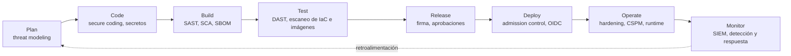

---
tags:
  - seguridad
  - devsecops
  - arquitectura
---

# Fundamentos de DevSecOps

> Qué es DevSecOps, dónde entra la seguridad en cada fase del ciclo de vida y qué modelos mentales (tríada CIA, STRIDE, OWASP Top 10, gestión de riesgo) se usan para decidir qué proteger primero.

## ¿Qué es?

**DevSecOps** (*Development, Security and Operations*) es la práctica de integrar la seguridad en todo el ciclo de vida del software, en lugar de dejarla para una revisión al final. Parte de la misma cultura que DevOps (ver [Cultura DevOps y métricas DORA](../devops/fundamentos/cultura-metricas-dora.md)): equipos que colaboran, automatización y retroalimentación rápida. La diferencia es que la seguridad pasa a ser **responsabilidad compartida** de quien desarrolla, quien opera y el equipo de seguridad.

En este cuaderno, DevSecOps es **la verificación**: Cloud es dónde corre todo (el control) y DevOps es cómo lo automatizas (la automatización). DevSecOps comprueba, de forma automática y continua, que lo que se construye y se despliega es seguro. El [mapa de relaciones](../mapa-de-relaciones.md) muestra cómo encajan las tres capas.

!!! note "No es una herramienta ni un equipo aparte"
    Comprar un escáner no te hace "hacer DevSecOps". Lo importante es que los controles de seguridad estén **dentro del flujo normal de trabajo** (el IDE, el *pull request*, el pipeline) y que sus resultados lleguen a quien puede corregirlos, cuando todavía es barato hacerlo.

### Términos que conviene conocer

| Término | Qué significa |
| --- | --- |
| **Shift-left** (desplazar a la izquierda) | Mover los controles de seguridad hacia las fases tempranas del ciclo (diseño, código, build) |
| **Shift-right** (desplazar a la derecha) | Seguir verificando la seguridad en producción: monitoreo, detección, pruebas sobre el sistema real |
| **Guardrail** (barrera de protección) | Control automático que impide o avisa de algo inseguro sin frenar el trabajo normal |
| **Security champion** (referente de seguridad) | Persona de un equipo de desarrollo con formación extra en seguridad, que hace de puente con el equipo de seguridad |
| **Attack surface** (superficie de ataque) | Todo lo que un atacante puede tocar: endpoints, puertos, dependencias, credenciales, personas |
| **Vulnerabilidad** (*vulnerability*) | Debilidad que puede explotarse; si tiene identificador público se le asigna un **CVE** (*Common Vulnerabilities and Exposures*) |

## Shift-left y shift-right

**Shift-left** se basa en una idea sencilla: un fallo de seguridad encontrado en el editor o en el *pull request* cuesta minutos; el mismo fallo encontrado en producción cuesta un incidente. Por eso se adelantan los controles: revisión del diseño, análisis del código, escaneo de dependencias y de IaC antes de desplegar.

Pero no todo se detecta antes de desplegar: configuraciones que cambian a mano, vulnerabilidades nuevas en dependencias que ayer estaban limpias, ataques reales. **Shift-right** completa el ciclo con controles en producción: monitoreo de seguridad, detección de amenazas, CSPM y pruebas sobre el sistema en marcha.

| | Shift-left | Shift-right |
| --- | --- | --- |
| Cuándo | Diseño, código, build, test | Release, deploy, operate, monitor |
| Objetivo | Prevenir: que lo inseguro no llegue a producción | Detectar y responder: lo que se escapó o apareció después |
| Ejemplos | Threat modeling, SAST, SCA, escaneo de IaC, detección de secretos | DAST en staging, CSPM, runtime security, SIEM, *bug bounty* |
| Quién lo ve primero | Quien desarrolla | Operaciones y seguridad |

!!! tip "Las dos direcciones son necesarias"
    Shift-left sin shift-right te deja ciego ante lo que cambia después del despliegue. Shift-right sin shift-left te obliga a apagar incendios que se podían haber evitado.

## La seguridad en cada fase del ciclo



| Fase | Control de seguridad | Nota |
| --- | --- | --- |
| Plan | Threat modeling (STRIDE), requisitos de seguridad, clasificación de datos | Esta nota |
| Code | Secure coding, pre-commit hooks, detección de secretos | [Seguridad del código](codigo-y-dependencias/seguridad-codigo.md) |
| Build | SAST, SCA, SBOM, version pinning | [Seguridad del código](codigo-y-dependencias/seguridad-codigo.md), [Software supply chain](codigo-y-dependencias/cadena-suministro.md), [Escaneo en el pipeline](escaneos/escaneo-en-pipeline.md) |
| Test | DAST, fuzzing, escaneo de IaC y de imágenes | [Pruebas dinámicas](codigo-y-dependencias/pruebas-dinamicas.md), [Seguridad de IaC](infraestructura-y-contenedores/seguridad-iac.md), [Seguridad de contenedores](infraestructura-y-contenedores/seguridad-contenedores.md) |
| Release | Firma de artefactos, provenance, aprobaciones, branch protection | [Software supply chain](codigo-y-dependencias/cadena-suministro.md), [Seguridad del pipeline](identidades-y-pipeline/seguridad-pipeline.md) |
| Deploy | OIDC entre pipeline y nube, secretos inyectados, admission control | [Secretos e identidades](identidades-y-pipeline/secretos-identidades.md), [Seguridad de Kubernetes](infraestructura-y-contenedores/seguridad-kubernetes.md) |
| Operate | Hardening, CSPM, cumplimiento continuo, runtime security | [Cumplimiento y gobierno](gobierno-y-respuesta/cumplimiento.md), [Seguridad de Kubernetes](infraestructura-y-contenedores/seguridad-kubernetes.md) |
| Monitor | Logs de auditoría, SIEM, gestión de vulnerabilidades, respuesta a incidentes | [Detección y respuesta](gobierno-y-respuesta/deteccion-respuesta.md) |

## Tríada CIA

La **tríada CIA** (*confidentiality, integrity, availability*: confidencialidad, integridad y disponibilidad) resume qué se quiere proteger. Cada control de seguridad defiende al menos una de estas tres propiedades.

| Propiedad | Qué significa | Ejemplo de fallo en la nube | Controles típicos |
| --- | --- | --- | --- |
| **Confidentiality** (confidencialidad) | Solo quien está autorizado puede leer los datos | Un bucket de almacenamiento público con backups de clientes | IAM con mínimo privilegio, cifrado en reposo y en tránsito, acceso privado |
| **Integrity** (integridad) | Los datos y el software no se modifican sin autorización | Alguien con credenciales filtradas cambia una imagen en el registry | Firma de artefactos, control de versiones, logs de auditoría inmutables |
| **Availability** (disponibilidad) | El servicio funciona cuando se necesita | Un ataque DDoS o un *ransomware* que cifra la base de datos | Multi-AZ, autoscaling, backups probados, WAF y protección DDoS |

Para cifrado, KMS, WAF y logs de auditoría en cada proveedor, ver [Seguridad base en la nube](../cloud/identidad-y-seguridad/seguridad-base.md). Recuerda que la parte de la tríada que te toca depende del [Shared Responsibility Model](../cloud/fundamentos/responsabilidad-compartida.md).

## Threat modeling con STRIDE

**Threat modeling** (modelado de amenazas) es analizar un sistema **antes de construirlo o cambiarlo** para responder cuatro preguntas (las del *Threat Modeling Manifesto*):

1. ¿En qué estamos trabajando? (diagrama del sistema y sus flujos de datos)
2. ¿Qué puede salir mal?
3. ¿Qué vamos a hacer al respecto?
4. ¿Hicimos un buen trabajo?

Para la segunda pregunta se usa **STRIDE**, un modelo creado en Microsoft que agrupa las amenazas en seis categorías. Cada una viola una propiedad de seguridad:

| Amenaza | Propiedad violada | Ejemplo | Mitigación |
| --- | --- | --- | --- |
| **Spoofing** (suplantación) | Autenticación | Un atacante usa un token robado para llamar a la API como otro usuario | MFA, tokens de vida corta, OIDC en lugar de claves estáticas |
| **Tampering** (manipulación) | Integridad | Se modifica una dependencia o una imagen entre el build y el deploy | Firma de artefactos, digests, TLS, control de cambios |
| **Repudiation** (repudio) | No repudio | Alguien borra recursos en producción y no queda registro de quién fue | Logs de auditoría (CloudTrail, Activity Log, Cloud Audit Logs) protegidos contra borrado |
| **Information disclosure** (divulgación de información) | Confidencialidad | Un mensaje de error devuelve la cadena de conexión a la base de datos | Manejo de errores genérico, cifrado, mínimo privilegio, gestión de secretos |
| **Denial of service** (denegación de servicio) | Disponibilidad | Una API sin límites recibe millones de peticiones y se cae | Rate limiting, WAF, autoscaling, cuotas |
| **Elevation of privilege** (escalada de privilegios) | Autorización | Un contenedor que corre como root escapa al nodo | Mínimo privilegio, contenedores sin root, Pod Security Standards |

!!! tip "Cómo empezar sin complicarse"
    Dibuja un diagrama de flujo de datos sencillo (usuarios, servicios, bases de datos y las **trust boundaries**, fronteras de confianza, entre ellos) y recorre cada flujo preguntando por las seis letras de STRIDE. Herramientas como **OWASP Threat Dragon** o **Microsoft Threat Modeling Tool** ayudan, pero una pizarra también sirve. Repite el ejercicio cuando cambie la arquitectura, no solo una vez.

## OWASP Top 10

El **OWASP Top 10** es la lista de referencia de los riesgos más críticos en aplicaciones web, publicada por la fundación OWASP (*Open Worldwide Application Security Project*). La edición vigente es la **2025**, que reemplaza a la de 2021:

| Código | Categoría | En pocas palabras |
| --- | --- | --- |
| A01:2025 | Broken Access Control | Usuarios que acceden a datos o funciones que no les corresponden (incluye SSRF) |
| A02:2025 | Security Misconfiguration | Configuraciones por defecto, servicios expuestos, permisos de más |
| A03:2025 | Software Supply Chain Failures | Dependencias, herramientas de build o pipelines comprometidos o vulnerables |
| A04:2025 | Cryptographic Failures | Datos sensibles sin cifrar o con algoritmos débiles |
| A05:2025 | Injection | SQL injection, command injection, XSS: datos que se interpretan como código |
| A06:2025 | Insecure Design | Fallos de diseño que ninguna implementación perfecta corrige |
| A07:2025 | Authentication Failures | Contraseñas débiles, sesiones mal gestionadas, falta de MFA |
| A08:2025 | Software or Data Integrity Failures | Actualizaciones o datos que se aceptan sin verificar su origen |
| A09:2025 | Security Logging and Alerting Failures | No registrar o no alertar sobre eventos de seguridad |
| A10:2025 | Mishandling of Exceptional Conditions | Errores y condiciones anómalas mal gestionados (por ejemplo, *fail open*) |

!!! info "Qué cambió respecto a 2021"
    En 2025 entran dos categorías nuevas: **Software Supply Chain Failures** (amplía la antigua *Vulnerable and Outdated Components*) y **Mishandling of Exceptional Conditions**. **SSRF**, que en 2021 era la A10, pasa a formar parte de Broken Access Control. Security Misconfiguration sube al segundo puesto.

El Top 10 es una herramienta de **concienciación**, no un estándar completo. Si necesitas una lista verificable de requisitos, usa **OWASP ASVS** (*Application Security Verification Standard*). Para APIs existe una lista propia: ver [Pruebas dinámicas](codigo-y-dependencias/pruebas-dinamicas.md).

## Gestión de riesgo

No puedes corregir todo a la vez, así que la seguridad se gestiona como **riesgo**: la combinación de lo probable que es que algo pase y del daño que haría.

```text
Riesgo = Probabilidad × Impacto
```

| | Impacto bajo | Impacto medio | Impacto alto |
| --- | --- | --- | --- |
| **Probabilidad alta** | Medio | Alto | Crítico |
| **Probabilidad media** | Bajo | Medio | Alto |
| **Probabilidad baja** | Bajo | Bajo | Medio |

### CVSS

**CVSS** (*Common Vulnerability Scoring System*) da a cada vulnerabilidad una puntuación de 0 a 10 según su gravedad técnica. La versión actual es **CVSS v4.0** (2023), aunque muchas bases de datos y herramientas todavía muestran puntuaciones v3.1.

| Puntuación | Severidad |
| --- | --- |
| 0.0 | None |
| 0.1 – 3.9 | Low |
| 4.0 – 6.9 | Medium |
| 7.0 – 8.9 | High |
| 9.0 – 10.0 | Critical |

!!! warning "CVSS mide gravedad, no tu riesgo"
    Un CVE con CVSS 9.8 en una librería que tu código nunca llama puede ser menos urgente que un 6.5 en un servicio expuesto a internet. Para priorizar, combina CVSS con el contexto (¿está expuesto?, ¿hay datos sensibles?) y con señales de explotación real como **EPSS** (*Exploit Prediction Scoring System*) y el catálogo **CISA KEV** (*Known Exploited Vulnerabilities*).

### Cómo tratar un riesgo

| Estrategia | Qué significa | Ejemplo |
| --- | --- | --- |
| **Mitigar** (*mitigate*) | Aplicar controles para bajar la probabilidad o el impacto | Actualizar la dependencia vulnerable, añadir un WAF |
| **Transferir** (*transfer*) | Pasar parte del riesgo a un tercero | Seguro de ciberriesgo, usar un servicio gestionado |
| **Evitar** (*avoid*) | Eliminar la actividad que genera el riesgo | No guardar datos de tarjetas: delegarlo a un procesador de pagos |
| **Aceptar** (*accept*) | Asumir el riesgo de forma consciente y documentada | Riesgo bajo cuyo arreglo cuesta más que el daño posible |

!!! note "Aceptar no es ignorar"
    Un riesgo aceptado debe quedar **por escrito**, con un responsable y una fecha de revisión (lo que se suele llamar *risk register*, registro de riesgos). Para los plazos de corrección según severidad, ver [Detección y respuesta](gobierno-y-respuesta/deteccion-respuesta.md).

## Mapa de la sección DevSecOps

| Bloque | Nota | De qué trata |
| --- | --- | --- |
| Código y dependencias | [Seguridad del código](codigo-y-dependencias/seguridad-codigo.md) | Secure coding, SAST, detección de secretos, pre-commit hooks |
| Código y dependencias | [Software supply chain](codigo-y-dependencias/cadena-suministro.md) | SCA, SBOM, firma con Sigstore, SLSA, version pinning |
| Código y dependencias | [Escaneo de seguridad en el pipeline](escaneos/escaneo-en-pipeline.md) | Resumen práctico con Trivy |
| Código y dependencias | [Pruebas dinámicas](codigo-y-dependencias/pruebas-dinamicas.md) | DAST, fuzzing, seguridad de APIs, pentesting básico |
| Infraestructura y contenedores | [Seguridad de IaC](infraestructura-y-contenedores/seguridad-iac.md) | Checkov, Trivy, policy as code, drift detection |
| Infraestructura y contenedores | [Seguridad de contenedores](infraestructura-y-contenedores/seguridad-contenedores.md) | Escaneo de imágenes, distroless, ejecución sin root |
| Infraestructura y contenedores | [Seguridad de Kubernetes](infraestructura-y-contenedores/seguridad-kubernetes.md) | RBAC, Pod Security Standards, network policies, admission control, Falco |
| Identidades y pipeline | [Secretos e identidades](identidades-y-pipeline/secretos-identidades.md) | Vault, rotación, OIDC entre pipeline y nube |
| Identidades y pipeline | [Seguridad del pipeline](identidades-y-pipeline/seguridad-pipeline.md) | Permisos mínimos, branch protection, aprobaciones, aislamiento |
| Gobierno y respuesta | [Cumplimiento y gobierno](gobierno-y-respuesta/cumplimiento.md) | CIS Benchmarks, ISO 27001, SOC 2, NIST, CSPM |
| Gobierno y respuesta | [Detección y respuesta](gobierno-y-respuesta/deteccion-respuesta.md) | SIEM, vulnerability management, playbooks de incidentes |
| Vulnerabilidades y CVE | [Fundamentos de CVE](vulnerabilidades/fundamentos-cve.md), [Cómo investigar un CVE](vulnerabilidades/investigar-un-cve.md) | CVE Program, NVD, CWE, CVSS, EPSS, KEV, OSV; triage de un CVE y catálogo de CVE históricos |

## Relación con otras secciones

| Enfoque | Qué se mira desde ahí | Nota |
| --- | --- | --- |
| Cloud (el control) | Qué parte de la seguridad te toca y qué servicios nativos la implementan | [Shared Responsibility Model](../cloud/fundamentos/responsabilidad-compartida.md), [Well-Architected Framework](../cloud/fundamentos/well-architected.md), [Seguridad base en la nube](../cloud/identidad-y-seguridad/seguridad-base.md), [IAM: AWS, Azure y GCP](../cloud/identidad-y-seguridad/iam-comparativa.md) |
| DevOps (la automatización) | La cultura y el pipeline donde se insertan los controles | [Cultura DevOps y métricas DORA](../devops/fundamentos/cultura-metricas-dora.md), [Integración continua](../devops/ci-cd/integracion-continua.md), [Despliegue continuo](../devops/ci-cd/despliegue-continuo.md), [Observabilidad](../devops/operacion/observabilidad.md) |
| DevSecOps (la verificación) | Cada control de la tabla de fases, en detalle | Ver [Mapa de la sección DevSecOps](#mapa-de-la-seccion-devsecops), [Fundamentos de CVE](vulnerabilidades/fundamentos-cve.md) |
| Laboratorios (la práctica) | Practicar esto paso a paso | [Lab 12: Escaneos de seguridad en el pipeline](../laboratorios/devsecops/escaneos-en-pipeline.md), [Lab 15: DAST con OWASP ZAP sobre OWASP Juice Shop](../laboratorios/devsecops/dast-zap-juice-shop.md) |

## Referencias

- [OWASP Top 10:2025](https://owasp.org/Top10/2025/)
- [OWASP DevSecOps Guideline](https://owasp.org/www-project-devsecops-guideline/)
- [OWASP Application Security Verification Standard (ASVS)](https://owasp.org/www-project-application-security-verification-standard/)
- [Threat Modeling Manifesto](https://www.threatmodelingmanifesto.org/)
- [Microsoft Threat Modeling Tool: amenazas STRIDE](https://learn.microsoft.com/es-es/azure/security/develop/threat-modeling-tool-threats)
- [OWASP Threat Dragon](https://owasp.org/www-project-threat-dragon/)
- [CVSS v4.0 (FIRST)](https://www.first.org/cvss/v4-0/)
- [EPSS (FIRST)](https://www.first.org/epss/)
- [CISA Known Exploited Vulnerabilities Catalog](https://www.cisa.gov/known-exploited-vulnerabilities-catalog)
- [NIST Secure Software Development Framework (SSDF)](https://csrc.nist.gov/projects/ssdf)
