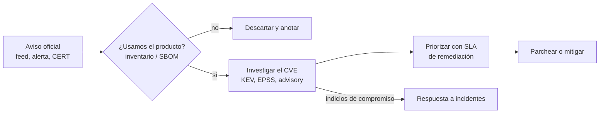

---
tags:
  - seguridad
  - vulnerabilidades
  - incidentes
  - aws
  - azure
  - gcp
  - python
---

# Fuentes oficiales de seguridad

> Dónde buscar información verificada y en tiempo real sobre incidentes, vulnerabilidades y amenazas: avisos de las nubes y plataformas DevOps, CERT/CSIRT nacionales, bases de vulnerabilidades, informes de amenazas y cómo recibirlo todo de forma automática.

!!! info "Dónde encaja"
    Esta nota es el **directorio** de fuentes y la forma de suscribirte a ellas. Qué significa cada señal (CVE, CVSS, EPSS, KEV, GHSA, OSV, EUVD) está en [Fundamentos de CVE](../vulnerabilidades/fundamentos-cve.md); cómo analizar un aviso concreto, en [Cómo investigar un CVE](../vulnerabilidades/investigar-un-cve.md); y cómo se prioriza y responde, en [Detección y respuesta](deteccion-respuesta.md).

## ¿Qué es?

Cuando pasa algo grave (una caída de una región, un CVE crítico, una campaña de ataques), la información circula primero por redes sociales, blogs y agregadores. Parte es correcta, parte está incompleta y parte es falsa. Una **fuente oficial** es la que publica **quien tiene la autoridad** sobre el dato:

| Tipo de fuente | Ejemplos | Autoridad sobre |
| --- | --- | --- |
| **Fabricante o proyecto** (*vendor*) | AWS, Microsoft, Google Cloud, GitHub, OpenSSL, Kubernetes | Su producto: versiones afectadas, parches, workarounds, estado del servicio |
| **Organismo público y CERT/CSIRT** | CISA, NCSC, ENISA, INCIBE-CERT, CSIRT nacionales | Explotación confirmada, alertas para un país o sector, coordinación |
| **Base de vulnerabilidades** | cve.org, NVD, OSV.dev, GitHub Advisory Database | Identificador y datos estructurados del CVE |
| **Informe de amenazas** | Verizon DBIR, M-Trends, ENISA Threat Landscape | Tendencias; no es tiempo real |

Un **CERT** (*Computer Emergency Response Team*) o **CSIRT** (*Computer Security Incident Response Team*, equipo de respuesta a incidentes de seguridad) es el equipo que coordina la respuesta a incidentes de un país, sector u organización.

## Por qué importa la fuente

| Fuente no verificada | Riesgo |
| --- | --- |
| Publicación en redes sociales | Versiones afectadas equivocadas, pánico, o un "exploit" que en realidad es malware |
| Blog o agregador | Copia de otro sitio, desactualizada, sin las correcciones posteriores del fabricante |
| Correo "de seguridad" que pide actuar ya | Phishing que imita un aviso real (enlace a un dominio parecido) |
| Repositorio con un supuesto PoC | Código malicioso disfrazado de prueba de concepto |

### Cómo verificar un aviso

1. **Primero, el aviso del fabricante** (*vendor advisory*). Es quien conoce las versiones corregidas, los *backports* y los workarounds de su producto. Cualquier otra fuente lo resume.
2. **Dominio oficial**: escribe tú la dirección o usa tus marcadores; no sigas enlaces de un correo o de una publicación. Desconfía de dominios parecidos (`aws-security-alerts.com` no es de AWS).
3. **Referencias cruzadas**: el mismo CVE debería aparecer en cve.org, en el aviso del fabricante y, si se explota, en el catálogo KEV de CISA o en el aviso de tu CERT nacional.
4. **Firma**: muchas listas de correo de seguridad (por ejemplo, los *Debian Security Advisories*) firman sus mensajes con **PGP**; si vas a automatizar a partir de una lista, comprueba la firma.
5. **Fecha y versión del aviso**: los avisos se actualizan (nuevas versiones afectadas, parches incompletos). Mira siempre la última revisión.

!!! warning "No ejecutes pruebas de concepto de origen dudoso"
    En incidentes mediáticos aparecen repositorios con "exploits" que instalan malware en la máquina de quien los ejecuta. Para saber si te afecta, usa versiones, escáneres y la configuración (ver [Cómo investigar un CVE](../vulnerabilidades/investigar-un-cve.md)), no código de terceros.

## Avisos de seguridad de las nubes

Cada proveedor separa dos cosas: el **estado público** del servicio (*status page*, página de estado, igual para todos los clientes) y la **vista personalizada** de tu cuenta, que solo muestra lo que afecta a tus recursos y permite alertas. Para seguridad, además, publica **security bulletins** (boletines de seguridad).

=== "AWS"

    | Recurso | Qué publica | Cómo suscribirse | Enlace |
    | --- | --- | --- | --- |
    | **AWS Security Bulletins** | Vulnerabilidades que afectan a servicios de AWS o a software muy usado (con o sin acción del cliente) | RSS | [Boletines](https://aws.amazon.com/security/security-bulletins/), [feed RSS](https://aws.amazon.com/security/security-bulletins/rss/feed/) |
    | **AWS Health Dashboard** (vista pública) | Estado de todos los servicios por región | Web | [health.aws.amazon.com](https://health.aws.amazon.com/health/status) |
    | **AWS Health** en tu cuenta | Eventos que afectan a **tu** cuenta: incidentes (`issue`), cambios programados (`scheduledChange`), notificaciones de cuenta (`accountNotification`) y avisos de abuso | Amazon EventBridge, AWS Health API, consola | [Qué es AWS Health](https://docs.aws.amazon.com/health/latest/ug/what-is-aws-health.html) |
    | **AWS Security Blog** | Anuncios y guías de seguridad | RSS | [Blog](https://aws.amazon.com/blogs/security/), [feed RSS](https://aws.amazon.com/blogs/security/feed/) |
    | **Vulnerability Reporting** | Cómo reportar una vulnerabilidad a AWS (y su clave PGP) | Web | [Vulnerability Reporting](https://aws.amazon.com/security/vulnerability-reporting/) |

    - Con **AWS Organizations** puedes activar la *organizational view* y ver los eventos de todas las cuentas desde la cuenta de administración o una cuenta delegada.
    - La **AWS Health API** necesita un plan de soporte de pago de nivel Business o superior (sin él devuelve `SubscriptionRequiredException`). Las reglas de **EventBridge** sobre eventos de AWS Health **no** lo necesitan: son la vía recomendada para automatizar (ver [ejemplo](#regla-de-eventbridge-para-aws-health)).

=== "Azure"

    | Recurso | Qué publica | Cómo suscribirse | Enlace |
    | --- | --- | --- | --- |
    | **Azure Status** | Incidentes de impacto amplio en todas las regiones | RSS | [azure.status.microsoft](https://azure.status.microsoft/en-us/status), [feed RSS](https://azure.status.microsoft/en-us/status/feed/) |
    | **Azure Service Health** (portal) | Vista personalizada de tus suscripciones: *Service issues*, *Planned maintenance*, *Health advisories* y *Security advisories*. Incluye **Resource Health** por recurso | Alertas de Service Health en Azure Monitor con **action groups** (correo, SMS, webhook, Logic Apps…) | [Qué es Azure Service Health](https://learn.microsoft.com/en-us/azure/service-health/overview) |
    | **Microsoft Security Response Center (MSRC)** | Blog del equipo de respuesta de Microsoft y avisos fuera de ciclo | Correo (*technical security notifications*) | [MSRC blog](https://msrc.microsoft.com/blog/), [notificaciones](https://www.microsoft.com/en-us/msrc/technical-security-notifications) |
    | **Security Update Guide** | Todos los CVE de productos Microsoft con KB, severidad y estado de explotación | RSS y **API CVRF** (JSON/XML, pública) | [Security Update Guide](https://msrc.microsoft.com/update-guide/), [RSS](https://api.msrc.microsoft.com/update-guide/rss), [API](https://github.com/microsoft/MSRC-Microsoft-Security-Updates-API) |
    | **Microsoft Security Blog** | Investigación de amenazas y anuncios de producto | RSS | [Blog](https://www.microsoft.com/en-us/security/blog/), [feed RSS](https://www.microsoft.com/en-us/security/blog/feed/) |

    - **Patch Tuesday** (martes de parches): Microsoft publica sus actualizaciones de seguridad el **segundo martes de cada mes**. Ese día conviene revisar la Security Update Guide; los fallos explotados activamente pueden recibir parches fuera de ciclo (*out-of-band*).
    - Las alertas de Service Health se crean sobre el **Activity Log** (categoría *ServiceHealth*); el action group debe ser global.

=== "Google Cloud"

    | Recurso | Qué publica | Cómo suscribirse | Enlace |
    | --- | --- | --- | --- |
    | **Google Cloud Service Health** (público) | Incidentes de todos los productos y ubicaciones | Atom y JSON | [status.cloud.google.com](https://status.cloud.google.com/), [feed Atom](https://status.cloud.google.com/en/feed.atom), [JSON](https://status.cloud.google.com/incidents.json) |
    | **Personalized Service Health** | Incidentes que afectan a **tus** proyectos u organización, con estado por producto y ubicación | Alertas (políticas de Cloud Monitoring basadas en logs), Service Health API (`servicehealth.googleapis.com`), integración con PagerDuty | [Visión general](https://cloud.google.com/service-health/docs/overview), [configurar alertas](https://cloud.google.com/service-health/docs/configure-alerts-dashboard) |
    | **Google Cloud security bulletins** | Vulnerabilidades que afectan a Google Cloud y qué hacer | XML (RSS) | [Boletines](https://cloud.google.com/support/bulletins), [feed](https://cloud.google.com/feeds/google-cloud-security-bulletins.xml) |
    | **GKE security bulletins** | CVE de Kubernetes, del kernel y de componentes de GKE, con versiones de parche | XML (RSS) y notificaciones de clúster `SecurityBulletinEvent` por Pub/Sub | [Boletines de GKE](https://cloud.google.com/kubernetes-engine/security-bulletins), [feed](https://cloud.google.com/feeds/gke-security-bulletins.xml) |
    | **Cloud Threat Horizons Report** | Informe semestral de amenazas en la nube (Office of the CISO, GTIG y Mandiant); hay *previews* en Advisory Notifications | Web | [H1 2026](https://cloud.google.com/security/report/resources/cloud-threat-horizons-report-h1-2026), [previews](https://docs.cloud.google.com/advisory-notifications/docs/threat-horizons-overview) |
    | **Google Cloud Security Blog** y **Threat Intelligence blog** (Mandiant / GTIG) | Anuncios de seguridad e investigación de campañas | Web | [Identity & Security](https://cloud.google.com/blog/products/identity-security), [Threat Intelligence](https://cloud.google.com/blog/topics/threat-intelligence) |

!!! tip "Antes de depurar tu código, mira el estado del proveedor"
    Un error raro y repentino en varios servicios a la vez suele ser del proveedor. La comprobación rápida del estado de cada nube está en [Troubleshooting](../../devops/operacion/troubleshooting.md#nube); esta nota añade los canales para enterarte **antes** de que te avisen los usuarios.

### Plataformas DevOps y SaaS

| Plataforma | Estado | Avisos de seguridad | Feed |
| --- | --- | --- | --- |
| **GitHub** | [githubstatus.com](https://www.githubstatus.com/) | [GitHub Advisory Database](https://github.com/advisories), [GitHub Blog: Security](https://github.blog/security/) | [Atom de estado](https://www.githubstatus.com/history.atom), [RSS del blog](https://github.blog/security/feed/) |
| **GitLab** | | [Patch releases](https://docs.gitlab.com/releases/) (los de seguridad se marcan como *Critical Patch Release*) | [Atom](https://docs.gitlab.com/releases/patch-releases.xml) |
| **Docker** | [dockerstatus.com](https://www.dockerstatus.com/) | [Docker security announcements](https://docs.docker.com/security/security-announcements/) | |
| **Cloudflare** | [cloudflarestatus.com](https://www.cloudflarestatus.com/) | | [Atom de estado](https://www.cloudflarestatus.com/history.atom) |
| **HashiCorp** (Terraform, Vault…) | | Boletines `HCSEC-AAAA-NN` en la categoría *Security* del foro oficial: [discuss.hashicorp.com](https://discuss.hashicorp.com/c/security/52) | Suscripción a la categoría del foro |
| **npm** | [status.npmjs.org](https://status.npmjs.org/) | Avisos de paquetes en la GitHub Advisory Database (npm es de GitHub) | |
| **PyPI** | [status.python.org](https://status.python.org/) | [Blog de PyPI](https://blog.pypi.org/) (incidentes y paquetes maliciosos) | [RSS](https://blog.pypi.org/feed_rss_created.xml) |

Las páginas de estado de GitHub, Docker, Cloudflare y npm permiten además suscribirse por correo o webhook desde el botón *Subscribe to updates*.

## Organismos oficiales y CERT/CSIRT

| Organismo | Ámbito | Qué publica | Suscripción |
| --- | --- | --- | --- |
| **CISA** | EE. UU. (referencia mundial) | [Cybersecurity Advisories](https://www.cisa.gov/news-events/cybersecurity-advisories), alertas y el [catálogo KEV](https://www.cisa.gov/known-exploited-vulnerabilities-catalog) | [Correo](https://www.cisa.gov/about/contact-us/subscribe-updates-cisa), [RSS de advisories](https://www.cisa.gov/cybersecurity-advisories/all.xml), [KEV en JSON](https://www.cisa.gov/sites/default/files/feeds/known_exploited_vulnerabilities.json) y [CSV](https://www.cisa.gov/sites/default/files/csv/known_exploited_vulnerabilities.csv) |
| **NCSC** | Reino Unido | Guías, informes de amenazas y avisos | [RSS general](https://www.ncsc.gov.uk/api/1/services/v1/all-rss-feed.xml), [RSS de informes](https://www.ncsc.gov.uk/api/1/services/v1/report-rss-feed.xml) |
| **ENISA** | Unión Europea | Agencia de ciberseguridad de la UE; opera la **EUVD** (ver [Fundamentos de CVE](../vulnerabilidades/fundamentos-cve.md#enisa-y-la-euvd)) | [enisa.europa.eu](https://www.enisa.europa.eu/), [EUVD](https://euvd.enisa.europa.eu/) |
| **CERT-EU** | Instituciones de la UE | Security advisories y avisos de amenazas | [cert.europa.eu](https://cert.europa.eu/), [RSS de advisories](https://cert.europa.eu/publications/security-advisories-rss) |
| **INCIBE-CERT** | España (ciudadanía, empresas, operadores) | Avisos de seguridad en español | [Avisos](https://www.incibe.es/incibe-cert/alerta-temprana/avisos), [RSS](https://www.incibe.es/incibe-cert/alerta-temprana/avisos/feed) |
| **CCN-CERT** | España (sector público) | Alertas, informes y guías CCN-STIC | [ccn-cert.cni.es](https://www.ccn-cert.cni.es/) |
| **ANCI** y **CSIRT Nacional** | Chile | Agencia Nacional de Ciberseguridad (Ley 21.663, Ley Marco de Ciberseguridad); el CSIRT Nacional depende de ella y publica alertas y vulnerabilidades | [anci.gob.cl](https://anci.gob.cl/), [csirt.gob.cl](https://csirt.gob.cl/) |
| **CERT.br** | Brasil | Estadísticas, recomendaciones y avisos | [cert.br](https://cert.br/), [RSS](https://cert.br/rss/certbr-rss.xml) |
| **ColCERT** | Colombia | Grupo de respuesta nacional | [colcert.gov.co](https://www.colcert.gov.co/) |
| **CERT-MX** | México (Guardia Nacional) | Alertas de seguridad y reporte de incidentes | [gob.mx/gncertmx](https://www.gob.mx/gncertmx) |
| **CERTuy** | Uruguay | Centro Nacional de Respuesta a Incidentes de Seguridad Informática | [gub.uy](https://www.gub.uy/centro-nacional-respuesta-incidentes-seguridad-informatica/) |
| **CERT.ar** | Argentina | Equipo de respuesta nacional | [argentina.gob.ar/ciberseguridad/certar](https://www.argentina.gob.ar/ciberseguridad/certar) |

Para encontrar el CSIRT de otro país o de un sector, usa el directorio de **FIRST** (*Forum of Incident Response and Security Teams*): [FIRST Teams](https://www.first.org/members/teams/).

!!! note "Tu CERT nacional también es para reportar"
    Además de leer sus alertas, el CSIRT de tu país es a quien se notifican incidentes. En Chile, por ejemplo, la Ley 21.663 obliga a los prestadores de servicios esenciales a reportar incidentes a la ANCI con plazos muy cortos. Revisa qué obligaciones aplican a tu organización en [Cumplimiento y gobierno](cumplimiento.md).

## Bases de vulnerabilidades y avisos de proyectos

La tabla de bases (cve.org, NVD, CISA KEV, EPSS, GHSA, OSV.dev, EUVD, CERT/CC) con su propósito ya está en [Fundamentos de CVE: fuentes oficiales](../vulnerabilidades/fundamentos-cve.md#fuentes-oficiales), y cómo consultarlas por API en [Cómo investigar un CVE](../vulnerabilidades/investigar-un-cve.md#consultar-las-apis). En resumen: **cve.org** identifica, **NVD** enriquece (con retraso), **KEV** confirma explotación, **EPSS** estima probabilidad y **GHSA/OSV** son las más precisas para dependencias.

Lo que falta ahí son los **avisos de proyectos** que usas a diario, que suelen llegar antes y con más detalle:

| Proyecto | Dónde publica | Feed o lista |
| --- | --- | --- |
| **Kubernetes** | [Official CVE feed](https://kubernetes.io/docs/reference/issues-security/official-cve-feed/) | [RSS](https://kubernetes.io/docs/reference/issues-security/official-cve-feed/feed.xml), [JSON](https://kubernetes.io/docs/reference/issues-security/official-cve-feed/index.json), lista [kubernetes-security-announce](https://groups.google.com/g/kubernetes-security-announce) |
| **Linux kernel** | El kernel es CNA y asigna sus propios CVE ([proceso](https://docs.kernel.org/process/cve.html)) | Lista [linux-cve-announce](https://lore.kernel.org/linux-cve-announce/) (mucho volumen) |
| **Ubuntu** | [Ubuntu Security Notices (USN)](https://ubuntu.com/security/notices) | [RSS](https://ubuntu.com/security/notices/rss.xml) |
| **Red Hat** | [Red Hat Security Advisories (RHSA)](https://access.redhat.com/security/security-updates/) | [CSAF legible por máquina](https://security.access.redhat.com/data/csaf/v2/advisories/) |
| **Debian** | [Debian Security Advisories (DSA)](https://www.debian.org/security/) | [RSS](https://www.debian.org/security/dsa), lista [debian-security-announce](https://lists.debian.org/debian-security-announce/) |
| **OpenSSL** | [Vulnerabilities](https://openssl-library.org/news/vulnerabilities/) | |
| **OpenSSH** | [Security](https://www.openssh.com/security.html) | |
| **Python** | [Python security](https://www.python.org/dev/security/) | Lista [security-announce](https://mail.python.org/mailman3/lists/security-announce.python.org/) |
| **Node.js** | [Vulnerability blog](https://nodejs.org/en/blog/vulnerability) (anuncia los *security releases* con días de antelación) | [RSS](https://nodejs.org/en/feed/vulnerability.xml) |
| **Varios (open source)** | **oss-security**, lista pública de Openwall donde se divulgan muchas vulnerabilidades de software libre | [Archivo](https://www.openwall.com/lists/oss-security/), [cómo suscribirse](https://oss-security.openwall.org/wiki/mailing-lists/oss-security) |

!!! tip "Sigue solo lo que usas"
    Suscribirte a todo genera ruido y acabas sin leer nada. Parte de tu **inventario** o SBOM (ver [Software supply chain](../codigo-y-dependencias/cadena-suministro.md)): si no usas Debian ni OpenSSH expuesto, esas fuentes no van en tu lista diaria. Las dependencias de aplicación ya las cubre el escaneo [SCA](../escaneos/sca.md) con GHSA/OSV.

## Inteligencia de amenazas y marcos

La **threat intelligence** (inteligencia de amenazas) responde a "quién ataca, cómo y a qué". Para el día a día basta con conocer el marco y los grandes informes anuales; ninguno es una fuente de **tiempo real**.

| Recurso | Qué es | Frecuencia |
| --- | --- | --- |
| **MITRE ATT&CK** | Base de conocimiento de tácticas y técnicas de atacantes (incluye matrices de cloud y contenedores). Sirve para describir detecciones y cobertura | Versiones periódicas: [attack.mitre.org](https://attack.mitre.org/) |
| **Verizon DBIR** (*Data Breach Investigations Report*) | Análisis de miles de brechas: vectores de entrada, sectores, tendencias | Anual: [DBIR](https://www.verizon.com/business/resources/reports/dbir/) |
| **Microsoft Digital Defense Report** | Panorama de amenazas desde la telemetría de Microsoft | Anual: [MDDR 2025](https://www.microsoft.com/en-us/security/security-insider/threat-landscape/microsoft-digital-defense-report-2025) |
| **M-Trends** (Google Cloud / Mandiant) | Datos de las investigaciones de incidentes de Mandiant (tiempo de permanencia, vectores) | Anual: [M-Trends](https://cloud.google.com/security/resources/m-trends) |
| **ENISA Threat Landscape** | Panorama de amenazas en la UE | Anual: [ETL 2025](https://www.enisa.europa.eu/publications/enisa-threat-landscape-2025) |
| **NCSC threat reports** | Informes de amenazas del Reino Unido | Periódicos: [Threat reports](https://www.ncsc.gov.uk/section/keep-up-to-date/threat-reports) |

Úsalos para **priorizar controles** y argumentar inversiones ante negocio (ver [Gobierno y riesgo de TI](../../negocio/gobierno-riesgo-ti.md)), no para reaccionar a un incidente concreto.

## Cómo recibir todo en tiempo real

| Mecanismo | Ejemplos verificados | Ventaja | Límite |
| --- | --- | --- | --- |
| **RSS/Atom** | Boletines de AWS y Google Cloud, Security Update Guide, Azure Status, CISA, NCSC, INCIBE-CERT, Kubernetes, USN, DSA, Node.js | Sin cuenta; cualquier lector o bot de chat lo consume | Solo texto; hay que leerlo |
| **Listas de correo** (*mailing lists*) | kubernetes-security-announce, debian-security-announce, oss-security, security-announce de Python, correo de CISA y MSRC | Llega a la bandeja, a veces firmado | Volumen; difícil de automatizar |
| **APIs y datos estructurados** | [NVD API 2.0](https://nvd.nist.gov/developers/vulnerabilities), [KEV JSON](https://www.cisa.gov/sites/default/files/feeds/known_exploited_vulnerabilities.json), [EPSS API](https://api.first.org/epss/), [OSV API](https://google.github.io/osv.dev/api/), [API CVRF de MSRC](https://github.com/microsoft/MSRC-Microsoft-Security-Updates-API), [Service Health API](https://cloud.google.com/service-health/docs/reference/rest) | Se cruzan con tu inventario y se filtran | Hay que programar y mantener |
| **Eventos de la nube** | AWS Health + EventBridge, alertas de Azure Service Health con action groups, alertas de Personalized Service Health | Solo lo que afecta a **tus** recursos, en minutos | Uno por proveedor |

Para que llegue al equipo, envía todo a **un canal** de chat (Slack, Microsoft Teams, Google Chat) o a tu herramienta de incidentes: los lectores de RSS tienen integración con chat, AWS ofrece **Amazon Q Developer in chat applications** (antes AWS Chatbot) para Slack y Teams, los action groups de Azure llaman a webhooks y Logic Apps, y Personalized Service Health se integra con PagerDuty y canales de notificación de Cloud Monitoring.

### Regla de EventBridge para AWS Health

Este patrón captura incidentes, notificaciones de cuenta y cambios programados de **todos** los servicios (es el formato que documenta AWS; añade `"service": ["EC2", …]` dentro de `detail` para filtrar):

```json title="patron-aws-health.json"
{
  "source": ["aws.health"],
  "detail-type": ["AWS Health Event"],
  "detail": {
    "eventTypeCategory": ["issue", "accountNotification", "scheduledChange"]
  }
}
```

```bash
# Regla en la región que quieres vigilar (repite por región)
aws events put-rule --name aws-health-a-sns \
  --event-pattern file://patron-aws-health.json --region eu-west-1

# Destino: un tema SNS que reenvía a correo o chat
aws events put-targets --rule aws-health-a-sns --region eu-west-1 \
  --targets 'Id=sns,Arn=arn:aws:sns:eu-west-1:111122223333:alertas-health'
```

- Los eventos **globales** (por ejemplo, de IAM) solo llegan a **us-east-1**: crea también la regla allí.
- AWS envía cada evento a su región y a una **región de respaldo** (us-west-2 para casi todas). Si pones reglas en ambas, deduplica por `detail.communicationId`; si no quieres los duplicados, filtra `detail.backupEvent`.
- Para seguridad, AWS sugiere fijarse en los eventos de **abuso** y en los que llevan la *persona* `SECURITY`.
- La política de acceso del tema SNS debe permitir publicar a `events.amazonaws.com`.

### Script: lo nuevo en CISA KEV de los últimos 7 días

Un script corto, solo con la librería estándar, para la revisión diaria o para un job programado (cron, GitHub Actions con `schedule`) que publique el resultado en el chat:

```python title="kev_recientes.py"
"""Lista las vulnerabilidades agregadas al catálogo CISA KEV en los últimos N días."""
import json
import sys
import urllib.request
from datetime import date, timedelta

KEV_URL = "https://www.cisa.gov/sites/default/files/feeds/known_exploited_vulnerabilities.json"
DIAS = int(sys.argv[1]) if len(sys.argv) > 1 else 7


def descargar_kev() -> dict:
    req = urllib.request.Request(KEV_URL, headers={"User-Agent": "kev-recientes/1.0"})
    with urllib.request.urlopen(req, timeout=30) as resp:
        return json.load(resp)


def main() -> None:
    kev = descargar_kev()
    desde = date.today() - timedelta(days=DIAS)
    recientes = [
        v for v in kev["vulnerabilities"]
        if date.fromisoformat(v["dateAdded"]) >= desde
    ]
    recientes.sort(key=lambda v: v["dateAdded"], reverse=True)

    print(f"Catálogo {kev['catalogVersion']} ({kev['count']} entradas)")
    print(f"Agregadas desde {desde}: {len(recientes)}\n")
    for v in recientes:
        ransomware = " [ransomware]" if v["knownRansomwareCampaignUse"] == "Known" else ""
        print(f"{v['dateAdded']}  {v['cveID']:<16} {v['vendorProject']} {v['product']}"
              f"  (plazo {v['dueDate']}){ransomware}")


if __name__ == "__main__":
    main()
```

Salida real (ejecutado el 26 de octubre de 2026 con Python 3.12, abreviada):

```text
$ python kev_recientes.py
Catálogo 2026.10.23 (1756 entradas)
Agregadas desde 2026-10-19: 8

2026-10-23  CVE-2026-114625  Arista VeloCloud Orchestrator  (plazo 2026-10-26)
2026-10-23  CVE-2026-110447  Collabora Collabora Online – Built-in CODE Server  (plazo 2026-10-26)
2026-10-20  CVE-2026-106931  EG Secure Solutions SiteGuard Server Edition  (plazo 2026-10-23)
2026-10-20  CVE-2026-96656   Plex Media Server  (plazo 2026-10-23)
...
```

El `dueDate` es el plazo que CISA fija a las agencias federales de EE. UU.; para ti es una pista de urgencia, no una obligación. El paso siguiente es cruzar `vendorProject` y `product` con tu inventario. Peticiones HTTP con reintentos y timeouts: [APIs y HTTP](../../python/scripting/apis-http.md).

## Rutina recomendada

| Cuándo | Qué revisar | Quién |
| --- | --- | --- |
| **Continuo** (alertas automáticas) | AWS Health, Azure Service Health, Personalized Service Health; GKE `SecurityBulletinEvent`; páginas de estado de GitHub y del registry | On-call de plataforma |
| **Diario** | Novedades de CISA KEV (script anterior), boletines de seguridad de tus nubes, avisos de tu CERT nacional, feeds de los proyectos de tu inventario | Responsable de seguridad o rotación del equipo |
| **Semanal** | Hallazgos de SCA y container scanning frente a lo publicado; CVE de la semana con EPSS alto | Equipo de plataforma + seguridad |
| **Mensual** | Patch Tuesday de Microsoft; revisar que las suscripciones siguen funcionando (un feed que lleva un mes callado puede estar roto) | Seguridad |
| **Anual** | DBIR, M-Trends, ENISA Threat Landscape: ¿cambian las prioridades de controles? | Responsable de seguridad con negocio |



- **De aviso a acción**: con el aviso en la mano, sigue [Cómo investigar un CVE](../vulnerabilidades/investigar-un-cve.md); los plazos y excepciones están en [Vulnerability management](deteccion-respuesta.md#vulnerability-management), y si hay compromiso, en [Respuesta a incidentes](deteccion-respuesta.md#respuesta-a-incidentes).
- **Un responsable por fuente**: cada feed debe tener alguien que lo lea. Sin dueño, el canal se convierte en ruido.
- **Incidentes del proveedor**: si la caída es de la nube, tu trabajo es comunicar y aplicar tu plan de resiliencia; coordínalo como cualquier incidente (ver [Operación y fiabilidad (SRE)](../../devops/operacion/operacion-sre.md)).

## Relación con otras secciones

| Enfoque | Qué se mira desde ahí | Nota |
| --- | --- | --- |
| Cloud (el control) | Estado del proveedor, alertas nativas y qué parchea cada parte | [Observabilidad nativa](../../monitoreo/nube/observabilidad-nativa.md), [Shared Responsibility Model](../../cloud/fundamentos/responsabilidad-compartida.md), [Resiliencia](../../cloud/operacion-y-gobierno/resiliencia.md) |
| DevOps (la automatización) | Llevar avisos al canal de alertas e incidentes; comprobar el estado del proveedor al depurar | [Observabilidad](../../monitoreo/fundamentos/observabilidad.md), [Operación y fiabilidad (SRE)](../../devops/operacion/operacion-sre.md), [Troubleshooting](../../devops/operacion/troubleshooting.md#nube) |
| DevSecOps (la verificación) | Qué significa cada señal, cómo investigar un aviso y cómo priorizarlo | [Fundamentos de CVE](../vulnerabilidades/fundamentos-cve.md), [Cómo investigar un CVE](../vulnerabilidades/investigar-un-cve.md), [Detección y respuesta](deteccion-respuesta.md), [Cumplimiento y gobierno](cumplimiento.md) |
| Negocio TI (el porqué) | Usar los informes de amenazas para justificar riesgo e inversión | [Gobierno y riesgo de TI](../../negocio/gobierno-riesgo-ti.md) |
| Python (la herramienta) | Consumir feeds y APIs con timeouts y reintentos | [APIs y HTTP](../../python/scripting/apis-http.md) |

## Referencias

- [AWS Health: monitorear eventos con Amazon EventBridge](https://docs.aws.amazon.com/health/latest/ug/cloudwatch-events-health.html)
- [AWS Health: reglas de EventBridge por región](https://docs.aws.amazon.com/health/latest/ug/choosing-a-region.html)
- [AWS Health: configurar una regla de EventBridge](https://docs.aws.amazon.com/health/latest/ug/creating-event-bridge-events-rule-for-aws-health.html)
- [AWS Health API](https://docs.aws.amazon.com/health/latest/ug/health-api.html)
- [AWS Health: organizational view](https://docs.aws.amazon.com/health/latest/ug/aggregate-events.html)
- [Azure Service Health](https://learn.microsoft.com/en-us/azure/service-health/overview)
- [Azure: alertas de Service Health](https://learn.microsoft.com/en-us/azure/service-health/alerts-activity-log-service-notifications-portal)
- [Azure Monitor: action groups](https://learn.microsoft.com/en-us/azure/azure-monitor/alerts/action-groups)
- [Microsoft Security Update Guide](https://msrc.microsoft.com/update-guide/)
- [Google Cloud Personalized Service Health](https://cloud.google.com/service-health/docs/overview)
- [Google Cloud security bulletins](https://cloud.google.com/support/bulletins)
- [GKE security bulletins](https://cloud.google.com/kubernetes-engine/security-bulletins)
- [CISA: suscribirse a actualizaciones](https://www.cisa.gov/about/contact-us/subscribe-updates-cisa)
- [CISA: Known Exploited Vulnerabilities Catalog](https://www.cisa.gov/known-exploited-vulnerabilities-catalog)
- [CISA KEV en GitHub](https://github.com/cisagov/kev-data)
- [FIRST: directorio de equipos](https://www.first.org/members/teams/)
- [Kubernetes Official CVE Feed](https://kubernetes.io/docs/reference/issues-security/official-cve-feed/)
- [oss-security (Openwall)](https://oss-security.openwall.org/wiki/mailing-lists/oss-security)
- [MITRE ATT&CK](https://attack.mitre.org/)
