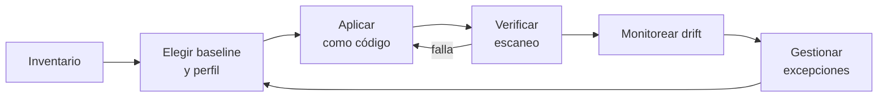

---
tags:
  - devsecops
  - hardening
  - seguridad
  - cumplimiento
---

# Fundamentos de hardening

> Qué es endurecer un sistema, qué principios lo guían, qué baselines usar como referencia (CIS, DISA STIG, guías de fabricante), cómo es el ciclo completo y con qué herramientas se mide.

!!! info "Dónde encaja"
    En IaaS (máquinas virtuales, nodos, servidores on-premise) el sistema operativo y los servicios que instalas son **tu** parte del [Shared Responsibility Model](../../cloud/fundamentos/responsabilidad-compartida.md): el proveedor no los endurece por ti. Este bloque cubre esa parte. Lo que ya está en otras notas se enlaza, no se repite: imágenes y controles de VM en la nube en [Seguridad de máquinas virtuales](../../cloud/seguridad/seguridad-maquinas-virtuales.md), contenedores en [Seguridad de contenedores](../infraestructura-y-contenedores/seguridad-contenedores.md), clústeres en [Seguridad de Kubernetes](../infraestructura-y-contenedores/seguridad-kubernetes.md) y [KSPM](../escaneos/kspm.md), y los marcos (CIS, ISO 27001, NIST) en [Cumplimiento y gobierno](../gobierno-y-respuesta/cumplimiento.md).

## ¿Qué es?

El **hardening** (bastionado o endurecimiento) consiste en reducir la **attack surface** (superficie de ataque) de un sistema. Para lograrlo se aplica una configuración segura de referencia y después se verifica de forma continua que se mantenga. No es un producto que instalas: es una disciplina que combina quitar lo que sobra, restringir lo que queda y comprobarlo.

La razón es simple: casi todo software viene configurado para **funcionar a la primera**, no para ser seguro. Las instalaciones por defecto suelen traer servicios de ejemplo, contraseñas conocidas, protocolos antiguos activados para mantener la compatibilidad, puertos escuchando en todas las interfaces y registros mínimos.

| Configuración insegura por defecto | Hardening |
| --- | --- |
| Servicios y paquetes instalados "por si acaso" | Solo lo necesario para la función del servidor |
| Login de root por SSH, contraseñas | Solo llaves, sin root directo, grupos permitidos |
| Protocolos heredados (SMBv1, TLS 1.0, SSH con SHA-1) | Solo algoritmos y versiones vigentes |
| Puertos escuchando en `0.0.0.0` | Escuchar solo donde hace falta, con firewall local |
| Logs mínimos | Auditoría de eventos relevantes, enviada fuera del host |
| Credenciales de fábrica | Credenciales únicas, rotadas o sin contraseña |

### Incidentes por mala configuración

Muchas brechas famosas no necesitaron un exploit sofisticado, sino una configuración que nadie revisó:

- **Mirai (2016)**: botnet construida con dispositivos IoT que conservaban usuario y contraseña de fábrica en Telnet.
- **Bases de datos expuestas sin autenticación**: oleadas de borrado y extorsión contra instancias de MongoDB y Elasticsearch abiertas a internet (por ejemplo, los ataques "Meow" de 2020).
- **Capital One (2019)**: un WAF mal configurado permitió SSRF hacia el servicio de metadatos de la instancia, y el rol asociado tenía permisos de sobra. El remedio en la nube (IMDSv2, mínimo privilegio) está en [Seguridad de máquinas virtuales](../../cloud/seguridad/seguridad-maquinas-virtuales.md).

Las vulnerabilidades de software (CVE) se corrigen con parches, como se ve en [Fundamentos de CVE](../vulnerabilidades/fundamentos-cve.md). Hardening y parcheo son complementarios: un buen hardening reduce el impacto de un CVE aún sin parche, por ejemplo cuando el servicio vulnerable ni siquiera está instalado.

## Principios

| Principio | Qué significa en un servidor |
| --- | --- |
| **Least functionality** (mínima funcionalidad) | Desinstalar o deshabilitar paquetes, servicios, módulos del kernel y puertos que la función del sistema no requiere |
| **Least privilege** (mínimo privilegio) | Sin login directo de root, `sudo` acotado, servicios con su propio usuario, permisos de archivos estrictos |
| **Defense in depth** (defensa en profundidad) | Firewall de red y firewall local, SELinux/AppArmor, auditoría: si una capa falla, la siguiente frena el ataque |
| **Secure by default** (seguro por defecto) | La configuración base es la restrictiva; abrir algo exige una decisión explícita y documentada |
| **Immutability** (inmutabilidad) | No se cambian los servidores en caliente: se construye una imagen nueva endurecida y se reemplaza |
| **Verificación continua** | Lo que no se mide se degrada: auditar al construir y también periódicamente en ejecución |

## Baselines de referencia

Una **baseline** (línea base de configuración segura) es una lista de controles concretos y comprobables, del tipo "`PermitRootLogin` debe ser `no`". No conviene inventar la tuya desde cero: parte de una reconocida y adáptala.

| Baseline | Quién la publica | Para qué se usa |
| --- | --- | --- |
| **CIS Benchmarks** | Center for Internet Security | La referencia más usada: SO, nubes, Kubernetes, Docker, bases de datos, navegadores. Gratis en PDF para uso no comercial |
| **DISA STIG** | Defense Information Systems Agency (EE. UU.) | Obligatoria en el sector defensa de EE. UU.; más estricta y detallada que CIS |
| **Microsoft Security Baselines** | Microsoft | Configuraciones de GPO recomendadas para Windows, Edge y Microsoft 365 Apps; se distribuyen con el Security Compliance Toolkit |
| **Guías de fabricante Linux** | Red Hat (Security hardening de RHEL), Canonical (Ubuntu Security Guide) | Cómo aplicar CIS/STIG en su distribución, con herramientas propias |
| **NIST SP 800-70** | NIST | No es una baseline: define el *National Checklist Program* y el repositorio de checklists (NCP) donde se publican muchas de las anteriores |
| **NIST SP 800-123** | NIST | Guía general de seguridad de servidores (2008): sirve como marco conceptual, pero es antigua; para controles concretos usa CIS o STIG |

!!! note "Versiones de NIST"
    SP 800-70 Rev. 4 (2018) fue retirada en mayo de 2026 y reemplazada por **SP 800-70 Rev. 5**. Revisa siempre la página de CSRC para confirmar qué revisión está vigente.

### Niveles y perfiles de CIS

Cada CIS Benchmark agrupa sus recomendaciones en **perfiles**:

| Perfil | Idea | Riesgo de romper algo |
| --- | --- | --- |
| **Level 1** | Controles básicos y prácticos con poco impacto en la funcionalidad. Es el punto de partida razonable | Bajo |
| **Level 2** | Defensa en profundidad para entornos sensibles: más restrictivo (por ejemplo, particiones separadas o auditoría muy detallada) | Medio o alto |
| **Server / Workstation** | Variantes del mismo benchmark según el rol del equipo | — |
| **STIG** (en algunos benchmarks) | Versión de CIS alineada con DISA STIG | Alto |

Cada control también indica si es *Automated* (se puede comprobar con una herramienta) o *Manual* (exige revisión humana).

## El ciclo de hardening



1. **Inventario**: qué sistemas tienes, qué SO y versión, qué función cumple cada uno. Sin inventario no sabes a qué aplicar qué baseline.
2. **Elegir baseline y perfil**: por ejemplo, CIS Level 1 Server para todos los servidores Linux y Level 2 para los que procesan datos de pago.
3. **Aplicar**: primero en un entorno de prueba y siempre como código (Ansible, imágenes con Packer). Lo ves en [Hardening como código](hardening-como-codigo.md).
4. **Verificar**: escanear contra la baseline y guardar el resultado como evidencia.
5. **Monitorear el drift**: el **configuration drift** (deriva de configuración) aparece cuando alguien cambia algo a mano o una actualización restaura un valor. Hay que reescanear periódicamente.
6. **Gestionar excepciones**: lo que no se puede aplicar se documenta y se acepta de forma explícita.

### Excepciones bien gestionadas

Siempre habrá controles que rompen algo, como una aplicación heredada que necesita TLS 1.1 o un agente que requiere un puerto abierto. La excepción es válida si queda registrada con:

| Campo | Ejemplo |
| --- | --- |
| Control | CIS 5.1.x: `AllowTcpForwarding no` |
| Sistema | `bastion-prod-01` |
| Justificación | Es el bastión de acceso a las bases de datos; el túnel SSH es su función |
| Control compensatorio | Solo el grupo `dba` puede iniciar sesión y se registra con `LogLevel VERBOSE` |
| Dueña o dueño | Equipo de plataforma |
| Caducidad | 2027-03-31 (revisar al migrar a un acceso tipo Session Manager / Bastion) |

Una excepción sin dueño ni fecha de caducidad se vuelve permanente sin que nadie lo haya decidido.

## Golden images frente a hardening en caliente

| Enfoque | Cómo funciona | Ventajas | Desventajas |
| --- | --- | --- | --- |
| **Golden image** (imagen dorada) + infraestructura inmutable | Construyes una imagen ya endurecida y verificada; los servidores se crean desde ella y se reemplazan en vez de modificarse | Todos los servidores parten iguales, la imagen se escanea antes de usarla y el drift se reduce | Requiere pipeline de imágenes y que la aplicación tolere reemplazar instancias |
| **Hardening en caliente** | Una herramienta de configuración (Ansible, SSM, DSC) endurece servidores que ya existen | Sirve para servidores heredados o de larga vida | Más drift, cambios sobre sistemas en producción |

En la práctica se combinan: imagen endurecida como base y gestión de configuración para mantenerla y detectar drift. El pipeline de imágenes con Packer y Ansible está en [Hardening como código](hardening-como-codigo.md); los builders gestionados de cada nube y las imágenes CIS del Marketplace, en [Seguridad de máquinas virtuales](../../cloud/seguridad/seguridad-maquinas-virtuales.md#pipeline-de-imagenes-golden-images).

## Cómo medir

| Métrica | Qué indica |
| --- | --- |
| **Porcentaje de cumplimiento** por baseline | Controles que pasan entre controles aplicables. Ejemplo: OpenSCAP da un *score* sobre 100 |
| **Hallazgos por severidad** | Cuántos controles fallan con severidad alta, media o baja; prioriza los altos |
| **Sistemas fuera de baseline** | Número o porcentaje de hosts con al menos un control alto fallando |
| **Excepciones activas y vencidas** | Si crecen sin control, la baseline ya no se usa de verdad |
| **Tiempo hasta corregir drift** | Cuánto tarda un cambio no autorizado en detectarse y revertirse |

!!! warning "Un índice alto no significa un sistema seguro"
    El *hardening index* de Lynis o el *score* de OpenSCAP miden el parecido con una lista de controles. Sirven para comparar antes y después y para encontrar huecos, pero no reemplazan el parcheo, el monitoreo ni el threat modeling de [Fundamentos DevSecOps](../fundamentos-devsecops.md).

## Herramientas de auditoría

| Herramienta | Alcance | Notas |
| --- | --- | --- |
| **Lynis** | Linux, macOS, Unix | Auditoría local sin agente; da un *hardening index* y sugerencias. Open source (GPLv3) con versión Enterprise |
| **OpenSCAP** + **SCAP Security Guide** | Linux (RHEL y derivadas, Ubuntu, Debian, SUSE…) | `oscap` evalúa perfiles SCAP (CIS, STIG, PCI-DSS…) y genera un informe HTML; también puede corregir |
| **CIS-CAT Lite / Pro** | Muchos SO y productos | Herramienta oficial de CIS; Lite es gratuita con alcance limitado y Pro es para miembros |
| **Ubuntu Security Guide (USG)** | Ubuntu LTS | Herramienta de Canonical para auditar y aplicar CIS/STIG; requiere suscripción Ubuntu Pro |
| **InSpec** / **cinc-auditor** | Multiplataforma | Compliance as code: los controles se escriben como tests; cinc-auditor es la distribución libre de InSpec |
| **HardeningKitty** | Windows | Audita contra listas basadas en CIS y Microsoft Security Baselines con PowerShell |
| **docker-bench-security** | Host Docker | Comprueba el CIS Docker Benchmark |
| **kube-bench** | Kubernetes | Comprueba el CIS Kubernetes Benchmark (ver [KSPM](../escaneos/kspm.md)) |
| **ssh-audit** | Servidores y clientes SSH | Analiza los algoritmos que ofrece un servidor SSH y recomienda cuáles quitar |

## Cómo verificarlo

Una primera medición rápida en un Linux de prueba combina un auditor general y uno basado en una baseline:

```bash
# Auditoría general: hardening index y sugerencias
sudo lynis audit system --quick

# Baseline concreta: CIS Level 1 Server con SCAP Security Guide (RHEL 9 y derivadas)
sudo oscap xccdf eval \
  --profile xccdf_org.ssgproject.content_profile_cis_server_l1 \
  --report informe-cis.html \
  /usr/share/xml/scap/ssg/content/ssg-rhel9-ds.xml
```

Los resultados reales de ambas herramientas, antes y después de aplicar cambios, están en [Hardening de Linux](hardening-linux.md#como-verificarlo).

## Errores comunes

- **Romper producción por endurecer sin probar**: aplicar CIS Level 2 completo de golpe puede dejarte fuera del servidor (SSH), parar aplicaciones (`noexec` en `/tmp`) o llenar el disco (auditd). Aplica primero en un entorno de prueba, por fases y con modo de solo comprobación (`--check`).
- **Tratar la baseline como un checklist de una vez**: sin reescaneo periódico, el drift deshace el trabajo en semanas.
- **Perseguir el 100 %**: algunos controles no aplican a tu caso; lo correcto es una excepción documentada, no forzar un cambio que rompe algo.
- **Endurecer a mano**: cada servidor queda distinto y no hay evidencia. Hazlo como código.
- **Olvidar las imágenes base**: si la golden image no está endurecida, cada servidor nuevo nace incumpliendo.
- **Confundir cumplimiento con seguridad**: pasar CIS no sustituye parchear CVE ni vigilar los logs.

## Mapa del bloque

| Nota | Qué cubre |
| --- | --- |
| [Hardening de Linux](hardening-linux.md) | Usuarios y sudo, SSH, servicios, sysctl, montajes, auditd, SELinux/AppArmor, firewall, parches; verificación con Lynis, ssh-audit y OpenSCAP |
| [Hardening de Windows](hardening-windows.md) | Microsoft Security Baselines, Windows LAPS, ASR, Credential Guard, protocolos heredados, RDP, logging; HardeningKitty |
| [Hardening de servidores web](hardening-servidores-web.md) | NGINX y Apache: TLS, cabeceras de seguridad, límites |
| [Hardening de servicios](hardening-servicios.md) | PostgreSQL, MySQL/MariaDB y el daemon de Docker |
| [Hardening como código](hardening-como-codigo.md) | Roles de Ansible (ansible-lockdown, devsec.hardening), golden images con Packer, verificación continua y drift |
| [Lab 22: Endurecer un servidor Linux con Ansible](../../laboratorios/devsecops/hardening-linux-ansible.md) | Práctica: medir con Lynis y OpenSCAP, aplicar un rol, volver a medir |

## Relación con otras secciones

| Enfoque | Qué se mira desde ahí | Nota |
| --- | --- | --- |
| Cloud (el control) | Qué parte endurece el proveedor y cuál te toca; imágenes y agentes en VMs | [Responsabilidad compartida](../../cloud/fundamentos/responsabilidad-compartida.md), [Seguridad de máquinas virtuales](../../cloud/seguridad/seguridad-maquinas-virtuales.md), [Fundamentos de seguridad cloud](../../cloud/seguridad/fundamentos-seguridad-cloud.md) |
| DevOps (la automatización) | Aplicar la baseline como código e imágenes | [Ansible](../../devops/iac/ansible.md), [Infrastructure as Code](../../devops/iac/infraestructura-como-codigo.md), [Linux, redes y scripting](../../devops/fundamentos/linux-redes-scripting.md) |
| DevSecOps (la verificación) | Baselines como marco de cumplimiento, CVE, contenedores y clústeres | [Cumplimiento y gobierno](../gobierno-y-respuesta/cumplimiento.md), [Fundamentos de CVE](../vulnerabilidades/fundamentos-cve.md), [Seguridad de contenedores](../infraestructura-y-contenedores/seguridad-contenedores.md), [KSPM](../escaneos/kspm.md) |
| Networking (la base) | Firewalls y segmentación alrededor del host | [Seguridad de red](../../networking/avanzado/seguridad-red.md) |
| Laboratorios | Práctica guiada | [Lab 10: Ansible](../../laboratorios/devops/ansible-configuracion.md), [Lab 22](../../laboratorios/devsecops/hardening-linux-ansible.md) |
| Laboratorios (la práctica) | Practicar esto paso a paso | [Lab 22: Endurecer un servidor Linux con Ansible y medirlo con Lynis y OpenSCAP](../../laboratorios/devsecops/hardening-linux-ansible.md) |

## Referencias

- [CIS Benchmarks](https://www.cisecurity.org/cis-benchmarks)
- [CIS-CAT Lite](https://www.cisecurity.org/cybersecurity-tools/cis-cat-pro)
- [DISA STIGs (Cyber Exchange)](https://public.cyber.mil/stigs/)
- [Microsoft: Security baselines](https://learn.microsoft.com/es-es/windows/security/operating-system-security/device-management/windows-security-configuration-framework/windows-security-baselines)
- [Red Hat: Security hardening (RHEL 9)](https://docs.redhat.com/en/documentation/red_hat_enterprise_linux/9/html/security_hardening/index)
- [Ubuntu Security Guide (USG)](https://documentation.ubuntu.com/security/compliance/usg/)
- [NIST SP 800-70 Rev. 5: National Checklist Program](https://csrc.nist.gov/pubs/sp/800/70/r5/final)
- [NIST SP 800-123: Guide to General Server Security](https://csrc.nist.gov/pubs/sp/800/123/final)
- [NIST National Checklist Program Repository](https://ncp.nist.gov/repository)
- [Lynis](https://cisofy.com/lynis/)
- [OpenSCAP](https://www.open-scap.org/) y [ComplianceAsCode / SCAP Security Guide](https://github.com/ComplianceAsCode/content)
- [Cinc Auditor](https://cinc.sh/start/auditor/) y [Chef InSpec](https://docs.chef.io/inspec/)
- [HardeningKitty](https://github.com/scipag/HardeningKitty)
- [docker-bench-security](https://github.com/docker/docker-bench-security) y [kube-bench](https://github.com/aquasecurity/kube-bench)
