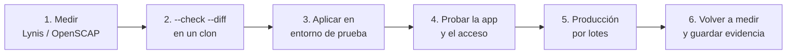
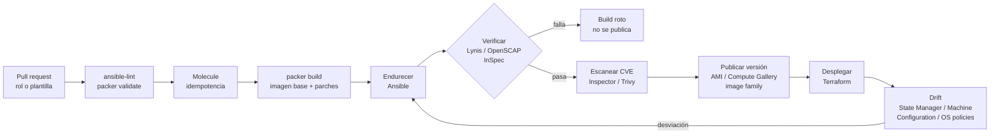

---
tags:
  - devsecops
  - hardening
  - ansible
  - iac
  - cumplimiento
---

# Hardening como código

> Cómo aplicar y mantener una baseline de seguridad con código: roles de Ansible (ansible-lockdown y devsec.hardening), golden images con Packer y los builders de cada nube, verificación continua en CI, drift y excepciones versionadas.

!!! info "Dónde encaja"
    Es el paso "aplicar como código" del [ciclo de hardening](fundamentos-hardening.md#el-ciclo-de-hardening). Lo que se configura (SSH, sysctl, auditd, PAM…) está en [Hardening de Linux](hardening-linux.md) y [Hardening de Windows](hardening-windows.md). Aquí se ve **cómo** automatizarlo, verificarlo y mantenerlo. Las opciones de cada nube para VMs (IMDSv2, Trusted Launch, Shielded VM, parches gestionados) siguen en [Seguridad de máquinas virtuales](../../cloud/seguridad/seguridad-maquinas-virtuales.md), y los fundamentos de Ansible en [Configuration management con Ansible](../../devops/iac/ansible.md). La práctica completa es el [Lab 22](../../laboratorios/devsecops/hardening-linux-ansible.md).

## ¿Qué es?

**Hardening as code** (hardening como código) consiste en describir la baseline en archivos versionados (roles, plantillas de imagen, políticas) y dejar que una herramienta la aplique y la compruebe. Es la misma idea que IaC, pero aplicada a lo que hay **dentro** del servidor.

| Endurecer a mano | Hardening como código |
| --- | --- |
| Cada servidor queda un poco distinto | Todos parten de la misma definición |
| Nadie sabe qué se cambió ni por qué | El historial de Git es la evidencia: quién, qué y cuándo |
| Las excepciones viven en correos | Las excepciones son variables con dueño y fecha de caducidad |
| Se revisa una vez al año | Se reaplica y se verifica en cada build y de forma periódica |
| Un error se repite en cada servidor nuevo | Un error se corrige en un sitio y se propaga |

Las piezas que se combinan son cuatro:

1. **Gestión de configuración** (Ansible, DSC, Chef…) para endurecer servidores que ya existen.
2. **Golden images** construidas en un pipeline, para que cada servidor nuevo nazca endurecido.
3. **Verificación** automática (Lynis, OpenSCAP, InSpec, Goss) que falla el build si la baseline no se cumple.
4. **Control del drift** con un servicio que reaplica o reporta la configuración de forma periódica.

## Roles de Ansible para hardening

No hace falta escribir cientos de tareas desde cero: hay proyectos open source que implementan las baselines y se mantienen al día.

### ansible-lockdown: CIS y STIG

[ansible-lockdown](https://github.com/ansible-lockdown) (patrocinado por MindPoint Group) publica un repositorio por sistema operativo y por baseline, con licencia **MIT**:

| Tipo | Ejemplos de repositorio |
| --- | --- |
| CIS Linux | `UBUNTU22-CIS`, `UBUNTU24-CIS`, `RHEL8-CIS`, `RHEL9-CIS`, `RHEL10-CIS`, `Debian12-CIS`, `AMAZON2023-CIS` |
| CIS Windows | `Windows-2019-CIS`, `Windows-2022-CIS`, `Windows-2025-CIS`, `Windows-11-CIS` |
| STIG | `RHEL9-STIG`, `UBUNTU22-STIG`, `UBUNTU24-STIG`, `AMAZON2023-STIG`, `Windows-2022-STIG` |
| Auditoría | Repos `*-Audit` (p. ej. `UBUNTU24-CIS-Audit`) que comprueban el sistema con **Goss** |

Cómo funcionan:

- Cada control del benchmark es una tarea con su propia variable para activarlo o desactivarlo, del tipo `ubtu24cis_rule_<sección>`. Los niveles se eligen con **tags**: `level1-server`, `level2-server`, etc.
- Cada repositorio declara en el README la versión del benchmark que implementa (por ejemplo, `UBUNTU24-CIS` se basa en CIS Ubuntu 24.04 v1.0.0). Compruébalo antes de prometer un nivel de cumplimiento.
- La auditoría con Goss se activa con la variable `run_audit` y genera un informe antes y después.
- El propio proyecto avisa: el rol **cambia el sistema**, se desarrolló contra instalaciones limpias del SO, y el modo `--check` "no está garantizado". Es una herramienta de remediación, no de auditoría.

### devsec.hardening

La colección [devsec.hardening](https://github.com/dev-sec/ansible-collection-hardening) (proyecto DevSec, licencia **Apache 2.0**, versión 11.0.0 en octubre de 2026) no sigue un benchmark al pie de la letra. Aplica una baseline propia, razonable para servidores, que se apoya en CIS, en las guías de los fabricantes y en la experiencia del proyecto:

| Rol | Qué endurece |
| --- | --- |
| `os_hardening` | `login.defs`, PAM, límites y core dumps, permisos de cron, `/etc/shadow` y `su`, módulos del kernel no usados, sysctl, auditd, opciones de montaje, SUID/SGID |
| `ssh_hardening` | `sshd_config` y `ssh_config`: sin root, sin contraseña, algoritmos modernos, `AllowGroups`, banner, SFTP restringido |
| `nginx_hardening` / `mysql_hardening` | Configuración segura de NGINX y MySQL/MariaDB |

Requiere ansible-core 2.16 o posterior y soporta, entre otros, Ubuntu 22.04/24.04/26.04, Debian 12/13 y RHEL, Rocky y AlmaLinux 8 a 10. Casi todo se controla con variables (`os_sysctl_enabled`, `os_auditd_enabled`, `ssh_allow_tcp_forwarding`…), lo que facilita las excepciones. DevSec publica además perfiles InSpec con los mismos controles (`linux-baseline`, `ssh-baseline`) para verificar el resultado.

### Cuál elegir

| Si necesitas… | Usa |
| --- | --- |
| Demostrar cumplimiento de **CIS o STIG** control por control | ansible-lockdown (y su repo `-Audit`) o las correcciones que genera SCAP Security Guide |
| Una baseline sensata para muchos servidores sin perseguir un benchmark concreto | devsec.hardening |
| Algo que solo aplica tu organización (banner legal, agentes, grupos) | Un **rol propio** pequeño que se ejecuta junto al anterior |

!!! tip "SCAP Security Guide también genera Ansible"
    Cada versión de [SCAP Security Guide](https://github.com/ComplianceAsCode/content/releases) incluye playbooks listos por perfil (por ejemplo `ubuntu2404-playbook-cis_level1_server.yml`). También puedes generar las correcciones de un perfil con `oscap xccdf generate fix --fix-type ansible`. La ventaja es que el playbook y el escáner usan exactamente los mismos controles. Ver [OpenSCAP](hardening-linux.md#openscap-con-scap-security-guide).

## Adoptarlos sin romper nada

Un rol de hardening toca SSH, PAM, montajes y el kernel. Si se aplica de golpe en producción, es muy fácil dejar a todo el equipo fuera del servidor. El orden seguro es este:



1. **Mide antes** para tener una línea base y poder demostrar la mejora.
2. **Modo check**: `ansible-playbook site.yml --check --diff` enseña qué cambiaría sin tocar nada. Es una vista previa, no una garantía: no detecta, por ejemplo, que un remontaje de `/proc` fallará o que un servicio no arrancará (las dos cosas pasan en el [Lab 22](../../laboratorios/devsecops/hardening-linux-ansible.md)).
3. **Por fases**: empieza por las secciones de menor riesgo (permisos, banners, paquetes) usando `--tags` y deja para el final SSH, PAM, montajes y firewall.
4. **Mantén una vía de entrada alternativa** mientras pruebas: una segunda sesión SSH abierta, consola serie o Session Manager / Bastion / IAP.
5. **En producción, por lotes**: `serial: "20%"` y `max_fail_percentage: 0` en el play hacen que Ansible aplique los cambios a unos pocos servidores cada vez y se detenga en el primer fallo.
6. **Fija versiones** de los roles en `requirements.yml` y actualízalas con un pull request que pase por el mismo pipeline.

```yaml title="requirements.yml"
collections:
  - name: devsec.hardening
    version: "11.0.0"      # versión exacta: un cambio de versión es un cambio revisado
```

```yaml title="site.yml"
---
- name: Endurecer servidores Linux
  hosts: linux
  become: true
  serial: "20%"              # de cinco en cinco por cada 25 servidores
  max_fail_percentage: 0     # el primer fallo detiene el despliegue
  # En Ubuntu 24.04+ con devsec.hardening 11.0.0, añade aquí las pre_tasks
  # del Lab 22 (ver el aviso de abajo)
  roles:
    - role: linea_base                       # rol propio: banner, paquetes, excepciones
    - role: devsec.hardening.os_hardening
    - role: devsec.hardening.ssh_hardening
```

!!! warning "Los roles de terceros también tienen bugs"
    Con devsec.hardening 11.0.0 en Ubuntu 24.04, `ssh_hardening` desactiva la activación por socket de SSH sin recargar systemd y **sshd queda parado** ([issue #941](https://github.com/dev-sec/ansible-collection-hardening/issues/941)). En un servidor remoto eso significa perder el acceso. Se detectó al probar el rol en un contenedor desechable, antes de llegar a ninguna VM. Por eso se fija la versión, se lee el changelog y se prueba antes de actualizar.

## Excepciones como código

Una excepción es un control que decides no aplicar, con justificación, dueño y fecha de caducidad (ver [Excepciones bien gestionadas](fundamentos-hardening.md#excepciones-bien-gestionadas)). Como código tiene dos partes: la **variable** que cambia el comportamiento del rol y el **registro** de por qué.

```yaml title="inventory/group_vars/linux/hardening.yml"
# Valor exceptuado: el rol dejaría "no"
ssh_allow_tcp_forwarding: "local"

linea_base_excepciones:
  - id: EXC-001
    control: "SSH AllowTcpForwarding distinto de 'no'"
    valor: "local"
    motivo: "El equipo de datos abre túneles locales a PostgreSQL a través del bastión"
    mitigacion: "Solo el grupo sshusers entra por SSH; acceso al bastión solo desde la VPN"
    dueno: "equipo-datos"
    aprobada_por: "seguridad-ti"
    caduca: "2027-03-31"
```

Una tarea del rol propio hace que la caducidad no se quede en papel: si una excepción vence, el playbook falla hasta que alguien la renueve o la elimine.

```yaml title="roles/linea_base/tasks/main.yml (extracto)"
- name: Comprobar que ninguna excepción ha caducado
  ansible.builtin.assert:
    that:
      - item.caduca is version(ansible_facts['date_time']['date'], '>=')   # fechas ISO
    fail_msg: >-
      La excepción {{ item.id }} ({{ item.control }}) caducó el {{ item.caduca }}.
      Renuévala con su dueño ({{ item.dueno }}) o elimínala.
    quiet: true
  loop: "{{ linea_base_excepciones }}"
  loop_control:
    label: "{{ item.id }}"
```

Como el archivo vive en Git, crear o renovar una excepción pasa por un pull request que revisa seguridad (ver [Seguridad del pipeline](../identidades-y-pipeline/seguridad-pipeline.md)). Los escáneres seguirán marcando el control como fallido, y está bien que así sea: el informe y la lista de excepciones se leen juntos.

## Golden images con Packer y Ansible

Una **golden image** (imagen dorada) es una imagen de VM ya parcheada, endurecida y verificada, desde la que se crean todos los servidores. [Packer](https://developer.hashicorp.com/packer) (HashiCorp) la construye así: arranca una VM temporal desde la imagen base, ejecuta los **provisioners** (aprovisionadores), crea la imagen y borra la VM. El mismo playbook sirve para la imagen y para los servidores existentes.

```hcl title="golden-ubuntu.pkr.hcl"
packer {
  required_plugins {
    amazon = {
      source  = "github.com/hashicorp/amazon"
      version = "~> 1.8"
    }
    ansible = {
      source  = "github.com/hashicorp/ansible"
      version = "~> 1.1"
    }
  }
}

variable "region" {
  type    = string
  default = "us-east-1"
}

variable "version_imagen" {
  type        = string
  description = "Versión de la golden image, la pone el pipeline (p. ej. 2026.10.1)"
}

# Imagen base: la última Ubuntu 24.04 LTS oficial de Canonical
source "amazon-ebs" "ubuntu" {
  region        = var.region
  instance_type = "t3.micro"
  ssh_username  = "ubuntu"
  ami_name      = "golden-ubuntu-2404-${var.version_imagen}"

  source_ami_filter {
    filters = {
      name                = "ubuntu/images/hvm-ssd-gp3/ubuntu-noble-24.04-amd64-server-*"
      virtualization-type = "hvm"
      root-device-type    = "ebs"
    }
    owners      = ["099720109477"] # Canonical
    most_recent = true
  }

  # La VM temporal de build también va endurecida: IMDSv2 obligatorio
  metadata_options {
    http_tokens                 = "required"
    http_endpoint               = "enabled"
    http_put_response_hop_limit = 1
  }

  encrypt_boot = true

  tags = {
    Name     = "golden-ubuntu-2404"
    Version  = var.version_imagen
    Baseline = "devsec-os-ssh-hardening-11"
    BaseAMI  = "{{ .SourceAMI }}"
  }
}

build {
  sources = ["source.amazon-ebs.ubuntu"]

  # 1. Parches al día antes de endurecer
  provisioner "shell" {
    inline = [
      "cloud-init status --wait",
      "sudo apt-get update",
      "sudo DEBIAN_FRONTEND=noninteractive apt-get -y upgrade",
    ]
  }

  # 2. Endurecer con el mismo playbook que usas en servidores existentes
  provisioner "ansible" {
    playbook_file   = "ansible/site.yml"
    user            = "ubuntu"
    use_proxy       = false
    extra_arguments = ["--extra-vars", "entorno=golden-image"]
  }

  # 3. Verificar: si el hardening index baja del umbral, el build falla
  provisioner "shell" {
    script = "scripts/verificar-lynis.sh"
  }

  # 4. Dejar constancia de qué AMI salió de este build
  post-processor "manifest" {
    output = "manifest.json"
  }
}
```

```bash
packer init .                                            # descarga los plugins fijados
packer fmt -check .                                      # formato
packer validate -var version_imagen=2026.10.1 .          # sintaxis y referencias
packer build -var version_imagen=2026.10.1 .             # crea la AMI (cobra la VM temporal)
```

Esta plantilla se validó con Packer 1.16.2 (`packer validate` → `The configuration is valid.`); el `build` no se ejecutó porque crea recursos en AWS. Con el plugin de Ansible, `packer validate` necesita `ansible-playbook` en el `PATH`. Para Azure o Google Cloud solo cambia el bloque `source` (`azure-arm`, `googlecompute`); los provisioners son los mismos.

### Builders gestionados de cada nube

Si prefieres no mantener Packer, cada proveedor ofrece una opción propia:

| | AWS | Azure | Google Cloud |
| --- | --- | --- | --- |
| Servicio | **EC2 Image Builder** | **Azure VM Image Builder** | No hay un builder gestionado equivalente: **Packer en Cloud Build** |
| Cómo se define | Image recipe + components (YAML de AWSTOE) + infrastructure y distribution configuration | Image template (JSON/Bicep) con customizers `Shell`, `PowerShell`, `File`, `WindowsUpdate` | `cloudbuild.yaml` que ejecuta el builder de comunidad de Packer |
| Hardening incluido | Componentes de **STIG** gestionados por Amazon; componentes **CIS** al suscribirte a una CIS Hardened Image del Marketplace | Plantilla de ejemplo con la Azure Windows security baseline; tus scripts o Ansible | Tus provisioners (Ansible, scripts) |
| Escaneo | Integración con Amazon Inspector durante el pipeline | Microsoft Defender for Cloud sobre las VMs creadas | Escaneo de la VM o de la imagen con tus herramientas en el pipeline |
| Publicación | AMI distribuida a regiones y cuentas (AWS RAM, Organizations) | **Azure Compute Gallery** (versiones y réplicas) | Compute Engine image, opcionalmente en una image family |
| Costo | El servicio no cobra; pagas la instancia de build, EBS, S3 e Inspector | Pagas la VM de build, el almacenamiento y la red | Pagas Cloud Build y la VM temporal |

=== "AWS"

    - Los **componentes** tienen fases `build`, `validate` y `test`: si un test falla, la imagen no se distribuye.
    - Una **CIS Hardened Image** del AWS Marketplace (con costo por hora) da acceso a un componente CIS Level 1 que se ejecuta al final de la receta, después de tus cambios.
    - Combínalo con una restricción de organización para lanzar solo AMIs aprobadas (ver [Gobernanza](../../cloud/operacion-y-gobierno/gobernanza.md)).

=== "Azure"

    - VM Image Builder **usa Packer por debajo** y crea un resource group temporal `IT_<rg>_<plantilla>_<guid>` en tu suscripción.
    - Necesita una **user-assigned managed identity** con permisos para leer artefactos y escribir en la Compute Gallery.
    - Las **CIS Hardened Images** también están en Azure Marketplace.

=== "Google Cloud"

    - La guía oficial construye y publica en Artifact Registry el builder de comunidad de Packer y lo usa desde Cloud Build. La service account de Cloud Build necesita `Compute Instance Admin (v1)` y `Service Account User`.
    - Agrupa las imágenes en una **image family** para que las VMs usen siempre la última versión aprobada.
    - Las **CIS Hardened Images** están en Google Cloud Marketplace.

## Verificación continua en CI

La verificación debe ser un paso que **falla el pipeline**, no un informe que alguien mira de vez en cuando:

| Herramienta | Qué comprueba | Cómo se usa en CI |
| --- | --- | --- |
| `ansible-lint` | Calidad del código del rol (FQCN, nombres, `changed_when`…) | En cada pull request |
| Molecule | El rol se aplica en un contenedor o VM de prueba y la segunda ejecución da `changed=0` | En cada pull request (ver [Molecule](../../devops/iac/pruebas-infraestructura.md#molecule-para-roles-de-ansible)) |
| **Lynis** | Hardening index y sugerencias | Umbral mínimo: `hardening_index` en `/var/log/lynis-report.dat` |
| **OpenSCAP** | Perfil CIS o STIG de SCAP Security Guide | Código de salida 2 si falla alguna regla; guarda el informe HTML como evidencia |
| **InSpec / cinc-auditor** | Controles como tests; DevSec publica `linux-baseline` y `ssh-baseline` | `cinc-auditor exec <perfil> -t ssh://usuario@host` con reporter JSON o JUnit |
| **Goss** | Los repos `-Audit` de ansible-lockdown | Se ejecuta en el host y devuelve el resultado de cada control |

```bash title="scripts/verificar-lynis.sh"
#!/usr/bin/env bash
# Falla el build si el hardening index de Lynis no llega al umbral
set -euo pipefail
UMBRAL="${UMBRAL:-75}"
sudo lynis audit system --quick --no-colors > /dev/null
INDICE=$(sudo grep '^hardening_index=' /var/log/lynis-report.dat | cut -d= -f2)
echo "Hardening index: ${INDICE} (umbral ${UMBRAL})"
[ "${INDICE}" -ge "${UMBRAL}" ] || { echo "Por debajo del umbral"; exit 1; }
```

El umbral es tuyo: elígelo después de medir tu baseline (en el Lab 22, un contenedor Ubuntu 24.04 pasa de 62 a 75) y súbelo con el tiempo. Lynis debe estar instalado en la imagen o copiarse en el paso anterior. El script se probó en el contenedor del Lab 22: con `UMBRAL=75` termina con código 0 y con `UMBRAL=80` imprime `Por debajo del umbral` y sale con 1.

## Drift y remediación automática

El **configuration drift** aparece cuando alguien edita un archivo a mano o un paquete restaura un valor por defecto. Hay dos estrategias, y se pueden combinar:

- **Reemplazar**: en infraestructura inmutable no se corrige el servidor, se recrea desde la última golden image.
- **Reaplicar**: un servicio ejecuta la baseline de forma periódica, ya sea en modo solo reporte o corrigiendo.

| | AWS | Azure | Google Cloud |
| --- | --- | --- | --- |
| Servicio | **AWS Systems Manager State Manager** | **Azure Machine Configuration** (función de Azure Policy, antes "guest configuration") | **VM Manager**: **OS policies** y **OS policy assignments** |
| Qué aplica | Una **association**: documento SSM + destinos (tags) + programación cron/rate. `AWS-ApplyAnsiblePlaybooks` ejecuta tus playbooks | Configuraciones DSC asignadas por política; baselines integradas como *Linux machines should meet requirements for the Azure compute security baseline* | Recursos de paquetes, repositorios, archivos y scripts `exec` (validar + aplicar) |
| Solo reportar o corregir | El parámetro `Check` de `AWS-ApplyAnsiblePlaybooks` ejecuta en modo check | Modos `Audit`, `Apply and Monitor` y `Apply and Autocorrect` | Modo `ENFORCEMENT`; el agente comprueba y corrige cada 60 minutos |
| Alcance | Managed nodes en EC2 y on-premise (híbrido) | VMs de Azure y servidores **Azure Arc** | VMs de Compute Engine con el agente OS Config |
| Costo | Sin costo adicional | Revisa la página de precios: depende del tipo de máquina y del plan de Defender for Servers | Revisa la página de precios de VM Manager |

=== "AWS"

    ```bash
    # Reaplicar el playbook cada domingo a las 02:00 en modo check (solo reporta drift)
    aws ssm create-association --name "AWS-ApplyAnsiblePlaybooks" \
      --association-name "hardening-linux-drift" \
      --targets "Key=tag:Baseline,Values=linux" \
      --parameters '{"SourceType":["S3"],"SourceInfo":["{\"path\":\"https://s3.amazonaws.com/mi-bucket-hardening/ansible/\"}"],"InstallDependencies":["True"],"PlaybookFile":["site.yml"],"Check":["True"]}' \
      --schedule-expression "cron(0 2 ? * SUN *)" \
      --compliance-severity "HIGH"
    ```

    Con `Check` en `False`, la misma association corrige. El perfil de instancia necesita leer el bucket.

=== "Azure"

    Asigna la iniciativa de requisitos de Machine Configuration (instala la extensión y la managed identity) y después la política de baseline. Para Linux, la política integrada de la Azure security baseline es **solo de auditoría**; la autocorrección usa definiciones personalizadas (en preview al escribir esta nota).

=== "Google Cloud"

    ```bash
    # Crear una OS policy assignment a partir de un archivo YAML (zona concreta)
    gcloud compute os-config os-policy-assignments create hardening-ssh \
      --location=us-central1-a \
      --file=hardening-ssh.yaml
    ```

    Un recurso `exec` tiene un script `validate` (exit 100 = conforme, 101 = no conforme) y un script `enforce` que corrige.

Fuera de la nube, una ejecución programada del playbook con `--check` (desde AWX/Ansible Automation Platform, un cron o un job de CI) cumple la misma función: si el recap muestra `changed` mayor que 0, hay drift.

## Pipeline de ejemplo

Todo junto, para una golden image Linux:



- La imagen se publica **versionada** (`2026.10.1`), con tags que dicen de qué AMI base y de qué versión de la baseline salió.
- Terraform consume la última versión aprobada; un cambio de imagen es un pull request (ver [Infrastructure as Code con Terraform](../../devops/iac/terraform-basico.md)).
- Programa el pipeline para que reconstruya la imagen cuando salgan parches, por ejemplo cada semana, y no solo cuando cambia el código.
- Los escaneos de CVE de la imagen y su gestión están en [Fundamentos de CVE](../vulnerabilidades/fundamentos-cve.md).

## Cómo verificarlo

Los comandos de esta sección son de solo lectura o se ejecutan contra un host desechable. Las salidas son reales, del [Lab 22](../../laboratorios/devsecops/hardening-linux-ansible.md) (Ubuntu 24.04 en un contenedor con systemd, devsec.hardening 11.0.0 y un rol propio).

**1. Antes de aplicar: qué cambiaría.** El diff se lee como un pull request:

```bash
ansible-playbook site.yml --check --diff
```

```text
+PermitRootLogin no
+MaxAuthTries 3
+PasswordAuthentication no
+AllowGroups sshusers
+AllowTcpForwarding local          # excepción EXC-001, no un error
+UMASK             027
+PASS_MAX_DAYS     99999            # excepción EXC-002
...
hard-lab22 : ok=95   changed=32   unreachable=0    failed=0    skipped=57
```

**2. Idempotencia: la segunda ejecución no cambia nada.**

```text
hard-lab22 : ok=94   changed=0    unreachable=0    failed=0    skipped=56
```

**3. Calidad del código**, sin revisar la colección de terceros (`exclude_paths: [collections/]` en `.ansible-lint`):

```text
Passed: 0 failure(s), 0 warning(s) in 10 files processed of 12 encountered. Profile 'production' was required, and it passed.
```

**4. Medición antes y después** con tres herramientas:

| Medición | Antes | Después |
| --- | --- | --- |
| Lynis 3.1.7: hardening index / sugerencias | 62 / 43 | 75 / 24 |
| ssh-audit 3.9.0: algoritmos `fail` | 6 | 1 |
| OpenSCAP, CIS Ubuntu 24.04 L1 Server: pass / fail / notapplicable | 132 / 6 / 270 | 132 / 6 / 270 |

Lynis y ssh-audit mejoran porque devsec.hardening cubre lo que miden. OpenSCAP no se mueve por dos motivos que conviene recordar: devsec.hardening **no es una implementación de CIS** (por ejemplo, instala `passwdqc` donde CIS pide `pam_pwquality`), y en un contenedor 270 reglas salen *notapplicable*. Si la baseline exigida es CIS, aplica un rol CIS y mide con CIS.

**5. Excepciones vencidas.** Con una excepción caducada, el playbook se detiene:

```text
[ERROR]: Task failed: Action failed: La excepción EXC-003 (prueba) caducó el 2026-09-30. Renuévala con su dueño (plataforma) o elimínala.
```

**6. La plantilla de Packer**, sin crear nada en la nube:

```bash
packer init . && packer fmt -check . && packer validate -var version_imagen=2026.10.1 .
```

```text
Installed plugin github.com/hashicorp/amazon v1.8.3 ...
Installed plugin github.com/hashicorp/ansible v1.1.6 ...
The configuration is valid.
```

## Errores comunes

- **Romper producción por endurecer sin probar**: aplicar un rol CIS completo a servidores en uso puede cortar SSH, bloquear cuentas con PAM o parar una aplicación por `noexec` en `/tmp`. Primero un clon o un contenedor desechable, después staging y después producción por lotes.
- **Fiarse de `--check`**: es una vista previa. Ni los remontajes ni los servicios que no arrancan se ven hasta aplicar de verdad.
- **Usar `latest` del rol**: una versión nueva puede cambiar valores por defecto o traer un bug. Fija la versión y actualízala con un pull request.
- **Modificar el rol de terceros en vez de usar variables**: pierdes las actualizaciones. Ajusta con variables y deja lo propio en un rol aparte.
- **Excepciones sin caducidad**, o que solo existen en el inventario sin el registro de por qué.
- **Golden image sin reconstrucción periódica**: una imagen de hace seis meses nace con seis meses de CVE sin parchear.
- **Endurecer la imagen y olvidar el drift**: sin State Manager, Machine Configuration, OS policies o ejecuciones periódicas, los cambios manuales se acumulan.
- **Medir solo con una herramienta**: el *score* de OpenSCAP dentro de un contenedor parece excelente porque la mayoría de reglas salen *notapplicable*. Lee también cuántas reglas se evaluaron.

## Relación con otras secciones

| Enfoque | Qué se mira desde ahí | Nota |
| --- | --- | --- |
| Cloud (el control) | Imágenes endurecidas, IMDSv2, agentes y parches gestionados de cada nube; guardrails para usar solo imágenes aprobadas | [Seguridad de máquinas virtuales](../../cloud/seguridad/seguridad-maquinas-virtuales.md), [Máquinas virtuales](../../cloud/computo/maquinas-virtuales.md), [Gobernanza](../../cloud/operacion-y-gobierno/gobernanza.md) |
| DevOps (la automatización) | Roles, inventarios, idempotencia, pruebas de roles y pipelines de imágenes | [Configuration management con Ansible](../../devops/iac/ansible.md), [Pruebas de infraestructura](../../devops/iac/pruebas-infraestructura.md), [Infrastructure as Code](../../devops/iac/infraestructura-como-codigo.md), [Integración continua](../../devops/ci-cd/integracion-continua.md) |
| DevSecOps (la verificación) | Baselines, qué se configura en cada SO, drift y cumplimiento continuo | [Fundamentos de hardening](fundamentos-hardening.md), [Hardening de Linux](hardening-linux.md), [Hardening de Windows](hardening-windows.md), [Hardening de servicios](hardening-servicios.md), [Seguridad de IaC](../infraestructura-y-contenedores/seguridad-iac.md), [Cumplimiento y gobierno](../gobierno-y-respuesta/cumplimiento.md) |
| Laboratorios | Aplicar un rol, medir antes y después, idempotencia y excepciones | [Lab 22: Endurecer un servidor Linux con Ansible y medirlo con Lynis y OpenSCAP](../../laboratorios/devsecops/hardening-linux-ansible.md), [Lab 10: Configurar servidores con Ansible](../../laboratorios/devops/ansible-configuracion.md) |
| Laboratorios (la práctica) | Practicar esto paso a paso | [Lab 22: Endurecer un servidor Linux con Ansible y medirlo con Lynis y OpenSCAP](../../laboratorios/devsecops/hardening-linux-ansible.md) |

## Referencias

- [ansible-lockdown](https://github.com/ansible-lockdown) y [UBUNTU24-CIS](https://github.com/ansible-lockdown/UBUNTU24-CIS)
- [devsec.hardening (GitHub)](https://github.com/dev-sec/ansible-collection-hardening) y [en Ansible Galaxy](https://galaxy.ansible.com/ui/repo/published/devsec/hardening/)
- [DevSec linux-baseline (InSpec)](https://github.com/dev-sec/linux-baseline)
- [SCAP Security Guide / ComplianceAsCode](https://github.com/ComplianceAsCode/content)
- [Packer](https://developer.hashicorp.com/packer/docs), [plugin de Ansible para Packer](https://developer.hashicorp.com/packer/integrations/hashicorp/ansible) y [plugin de Amazon](https://developer.hashicorp.com/packer/integrations/hashicorp/amazon)
- [EC2 Image Builder](https://docs.aws.amazon.com/imagebuilder/latest/userguide/what-is-image-builder.html), [componentes de hardening STIG](https://docs.aws.amazon.com/imagebuilder/latest/userguide/ib-stig.html) y [componentes de hardening CIS](https://docs.aws.amazon.com/imagebuilder/latest/userguide/toe-cis.html)
- [Azure VM Image Builder](https://learn.microsoft.com/es-es/azure/virtual-machines/image-builder-overview)
- [Construir imágenes de VM con Packer en Cloud Build](https://cloud.google.com/build/docs/building/build-vm-images-with-packer)
- [AWS Systems Manager State Manager](https://docs.aws.amazon.com/systems-manager/latest/userguide/systems-manager-state.html) y [associations con Ansible](https://docs.aws.amazon.com/systems-manager/latest/userguide/systems-manager-state-manager-ansible.html)
- [Azure Machine Configuration](https://learn.microsoft.com/es-es/azure/governance/machine-configuration/overview)
- [VM Manager: OS policies](https://cloud.google.com/compute/vm-manager/docs/os-policies)
- [CIS Hardened Images](https://www.cisecurity.org/cis-hardened-images)
- [Lynis](https://cisofy.com/lynis/) y [cinc-auditor](https://cinc.sh/start/auditor/)
