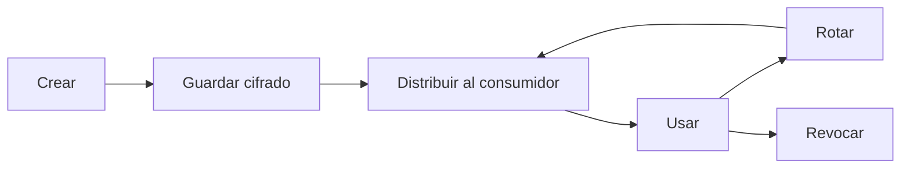
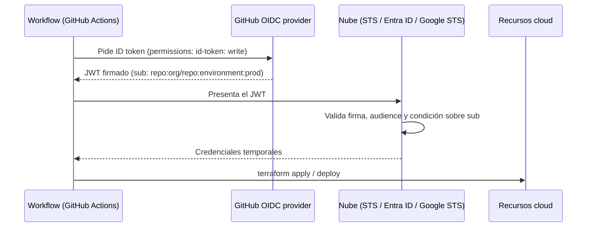

---
tags:
  - seguridad
  - secretos
  - iam
  - oidc
  - github-actions
  - aws
  - azure
  - gcp
---

# Secretos e identidades

> Cómo guardar, entregar y rotar secretos (Vault y gestores nativos) y cómo conectar el pipeline con la nube mediante OIDC, sin llaves estáticas.

## ¿Qué es?

Un **secret** (secreto) es cualquier dato que da acceso a algo: si alguien lo copia, puede hacerse pasar por ti o por tu aplicación. La gestión de secretos responde a tres preguntas: **dónde** se guardan, **cómo** llegan a quien los necesita y **cuándo** se cambian.

| Tipo de secreto | Ejemplos |
| --- | --- |
| Credenciales cloud | Access keys de AWS, *client secrets* de Entra ID, service account keys de GCP |
| Credenciales de bases de datos | Usuario y contraseña de PostgreSQL |
| **API keys** y tokens | Token de npm, de GitHub, de Slack, de un proveedor de pagos |
| Claves criptográficas | Claves privadas TLS, SSH, de firma |
| Certificados | Certificados de cliente para mTLS |

### Ciclo de vida



En cada paso hay un riesgo: un secreto creado con poca entropía, guardado en un `.env` subido a Git, distribuido por chat, usado en logs, nunca rotado o no revocado cuando alguien deja el equipo. La detección de secretos en commits está en [Seguridad del código](../codigo-y-dependencias/seguridad-codigo.md).

## Por qué evitar llaves estáticas

Una **static credential** (credencial estática o de larga duración), como una access key de AWS o una service account key JSON, funciona hasta que alguien la revoca. Si se filtra (en un repositorio, en una imagen, en un log), el atacante la usa desde cualquier lugar.

La alternativa es la **identity federation** (federación de identidad): la carga de trabajo demuestra *quién es* con un token firmado por un emisor de confianza y recibe **credenciales temporales** que caducan solas en minutos u horas.

En la nube, las VMs y funciones usan instance profiles o execution roles (AWS), managed identities (Azure) o attached service accounts (GCP); los pods, workload identity; y las personas, SSO con MFA. Los controles de cada proveedor están en [Seguridad de identidades](../../cloud/seguridad/seguridad-identidades.md#eliminar-credenciales-de-larga-duracion) y, para pods, en [Seguridad de contenedores y Kubernetes gestionado](../../cloud/seguridad/seguridad-contenedores-kubernetes.md#identidad-de-pods-hacia-la-nube). Para el pipeline CI/CD la alternativa es **OIDC** hacia la nube, que se ve [más abajo](#oidc-entre-el-pipeline-y-la-nube).

Si no puedes evitar un secreto (la contraseña de una API externa), guárdalo en un gestor de secretos, no en el código ni en variables de entorno de un servidor.

## Gestores de secretos

### HashiCorp Vault

**Vault** es un gestor de secretos independiente del proveedor. Sus piezas principales:

- **Secrets engines** (motores de secretos):
    - **KV** (*key/value*, clave-valor): guarda secretos estáticos, con versiones en KV v2.
    - **Dynamic secrets** (secretos dinámicos): Vault **crea** la credencial cuando se pide (un usuario de base de datos, credenciales de AWS) con un *lease* (tiempo de vida) y la borra al expirar. Cada consumidor recibe una distinta.
    - **Transit**: cifra y descifra datos sin entregar la clave (*encryption as a service*).
- **Auth methods** (métodos de autenticación): cómo se identifica quien pide el secreto: AppRole, Kubernetes, JWT/OIDC (pipelines), AWS, Azure, GCP, LDAP.
- **Policies**: qué rutas puede leer cada identidad.

```bash
vault kv put secret/app/prod db_password='s3cr3t'
vault kv get -field=db_password secret/app/prod

# Secreto dinámico: credenciales de base de datos que caducan solas
vault read database/creds/app-readonly
```

!!! info "OpenBao"
    En 2023 HashiCorp cambió la licencia de Vault a BSL (igual que Terraform). **OpenBao** es un *fork* *open source* bajo la Linux Foundation, compatible en gran parte con la API de Vault.

Ansible puede leer secretos de Vault al configurar servidores (ver [Ansible](../../devops/iac/ansible.md)).

### Servicios nativos

| | AWS | Azure | Google Cloud |
| --- | --- | --- | --- |
| Gestor de secretos | **AWS Secrets Manager** (y Parameter Store de Systems Manager para configuración) | **Azure Key Vault** (secrets, keys y certificates) | **Secret Manager** |
| Cifrado | AWS KMS | Claves gestionadas por Microsoft o propias (HSM en Premium / Managed HSM) | Cloud KMS (Google-managed o CMEK) |
| Rotación | Integrada: *managed rotation* para algunos servicios (RDS, Redshift…) o función Lambda propia | Autorotación de **keys**; para secrets, eventos de Event Grid cerca de caducar + automatización propia | *Rotation schedules* que publican en Pub/Sub; tú implementas el cambio |
| Acceso | IAM policies | Azure RBAC (recomendado) o access policies | IAM (`roles/secretmanager.secretAccessor`) |

Los controles de cifrado, KMS y gestores de secretos de cada proveedor están en [Seguridad de cifrado y secretos](../../cloud/seguridad/seguridad-cifrado-secretos.md).

### External Secrets Operator

En Kubernetes, **External Secrets Operator** lee el secreto del gestor (Vault, Secrets Manager, Key Vault, Secret Manager) y lo sincroniza como Secret del clúster. Así el valor nunca vive en Git ni en los manifiestos:

```yaml title="external-secret.yaml"
apiVersion: external-secrets.io/v1
kind: ExternalSecret
metadata:
  name: db
  namespace: app
spec:
  refreshInterval: 1h
  secretStoreRef:
    kind: ClusterSecretStore
    name: aws-secrets-manager
  target:
    name: db-credentials        # Secret de Kubernetes que se crea
  data:
    - secretKey: password
      remoteRef:
        key: prod/app/db
        property: password
```

## Rotación

**Rotation** (rotación) es reemplazar un secreto por uno nuevo y retirar el anterior. Limita cuánto tiempo sirve un secreto filtrado sin que lo sepas.

- **Automatízala**: una rotación manual se olvida. Secrets Manager rota según un calendario; Vault evita el problema con dynamic secrets.
- **Frecuencia**: no hay un número universal; depende de la política de la organización y de la normativa (muchas usan 30–90 días para secretos estáticos). Cuanto más corto el tiempo de vida, mejor, siempre que la rotación no rompa nada.
- **Sin cortes**: rota en dos fases (crear el nuevo, desplegarlo, retirar el viejo) o usa dos credenciales alternas.
- **Tras una filtración**: rota **de inmediato**, aunque el commit se haya borrado, y revisa los logs de uso. Borrar el secreto del historial de Git no lo invalida. Ver el playbook en [Detección y respuesta](../gobierno-y-respuesta/deteccion-respuesta.md).

## OIDC entre el pipeline y la nube

Con **OIDC** (*OpenID Connect*) el pipeline no guarda ninguna credencial de la nube. GitHub Actions emite un **ID token** (JWT) firmado para cada ejecución, con *claims* (datos) como el repositorio, la rama o el environment. La nube confía en ese emisor y, si el token cumple las condiciones, entrega credenciales temporales.



!!! danger "La condición sobre `sub` es la seguridad"
    El claim **`sub`** (*subject*) identifica qué repositorio, rama o environment pide el token. Si la trust policy no lo restringe, **cualquier repositorio de GitHub** podría asumir tu rol. Limítalo siempre a tu repo y, para producción, a un environment o rama concreta.

Formatos frecuentes de `sub`: `repo:org/repo:ref:refs/heads/main`, `repo:org/repo:environment:prod`, `repo:org/repo:pull_request`.

El workflow necesita permiso para pedir el token:

```yaml
permissions:
  id-token: write   # pedir el ID token de OIDC
  contents: read
```

=== "AWS"

    **Paso 1.** Crea un **IAM OIDC identity provider** con URL `https://token.actions.githubusercontent.com` y audience `sts.amazonaws.com`.

    **Paso 2.** Crea un IAM role con esta **trust policy**:

    ```json title="trust-policy.json"
    {
      "Version": "2012-10-17",
      "Statement": [
        {
          "Effect": "Allow",
          "Principal": {
            "Federated": "arn:aws:iam::111122223333:oidc-provider/token.actions.githubusercontent.com"
          },
          "Action": "sts:AssumeRoleWithWebIdentity",
          "Condition": {
            "StringEquals": {
              "token.actions.githubusercontent.com:aud": "sts.amazonaws.com",
              "token.actions.githubusercontent.com:sub": "repo:mi-org/mi-repo:environment:prod"
            }
          }
        }
      ]
    }
    ```

    **Paso 3.** En el workflow:

    ```yaml
    - uses: aws-actions/configure-aws-credentials@e1253824e5c10ff9df46874f81ed3ec929e19cfd # v6.3.0
      with:
        role-to-assume: arn:aws:iam::111122223333:role/github-deploy-prod
        aws-region: eu-west-1
    - run: aws sts get-caller-identity
    ```

=== "Azure"

    **Paso 1.** Crea una **user-assigned managed identity** (o una app registration en Microsoft Entra ID) y dale un role de Azure RBAC en el scope necesario.

    **Paso 2.** Añádele una **federated credential** que confíe en GitHub:

    ```bash
    az identity federated-credential create \
      --name github-prod \
      --identity-name id-github-deploy \
      --resource-group rg-identidades \
      --issuer https://token.actions.githubusercontent.com \
      --subject repo:mi-org/mi-repo:environment:prod \
      --audiences api://AzureADTokenExchange
    ```

    **Paso 3.** En el workflow (los IDs no son secretos, pero se suelen guardar como variables):

    ```yaml
    - uses: azure/login@a641126d1b8aa4d1fa005f4f92df94a3a4c4c906 # v3.1.0
      with:
        client-id: ${{ vars.AZURE_CLIENT_ID }}
        tenant-id: ${{ vars.AZURE_TENANT_ID }}
        subscription-id: ${{ vars.AZURE_SUBSCRIPTION_ID }}
    - run: az account show
    ```

=== "Google Cloud"

    **Paso 1.** Crea un **Workload Identity Pool** y un **provider** OIDC para GitHub, con una **attribute condition** que limite el repositorio:

    ```bash
    gcloud iam workload-identity-pools create github \
      --location=global --display-name="GitHub Actions"

    gcloud iam workload-identity-pools providers create-oidc github-provider \
      --location=global --workload-identity-pool=github \
      --issuer-uri=https://token.actions.githubusercontent.com \
      --attribute-mapping="google.subject=assertion.sub,attribute.repository=assertion.repository" \
      --attribute-condition="assertion.repository=='mi-org/mi-repo'"
    ```

    **Paso 2.** Da los roles de IAM al `principalSet` del repositorio (o permite que suplante a una service account).

    **Paso 3.** En el workflow:

    ```yaml
    - uses: google-github-actions/auth@7c6bc770dae815cd3e89ee6cdf493a5fab2cc093 # v3.0.0
      with:
        workload_identity_provider: projects/123456789/locations/global/workloadIdentityPools/github/providers/github-provider
    - uses: google-github-actions/setup-gcloud@aa5489c8933f4cc7a4f7d45035b3b1440c9c10db # v3.0.1
    - run: gcloud auth list
    ```

!!! tip "Un rol por entorno"
    Crea un rol (o identidad) distinto para `dev` y `prod`, cada uno con su condición sobre `sub` y sus permisos. Así un workflow de una rama de prueba nunca puede obtener las credenciales de producción. Ver [Seguridad del pipeline](seguridad-pipeline.md).

## Errores comunes

- Guardar access keys como *secrets* de GitHub "porque funciona": migra a OIDC.
- Trust policy con `sub` comodín (`repo:mi-org/*`) para producción.
- Secretos en variables de entorno que acaban impresos en logs (`env`, `set -x`, mensajes de error).
- Un único secreto compartido por todas las apps y entornos: imposible saber quién lo usó y difícil de rotar.
- Creer que borrar el commit "arregla" una filtración: el secreto se rota, siempre.

## Relación con otras secciones

| Enfoque | Qué se mira desde ahí | Nota |
| --- | --- | --- |
| Cloud (el control) | Roles, federación, workload identities, break-glass y MFA; KMS y gestores de secretos de cada proveedor | [IAM: AWS, Azure y GCP](../../cloud/fundamentos/iam-comparativa.md), [Seguridad de identidades](../../cloud/seguridad/seguridad-identidades.md), [Seguridad de cifrado y secretos](../../cloud/seguridad/seguridad-cifrado-secretos.md) |
| DevOps (la automatización) | Cómo el pipeline y la configuración inyectan los secretos | [Integración continua](../../devops/ci-cd/integracion-continua.md), [Ansible](../../devops/iac/ansible.md) |
| DevSecOps (la verificación) | Detectar secretos filtrados, proteger el pipeline y responder a una fuga | [Seguridad del código](../codigo-y-dependencias/seguridad-codigo.md), [Seguridad del pipeline](seguridad-pipeline.md), [Detección y respuesta](../gobierno-y-respuesta/deteccion-respuesta.md) |
| Laboratorios (la práctica) | Practicar esto paso a paso | [Lab 00: Preparar el entorno de laboratorio](../../laboratorios/fundamentos/preparar-entorno.md), [Lab 05: Imagen multi-stage y Docker Compose](../../laboratorios/devops/docker-multistage-compose.md), [Lab 06: Desplegar una app en Kubernetes local con kind](../../laboratorios/devops/kubernetes-local-kind.md), [Lab 09: Terraform en AWS con remote state en S3](../../laboratorios/devops/terraform-aws-backend-remoto.md), [Lab 10: Configurar servidores con Ansible](../../laboratorios/devops/ansible-configuracion.md), [Lab 12: Escaneos de seguridad en el pipeline](../../laboratorios/devsecops/escaneos-en-pipeline.md), [Lab 13: Desplegar en AWS desde GitHub Actions con OIDC (sin llaves)](../../laboratorios/devsecops/oidc-github-aws.md), [Lab 17: AWS: VPC con subnets públicas y privadas y una EC2](../../laboratorios/cloud/aws-vpc-ec2.md), [Lab 18: AWS: API serverless con Lambda, API Gateway y DynamoDB](../../laboratorios/cloud/aws-serverless-api.md), [Lab 19: Azure: VNet, NSG y una VM con Azure CLI](../../laboratorios/cloud/azure-vnet-vm.md), [Lab 20: Google Cloud: desplegar un contenedor en Cloud Run](../../laboratorios/cloud/gcp-cloud-run.md) |

## Referencias

- [GitHub Actions: security hardening con OpenID Connect](https://docs.github.com/es/actions/security-for-github-actions/security-hardening-your-deployments/about-security-hardening-with-openid-connect)
- [Configurar OIDC en AWS para GitHub Actions](https://docs.github.com/es/actions/security-for-github-actions/security-hardening-your-deployments/configuring-openid-connect-in-amazon-web-services)
- [aws-actions/configure-aws-credentials](https://github.com/aws-actions/configure-aws-credentials)
- [Azure Login con OIDC](https://learn.microsoft.com/es-es/azure/developer/github/connect-from-azure-openid-connect)
- [google-github-actions/auth](https://github.com/google-github-actions/auth)
- [Workload Identity Federation con pipelines](https://cloud.google.com/iam/docs/workload-identity-federation-with-deployment-pipelines)
- [HashiCorp Vault](https://developer.hashicorp.com/vault/docs)
- [OpenBao](https://openbao.org/)
- [AWS Secrets Manager: rotación](https://docs.aws.amazon.com/es_es/secretsmanager/latest/userguide/rotating-secrets.html)
- [Azure Key Vault](https://learn.microsoft.com/es-es/azure/key-vault/general/overview)
- [Secret Manager](https://cloud.google.com/secret-manager/docs/overview)
- [External Secrets Operator](https://external-secrets.io/)
- [OWASP Secrets Management Cheat Sheet](https://cheatsheetseries.owasp.org/cheatsheets/Secrets_Management_Cheat_Sheet.html)
