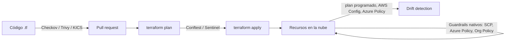

---
tags:
  - seguridad
  - iac
  - terraform
  - policy-as-code
  - ci-cd
---

# Seguridad de IaC

> Cómo verificar que el código de infraestructura es seguro antes de aplicarlo: escaneo estático (Checkov, Trivy, KICS), *policy as code* (OPA, Sentinel, servicios nativos) y detección de *drift*.

## ¿Qué es?

Si la infraestructura se define como código ([Infrastructure as Code](../../devops/iac/infraestructura-como-codigo.md)), un error de seguridad también es código: un puerto abierto a internet o un bucket público quedan escritos en un archivo `.tf` y se pueden detectar **antes** de que existan. Eso es **shift-left** (desplazar a la izquierda): mover los controles al principio del ciclo, donde arreglarlos cuesta un *commit* y no un incidente.

La seguridad de IaC tiene tres capas:

| Capa | Pregunta que responde | Cuándo actúa |
| --- | --- | --- |
| **Static analysis** (análisis estático) de IaC | ¿El código tiene *misconfigurations* (malas configuraciones) conocidas? | En el *commit*, en el *pull request*, en CI |
| **Policy as code** (políticas como código) | ¿El cambio cumple las reglas propias de la organización? | Sobre el `plan`, antes del `apply`, o en la propia nube |
| **Drift detection** (detección de desviaciones) | ¿Lo que corre en la nube sigue coincidiendo con el código? | De forma programada, después del despliegue |



!!! note "Esta nota amplía la de Terraform"
    En [Infrastructure as Code con Terraform](../../devops/iac/terraform-basico.md) está el resumen (dos comandos para escanear). Aquí ves qué detectan, cómo fallar el *build* y cómo ir más allá con políticas propias.

## Escáneres de IaC

Todos funcionan igual: leen el código (o el plan), lo comparan con cientos de reglas basadas en buenas prácticas y CIS Benchmarks, y devuelven hallazgos con severidad.

| Herramienta | Mantenida por | Qué escanea | Puntos fuertes |
| --- | --- | --- | --- |
| **Checkov** | Prisma Cloud (Palo Alto Networks), *open source* | Terraform, plan JSON, CloudFormation, Bicep/ARM, Kubernetes, Helm, Dockerfile, GitHub Actions | Muchas reglas, políticas propias en Python o YAML, análisis de grafo entre recursos |
| **Trivy** (`trivy config`) | Aqua Security, *open source* | Terraform, plan JSON, CloudFormation, ARM, Kubernetes, Helm, Dockerfile | Una sola herramienta para IaC, imágenes, dependencias y secretos |
| **KICS** | Checkmarx, *open source* | Terraform, CloudFormation, Ansible, Kubernetes, Docker, OpenAPI y más | Muy amplio en formatos; reglas escritas en Rego |

!!! info "tfsec ahora es Trivy"
    **tfsec** ya no recibe desarrollo nuevo: Aqua Security integró sus reglas en Trivy. Si ves `tfsec .` en guías antiguas, el equivalente actual es `trivy config .`.

### Comandos básicos

```bash
# Checkov: todo el directorio, solo Terraform
checkov -d . --framework terraform

# Trivy: solo hallazgos altos y críticos, falla si los hay
trivy config --severity HIGH,CRITICAL --exit-code 1 .

# KICS con Docker
docker run --rm -v "$PWD":/src checkmarx/kics scan -p /src -o /src/kics-results
```

!!! tip "Escanea también el plan"
    El código HCL puede tener variables y *modules* que el escáner no resuelve. El **plan en JSON** tiene los valores finales:

    ```bash
    terraform plan -out=plan.tfplan
    terraform show -json plan.tfplan > plan.json
    checkov -f plan.json
    trivy config plan.json
    ```

!!! tip "Escaneo en detalle"
    Código frente a plan, Dockerfiles, manifests de Kubernetes y Helm (con `helm template`), integración en el pull request con SARIF, baselines y supresiones con caducidad: [IaC scanning](../escaneos/iac-scanning.md).

## Hallazgos típicos

Estos son los errores que más aparecen y los que el temario relaciona con [Redes](../../cloud/redes-y-datos/redes.md) e [IAM](../../cloud/identidad-y-seguridad/iam-comparativa.md):

=== "Security group abierto"

    ```hcl
    resource "aws_security_group" "web" {
      name   = "web"
      vpc_id = var.vpc_id

      ingress {
        description = "SSH"
        from_port   = 22
        to_port     = 22
        protocol    = "tcp"
        cidr_blocks = ["0.0.0.0/0"] # SSH abierto a todo internet
      }
    }
    ```

    **Corrección**: limita el origen a una IP o rango conocido, o elimina SSH y usa acceso sin puertos abiertos (AWS Systems Manager Session Manager, Azure Bastion, IAP de Google Cloud).

=== "Bucket público"

    ```hcl
    resource "aws_s3_bucket_public_access_block" "datos" {
      bucket                  = aws_s3_bucket.datos.id
      block_public_acls       = false
      block_public_policy     = false # permite policies públicas
      ignore_public_acls      = false
      restrict_public_buckets = false
    }
    ```

    **Corrección**: los cuatro valores en `true`, como en el ejemplo de [Terraform básico](../../devops/iac/terraform-basico.md).

=== "IAM con `*:*`"

    ```hcl
    resource "aws_iam_policy" "pipeline" {
      name = "pipeline"
      policy = jsonencode({
        Version = "2012-10-17"
        Statement = [{
          Effect   = "Allow"
          Action   = "*"   # cualquier acción
          Resource = "*"   # sobre cualquier recurso
        }]
      })
    }
    ```

    **Corrección**: acciones y recursos concretos (*least privilege*, mínimo privilegio).

=== "Cifrado desactivado"

    ```hcl
    resource "aws_db_instance" "app" {
      identifier        = "app"
      engine            = "postgres"
      instance_class    = "db.t4g.micro"
      allocated_storage = 20
      storage_encrypted = false # datos en disco sin cifrar
      # ...
    }
    ```

    **Corrección**: `storage_encrypted = true` y, si la organización lo exige, una *customer managed key* de KMS (ver [Seguridad base](../../cloud/identidad-y-seguridad/seguridad-base.md)).

Una salida de Checkov para el primer caso se ve así (el ID de la regla puede variar entre versiones):

```text
Check: CKV_AWS_24: "Ensure no security groups allow ingress from 0.0.0.0:0 to port 22"
    FAILED for resource: aws_security_group.web
    File: /main.tf:1-13
```

## Fallar el build

Un escáner que solo avisa se acaba ignorando. En CI lo habitual es **fallar el pipeline** con hallazgos de severidad alta o crítica y dejar el resto como aviso.

| Herramienta | Falla por defecto | Opciones útiles |
| --- | --- | --- |
| Checkov | Sí, si hay algún check fallido | `--soft-fail`, `--hard-fail-on HIGH`, `--skip-check CKV_AWS_XX` |
| Trivy | No (sale con 0) | `--exit-code 1`, `--severity HIGH,CRITICAL` |
| KICS | Sí, con código distinto según severidad | `--fail-on high,critical`, `--ignore-on-exit results` |

```yaml title=".github/workflows/iac.yml (fragmento)"
jobs:
  iac-scan:
    runs-on: ubuntu-latest
    permissions:
      contents: read
    steps:
      - uses: actions/checkout@v7
      - name: Trivy config
        uses: aquasecurity/trivy-action@ed142fd0673e97e23eac54620cfb913e5ce36c25 # v0.36.0
        with:
          scan-type: config
          severity: HIGH,CRITICAL
          exit-code: "1"
```

!!! warning "Excepciones documentadas, no silenciadas"
    A veces un hallazgo no aplica (un bucket que **debe** ser público para un sitio estático). Suprime la regla **solo en ese recurso** y con el motivo escrito, para que quede en la revisión del *pull request*. Usa el ID exacto que muestre el escáner:

    ```hcl
    #trivy:ignore:<ID-de-la-regla>
    resource "aws_s3_bucket" "web_publica" {
      #checkov:skip=<ID-de-la-regla>:Bucket de sitio estático, público a propósito
      bucket = "mi-sitio-estatico"
    }
    ```

## Policy as code

Los escáneres traen reglas genéricas. **Policy as code** es escribir **tus** reglas (las de la organización) como código versionado y probado: "ningún rol con `*:*`", "todo recurso lleva la tag `Entorno`", "solo regiones de la UE".

Hay dos momentos para aplicarlas:

- **En el pipeline** (*preventivo*): se evalúa el plan de Terraform y el pipeline falla si incumple.
- **En la nube** (*guardrail*, barrera): el proveedor rechaza la creación del recurso, venga de Terraform, de la consola o de la CLI. Ver [Gobernanza](../../cloud/operacion-y-gobierno/gobernanza.md).

### OPA y Conftest

**OPA** (*Open Policy Agent*) es un motor de políticas de la CNCF; las políticas se escriben en **Rego**. **Conftest** es la CLI que aplica políticas Rego a archivos estructurados (JSON, YAML, HCL), ideal para el plan de Terraform.

```rego title="policy/iam.rego"
package main

# Deniega policies de IAM que permiten cualquier acción sobre cualquier recurso
deny contains msg if {
    rc := input.resource_changes[_]
    rc.type == "aws_iam_policy"
    doc := json.unmarshal(rc.change.after.policy)
    stmt := as_array(doc.Statement)[_]
    stmt.Effect == "Allow"
    "*" in as_array(stmt.Action)
    "*" in as_array(stmt.Resource)
    msg := sprintf("%s: la policy permite '*' sobre '*'", [rc.address])
}

as_array(x) := x if is_array(x)

as_array(x) := [x] if not is_array(x)
```

```bash
terraform show -json plan.tfplan > plan.json
conftest test plan.json        # busca políticas en ./policy por defecto
```

```text
FAIL - plan.json - main - aws_iam_policy.pipeline: la policy permite '*' sobre '*'
```

!!! tip "Prueba tus políticas"
    Las políticas también son código: OPA permite escribir tests (`opa test policy/`) para comprobar que una regla deniega lo que debe y no bloquea lo que no debe.

### HashiCorp Sentinel

**Sentinel** es el lenguaje de policy as code de HashiCorp, integrado en **HCP Terraform** (antes *Terraform Cloud*) y Terraform Enterprise. Las políticas se agrupan en *policy sets* y se evalúan entre el `plan` y el `apply`, con tres *enforcement levels* (niveles de aplicación):

| Nivel | Efecto si falla |
| --- | --- |
| `advisory` | Solo avisa |
| `soft-mandatory` | Bloquea, pero alguien con permiso puede hacer *override* (saltarse la política) |
| `hard-mandatory` | Bloquea siempre |

HCP Terraform también acepta políticas **OPA** en los *policy sets*. La disponibilidad depende del plan contratado; revísalo en la documentación.

### Guardrails nativos de cada nube

Cambia el servicio según el proveedor; la idea es la misma: reglas que la nube evalúa sobre los recursos.

| | AWS | Azure | Google Cloud |
| --- | --- | --- | --- |
| Bloquear en la nube | **SCPs** (Service Control Policies), RCPs | **Azure Policy** (efecto `Deny`) | **Organization Policy** (constraints) |
| Evaluar y reportar lo que ya existe | AWS Config rules | Azure Policy (efecto `Audit`) | Security Command Center, Organization Policy (*dry-run*) |

En AWS existe además **AWS CloudFormation Guard** (`cfn-guard`), un validador *open source* con su propio lenguaje de reglas que se ejecuta en el pipeline sobre plantillas de CloudFormation o sobre cualquier JSON/YAML, incluido el plan de Terraform:

```bash
# CloudFormation Guard: valida una plantilla contra un archivo de reglas
cfn-guard validate --data plantilla.yaml --rules reglas.guard
```

## Drift detection

**Drift** es la diferencia entre lo que dice el código (y el *state*) y lo que de verdad existe en la nube. Ocurre cuando alguien cambia algo a mano en la consola, cuando un servicio modifica un recurso o tras un incidente. En seguridad importa porque un cambio manual puede abrir un puerto o quitar el cifrado **sin pasar por el escáner ni por la revisión**.

### Con Terraform

`terraform plan -detailed-exitcode` devuelve un código de salida distinto según el resultado:

| Exit code | Significado |
| --- | --- |
| `0` | Sin cambios: no hay drift |
| `1` | Error |
| `2` | Hay cambios: código y realidad no coinciden |

```yaml title=".github/workflows/drift.yml"
name: drift-detection
on:
  schedule:
    - cron: "0 6 * * 1-5" # días laborables a las 06:00 UTC
permissions:
  contents: read
  id-token: write # OIDC hacia la nube
jobs:
  drift:
    runs-on: ubuntu-latest
    steps:
      - uses: actions/checkout@v7
      - uses: hashicorp/setup-terraform@b9cd54a3c349d3f38e8881555d616ced269862dd # v3.1.2
      # ... autenticación OIDC (ver Secretos e identidades)
      - run: terraform init -input=false
      - name: Detectar drift
        run: |
          set +e
          terraform plan -detailed-exitcode -input=false -lock=false
          code=$?
          if [ "$code" -eq 2 ]; then echo "::error::Drift detectado"; fi
          exit $code
```

!!! tip "`-refresh-only`"
    `terraform plan -refresh-only` muestra solo qué cambió fuera de Terraform, sin mezclarlo con cambios pendientes del código. Útil para investigar un drift antes de decidir si se revierte o se incorpora al código.

### Servicios que lo detectan

| Herramienta | Cómo detecta drift |
| --- | --- |
| **HCP Terraform health assessments** | Ejecuta planes de *refresh* programados por workspace (*drift detection*) y comprueba *checks* y condiciones (*continuous validation*). Depende del plan |
| **AWS Config** | Registra cada cambio de configuración y evalúa reglas; CloudFormation tiene además *drift detection* por stack |
| **Azure Policy compliance** | Evalúa periódicamente todos los recursos y marca los *non-compliant* (no conformes) |
| **Google Cloud** | Cloud Asset Inventory (historial de cambios) y Security Command Center (hallazgos de configuración) |

!!! warning "Drift por la consola = falta de permisos bien puestos"
    Si el drift es frecuente, el problema no es la detección: hay demasiada gente con permisos de escritura en producción. Lo ideal es que en `prod` solo el rol del pipeline pueda modificar recursos (ver [Seguridad del pipeline](../identidades-y-pipeline/seguridad-pipeline.md)).

## Dónde encaja en el ciclo

| Momento | Control | Herramienta típica |
| --- | --- | --- |
| Editor / *pre-commit* | Escaneo rápido local | Checkov, Trivy (ver [Seguridad del código](../codigo-y-dependencias/seguridad-codigo.md)) |
| Pull request | Escaneo + comentario con hallazgos | Checkov, Trivy, KICS en CI |
| Después del `plan` | Políticas de la organización | Conftest, Sentinel, CloudFormation Guard |
| En la nube | Guardrails | SCP, Azure Policy, Organization Policy |
| Programado | Drift y cumplimiento | `plan -detailed-exitcode`, AWS Config, Azure Policy ([Cumplimiento](../gobierno-y-respuesta/cumplimiento.md)) |

## Relación con otras secciones

| Enfoque | Qué se mira desde ahí | Nota |
| --- | --- | --- |
| Cloud (el control) | Los recursos que se validan: reglas de red, roles y políticas, guardrails de la organización | [Redes en la nube](../../cloud/redes-y-datos/redes.md), [IAM: AWS, Azure y GCP](../../cloud/identidad-y-seguridad/iam-comparativa.md), [Gobernanza](../../cloud/operacion-y-gobierno/gobernanza.md) |
| DevOps (la automatización) | Cómo se escribe, prueba y aplica el código que aquí se escanea | [Infrastructure as Code](../../devops/iac/infraestructura-como-codigo.md), [Infrastructure as Code con Terraform](../../devops/iac/terraform-basico.md), [Pruebas de infraestructura](../../devops/iac/pruebas-infraestructura.md) |
| DevSecOps (la verificación) | Dónde corren los escaneos y qué se hace con los hallazgos | [Escaneo de seguridad en el pipeline](../escaneos/escaneo-en-pipeline.md), [IaC scanning](../escaneos/iac-scanning.md), [Cumplimiento y gobierno](../gobierno-y-respuesta/cumplimiento.md) |
| Laboratorios (la práctica) | Practicar esto paso a paso | [Lab 08: Terraform sin nube: providers locales y workspaces](../../laboratorios/devops/terraform-local-workspaces.md), [Lab 09: Terraform en AWS con remote state en S3](../../laboratorios/devops/terraform-aws-backend-remoto.md), [Lab 12: Escaneos de seguridad en el pipeline](../../laboratorios/devsecops/escaneos-en-pipeline.md), [Lab 13: Desplegar en AWS desde GitHub Actions con OIDC (sin llaves)](../../laboratorios/devsecops/oidc-github-aws.md), [Lab 14: Endurecer un clúster: Pod Security, NetworkPolicy y Kyverno](../../laboratorios/devsecops/seguridad-kubernetes.md), [Lab 16: Auditar tu cuenta cloud con Prowler (CSPM)](../../laboratorios/devsecops/cspm-prowler.md), [Lab 17: AWS: VPC con subnets públicas y privadas y una EC2](../../laboratorios/cloud/aws-vpc-ec2.md), [Lab 18: AWS: API serverless con Lambda, API Gateway y DynamoDB](../../laboratorios/cloud/aws-serverless-api.md), [Lab 19: Azure: VNet, NSG y una VM con Azure CLI](../../laboratorios/cloud/azure-vnet-vm.md) |

## Referencias

- [Checkov](https://www.checkov.io/)
- [Trivy: escaneo de misconfigurations](https://trivy.dev/latest/docs/scanner/misconfiguration/)
- [KICS](https://docs.kics.io/)
- [Conftest](https://www.conftest.dev/)
- [Open Policy Agent: lenguaje Rego](https://www.openpolicyagent.org/docs/policy-language)
- [HashiCorp Sentinel en HCP Terraform](https://developer.hashicorp.com/terraform/cloud-docs/policy-enforcement)
- [HCP Terraform health assessments](https://developer.hashicorp.com/terraform/cloud-docs/workspaces/health)
- [AWS CloudFormation Guard](https://docs.aws.amazon.com/cfn-guard/latest/ug/what-is-guard.html)
- [Azure Policy](https://learn.microsoft.com/es-es/azure/governance/policy/overview)
- [Organization Policy Service](https://cloud.google.com/resource-manager/docs/organization-policy/overview)
- [Comando `terraform plan`](https://developer.hashicorp.com/terraform/cli/commands/plan)
- [Comandos de seguridad](../../recursos/comandos/seguridad.md)
