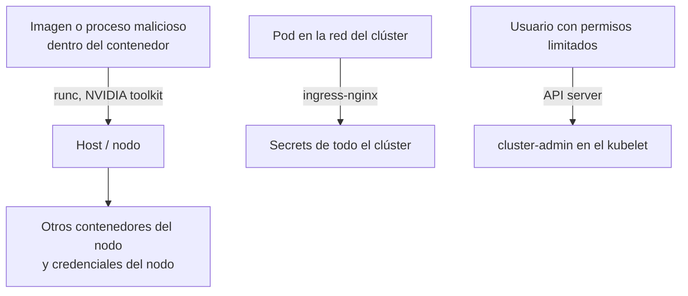

# CVE en contenedores y Kubernetes

> Las vulnerabilidades que rompieron el aislamiento de los contenedores o comprometieron clústeres (runc, Leaky Vessels, el API server de Kubernetes, IngressNightmare y NVIDIA Container Toolkit): qué pasó, cómo comprobar tus nodos y qué controles las contienen.

!!! info "Cómo leer esta nota"
    Los conceptos (CVE, CVSS, KEV, GHSA) están en [Fundamentos de CVE](fundamentos-cve.md) y el método en [Cómo investigar un CVE](investigar-un-cve.md). CVSS, KEV y el estado en NVD **cambian**: los datos se comprobaron en NVD, cve.org, los advisories de cada proyecto y el catálogo KEV en octubre de 2026, y **manda la fuente oficial**. Varios CVE recientes de Kubernetes aparecen en NVD como *Deferred* (NVD no los analiza): en ese caso la puntuación es la de la CNA de Kubernetes.

!!! note "Por qué este grupo importa aunque casi no esté en KEV"
    Ninguno de los CVE de esta nota figura en CISA KEV a la fecha de revisión. No significa que sean poco importantes: un **container escape** (escape del contenedor al host) convierte el compromiso de **una** aplicación en el compromiso del **nodo** y, a menudo, de todo el clúster. Prioriza también por contexto: ¿ejecutas imágenes o código de terceros? ¿Es un clúster multi-tenant?

## Resumen

| Nombre común | CVE | Año | Componente | Tipo (CWE) | CVSS (versión) | En KEV |
| --- | --- | --- | --- | --- | --- | --- |
| runc container escape | CVE-2019-5736 | 2019 | runc ≤ 1.0-rc6 (Docker < 18.09.2) | CWE-78 | 8.6 (3.1, NVD) | No |
| Leaky Vessels | CVE-2024-21626 | 2024 | runc ≤ 1.1.11 | CWE-668 / CWE-403 | 8.6 (3.1, NVD) | No |
| runc: escapes de 2025 | CVE-2025-31133, CVE-2025-52565, CVE-2025-52881 | 2025 | runc 1.2.7, 1.3.x, 1.4.0-rc | CWE-363, CWE-61 | 7.3–8.4 (4.0, CNA GitHub); 7.5–7.8 (3.1, NVD) | No |
| Escalada en el API server | CVE-2018-1002105 | 2018 | kube-apiserver | CWE-388 | 9.8 (3.0, NVD) | No |
| Interceptación con `externalIPs` | CVE-2020-8554 | 2020 | Kubernetes (diseño de Services) | CWE-283 (CNA) | 6.3 (3.1, CNA); 5.0 (3.1, NVD) | No |
| IngressNightmare | CVE-2025-1974 (+ CVE-2025-1097, CVE-2025-1098, CVE-2025-24514, CVE-2025-24513) | 2025 | ingress-nginx | CWE-653 / CWE-20 | 9.8 (3.1, CNA Kubernetes) | No |
| NVIDIA Container Toolkit | CVE-2024-0132 | 2024 | NVIDIA Container Toolkit ≤ 1.16.1 | CWE-367 | 9.0 (3.1, CNA NVIDIA); 8.3 (3.1, NVD) | No |
| NVIDIAScape | CVE-2025-23266 | 2025 | NVIDIA Container Toolkit ≤ 1.17.7 | CWE-426 | 9.0 (3.1, CNA NVIDIA) | No |



## runc container escape (CVE-2019-5736)

**Qué es / qué pasó.** **runc** es el *container runtime* de bajo nivel que usan Docker, containerd y CRI-O para crear contenedores. Por un mal manejo de descriptores de archivo relacionados con `/proc/self/exe`, un proceso que corriera **como root dentro del contenedor** podía sobrescribir el binario `runc` del host y obtener root en el nodo. Bastaba con una imagen maliciosa o con acceso de escritura a un contenedor existente en el que alguien ejecutara `docker exec`.

**Versiones afectadas y corregidas.** runc hasta **1.0-rc6**; Docker anterior a **18.09.2**. Las distribuciones y los proveedores de Kubernetes gestionado publicaron parches en febrero de 2019.

**Impacto.** Root en el host desde un contenedor (CVSS 8.6).

**Cómo detectarlo.**

```bash
runc --version
docker version --format '{{.Server.Version}}'
kubectl get nodes -o wide        # columna CONTAINER-RUNTIME de cada nodo
```

**Mitigación.** Actualizar runc (o el motor que lo incluye). Ejecutar los contenedores **sin root** y con user namespaces reduce el riesgo; Red Hat indicó que SELinux en modo *enforcing* lo bloqueaba en sus plataformas.

**Lección DevSecOps.** El aislamiento de un contenedor **no es una frontera de seguridad tan fuerte como una VM**. [Ejecutar sin root](../infraestructura-y-contenedores/seguridad-contenedores.md#endurecer-la-ejecucion), exigirlo con [Pod Security Standards](../infraestructura-y-contenedores/seguridad-kubernetes.md#pod-security-standards) y usar solo imágenes de origen confiable son las capas que contienen este tipo de fallo.

**Enlaces oficiales.** [cve.org](https://www.cve.org/CVERecord?id=CVE-2019-5736) · [NVD](https://nvd.nist.gov/vuln/detail/CVE-2019-5736) · [Kubernetes blog: runc and CVE-2019-5736](https://kubernetes.io/blog/2019/02/11/runc-and-cve-2019-5736/) · [Red Hat: runc escape](https://access.redhat.com/security/vulnerabilities/runcescape)

## Leaky Vessels (CVE-2024-21626)

**Qué es / qué pasó.** Una **fuga de un descriptor de archivo** interno de runc permitía que un proceso nuevo del contenedor arrancara con su directorio de trabajo **dentro del sistema de archivos del host**, lo que daba acceso a ese sistema de archivos y, en variantes, sobrescribir binarios del host. Se podía disparar con una imagen maliciosa (`runc run`) o al ejecutar `runc exec`. Se publicó en enero de 2024 junto con varios CVE de **BuildKit**, bajo el nombre común *Leaky Vessels*.

**Versiones afectadas y corregidas.** runc **1.1.11** y anteriores; corregido en **1.1.12**. Docker Engine, containerd y los servicios gestionados (EKS, AKS, GKE) publicaron versiones o imágenes de nodo con runc corregido.

**Impacto.** Escape del contenedor al host (CVSS 8.6).

**Cómo detectarlo.** Igual que el anterior (`runc --version`, versión del runtime por nodo). Los escáneres de imágenes no lo detectan dentro de tus imágenes, porque runc vive en el **nodo**; revísalo con el inventario de nodos o con un escáner del host o del clúster ([KSPM](../escaneos/kspm.md)).

**Mitigación.** Actualizar runc y actualizar las imágenes de nodo del clúster. Mientras tanto, permitir solo imágenes de registries confiables y firmadas reduce la exposición, ya que una de las vías requiere ejecutar una imagen maliciosa.

**Lección DevSecOps.** En Kubernetes gestionado, **el proveedor parchea el control plane, pero los nodos son responsabilidad compartida** ([Shared Responsibility Model](../../cloud/fundamentos/responsabilidad-compartida.md)): si no actualizas los node pools, sigues expuesto. Verificar firmas de imágenes con un [admission controller](../infraestructura-y-contenedores/seguridad-kubernetes.md#admission-control) limita qué imágenes pueden llegar a ejecutarse.

**Enlaces oficiales.** [cve.org](https://www.cve.org/CVERecord?id=CVE-2024-21626) · [NVD](https://nvd.nist.gov/vuln/detail/CVE-2024-21626) · [GHSA-xr7r-f8xq-vfvv (runc)](https://github.com/opencontainers/runc/security/advisories/GHSA-xr7r-f8xq-vfvv) · [runc v1.1.12](https://github.com/opencontainers/runc/releases/tag/v1.1.12)

## runc: escapes de 2025 (CVE-2025-31133, CVE-2025-52565 y CVE-2025-52881)

**Qué es / qué pasó.** En noviembre de 2025 se publicaron tres vulnerabilidades de runc relacionadas entre sí. Las tres abusan de **condiciones de carrera** y **enlaces simbólicos** durante la preparación del contenedor (montajes de `/dev/null`, `/dev/console` y escrituras en `/proc`) para que runc monte o escriba en rutas que deberían estar protegidas. El resultado puede ser escape del contenedor, denegación de servicio del host o saltarse las rutas enmascaradas (*maskedPaths*). CVE-2025-52881 se puede disparar incluso con un Dockerfile durante `docker buildx build`.

**Versiones afectadas y corregidas.** runc 1.2.7 y anteriores, la rama 1.3 anterior a 1.3.3 y 1.4.0-rc.1 y rc.2 (el rango exacto varía un poco entre los tres CVE); corregido en **1.2.8**, **1.3.3** y **1.4.0-rc.3**.

**Impacto.** Escape del contenedor (CVSS 4.0 de 7.3 a 8.4 según la CNA; 7.5 a 7.8 en CVSS 3.1 según NVD). Requieren poder ejecutar una imagen o configuración controlada por el atacante.

**Cómo detectarlo.** `runc --version` en los nodos y en los runners de CI donde se construyen imágenes.

**Mitigación.** Actualizar runc y las imágenes de nodo. Revisa en los advisories qué configuraciones reducen el riesgo mientras actualizas (por ejemplo, contenedores sin root o con user namespaces).

**Lección DevSecOps.** Los **runners de CI** que construyen imágenes de terceros también son "hosts de contenedores": aíslalos (runners efímeros) y actualízalos como los nodos de producción ([Seguridad del pipeline](../identidades-y-pipeline/seguridad-pipeline.md#runners-hosted-vs-self-hosted)).

**Enlaces oficiales.**

- CVE-2025-31133: [cve.org](https://www.cve.org/CVERecord?id=CVE-2025-31133) · [NVD](https://nvd.nist.gov/vuln/detail/CVE-2025-31133) · [GHSA-9493-h29p-rfm2](https://github.com/opencontainers/runc/security/advisories/GHSA-9493-h29p-rfm2)
- CVE-2025-52565: [cve.org](https://www.cve.org/CVERecord?id=CVE-2025-52565) · [NVD](https://nvd.nist.gov/vuln/detail/CVE-2025-52565) · [GHSA-qw9x-cqr3-wc7r](https://github.com/opencontainers/runc/security/advisories/GHSA-qw9x-cqr3-wc7r)
- CVE-2025-52881: [cve.org](https://www.cve.org/CVERecord?id=CVE-2025-52881) · [NVD](https://nvd.nist.gov/vuln/detail/CVE-2025-52881) · [GHSA-cgrx-mc8f-2prm](https://github.com/opencontainers/runc/security/advisories/GHSA-cgrx-mc8f-2prm)

## Escalada en el API server de Kubernetes (CVE-2018-1002105)

**Qué es / qué pasó.** Fue la primera vulnerabilidad crítica de Kubernetes de gran repercusión. El **kube-apiserver** manejaba mal los errores en peticiones de *upgrade* de conexión que reenviaba a los backends (kubelets o API servers agregados). Un atacante podía mantener abierta esa conexión y enviar peticiones arbitrarias al backend **con las credenciales TLS del propio API server**. En la práctica, un usuario con permiso de `exec`/`attach`/`portforward` sobre un pod podía obtener control total del kubelet, y en clústeres con API servers agregados incluso usuarios anónimos podían escalar.

**Versiones afectadas y corregidas.** Todas las anteriores a **v1.10.11**, **v1.11.5** y **v1.12.3**.

**Impacto.** Escalada de privilegios hasta nivel de administrador del clúster (CVSS 9.8).

**Cómo detectarlo.**

```bash
kubectl version            # versión del cliente y del servidor
```

**Mitigación.** Actualizar el control plane. Como medidas temporales: desactivar el acceso anónimo y quitar permisos de `pods/exec`, `pods/attach` y `pods/portforward` a quien no los necesite.

**Lección DevSecOps.** Permisos como `pods/exec` son más poderosos de lo que parecen. Diseña [RBAC](../infraestructura-y-contenedores/seguridad-kubernetes.md#rbac) con mínimo privilegio y revisa quién puede hacer qué (`kubectl auth can-i`). Hoy, con EKS, AKS o GKE, el proveedor actualiza el control plane, pero tú debes mantener la versión dentro del soporte.

**Enlaces oficiales.** [cve.org](https://www.cve.org/CVERecord?id=CVE-2018-1002105) · [NVD](https://nvd.nist.gov/vuln/detail/CVE-2018-1002105) · [Issue de Kubernetes #71411](https://github.com/kubernetes/kubernetes/issues/71411)

## Interceptación de tráfico con externalIPs (CVE-2020-8554)

**Qué es / qué pasó.** Un caso distinto: **no tiene parche** porque es una consecuencia del diseño. Quien puede crear un Service de tipo ClusterIP y fijar `spec.externalIPs` puede **interceptar el tráfico** del clúster dirigido a esa IP (ataque *man-in-the-middle*). Kubernetes lo documentó como vulnerabilidad sin corrección y ofreció mitigaciones.

**Versiones afectadas.** Todas las versiones de Kubernetes.

**Impacto.** Interceptación de tráfico en clústeres multi-tenant (CVSS 6.3 según la CNA; 5.0 según NVD).

**Cómo detectarlo.**

```bash
# Services que usan externalIPs (revisa que sean legítimos)
kubectl get svc -A -o jsonpath='{range .items[?(@.spec.externalIPs)]}{.metadata.namespace}/{.metadata.name}{"\n"}{end}'
```

**Mitigación.** Restringir el uso de `externalIPs` con el admission plugin `DenyServiceExternalIPs` o con una política de **Kyverno** o **Gatekeeper**.

**Lección DevSecOps.** No todos los CVE se resuelven actualizando: algunos se gestionan con **policy as code** en el [admission control](../infraestructura-y-contenedores/seguridad-kubernetes.md#admission-control). Documenta estos casos como riesgo aceptado con mitigación ([Excepciones y riesgo aceptado](../gobierno-y-respuesta/deteccion-respuesta.md#excepciones-y-riesgo-aceptado)).

**Enlaces oficiales.** [cve.org](https://www.cve.org/CVERecord?id=CVE-2020-8554) · [NVD](https://nvd.nist.gov/vuln/detail/CVE-2020-8554) · [Issue de Kubernetes #97076](https://github.com/kubernetes/kubernetes/issues/97076)

## IngressNightmare en ingress-nginx (CVE-2025-1974 y relacionadas)

**Qué es / qué pasó.** **ingress-nginx** es un ingress controller muy usado. Su **validating admission webhook** (el componente que valida los objetos Ingress antes de aceptarlos) generaba y probaba configuración de NGINX a partir de datos del Ingress. Una serie de fallos permitía **inyectar configuración** a través de anotaciones (`auth-url`, `auth-tls-match-cn`, `mirror-target`/`mirror-host`), y CVE-2025-1974 permitía explotarlo **sin autenticación** desde cualquier pod con acceso a la red del clúster. El resultado: ejecución de código en el controller, que en la instalación por defecto **puede leer todos los Secrets del clúster**.

| CVE | Qué permite | CVSS (3.1, CNA Kubernetes) |
| --- | --- | --- |
| CVE-2025-1974 | Ejecución de código sin autenticación desde la red de pods (encadenando las demás) | 9.8 |
| CVE-2025-1097 | Inyección de configuración vía `auth-tls-match-cn` | 8.8 |
| CVE-2025-1098 | Inyección de configuración vía `mirror-target` y `mirror-host` | 8.8 |
| CVE-2025-24514 | Inyección de configuración vía `auth-url` | 8.8 |
| CVE-2025-24513 | Path traversal en el admission controller | 4.8 |

**Versiones afectadas y corregidas.** Anteriores a v1.11.0, v1.11.0 a **v1.11.4** y **v1.12.0**; corregido en **v1.11.5** y **v1.12.1**.

!!! warning "ingress-nginx está retirado"
    El proyecto de Kubernetes anunció en noviembre de 2025 el retiro de ingress-nginx, con mantenimiento *best-effort* solo hasta **marzo de 2026**. Las instalaciones existentes siguen funcionando, pero ya no reciben parches de seguridad del proyecto. La recomendación oficial es migrar a **Gateway API** o a otro ingress controller.

**Impacto.** Robo de todos los Secrets del clúster y posible toma de control (CVSS 9.8).

**Cómo detectarlo.**

```bash
# ¿Hay ingress-nginx en el clúster?
kubectl get pods --all-namespaces --selector app.kubernetes.io/name=ingress-nginx

# Versión de la imagen del controller
kubectl get pods -A -l app.kubernetes.io/name=ingress-nginx \
  -o jsonpath='{range .items[*]}{.spec.containers[*].image}{"\n"}{end}'
```

**Mitigación.** Actualizar a v1.11.5, v1.12.1 o posterior (y planificar la migración por el retiro). Hasta poder actualizar, el aviso oficial recomienda **desactivar el validating admission webhook** de ingress-nginx.

**Lección DevSecOps.** Los webhooks de admisión **no deberían ser accesibles** desde cualquier pod: una [NetworkPolicy](../infraestructura-y-contenedores/seguridad-kubernetes.md#networkpolicy) que limite quién habla con el webhook (solo el API server) habría reducido mucho la exposición. Además, un controller que lee **todos** los Secrets es un objetivo de alto valor: revisa su [RBAC](../infraestructura-y-contenedores/seguridad-kubernetes.md#rbac). Y vigila el **ciclo de vida** de los componentes: usar software retirado es una vulnerabilidad en sí.

**Enlaces oficiales.**

- CVE-2025-1974: [cve.org](https://www.cve.org/CVERecord?id=CVE-2025-1974) · [NVD](https://nvd.nist.gov/vuln/detail/CVE-2025-1974) · [Issue de Kubernetes #131009](https://github.com/kubernetes/kubernetes/issues/131009)
- CVE-2025-1097: [cve.org](https://www.cve.org/CVERecord?id=CVE-2025-1097) · [NVD](https://nvd.nist.gov/vuln/detail/CVE-2025-1097)
- CVE-2025-1098: [cve.org](https://www.cve.org/CVERecord?id=CVE-2025-1098) · [NVD](https://nvd.nist.gov/vuln/detail/CVE-2025-1098)
- CVE-2025-24514: [cve.org](https://www.cve.org/CVERecord?id=CVE-2025-24514) · [NVD](https://nvd.nist.gov/vuln/detail/CVE-2025-24514)
- CVE-2025-24513: [cve.org](https://www.cve.org/CVERecord?id=CVE-2025-24513) · [NVD](https://nvd.nist.gov/vuln/detail/CVE-2025-24513)
- [Kubernetes blog: Ingress-nginx CVE-2025-1974](https://kubernetes.io/blog/2025/03/24/ingress-nginx-cve-2025-1974/) · [Ingress NGINX Retirement](https://kubernetes.io/blog/2025/11/11/ingress-nginx-retirement/)

## NVIDIA Container Toolkit (CVE-2024-0132 y CVE-2025-23266)

**Qué es / qué pasó.** El **NVIDIA Container Toolkit** permite que los contenedores usen GPUs, y es la base de muchos clústeres de IA (también en servicios gestionados con GPU). Dos fallos permitían que una **imagen maliciosa** accediera al sistema de archivos del host o ejecutara código con privilegios elevados durante la inicialización del contenedor: CVE-2024-0132 por una condición de carrera **TOCTOU** (*time-of-check time-of-use*), y CVE-2025-23266 ("NVIDIAScape") por un *hook* de inicialización que cargaba bibliotecas desde una ruta controlable (*untrusted search path*).

**Versiones afectadas y corregidas.**

| CVE | Afectado | Corregido |
| --- | --- | --- |
| CVE-2024-0132 | Container Toolkit hasta 1.16.1; GPU Operator hasta 24.6.1 (no afecta si se usa CDI) | Container Toolkit 1.16.2 o posterior |
| CVE-2025-23266 | Container Toolkit hasta 1.17.7; GPU Operator hasta 25.3.0 | Container Toolkit 1.17.8 o posterior |

**Impacto.** Escape del contenedor al nodo con GPU (CVSS 9.0 según NVIDIA). En plataformas de IA que ejecutan modelos o imágenes de clientes, es un riesgo **entre inquilinos**.

**Cómo detectarlo.**

```bash
nvidia-ctk --version      # en el nodo con GPU
```

**Mitigación.** Actualizar el toolkit o el GPU Operator según el boletín de NVIDIA, que también describe mitigaciones por configuración para quien no pueda actualizar de inmediato.

**Lección DevSecOps.** Las cargas de IA traen **componentes de host nuevos** que tienen que entrar en tu inventario y tu ciclo de parches. Si ejecutas imágenes de terceros, aíslalas en nodos dedicados o con *sandboxing* (gVisor, Kata Containers).

**Enlaces oficiales.**

- CVE-2024-0132: [cve.org](https://www.cve.org/CVERecord?id=CVE-2024-0132) · [NVD](https://nvd.nist.gov/vuln/detail/CVE-2024-0132) · [Boletín de NVIDIA](https://nvidia.custhelp.com/app/answers/detail/a_id/5582)
- CVE-2025-23266: [cve.org](https://www.cve.org/CVERecord?id=CVE-2025-23266) · [NVD](https://nvd.nist.gov/vuln/detail/CVE-2025-23266) · [Boletín de NVIDIA](https://nvidia.custhelp.com/app/answers/detail/a_id/5659)

## Patrones comunes

| Patrón | Casos | Control que lo contiene |
| --- | --- | --- |
| **Imagen maliciosa como vector** | runc (todos), NVIDIA toolkit | Solo registries confiables, firma y verificación en el admission control |
| **Contenedor como root** | runc 2019 | `runAsNonRoot`, Pod Security Standards *restricted*, user namespaces |
| **Componentes del nodo fuera del inventario** | runc, NVIDIA toolkit | Inventario de nodos, actualización de node pools, [KSPM](../escaneos/kspm.md) |
| **Permisos excesivos** | API server (`pods/exec`), ingress-nginx (todos los Secrets) | RBAC de mínimo privilegio, auditoría de permisos |
| **Superficie de red interna abierta** | IngressNightmare | NetworkPolicy *default deny* también para webhooks |
| **Sin parche posible** | `externalIPs` | Policy as code (Kyverno, Gatekeeper, admission plugins) |
| **Software retirado** | ingress-nginx | Seguimiento del ciclo de vida y planes de migración |

!!! tip "Fuente oficial para Kubernetes"
    Kubernetes publica un **CVE feed oficial** (JSON y RSS) con todos los CVE del proyecto. Puedes suscribirte o consumirlo desde un script para saber cuándo uno afecta a tus versiones; para los componentes gestionados, sigue además los boletines de seguridad de EKS, AKS y GKE ([Contenedores gestionados](../../cloud/computo/contenedores-gestionados.md)).

## Relación con otras secciones

| Enfoque | Qué se mira desde ahí | Nota |
| --- | --- | --- |
| Cloud (el control) | EKS, AKS y GKE: qué parchea el proveedor (control plane) y qué te toca a ti (nodos, add-ons) | [Contenedores gestionados](../../cloud/computo/contenedores-gestionados.md), [Shared Responsibility Model](../../cloud/fundamentos/responsabilidad-compartida.md) |
| DevOps (la automatización) | Imágenes, manifiestos, ingress controllers y actualizaciones de clúster | [Docker](../../devops/contenedores/docker.md), [Kubernetes](../../devops/contenedores/kubernetes.md) |
| DevSecOps (la verificación) | Endurecimiento de pods y nodos, admission control, escaneo de imágenes y del clúster | [Seguridad de contenedores](../infraestructura-y-contenedores/seguridad-contenedores.md), [Seguridad de Kubernetes](../infraestructura-y-contenedores/seguridad-kubernetes.md), [Container image scanning](../escaneos/container-scanning.md), [KSPM](../escaneos/kspm.md), [Detección y respuesta](../gobierno-y-respuesta/deteccion-respuesta.md), [CVE de supply chain y CI/CD](cve-supply-chain-cicd.md), [CVE en Linux y sistemas](cve-linux-sistemas.md) |

## Referencias

- [CVE Program (cve.org)](https://www.cve.org/)
- [NVD: National Vulnerability Database](https://nvd.nist.gov/)
- [CISA: Known Exploited Vulnerabilities Catalog](https://www.cisa.gov/known-exploited-vulnerabilities-catalog)
- [Kubernetes: Official CVE Feed](https://kubernetes.io/docs/reference/issues-security/official-cve-feed/)
- [Kubernetes: Security and Disclosure Information](https://kubernetes.io/docs/reference/issues-security/security/)
- [runc: Security Advisories](https://github.com/opencontainers/runc/security/advisories)
- [Amazon EKS: boletines de seguridad](https://aws.amazon.com/security/security-bulletins/)
- [GKE: boletines de seguridad](https://cloud.google.com/kubernetes-engine/docs/security-bulletins)
- [Gateway API](https://gateway-api.sigs.k8s.io/)
- [Guía de comandos de kubectl](../../recursos/comandos/kubectl.md)
