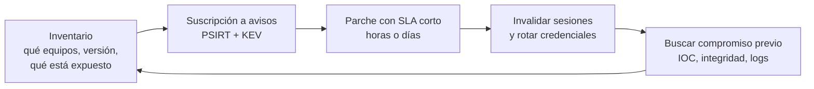

---
tags:
  - devsecops
  - vulnerabilidades
  - cve
  - perimetro
  - vpn
---

# CVE en dispositivos perimetrales, VPN y transferencia de archivos

> Las vulnerabilidades que más se explotan cada año según CISA: SSL-VPN, gateways de acceso remoto, firewalls, routers y servidores de transferencia de archivos expuestos a internet. Qué pasó en cada caso, cómo comprobar si te afecta y por qué estos equipos necesitan un trato especial.

!!! info "Cómo leer esta nota"
    Antes de esta nota conviene leer [Fundamentos de CVE](fundamentos-cve.md) (CVSS, EPSS, KEV) y [Cómo investigar un CVE](investigar-un-cve.md). Las puntuaciones **CVSS**, la presencia en **CISA KEV** (*Known Exploited Vulnerabilities*) y el **EPSS** pueden cambiar: los datos se verificaron en octubre de 2026 y **manda la fuente oficial** (cve.org, NVD y el **PSIRT** del fabricante, su *Product Security Incident Response Team*). Contenido solo defensivo: no hay pasos de explotación. Comprueba solo equipos **propios** o con autorización.

## Por qué el perímetro

Los informes conjuntos anuales de CISA, NSA, FBI y agencias aliadas sobre las **vulnerabilidades explotadas de forma rutinaria** (*Top Routinely Exploited Vulnerabilities*) repiten la misma conclusión: la mayoría afecta a **equipos de borde** (*edge devices*). En el último publicado (AA24-317A, sobre 2023), la mayor parte de las 15 principales se explotó primero como **zero-day** y casi todas eran de dispositivos de red, VPN o aplicaciones expuestas.

| Informe | Año que cubre | Enlace |
| --- | --- | --- |
| AA24-317A | 2023 | [2023 Top Routinely Exploited Vulnerabilities](https://www.cisa.gov/news-events/cybersecurity-advisories/aa24-317a) |
| AA23-215A | 2022 | [2022 Top Routinely Exploited Vulnerabilities](https://www.cisa.gov/news-events/cybersecurity-advisories/aa23-215a) |
| AA22-117A | 2021 | [2021 Top Routinely Exploited Vulnerabilities](https://www.cisa.gov/news-events/cybersecurity-advisories/aa22-117a) |
| AA21-209A | 2020 | [Top Routinely Exploited Vulnerabilities](https://www.cisa.gov/news-events/cybersecurity-advisories/aa21-209a) |

!!! note "Revisa si hay una edición nueva"
    A octubre de 2026 no se encontró una edición posterior a AA24-317A. Busca "Top Routinely Exploited Vulnerabilities" en la página de [Cybersecurity Advisories de CISA](https://www.cisa.gov/news-events/cybersecurity-advisories) por si hay una más reciente.

¿Por qué estos equipos?

- Están **expuestos a internet por diseño** (su función es recibir conexiones de fuera).
- Son **cajas cerradas** (*appliances*): no admiten EDR, sus logs son limitados y el cliente no puede inspeccionar el sistema.
- Dan acceso directo a la red interna y guardan **credenciales y sesiones** de usuarios.
- Se parchean con menos frecuencia que los servidores ("si funciona, no lo toques") y muchas organizaciones no saben qué versión tienen.

## Resumen

| Nombre común | CVE | Año | Componente | Tipo (CWE) | CVSS (versión) | En KEV |
| --- | --- | --- | --- | --- | --- | --- |
| FortiOS SSL-VPN path traversal | CVE-2018-13379 | 2019 | Fortinet FortiOS SSL-VPN | CWE-22 Path Traversal | 9.8 (3.1, NVD); 9.1 (3.1, Fortinet) | Sí (2021-11-03) |
| FortiOS sslvpnd out-of-bounds write | CVE-2024-21762 | 2024 | Fortinet FortiOS / FortiProxy | CWE-787 Out-of-bounds Write | 9.8 (3.1, NVD y Fortinet) | Sí (2024-02-09) |
| Pulse Connect Secure file read | CVE-2019-11510 | 2019 | Pulse Secure (hoy Ivanti) Connect Secure | CWE-22 Path Traversal | 10.0 (3.1, NVD) | Sí (2021-11-03) |
| Ivanti Connect Secure auth bypass | CVE-2023-46805 | 2024 | Ivanti Connect Secure / Policy Secure | CWE-287 Improper Authentication | 8.2 (3.1, NVD) | Sí (2024-01-10) |
| Ivanti Connect Secure command injection | CVE-2024-21887 | 2024 | Ivanti Connect Secure / Policy Secure | CWE-77 Command Injection | 9.1 (3.1, NVD) | Sí (2024-01-10) |
| Citrix Bleed | CVE-2023-4966 | 2023 | Citrix NetScaler ADC / Gateway | CWE-119 | 7.5 (3.1, NVD); 9.4 (3.1, Citrix) | Sí (2023-10-18) |
| CitrixBleed 2 | CVE-2025-5777 | 2025 | Citrix NetScaler ADC / Gateway | CWE-125 / CWE-908 | 7.5 (3.1, NVD); 9.3 (4.0, Citrix) | Sí (2025-07-10) |
| PAN-OS GlobalProtect command injection | CVE-2024-3400 | 2024 | Palo Alto Networks PAN-OS | CWE-77 / CWE-20 | 10.0 (3.1, NVD y Palo Alto) | Sí (2024-04-12) |
| MOVEit Transfer SQL injection | CVE-2023-34362 | 2023 | Progress MOVEit Transfer | CWE-89 SQL Injection | 9.8 (3.1, NVD) | Sí (2023-06-02) |
| Cisco IOS XE Web UI | CVE-2023-20198 (+ CVE-2023-20273) | 2023 | Cisco IOS XE (Web UI) | CWE-420 | 10.0 (3.1, NVD y Cisco) | Sí (2023-10-16) |

El año es el de publicación del CVE. Todos menos el de Cisco tienen en KEV la marca **Known** de uso en campañas de ransomware (el de Cisco figura como *Unknown*).

## Fortinet FortiOS SSL-VPN (CVE-2018-13379)

- **Qué es / qué pasó**: un **path traversal** (recorrido de directorios) en el portal web de la SSL-VPN de FortiOS permitía a un atacante sin autenticar **descargar archivos del sistema**, incluido el que guarda las sesiones de la VPN con credenciales de usuarios. Años después del parche se publicaron listas con credenciales robadas de decenas de miles de equipos.
- **Versiones afectadas y corregidas**: FortiOS 5.4.6 a 5.4.12, 5.6.3 a 5.6.7 y 6.0.0 a 6.0.4, solo con la SSL-VPN (web-mode o tunnel-mode) activa; el registro del CVE incluye también versiones de FortiProxy 1.x y 2.0.0. Corregido en 5.4.13, 5.6.8, 6.0.5 y 6.2.0 en adelante.
- **Impacto**: robo de credenciales de VPN en texto claro → acceso a la red interna con usuarios legítimos.
- **Cómo detectarlo**: versión del firmware (`get system status` en la CLI de FortiOS o el panel de administración) frente al aviso.
- **Mitigación**: actualizar el firmware; el aviso propone como workaround desactivar la SSL-VPN y recomienda **activar el segundo factor** para que las credenciales robadas no basten. Cuando en 2021 se publicaron credenciales robadas, Fortinet recomendó además **resetear las contraseñas** de los usuarios de la VPN de equipos que estuvieron vulnerables.
- **Lección DevSecOps**: el parche no invalida credenciales ya robadas. Toda VPN necesita **MFA** y un proceso de rotación tras un incidente ([Secretos e identidades](../identidades-y-pipeline/secretos-identidades.md#rotacion)).
- **Enlaces oficiales**: [cve.org](https://www.cve.org/CVERecord?id=CVE-2018-13379) · [NVD](https://nvd.nist.gov/vuln/detail/CVE-2018-13379) · [Fortinet FG-IR-18-384](https://www.fortiguard.com/psirt/FG-IR-18-384)

## Fortinet FortiOS sslvpnd (CVE-2024-21762)

- **Qué es / qué pasó**: una **escritura fuera de límites** en el proceso `sslvpnd` de FortiOS que permite ejecución remota de código sin autenticación mediante peticiones HTTP manipuladas. Fortinet publicó el aviso en febrero de 2024 indicando posible explotación; CISA lo añadió a KEV el mismo día.
- **Versiones afectadas y corregidas** (según el aviso FG-IR-24-015):

    | Rama FortiOS | Afectadas | Corregida |
    | --- | --- | --- |
    | 7.4 | 7.4.0 a 7.4.2 | 7.4.3 o superior |
    | 7.2 | 7.2.0 a 7.2.6 | 7.2.7 o superior |
    | 7.0 | 7.0.0 a 7.0.13 | 7.0.14 o superior |
    | 6.4 | 6.4.0 a 6.4.14 | 6.4.15 o superior |
    | 6.2 | 6.2.0 a 6.2.15 | 6.2.16 o superior |
    | 6.0 | 6.0.0 a 6.0.17 | 6.0.18 o superior |

    FortiProxy también está afectado (ver el aviso).
- **Impacto**: RCE en el firewall: control total del equipo que separa la red interna de internet.
- **Cómo detectarlo**: versión de firmware; si la SSL-VPN está habilitada (es la condición para estar expuesto).
- **Mitigación**: actualizar. Workaround oficial: **desactivar la SSL-VPN**; el aviso aclara que desactivar solo el *webmode* **no** es suficiente. Fortinet ofrece además un parche virtual en su servicio de IPS.
- **Lección DevSecOps**: si no usas una función expuesta, apágala. Y para los equipos perimetrales, la suscripción a los avisos del PSIRT del fabricante debe disparar un ticket con el SLA más corto ([Detección y respuesta](../gobierno-y-respuesta/deteccion-respuesta.md#sla-de-remediacion)).
- **Enlaces oficiales**: [cve.org](https://www.cve.org/CVERecord?id=CVE-2024-21762) · [NVD](https://nvd.nist.gov/vuln/detail/CVE-2024-21762) · [Fortinet FG-IR-24-015](https://www.fortiguard.com/psirt/FG-IR-24-015)

## Pulse Connect Secure (CVE-2019-11510)

- **Qué es / qué pasó**: una **lectura arbitraria de archivos** sin autenticación en Pulse Connect Secure (hoy **Ivanti Connect Secure**) mediante una URI manipulada. Permitía obtener credenciales en caché y claves; fue una de las vulnerabilidades más explotadas de 2019–2021 y aparece en varios informes anuales de CISA.
- **Versiones afectadas y corregidas**: 8.2 antes de 8.2R12.1, 8.3 antes de 8.3R7.1 y 9.0 antes de 9.0R3.4. Parche de abril de 2019 (aviso SA44101).
- **Impacto**: robo de credenciales y sesiones → acceso a la red interna; usado por grupos de ransomware y de espionaje.
- **Cómo detectarlo**: versión del appliance en la consola de administración frente al aviso; Ivanti publica una herramienta de comprobación de integridad para sus gateways.
- **Mitigación**: actualizar y **rotar todas las credenciales** que pasaron por el equipo (usuarios, cuentas de servicio de LDAP/AD, certificados).
- **Lección DevSecOps**: las organizaciones que parchearon tarde (meses) siguieron siendo atacadas con credenciales robadas incluso después de actualizar. La métrica que importa es el **tiempo de exposición**, no solo si "ya está parcheado".
- **Enlaces oficiales**: [cve.org](https://www.cve.org/CVERecord?id=CVE-2019-11510) · [NVD](https://nvd.nist.gov/vuln/detail/CVE-2019-11510) · [Pulse Secure SA44101](https://kb.pulsesecure.net/articles/Pulse_Security_Advisories/SA44101)

## Ivanti Connect Secure (CVE-2023-46805 + CVE-2024-21887)

- **Qué es / qué pasó**: dos fallos encadenados en el componente web de Ivanti Connect Secure y Policy Secure: un **bypass de autenticación** (CVE-2023-46805) y una **inyección de comandos** que requiere privilegios de administrador (CVE-2024-21887). Juntos permitían ejecutar comandos sin credenciales. Se explotaron como zero-day desde diciembre de 2023; CISA emitió la **Emergency Directive 24-01**.
- **Versiones afectadas y corregidas**: todas las versiones soportadas de las ramas 9.x y 22.x. Ivanti publicó primero un archivo XML de mitigación y después parches escalonados por versión (finales de enero y febrero de 2024), junto con nuevos CVE relacionados (por ejemplo, CVE-2024-22024).
- **Impacto**: RCE en el gateway VPN, robo de credenciales y de configuración, y persistencia que en algunos casos sobrevivía a actualizaciones.
- **Cómo detectarlo**: ejecutar la **Integrity Checker Tool** (ICT) externa de Ivanti; CISA advirtió que los atacantes podían ocultar rastros y que la ICT no es infalible.
- **Mitigación** (resumen de la ED 24-01): importar el XML de mitigación mientras no había parche; ejecutar la ICT; **restablecer de fábrica**, reconstruir y actualizar el equipo antes de volver a ponerlo en servicio; revocar y reemitir certificados y claves; resetear contraseñas de administración y de cuentas de servicio; asumir que las cuentas de dominio conectadas podían estar comprometidas.
- **Lección DevSecOps**: un equipo perimetral comprometido se trata como un servidor comprometido: **reconstruir desde cero**, no "limpiar". Tener la configuración exportada y versionada permite reconstruir rápido ([Infrastructure as Code](../../devops/iac/infraestructura-como-codigo.md)).
- **Enlaces oficiales**: [cve.org CVE-2023-46805](https://www.cve.org/CVERecord?id=CVE-2023-46805) · [NVD CVE-2023-46805](https://nvd.nist.gov/vuln/detail/CVE-2023-46805) · [cve.org CVE-2024-21887](https://www.cve.org/CVERecord?id=CVE-2024-21887) · [NVD CVE-2024-21887](https://nvd.nist.gov/vuln/detail/CVE-2024-21887) · [Aviso de Ivanti](https://hub.ivanti.com/s/article/CVE-2023-46805-Authentication-Bypass-CVE-2024-21887-Command-Injection-for-Ivanti-Connect-Secure-and-Ivanti-Policy-Secure-Gateways) · [CISA ED 24-01](https://www.cisa.gov/news-events/directives/ed-24-01-mitigate-ivanti-connect-secure-and-ivanti-policy-secure-vulnerabilities)

## Citrix Bleed (CVE-2023-4966)

- **Qué es / qué pasó**: una **lectura de memoria fuera de límites** en NetScaler ADC y NetScaler Gateway configurados como Gateway (VPN, ICA Proxy, CVPN, RDP Proxy) o servidor virtual AAA. Permitía obtener **tokens de sesión** válidos de la memoria y secuestrar sesiones ya autenticadas, saltándose contraseña y MFA. LockBit 3.0 lo usó contra grandes organizaciones (aviso conjunto AA23-325A).
- **Versiones afectadas y corregidas**: 14.1 antes de 14.1-8.50, 13.1 antes de 13.1-49.15, 13.0 antes de 13.0-92.19, y versiones FIPS/NDcPP (13.1-FIPS antes de 13.1-37.164, 12.1-FIPS/NDcPP antes de 12.1-55.300). Las versiones fuera de soporte (12.1 no FIPS) no reciben parche.
- **Impacto**: secuestro de sesiones (*session hijacking*) de usuarios de la VPN, incluidas sesiones con MFA.
- **Cómo detectarlo**: versión y build del appliance (`show version` en la CLI de NetScaler) frente al boletín; revisar sesiones con IPs de origen inconsistentes.
- **Mitigación**: actualizar **y después terminar todas las sesiones activas y persistentes**; NetScaler indica los comandos (`kill icaconnection -all`, `kill rdp connection -all`, `kill pcoipConnection -all`, `kill aaa session -all`, `clear lb persistentSessions`).
- **Lección DevSecOps**: si la vulnerabilidad filtra secretos o sesiones, **parchear no basta**: hay que invalidar lo que pudo salir. Es la misma lección que Heartbleed ([CVE en Linux y sistemas](cve-linux-sistemas.md#heartbleed-cve-2014-0160)).
- **Enlaces oficiales**: [cve.org](https://www.cve.org/CVERecord?id=CVE-2023-4966) · [NVD](https://nvd.nist.gov/vuln/detail/CVE-2023-4966) · [Citrix CTX579459](https://support.citrix.com/article/CTX579459) · [CISA AA23-325A (LockBit 3.0 y Citrix Bleed)](https://www.cisa.gov/news-events/cybersecurity-advisories/aa23-325a)

## CitrixBleed 2 (CVE-2025-5777)

- **Qué es / qué pasó**: una validación de entrada insuficiente que provoca **lectura excesiva de memoria** en NetScaler ADC y Gateway con la misma configuración que Citrix Bleed (Gateway o AAA). El parecido con 2023 le dio el nombre. Se publicó en junio de 2025 y CISA lo añadió a KEV el 10 de julio de 2025.
- **Versiones afectadas y corregidas**: 14.1 antes de 14.1-43.56 y 13.1 antes de 13.1-58.32, además de versiones FIPS/NDcPP (13.1-FIPS y 13.1-NDcPP antes de 13.1-37.235, 12.1-FIPS antes de 12.1-55.328). Las ramas 12.1 y 13.0 no FIPS estaban en fin de vida: hay que migrar.
- **Impacto**: robo de tokens de sesión y otros datos de memoria → acceso sin credenciales.
- **Cómo detectarlo**: versión y build del appliance frente al boletín.
- **Mitigación**: actualizar y **terminar todas las sesiones ICA y PCoIP activas** como indica el boletín.
- **Lección DevSecOps**: la misma clase de fallo volvió dos años después en el mismo producto. Para los equipos perimetrales críticos, planifica **cómo cambiarías de producto o reducirías su exposición** (por ejemplo, ZTNA), no solo cómo parchearlos ([Seguridad de red](../../networking/avanzado/seguridad-red.md#zero-trust-y-ztna)).
- **Enlaces oficiales**: [cve.org](https://www.cve.org/CVERecord?id=CVE-2025-5777) · [NVD](https://nvd.nist.gov/vuln/detail/CVE-2025-5777) · [Citrix CTX693420](https://support.citrix.com/article/CTX693420)

## Palo Alto PAN-OS GlobalProtect (CVE-2024-3400)

- **Qué es / qué pasó**: una **inyección de comandos** derivada de la **creación arbitraria de archivos** en la función GlobalProtect de PAN-OS, que permite ejecutar código como root en el firewall sin autenticación. Se explotó como zero-day (campaña llamada *Operation MidnightEclipse* por Unit 42) antes de abril de 2024.
- **Versiones afectadas y corregidas**: PAN-OS 10.2, 11.0 y 11.1 con un **gateway o portal GlobalProtect** configurado. Corregido en 10.2.9-h1, 11.0.4-h1, 11.1.2-h3 y versiones posteriores (hay hotfixes para otras versiones de mantenimiento). No afecta a PAN-OS 10.1 y anteriores, Cloud NGFW, Panorama ni Prisma Access.
- **Impacto**: control total del firewall perimetral.
- **Cómo detectarlo**: versión de PAN-OS (`show system info`) y si GlobalProtect está configurado (Network > GlobalProtect > Gateways/Portals).
- **Mitigación**: actualizar. Mientras tanto, las firmas de Threat Prevention indicadas en el aviso (aplicadas a la interfaz de GlobalProtect). El aviso aclara que desactivar la telemetría del dispositivo **ya no** se considera mitigación efectiva.
- **Lección DevSecOps**: las mitigaciones iniciales de un aviso pueden cambiar a medida que el fabricante investiga; **suscríbete al aviso** y revísalo hasta que esté cerrado.
- **Enlaces oficiales**: [cve.org](https://www.cve.org/CVERecord?id=CVE-2024-3400) · [NVD](https://nvd.nist.gov/vuln/detail/CVE-2024-3400) · [Palo Alto Networks: CVE-2024-3400](https://security.paloaltonetworks.com/CVE-2024-3400)

## MOVEit Transfer (CVE-2023-34362)

- **Qué es / qué pasó**: una **inyección SQL** en la aplicación web de **MOVEit Transfer**, un software de **MFT** (*managed file transfer*, transferencia gestionada de archivos), que daba acceso a la base de datos sin autenticación. El grupo de ransomware **CL0P** lo explotó como zero-day desde finales de mayo de 2023 con la web shell LEMURLOOT y robó datos de cientos de organizaciones (y, a través de ellas, de millones de personas), sin cifrar nada: pura extorsión por exfiltración (aviso conjunto AA23-158A).
- **Versiones afectadas y corregidas**: versiones anteriores a 2021.0.6 (13.0.6), 2021.1.4 (13.1.4), 2022.0.4 (14.0.4), 2022.1.5 (14.1.5) y 2023.0.1 (15.0.1). Después aparecieron más CVE en el mismo producto; mantente en la última versión.
- **Impacto**: robo masivo de datos de clientes, con impacto en terceros (proveedores de nóminas, aseguradoras, administraciones).
- **Cómo detectarlo**: versión instalada; los indicadores de compromiso del aviso de Progress y de CISA (archivos `.aspx` inesperados en el directorio web, por ejemplo `human2.aspx`).
- **Mitigación**: según Progress, bloquear el tráfico HTTP/HTTPS hacia MOVEit Transfer hasta parchear, aplicar el parche, buscar indicadores y rotar credenciales.
- **Lección DevSecOps**: la **cadena de terceros** también es tu riesgo: muchas víctimas no usaban MOVEit, pero sí un proveedor que lo usaba. La gestión de proveedores debe preguntar por su gestión de vulnerabilidades ([Gobierno y riesgo de TI](../../negocio/gobierno-riesgo-ti.md)).
- **Enlaces oficiales**: [cve.org](https://www.cve.org/CVERecord?id=CVE-2023-34362) · [NVD](https://nvd.nist.gov/vuln/detail/CVE-2023-34362) · [Aviso de Progress](https://community.progress.com/s/article/MOVEit-Transfer-Critical-Vulnerability-31May2023) · [CISA AA23-158A](https://www.cisa.gov/news-events/cybersecurity-advisories/aa23-158a)

## Cisco IOS XE Web UI (CVE-2023-20198)

- **Qué es / qué pasó**: un fallo en la **interfaz web** (Web UI) de Cisco IOS XE permitía a un atacante remoto sin autenticación crear una cuenta con **privilegio 15** (administrador total). Encadenado con **CVE-2023-20273** (inyección de comandos, CVSS 7.2) escribía un implante en el equipo. En octubre de 2023 se contaron decenas de miles de routers y switches comprometidos.
- **Versiones afectadas y corregidas**: equipos con IOS XE (16.x y posteriores) que tienen activado `ip http server` o `ip http secure-server`. Corregido en 17.9.4a, 17.6.6a, 17.3.8a y 16.12.10a (Catalyst 3650/3850), según el aviso.
- **Impacto**: control total del equipo de red.
- **Cómo detectarlo**: en cada equipo propio, comprobar si la Web UI está activa:

    ```text
    show running-config | include ip http server|secure|active
    show version
    ```

    Busca también cuentas locales desconocidas en la configuración. Cisco publicó indicadores de compromiso en su aviso.
- **Mitigación**: actualizar. Hasta entonces, **desactivar la Web UI** (`no ip http server` y `no ip http secure-server`) o restringirla con una ACL a redes de gestión.
- **Lección DevSecOps**: las **interfaces de administración nunca deben estar expuestas a internet**: van en una red de gestión separada ([Seguridad de red](../../networking/avanzado/seguridad-red.md#dmz-y-segmentacion)). Un inventario de configuración (*config drift*) de los equipos de red detecta el cambio.
- **Enlaces oficiales**: [cve.org](https://www.cve.org/CVERecord?id=CVE-2023-20198) · [NVD](https://nvd.nist.gov/vuln/detail/CVE-2023-20198) · [NVD CVE-2023-20273](https://nvd.nist.gov/vuln/detail/CVE-2023-20273) · [Aviso de Cisco](https://sec.cloudapps.cisco.com/security/center/content/CiscoSecurityAdvisory/cisco-sa-iosxe-webui-privesc-j22SaA4z)

## Otros del mismo tipo que conviene conocer

Todos verificados en NVD y en KEV (con uso conocido en ransomware):

| CVE | Producto | Tipo | CVSS (3.1, NVD) | En KEV desde |
| --- | --- | --- | --- | --- |
| [CVE-2019-19781](https://nvd.nist.gov/vuln/detail/CVE-2019-19781) | Citrix ADC / Gateway | Path traversal (CWE-22) → RCE | 9.8 | 2021-11-03 |
| [CVE-2023-27997](https://nvd.nist.gov/vuln/detail/CVE-2023-27997) | Fortinet FortiOS / FortiProxy SSL-VPN | Heap-based buffer overflow (CWE-122) | 9.8 | 2023-06-13 |
| [CVE-2023-3519](https://nvd.nist.gov/vuln/detail/CVE-2023-3519) | Citrix NetScaler ADC / Gateway | Code injection (CWE-94), RCE sin autenticación | 9.8 | 2023-07-19 |
| [CVE-2025-0282](https://nvd.nist.gov/vuln/detail/CVE-2025-0282) | Ivanti Connect Secure, Policy Secure y Neurons for ZTA gateways | Stack-based buffer overflow (CWE-121) | 9.0 | 2025-01-08 |

## Defender el perímetro



1. **Inventario de lo expuesto**: qué equipos tienen interfaces accesibles desde internet, con qué versión. Revisa solo tus propios rangos de IP; en la nube, los security groups/NSG/firewall rules y los load balancers públicos ([CSPM](../escaneos/cspm.md)).
2. **Avisos del fabricante y KEV**: suscríbete al PSIRT de cada fabricante y cruza tu inventario con el catálogo KEV (se puede automatizar con su JSON). Un CVE en KEV sobre un equipo expuesto es prioridad máxima ([Detección y respuesta](../gobierno-y-respuesta/deteccion-respuesta.md#priorizar-con-cvss-epss-y-kev)).
3. **Reducir la superficie**: interfaces de administración solo desde la red de gestión; desactivar funciones que no usas (SSL-VPN, Web UI); MFA en todo acceso remoto; considerar **ZTNA** frente a la VPN clásica.
4. **Asumir el compromiso**: tras parchear un fallo explotado, invalida sesiones, rota credenciales y busca indicadores; si el fabricante lo recomienda, reconstruye el equipo.
5. **Logs fuera del equipo**: envía los logs del appliance a un SIEM; el equipo comprometido no es una fuente fiable sobre sí mismo.
6. **Ciclo de vida**: los equipos en fin de soporte (*end of life*) no reciben parches; sustitúyelos.

## Patrones comunes

- **Zero-days en el borde**: la mayoría se explotó antes o el mismo día del aviso; el margen para parchear es de **horas**.
- **Fallos clásicos de memoria y de entrada**: path traversal, desbordamientos, inyección de comandos y SQL en código cerrado de appliances.
- **Secretos que sobreviven al parche**: credenciales en archivos (FortiOS, Pulse), tokens de sesión en memoria (Citrix Bleed 1 y 2), persistencia (Ivanti). Parchear sin rotar e invalidar deja la puerta abierta.
- **Cadenas**: Ivanti y Cisco combinaron dos CVE; la puntuación de cada uno por separado subestima el riesgo.
- **Reincidencia**: los mismos fabricantes y productos aparecen año tras año en los informes de CISA; la decisión de qué producto exponer a internet también es una decisión de seguridad.

## Relación con otras secciones

| Enfoque | Qué se mira desde ahí | Nota |
| --- | --- | --- |
| DevSecOps (la verificación) | Priorización con KEV y SLA, respuesta a incidentes, auditoría de exposición | [Fundamentos de CVE](fundamentos-cve.md), [Cómo investigar un CVE](investigar-un-cve.md), [CVE en Windows y Active Directory](cve-windows-active-directory.md), [CVE en Linux y sistemas](cve-linux-sistemas.md), [Detección y respuesta](../gobierno-y-respuesta/deteccion-respuesta.md), [Cumplimiento y gobierno](../gobierno-y-respuesta/cumplimiento.md), [CSPM](../escaneos/cspm.md) |
| Networking (la base) | Firewalls, VPN (IPsec, SSL-VPN), DMZ, redes de gestión, zero trust y ZTNA | [Seguridad de red](../../networking/avanzado/seguridad-red.md), [Redes de datacenter e híbridas](../../networking/avanzado/redes-datacenter-hibridas.md) |
| Cloud (el control) | VPN y firewalls gestionados (el proveedor parchea), acceso con ZTNA nativo | [Redes en la nube](../../cloud/redes-y-datos/redes.md), [Seguridad base en la nube](../../cloud/identidad-y-seguridad/seguridad-base.md), [Shared Responsibility Model](../../cloud/fundamentos/responsabilidad-compartida.md) |
| DevOps (la automatización) | Configuración de equipos de red versionada y reproducible | [Infrastructure as Code](../../devops/iac/infraestructura-como-codigo.md), [Ansible](../../devops/iac/ansible.md) |
| Negocio TI (el porqué) | Riesgo de terceros y proveedores (MOVEit), ciclo de vida de productos | [Gobierno y riesgo de TI](../../negocio/gobierno-riesgo-ti.md) |

## Referencias

- [CISA: 2023 Top Routinely Exploited Vulnerabilities (AA24-317A)](https://www.cisa.gov/news-events/cybersecurity-advisories/aa24-317a)
- [CISA: 2022 Top Routinely Exploited Vulnerabilities (AA23-215A)](https://www.cisa.gov/news-events/cybersecurity-advisories/aa23-215a)
- [CISA: 2021 Top Routinely Exploited Vulnerabilities (AA22-117A)](https://www.cisa.gov/news-events/cybersecurity-advisories/aa22-117a)
- [CISA Known Exploited Vulnerabilities Catalog](https://www.cisa.gov/known-exploited-vulnerabilities-catalog)
- [CISA Cybersecurity Advisories](https://www.cisa.gov/news-events/cybersecurity-advisories)
- [Fortinet PSIRT Advisories](https://www.fortiguard.com/psirt)
- [Palo Alto Networks Security Advisories](https://security.paloaltonetworks.com/)
- [Cisco Security Advisories](https://sec.cloudapps.cisco.com/security/center/publicationListing.x)
- [CVE Program (cve.org)](https://www.cve.org/)
- [NVD: National Vulnerability Database](https://nvd.nist.gov/)
