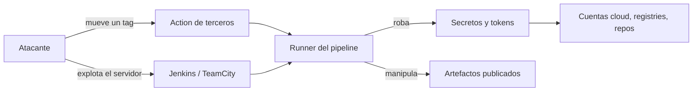

# CVE de supply chain y CI/CD

> Los incidentes y CVE que golpearon la cadena de suministro y los sistemas de CI/CD (xz utils, tj-actions, reviewdog, Trivy, Codecov, Jenkins y TeamCity): qué pasó, cómo comprobar si te afectó y qué controles lo habrían contenido.

!!! info "Cómo leer esta nota"
    Los conceptos (CVE, GHSA, CVSS, KEV) están en [Fundamentos de CVE](fundamentos-cve.md) y el método de análisis en [Cómo investigar un CVE](investigar-un-cve.md). Las puntuaciones y el estado en CISA KEV **pueden cambiar**: los datos se comprobaron en NVD, cve.org, los advisories de cada proyecto y el catálogo KEV en octubre de 2026, y **manda la fuente oficial** enlazada. Esta nota no repite la explicación general de los ataques a la cadena de suministro: para eso, [Software supply chain](../codigo-y-dependencias/cadena-suministro.md#ataques-conocidos) y [Seguridad del pipeline](../identidades-y-pipeline/seguridad-pipeline.md).

!!! note "Código malicioso también recibe CVE"
    Varios de estos casos no son un "error" de programación sino **código malicioso insertado** a propósito (CWE-506, *Embedded Malicious Code*). Aun así se les asigna CVE para que los escáneres y los catálogos como KEV puedan rastrearlos. Cuando un incidente **no** tiene CVE, se dice y se enlaza el aviso oficial.

## Resumen

| Nombre común | CVE | Año | Componente | Tipo (CWE) | CVSS (versión) | En KEV |
| --- | --- | --- | --- | --- | --- | --- |
| Puerta trasera en xz utils | CVE-2024-3094 | 2024 | xz / liblzma 5.6.0 y 5.6.1 | CWE-506 | 10.0 (3.1, NVD y Red Hat) | No |
| reviewdog/action-setup | CVE-2025-30154 | 2025 | GitHub Action `reviewdog/action-setup@v1` | CWE-506 | 8.6 (3.1, NVD) | Sí (2025-03-24) |
| tj-actions/changed-files | CVE-2025-30066 | 2025 | GitHub Action `tj-actions/changed-files` | CWE-506 | 8.6 (3.1, NVD) | Sí (2025-03-18) |
| Compromiso de Trivy y trivy-action | CVE-2026-33634 | 2026 | Trivy 0.69.4, `trivy-action`, `setup-trivy`, imágenes | CWE-506 | 9.4 (4.0, CNA GitHub); 8.8 (3.1, NVD) | Sí (2026-03-26) |
| Codecov Bash Uploader | Sin CVE | 2021 | Script `bash` uploader de Codecov | — | — | — |
| Jenkins CLI file read | CVE-2024-23897 | 2024 | Jenkins core | CWE-22 (NVD), CWE-27 (CISA) | 9.8 (3.1, NVD) | Sí (2024-08-19) |
| TeamCity auth bypass | CVE-2023-42793 | 2023 | JetBrains TeamCity | CWE-288 (CNA), CWE-306 (NVD) | 9.8 (3.1, NVD) | Sí (2023-10-04) |
| TeamCity auth bypass | CVE-2024-27198 | 2024 | JetBrains TeamCity | CWE-288 | 9.8 (3.1, NVD) | Sí (2024-03-07) |
| TeamCity path traversal | CVE-2024-27199 | 2024 | JetBrains TeamCity | CWE-22 / CWE-23 | 7.3 (3.1, NVD) | Sí (2026-04-20) |

## Puerta trasera en xz utils (CVE-2024-3094)

**Qué es / qué pasó.** Una persona que durante unos dos años se ganó la confianza como co-mantenedora de **xz utils** (compresión usada por casi todas las distribuciones Linux) incluyó código malicioso ofuscado en los **tarballs** de las versiones 5.6.0 y 5.6.1. El código no estaba a la vista en el repositorio: el proceso de build extraía un objeto precompilado escondido en archivos de prueba y modificaba `liblzma`. En algunas distribuciones, `sshd` carga `liblzma` indirectamente, lo que habría permitido acceso remoto a quien tuviera la clave del atacante. Un ingeniero lo detectó en marzo de 2024 al investigar una pequeña lentitud en SSH, antes de que llegara a las versiones estables de la mayoría de distribuciones.

**Versiones afectadas y corregidas.** **5.6.0 y 5.6.1**. Las distribuciones volvieron a versiones 5.4.x o publicaron paquetes limpios; el proyecto publicó después versiones sin el código malicioso.

**Impacto.** Potencial acceso remoto no autorizado a servidores SSH (CVSS 10.0). Afectó sobre todo a versiones de desarrollo o *rolling* (Fedora Rawhide y 41, Debian testing/unstable, Kali, openSUSE Tumbleweed, entre otras; revisa el aviso de tu distribución). No está en KEV.

**Cómo detectarlo.**

```bash
xz --version                       # 5.6.0 o 5.6.1 = afectada
dpkg -l | grep -E 'liblzma|xz-utils'   # Debian/Ubuntu
rpm -q xz xz-libs                  # Fedora/RHEL
trivy image mi-imagen:tag          # también lo detectan los escáneres de imágenes
```

**Mitigación.** Volver a una versión no afectada siguiendo el aviso de tu distribución y reconstruir las imágenes que la incluyeran. Revisa también imágenes antiguas guardadas en registries: algunas imágenes publicadas en esas fechas siguieron conteniendo las versiones afectadas.

**Lección DevSecOps.** Lo que se compila desde un **tarball** puede no coincidir con el repositorio; los **builds reproducibles** y la **provenance** ([SLSA](../codigo-y-dependencias/cadena-suministro.md#provenance-y-slsa)) atacan justo esa brecha. También muestra el riesgo de proyectos críticos con un solo mantenedor (algo que mide OpenSSF Scorecard) y el valor de rescanear imágenes ya publicadas ([Container image scanning](../escaneos/container-scanning.md)).

**Enlaces oficiales.** [cve.org](https://www.cve.org/CVERecord?id=CVE-2024-3094) · [NVD](https://nvd.nist.gov/vuln/detail/CVE-2024-3094) · [Tukaani: XZ Utils backdoor](https://tukaani.org/xz-backdoor/) · [Red Hat: CVE-2024-3094](https://access.redhat.com/security/cve/CVE-2024-3094) · [CISA: alerta de xz utils](https://www.cisa.gov/news-events/alerts/2024/03/29/reported-supply-chain-compromise-affecting-xz-utils-data-compression-library-cve-2024-3094)

## reviewdog/action-setup (CVE-2025-30154)

**Qué es / qué pasó.** El 11 de marzo de 2025, entre las 18:42 y las 20:31 UTC, el tag `v1` de `reviewdog/action-setup` apuntó a código malicioso que volcaba los secretos del runner en los **logs del workflow**. Otras actions de reviewdog que usan internamente `action-setup@v1` (`action-shellcheck`, `action-staticcheck`, `action-typos`, `action-ast-grep`, `action-composite-template`) quedaron comprometidas **aunque las fijaras por SHA**, porque la dependencia interna seguía apuntando a un tag. Según las investigaciones publicadas, este compromiso pudo ser el punto de entrada del ataque a tj-actions días después.

**Versiones afectadas y corregidas.** `reviewdog/action-setup@v1` durante esa ventana; el tag se restauró al código legítimo.

**Impacto.** Robo de secretos del pipeline (CVSS 8.6). En repositorios **públicos**, los logs son visibles para cualquiera, así que los secretos quedaron expuestos públicamente.

**Cómo detectarlo.** Busca las actions afectadas en tus workflows y revisa los logs de las ejecuciones del 11 de marzo de 2025 (ver el comando de la sección siguiente).

**Mitigación.** Rotar todos los secretos accesibles a los workflows que corrieron en la ventana y revisar los logs públicos.

**Lección DevSecOps.** Fijar por SHA **tu** workflow no protege de lo que la action carga por dentro. Por eso conviene revisar también las **composite actions** y sus dependencias, preferir actions que fijen sus propias dependencias y auditar con herramientas como zizmor ([Herramientas para auditar el pipeline](../identidades-y-pipeline/seguridad-pipeline.md#herramientas-para-auditar-el-pipeline)).

**Enlaces oficiales.** [cve.org](https://www.cve.org/CVERecord?id=CVE-2025-30154) · [NVD](https://nvd.nist.gov/vuln/detail/CVE-2025-30154) · [GHSA-qmg3-hpqr-gqvc (reviewdog)](https://github.com/reviewdog/reviewdog/security/advisories/GHSA-qmg3-hpqr-gqvc) · [CISA KEV](https://www.cisa.gov/known-exploited-vulnerabilities-catalog?field_cve=CVE-2025-30154)

## tj-actions/changed-files (CVE-2025-30066)

**Qué es / qué pasó.** El 14 y 15 de marzo de 2025, un atacante movió casi todos los tags de `tj-actions/changed-files` (de `v1` a `v45.0.7`), una action usada en decenas de miles de repositorios, para que apuntaran a un commit malicioso que imprimía los secretos del runner en los logs. Quien la usaba por tag ejecutó el código malicioso sin cambiar nada en su repositorio.

**Versiones afectadas y corregidas.** 45.0.7 y anteriores durante la ventana del incidente; versión corregida **46.0.1**. El advisory pide además eliminar cualquier referencia al commit malicioso `0e58ed8671d6b60d0890c21b07f8835ace038e67`.

**Impacto.** Robo de secretos de CI/CD (CVSS 8.6). En KEV.

**Cómo detectarlo.**

```bash
# En un repositorio
grep -rnE 'tj-actions/changed-files|reviewdog/action-' .github/workflows/

# En toda tu organización de GitHub (requiere gh autenticado)
gh search code "tj-actions/changed-files" --owner mi-org
```

Después revisa los logs de los workflows que se ejecutaron en la ventana del incidente; el advisory explica cómo identificar la salida maliciosa.

**Mitigación.** Rotar los secretos expuestos, actualizar a 46.0.1 o posterior y fijar por SHA.

**Lección DevSecOps.** Es el argumento principal para [fijar actions por SHA](../identidades-y-pipeline/seguridad-pipeline.md#pinning-de-actions-por-sha), dar al `GITHUB_TOKEN` [permisos mínimos](../identidades-y-pipeline/seguridad-pipeline.md#permisos-minimos-del-github_token) y usar **OIDC** con credenciales de corta duración en lugar de secretos de larga vida ([Secretos e identidades](../identidades-y-pipeline/secretos-identidades.md)).

**Enlaces oficiales.** [cve.org](https://www.cve.org/CVERecord?id=CVE-2025-30066) · [NVD](https://nvd.nist.gov/vuln/detail/CVE-2025-30066) · [GHSA-mrrh-fwg8-r2c3](https://github.com/advisories/GHSA-mrrh-fwg8-r2c3) · [CISA: alerta de tj-actions/changed-files](https://www.cisa.gov/news-events/alerts/2025/03/18/supply-chain-compromise-third-party-github-action-cve-2025-30066) · [CISA KEV](https://www.cisa.gov/known-exploited-vulnerabilities-catalog?field_cve=CVE-2025-30066)

## Compromiso de Trivy y trivy-action (CVE-2026-33634)

**Qué es / qué pasó.** Continuación de un ataque que empezó a finales de febrero de 2026: la rotación de credenciales tras el primer aviso no fue **atómica** (no se revocaron todas a la vez) y el atacante conservó acceso. El 19 de marzo de 2026 publicó una release maliciosa de **Trivy v0.69.4**, reescribió 76 de los 77 tags de `aquasecurity/trivy-action` y los 7 de `aquasecurity/setup-trivy` para que apuntaran a código que robaba credenciales antes de ejecutar el escaneo normal. El 22 de marzo publicó además imágenes maliciosas **v0.69.5 y v0.69.6** en Docker Hub. El registro del CVE enlaza también incidentes derivados en otros proyectos que usaban estas herramientas en su pipeline.

**Versiones afectadas y corregidas** (según el advisory):

| Componente | Afectado | Seguro |
| --- | --- | --- |
| Binario `trivy` | v0.69.4 (GitHub, Deb, RPM) | v0.69.2 o v0.69.3 |
| Imágenes de `trivy` | v0.69.4 (GHCR, ECR Public, Docker Hub); v0.69.5 y v0.69.6 (Docker Hub) | Imágenes referenciadas por digest de versiones anteriores |
| `trivy-action` | Tags 0.0.1 a 0.34.2 en la ventana; también SHA antiguos (anteriores a 2025-04-09) | v0.35.0 o posterior |
| `setup-trivy` | Cualquier versión sin fijar | v0.2.6 |

**Impacto.** Robo de credenciales de pipelines (CVSS 4.0 de 9.4 según la CNA; 8.8 en CVSS 3.1 según NVD). En KEV.

**Cómo detectarlo.** Busca `trivy-action`, `setup-trivy` y descargas de `trivy` en tus workflows y scripts; revisa logs del 19 al 23 de marzo de 2026; busca en tu organización de GitHub repositorios con el prefijo `tpcp-docs-` (indicador de exfiltración citado en el advisory) y comprueba las versiones de Trivy instaladas con `trivy --version`.

**Mitigación.** Tratar como expuestos **todos** los secretos accesibles a los pipelines afectados y rotarlos; eliminar artefactos de las versiones maliciosas; fijar por SHA; verificar binarios e imágenes con cosign como indica el advisory.

**Lección DevSecOps.** **Una herramienta de seguridad también es una dependencia** y suele correr con permisos amplios. Fijar por SHA (y por digest las imágenes), **verificar firmas** de lo que descargas ([Firma de artefactos con Sigstore](../codigo-y-dependencias/cadena-suministro.md#firma-de-artefactos-con-sigstore)) y rotar credenciales de forma atómica en la respuesta a incidentes ([Detección y respuesta](../gobierno-y-respuesta/deteccion-respuesta.md#respuesta-a-incidentes)).

**Enlaces oficiales.** [cve.org](https://www.cve.org/CVERecord?id=CVE-2026-33634) · [NVD](https://nvd.nist.gov/vuln/detail/CVE-2026-33634) · [GHSA-69fq-xp46-6x23 (Trivy)](https://github.com/aquasecurity/trivy/security/advisories/GHSA-69fq-xp46-6x23) · [Discusión oficial del incidente](https://github.com/aquasecurity/trivy/discussions/10425) · [CISA KEV](https://www.cisa.gov/known-exploited-vulnerabilities-catalog?field_cve=CVE-2026-33634)

## Codecov Bash Uploader (2021, sin CVE)

**Qué es / qué pasó.** Un error en el proceso de creación de la imagen Docker de Codecov expuso una credencial que permitió a un atacante modificar el script **Bash Uploader**, que muchos pipelines descargaban y ejecutaban con `curl ... | bash`. Desde el 31 de enero de 2021, el script modificado enviaba las variables de entorno del pipeline (con sus secretos) a un servidor externo. Un cliente lo detectó el 1 de abril al comparar el **checksum** del script con el publicado, y Codecov lo anunció el 15 de abril.

**Versiones afectadas.** El Bash Uploader y los integradores que lo usaban (la GitHub Action de Codecov, el CircleCI Orb y el Bitrise Step) durante ese periodo. **No tiene CVE asignado**: los CVE de Codecov en NVD corresponden a otros fallos del módulo de npm.

**Impacto.** Robo de secretos de CI (tokens, credenciales cloud) de los clientes.

**Mitigación.** Rotar los secretos que estuvieron disponibles en los pipelines afectados. Codecov sustituyó el Bash Uploader por un uploader nuevo con verificación de firmas.

**Lección DevSecOps.** No ejecutes scripts remotos sin **verificar su checksum o firma**, y limita los secretos que ve cada job ([Version pinning](../codigo-y-dependencias/cadena-suministro.md#version-pinning)).

**Enlaces oficiales.** [Codecov: Security Update (abril de 2021)](https://about.codecov.io/security-update/)

## Jenkins CLI (CVE-2024-23897)

**Qué es / qué pasó.** El parser de comandos del **CLI de Jenkins** reemplazaba un `@` seguido de una ruta por el contenido de ese archivo, una función que Jenkins no desactivaba. Eso permitía a atacantes **sin autenticación** leer archivos del controller (en parte o completos según los permisos), incluidos secretos que, combinados, podían llevar a ejecución de código.

**Versiones afectadas y corregidas.** Jenkins **2.441** y anteriores, y LTS **2.426.2** y anteriores; corregido en 2.442 y LTS 2.426.3.

**Impacto.** Lectura arbitraria de archivos y posible ejecución de código (CVSS 9.8). En KEV, con uso conocido en ransomware.

**Cómo detectarlo.** Comprueba la versión en la interfaz de Jenkins o en el header de respuesta de **tu** servidor:

```bash
curl -sI https://jenkins.mi-empresa.example/login | grep -i '^x-jenkins:'
```

**Mitigación.** Actualizar. Como workaround, el advisory explica cómo **desactivar el acceso al CLI** hasta poder aplicar el parche.

**Lección DevSecOps.** Un servidor de CI **es infraestructura crítica**: guarda credenciales de todo. No lo expongas a internet, ponlo detrás de VPN o un proxy con autenticación, aplícale el mismo [SLA de remediación](../gobierno-y-respuesta/deteccion-respuesta.md#sla-de-remediacion) que a producción y vigila sus [runners](../identidades-y-pipeline/seguridad-pipeline.md#runners-hosted-vs-self-hosted).

**Enlaces oficiales.** [cve.org](https://www.cve.org/CVERecord?id=CVE-2024-23897) · [NVD](https://nvd.nist.gov/vuln/detail/CVE-2024-23897) · [Jenkins Security Advisory 2024-01-24](https://www.jenkins.io/security/advisory/2024-01-24/#SECURITY-3314) · [CISA KEV](https://www.cisa.gov/known-exploited-vulnerabilities-catalog?field_cve=CVE-2024-23897)

## JetBrains TeamCity (CVE-2023-42793, CVE-2024-27198 y CVE-2024-27199)

**Qué es / qué pasó.** Dos fallos de **authentication bypass** (omisión de autenticación) en el servidor de TeamCity, en 2023 y 2024, permitían a un atacante sin credenciales realizar acciones de administrador y llegar a ejecutar código en el servidor de CI. CVE-2023-42793 se explotó por grupos patrocinados por estados y de ransomware; CVE-2024-27198 sufrió explotación masiva con creación de cuentas de administrador falsas. CVE-2024-27199 (*path traversal*, recorrido de rutas) se publicó junto con este último y CISA lo añadió a KEV en 2026.

**Versiones afectadas y corregidas.**

| CVE | Afectado | Corregido |
| --- | --- | --- |
| CVE-2023-42793 | TeamCity anterior a 2023.05.4 | 2023.05.4 |
| CVE-2024-27198 y CVE-2024-27199 | TeamCity anterior a 2023.11.4 | 2023.11.4 |

JetBrains publicó también un **security patch plugin** para versiones antiguas que no podían actualizarse de inmediato. TeamCity Cloud fue parcheado por JetBrains.

**Impacto.** Toma de control del servidor de CI (CVSS 9.8 los dos bypass; 7.3 el path traversal). Los tres en KEV.

**Cómo detectarlo.** Revisa la versión del servidor en la interfaz de TeamCity y, si estuvo expuesto, audita usuarios administradores y tokens de acceso creados en las fechas de explotación.

**Mitigación.** Actualizar o aplicar el plugin de parche; si no es posible, sacar el servidor de internet.

**Lección DevSecOps.** Igual que con Jenkins: el servidor de CI necesita aislamiento de red, inventario y parches rápidos. Una toma de control del CI permite **envenenar los artefactos** que salen de él, por eso la [provenance](../codigo-y-dependencias/cadena-suministro.md#provenance-y-slsa) y la firma de artefactos ayudan a detectar builds manipulados.

**Enlaces oficiales.**

- CVE-2023-42793: [cve.org](https://www.cve.org/CVERecord?id=CVE-2023-42793) · [NVD](https://nvd.nist.gov/vuln/detail/CVE-2023-42793) · [CISA KEV](https://www.cisa.gov/known-exploited-vulnerabilities-catalog?field_cve=CVE-2023-42793) · [JetBrains: post-mortem](https://blog.jetbrains.com/teamcity/2023/09/cve-2023-42793-vulnerability-post-mortem/)
- CVE-2024-27198: [cve.org](https://www.cve.org/CVERecord?id=CVE-2024-27198) · [NVD](https://nvd.nist.gov/vuln/detail/CVE-2024-27198) · [CISA KEV](https://www.cisa.gov/known-exploited-vulnerabilities-catalog?field_cve=CVE-2024-27198)
- CVE-2024-27199: [cve.org](https://www.cve.org/CVERecord?id=CVE-2024-27199) · [NVD](https://nvd.nist.gov/vuln/detail/CVE-2024-27199) · [CISA KEV](https://www.cisa.gov/known-exploited-vulnerabilities-catalog?field_cve=CVE-2024-27199)
- [JetBrains: Fixed security issues](https://www.jetbrains.com/privacy-security/issues-fixed/)

## Patrones comunes

| Patrón | Casos | Control que lo contiene |
| --- | --- | --- |
| **Referencias mutables** (tags que se mueven, `latest`, scripts descargados) | tj-actions, reviewdog, trivy-action, Codecov | Pinning por SHA o digest, verificación de checksum o firma |
| **Secretos de larga duración disponibles en el pipeline** | Todos los de GitHub Actions y Codecov | OIDC, secretos por environment, permisos mínimos del token |
| **Dependencias de las dependencias** (composite actions, tarballs) | reviewdog, xz utils | Auditar workflows (zizmor), builds reproducibles, provenance |
| **Respuesta incompleta** (rotación no atómica) | Trivy | Playbook de rotación: revocar todo a la vez y verificar |
| **Servidor de CI expuesto a internet** | Jenkins, TeamCity | Aislamiento de red, parches con SLA, auditoría de cuentas |
| **Un solo punto de confianza humano** | xz utils | Revisión por dos personas, OpenSSF Scorecard, apoyo a mantenedores |



## Relación con otras secciones

| Enfoque | Qué se mira desde ahí | Nota |
| --- | --- | --- |
| Cloud (el control) | Lo que un secreto robado del pipeline permite hacer en la nube, y cómo acotarlo con roles y guardrails | [IAM: AWS, Azure y GCP](../../cloud/fundamentos/iam-comparativa.md), [Gobernanza](../../cloud/operacion-y-gobierno/gobernanza.md) |
| DevOps (la automatización) | Los pipelines y servidores de CI que estos incidentes atacan | [Integración continua](../../devops/ci-cd/integracion-continua.md) |
| DevSecOps (la verificación) | Pinning, firma, provenance, OIDC y respuesta a incidentes | [Software supply chain](../codigo-y-dependencias/cadena-suministro.md), [Seguridad del pipeline](../identidades-y-pipeline/seguridad-pipeline.md), [Secretos e identidades](../identidades-y-pipeline/secretos-identidades.md), [SCA](../escaneos/sca.md), [Detección y respuesta](../gobierno-y-respuesta/deteccion-respuesta.md), [CVE en aplicaciones y librerías](cve-aplicaciones-librerias.md), [CVE en contenedores y Kubernetes](cve-contenedores-kubernetes.md) |

## Referencias

- [CVE Program (cve.org)](https://www.cve.org/)
- [NVD: National Vulnerability Database](https://nvd.nist.gov/)
- [CISA: Known Exploited Vulnerabilities Catalog](https://www.cisa.gov/known-exploited-vulnerabilities-catalog)
- [GitHub Advisory Database](https://github.com/advisories)
- [GitHub: fortalecimiento de seguridad para GitHub Actions](https://docs.github.com/es/actions/security-for-github-actions/security-guides/security-hardening-for-github-actions)
- [Jenkins Security Advisories](https://www.jenkins.io/security/advisories/)
- [JetBrains: Fixed security issues](https://www.jetbrains.com/privacy-security/issues-fixed/)
- [OpenSSF Scorecard](https://scorecard.dev/)
- [SLSA](https://slsa.dev/)
