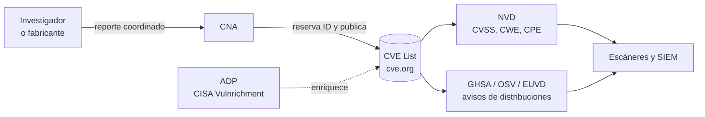

---
tags:
  - devsecops
  - vulnerabilidades
  - cve
  - seguridad
---

# Fundamentos de CVE

> Qué es un CVE, quién lo asigna y quién lo enriquece (CVE Program, CNAs, NVD), y cómo leer las señales que lo acompañan: CWE, CVSS, EPSS, CISA KEV, GHSA, OSV, avisos de fabricantes y la EUVD de ENISA.

!!! info "Dónde encaja"
    Esta nota es el vocabulario del bloque **Vulnerabilidades y CVE**. El paso a paso para analizar un CVE concreto está en [Cómo investigar un CVE](investigar-un-cve.md), y el catálogo de CVE históricos empieza, por ejemplo, en [Protocolos y hardware](cve-protocolos-hardware.md). Cómo se priorizan y en qué plazos se corrigen (CVSS + EPSS + KEV y SLA de remediación) está en [Detección y respuesta](../gobierno-y-respuesta/deteccion-respuesta.md#vulnerability-management); aquí no se repite.

## ¿Qué es?

Un **CVE** (*Common Vulnerabilities and Exposures*) es un **identificador público y único** para una vulnerabilidad concreta de un producto concreto. Su función es que todo el mundo (fabricantes, escáneres, equipos de seguridad, boletines) hable de **la misma** vulnerabilidad con el mismo nombre.

Conviene separar tres cosas que se confunden a menudo:

| Concepto | Qué es | Ejemplo |
| --- | --- | --- |
| **Vulnerabilidad** (*vulnerability*) | El fallo en sí, en un producto y unas versiones | El *lookup* JNDI de Log4j 2 ejecuta código remoto |
| **CVE ID** | El nombre público de ese fallo | `CVE-2021-44228` |
| **CVE Record** (registro CVE) | La ficha publicada con descripción, productos afectados y referencias | La página de `CVE-2021-44228` en cve.org |
| **Debilidad** (*weakness*, CWE) | El **tipo** de error de programación que la causa | CWE-917 (inyección en lenguaje de expresiones) |

!!! warning "Un CVE no dice si te afecta ni cuánto te urge"
    El registro CVE identifica y describe. La gravedad (CVSS), la probabilidad de explotación (EPSS), si ya se explota (KEV) y si tu sistema está expuesto son **capas que se añaden encima**, cada una desde una fuente distinta. Por eso la misma vulnerabilidad puede tener varias puntuaciones.

Además, no toda vulnerabilidad tiene CVE: los fallos en servicios SaaS que el proveedor corrige en su lado, o los paquetes maliciosos publicados a propósito, suelen tener otro tipo de aviso (ver [Supply chain y CI/CD](cve-supply-chain-cicd.md)).

## El identificador y el registro

El formato es `CVE-AAAA-NNNN…`:

- **AAAA**: el año en que se **reservó** el ID, no el de descubrimiento ni el de publicación. Por eso Spectre es `CVE-2017-5753` aunque se publicó en enero de 2018.
- **NNNN…**: número secuencial de **4 dígitos o más** (desde 2014 no hay límite: `CVE-2024-21626`, `CVE-2023-44487`).

El registro se publica en formato **CVE JSON 5** e incluye, como mínimo, la descripción, el producto y las versiones afectadas, y referencias. Puede incluir además el CWE (`problemTypes`), métricas CVSS de la propia CNA y contenedores **ADP** (*Authorized Data Publisher*) con datos añadidos por terceros autorizados, como **CISA-ADP** (programa *Vulnrichment*: CVSS, CWE y SSVC cuando la CNA no los dio).

| Estado del registro | Qué significa |
| --- | --- |
| **Reserved** (reservado) | El ID está asignado pero aún no hay detalles públicos (divulgación coordinada en curso) |
| **Published** (publicado) | Tiene descripción, productos afectados y referencias; ya es público |
| **Rejected** (rechazado) | El ID no debe usarse: duplicado, no era una vulnerabilidad o se retiró. Se conserva para que no se reutilice |

## El CVE Program y las CNAs

El **CVE Program** lo opera **MITRE** con patrocinio de **CISA** (EE. UU.) y lo gobierna el **CVE Board**. No asigna los IDs una sola entidad: lo hacen cientos de **CNAs** (*CVE Numbering Authorities*, autoridades de numeración).

| Rol | Quién | Qué hace |
| --- | --- | --- |
| **CNA** | Fabricantes (Microsoft, Red Hat, Apache, GitHub…), CERTs, investigadores | Asigna IDs y publica registros dentro de su **alcance** (*scope*), normalmente sus propios productos |
| **Root** / **Top-Level Root** | MITRE, CISA y otras organizaciones (por ejemplo, ENISA para entidades europeas) | Reclutan, forman y coordinan a las CNAs de su ámbito |
| **CNA-LR** (*CNA of Last Resort*) | MITRE (y CISA para sistemas industriales y dispositivos médicos) | Asigna IDs cuando ninguna otra CNA tiene alcance |
| **ADP** | CISA-ADP, el propio CVE Program | Añaden información al registro sin cambiar lo que publicó la CNA |



!!! note "La continuidad del programa"
    En abril de 2025 el contrato de MITRE estuvo a punto de expirar sin renovación; CISA lo prorrogó a última hora y surgió la **CVE Foundation**, una organización sin ánimo de lucro para dar al programa una gobernanza más independiente. La lección para ti: no dependas de una sola fuente. Consulta el estado actual en [cve.org](https://www.cve.org/).

## NVD: el enriquecimiento

La **NVD** (*National Vulnerability Database*, del NIST) importa cada registro CVE y lo **enriquece** con:

- **CVSS** calculado por el NIST (fuente `nvd@nist.gov`, tipo *Primary*), junto a los de la CNA o CISA-ADP (tipo *Secondary*).
- **CWE** asignado o revisado por el NIST.
- **CPE** (*Common Platform Enumeration*): las configuraciones de producto y versión afectadas, en formato `cpe:2.3:a:apache:log4j:…`. Muchos escáneres de hosts dependen de estos CPE para hacer *matching*.
- **Etiquetas en las referencias** (*Vendor Advisory*, *Patch*, *Exploit*, *Third Party Advisory*…).
- Los campos de **KEV** (`cisaExploitAdd`, `cisaActionDue`) cuando el CVE está en el catálogo de CISA.

| Estado en la NVD (`vulnStatus`) | Qué significa |
| --- | --- |
| **Received** | Llegó desde la CVE List; sin enriquecer todavía |
| **Awaiting Analysis** | En cola para enriquecer |
| **Undergoing Analysis** | Un analista lo está enriqueciendo |
| **Analyzed** | Enriquecimiento completo |
| **Modified** | El registro cambió después del análisis; puede que el enriquecimiento ya no esté al día |
| **Deferred** | El NIST no prioriza su enriquecimiento |
| **Rejected** | Rechazado en la CVE List (no aparece en las búsquedas por defecto) |

!!! warning "La NVD ya no enriquece todo"
    Desde febrero de 2024 la NVD acumuló un gran retraso. En abril de 2026 el NIST pasó a un modelo **basado en riesgo**: prioriza los CVE de **CISA KEV** (objetivo: un día hábil), el software usado por el gobierno federal y el *critical software* de la EO 14028. El resto entra en la NVD con prioridad mínima, sin enriquecimiento inmediato, y el NIST deja de añadir rutinariamente su propio CVSS cuando la CNA ya dio uno. Consecuencia práctica: **muchos CVE recientes no tendrán CPE ni CVSS del NIST**, y un escáner que dependa solo de la NVD los puede pasar por alto. Usa también GHSA, OSV y los avisos de fabricantes y distribuciones.

## CWE y CWE Top 25

**CWE** (*Common Weakness Enumeration*) es el catálogo de **tipos** de debilidad, mantenido por MITRE. Un CVE dice *qué producto falla*; el CWE dice *qué clase de error es*. Sirve para encontrar la causa raíz y para decidir qué controles atacan muchos CVE a la vez (por ejemplo, SAST con reglas para CWE-89, ver [SAST](../escaneos/sast.md)).

La **CWE Top 25** (*Most Dangerous Software Weaknesses*) ordena las debilidades más peligrosas según su frecuencia y severidad en los CVE de los últimos años. Las 10 primeras de la edición **2025**:

| # | CWE | Debilidad |
| --- | --- | --- |
| 1 | CWE-79 | Cross-site Scripting (XSS) |
| 2 | CWE-89 | SQL Injection |
| 3 | CWE-352 | Cross-Site Request Forgery (CSRF) |
| 4 | CWE-862 | Missing Authorization |
| 5 | CWE-787 | Out-of-bounds Write |
| 6 | CWE-22 | Path Traversal |
| 7 | CWE-416 | Use After Free |
| 8 | CWE-125 | Out-of-bounds Read |
| 9 | CWE-78 | OS Command Injection |
| 10 | CWE-94 | Code Injection |

Para un CVE, la NVD usa a veces `NVD-CWE-noinfo` (no hay información suficiente) o `NVD-CWE-Other` (no encaja en la vista que usa el NIST).

## CVSS

**CVSS** (*Common Vulnerability Scoring System*, de FIRST) puntúa la **gravedad técnica** de 0 a 10. Los rangos de severidad (Low, Medium, High, Critical) están en [Fundamentos DevSecOps](../fundamentos-devsecops.md#cvss).

| | CVSS v3.1 (2019) | CVSS v4.0 (noviembre de 2023) |
| --- | --- | --- |
| Grupos de métricas | Base, Temporal, Environmental | **Base**, **Threat**, **Environmental**, **Supplemental** |
| Novedades | Métrica *Scope* (S) | Desaparece *Scope*: el impacto se separa en **sistema vulnerable** (VC/VI/VA) y **sistemas posteriores** (SC/SI/SA); nueva métrica **Attack Requirements** (AT); *User Interaction* pasa a None/Passive/Active |
| Nomenclatura | "CVSS 9.8" | Indica qué grupos se usaron: **CVSS-B** (solo base), **CVSS-BT**, **CVSS-BE**, **CVSS-BTE** |
| Uso real | Sigue siendo la más publicada (NVD, la mayoría de CNAs) | Cada vez más CNAs la publican; conviven las dos |

### Leer un vector

El **vector** (*vector string*) es más útil que el número: dice **por qué** sale esa puntuación. El de Log4Shell en la NVD:

```text
CVSS:3.1/AV:N/AC:L/PR:N/UI:N/S:C/C:H/I:H/A:H   -> 10.0 Critical
```

| Métrica | Valor | Lectura |
| --- | --- | --- |
| AV (*Attack Vector*) | N (Network) | Se explota por red, en remoto |
| AC (*Attack Complexity*) | L (Low) | Sin condiciones especiales |
| PR (*Privileges Required*) | N (None) | Sin autenticación |
| UI (*User Interaction*) | N (None) | Nadie tiene que hacer clic |
| S (*Scope*) | C (Changed) | El impacto sale del componente vulnerable |
| C / I / A | H / H / H | Pérdida total de confidencialidad, integridad y disponibilidad |

En v4.0 el mismo tipo de fallo se escribiría con `CVSS:4.0/AV:N/AC:L/AT:N/PR:N/UI:N/VC:H/VI:H/VA:H/SC:…/SI:…/SA:…`. Las métricas **Threat** (*Exploit Maturity*) y **Environmental** las debe ajustar **tu organización**: el número que publica la NVD o la CNA es solo la parte base.

!!! tip "Fíjate en quién puntúa"
    En la NVD verás a menudo dos o tres puntuaciones: la del NIST (*Primary*), la de la CNA y la de CISA-ADP (*Secondary*). Pueden no coincidir. El fabricante conoce mejor su producto; el NIST aplica criterios homogéneos. Anota siempre **versión de CVSS y fuente** al citar una puntuación.

## EPSS

**EPSS** (*Exploit Prediction Scoring System*, de FIRST) estima la **probabilidad** de que un CVE publicado se explote en los próximos **30 días**. Se recalcula **cada día** para todos los CVE y da dos valores:

- **epss**: probabilidad de 0 a 1 (0.05 = 5 %).
- **percentile**: qué proporción de CVE tiene una puntuación igual o menor (0.95 = está por encima del 95 % de los CVE).

La versión 4 del modelo se publicó en marzo de 2025. EPSS no mide impacto: un CVE con EPSS alto y CVSS medio puede ser más urgente que uno crítico que nadie explota. Se consulta con una API pública (ver [Cómo investigar un CVE](investigar-un-cve.md#consultar-las-apis)).

## CISA KEV

El catálogo **KEV** (*Known Exploited Vulnerabilities*) de CISA lista los CVE con **explotación confirmada**. Para entrar, un CVE debe cumplir tres criterios: tener **CVE ID**, tener **guía de remediación clara** y haber **evidencia fiable de explotación activa**. Cada entrada incluye `dateAdded`, `dueDate`, `requiredAction` y `knownRansomwareCampaignUse` (`Known` o `Unknown`). Se descarga como JSON o CSV.

| Directiva | Qué establece |
| --- | --- |
| **BOD 22-01** (noviembre de 2021) | Creó el catálogo y obligaba a las agencias federales civiles de EE. UU. a corregir cada entrada en plazo (dos semanas por defecto para CVE recientes) |
| **BOD 26-04** (junio de 2026), *Prioritizing Security Updates Based on Risk* | **Sustituye** a la BOD 22-01 y a la BOD 19-02. Los plazos dependen de cuatro factores: exposición pública del activo, estar en KEV, si la explotación es **automatizable** y el **impacto técnico** (control parcial o total). Lo más grave tiene 3 días más un triage forense |

Las directivas solo obligan a agencias federales de EE. UU., pero el catálogo es una referencia mundial: si un CVE está en KEV y lo tienes expuesto, es prioridad máxima.

!!! info "SSVC"
    Los factores *Automatable* y *Technical Impact* vienen de **SSVC** (*Stakeholder-Specific Vulnerability Categorization*), un modelo de decisión en árbol que CISA publica para muchos CVE en el contenedor CISA-ADP. En la API de la NVD aparece como `ssvcV203` con `exploitation` (none / poc / active), `automatable` y `technicalImpact`.

## GHSA, OSV y avisos de fabricantes

| Fuente | Qué es | Por qué importa |
| --- | --- | --- |
| **GHSA** (*GitHub Security Advisory*) | Base de avisos de GitHub (`GHSA-xxxx-xxxx-xxxx`), revisados por su equipo para npm, PyPI, Maven, Go, RubyGems, NuGet, Rust, Composer, Actions… | GitHub es CNA; muchos avisos de paquetes salen aquí **antes** que en la NVD. Alimenta Dependabot |
| **OSV** (*Open Source Vulnerabilities*) | Formato abierto (esquema OSV) y base agregada en **OSV.dev** (Google) | Agrega GHSA, PyPI (`PYSEC-`), Go (`GO-`), RustSec, distribuciones Linux… Describe los rangos afectados **en la versión del ecosistema**, más preciso que CPE para dependencias |
| **Avisos de fabricantes** (*vendor advisories*) | MSRC (Patch Tuesday, segundo martes de cada mes), Red Hat, Ubuntu (USN), Debian (DSA y *security tracker*), Cisco PSIRT, Oracle (CPU trimestral)… | Mandan sobre las versiones corregidas, los *backports* y los workarounds de **su** producto |
| **CSAF** y **VEX** | Formatos para publicar avisos legibles por máquina (CSAF, de OASIS) y declarar si un producto está **afectado o no** (VEX) | Permiten automatizar el "¿me afecta?". VEX en práctica: [Container scanning](../escaneos/container-scanning.md#vex-declarar-lo-que-no-es-explotable) |

!!! warning "Para paquetes de una distribución, manda la distribución"
    Debian, Ubuntu o Red Hat aplican parches sin cambiar la versión upstream (*backports*). Que `openssl` diga 3.0.2 no significa que siga vulnerable. Comprueba el estado en el *security tracker* de la distribución (ver [Container scanning](../escaneos/container-scanning.md)).

## ENISA y la EUVD

La **EUVD** (*European Union Vulnerability Database*) de **ENISA** está operativa desde mayo de 2025, creada por mandato de la directiva **NIS2**. Agrega registros CVE, avisos de fabricantes, el catálogo KEV y aportes de CSIRTs nacionales, y asigna su propio identificador (`EUVD-AAAA-NNNNN`; Log4Shell es `EUVD-2021-34768`). Tiene interfaz web y API pública. ENISA participa además en el CVE Program como CNA y como Root para entidades europeas, y la EUVD gana relevancia con las obligaciones de notificación del **Cyber Resilience Act**. Es una fuente complementaria, no un sustituto del CVE ID: el ID común sigue siendo el CVE.

## Zero-day y n-day

| Término | Qué significa | Qué puedes hacer |
| --- | --- | --- |
| **Zero-day** (día cero) | Vulnerabilidad que se explota **antes** de que exista parche, o antes de que el fabricante la conozca | Defensa en profundidad: mínimo privilegio, segmentación, WAF, detección en runtime y respuesta a incidentes |
| **N-day** (o *1-day*) | Vulnerabilidad **ya publicada**, con o sin parche, que se explota en sistemas que no se actualizaron | Gestión de vulnerabilidades: inventario, escaneo continuo y SLA de remediación |

La mayoría de los incidentes reales usan **n-days**: el parche existía, pero no se aplicó a tiempo. Los informes de CISA sobre las vulnerabilidades más explotadas lo repiten cada año (ver [Perímetro y VPN](cve-perimetro-vpn.md)).

## Fuentes oficiales

| Fuente | Para qué | Enlace |
| --- | --- | --- |
| CVE Program | Registro oficial, CNA, estado | [cve.org](https://www.cve.org/) |
| NVD | CVSS del NIST, CPE, CWE, API | [nvd.nist.gov](https://nvd.nist.gov/) |
| CISA KEV | Explotación confirmada | [Catálogo KEV](https://www.cisa.gov/known-exploited-vulnerabilities-catalog) |
| FIRST EPSS | Probabilidad de explotación | [first.org/epss](https://www.first.org/epss/) |
| FIRST CVSS | Especificación y calculadoras | [first.org/cvss](https://www.first.org/cvss/) |
| CWE | Tipos de debilidad y Top 25 | [cwe.mitre.org](https://cwe.mitre.org/) |
| GitHub Advisory Database | Avisos de paquetes y Actions | [github.com/advisories](https://github.com/advisories) |
| OSV.dev | Base agregada y API | [osv.dev](https://osv.dev/) |
| ENISA EUVD | Base europea | [euvd.enisa.europa.eu](https://euvd.enisa.europa.eu/) |
| CERT/CC | Notas de vulnerabilidad coordinadas (VU#) | [kb.cert.org/vuls](https://kb.cert.org/vuls/) |

## Relación con otras secciones

| Enfoque | Qué se mira desde ahí | Nota |
| --- | --- | --- |
| Cloud (el control) | Qué parte de los parches te toca a ti y cuál al proveedor; escáneres nativos | [Shared Responsibility Model](../../cloud/fundamentos/responsabilidad-compartida.md), [Fundamentos de seguridad cloud](../../cloud/seguridad/fundamentos-seguridad-cloud.md) |
| DevOps (la automatización) | Reconstruir y desplegar rápido cuando sale un CVE | [Integración continua](../../devops/ci-cd/integracion-continua.md), [Despliegue continuo](../../devops/ci-cd/despliegue-continuo.md) |
| DevSecOps (la verificación) | Riesgo, escaneos que consumen estas fuentes y gestión de vulnerabilidades | [Fundamentos DevSecOps](../fundamentos-devsecops.md#gestion-de-riesgo), [SCA](../escaneos/sca.md), [Container scanning](../escaneos/container-scanning.md), [Detección y respuesta](../gobierno-y-respuesta/deteccion-respuesta.md), [Cómo investigar un CVE](investigar-un-cve.md) |
| Negocio TI (el porqué) | Riesgo, apetito de riesgo y obligaciones regulatorias | [Gobierno y riesgo de TI](../../negocio/gobierno-riesgo-ti.md) |

## Referencias

- [CVE Program: cve.org](https://www.cve.org/)
- [CVE Program: Process (ciclo de vida de un registro)](https://www.cve.org/About/Process)
- [CVE Program: lista de CNAs](https://www.cve.org/PartnerInformation/ListofPartners)
- [NVD: vulnerability status](https://nvd.nist.gov/vuln/vulnerability-status)
- [NIST: NIST updates NVD operations to address record CVE growth (abril de 2026)](https://www.nist.gov/news-events/news/2026/04/nist-updates-nvd-operations-address-record-cve-growth)
- [FIRST: CVSS v4.0](https://www.first.org/cvss/v4-0/)
- [FIRST: CVSS v3.1 specification](https://www.first.org/cvss/v3-1/specification-document)
- [FIRST: EPSS](https://www.first.org/epss/)
- [CWE Top 25 (2025)](https://cwe.mitre.org/top25/archive/2025/2025_cwe_top25.html)
- [CISA: Known Exploited Vulnerabilities Catalog](https://www.cisa.gov/known-exploited-vulnerabilities-catalog)
- [CISA: BOD 26-04 Prioritizing Security Updates Based on Risk](https://www.cisa.gov/news-events/directives/bod-26-04-prioritizing-security-updates-based-risk)
- [CISA: BOD 22-01 (archivada)](https://www.cisa.gov/news-events/directives/bod-22-01-reducing-significant-risk-known-exploited-vulnerabilities)
- [CISA: SSVC](https://www.cisa.gov/stakeholder-specific-vulnerability-categorization-ssvc)
- [CISA Vulnrichment](https://github.com/cisagov/vulnrichment)
- [GitHub Advisory Database](https://docs.github.com/es/code-security/security-advisories/working-with-global-security-advisories-from-the-github-advisory-database/about-the-github-advisory-database)
- [OSV schema](https://ossf.github.io/osv-schema/)
- [ENISA: European Vulnerability Database](https://euvd.enisa.europa.eu/)
- [OASIS CSAF](https://oasis-open.github.io/csaf-documentation/)
