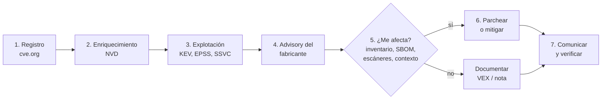

---
tags:
  - devsecops
  - vulnerabilidades
  - cve
  - seguridad
  - python
---

# Cómo investigar un CVE

> Paso a paso para responder tres preguntas cuando sale un CVE: ¿nos afecta?, ¿qué tan urgente es? y ¿qué hacemos?, con las fuentes oficiales, consultas reales a las APIs de NVD, EPSS, KEV y OSV, y Log4Shell como ejemplo resuelto.

!!! info "Antes de leer"
    Esta nota usa el vocabulario de [Fundamentos de CVE](fundamentos-cve.md) (CNA, NVD, CVSS, EPSS, KEV, GHSA, OSV). Los plazos de remediación por severidad y cómo se registran las excepciones están en [Detección y respuesta](../gobierno-y-respuesta/deteccion-respuesta.md#vulnerability-management); esta nota es el trabajo de análisis que va **antes** de aplicar ese SLA.

## ¿Qué es?

**Investigar un CVE** (*vulnerability triage*, triage de vulnerabilidades) es pasar de un titular ("crítica en Log4j") a una decisión documentada. El escáner te dice que un paquete coincide con un CVE; la investigación decide si de verdad te afecta, con qué prioridad y qué acción tomar.



## Paso 1: leer el registro en cve.org

Abre `https://www.cve.org/CVERecord?id=CVE-…` y fíjate en:

- **Estado**: *Published*, *Reserved* o *Rejected*. Un CVE *Reserved* del que se habla en redes todavía no tiene detalles oficiales.
- **CNA**: quién lo publicó. Si es el propio fabricante, su descripción y sus versiones son la referencia.
- **Producto y versiones afectadas** (*affected*): revisa los rangos con cuidado, a veces son imprecisos o están escritos a mano.
- **Referencias**: el advisory del fabricante, el commit del parche y, a veces, análisis técnicos.
- **Contenedor CISA-ADP**: CVSS, CWE y SSVC añadidos por CISA cuando la CNA no los dio.

## Paso 2: el enriquecimiento en NVD

En `https://nvd.nist.gov/vuln/detail/CVE-…` revisa:

- El **estado** (`Analyzed`, `Awaiting Analysis`, `Deferred`…). Si no está analizado, no habrá CPE ni CVSS del NIST: no concluyas "no tiene puntuación, entonces es leve".
- **Todas** las puntuaciones CVSS, con su versión y su fuente (NIST, CNA, CISA-ADP), y el **vector**.
- El **CWE**, para entender la clase de fallo y la causa raíz.
- Las **configuraciones CPE**: qué productos y versiones considera afectados el NIST.
- Las referencias etiquetadas como **Vendor Advisory** y **Patch**.

## Paso 3: ¿se está explotando?

| Señal | Pregunta | Dónde |
| --- | --- | --- |
| **CISA KEV** | ¿Hay explotación confirmada? ¿Se usa en ransomware? | Catálogo KEV (JSON/CSV) o los campos `cisaExploitAdd` de la NVD |
| **EPSS** | ¿Qué probabilidad hay de explotación en 30 días? | API de FIRST |
| **SSVC** (CISA-ADP) | ¿Explotación none / poc / active? ¿Automatizable? ¿Impacto parcial o total? | Registro en cve.org o `ssvcV203` en la NVD |
| Avisos del fabricante y de CERTs | ¿Hay explotación "limitada y dirigida"? ¿Indicadores de compromiso? | Advisory del fabricante, CERT nacional |

Si está en KEV **y** el activo está expuesto a internet, trátalo como incidente potencial: además de parchear, busca indicios de compromiso **anteriores** al parche.

## Paso 4: el advisory del fabricante

El aviso del fabricante o del proyecto (o el de tu **distribución** para paquetes del sistema) manda sobre los datos genéricos:

- **Versiones corregidas** por rama (a menudo hay varias líneas soportadas).
- **Backports**: Debian, Ubuntu o Red Hat corrigen sin cambiar la versión upstream. Consulta su *security tracker*.
- **Workarounds** oficiales y sus límites (algunos se descubren insuficientes días después).
- **Condiciones** para que sea explotable: una opción de configuración, un módulo concreto, un protocolo activado.
- **CVE relacionados**: los parches incompletos generan CVE nuevos (Log4Shell tuvo tres más en tres semanas).

## Paso 5: ¿me afecta?

### Inventario y SBOM

Si ya tienes **SBOM** (*Software Bill of Materials*) de cada release, la respuesta es una consulta, no una búsqueda manual (ver [El SBOM como insumo](../escaneos/sca.md#el-sbom-como-insumo)):

```bash
grype sbom:./sbom.cdx.json -o json > hallazgos.json
grype explain --id CVE-2021-44228 < hallazgos.json   # explica por qué coincide y dónde está
trivy sbom sbom.cdx.json | grep CVE-2021-44228
```

### Escanear lo que corre

```bash
trivy image --severity CRITICAL mi-app:1.4.2 | grep CVE-2021-44228
trivy fs --scanners vuln .                           # repositorio con lockfiles
grype mi-app:1.4.2 -o json | grype explain --id CVE-2021-44228
```

Los escáneres detectan también JAR anidados dentro de *fat JARs*; una búsqueda por nombre de archivo (`find / -name "log4j-core-*.jar"`) no los ve. Escanea también las **imágenes ya publicadas** en el registry y lo que corre en el clúster: ver [Container scanning](../escaneos/container-scanning.md) y [KSPM](../escaneos/kspm.md). En la nube, Amazon Inspector, Defender for Cloud y Artifact Analysis permiten filtrar los hallazgos por CVE ID.

### Contexto

Que el paquete esté no basta. Pregúntate:

- ¿Se **carga** el componente vulnerable en ejecución? ¿Se llama a la función afectada? (*reachability*, ver [SCA](../escaneos/sca.md#reachability)).
- ¿Se cumplen las **condiciones** del advisory (configuración, módulo activo, versión de Java)?
- ¿Está **expuesto** a internet o solo en una red interna? ¿Qué datos maneja?
- ¿Hay un **control compensatorio** ya activo (WAF, egress bloqueado, segmentación)?

Documenta la respuesta. Si eres proveedor de software, publícala como **VEX** (ver [Container scanning](../escaneos/container-scanning.md#vex-declarar-lo-que-no-es-explotable)).

## Consultar las APIs

Todas estas APIs son públicas y de solo lectura. Las salidas siguientes son **reales** (consultadas en octubre de 2026) y abreviadas; tus resultados cambiarán con el tiempo (EPSS se recalcula cada día). Los ejemplos con `curl` usan `jq` para filtrar el JSON.

!!! warning "Límites de la API de NVD"
    Sin API key, la NVD permite **5 peticiones por ventana de 30 segundos**; con API key (gratuita, se solicita en la web de la NVD), 50. Si te pasas responde con error (403 o 429): espera unos 6 segundos entre peticiones y reintenta con *backoff*. La key va en la cabecera `apiKey`, nunca escrita en el código (ver [APIs y HTTP](../../python/scripting/apis-http.md)).

=== "NVD"

    ```bash
    curl -s "https://services.nvd.nist.gov/rest/json/cves/2.0?cveId=CVE-2021-44228" \
      | jq '.vulnerabilities[0].cve | {id, vulnStatus, cisaExploitAdd,
          cvss: (.metrics.cvssMetricV31[] | select(.source == "nvd@nist.gov") | .cvssData | {baseSeverity, vectorString}),
          cwe: [.weaknesses[].description[].value]}'
    ```

    ```json
    {
      "id": "CVE-2021-44228",
      "vulnStatus": "Analyzed",
      "cisaExploitAdd": "2021-12-10",
      "cvss": {
        "baseSeverity": "CRITICAL",
        "vectorString": "CVSS:3.1/AV:N/AC:L/PR:N/UI:N/S:C/C:H/I:H/A:H"
      },
      "cwe": ["CWE-20", "CWE-400", "CWE-502", "CWE-917"]
    }
    ```

    Otros parámetros útiles de la misma API: `cpeName=` (CVE de un producto), `pubStartDate=`/`pubEndDate=` (rango de fechas, máximo 120 días), `hasKev` (solo los que están en KEV) y `resultsPerPage`/`startIndex` para paginar.

=== "cve.org"

    ```bash
    curl -s "https://cveawg.mitre.org/api/cve/CVE-2021-44228" \
      | jq '{state: .cveMetadata.state, cna: .cveMetadata.assignerShortName,
             title: .containers.cna.title, adp: [.containers.adp[]?.providerMetadata.shortName]}'
    ```

    ```json
    {
      "state": "PUBLISHED",
      "cna": "apache",
      "title": "Apache Log4j2 JNDI features do not protect against attacker controlled LDAP and other JNDI related endpoints",
      "adp": ["CVE", "CISA-ADP"]
    }
    ```

=== "EPSS y KEV"

    ```bash
    curl -s "https://api.first.org/data/v1/epss?cve=CVE-2021-44228,CVE-2021-45046" | jq '.data'

    curl -s -o kev.json https://www.cisa.gov/sites/default/files/feeds/known_exploited_vulnerabilities.json
    jq '.vulnerabilities[] | select(.cveID == "CVE-2021-44228")
        | {cveID, dateAdded, dueDate, knownRansomwareCampaignUse}' kev.json
    ```

    ```json
    [
      { "cve": "CVE-2021-45046", "epss": "0.999770000", "percentile": "0.999800000", "date": "2026-10-26" },
      { "cve": "CVE-2021-44228", "epss": "0.999990000", "percentile": "1.000000000", "date": "2026-10-26" }
    ]
    {
      "cveID": "CVE-2021-44228",
      "dateAdded": "2021-12-10",
      "dueDate": "2021-12-24",
      "knownRansomwareCampaignUse": "Known"
    }
    ```

=== "OSV"

    ```bash
    # ¿Qué vulnerabilidades tiene esta versión exacta de un paquete?
    curl -s -X POST https://api.osv.dev/v1/query \
      -d '{"package": {"ecosystem": "Maven", "name": "org.apache.logging.log4j:log4j-core"}, "version": "2.14.1"}' \
      | jq '[.vulns[] | {id, aliases}]'

    # Detalle de un aviso: rangos afectados por ecosistema
    curl -s https://api.osv.dev/v1/vulns/GHSA-jfh8-c2jp-5v3q \
      | jq '[.affected[] | select(.package.name == "org.apache.logging.log4j:log4j-core") | .ranges[].events]'
    ```

    ```json
    [
      { "id": "GHSA-7rjr-3q55-vv33", "aliases": ["CVE-2021-45046"] },
      { "id": "GHSA-8489-44mv-ggj8", "aliases": ["CVE-2021-44832"] },
      { "id": "GHSA-jfh8-c2jp-5v3q", "aliases": ["CVE-2021-44228"] },
      { "id": "GHSA-p6xc-xr62-6r2g", "aliases": ["CVE-2021-45105"] }
    ]
    [
      [{ "introduced": "2.13.0" }, { "fixed": "2.15.0" }],
      [{ "introduced": "2.0-beta9" }, { "fixed": "2.3.1" }],
      [{ "introduced": "2.4" }, { "fixed": "2.12.2" }]
    ]
    ```

    La primera salida está abreviada: la consulta devuelve 8 avisos, 4 de ellos de 2025 y 2026. OSV responde por **paquete y versión del ecosistema**, sin depender de CPE. Fíjate en que incluso la 2.17.1, la versión "segura" de finales de 2021, tiene hoy avisos posteriores.

### El mismo triage en Python

Un script que resume un CVE con las tres fuentes. Requiere `requests` (`pip install requests`, idealmente en un entorno virtual: ver [Entorno de trabajo](../../python/fundamentos/entorno-python.md)).

```python title="triage_cve.py"
"""Resume un CVE con datos de NVD, EPSS y CISA KEV."""
import os
import sys
import time

import requests

NVD = "https://services.nvd.nist.gov/rest/json/cves/2.0"
EPSS = "https://api.first.org/data/v1/epss"
KEV = "https://www.cisa.gov/sites/default/files/feeds/known_exploited_vulnerabilities.json"


def nvd(cve_id: str) -> dict:
    headers = {}
    if key := os.environ.get("NVD_API_KEY"):  # opcional: sube el límite de peticiones
        headers["apiKey"] = key
    for intento in range(4):
        r = requests.get(NVD, params={"cveId": cve_id}, headers=headers, timeout=30)
        if r.status_code in (403, 429, 503):  # rate limit o servicio saturado
            time.sleep(6 * (intento + 1))
            continue
        r.raise_for_status()
        return r.json()["vulnerabilities"][0]["cve"]
    raise RuntimeError(f"NVD no respondió para {cve_id}")


def cvss(cve: dict) -> str:
    for clave in ("cvssMetricV40", "cvssMetricV31", "cvssMetricV30"):
        for m in cve.get("metrics", {}).get(clave, []):
            d = m["cvssData"]
            return f'{d["baseScore"]} {d["baseSeverity"]} (v{d["version"]}, {m["source"]})'
    return "sin CVSS"


def main(ids: list[str]) -> None:
    kev = {v["cveID"]: v for v in requests.get(KEV, timeout=60).json()["vulnerabilities"]}
    epss = {e["cve"]: e for e in requests.get(EPSS, params={"cve": ",".join(ids)}, timeout=30).json()["data"]}
    for cve_id in ids:
        cve = nvd(cve_id)
        e = epss.get(cve_id, {})
        print(f"{cve_id}  estado NVD: {cve['vulnStatus']}")
        print(f"  CVSS: {cvss(cve)}")
        print(f"  CWE:  {', '.join(sorted({d['value'] for w in cve.get('weaknesses', []) for d in w['description']}))}")
        print(f"  EPSS: {float(e.get('epss', 0)):.5f} (percentil {float(e.get('percentile', 0)):.5f})")
        k = kev.get(cve_id)
        print(f"  KEV:  {'sí, desde ' + k['dateAdded'] + ', ransomware: ' + k['knownRansomwareCampaignUse'] if k else 'no'}")
        time.sleep(6)  # sin API key: 5 peticiones cada 30 s


if __name__ == "__main__":
    main(sys.argv[1:] or ["CVE-2021-44228"])
```

```text
$ python triage_cve.py CVE-2021-44228 CVE-2021-45046
CVE-2021-44228  estado NVD: Analyzed
  CVSS: 10.0 CRITICAL (v3.1, nvd@nist.gov)
  CWE:  CWE-20, CWE-400, CWE-502, CWE-917
  EPSS: 0.99999 (percentil 1.00000)
  KEV:  sí, desde 2021-12-10, ransomware: Known
CVE-2021-45046  estado NVD: Analyzed
  CVSS: 9.0 CRITICAL (v3.1, nvd@nist.gov)
  CWE:  CWE-917
  EPSS: 0.99977 (percentil 0.99980)
  KEV:  sí, desde 2023-05-01, ransomware: Known
```

Y una consulta por lotes a OSV para un inventario pequeño (`querybatch` devuelve solo los IDs; pide el detalle con `/v1/vulns/{id}`):

```python title="osv_check.py"
"""Consulta OSV.dev por lotes: ¿qué versiones de mi inventario tienen vulnerabilidades?"""
import requests

OSV_BATCH = "https://api.osv.dev/v1/querybatch"

inventario = [
    ("Maven", "org.apache.logging.log4j:log4j-core", "2.14.1"),
    ("Maven", "org.apache.logging.log4j:log4j-core", "2.17.1"),
    ("PyPI", "requests", "2.31.0"),
]

consulta = {"queries": [
    {"package": {"ecosystem": eco, "name": nombre}, "version": version}
    for eco, nombre, version in inventario
]}
r = requests.post(OSV_BATCH, json=consulta, timeout=30)
r.raise_for_status()

for (eco, nombre, version), res in zip(inventario, r.json()["results"]):
    ids = [v["id"] for v in res.get("vulns", [])]  # querybatch solo devuelve id y modified
    print(f"{eco}:{nombre}@{version} -> {len(ids)} vulnerabilidades {ids}")
```

```text
$ python osv_check.py
Maven:org.apache.logging.log4j:log4j-core@2.14.1 -> 8 vulnerabilidades ['GHSA-3pxv-7cmr-fjr4', 'GHSA-6hg6-v5c8-fphq', 'GHSA-7rjr-3q55-vv33', ...]
Maven:org.apache.logging.log4j:log4j-core@2.17.1 -> 4 vulnerabilidades ['GHSA-3pxv-7cmr-fjr4', 'GHSA-6hg6-v5c8-fphq', ...]
PyPI:requests@2.31.0 -> 6 vulnerabilidades ['GHSA-9hjg-9r4m-mvj7', 'GHSA-9wx4-h78v-vm56', ...]
```

Para inventarios reales usa **OSV-Scanner**, Trivy o Grype sobre el SBOM; el script sirve para entender qué hacen por debajo o para integrarlo en una herramienta propia.

## Paso 6: parchear o mitigar

| Situación | Acción | Ojo con |
| --- | --- | --- |
| Hay versión corregida y puedes desplegar | **Parchear**: actualizar, reconstruir la imagen y redesplegar por el pipeline | Re-escanear después; reiniciar los procesos que cargan la librería |
| Hay parche, pero el despliegue tarda | **Mitigar** ya (desactivar la función, regla de WAF, bloquear egress, aislar) y parchear después | Las mitigaciones se rodean; ponles fecha de caducidad |
| No hay parche | Mitigación + monitoreo reforzado + excepción documentada | Revisar el advisory a diario hasta que salga el fix |
| Sistema heredado que no se puede tocar | Aislar, controles compensatorios y plan de retirada | Es [riesgo aceptado](../gobierno-y-respuesta/deteccion-respuesta.md#excepciones-y-riesgo-aceptado), con responsable y fecha |
| En KEV y expuesto | Parche o mitigación **inmediata** y búsqueda de indicadores de compromiso | Revisar logs desde antes de la publicación del CVE |

Un pipeline que reconstruye y despliega en minutos es la mejor defensa contra los n-days: ver [Integración continua](../../devops/ci-cd/integracion-continua.md) y [Despliegue continuo](../../devops/ci-cd/despliegue-continuo.md).

## Paso 7: comunicar

Un aviso interno corto, con estado claro y actualizaciones periódicas:

```text title="aviso-interno.txt"
Asunto: [CVE-2021-44228] Log4Shell – estado 2: en remediación

Resumen: RCE sin autenticación en Apache Log4j 2 (CVSS 10.0, en CISA KEV).
Afectados: api-pagos (log4j-core 2.14.1, expuesta a internet), batch-informes (interna).
No afectados (verificado con SBOM y Trivy): web-front, servicios en Python y Go.
Acciones: WAF con reglas para JNDI en api-pagos (hecho, 10:40);
  actualización a la última 2.x en ambos servicios (en curso, ETA 16:00).
Indicadores de compromiso: revisión de logs desde el 1 de diciembre (en curso).
Próxima actualización: 14:00. Responsable: equipo de plataforma.
```

- Estados claros: **investigando / afectado / no afectado / corregido**.
- Distingue lo **verificado** de lo **supuesto**.
- Si das servicio a clientes, publica tu posición (y un VEX si aplica). Si hubo compromiso, pasa a [respuesta a incidentes](../gobierno-y-respuesta/deteccion-respuesta.md#respuesta-a-incidentes).

## Ejemplo resuelto: Log4Shell

| Paso | Hallazgo |
| --- | --- |
| 1. Registro | `CVE-2021-44228`, CNA **Apache**, publicado el 10 de diciembre de 2021. Log4j 2 desde 2.0-beta9: los *lookups* JNDI en mensajes de log permiten cargar y ejecutar código desde un servidor LDAP controlado por el atacante |
| 2. NVD | *Analyzed*. CVSS **10.0** (3.1, NIST y CISA-ADP), vector `AV:N/AC:L/PR:N/UI:N/S:C/C:H/I:H/A:H`. CWE-917 (NIST) y CWE-20, CWE-400, CWE-502 (Apache) |
| 3. Explotación | En **KEV** desde el mismo día, uso conocido en ransomware. EPSS 0.99999 |
| 4. Advisory | Apache publicó la 2.15.0, que resultó incompleta (**CVE-2021-45046**); luego 2.16.0, 2.17.0 (**CVE-2021-45105**) y 2.17.1 (**CVE-2021-44832**), con ramas para Java 7 y 6. La propiedad `formatMsgNoLookups` no bastaba como mitigación |
| 5. ¿Me afecta? | SBOM + `grype`/`trivy` sobre repositorios **e imágenes**, incluidos JAR anidados y productos de terceros (muchos fabricantes publicaron sus propios avisos). Condición: que se registre en el log texto controlado por un usuario, algo muy común (cabeceras HTTP, nombres de usuario) |
| 6. Acción | Actualizar a la **última versión 2.x** soportada (OSV muestra que la 2.17.1 tiene hoy avisos posteriores). Mientras tanto: WAF, bloquear el tráfico de salida LDAP/RMI de los servidores y, como mitigación temporal publicada en su día, eliminar la clase `JndiLookup` del JAR |
| 7. Comunicación | Avisos con estado por servicio, actualizaciones periódicas y búsqueda de compromiso desde antes del 10 de diciembre |

La lección: la segunda y tercera semanas fueron tan importantes como la primera. Un CVE crítico casi siempre trae **variantes y parches sucesivos**: vuelve a ejecutar el triage con cada nuevo aviso. El resto de detalles de Log4Shell está en [Aplicaciones y librerías](cve-aplicaciones-librerias.md).

## Buenas prácticas y errores comunes

- Ten el **SBOM de cada release** y re-escanéalo a diario: el "¿nos afecta?" pasa de días a minutos.
- Cita siempre **fuente y versión** de cada puntuación, y la fecha de consulta de EPSS.
- Usa **varias fuentes** (NVD, GHSA/OSV, distribución, fabricante): ninguna está completa sola.
- Error común: decidir solo por el CVSS base. Un 7.5 en KEV y expuesto va antes que un 9.8 no alcanzable.
- Error común: confiar en la versión upstream de un paquete de distribución sin mirar los backports.
- Error común: dar por cerrado el CVE con el primer parche; sigue el advisory hasta que se estabilice.
- Error común: buscar archivos por nombre en lugar de usar un escáner que entiende JAR anidados, binarios Go o imágenes.
- No ejecutes pruebas de explotación contra sistemas que no son tuyos ni sin autorización; para verificar, usa versiones, escáneres y la configuración.

## Relación con otras secciones

| Enfoque | Qué se mira desde ahí | Nota |
| --- | --- | --- |
| Cloud (el control) | Escáneres nativos (Inspector, Defender, Artifact Analysis) y qué parchea el proveedor | [Fundamentos de seguridad cloud](../../cloud/seguridad/fundamentos-seguridad-cloud.md), [Shared Responsibility Model](../../cloud/fundamentos/responsabilidad-compartida.md) |
| DevOps (la automatización) | Reconstruir y desplegar rápido el parche | [Integración continua](../../devops/ci-cd/integracion-continua.md), [Despliegue continuo](../../devops/ci-cd/despliegue-continuo.md), [Docker](../../devops/contenedores/docker.md) |
| DevSecOps (la verificación) | Escaneos que encuentran el CVE y el ciclo de gestión de vulnerabilidades | [SCA](../escaneos/sca.md), [Container scanning](../escaneos/container-scanning.md), [Software supply chain](../codigo-y-dependencias/cadena-suministro.md#sbom), [Detección y respuesta](../gobierno-y-respuesta/deteccion-respuesta.md), [Fundamentos de CVE](fundamentos-cve.md) |
| Python (la herramienta) | Consumir APIs con `requests`, timeouts y reintentos | [APIs y HTTP](../../python/scripting/apis-http.md) |

## Referencias

- [CVE Program: buscar registros](https://www.cve.org/)
- [NVD: Vulnerabilities API 2.0](https://nvd.nist.gov/developers/vulnerabilities)
- [NVD: solicitar una API key](https://nvd.nist.gov/developers/request-an-api-key)
- [CVE Services API (cveawg)](https://cveawg.mitre.org/api-docs/)
- [FIRST: EPSS API](https://api.first.org/epss/)
- [CISA KEV: catálogo y descargas](https://www.cisa.gov/known-exploited-vulnerabilities-catalog)
- [OSV.dev: API](https://google.github.io/osv.dev/api/)
- [OSV-Scanner](https://google.github.io/osv-scanner/)
- [Grype: explain](https://github.com/anchore/grype)
- [Trivy](https://trivy.dev/)
- [Apache Log4j: Security Vulnerabilities](https://logging.apache.org/security.html)
- [CISA: Apache Log4j Vulnerability Guidance](https://www.cisa.gov/news-events/news/apache-log4j-vulnerability-guidance)
- [Debian Security Tracker](https://security-tracker.debian.org/tracker/)
- [Ubuntu CVE reports](https://ubuntu.com/security/cves)
- [Red Hat CVE database](https://access.redhat.com/security/security-updates/cve)
