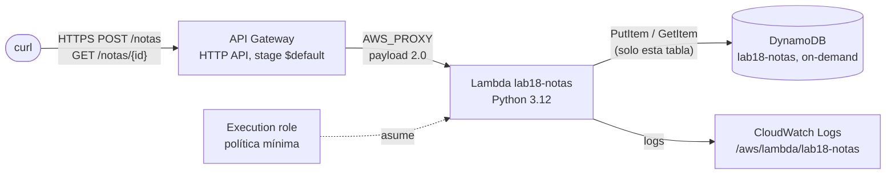

---
tags:
  - laboratorio
  - aws
  - serverless
  - terraform
  - python
---

# Lab 18: AWS: API serverless con Lambda, API Gateway y DynamoDB

> Construye una API HTTP de notas con API Gateway, una función Lambda en Python con permisos mínimos y una tabla DynamoDB on-demand; pruébala primero en local, despliégala con Terraform y sigue sus logs en CloudWatch.

| Nivel | Duración | Costo | Requisitos |
| --- | --- | --- | --- |
| Intermedio | ~60 min | Capa gratuita (~0 USD si limpias) | Lab 00, Lab 03, AWS CLI v2, Terraform 1.10+, Python 3.12 |

!!! info "Qué vas a aprender"
    - Escribir un *handler* de Lambda para el **payload 2.0** de una HTTP API y probarlo en local **sin AWS**, simulando el evento.
    - Crear un **execution role** (rol de ejecución) con permisos limitados a **una tabla** y a **un log group**.
    - Conectar API Gateway con Lambda (integración `AWS_PROXY`) y entender el **resource-based policy** que permite la invocación.
    - Desplegar todo como código con Terraform (provider AWS v6) y destruirlo con un comando.
    - Leer los logs de la función en **CloudWatch Logs** y relacionarlos con cada petición.

!!! warning "Costos y seguridad"
    Usa una **cuenta de pruebas** con **alerta de presupuesto** ([Lab 00](../fundamentos/preparar-entorno.md)). Todo es de pago por uso: si no hay peticiones, el costo es prácticamente cero. Precios de referencia en `us-east-1`; revísalos antes de empezar:

    | Servicio | Qué cobra | Capa gratuita aplicable | Cómo evitar el cargo |
    | --- | --- | --- | --- |
    | AWS Lambda | Peticiones + GB-segundo de ejecución | 1 millón de peticiones y 400 000 GB-s al mes | Memoria de 128 MB y *timeout* de 5 s |
    | API Gateway (HTTP API) | ~1,00 USD por millón de peticiones | 1 millón de llamadas al mes durante 12 meses (cuentas que tienen esa oferta) | *Throttling* bajo en el stage; destruir al terminar |
    | DynamoDB on-demand | ~0,625 USD por millón de escrituras, ~0,125 USD por millón de lecturas, almacenamiento por GB-mes | 25 GB de almacenamiento (las 25 WCU/RCU gratuitas son de modo *provisioned*, no aplican a on-demand) | Pocas peticiones de prueba; borrar la tabla |
    | CloudWatch Logs | Ingesta y almacenamiento de logs | Capa gratuita mensual de CloudWatch | Retención de 7 días; el log group se borra con `terraform destroy` |

    En cuentas creadas desde el 15/07/2025 la capa gratuita funciona con **créditos** (plan gratuito de hasta 6 meses). La URL de la API es pública: no publiques la URL ni guardes datos reales en la tabla.

## Antes de empezar

- **Python 3.12** para probar la función en local (`py -3.12 --version` en Windows, `python3.12 --version` en Linux/macOS). No hace falta instalar `boto3`.
- **Terraform 1.10 o superior** y **AWS CLI v2** con el perfil **`lab-admin`** del [Lab 00 (Paso 11)](../fundamentos/preparar-entorno.md#paso-11-perfil-lab-admin-para-gestionar-iam-en-aws) para la parte en AWS (pasos 5 a 8, Verificación y Limpieza). Terraform crea el rol de ejecución de la función y su política, y al crear la Lambda le entrega ese rol (`iam:PassRole`): el perfil `lab` (PowerUserAccess) no puede hacer ninguna de las dos cosas. Asigna `AdministratorAccess` a tu usuario en IAM Identity Center antes del paso 5 y quítalo al terminar la Limpieza. Los pasos 1 a 4 son locales y no usan AWS.
- `curl` (en Windows usa `curl.exe`; `curl` a secas en PowerShell 5.1 es un alias de `Invoke-WebRequest`).
- Labs previos: [Lab 00](../fundamentos/preparar-entorno.md), [Lab 03](../fundamentos/python-analizar-logs.md) (Python) y, recomendado, [Lab 08](../devops/terraform-local-workspaces.md) (Terraform sin nube).
- Teoría: [Serverless](../../cloud/computo/serverless.md), [Almacenamiento y datos](../../cloud/redes-y-datos/almacenamiento-datos.md) y la arquitectura [API serverless](../../cloud/arquitectura/arquitecturas-referencia.md#2-api-serverless).

!!! tip "Git Bash"
    Si usas Git Bash en Windows, ejecuta `export MSYS_NO_PATHCONV=1` antes de los comandos `aws logs`: si no, el nombre del log group `/aws/lambda/...` se convierte en una ruta de Windows.

## Arquitectura



API Gateway recibe la petición HTTPS y la pasa completa a Lambda (integración *proxy*). La función asume su rol de ejecución, que solo permite `PutItem` y `GetItem` sobre la tabla y escribir en su propio log group. No hay servidores ni red que gestionar.

## Paso a paso

### Paso 1: Crear la estructura del proyecto

Separar el código de la función (`src/`) del código de infraestructura permite empaquetar solo lo necesario en el `.zip` de Lambda.

```text
serverless-api/
├── src/
│   └── app.py           # código de la Lambda
├── probar_local.py      # prueba local sin AWS
└── main.tf              # infraestructura
```

### Paso 2: Escribir la función

Puntos clave del código:

- `handler(event, context)` es lo que invoca Lambda. Con una HTTP API y **payload 2.0**, la ruta llega en `event["routeKey"]` (por ejemplo `"POST /notas"`), el cuerpo en `event["body"]` y los parámetros de ruta en `event["pathParameters"]`.
- La respuesta es un diccionario con `statusCode`, `headers` y `body` (texto JSON).
- El cliente de DynamoDB se crea **una vez** y se reutiliza entre invocaciones (fuera del flujo de cada petición), y `boto3` solo se importa dentro de AWS: así puedes probar en local sin instalarlo.
- El nombre de la tabla llega por **variable de entorno** (`TABLE_NAME`), no escrito en el código.
- Se valida la entrada y los errores no controlados devuelven 500 sin filtrar detalles al cliente (quedan en el log).

```python title="src/app.py"
"""API de notas: Lambda detrás de una HTTP API de API Gateway (payload 2.0)."""

import json
import logging
import os
import uuid
from datetime import datetime, timezone

logger = logging.getLogger()
logger.setLevel(logging.INFO)

_tabla = None  # se crea en el primer uso y se reutiliza entre invocaciones


def obtener_tabla():
    """Devuelve la tabla de DynamoDB (boto3 solo se importa dentro de AWS)."""
    global _tabla
    if _tabla is None:
        import boto3

        _tabla = boto3.resource("dynamodb").Table(os.environ["TABLE_NAME"])
    return _tabla


def respuesta(status: int, cuerpo: dict) -> dict:
    return {
        "statusCode": status,
        "headers": {"Content-Type": "application/json"},
        "body": json.dumps(cuerpo, ensure_ascii=False),
    }


def crear_nota(event: dict) -> dict:
    try:
        datos = json.loads(event.get("body") or "{}")
    except json.JSONDecodeError:
        return respuesta(400, {"error": "El body debe ser JSON"})

    texto = str(datos.get("texto", "")).strip()
    if not texto or len(texto) > 500:
        return respuesta(400, {"error": "Falta 'texto' (1 a 500 caracteres)"})

    nota = {
        "id": str(uuid.uuid4()),
        "texto": texto,
        "creada": datetime.now(timezone.utc).isoformat(timespec="seconds"),
    }
    obtener_tabla().put_item(Item=nota)
    logger.info("nota creada id=%s", nota["id"])
    return respuesta(201, nota)


def leer_nota(event: dict) -> dict:
    nota_id = (event.get("pathParameters") or {}).get("id", "")
    resultado = obtener_tabla().get_item(Key={"id": nota_id})
    if "Item" not in resultado:
        return respuesta(404, {"error": "No existe", "id": nota_id})
    return respuesta(200, resultado["Item"])


RUTAS = {
    "POST /notas": crear_nota,
    "GET /notas/{id}": leer_nota,
}


def handler(event, context):
    ruta = event.get("routeKey", "")
    accion = RUTAS.get(ruta)
    if accion is None:
        return respuesta(404, {"error": f"Ruta no soportada: {ruta}"})
    try:
        return accion(event)
    except Exception:
        logger.exception("error no controlado en %s", ruta)
        return respuesta(500, {"error": "Error interno"})
```

### Paso 3: Probar en local, sin AWS

Antes de desplegar, comprueba la lógica con un evento simulado y una tabla falsa que imita `put_item` y `get_item`. Es rápido, gratis y te ahorra ciclos de "desplegar, fallar, mirar logs".

```python title="probar_local.py"
"""Prueba la Lambda en local, sin AWS: simula el evento de API Gateway y la tabla."""

import json
import sys
from pathlib import Path

sys.path.insert(0, str(Path(__file__).parent / "src"))
import app  # noqa: E402


class TablaFalsa:
    """Imita los dos métodos de la tabla de DynamoDB que usa la función."""

    def __init__(self):
        self.items = {}

    def put_item(self, Item):
        self.items[Item["id"]] = Item

    def get_item(self, Key):
        item = self.items.get(Key["id"])
        return {"Item": item} if item else {}


def evento(route_key, body=None, path_parameters=None):
    """Evento mínimo con el formato 2.0 de una HTTP API."""
    return {
        "version": "2.0",
        "routeKey": route_key,
        "rawPath": route_key.split(" ", 1)[1],
        "headers": {"content-type": "application/json"},
        "pathParameters": path_parameters,
        "body": json.dumps(body) if body is not None else None,
        "isBase64Encoded": False,
    }


def main():
    app._tabla = TablaFalsa()  # inyectamos la tabla falsa: no se importa boto3

    creada = app.handler(evento("POST /notas", {"texto": "Hola desde local"}), None)
    print("POST ->", creada["statusCode"], creada["body"])
    assert creada["statusCode"] == 201
    nota_id = json.loads(creada["body"])["id"]

    leida = app.handler(evento("GET /notas/{id}", path_parameters={"id": nota_id}), None)
    print("GET  ->", leida["statusCode"], leida["body"])
    assert leida["statusCode"] == 200

    no_existe = app.handler(evento("GET /notas/{id}", path_parameters={"id": "x"}), None)
    assert no_existe["statusCode"] == 404

    invalida = app.handler(evento("POST /notas", {"texto": ""}), None)
    assert invalida["statusCode"] == 400

    print("OK: 4 casos pasaron")


if __name__ == "__main__":
    main()
```

=== "Windows (PowerShell)"

    ```powershell
    py -3.12 probar_local.py
    ```

=== "Linux/macOS"

    ```bash
    python3.12 probar_local.py
    ```

```text
POST -> 201 {"id": "ae376537-...", "texto": "Hola desde local", "creada": "2026-10-26T17:15:00+00:00"}
GET  -> 200 {"id": "ae376537-...", "texto": "Hola desde local", "creada": "2026-10-26T17:15:00+00:00"}
OK: 4 casos pasaron
```

!!! note "Pruebas más completas"
    Este script sin dependencias basta para el lab. En un proyecto real usarías `pytest` y, para simular DynamoDB con más fidelidad, `moto` o DynamoDB Local. Ver [Calidad de código](../../python/scripting/calidad-codigo.md).

### Paso 4: Describir la infraestructura con Terraform

Se eligió **Terraform** (y no AWS SAM) para reutilizar lo aprendido en los labs 08 y 09 y poder validar el código sin credenciales. Lo importante de cada bloque:

| Bloque | Qué crea | Por qué así |
| --- | --- | --- |
| `aws_dynamodb_table` | Tabla con clave `id` (string) en `PAY_PER_REQUEST` | On-demand: sin capacidad que dimensionar ni pagar en reposo |
| `aws_cloudwatch_log_group` | `/aws/lambda/lab18-notas` con 7 días de retención | Si lo crea Lambda sola, no tiene retención y Terraform no lo borra |
| `aws_iam_role` + `aws_iam_role_policy` | Rol que solo Lambda puede asumir, con `dynamodb:PutItem`/`GetItem` sobre **el ARN de la tabla** y `logs:CreateLogStream`/`PutLogEvents` sobre **su log group** | **Least privilege** (mínimo privilegio): sin `dynamodb:*` ni `Resource: "*"` |
| `archive_file` + `aws_lambda_function` | Zip de `src/app.py` y la función `python3.12`, arm64, 128 MB, 5 s | `source_code_hash` hace que un cambio en el código redepliegue la función |
| `aws_apigatewayv2_*` | HTTP API, integración `AWS_PROXY` con payload 2.0, dos rutas y el stage `$default` con `auto_deploy` | El stage limita a 5 peticiones/s (ráfaga de 10) para proteger la factura |
| `aws_lambda_permission` | *Resource-based policy* en la función que permite a **esta** API invocarla | Sin esto, API Gateway recibe 500 al llamar a Lambda |

??? example "main.tf completo (haz clic para desplegar)"

    ```hcl title="main.tf"
    terraform {
      required_version = ">= 1.10"

      required_providers {
        aws = {
          source  = "hashicorp/aws"
          version = "~> 6.0"
        }
        archive = {
          source  = "hashicorp/archive"
          version = "~> 2.7"
        }
      }
    }

    provider "aws" {
      region  = var.region
      profile = var.aws_profile

      default_tags {
        tags = {
          lab        = "lab18"
          managed-by = "terraform"
        }
      }
    }

    variable "region" {
      type    = string
      default = "us-east-1"
    }

    # lab-admin: el plan crea un rol de IAM y se lo entrega a Lambda (iam:PassRole)
    variable "aws_profile" {
      type    = string
      default = "lab-admin"
    }

    locals {
      nombre = "lab18-notas"
    }

    # ---------- DynamoDB (on-demand) ----------

    resource "aws_dynamodb_table" "notas" {
      name         = local.nombre
      billing_mode = "PAY_PER_REQUEST"
      hash_key     = "id"

      attribute {
        name = "id"
        type = "S"
      }
    }

    # ---------- Logs: el log group lo crea Terraform para controlar retención y borrado ----------

    resource "aws_cloudwatch_log_group" "lambda" {
      name              = "/aws/lambda/${local.nombre}"
      retention_in_days = 7
    }

    # ---------- IAM: rol de ejecución con permisos mínimos ----------

    resource "aws_iam_role" "lambda" {
      name = "${local.nombre}-exec"

      assume_role_policy = jsonencode({
        Version = "2012-10-17"
        Statement = [{
          Effect    = "Allow"
          Principal = { Service = "lambda.amazonaws.com" }
          Action    = "sts:AssumeRole"
        }]
      })
    }

    resource "aws_iam_role_policy" "lambda" {
      name = "acceso-minimo"
      role = aws_iam_role.lambda.id

      policy = jsonencode({
        Version = "2012-10-17"
        Statement = [
          {
            Sid      = "TablaNotas"
            Effect   = "Allow"
            Action   = ["dynamodb:PutItem", "dynamodb:GetItem"]
            Resource = aws_dynamodb_table.notas.arn
          },
          {
            Sid      = "LogsPropios"
            Effect   = "Allow"
            Action   = ["logs:CreateLogStream", "logs:PutLogEvents"]
            Resource = "${aws_cloudwatch_log_group.lambda.arn}:*"
          }
        ]
      })
    }

    # ---------- Lambda ----------

    data "archive_file" "codigo" {
      type        = "zip"
      source_file = "${path.module}/src/app.py"
      output_path = "${path.module}/build/app.zip"
    }

    resource "aws_lambda_function" "api" {
      function_name    = local.nombre
      role             = aws_iam_role.lambda.arn
      runtime          = "python3.12"
      handler          = "app.handler"
      filename         = data.archive_file.codigo.output_path
      source_code_hash = data.archive_file.codigo.output_base64sha256
      architectures    = ["arm64"]
      memory_size      = 128
      timeout          = 5

      environment {
        variables = {
          TABLE_NAME = aws_dynamodb_table.notas.name
        }
      }

      logging_config {
        log_format = "Text"
        log_group  = aws_cloudwatch_log_group.lambda.name
      }

      depends_on = [aws_iam_role_policy.lambda]
    }

    # ---------- API Gateway (HTTP API) ----------

    resource "aws_apigatewayv2_api" "http" {
      name          = local.nombre
      protocol_type = "HTTP"
    }

    resource "aws_apigatewayv2_integration" "lambda" {
      api_id                 = aws_apigatewayv2_api.http.id
      integration_type       = "AWS_PROXY"
      integration_uri        = aws_lambda_function.api.invoke_arn
      payload_format_version = "2.0"
    }

    resource "aws_apigatewayv2_route" "rutas" {
      for_each = toset(["POST /notas", "GET /notas/{id}"])

      api_id    = aws_apigatewayv2_api.http.id
      route_key = each.value
      target    = "integrations/${aws_apigatewayv2_integration.lambda.id}"
    }

    resource "aws_apigatewayv2_stage" "default" {
      api_id      = aws_apigatewayv2_api.http.id
      name        = "$default"
      auto_deploy = true

      # Límite bajo a propósito: protege tu factura si alguien encuentra la URL
      default_route_settings {
        throttling_burst_limit = 10
        throttling_rate_limit  = 5
      }
    }

    # Permite que ESTA API (y solo ella) invoque la función
    resource "aws_lambda_permission" "apigw" {
      statement_id  = "AllowHttpApiInvoke"
      action        = "lambda:InvokeFunction"
      function_name = aws_lambda_function.api.function_name
      principal     = "apigateway.amazonaws.com"
      source_arn    = "${aws_apigatewayv2_api.http.execution_arn}/*/*"
    }

    output "api_url" {
      value = aws_apigatewayv2_api.http.api_endpoint
    }

    output "log_group" {
      value = aws_cloudwatch_log_group.lambda.name
    }
    ```

!!! info "Runtime de Python"
    Lambda soporta `python3.12`, `python3.13` y `python3.14` (los tres sobre Amazon Linux 2023). Este lab usa `python3.12` para que coincida con tu prueba local; cambiarlo es una línea.

### Paso 5: Desplegar

A partir de aquí trabajas en AWS con el perfil `lab-admin`: el provider lo usa por defecto (variable `aws_profile`) y exportarlo hace que los comandos `aws` de los pasos siguientes, la Verificación y la Limpieza usen la misma identidad.

```bash
export AWS_PROFILE=lab-admin     # crea un rol de IAM (ver Antes de empezar)
cd serverless-api
terraform init
terraform fmt -check && terraform validate
terraform plan -out plan.tfplan
terraform apply plan.tfplan
```

```text
Plan: 11 to add, 0 to change, 0 to destroy.
...
Outputs:
api_url   = "https://abc123def4.execute-api.us-east-1.amazonaws.com"
log_group = "/aws/lambda/lab18-notas"
```

### Paso 6: Probar la API con curl

=== "Linux/macOS / Git Bash"

    ```bash
    API=$(terraform output -raw api_url)
    curl -s -X POST "$API/notas" -H "Content-Type: application/json" -d '{"texto":"Mi primera nota serverless"}'
    # copia el id de la respuesta
    curl -s "$API/notas/<id>"
    curl -s -o /dev/null -w "%{http_code}\n" "$API/notas/no-existe"
    curl -s -X POST "$API/notas" -H "Content-Type: application/json" -d '{"texto":""}'
    ```

=== "Windows (PowerShell)"

    ```powershell
    $API = terraform output -raw api_url
    '{"texto":"Mi primera nota serverless"}' | Out-File -Encoding ascii nota.json
    curl.exe -s -X POST "$API/notas" -H "Content-Type: application/json" --data-binary "@nota.json"
    curl.exe -s "$API/notas/<id>"
    curl.exe -s -o NUL -w "%{http_code}`n" "$API/notas/no-existe"
    ```

```text
{"id": "5b0e...", "texto": "Mi primera nota serverless", "creada": "2026-10-26T18:02:11+00:00"}
{"id": "5b0e...", "texto": "Mi primera nota serverless", "creada": "2026-10-26T18:02:11+00:00"}
404
{"error": "Falta 'texto' (1 a 500 caracteres)"}
```

La primera petición tarda más: es el **cold start** (la plataforma prepara el entorno de ejecución). Las siguientes reutilizan el entorno y el cliente de DynamoDB.

### Paso 7: Ver los logs en CloudWatch

Todo lo que la función escribe con `logging` (y los errores no controlados) llega a CloudWatch Logs. Lambda añade por cada invocación líneas `START`, `END` y `REPORT` con la duración, la memoria usada y, si hubo, el *Init Duration* del cold start.

```bash
aws logs tail /aws/lambda/lab18-notas --since 15m
aws logs tail /aws/lambda/lab18-notas --follow      # en vivo; Ctrl+C para salir
```

```text
... START RequestId: 1f2e... Version: $LATEST
... [INFO] ... nota creada id=5b0e...
... END RequestId: 1f2e...
... REPORT RequestId: 1f2e... Duration: 38.12 ms Billed Duration: 39 ms Memory Size: 128 MB Max Memory Used: 82 MB Init Duration: 412.55 ms
```

También puedes verlos en la consola: **CloudWatch → Log groups → /aws/lambda/lab18-notas**, o con **Logs Insights** filtrando por `@message like /nota creada/`.

### Paso 8: Comprobar que los permisos son mínimos

Mira la política efectiva del rol y confirma que solo nombra la tabla y el log group:

```bash
aws iam get-role-policy --role-name lab18-notas-exec --policy-name acceso-minimo --query PolicyDocument
```

Ahora rompe algo a propósito para verlo fallar de forma controlada: en `src/app.py`, cambia temporalmente `get_item` por un `scan()` en `leer_nota`, despliega (`terraform apply`) y llama a `GET /notas/<id>`. Recibirás `500 {"error": "Error interno"}` y en el log un `AccessDeniedException` para `dynamodb:Scan`: el rol no lo permite. Revierte el cambio y vuelve a aplicar.

## Verificación

| Comprobación | Comando | Resultado esperado |
| --- | --- | --- |
| La nota está en la tabla | `aws dynamodb get-item --table-name lab18-notas --key '{"id":{"S":"<id>"}}'` | El item con `texto` y `creada` |
| La tabla es on-demand | `aws dynamodb describe-table --table-name lab18-notas --query Table.BillingModeSummary.BillingMode` | `"PAY_PER_REQUEST"` |
| La función usa el runtime y la variable correctos | `aws lambda get-function-configuration --function-name lab18-notas --query '[Runtime,Environment.Variables.TABLE_NAME]'` | `["python3.12", "lab18-notas"]` |
| Solo API Gateway puede invocarla | `aws lambda get-policy --function-name lab18-notas --query Policy` | Un statement con `apigateway.amazonaws.com` y `SourceArn` de tu API |
| El stage tiene throttling | `aws apigatewayv2 get-stage --api-id <api-id> --stage-name '$default' --query DefaultRouteSettings` | `ThrottlingBurstLimit: 10`, `ThrottlingRateLimit: 5.0` |
| Hay logs de cada petición | `aws logs tail /aws/lambda/lab18-notas --since 1h` | Líneas `REPORT` y `nota creada` |

## Retos extra

1. Añade la ruta `GET /notas` que devuelva las últimas notas. Pista: necesitarás `dynamodb:Scan` (o mejor, un diseño con `Query` y una clave de partición distinta); amplía la política **solo** con esa acción.
2. Protege la API con un **JWT authorizer** de la HTTP API (por ejemplo con Amazon Cognito) y comprueba que sin token recibes 401.
3. Activa los **access logs** del stage hacia otro log group y compara qué información da API Gateway frente a la de Lambda.
4. Despliega lo mismo con **AWS SAM** (`AWS::Serverless::Function` con un evento `HttpApi`) y compara cuántas líneas necesitas frente a Terraform.

## Limpieza

```bash
terraform destroy      # confirma con yes; borra los 11 recursos, incluidos tabla y log group
```

**Verifica que no queda nada facturando** (todas deben devolver vacío o un error `NotFound`/`NoSuchEntity`):

```bash
aws dynamodb list-tables --query "TableNames[?starts_with(@, 'lab18')]"
aws lambda list-functions --query "Functions[?starts_with(FunctionName, 'lab18')].FunctionName"
aws apigatewayv2 get-apis --query "Items[?starts_with(Name, 'lab18')].[Name,ApiId]"
aws logs describe-log-groups --log-group-name-prefix /aws/lambda/lab18 --query 'logGroups[].logGroupName'
aws iam get-role --role-name lab18-notas-exec
aws resourcegroupstaggingapi get-resources --tag-filters Key=lab,Values=lab18 --query 'ResourceTagMappingList[].ResourceARN'
```

Comprueba que `aws iam get-role` devuelve `NoSuchEntity` y, al terminar, quita la asignación de `AdministratorAccess` en IAM Identity Center y vuelve a `export AWS_PROFILE=lab`; `aws sts get-caller-identity --profile lab-admin` debe fallar con `No access` ([Lab 00, Paso 11](../fundamentos/preparar-entorno.md#paso-11-perfil-lab-admin-para-gestionar-iam-en-aws)).

El rol de la función no tiene `logs:CreateLogGroup`, así que Lambda no puede recrear el log group después del destroy; si aun así aparece, bórralo con `aws logs delete-log-group --log-group-name /aws/lambda/lab18-notas`. Al día siguiente revisa **Billing and Cost Management → Bills** y confirma que Lambda, API Gateway y DynamoDB están en 0 o dentro de la capa gratuita.

## Problemas comunes

| Síntoma | Causa probable | Solución |
| --- | --- | --- |
| `{"message":"Internal Server Error"}` (mensaje de API Gateway, no de tu función) | Falta el `aws_lambda_permission` o su `source_arn` no coincide | Revisa `aws lambda get-policy`; el ARN debe ser `<execution_arn>/*/*` |
| `terraform apply` falla con `AccessDenied ... is not authorized to perform: iam:CreateRole` (o `iam:PassRole` al crear la función) | El provider usa el perfil `lab` (PowerUserAccess), que no gestiona IAM | Usa `lab-admin` (valor por defecto de `aws_profile`; no lo sobrescribas con `-var aws_profile=lab`); si da `No access`, asigna antes `AdministratorAccess` ([Lab 00](../fundamentos/preparar-entorno.md#paso-11-perfil-lab-admin-para-gestionar-iam-en-aws)) |
| `{"message":"Not Found"}` | La ruta no existe en la API (por ejemplo `/nota` en vez de `/notas`) | Compara con `route_key` en Terraform |
| `500 {"error": "Error interno"}` | Excepción en la función (permisos, nombre de tabla) | `aws logs tail` y busca el *traceback*; un `AccessDeniedException` indica que falta una acción en la política |
| `KeyError: 'TABLE_NAME'` en el log | Variable de entorno no definida | Revisa el bloque `environment` de la función |
| `429 Too Many Requests` | Superaste el throttling del stage (5 req/s) | Es intencional; súbelo solo si lo necesitas |
| `aws logs tail` dice que el log group no existe en Git Bash | Conversión de rutas | `export MSYS_NO_PATHCONV=1` |
| El código nuevo no se despliega | No cambió el hash del zip | Comprueba que editaste `src/app.py` y que `terraform plan` muestra cambio en `source_code_hash` |

Para el método general, ver [Troubleshooting](../../devops/operacion/troubleshooting.md) y [Leer logs](../../devops/operacion/leer-logs.md).

## Información complementaria

- **Serverless y cold starts**: pagas por invocación y la plataforma escala sola; el costo es la latencia del primer arranque y los límites de tiempo. Ver [Serverless](../../cloud/computo/serverless.md).
- **DynamoDB on-demand vs provisioned**: on-demand cobra por petición y encaja con tráfico impredecible o bajo; provisioned es más barato con carga estable. Ver [Almacenamiento y datos](../../cloud/redes-y-datos/almacenamiento-datos.md).
- **API Gateway como puerta de entrada**: centraliza autenticación, throttling y enrutado delante de las funciones. Ver [Integración y APIs](../../cloud/arquitectura/integracion-apis.md).
- **Identity-based vs resource-based policy**: el rol dice qué puede hacer la función; la política de la función dice quién puede invocarla. Ver [IAM: AWS, Azure y GCP](../../cloud/identidad-y-seguridad/iam-comparativa.md).
- **Logs y observabilidad**: logs estructurados (JSON) facilitan buscar por campos en Logs Insights. Ver [Observabilidad nativa](../../cloud/operacion-y-gobierno/observabilidad-nativa.md).
- **En el trabajo real** el `terraform apply` lo ejecuta un pipeline con OIDC (sin llaves, como en el [Lab 13](../devsecops/oidc-github-aws.md)), las pruebas locales corren en CI y un escáner de IaC rechaza políticas con `"Action": "*"`.

## Documentación oficial

- [Lambda: definir el handler en Python](https://docs.aws.amazon.com/lambda/latest/dg/python-handler.html)
- [Runtimes de Lambda](https://docs.aws.amazon.com/lambda/latest/dg/lambda-runtimes.html)
- [HTTP APIs: integraciones con Lambda (payload 2.0)](https://docs.aws.amazon.com/apigateway/latest/developerguide/http-api-develop-integrations-lambda.html)
- [DynamoDB: modo on-demand](https://docs.aws.amazon.com/amazondynamodb/latest/developerguide/on-demand-capacity-mode.html)
- [Logs de Lambda en CloudWatch](https://docs.aws.amazon.com/lambda/latest/dg/monitoring-cloudwatchlogs.html)
- Precios: [Lambda](https://aws.amazon.com/lambda/pricing/), [API Gateway](https://aws.amazon.com/api-gateway/pricing/), [DynamoDB on-demand](https://aws.amazon.com/dynamodb/pricing/)
- Terraform: [`aws_lambda_function`](https://registry.terraform.io/providers/hashicorp/aws/latest/docs/resources/lambda_function), [`aws_apigatewayv2_api`](https://registry.terraform.io/providers/hashicorp/aws/latest/docs/resources/apigatewayv2_api)

## Preguntas para verificar el aprendizaje

??? question "1. ¿Por qué la prueba local no necesita `boto3` ni credenciales?"
    Porque el handler obtiene la tabla con `obtener_tabla()`, que solo importa `boto3` si la tabla no está creada. La prueba inyecta una `TablaFalsa` en `app._tabla` antes de invocar, así nunca se llama a AWS.

??? question "2. ¿Qué dos políticas tienen que existir para que una petición llegue a DynamoDB?"
    La *resource-based policy* de la función (permiso `lambda:InvokeFunction` para `apigateway.amazonaws.com` con el ARN de la API) y la política del execution role (`dynamodb:PutItem`/`GetItem` sobre la tabla). Faltando cualquiera, la petición falla.

??? question "3. ¿Qué pasaría si el execution role tuviera `dynamodb:*` sobre `*`?"
    Funcionaría igual, pero un fallo en la función (por ejemplo, una inyección en un parámetro) permitiría leer o borrar **cualquier** tabla de la cuenta. Con least privilege el daño queda limitado a dos acciones sobre una tabla.

??? question "4. ¿Por qué el log group se crea en Terraform en vez de dejar que Lambda lo cree?"
    Para fijar una retención (si no, los logs se guardan para siempre y se pagan) y para que `terraform destroy` lo borre. Además permite limitar el permiso de logs a ese log group concreto.

??? question "5. ¿Cuándo dejaría de ser buena idea DynamoDB on-demand?"
    Con tráfico alto y estable y predecible: el modo provisioned (con auto scaling o capacidad reservada) sale más barato. On-demand es ideal para cargas bajas, variables o nuevas.

??? question "6. El primer `curl` tardó casi un segundo y los siguientes 50 ms. ¿Por qué?"
    Cold start: Lambda tuvo que crear el entorno de ejecución, cargar Python y ejecutar el código de inicialización. Lo ves como `Init Duration` en la línea `REPORT`. Los siguientes reutilizan el entorno caliente.

??? question "7. ¿Qué ocurre si alguien descubre la URL y lanza 10 000 peticiones por segundo?"
    El throttling del stage (5 req/s, ráfaga 10) rechaza el exceso con 429 antes de invocar Lambda, lo que limita el costo. En producción se añadiría autenticación (JWT authorizer) y AWS WAF delante.

??? question "8. ¿Por qué `source_code_hash` es importante en `aws_lambda_function`?"
    Terraform compara el hash del zip con el desplegado. Si cambias el código, cambia el hash y Terraform actualiza la función; sin él, Terraform podría no detectar el cambio porque el nombre del archivo es el mismo.

## Notas relacionadas

- **Cloud**: [Serverless](../../cloud/computo/serverless.md) · [Almacenamiento y datos](../../cloud/redes-y-datos/almacenamiento-datos.md) · [Arquitecturas de referencia](../../cloud/arquitectura/arquitecturas-referencia.md) · [Integración y APIs](../../cloud/arquitectura/integracion-apis.md) · [IAM: AWS, Azure y GCP](../../cloud/identidad-y-seguridad/iam-comparativa.md) · [Observabilidad nativa](../../cloud/operacion-y-gobierno/observabilidad-nativa.md) · [FinOps y costos](../../cloud/fundamentos/finops-costos.md)
- **DevOps**: [Infrastructure as Code](../../devops/iac/infraestructura-como-codigo.md) · [Terraform](../../devops/iac/terraform-basico.md) · [Leer logs](../../devops/operacion/leer-logs.md) · [Troubleshooting](../../devops/operacion/troubleshooting.md)
- **DevSecOps**: [Secretos e identidades](../../devsecops/identidades-y-pipeline/secretos-identidades.md) · [Seguridad de IaC](../../devsecops/infraestructura-y-contenedores/seguridad-iac.md) · [Pruebas dinámicas](../../devsecops/codigo-y-dependencias/pruebas-dinamicas.md)
- **Networking**: [Protocolos de aplicación](../../networking/intermedio/protocolos-aplicacion.md)
- **Python**: [Errores y módulos](../../python/fundamentos/errores-modulos.md) · [APIs y HTTP](../../python/scripting/apis-http.md) · [Automatización cloud](../../python/scripting/automatizacion-cloud.md) · [Calidad de código](../../python/scripting/calidad-codigo.md)
- **Certificaciones**: [AWS Solutions Architect Associate: arquitecturas de alto rendimiento](../../certificaciones/aws/solutions-architect-associate/dominio-3-arquitecturas-alto-rendimiento.md)
- **Lab anterior**: [Lab 17: VPC y EC2 en AWS](aws-vpc-ec2.md) · **Lab siguiente**: [Lab 19: VNet y VM en Azure](azure-vnet-vm.md)
