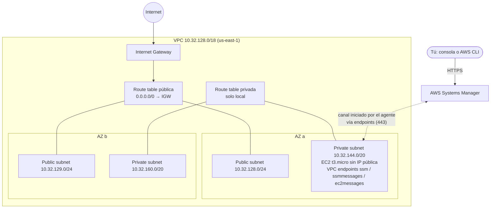

---
tags:
  - laboratorio
  - aws
  - redes
  - computo
  - terraform
---

# Lab 17: AWS: VPC con subnets públicas y privadas y una EC2

> Construye una VPC en dos Availability Zones con subnets públicas y privadas, lanza una EC2 sin IP pública a la que entras con Session Manager (sin SSH) y repite todo con Terraform.

| Nivel | Duración | Costo | Requisitos |
| --- | --- | --- | --- |
| Intermedio | ~90 min | Capa gratuita + ~0,10 USD si limpias el mismo día | Lab 00, Lab 02, AWS CLI v2, Terraform 1.10+ |

!!! info "Qué vas a aprender"
    - Traducir un plan de direccionamiento (Lab 02) a una **VPC** real con subnets en dos AZ.
    - Qué hace pública o privada a una subnet: el **route table**, no el nombre.
    - Entrar a una instancia **sin IP pública ni puerto 22** con **Session Manager** y **VPC endpoints**.
    - Escribir un **security group** mínimo y exigir **IMDSv2** en la instancia.
    - Comprobar con **Reachability Analyzer** que no hay camino desde internet.
    - Expresar exactamente lo mismo como **Infrastructure as Code** (infraestructura como código) con Terraform y el provider AWS v6.

!!! warning "Costos y seguridad"
    Haz este lab en una **cuenta de pruebas** con **alerta de presupuesto** activa ([Lab 00](../fundamentos/preparar-entorno.md)), nunca en producción. Precios de referencia en `us-east-1` (revísalos en las páginas de precios oficiales antes de empezar):

    | Recurso | Qué cobra | Capa gratuita | Cómo evitar el cargo |
    | --- | --- | --- | --- |
    | VPC, subnets, route tables, Internet Gateway, security groups | Nada | No aplica | — |
    | EC2 `t3.micro` + disco gp3 | Por segundo de ejecución y GB-mes de disco | Elegible para Free Tier (créditos en cuentas nuevas desde el 15/07/2025; 750 h/mes en cuentas anteriores) | Terminar la instancia al acabar |
    | 3 interface endpoints (ssm, ssmmessages, ec2messages) | ~0,01 USD por hora **cada uno** por AZ + 0,01 USD/GB | No | Borrarlos al terminar (~0,03 USD/h los tres) |
    | NAT Gateway (paso opcional) | ~0,045 USD/h + 0,045 USD/GB procesado + IPv4 pública (0,005 USD/h) | No | Crearlo, probar y borrarlo en minutos |
    | Reachability Analyzer (opcional) | 0,10 USD por análisis | No | Ejecutar un solo análisis |

    Un NAT Gateway olvidado cuesta unos **33 USD al mes** aunque no pase tráfico. Por eso este lab **no** lo deja creado.

## Antes de empezar

- **AWS CLI v2** con los dos perfiles del [Lab 00](../fundamentos/preparar-entorno.md#paso-11-perfil-lab-admin-para-gestionar-iam-en-aws), aplicando **least privilege** (mínimo privilegio) paso a paso:

    | Perfil | Pasos | Por qué |
    | --- | --- | --- |
    | `lab` (PowerUserAccess) | 1–6, 9–11 y la limpieza de red | Crear y borrar VPC, subnets, routing, security groups, endpoints, NAT y conectarte con Session Manager no requiere permisos de IAM |
    | `lab-admin` (AdministratorAccess, sesión de 1 h) | 7–8, el paso 12 (Terraform) y el borrado del rol | El paso 7 crea un rol y un instance profile, y el `run-instances` del paso 8 necesita `iam:PassRole` para entregar ese rol a la EC2; `lab` no permite ninguna de las dos cosas |

    Antes del paso 7, vuelve a asignar `AdministratorAccess` a tu usuario en IAM Identity Center; quítalo al terminar la Limpieza. Nunca uses las credenciales de root.
- **Session Manager plugin** para la AWS CLI si quieres conectarte desde tu terminal ([instalación](https://docs.aws.amazon.com/systems-manager/latest/userguide/session-manager-working-with-install-plugin.html)). Si no lo instalas, usa el botón **Connect** de la consola.
- **Terraform 1.10 o superior** (`terraform version`).
- Labs previos: [Lab 00](../fundamentos/preparar-entorno.md) (cuenta y presupuesto) y [Lab 02](../fundamentos/subnetting-plan-ips.md) (plan de IPs).
- Teoría recomendada: [Redes en la nube](../../cloud/redes-y-datos/redes.md), [Máquinas virtuales](../../cloud/computo/maquinas-virtuales.md), [Direccionamiento IP](../../networking/basico/direccionamiento-ip.md) y [Routing y NAT](../../networking/intermedio/routing-nat.md).

!!! tip "Windows: usa Git Bash o AWS CloudShell"
    Los comandos están en Bash. En **Git Bash** ejecuta antes `export MSYS_NO_PATHCONV=1`: sin esto, Git Bash convierte argumentos que empiezan por `/` (como `/aws/service/...`) en rutas de Windows y los comandos fallan. **AWS CloudShell** (en la consola) ya trae la CLI con tus credenciales.

## Arquitectura



La EC2 vive en una subnet privada: no tiene IP pública ni ruta a internet. El **SSM Agent** de la instancia abre la conexión hacia Systems Manager a través de los VPC endpoints (tráfico privado dentro de AWS), así que no hace falta abrir ningún puerto de entrada.

## Paso a paso

### Paso 1: Preparar variables y comprobar identidad

Guardar los IDs en variables evita copiar y pegar a mano y errores de "subnet equivocada".

```bash
export AWS_PROFILE=lab             # perfil del día a día: la red no necesita permisos de IAM
export AWS_REGION=us-east-1        # la CLI usa esta región
export MSYS_NO_PATHCONV=1          # solo necesario en Git Bash
aws sts get-caller-identity --query Arn --output text
TAGS='{Key=lab,Value=lab17}'
AZ_A=$(aws ec2 describe-availability-zones --query 'AvailabilityZones[0].ZoneName' --output text)
AZ_B=$(aws ec2 describe-availability-zones --query 'AvailabilityZones[1].ZoneName' --output text)
echo "$AZ_A $AZ_B"
```

```text
arn:aws:sts::111122223333:assumed-role/AWSReservedSSO_PowerUserAccess_.../lab-tu-nombre
us-east-1a us-east-1b
```

### Paso 2: Crear la VPC con DNS activado

Las **DNS hostnames** y la **DNS resolution** de la VPC deben estar activas para que los interface endpoints respondan con el nombre normal del servicio (`ssm.us-east-1.amazonaws.com`) pero con IP privada (*private DNS*).

```bash
VPC_ID=$(aws ec2 create-vpc --cidr-block 10.32.128.0/18 \
  --tag-specifications "ResourceType=vpc,Tags=[{Key=Name,Value=lab17-vpc},$TAGS]" \
  --query Vpc.VpcId --output text)
aws ec2 modify-vpc-attribute --vpc-id "$VPC_ID" --enable-dns-hostnames
aws ec2 modify-vpc-attribute --vpc-id "$VPC_ID" --enable-dns-support
echo "$VPC_ID"
```

### Paso 3: Crear las cuatro subnets según el plan del Lab 02

Este lab usa el entorno **dev** del plan del [Lab 02](../fundamentos/subnetting-plan-ips.md) en dos de sus zonas: VPC `10.32.128.0/18`, públicas `10.32.128.0/24` (AZ a) y `10.32.129.0/24` (AZ b), y las subnets de aplicación `10.32.144.0/20` (AZ a) y `10.32.160.0/20` (AZ b) como privadas. Si en tu plan elegiste otros rangos, usa los tuyos. Cada subnet de AWS vive en **una sola AZ**, por eso hay una de cada tipo por zona. Recuerda que AWS reserva 5 IPs por subnet: cada `/24` deja 251 utilizables y cada `/20`, 4091.

```bash
crear_subnet () {  # nombre cidr az
  aws ec2 create-subnet --vpc-id "$VPC_ID" --cidr-block "$2" --availability-zone "$3" \
    --tag-specifications "ResourceType=subnet,Tags=[{Key=Name,Value=lab17-$1},$TAGS]" \
    --query Subnet.SubnetId --output text
}
PUB_A=$(crear_subnet publica-a 10.32.128.0/24 "$AZ_A")
PUB_B=$(crear_subnet publica-b 10.32.129.0/24 "$AZ_B")
PRIV_A=$(crear_subnet privada-a 10.32.144.0/20 "$AZ_A")
PRIV_B=$(crear_subnet privada-b 10.32.160.0/20 "$AZ_B")
aws ec2 describe-subnets --filters Name=vpc-id,Values="$VPC_ID" \
  --query 'Subnets[].[Tags[?Key==`Name`]|[0].Value,CidrBlock,AvailabilityZone,MapPublicIpOnLaunch]' --output table
```

```text
|  lab17-publica-a |  10.32.128.0/24  |  us-east-1a |  False |
|  lab17-privada-a |  10.32.144.0/20  |  us-east-1a |  False |
...
```

Ninguna asigna IP pública automáticamente (`MapPublicIpOnLaunch = False`): si algún día lanzas algo en una pública, pides la IP de forma explícita.

### Paso 4: Internet Gateway y route tables

El **Internet Gateway** (IGW) por sí solo no hace pública a nadie: lo que convierte una subnet en pública es asociarla a un route table con `0.0.0.0/0 → IGW`. El route table privado solo tiene la ruta `local` (implícita), así que lo de dentro no sale a internet.

```bash
IGW_ID=$(aws ec2 create-internet-gateway \
  --tag-specifications "ResourceType=internet-gateway,Tags=[{Key=Name,Value=lab17-igw},$TAGS]" \
  --query InternetGateway.InternetGatewayId --output text)
aws ec2 attach-internet-gateway --internet-gateway-id "$IGW_ID" --vpc-id "$VPC_ID"

RT_PUB=$(aws ec2 create-route-table --vpc-id "$VPC_ID" \
  --tag-specifications "ResourceType=route-table,Tags=[{Key=Name,Value=lab17-rt-publica},$TAGS]" \
  --query RouteTable.RouteTableId --output text)
aws ec2 create-route --route-table-id "$RT_PUB" --destination-cidr-block 0.0.0.0/0 --gateway-id "$IGW_ID"

RT_PRIV=$(aws ec2 create-route-table --vpc-id "$VPC_ID" \
  --tag-specifications "ResourceType=route-table,Tags=[{Key=Name,Value=lab17-rt-privada},$TAGS]" \
  --query RouteTable.RouteTableId --output text)

for s in "$PUB_A" "$PUB_B"; do aws ec2 associate-route-table --route-table-id "$RT_PUB" --subnet-id "$s" >/dev/null; done
for s in "$PRIV_A" "$PRIV_B"; do aws ec2 associate-route-table --route-table-id "$RT_PRIV" --subnet-id "$s" >/dev/null; done
```

!!! note "¿Y si no asocio una subnet?"
    Una subnet sin asociación explícita usa el **main route table** de la VPC. Asociarlas todas de forma explícita hace que el diseño se lea solo y evita sorpresas si alguien modifica el main route table.

### Paso 5: Security groups mínimos

Dos **security groups** (firewall *stateful* a nivel de interfaz):

- `lab17-sg-instancia`: **ninguna regla de entrada**. De salida, solo HTTPS (443) hacia la VPC, que es donde están los endpoints. Se elimina la regla de salida "todo permitido" que AWS crea por defecto.
- `lab17-sg-endpoints`: entrada 443 **solo desde el security group de la instancia** (referencia a SG, no a un rango de IPs).

```bash
SG_EC2=$(aws ec2 create-security-group --vpc-id "$VPC_ID" --group-name lab17-sg-instancia \
  --description "EC2 privada sin entradas" --query GroupId --output text)
aws ec2 revoke-security-group-egress --group-id "$SG_EC2" \
  --ip-permissions 'IpProtocol=-1,IpRanges=[{CidrIp=0.0.0.0/0}]' >/dev/null
aws ec2 authorize-security-group-egress --group-id "$SG_EC2" \
  --ip-permissions 'IpProtocol=tcp,FromPort=443,ToPort=443,IpRanges=[{CidrIp=10.32.128.0/18,Description="HTTPS a endpoints"}]' >/dev/null

SG_VPCE=$(aws ec2 create-security-group --vpc-id "$VPC_ID" --group-name lab17-sg-endpoints \
  --description "Endpoints HTTPS desde la instancia" --query GroupId --output text)
aws ec2 authorize-security-group-ingress --group-id "$SG_VPCE" \
  --ip-permissions "IpProtocol=tcp,FromPort=443,ToPort=443,UserIdGroupPairs=[{GroupId=$SG_EC2}]" >/dev/null
```

### Paso 6: VPC endpoints para Session Manager

Sin NAT ni IGW, el agente necesita una forma privada de llegar a Systems Manager. Los **interface endpoints** (AWS PrivateLink) ponen una interfaz de red con IP privada de la subnet que responde por el servicio. Session Manager necesita `ssm` y `ssmmessages`; `ec2messages` solo lo usan versiones del agente anteriores a la 3.3.40.0, pero AWS lo sigue listando y cuesta lo mismo, así que lo incluimos. Para ahorrar, los creamos **solo en la AZ a**, que es donde está la instancia.

```bash
for svc in ssm ssmmessages ec2messages; do
  aws ec2 create-vpc-endpoint --vpc-id "$VPC_ID" --vpc-endpoint-type Interface \
    --service-name "com.amazonaws.$AWS_REGION.$svc" \
    --subnet-ids "$PRIV_A" --security-group-ids "$SG_VPCE" --private-dns-enabled \
    --tag-specifications "ResourceType=vpc-endpoint,Tags=[{Key=Name,Value=lab17-vpce-$svc},$TAGS]" \
    --query VpcEndpoint.VpcEndpointId --output text
done
aws ec2 describe-vpc-endpoints --filters Name=vpc-id,Values="$VPC_ID" \
  --query 'VpcEndpoints[].[ServiceName,State]' --output table   # espera a "available"
```

### Paso 7: Rol de IAM para la instancia

La instancia necesita permiso para registrarse en Systems Manager. Se lo da un **IAM role** con la política administrada `AmazonSSMManagedInstanceCore`, entregado a la EC2 mediante un **instance profile**. Nada de access keys dentro de la máquina.

Aquí cambias a `lab-admin`: crear el rol y el instance profile (este paso) y entregárselo a la instancia con `iam:PassRole` (paso 8) son las únicas acciones del lab que `lab` no permite; con él fallarían con `AccessDenied`. Las variables que guardaste (`PRIV_A`, `SG_EC2`…) siguen disponibles, porque cambiar de perfil no cambia de cuenta.

```bash
export AWS_PROFILE=lab-admin       # solo para los pasos 7 y 8 (IAM y PassRole)
aws sts get-caller-identity --query Arn --output text   # ...AWSReservedSSO_AdministratorAccess_...
cat > confianza-ec2.json <<'EOF'
{
  "Version": "2012-10-17",
  "Statement": [{ "Effect": "Allow", "Principal": { "Service": "ec2.amazonaws.com" }, "Action": "sts:AssumeRole" }]
}
EOF
aws iam create-role --role-name lab17-ec2-ssm --assume-role-policy-document file://confianza-ec2.json >/dev/null
aws iam attach-role-policy --role-name lab17-ec2-ssm \
  --policy-arn arn:aws:iam::aws:policy/AmazonSSMManagedInstanceCore
aws iam create-instance-profile --instance-profile-name lab17-ec2-ssm >/dev/null
aws iam add-role-to-instance-profile --instance-profile-name lab17-ec2-ssm --role-name lab17-ec2-ssm
```

### Paso 8: Lanzar la EC2 privada con IMDSv2 obligatorio

- La AMI de Amazon Linux 2023 se resuelve desde un parámetro público de SSM (`resolve:ssm:`), así siempre usas la más reciente sin buscar IDs a mano. Trae el SSM Agent instalado.
- `HttpTokens=required` obliga a usar **IMDSv2**: el servicio de metadatos solo responde con un token obtenido por `PUT`, lo que bloquea la mayoría de ataques **SSRF** (*Server-Side Request Forgery*) que intentan robar las credenciales del rol. `HttpPutResponseHopLimit=1` impide que el token salga de la propia instancia.
- No hay `--key-name`: no existe llave SSH.

```bash
sleep 15   # el instance profile tarda unos segundos en estar disponible
INSTANCE_ID=$(aws ec2 run-instances \
  --image-id resolve:ssm:/aws/service/ami-amazon-linux-latest/al2023-ami-kernel-default-x86_64 \
  --instance-type t3.micro --subnet-id "$PRIV_A" --security-group-ids "$SG_EC2" \
  --no-associate-public-ip-address \
  --iam-instance-profile Name=lab17-ec2-ssm \
  --metadata-options HttpTokens=required,HttpEndpoint=enabled,HttpPutResponseHopLimit=1 \
  --tag-specifications "ResourceType=instance,Tags=[{Key=Name,Value=lab17-ec2-privada},$TAGS]" \
  --query 'Instances[0].InstanceId' --output text)
aws ec2 wait instance-running --instance-ids "$INSTANCE_ID"
aws ec2 describe-instances --instance-ids "$INSTANCE_ID" \
  --query 'Reservations[0].Instances[0].[PrivateIpAddress,PublicIpAddress,MetadataOptions.HttpTokens]' --output text
```

```text
10.32.144.87    None    required
```

La instancia ya tiene su rol: a partir de aquí no necesitas permisos de IAM, así que **vuelve al perfil del día a día**. Usar el perfil con más privilegios solo mientras hace falta reduce el daño si cometes un error o si alguien obtiene tu sesión.

```bash
export AWS_PROFILE=lab
```

### Paso 9: Entrar con Session Manager

Tras 1–3 minutos el agente se registra. Comprueba que aparece como *managed node* y abre una sesión:

```bash
aws ssm describe-instance-information \
  --query 'InstanceInformationList[].[InstanceId,PingStatus,AgentVersion]' --output table
aws ssm start-session --target "$INSTANCE_ID"
```

Sin plugin: consola de EC2 → selecciona la instancia → **Connect** → pestaña **Session Manager** → **Connect**. Dentro de la sesión prueba:

```bash
whoami                                        # ssm-user
ip -4 addr show | grep inet                   # solo IP privada 10.32.144.x
curl -sS -m 5 https://aws.amazon.com -o /dev/null || echo "Sin salida a internet (esperado)"
```

### Paso 10: Comprobar IMDSv2 desde dentro

```bash
# IMDSv1 (sin token): debe fallar con 401
curl -s -o /dev/null -w "%{http_code}\n" http://169.254.169.254/latest/meta-data/instance-id
# IMDSv2: primero el token (PUT), luego la consulta con el token
TOKEN=$(curl -s -X PUT http://169.254.169.254/latest/api/token -H "X-aws-ec2-metadata-token-ttl-seconds: 300")
curl -s -H "X-aws-ec2-metadata-token: $TOKEN" http://169.254.169.254/latest/meta-data/iam/security-credentials/
```

```text
401
lab17-ec2-ssm
```

Sal con `exit`.

### Paso 11 (opcional, breve): salida a internet con NAT Gateway

Si la instancia necesitara descargar paquetes o llamar APIs externas, pondrías un **NAT Gateway** en una subnet pública y una ruta `0.0.0.0/0` hacia él en el route table privado. Hazlo solo si quieres verlo funcionar, **y bórralo en cuanto termines**:

```bash
EIP_ALLOC=$(aws ec2 allocate-address --domain vpc --query AllocationId --output text)
NAT_ID=$(aws ec2 create-nat-gateway --subnet-id "$PUB_A" --allocation-id "$EIP_ALLOC" \
  --query NatGateway.NatGatewayId --output text)
aws ec2 wait nat-gateway-available --nat-gateway-ids "$NAT_ID"
aws ec2 create-route --route-table-id "$RT_PRIV" --destination-cidr-block 0.0.0.0/0 --nat-gateway-id "$NAT_ID"
aws ec2 authorize-security-group-egress --group-id "$SG_EC2" \
  --ip-permissions 'IpProtocol=tcp,FromPort=443,ToPort=443,IpRanges=[{CidrIp=0.0.0.0/0}]' >/dev/null
# Repite el curl a https://aws.amazon.com en Session Manager: ahora responde.

# Deshacer en orden inverso
aws ec2 revoke-security-group-egress --group-id "$SG_EC2" \
  --ip-permissions 'IpProtocol=tcp,FromPort=443,ToPort=443,IpRanges=[{CidrIp=0.0.0.0/0}]' >/dev/null
aws ec2 delete-route --route-table-id "$RT_PRIV" --destination-cidr-block 0.0.0.0/0
aws ec2 delete-nat-gateway --nat-gateway-id "$NAT_ID"
aws ec2 wait nat-gateway-deleted --nat-gateway-ids "$NAT_ID"
aws ec2 release-address --allocation-id "$EIP_ALLOC"
```

Fíjate en que hizo falta tocar **dos capas**: la ruta (routing) y el security group (filtrado). Es el error más común al depurar conectividad.

### Paso 12: El mismo resultado con Terraform

Ahora que entiendes cada pieza, bórralas (sección [Limpieza](#limpieza), parte A) y créalas de nuevo como código. Este paso usa `lab-admin` (variable `aws_profile`): un único `terraform apply` crea a la vez la red, el rol, el instance profile y la EC2 que lo usa, así que necesita los permisos de IAM durante todo el plan. Si quieres mínimo privilegio también aquí, separa el rol en su propio proyecto de Terraform (reto 5). El archivo usa el **provider AWS v6** y `default_tags` para etiquetar todo con `lab = lab17`. Observa que `aws_security_group` sin bloques `egress` **elimina** la regla de salida por defecto, igual que hiciste a mano.

??? example "main.tf completo (haz clic para desplegar)"

    ```hcl title="lab17/main.tf"
    terraform {
      required_version = ">= 1.10"
      required_providers {
        aws = {
          source  = "hashicorp/aws"
          version = "~> 6.0"
        }
      }
    }

    provider "aws" {
      region  = var.region
      profile = var.aws_profile
      default_tags {
        tags = { lab = "lab17", managed-by = "terraform" }
      }
    }

    variable "region" {
      type    = string
      default = "us-east-1"
    }

    # lab-admin: el plan crea un rol, un instance profile y una EC2 que lo usa (iam:PassRole)
    variable "aws_profile" {
      type    = string
      default = "lab-admin"
    }

    variable "vpc_cidr" {
      type    = string
      default = "10.32.128.0/18"
    }

    # Plan del Lab 02: una subnet pública y una privada por AZ
    locals {
      subnets = {
        "publica-a" = { cidr = "10.32.128.0/24", az_index = 0, publica = true }
        "publica-b" = { cidr = "10.32.129.0/24", az_index = 1, publica = true }
        "privada-a" = { cidr = "10.32.144.0/20", az_index = 0, publica = false }
        "privada-b" = { cidr = "10.32.160.0/20", az_index = 1, publica = false }
      }
      ssm_endpoints = ["ssm", "ssmmessages", "ec2messages"]
    }

    data "aws_availability_zones" "disponibles" {
      state = "available"
    }

    data "aws_ssm_parameter" "al2023" {
      name = "/aws/service/ami-amazon-linux-latest/al2023-ami-kernel-default-x86_64"
    }

    resource "aws_vpc" "lab" {
      cidr_block           = var.vpc_cidr
      enable_dns_support   = true
      enable_dns_hostnames = true
      tags                 = { Name = "lab17-vpc" }
    }

    resource "aws_subnet" "this" {
      for_each                = local.subnets
      vpc_id                  = aws_vpc.lab.id
      cidr_block              = each.value.cidr
      availability_zone       = data.aws_availability_zones.disponibles.names[each.value.az_index]
      map_public_ip_on_launch = false
      tags                    = { Name = "lab17-${each.key}" }
    }

    resource "aws_internet_gateway" "lab" {
      vpc_id = aws_vpc.lab.id
      tags   = { Name = "lab17-igw" }
    }

    resource "aws_route_table" "publica" {
      vpc_id = aws_vpc.lab.id
      route {
        cidr_block = "0.0.0.0/0"
        gateway_id = aws_internet_gateway.lab.id
      }
      tags = { Name = "lab17-rt-publica" }
    }

    resource "aws_route_table" "privada" {
      vpc_id = aws_vpc.lab.id
      tags   = { Name = "lab17-rt-privada" }
    }

    resource "aws_route_table_association" "this" {
      for_each       = local.subnets
      subnet_id      = aws_subnet.this[each.key].id
      route_table_id = each.value.publica ? aws_route_table.publica.id : aws_route_table.privada.id
    }

    resource "aws_security_group" "instancia" {
      name        = "lab17-sg-instancia"
      description = "EC2 privada: sin entradas, solo HTTPS hacia la VPC"
      vpc_id      = aws_vpc.lab.id
    }

    resource "aws_vpc_security_group_egress_rule" "instancia_https" {
      security_group_id = aws_security_group.instancia.id
      ip_protocol       = "tcp"
      from_port         = 443
      to_port           = 443
      cidr_ipv4         = var.vpc_cidr
    }

    resource "aws_security_group" "endpoints" {
      name        = "lab17-sg-endpoints"
      description = "Interface endpoints: HTTPS solo desde la instancia"
      vpc_id      = aws_vpc.lab.id
    }

    resource "aws_vpc_security_group_ingress_rule" "endpoints_https" {
      security_group_id            = aws_security_group.endpoints.id
      ip_protocol                  = "tcp"
      from_port                    = 443
      to_port                      = 443
      referenced_security_group_id = aws_security_group.instancia.id
    }

    resource "aws_vpc_endpoint" "ssm" {
      for_each            = toset(local.ssm_endpoints)
      vpc_id              = aws_vpc.lab.id
      service_name        = "com.amazonaws.${var.region}.${each.key}"
      vpc_endpoint_type   = "Interface"
      subnet_ids          = [aws_subnet.this["privada-a"].id]
      security_group_ids  = [aws_security_group.endpoints.id]
      private_dns_enabled = true
      tags                = { Name = "lab17-vpce-${each.key}" }
    }

    resource "aws_iam_role" "ssm" {
      name = "lab17-ec2-ssm"
      assume_role_policy = jsonencode({
        Version = "2012-10-17"
        Statement = [{
          Effect    = "Allow"
          Principal = { Service = "ec2.amazonaws.com" }
          Action    = "sts:AssumeRole"
        }]
      })
    }

    resource "aws_iam_role_policy_attachment" "ssm_core" {
      role       = aws_iam_role.ssm.name
      policy_arn = "arn:aws:iam::aws:policy/AmazonSSMManagedInstanceCore"
    }

    resource "aws_iam_instance_profile" "ssm" {
      name = "lab17-ec2-ssm"
      role = aws_iam_role.ssm.name
    }

    resource "aws_instance" "privada" {
      ami                         = data.aws_ssm_parameter.al2023.value
      instance_type               = "t3.micro"
      subnet_id                   = aws_subnet.this["privada-a"].id
      vpc_security_group_ids      = [aws_security_group.instancia.id]
      iam_instance_profile        = aws_iam_instance_profile.ssm.name
      associate_public_ip_address = false

      metadata_options {
        http_endpoint               = "enabled"
        http_tokens                 = "required" # IMDSv2 obligatorio
        http_put_response_hop_limit = 1
      }

      root_block_device {
        volume_type = "gp3"
        encrypted   = true
      }

      tags       = { Name = "lab17-ec2-privada" }
      depends_on = [aws_vpc_endpoint.ssm]
    }

    output "instance_id" {
      value = aws_instance.privada.id
    }

    output "igw_id" {
      value = aws_internet_gateway.lab.id
    }
    ```

```bash
mkdir lab17 && cd lab17          # guarda ahí el main.tf
terraform init
terraform fmt -check && terraform validate
terraform plan -out plan.tfplan  # revisa: 23 recursos a crear
terraform apply plan.tfplan
aws ssm start-session --target "$(terraform output -raw instance_id)"
```

```text
Success! The configuration is valid.
Plan: 23 to add, 0 to change, 0 to destroy.
```

Compara el `plan` con lo que hiciste a mano: cada bloque `resource` es uno de los comandos de los pasos 2 a 8.

## Verificación

| Comprobación | Comando | Resultado esperado |
| --- | --- | --- |
| La instancia no tiene IP pública | `aws ec2 describe-instances --instance-ids $INSTANCE_ID --query 'Reservations[0].Instances[0].PublicIpAddress'` | `null` |
| IMDSv2 obligatorio | `... --query 'Reservations[0].Instances[0].MetadataOptions.HttpTokens'` | `"required"` |
| Ninguna regla de entrada en la instancia | `aws ec2 describe-security-groups --group-ids $SG_EC2 --query 'SecurityGroups[0].IpPermissions'` | `[]` |
| Managed node en línea | `aws ssm describe-instance-information` | `PingStatus: Online` |
| Route table privado sin salida | `aws ec2 describe-route-tables --route-table-ids $RT_PRIV --query 'RouteTables[0].Routes[].DestinationCidrBlock'` | solo `10.32.128.0/18` |

**Reachability Analyzer (opcional, 0,10 USD):** pide a AWS que analice si existe un camino desde el Internet Gateway hasta el puerto 22 de la instancia. No envía paquetes: razona sobre la configuración (rutas, security groups, NACLs, IP pública).

```bash
PATH_ID=$(aws ec2 create-network-insights-path --source "$IGW_ID" --destination "$INSTANCE_ID" \
  --protocol tcp --destination-port 22 --query NetworkInsightsPath.NetworkInsightsPathId --output text)
ANALYSIS_ID=$(aws ec2 start-network-insights-analysis --network-insights-path-id "$PATH_ID" \
  --query NetworkInsightsAnalysis.NetworkInsightsAnalysisId --output text)
sleep 30
aws ec2 describe-network-insights-analyses --network-insights-analysis-ids "$ANALYSIS_ID" \
  --query 'NetworkInsightsAnalyses[0].[Status,NetworkPathFound,Explanations[0].ExplanationCode]' --output text
```

```text
succeeded    False    <código que explica qué bloquea el camino>
```

`NetworkPathFound = False` es lo que quieres: desde internet no se llega. En la consola (VPC → Reachability Analyzer) verás qué componente corta el camino.

## Retos extra

1. Crea un **gateway endpoint** de S3 (gratuito) asociado al route table privado y comprueba si `sudo dnf check-update` funciona sin NAT. Pista: `--vpc-endpoint-type Gateway` y la regla de salida del SG hacia el *prefix list* de S3.
2. Activa **VPC Flow Logs** de la VPC hacia CloudWatch Logs y busca los intentos rechazados (`REJECT`). Recuerda borrar el log group.
3. Exige IMDSv2 como **valor por defecto de la cuenta** en la región (`aws ec2 modify-instance-metadata-defaults`) y comprueba qué pasa al lanzar una instancia sin `--metadata-options`.
4. Pasa los rangos de subnets a una variable `map(object)` en Terraform y genera los CIDR con `cidrsubnet()` a partir del `/18` de la VPC, igual que el script del Lab 02.
5. Aplica mínimo privilegio también en Terraform: mueve `aws_iam_role`, `aws_iam_role_policy_attachment` y `aws_iam_instance_profile` a un proyecto aparte (`lab17-iam/`) que aplicas con `lab-admin`, y lee el nombre del instance profile desde la red con un `data "aws_iam_instance_profile"`. Pista: la EC2 sigue necesitando `iam:PassRole`, así que esa parte del plan tampoco funciona con `lab`; piensa qué permiso mínimo tendría que tener un perfil intermedio para lanzarla.

## Limpieza

**A. Si lo creaste con la CLI** (en este orden; cada recurso depende del anterior). La red y la instancia se borran con `lab`; solo los cuatro comandos de IAM del final llevan `--profile lab-admin`:

```bash
export AWS_PROFILE=lab
aws ec2 delete-network-insights-analysis --network-insights-analysis-id "$ANALYSIS_ID" 2>/dev/null
aws ec2 delete-network-insights-path --network-insights-path-id "$PATH_ID" 2>/dev/null
aws ec2 terminate-instances --instance-ids "$INSTANCE_ID" >/dev/null
aws ec2 wait instance-terminated --instance-ids "$INSTANCE_ID"
VPCE_IDS=$(aws ec2 describe-vpc-endpoints --filters Name=vpc-id,Values="$VPC_ID" --query 'VpcEndpoints[].VpcEndpointId' --output text)
aws ec2 delete-vpc-endpoints --vpc-endpoint-ids $VPCE_IDS >/dev/null
sleep 60   # las interfaces de los endpoints tardan en desaparecer
aws ec2 delete-security-group --group-id "$SG_VPCE"
aws ec2 delete-security-group --group-id "$SG_EC2"
for s in "$PUB_A" "$PUB_B" "$PRIV_A" "$PRIV_B"; do aws ec2 delete-subnet --subnet-id "$s"; done
aws ec2 delete-route-table --route-table-id "$RT_PUB"
aws ec2 delete-route-table --route-table-id "$RT_PRIV"
aws ec2 detach-internet-gateway --internet-gateway-id "$IGW_ID" --vpc-id "$VPC_ID"
aws ec2 delete-internet-gateway --internet-gateway-id "$IGW_ID"
aws ec2 delete-vpc --vpc-id "$VPC_ID"
aws iam remove-role-from-instance-profile --profile lab-admin --instance-profile-name lab17-ec2-ssm --role-name lab17-ec2-ssm
aws iam delete-instance-profile --profile lab-admin --instance-profile-name lab17-ec2-ssm
aws iam detach-role-policy --profile lab-admin --role-name lab17-ec2-ssm --policy-arn arn:aws:iam::aws:policy/AmazonSSMManagedInstanceCore
aws iam delete-role --profile lab-admin --role-name lab17-ec2-ssm
```

**B. Si lo creaste con Terraform:** `terraform destroy` (usa `lab-admin` a través de la variable `aws_profile`, porque también borra el rol) y confirma con `yes`.

**Verifica que no queda nada facturando** (todas deben devolver vacío o `terminated`):

```bash
aws ec2 describe-instances --filters Name=tag:lab,Values=lab17 --query 'Reservations[].Instances[].[InstanceId,State.Name]' --output text
aws ec2 describe-vpc-endpoints --filters Name=tag:lab,Values=lab17 --query 'VpcEndpoints[].VpcEndpointId' --output text
aws ec2 describe-nat-gateways --filter Name=state,Values=available,pending --query 'NatGateways[].NatGatewayId' --output text
aws ec2 describe-addresses --query 'Addresses[].[PublicIp,AllocationId]' --output text
aws ec2 describe-volumes --filters Name=status,Values=available --query 'Volumes[].VolumeId' --output text
aws resourcegroupstaggingapi get-resources --tag-filters Key=lab,Values=lab17 --query 'ResourceTagMappingList[].ResourceARN'
```

Comprueba también que no queda el rol (`aws iam get-role --profile lab-admin --role-name lab17-ec2-ssm` debe dar `NoSuchEntity`) y, al terminar, quita la asignación de `AdministratorAccess` en IAM Identity Center y vuelve al perfil del día a día (`export AWS_PROFILE=lab`); `aws sts get-caller-identity --profile lab-admin` debe fallar con `No access` ([Lab 00, Paso 11](../fundamentos/preparar-entorno.md#paso-11-perfil-lab-admin-para-gestionar-iam-en-aws)).

`get-resources` puede seguir mostrando recursos ya borrados durante un rato. Al día siguiente revisa **Billing and Cost Management → Bills** (o Cost Explorer filtrando por el tag `lab`) y confirma que no hay cargos de EC2, VPC ni NAT Gateway en curso.

## Problemas comunes

| Síntoma | Causa probable | Solución |
| --- | --- | --- |
| La instancia no aparece en `describe-instance-information` | Falta el instance profile, los endpoints aún no están `available`, o el SG del endpoint no acepta 443 desde la instancia | Revisa el rol, el estado de los endpoints y la regla de entrada de `lab17-sg-endpoints`; reinicia la instancia |
| `AccessDenied ... is not authorized to perform: iam:CreateRole` (paso 7) o `... iam:PassRole` al lanzar la instancia (paso 8 o `terraform apply`) | Sigues con el perfil `lab` (PowerUserAccess) en los pasos 7–8 o en Terraform; `lab` no gestiona IAM ni puede entregar un rol a la EC2 | `export AWS_PROFILE=lab-admin` al empezar el paso 7 (y en Terraform, la variable `aws_profile`); si da `No access`, asigna antes `AdministratorAccess` ([Lab 00](../fundamentos/preparar-entorno.md#paso-11-perfil-lab-admin-para-gestionar-iam-en-aws)) |
| `ForbiddenException ... No access` en el paso 9 o 11 | Sigues con `AWS_PROFILE=lab-admin` y ya quitaste la asignación de `AdministratorAccess` (o caducó la sesión de 1 h) | `export AWS_PROFILE=lab`: desde el paso 9 no necesitas `lab-admin` |
| `TargetNotConnected` al iniciar sesión | El agente no llega a `ssmmessages` | Comprueba que el endpoint `ssmmessages` existe con private DNS y que la VPC tiene DNS hostnames activado |
| `SessionManagerPlugin is not found` | Falta el plugin local | Instálalo o usa **Connect** desde la consola |
| `Invalid id: "resolve:ssm:C:/Program Files/Git/..."` | Conversión de rutas de Git Bash | `export MSYS_NO_PATHCONV=1` |
| `DependencyViolation` al borrar subnet o SG | Quedan interfaces de red (endpoints o instancia) | Espera a que terminen de borrarse y reintenta; lista con `aws ec2 describe-network-interfaces --filters Name=vpc-id,Values=$VPC_ID` |
| `curl` a internet funciona sin NAT | La instancia tiene IP pública o la subnet usa el route table público | Revisa `PublicIpAddress` y la asociación del route table |

Para un método general, ver [Troubleshooting](../../devops/operacion/troubleshooting.md) y [Troubleshooting de red](../../networking/avanzado/troubleshooting-red.md).

## Información complementaria

- **Subnet pública vs privada**: depende de su route table, no del nombre. Ver [Redes en la nube](../../cloud/redes-y-datos/redes.md#subnets-publicas-y-privadas).
- **Security group vs Network ACL**: el SG es *stateful* y se aplica a la interfaz; la NACL es *stateless* y se aplica a la subnet. Ver [Seguridad de red](../../networking/avanzado/seguridad-red.md).
- **Session Manager, EC2 Instance Connect Endpoint y bastion host**: tres formas de administrar instancias privadas; Session Manager no abre puertos y deja registro en CloudTrail. Ver [Máquinas virtuales](../../cloud/computo/maquinas-virtuales.md#acceso-y-seguridad).
- **NAT y costos**: un NAT Gateway por AZ da alta disponibilidad, pero se paga por hora; los endpoints privados ahorran tráfico hacia servicios de AWS. Ver [Routing y NAT](../../networking/intermedio/routing-nat.md) y [FinOps y costos](../../cloud/fundamentos/finops-costos.md).
- **En el trabajo real** la VPC se define una vez como código (a menudo con un módulo compartido) dentro de una *landing zone*, las reglas abiertas a `0.0.0.0/0` se bloquean en el pipeline con escáneres de IaC y el acceso a servidores se hace con Session Manager o similar, sin llaves SSH. Ver [Gobernanza](../../cloud/operacion-y-gobierno/gobernanza.md) y [Seguridad de IaC](../../devsecops/infraestructura-y-contenedores/seguridad-iac.md).

## Documentación oficial

- [Amazon VPC: subnets y route tables](https://docs.aws.amazon.com/vpc/latest/userguide/configure-subnets.html)
- [Systems Manager: usar VPC endpoints](https://docs.aws.amazon.com/systems-manager/latest/userguide/setup-create-vpc.html)
- [Session Manager plugin para la AWS CLI](https://docs.aws.amazon.com/systems-manager/latest/userguide/session-manager-working-with-install-plugin.html)
- [Configurar el Instance Metadata Service (IMDSv2)](https://docs.aws.amazon.com/AWSEC2/latest/UserGuide/configuring-instance-metadata-service.html)
- [NAT gateways](https://docs.aws.amazon.com/vpc/latest/userguide/vpc-nat-gateway.html) y [precios de Amazon VPC](https://aws.amazon.com/vpc/pricing/)
- [Reachability Analyzer](https://docs.aws.amazon.com/vpc/latest/reachability/what-is-reachability-analyzer.html)
- [EC2 Free Tier](https://docs.aws.amazon.com/AWSEC2/latest/UserGuide/ec2-free-tier-usage.html)
- [Terraform AWS provider](https://registry.terraform.io/providers/hashicorp/aws/latest/docs)

## Preguntas para verificar el aprendizaje

??? question "1. ¿Qué convierte a una subnet en pública en AWS?"
    Estar asociada a un route table con una ruta `0.0.0.0/0` hacia un Internet Gateway. Además, para que una instancia sea alcanzable necesita IP pública y que su security group lo permita.

??? question "2. ¿Por qué la instancia no necesita ninguna regla de entrada para que funcione Session Manager?"
    Porque el SSM Agent inicia la conexión hacia fuera (443 hacia los endpoints) y el security group es *stateful*: el tráfico de respuesta de esa conexión se permite automáticamente.

??? question "3. ¿Qué pasaría si borras solo el endpoint `ssmmessages`?"
    La instancia podría seguir registrada en Systems Manager (usa `ssm`), pero no podrías abrir sesiones: el canal de datos de Session Manager usa `ssmmessages`. Verías `TargetNotConnected` o la sesión no arrancaría.

??? question "4. ¿Qué protege exactamente IMDSv2?"
    Obliga a pedir un token con `PUT` y cabeceras antes de leer metadatos. Un atacante que solo consigue que la aplicación haga un `GET` a una URL (SSRF) no puede obtener el token ni, por tanto, las credenciales temporales del rol.

??? question "5. ¿Por qué no dejamos un NAT Gateway en el lab y cuál es la alternativa para hablar con servicios de AWS?"
    Porque cobra por hora aunque no se use (~33 USD/mes más datos e IPv4). Para servicios de AWS se usan VPC endpoints: interface endpoints (de pago, más baratos por servicio) o gateway endpoints para S3 y DynamoDB (gratuitos).

??? question "6. Abres el puerto 22 desde `0.0.0.0/0` en el SG de la instancia. ¿Ya se puede entrar por SSH desde internet?"
    No. La instancia no tiene IP pública y su subnet no tiene ruta al IGW. Pero es una mala práctica: si mañana alguien le asigna una IP pública, quedaría expuesta. Los escáneres de IaC y CSPM lo marcarían como hallazgo.

??? question "7. ¿Qué diferencia hay entre lo que hace Reachability Analyzer y un `ping` o `nc`?"
    Reachability Analyzer analiza la configuración (rutas, SG, NACL, IPs) sin enviar tráfico y te dice qué componente bloquea. `ping`/`nc` prueban el tráfico real desde un punto concreto, pero no explican por qué falla.

??? question "8. ¿Por qué Terraform elimina la regla de salida por defecto de un security group?"
    Porque el recurso `aws_security_group` gestiona de forma declarativa las reglas: si no declaras ninguna regla de salida, el estado deseado es "sin reglas" y Terraform elimina la que AWS crea por defecto. Así el código describe exactamente lo permitido.

## Notas relacionadas

- **Cloud**: [Redes en la nube](../../cloud/redes-y-datos/redes.md) · [Máquinas virtuales](../../cloud/computo/maquinas-virtuales.md) · [IAM: AWS, Azure y GCP](../../cloud/fundamentos/iam-comparativa.md) · [Fundamentos de seguridad cloud](../../cloud/seguridad/fundamentos-seguridad-cloud.md) · [Modelos de servicio y regiones](../../cloud/fundamentos/modelos-de-servicio-y-regiones.md) · [FinOps y costos](../../cloud/fundamentos/finops-costos.md)
- **DevOps**: [Infrastructure as Code](../../devops/iac/infraestructura-como-codigo.md) · [Terraform](../../devops/iac/terraform-basico.md) · [Troubleshooting](../../devops/operacion/troubleshooting.md)
- **DevSecOps**: [Seguridad de IaC](../../devsecops/infraestructura-y-contenedores/seguridad-iac.md) · [Secretos e identidades](../../devsecops/identidades-y-pipeline/secretos-identidades.md)
- **Networking**: [Direccionamiento IP](../../networking/basico/direccionamiento-ip.md) · [Routing y NAT](../../networking/intermedio/routing-nat.md) · [Capa de transporte](../../networking/intermedio/capa-transporte.md) · [Seguridad de red](../../networking/avanzado/seguridad-red.md) · [Troubleshooting de red](../../networking/avanzado/troubleshooting-red.md)
- **Certificaciones**: [AWS Solutions Architect Associate: arquitecturas seguras](../../certificaciones/aws/solutions-architect-associate/dominio-1-arquitecturas-seguras.md) · [Resumen del examen SAA](../../certificaciones/aws/solutions-architect-associate/resumen-examen.md)
- **Lab anterior**: [Lab 16: CSPM con Prowler](../devsecops/cspm-prowler.md) · **Lab siguiente**: [Lab 18: API serverless en AWS](aws-serverless-api.md)
