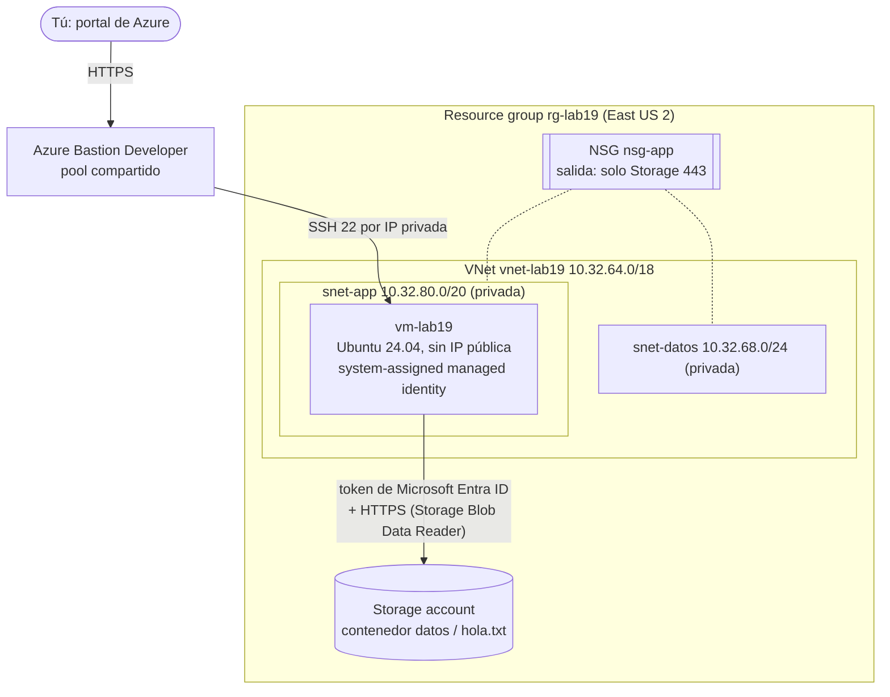

---
tags:
  - laboratorio
  - azure
  - redes
  - computo
  - iam
---

# Lab 19: Azure: VNet, NSG y una VM con Azure CLI

> Crea con Azure CLI una VNet con dos subnets privadas, un NSG con reglas mínimas, una VM Linux sin IP pública a la que entras con Azure Bastion y una managed identity que lee un blob sin contraseñas; al final, lo mismo en Bicep.

| Nivel | Duración | Costo | Requisitos |
| --- | --- | --- | --- |
| Intermedio | ~75 min | Créditos de prueba / capa gratuita (~0,05 USD si limpias el mismo día) | Lab 00, Lab 02, Azure CLI 2.62+ |

!!! info "Qué vas a aprender"
    - Organizar todo en un **resource group** para poder borrarlo de una vez.
    - Crear una **VNet** con dos subnets **privadas** (sin *default outbound access*) y asociarles un **NSG** con reglas mínimas.
    - Lanzar una VM Linux **sin IP pública** y entrar con **Azure Bastion Developer**, sin abrir el puerto 22 a internet.
    - Dar a la VM una **system-assigned managed identity** con el rol **Storage Blob Data Reader** sobre una sola storage account, y leer un blob con un token, sin claves.
    - Desplegar lo mismo de forma declarativa con **Bicep**.

!!! warning "Costos y seguridad"
    Usa una **suscripción de pruebas** con un **budget** y alertas ([Lab 00, parte 2](../fundamentos/preparar-cuentas-cloud.md)), nunca producción. Precios de referencia (pay-as-you-go, `eastus2`, Linux); revísalos en la calculadora de Azure:

    | Recurso | Qué cobra | Capa gratuita aplicable | Cómo evitar el cargo |
    | --- | --- | --- | --- |
    | VNet, subnets, NSG | Nada | No aplica | — |
    | VM `Standard_B2ats_v2` | ~0,0094 USD por hora encendida | La cuenta gratuita incluye 750 h/mes de B1s, B2pts v2 o B2ats v2 durante 12 meses (revisa condiciones vigentes) | Borrar el resource group al terminar |
    | Disco del SO (Standard SSD, 30 GB) | Por GB-mes, aunque la VM esté apagada | Incluido en algunas ofertas de la cuenta gratuita | Se borra con la VM (`--os-disk-delete-option Delete`) |
    | **Azure Bastion Developer** | **Gratis** (sin cargo por hora ni por datos) | — | — |
    | Azure Bastion Basic / Standard | ~0,19 / ~0,29 USD por hora **desde que se crea**, más su IP pública | No | No lo uses en este lab; si lo pruebas, bórralo en el día |
    | Storage account (LRS) | Centavos por GB-mes y por operaciones | Parte de la oferta de 12 meses | Borrar con el resource group |

    Bastion Developer solo está disponible en algunas regiones (entre ellas **East US 2**, Central US, Brazil South, Canada Central, Mexico Central y varias de Europa) y admite **una conexión a la vez**: es para dev/test, no para producción.

## Antes de empezar

- **Azure CLI 2.62 o superior** (`az version`). La forma más simple es **Azure Cloud Shell** (Bash) en el portal: ya trae la CLI, Bicep y tu sesión iniciada. En local: `az login` y `az account set --subscription "<suscripción de pruebas>"`.
- Una cuenta con rol **Owner** (o Contributor + User Access Administrator) en la suscripción de pruebas: el lab crea **role assignments**.
- Un par de llaves SSH (el lab las genera si no existen).
- Labs previos: Lab 00 ([parte 1](../fundamentos/preparar-entorno.md) y [parte 2](../fundamentos/preparar-cuentas-cloud.md)) y [Lab 02](../fundamentos/subnetting-plan-ips.md) (plan de IPs). Si hiciste el [Lab 17](aws-vpc-ec2.md), compara cada paso con su equivalente en AWS.
- Teoría: [Redes en la nube](../../cloud/redes-y-datos/redes.md), [Máquinas virtuales](../../cloud/computo/maquinas-virtuales.md) e [IAM: AWS, Azure y GCP](../../cloud/fundamentos/iam-comparativa.md).

!!! tip "Git Bash en Windows"
    Ejecuta `export MSYS_NO_PATHCONV=1` antes de empezar: los IDs de Azure empiezan por `/subscriptions/...` y Git Bash los convertiría en rutas de Windows al pasarlos a `--scope`.

## Arquitectura



La VM no tiene IP pública ni salida general a internet. Entras por el portal con Bastion Developer, que llega a la VM por su IP privada. La VM pide un token a su servicio de metadatos (IMDS) y lo usa para leer el blob: el permiso lo da Azure RBAC, no una clave.

## Paso a paso

### Paso 1: Variables y resource group

Un **resource group** es el contenedor lógico de todo el lab: borrarlo al final elimina todo lo que contiene. El tag `lab=lab19` ayuda a encontrar recursos sueltos.

```bash
export MSYS_NO_PATHCONV=1   # solo Git Bash
RG=rg-lab19
LOC=eastus2
ST=stlab19$RANDOM$RANDOM    # nombre global y único: 3-24 minúsculas y números
az group create -n "$RG" -l "$LOC" --tags lab=lab19 -o table
```

### Paso 2: NSG con reglas mínimas

Un **network security group (NSG)** es un firewall *stateful* que se asocia a subnets o NICs. Trae **reglas por defecto** que no se pueden borrar, solo sobrescribir con prioridad menor (número más bajo = se evalúa antes):

- Entrada: `AllowVnetInBound` (tráfico dentro de la VNet), `AllowAzureLoadBalancerInBound` y `DenyAllInBound`. Desde internet no entra nada.
- Salida: `AllowVnetOutBound`, `AllowInternetOutBound` y `DenyAllOutBound`.

No añadimos ninguna regla de entrada: no hay nada que abrir a internet. Sí **restringimos la salida**: solo HTTPS hacia el **service tag** de Storage de la región, y todo lo demás hacia internet bloqueado.

```bash
az network nsg create -g "$RG" -n nsg-app --tags lab=lab19 -o none
az network nsg rule create -g "$RG" --nsg-name nsg-app -n AllowStorageOutbound \
  --priority 100 --direction Outbound --access Allow --protocol Tcp \
  --source-address-prefixes VirtualNetwork --destination-address-prefixes Storage.EastUS2 \
  --destination-port-ranges 443 -o none
az network nsg rule create -g "$RG" --nsg-name nsg-app -n DenyInternetOutbound \
  --priority 4000 --direction Outbound --access Deny --protocol '*' \
  --source-address-prefixes '*' --destination-address-prefixes Internet \
  --destination-port-ranges '*' -o none
az network nsg rule list -g "$RG" --nsg-name nsg-app --include-default -o table
```

### Paso 3: VNet con dos subnets privadas

Usamos el bloque **staging** del plan del [Lab 02](../fundamentos/subnetting-plan-ips.md) como address space (`10.32.64.0/18`), así no se solapa con la VPC del [Lab 17](aws-vpc-ec2.md) (bloque dev) si algún día las conectas: `snet-app` es la subnet de aplicación `10.32.80.0/20` y `snet-datos`, la de datos `10.32.68.0/24`. En Azure una subnet abarca **todas las zonas** de la región, así que no hace falta una por zona. Azure reserva 5 IPs por subnet.

`--default-outbound false` hace la subnet **privada**: las VMs no reciben la IP de salida implícita que Azure asignaba antes. Desde la API posterior al 31/03/2026 es el valor por defecto en VNets nuevas, pero lo dejamos explícito.

```bash
az network vnet create -g "$RG" -n vnet-lab19 --address-prefixes 10.32.64.0/18 --tags lab=lab19 -o none
for s in "snet-app 10.32.80.0/20" "snet-datos 10.32.68.0/24"; do
  set -- $s
  az network vnet subnet create -g "$RG" --vnet-name vnet-lab19 -n "$1" \
    --address-prefixes "$2" --nsg nsg-app --default-outbound false -o none
done
az network vnet subnet list -g "$RG" --vnet-name vnet-lab19 \
  --query '[].{nombre:name, rango:addressPrefix, nsg:networkSecurityGroup.id!=null, salidaPorDefecto:defaultOutboundAccess}' -o table
```

```text
Nombre      Rango         Nsg    SalidaPorDefecto
----------  ------------  -----  ------------------
snet-app    10.32.80.0/20   True   False
snet-datos  10.32.68.0/24   True   False
```

### Paso 4: Storage account con un blob

La storage account se crea **sin acceso público** y **sin shared key** (`--allow-shared-key-access false`): solo se puede usar con identidades de Microsoft Entra ID y RBAC. Por eso, para subir el archivo, primero te das a ti el rol de datos **Storage Blob Data Contributor** sobre esa cuenta (ser Owner de la suscripción no da acceso a los datos).

```bash
az storage account create -g "$RG" -n "$ST" -l "$LOC" --sku Standard_LRS --kind StorageV2 \
  --allow-blob-public-access false --allow-shared-key-access false --min-tls-version TLS1_2 \
  --tags lab=lab19 -o none
ST_ID=$(az storage account show -g "$RG" -n "$ST" --query id -o tsv)
YO=$(az ad signed-in-user show --query id -o tsv)
az role assignment create --assignee-object-id "$YO" --assignee-principal-type User \
  --role "Storage Blob Data Contributor" --scope "$ST_ID" -o none
sleep 60   # los role assignments tardan en propagarse
echo "Hola desde un blob leído con managed identity" > hola.txt
az storage container create --account-name "$ST" -n datos --auth-mode login -o none
az storage blob upload --account-name "$ST" -c datos -n hola.txt -f hola.txt --auth-mode login -o none
az storage blob list --account-name "$ST" -c datos --auth-mode login --query '[].name' -o tsv
```

### Paso 5: VM sin IP pública con managed identity

Opciones importantes:

- `--public-ip-address ""` y `--nsg ""`: sin IP pública y sin un NSG extra en la NIC (ya lo tiene la subnet).
- `--assign-identity '[system]' --role "Storage Blob Data Reader" --scope "$ST_ID"`: crea la **managed identity** de la VM y le da **solo lectura** sobre **esa** storage account.
- `--security-type TrustedLaunch`: arranque seguro (Secure Boot y vTPM).
- `--os-disk-delete-option Delete --nic-delete-option Delete`: al borrar la VM se borran su disco y su NIC.

```bash
az vm create -g "$RG" -n vm-lab19 \
  --image Canonical:ubuntu-24_04-lts:server:latest --size Standard_B2ats_v2 \
  --vnet-name vnet-lab19 --subnet snet-app \
  --public-ip-address "" --nsg "" \
  --admin-username azureuser --generate-ssh-keys --ssh-key-type Ed25519 \
  --assign-identity '[system]' --role "Storage Blob Data Reader" --scope "$ST_ID" \
  --security-type TrustedLaunch --storage-sku StandardSSD_LRS \
  --os-disk-delete-option Delete --nic-delete-option Delete \
  --tags lab=lab19 -o table
```

```text
ResourceGroup    PowerState    PublicIpAddress    PrivateIpAddress
---------------  ------------  -----------------  ------------------
rg-lab19         VM running                       10.32.80.4
```

!!! note "En PowerShell"
    Si ejecutas este comando en PowerShell, escribe las comillas vacías como `'""'` (`--public-ip-address '""' --nsg '""'`).

### Paso 6: Crear Azure Bastion Developer

**Bastion Developer** no necesita la subnet `AzureBastionSubnet` ni IP pública: usa un pool compartido de Microsoft y es gratuito. Se crea en segundos.

```bash
az network bastion create -g "$RG" -n bas-lab19 --sku Developer --vnet-name vnet-lab19 -l "$LOC" -o table
```

La primera vez, la CLI instala la extensión `bastion` automáticamente.

### Paso 7: Conectarte a la VM por el portal

1. En el portal, abre **vm-lab19** → **Connect** → **Connect via Bastion**.
2. **Authentication Type**: *SSH Private Key from Local File*; usuario `azureuser`; selecciona tu llave privada (`~/.ssh/id_ed25519`).
3. **Connect**: se abre una terminal en el navegador.

Bastion llega a la VM por su IP privada; la regla por defecto `AllowVnetInBound` lo permite. Nadie en internet puede intentar un SSH contra la VM porque no tiene IP pública.

### Paso 8: Leer el blob con la managed identity

Dentro de la VM no hay credenciales guardadas. La VM pide un **access token** para Azure Storage a su **Instance Metadata Service** (IMDS, en `169.254.169.254`, solo accesible desde la propia VM) y lo usa en la API REST de Blob Storage. La cabecera `Metadata: true` es obligatoria y protege contra SSRF.

```bash
ST=<nombre-de-tu-storage-account>     # el valor de $ST del paso 1
TOKEN=$(curl -s -H "Metadata: true" \
  "http://169.254.169.254/metadata/identity/oauth2/token?api-version=2018-02-01&resource=https%3A%2F%2Fstorage.azure.com%2F" \
  | python3 -c 'import json,sys; print(json.load(sys.stdin)["access_token"])')
curl -s -H "Authorization: Bearer $TOKEN" -H "x-ms-version: 2020-10-02" \
  "https://$ST.blob.core.windows.net/datos/hola.txt"
```

```text
Hola desde un blob leído con managed identity
```

Ahora intenta **escribir**. El rol es de solo lectura, así que Azure debe responder 403:

```bash
curl -s -o /dev/null -w "%{http_code}\n" -X PUT \
  -H "Authorization: Bearer $TOKEN" -H "x-ms-version: 2020-10-02" -H "x-ms-blob-type: BlockBlob" \
  --data "no deberia poder" "https://$ST.blob.core.windows.net/datos/intruso.txt"
curl -sS -m 5 https://www.microsoft.com -o /dev/null || echo "Sin salida a internet (esperado)"
```

```text
403
curl: (28) Connection timed out ...
Sin salida a internet (esperado)
```

La VM llega a Storage aunque la subnet sea privada: Azure permite el acceso a storage accounts **de la misma región** desde subnets privadas, y el NSG lo autoriza con la regla `AllowStorageOutbound`. Cualquier otro destino en internet queda bloqueado.

### Paso 9: Alternativas de acceso (para conocerlas)

| Opción | Qué necesita | Cuándo usarla |
| --- | --- | --- |
| **Bastion Developer** (este lab) | Región soportada; gratis; solo portal; una sesión a la vez | Dev/test |
| **Bastion Standard/Premium** + `az network bastion ssh` | ~0,29 USD/h o más, `AzureBastionSubnet` /26 y *native client* (`--enable-tunneling`) | Equipos que quieren usar su terminal y su cliente SSH |
| **Microsoft Entra ID login** (`az ssh vm`) | Extensión `AADSSHLoginForLinux`, rol *Virtual Machine Administrator/User Login*, **salida a internet** de la VM (`packages.microsoft.com`, `login.microsoftonline.com`) y conectividad hasta la IP de la VM | Quitar las llaves SSH y controlar el acceso con RBAC y Conditional Access |

En este lab la VM no tiene salida a internet, así que el login con Entra ID **no** funcionaría sin añadir un Azure NAT Gateway (de pago). Es un buen ejemplo de cómo una decisión de red condiciona las opciones de identidad.

### Paso 10 (opcional): el mismo despliegue en Bicep

**Bicep** es el lenguaje de IaC nativo de Azure: se compila a una plantilla ARM. Este archivo describe la red, el NSG, la storage account, la VM con su identidad, el role assignment y Bastion Developer. Despliégalo en **otro** resource group para comparar:

??? example "main.bicep completo (haz clic para desplegar)"

    ```bicep title="main.bicep"
    // Lab 19: VNet + NSG + VM sin IP pública + managed identity que lee un blob
    targetScope = 'resourceGroup'

    param location string = resourceGroup().location
    param adminUsername string = 'azureuser'
    @description('Contenido de tu llave pública SSH (por ejemplo, ~/.ssh/id_ed25519.pub)')
    param sshPublicKey string
    param storageAccountName string = 'stlab19${uniqueString(resourceGroup().id)}'
    @description('Service tag de Storage de tu región (salida permitida)')
    param storageServiceTag string = 'Storage.EastUS2'

    var tags = { lab: 'lab19' }

    resource nsg 'Microsoft.Network/networkSecurityGroups@2024-07-01' = {
      name: 'nsg-app'
      location: location
      tags: tags
      properties: {
        securityRules: [
          {
            name: 'AllowStorageOutbound'
            properties: {
              priority: 100
              direction: 'Outbound'
              access: 'Allow'
              protocol: 'Tcp'
              sourceAddressPrefix: 'VirtualNetwork'
              sourcePortRange: '*'
              destinationAddressPrefix: storageServiceTag
              destinationPortRange: '443'
            }
          }
          {
            name: 'DenyInternetOutbound'
            properties: {
              priority: 4000
              direction: 'Outbound'
              access: 'Deny'
              protocol: '*'
              sourceAddressPrefix: '*'
              sourcePortRange: '*'
              destinationAddressPrefix: 'Internet'
              destinationPortRange: '*'
            }
          }
        ]
      }
    }

    resource vnet 'Microsoft.Network/virtualNetworks@2024-07-01' = {
      name: 'vnet-lab19'
      location: location
      tags: tags
      properties: {
        addressSpace: { addressPrefixes: ['10.32.64.0/18'] }
        subnets: [
          {
            name: 'snet-app'
            properties: {
              addressPrefix: '10.32.80.0/20'
              networkSecurityGroup: { id: nsg.id }
              defaultOutboundAccess: false
            }
          }
          {
            name: 'snet-datos'
            properties: {
              addressPrefix: '10.32.68.0/24'
              networkSecurityGroup: { id: nsg.id }
              defaultOutboundAccess: false
            }
          }
        ]
      }
    }

    resource storage 'Microsoft.Storage/storageAccounts@2024-01-01' = {
      name: storageAccountName
      location: location
      tags: tags
      sku: { name: 'Standard_LRS' }
      kind: 'StorageV2'
      properties: {
        allowBlobPublicAccess: false
        allowSharedKeyAccess: false
        minimumTlsVersion: 'TLS1_2'
        supportsHttpsTrafficOnly: true
      }
    }

    resource blobService 'Microsoft.Storage/storageAccounts/blobServices@2024-01-01' = {
      parent: storage
      name: 'default'
    }

    resource container 'Microsoft.Storage/storageAccounts/blobServices/containers@2024-01-01' = {
      parent: blobService
      name: 'datos'
    }

    resource nic 'Microsoft.Network/networkInterfaces@2024-07-01' = {
      name: 'nic-vm-lab19'
      location: location
      tags: tags
      properties: {
        ipConfigurations: [
          {
            name: 'ipconfig1'
            properties: {
              subnet: { id: vnet.properties.subnets[0].id }
              privateIPAllocationMethod: 'Dynamic'
            }
          }
        ]
      }
    }

    resource vm 'Microsoft.Compute/virtualMachines@2024-07-01' = {
      name: 'vm-lab19'
      location: location
      tags: tags
      identity: { type: 'SystemAssigned' }
      properties: {
        hardwareProfile: { vmSize: 'Standard_B2ats_v2' }
        securityProfile: {
          securityType: 'TrustedLaunch'
          uefiSettings: { secureBootEnabled: true, vTpmEnabled: true }
        }
        storageProfile: {
          imageReference: {
            publisher: 'Canonical'
            offer: 'ubuntu-24_04-lts'
            sku: 'server'
            version: 'latest'
          }
          osDisk: {
            createOption: 'FromImage'
            deleteOption: 'Delete'
            managedDisk: { storageAccountType: 'StandardSSD_LRS' }
          }
        }
        osProfile: {
          computerName: 'vm-lab19'
          adminUsername: adminUsername
          linuxConfiguration: {
            disablePasswordAuthentication: true
            ssh: {
              publicKeys: [
                {
                  path: '/home/${adminUsername}/.ssh/authorized_keys'
                  keyData: sshPublicKey
                }
              ]
            }
          }
        }
        networkProfile: {
          networkInterfaces: [
            {
              id: nic.id
              properties: { deleteOption: 'Delete' }
            }
          ]
        }
      }
    }

    // Storage Blob Data Reader, solo sobre esta storage account
    var blobDataReader = subscriptionResourceId(
      'Microsoft.Authorization/roleDefinitions',
      '2a2b9908-6ea1-4ae2-8e65-a410df84e7d1'
    )

    resource vmPuedeLeerBlobs 'Microsoft.Authorization/roleAssignments@2022-04-01' = {
      name: guid(storage.id, vm.id, blobDataReader)
      scope: storage
      properties: {
        roleDefinitionId: blobDataReader
        principalId: vm.identity.principalId
        principalType: 'ServicePrincipal'
      }
    }

    resource bastion 'Microsoft.Network/bastionHosts@2024-07-01' = {
      name: 'bas-lab19'
      location: location
      tags: tags
      sku: { name: 'Developer' }
      properties: {
        virtualNetwork: { id: vnet.id }
      }
    }

    output storageAccount string = storage.name
    output vmPrivateIp string = nic.properties.ipConfigurations[0].properties.privateIPAddress
    ```

```bash
az group create -n rg-lab19-bicep -l eastus2 --tags lab=lab19 -o none
az deployment group what-if -g rg-lab19-bicep -f main.bicep \
  -p sshPublicKey="$(cat ~/.ssh/id_ed25519.pub)"        # muestra qué va a crear, sin crear nada
az deployment group create -g rg-lab19-bicep -f main.bicep \
  -p sshPublicKey="$(cat ~/.ssh/id_ed25519.pub)" --query properties.outputs
```

`what-if` es el equivalente a `terraform plan`. Los datos del contenedor (el blob) no se suben con Bicep: es el *data plane*, y se hace como en el paso 4. Si prefieres Terraform, el provider vigente es **azurerm v5**.

## Verificación

| Comprobación | Comando | Resultado esperado |
| --- | --- | --- |
| La VM no tiene IP pública | `az vm list-ip-addresses -g $RG -n vm-lab19 -o table` | Columna `PublicIPAddresses` vacía |
| Subnets privadas con NSG | `az network vnet subnet list -g $RG --vnet-name vnet-lab19 --query '[].[name,defaultOutboundAccess]' -o tsv` | `false` en ambas |
| Ninguna regla de entrada propia | `az network nsg rule list -g $RG --nsg-name nsg-app --query "[?direction=='Inbound']" -o tsv` | Vacío |
| La identidad existe | `az vm identity show -g $RG -n vm-lab19 --query type -o tsv` | `SystemAssigned` |
| Rol limitado a la storage account | `az role assignment list --assignee <principalId> --all -o table` | Solo *Storage Blob Data Reader* con scope de `$ST` |
| Lectura sí, escritura no | Paso 8 | Contenido del blob y `403` |
| Bastion es Developer | `az network bastion show -g $RG -n bas-lab19 --query sku.name -o tsv` | `Developer` |

El `principalId` lo obtienes con `az vm identity show -g $RG -n vm-lab19 --query principalId -o tsv`.

## Retos extra

1. Añade el **service endpoint** `Microsoft.Storage` a `snet-app` y configura el firewall de la storage account (`az storage account network-rule add`, `--default-action Deny`) para que **solo** esa subnet pueda llegar. Comprueba que desde Cloud Shell ya no puedes listar blobs.
2. Cambia la system-assigned identity por una **user-assigned managed identity** y explica qué ventaja tiene cuando hay varias VMs.
3. Añade un **Azure NAT Gateway** a `snet-app`, instala la extensión `AADSSHLoginForLinux` y entra con `az ssh vm`. Calcula cuánto costaría dejarlo un mes.
4. Activa los **flow logs** de la VNet con Network Watcher y busca el tráfico denegado por `DenyInternetOutbound`.

## Limpieza

Borrar el resource group elimina todo lo que contiene (VM, disco, NIC, VNet, NSG, storage account, Bastion, role assignments sobre esos recursos):

```bash
az group delete -n rg-lab19 --yes --no-wait
az group delete -n rg-lab19-bicep --yes --no-wait   # si hiciste el paso 10
rm -f hola.txt
```

**Verifica que no queda nada facturando** (tras unos minutos):

```bash
az group exists -n rg-lab19                  # false
az group exists -n rg-lab19-bicep            # false
az resource list --tag lab=lab19 -o table    # vacío
az vm list -o table                          # sin vm-lab19
az disk list --query "[?contains(name,'lab19')]" -o table
az network bastion list -o table
```

Azure crea automáticamente el resource group `NetworkWatcherRG` la primera vez que creas una VNet en una región; **Network Watcher no tiene costo** por sí solo, puedes dejarlo. Las llaves SSH quedan en `~/.ssh` de tu equipo: bórralas si no las vas a usar. Al día siguiente revisa **Cost Management → Cost analysis** filtrando por el tag `lab = lab19`.

## Problemas comunes

| Síntoma | Causa probable | Solución |
| --- | --- | --- |
| `AuthorizationPermissionMismatch` al subir el blob | El role assignment aún no se propagó o falta | Espera 1–5 minutos y repite; comprueba con `az role assignment list --scope $ST_ID` |
| `403` también al **leer** desde la VM | El rol de la managed identity no se propagó, o el scope es otro | Espera unos minutos; pide un token nuevo; revisa el scope |
| El token de IMDS no llega | Falta la cabecera `Metadata: true` o la VM no tiene identidad | Añade la cabecera; `az vm identity assign` |
| *Bastion Developer is not supported in this region* | Región sin Developer SKU | Usa una región de la lista (East US 2, Central US, Brazil South...) |
| Bastion no conecta a la VM | Usuario o llave incorrectos, o una regla de entrada que bloquea el tráfico interno | Revisa usuario `azureuser` y llave; no sobrescribas `AllowVnetInBound` con un *deny* |
| `InvalidResourceId` o rutas `C:/Program Files/Git/subscriptions/...` | Conversión de rutas de Git Bash | `export MSYS_NO_PATHCONV=1` |
| `SkuNotAvailable` / cuota insuficiente | El tamaño no está disponible en la región o en tu suscripción | Prueba `Standard_B2pts_v2` (Arm, imagen `server-arm64`) o `Standard_B1s`, u otra región con Bastion Developer |

Método general: [Troubleshooting](../../devops/operacion/troubleshooting.md) y [Troubleshooting de red](../../networking/avanzado/troubleshooting-red.md).

## Información complementaria

- **NSG y reglas por defecto**: entender las reglas implícitas es clave para no abrir más de la cuenta. Ver [Redes en la nube](../../cloud/redes-y-datos/redes.md#firewalls-stateful-y-stateless) y [Seguridad de red](../../networking/avanzado/seguridad-red.md).
- **Default outbound access**: Azure está retirando la salida implícita; lo correcto es una salida explícita (NAT Gateway, load balancer) o ninguna. Ver [Routing y NAT](../../networking/intermedio/routing-nat.md).
- **Managed identity vs claves**: la identidad la gestiona Azure y el token caduca solo; no hay secretos que rotar ni que se filtren. Ver [IAM: AWS, Azure y GCP](../../cloud/fundamentos/iam-comparativa.md) y [Secretos e identidades](../../devsecops/identidades-y-pipeline/secretos-identidades.md).
- **Control plane vs data plane**: ser Owner te deja crear la storage account, pero leer o escribir blobs requiere roles de datos. Ver [Almacenamiento y datos](../../cloud/redes-y-datos/almacenamiento-datos.md).
- **En el trabajo real** las VNets se organizan en *hub-and-spoke*, Azure Policy impide crear IPs públicas en VMs y obliga a usar subnets privadas, y el despliegue se hace con Bicep o Terraform desde un pipeline. Ver [Gobernanza](../../cloud/operacion-y-gobierno/gobernanza.md) y [Redes de datacenter e híbridas](../../networking/avanzado/redes-datacenter-hibridas.md).

## Documentación oficial

- [Azure CLI: `az network vnet subnet`](https://learn.microsoft.com/cli/azure/network/vnet/subnet) y [`az vm create`](https://learn.microsoft.com/cli/azure/vm#az-vm-create)
- [Network security groups: cómo funcionan](https://learn.microsoft.com/azure/virtual-network/network-security-groups-overview)
- [Default outbound access en Azure](https://learn.microsoft.com/azure/virtual-network/ip-services/default-outbound-access)
- [Azure Bastion: comparación de SKUs y regiones de Developer](https://learn.microsoft.com/azure/bastion/bastion-sku-comparison) y [`az network bastion`](https://learn.microsoft.com/cli/azure/network/bastion)
- [Managed identities: obtener un token desde una VM](https://learn.microsoft.com/entra/identity/managed-identities-azure-resources/how-to-use-vm-token)
- [Autorizar el acceso a blobs con Microsoft Entra ID](https://learn.microsoft.com/azure/storage/blobs/authorize-access-azure-active-directory)
- [Iniciar sesión en una VM Linux con Microsoft Entra ID](https://learn.microsoft.com/entra/identity/devices/howto-vm-sign-in-azure-ad-linux)
- [Bicep](https://learn.microsoft.com/azure/azure-resource-manager/bicep/overview) y [precios de Azure Bastion](https://azure.microsoft.com/pricing/details/azure-bastion/)

## Preguntas para verificar el aprendizaje

??? question "1. ¿Por qué no hizo falta ninguna regla de entrada para que Bastion llegue a la VM?"
    Porque la regla por defecto `AllowVnetInBound` permite el tráfico dentro de la red virtual, y Bastion se conecta a la IP privada de la VM. Lo que no existe es una IP pública ni una regla que permita entrar desde `Internet`.

??? question "2. ¿Qué diferencia hay entre ser Owner de la suscripción y tener Storage Blob Data Reader?"
    Owner da permisos de *control plane* (crear, configurar y borrar la storage account y asignar roles). Leer o escribir blobs es *data plane* y requiere roles de datos como Storage Blob Data Reader/Contributor.

??? question "3. ¿Qué pasaría si el role assignment de la VM tuviera scope en la suscripción?"
    La VM podría leer los blobs de **todas** las storage accounts de la suscripción. Si alguien compromete la VM, el alcance del daño sería mucho mayor. Por eso el scope se limita a un recurso.

??? question "4. ¿Por qué la VM puede llegar a Storage si su subnet es privada y el NSG bloquea internet?"
    Azure permite el acceso a storage accounts de la misma región desde subnets privadas sin salida explícita, y el NSG tiene una regla de mayor prioridad (`AllowStorageOutbound`, 100) que permite 443 al service tag de Storage antes de llegar a `DenyInternetOutbound` (4000).

??? question "5. ¿Por qué el login con Microsoft Entra ID no funcionaría en esta VM tal como está?"
    La extensión necesita descargar paquetes de `packages.microsoft.com` y la VM necesita hablar con `login.microsoftonline.com`; con la salida a internet bloqueada no puede. Habría que añadir una salida explícita (NAT Gateway) y permitirla en el NSG.

??? question "6. ¿Cuándo elegirías Bastion Standard en vez de Developer?"
    Cuando necesites varias sesiones simultáneas, VNets en peering, usar tu cliente SSH nativo (`az network bastion ssh`), *shareable links* o es un entorno de producción. A cambio pagas por hora desde que se crea.

??? question "7. ¿Qué protege la cabecera `Metadata: true` en IMDS?"
    Evita que un atacante que solo consigue que una aplicación haga peticiones a una URL (SSRF) obtenga el token: esas peticiones normalmente no pueden añadir cabeceras personalizadas. Es el mismo objetivo que IMDSv2 en AWS.

??? question "8. ¿Qué ventaja tiene borrar un resource group frente a borrar recurso por recurso?"
    Borra todo lo que contiene en el orden correcto, sin olvidar dependencias (NIC, disco, IP). Es la forma más segura de limpiar un lab. El riesgo es borrar algo que no querías: por eso cada lab usa su propio resource group.

## Notas relacionadas

- **Cloud**: [Redes en la nube](../../cloud/redes-y-datos/redes.md) · [Máquinas virtuales](../../cloud/computo/maquinas-virtuales.md) · [IAM: AWS, Azure y GCP](../../cloud/fundamentos/iam-comparativa.md) · [Fundamentos de seguridad cloud](../../cloud/seguridad/fundamentos-seguridad-cloud.md) · [Almacenamiento y datos](../../cloud/redes-y-datos/almacenamiento-datos.md) · [Gobernanza](../../cloud/operacion-y-gobierno/gobernanza.md) · [FinOps y costos](../../cloud/fundamentos/finops-costos.md)
- **DevOps**: [Infrastructure as Code](../../devops/iac/infraestructura-como-codigo.md) · [Troubleshooting](../../devops/operacion/troubleshooting.md)
- **DevSecOps**: [Secretos e identidades](../../devsecops/identidades-y-pipeline/secretos-identidades.md) · [Seguridad de IaC](../../devsecops/infraestructura-y-contenedores/seguridad-iac.md)
- **Networking**: [Direccionamiento IP](../../networking/basico/direccionamiento-ip.md) · [Routing y NAT](../../networking/intermedio/routing-nat.md) · [Seguridad de red](../../networking/avanzado/seguridad-red.md) · [Redes de datacenter e híbridas](../../networking/avanzado/redes-datacenter-hibridas.md) · [Troubleshooting de red](../../networking/avanzado/troubleshooting-red.md)
- **Certificaciones**: [Azure Administrator: redes virtuales](../../certificaciones/azure/azure-administrator/area-4-redes-virtuales.md) · [Azure Administrator: cómputo](../../certificaciones/azure/azure-administrator/area-3-computo.md) · [Azure Administrator: identidades y gobierno](../../certificaciones/azure/azure-administrator/area-1-identidades-gobierno.md) · [Azure Administrator: almacenamiento](../../certificaciones/azure/azure-administrator/area-2-almacenamiento.md)
- **Lab anterior**: [Lab 18: API serverless en AWS](aws-serverless-api.md) · **Lab siguiente**: [Lab 20: Cloud Run en Google Cloud](gcp-cloud-run.md)
