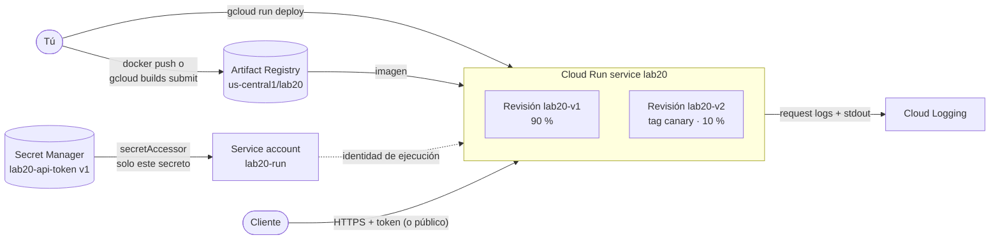

---
tags:
  - laboratorio
  - gcp
  - contenedores
  - serverless
  - ci-cd
---

# Lab 20: Google Cloud: desplegar un contenedor en Cloud Run

> Publica una imagen en Artifact Registry y despliégala en Cloud Run con una service account de permisos mínimos, un secreto de Secret Manager, acceso autenticado o público, un canary entre dos revisiones y sus logs en Cloud Logging.

| Nivel | Duración | Costo | Requisitos |
| --- | --- | --- | --- |
| Intermedio | ~60 min | Capa gratuita (~0 USD si limpias) | Lab 00, Lab 05, gcloud CLI, Docker (opcional) |

!!! info "Qué vas a aprender"
    - Crear un **proyecto de pruebas** y habilitar solo las APIs que necesitas.
    - Subir una imagen a **Artifact Registry**, construida en local con Docker o con **Cloud Build**.
    - Desplegar en **Cloud Run** con una **service account** dedicada, sin roles a nivel de proyecto.
    - Inyectar configuración con **variables de entorno** y un secreto de **Secret Manager** con versión fija.
    - Distinguir acceso **autenticado** (IAM, `roles/run.invoker`) y **público** (`allUsers`).
    - Hacer un **canary release** (despliegue canario): revisión nueva sin tráfico, URL con tag, 90/10, promoción y rollback.
    - Leer los logs estructurados del servicio en **Cloud Logging**.

!!! warning "Costos y seguridad"
    Crea un **proyecto nuevo solo para este lab** en una cuenta con **budget** y alertas ([Lab 00, parte 2](../fundamentos/preparar-cuentas-cloud.md)); al final lo borras entero. Capa gratuita mensual (Free Tier, sin fecha de fin) verificada en la documentación de Google Cloud:

    | Servicio | Qué cobra | Free Tier mensual | Cómo evitar el cargo |
    | --- | --- | --- | --- |
    | Cloud Run (facturación por petición) | vCPU-s, GiB-s y peticiones mientras atiende | 180 000 vCPU-s, 360 000 GiB-s, 2 millones de peticiones, 1 GB de salida desde Norteamérica | `--max-instances=2`, sin `--min-instances`: escala a cero |
    | Artifact Registry | Almacenamiento de imágenes | 0,5 GB | Una sola imagen pequeña; borrar el repositorio |
    | Cloud Build (si lo usas) | Minutos de build | 2 500 build-minutes en `e2-standard-2` | Un build de menos de 2 minutos |
    | Secret Manager | Versiones activas y accesos | 6 versiones activas y 10 000 accesos | Una versión; borrar el secreto |
    | Cloud Logging | Ingesta de logs | 50 GiB por proyecto | Pocas peticiones |

    Las cuentas nuevas tienen además un **Free Trial** de 300 USD en créditos durante 90 días. El paso de acceso público deja la URL abierta a internet: hazlo solo unos minutos y no muestres datos reales.

## Antes de empezar

- **gcloud CLI** actualizada (`gcloud version`; `gcloud components update` si la instalaste con el instalador). La opción más simple es **Cloud Shell** en la consola: trae gcloud, Docker y tu sesión iniciada.
- Una **billing account** activa (`gcloud billing accounts list`).
- **Docker** solo si construyes en local (con Docker Desktop en marcha). Si no, usa Cloud Build.
- Labs previos: Lab 00 ([parte 1](../fundamentos/preparar-entorno.md) y [parte 2](../fundamentos/preparar-cuentas-cloud.md)) y [Lab 05](../devops/docker-multistage-compose.md) (imágenes pequeñas, sin root, con tag concreto).
- Teoría: [Contenedores gestionados](../../cloud/computo/contenedores-gestionados.md), [Serverless](../../cloud/computo/serverless.md) y [Despliegue continuo](../../devops/ci-cd/despliegue-continuo.md) (estrategia canary).

## Arquitectura



Cloud Run toma la imagen de Artifact Registry y crea una **revisión** inmutable por cada despliegue. El tráfico se reparte entre revisiones por porcentajes. El contenedor corre con la identidad `lab20-run`, que solo puede leer un secreto.

## Paso a paso

### Paso 1: Crear el proyecto de pruebas

Un proyecto aislado deja claro qué cuesta este lab y permite borrarlo todo al final. El ID debe ser único en todo Google Cloud.

```bash
PROJECT_ID=lab20-cloudrun-$RANDOM
REGION=us-central1
gcloud projects create "$PROJECT_ID" --name="Lab 20 Cloud Run"
gcloud billing accounts list
gcloud billing projects link "$PROJECT_ID" --billing-account=<ID-de-tu-billing-account>
gcloud config set project "$PROJECT_ID"
gcloud config set run/region "$REGION"
```

### Paso 2: Habilitar las APIs

En Google Cloud cada servicio se habilita por proyecto. Habilitar solo lo necesario reduce superficie y sorpresas.

```bash
gcloud services enable run.googleapis.com artifactregistry.googleapis.com \
  secretmanager.googleapis.com cloudbuild.googleapis.com
gcloud services list --enabled --filter="name:(run OR artifactregistry OR secretmanager OR cloudbuild)"
```

### Paso 3: Crear el repositorio en Artifact Registry

**Artifact Registry** es el registry gestionado de Google Cloud (sustituye a Container Registry). Ponerlo en la misma región que Cloud Run evita tráfico entre regiones.

```bash
gcloud artifacts repositories create lab20 --repository-format=docker \
  --location="$REGION" --description="Imágenes del Lab 20"
IMAGE="$REGION-docker.pkg.dev/$PROJECT_ID/lab20/app:1.0.0"
echo "$IMAGE"
```

### Paso 4: Preparar la imagen del Lab 05

Vas a desplegar la API de tareas del [Lab 05](../devops/docker-multistage-compose.md) (carpeta `lab-devops-app`): imagen multi-stage, `slim`, con usuario sin root y tag concreto. Encaja con Cloud Run porque:

- Lee `APP_VERSION` y `API_TOKEN` de variables de entorno, y su endpoint `/info` devuelve `version` y `token_configurado`: así verás qué revisión responde y si el secreto llegó.
- Sin `DB_HOST` guarda las tareas **en memoria**, así que no necesitas base de datos (cada instancia tiene su propia memoria: es una demo, no un almacenamiento real).
- Escucha en el puerto **8000**. Cloud Run envía el tráfico al puerto 8080 por defecto, así que al desplegar indicarás `--port=8000`.

Antes de subirla, comprueba en local que la imagen arranca:

```bash
cd lab-devops-app
docker build --build-arg APP_VERSION=1.0.0 -t lab-api:1.0.0 .
docker run --rm -d --name lab20-prueba -p 8000:8000 -e APP_VERSION=v1 lab-api:1.0.0
curl -s localhost:8000/info
docker stop lab20-prueba
```

```text
{"version":"v1","mensaje":"Hola desde el lab","storage":"memoria","token_configurado":false,"hostname":"..."}
```

??? tip "¿No hiciste el Lab 05? Usa esta app mínima"
    Esta app sin dependencias responde lo mismo en `/info` (versión, revisión y si hay token) y escribe sus logs como JSON de una línea, que Cloud Logging convierte en **logs estructurados**. Lee el puerto de `PORT`, la variable que Cloud Run inyecta con el valor de `--port`, así que los comandos del lab sirven igual. Crea una carpeta `lab-devops-app` con estos dos archivos:

    ```python title="lab-devops-app/app.py"
    """App mínima para Cloud Run: muestra versión y revisión, sin dependencias externas."""

    import json
    import os
    from http.server import BaseHTTPRequestHandler, ThreadingHTTPServer


    def log(severity: str, message: str, **extra) -> None:
        # Una línea JSON por evento: Cloud Logging la convierte en log estructurado
        print(json.dumps({"severity": severity, "message": message, **extra}), flush=True)


    class Handler(BaseHTTPRequestHandler):
        def do_GET(self):
            if self.path == "/health":
                self._json(200, {"status": "ok"})
                return
            cuerpo = {
                "app": "lab20",
                "version": os.environ.get("APP_VERSION", "dev"),
                "revision": os.environ.get("K_REVISION", "local"),
                "token_configurado": bool(os.environ.get("API_TOKEN")),
            }
            log("INFO", "peticion atendida", path=self.path, version=cuerpo["version"])
            self._json(200, cuerpo)

        def _json(self, status: int, cuerpo: dict) -> None:
            datos = json.dumps(cuerpo).encode()
            self.send_response(status)
            self.send_header("Content-Type", "application/json")
            self.send_header("Content-Length", str(len(datos)))
            self.end_headers()
            self.wfile.write(datos)

        def log_message(self, format, *args):
            pass  # evitamos el log por defecto (sin formato) de http.server


    if __name__ == "__main__":
        puerto = int(os.environ.get("PORT", "8080"))  # Cloud Run inyecta PORT
        log("INFO", "arrancando", port=puerto)
        ThreadingHTTPServer(("0.0.0.0", puerto), Handler).serve_forever()
    ```

    ```dockerfile title="lab-devops-app/Dockerfile"
    FROM python:3.14.9-slim

    # Usuario sin privilegios, como en el Lab 05
    RUN useradd --create-home --uid 10001 app
    WORKDIR /app
    COPY app.py .
    USER 10001

    ENV PORT=8080 PYTHONUNBUFFERED=1
    EXPOSE 8080
    CMD ["python", "app.py"]
    ```

    Pruébala en local con `py -3.12 app.py` (Windows) o `PORT=8000 python3 app.py` (Linux/macOS) y `curl -s localhost:8000/info`. Con Docker, añade `-e PORT=8000` al `docker run` (la imagen usa 8080 si no se indica otro).

### Paso 5: Construir y subir la imagen

=== "Docker local"

    ```bash
    gcloud auth configure-docker "$REGION-docker.pkg.dev"
    docker build --build-arg APP_VERSION=1.0.0 -t "$IMAGE" lab-devops-app/
    docker push "$IMAGE"
    ```

=== "Cloud Build (sin Docker)"

    ```bash
    gcloud builds submit lab-devops-app/ --tag "$IMAGE"
    ```

    En proyectos nuevos Cloud Build usa la **Compute Engine default service account**. Si el build falla al subir la imagen por permisos, dale `roles/artifactregistry.writer` sobre el repositorio a esa cuenta (`PROJECT_NUMBER-compute@developer.gserviceaccount.com`), o usa la pestaña de Docker local.

```bash
gcloud artifacts docker images list "$REGION-docker.pkg.dev/$PROJECT_ID/lab20" --include-tags
```

### Paso 6: Service account dedicada y secreto

Si no indicas otra, Cloud Run ejecuta el contenedor con la **Compute Engine default service account**, que en muchos proyectos tiene el rol *Editor*. Una service account propia, **sin ningún rol en el proyecto**, aplica least privilege: solo le daremos acceso a **un** secreto.

```bash
gcloud iam service-accounts create lab20-run --display-name="Runtime de Cloud Run (lab 20)"
SA="lab20-run@$PROJECT_ID.iam.gserviceaccount.com"

printf 'token-de-prueba-no-real' | gcloud secrets create lab20-api-token \
  --replication-policy=automatic --data-file=-
gcloud secrets add-iam-policy-binding lab20-api-token \
  --member="serviceAccount:$SA" --role=roles/secretmanager.secretAccessor
```

El binding está en el **secreto**, no en el proyecto: `lab20-run` no puede leer ningún otro secreto.

### Paso 7: Desplegar la revisión v1 (autenticada)

- `--port=8000`: el puerto en el que escucha la app del Lab 05.
- `--no-allow-unauthenticated`: solo pueden invocar identidades con `roles/run.invoker`.
- `--set-secrets=API_TOKEN=lab20-api-token:1`: expone el secreto como variable de entorno, fijando la **versión 1**. Con `latest`, el valor de una variable se lee al arrancar cada instancia: dos instancias de la misma revisión podrían tener valores distintos si alguien crea una versión nueva del secreto.
- `--revision-suffix=v1`: nombre de revisión legible (`lab20-v1`).
- `--max-instances=2`: tope de costo y de daño ante un pico.

```bash
gcloud run deploy lab20 --image="$IMAGE" --region="$REGION" --port=8000 \
  --service-account="$SA" --no-allow-unauthenticated \
  --set-env-vars=APP_VERSION=v1 --set-secrets=API_TOKEN=lab20-api-token:1 \
  --revision-suffix=v1 --max-instances=2
URL=$(gcloud run services describe lab20 --region="$REGION" --format='value(status.url)')
echo "$URL"
```

```text
Service [lab20] revision [lab20-v1] has been deployed and is serving 100 percent of traffic.
Service URL: https://lab20-123456789012.us-central1.run.app
```

### Paso 8: Acceso autenticado vs público

Sin credenciales, Cloud Run rechaza la petición antes de llegar al contenedor. Con un **identity token** de tu cuenta (que es Owner del proyecto y por tanto tiene `run.invoker`) entra:

```bash
curl -s -o /dev/null -w "%{http_code}\n" "$URL/info"                                   # 403
TOKEN=$(gcloud auth print-identity-token)
curl -s -H "Authorization: Bearer $TOKEN" "$URL/info"
```

```text
403
{"version":"v1","mensaje":"Hola desde el lab","storage":"memoria","token_configurado":true,"hostname":"..."}
```

`token_configurado: true` confirma que el secreto llegó al contenedor sin que su valor aparezca en la respuesta ni en los logs.

Ahora hazlo **público** unos minutos, compruébalo y vuelve a cerrarlo:

```bash
gcloud run services add-iam-policy-binding lab20 --region="$REGION" \
  --member=allUsers --role=roles/run.invoker
curl -s "$URL/info"                                 # ahora responde sin token
gcloud run services remove-iam-policy-binding lab20 --region="$REGION" \
  --member=allUsers --role=roles/run.invoker
```

!!! note "Si `allUsers` da error"
    En cuentas de empresa la organization policy **Domain restricted sharing** suele impedir dar acceso a `allUsers`. Cloud Run también permite desactivar la comprobación de IAM del invocador (`--no-invoker-iam-check`), pero eso es una decisión de seguridad que debe aprobar quien gobierna la organización.

### Paso 9: Canary entre dos revisiones

Despliega la v2 **sin tráfico** y con un **tag**: Cloud Run le da una URL propia para probarla antes de que la vea ningún usuario. `--set-env-vars` reemplaza las variables, pero el puerto, el secreto y la service account se conservan de la revisión anterior.

```bash
gcloud run deploy lab20 --image="$IMAGE" --region="$REGION" \
  --set-env-vars=APP_VERSION=v2 --revision-suffix=v2 --no-traffic --tag=canary
gcloud run services describe lab20 --region="$REGION" --format='yaml(status.traffic)'
```

```yaml
status:
  traffic:
  - latestRevision: false
    percent: 100
    revisionName: lab20-v1
  - revisionName: lab20-v2
    tag: canary
    url: https://canary---lab20-123456789012.us-central1.run.app
```

Prueba la URL del tag y, si está bien, manda el 10 % del tráfico a v2:

```bash
CANARY_URL="https://canary---${URL#https://}"   # URL de un tag: <tag>---<host del servicio>
curl -s -H "Authorization: Bearer $TOKEN" "$CANARY_URL/info"
gcloud run services update-traffic lab20 --region="$REGION" --to-revisions=lab20-v1=90,lab20-v2=10
for i in $(seq 1 40); do
  curl -s -H "Authorization: Bearer $TOKEN" "$URL/info" | grep -o '"version": *"v[0-9]"'
done | sort | uniq -c
```

```text
     36 "version":"v1"
      4 "version":"v2"
```

El reparto es aproximado (con pocas peticiones varía). Con eso decides:

```bash
# Promover: todo el tráfico a la última revisión
gcloud run services update-traffic lab20 --region="$REGION" --to-latest
# Rollback inmediato si algo va mal
gcloud run services update-traffic lab20 --region="$REGION" --to-revisions=lab20-v1=100
```

El rollback es instantáneo porque la revisión v1 sigue existiendo: no se reconstruye ni se redespliega nada.

### Paso 10: Logs en Cloud Logging

Cloud Run envía a Cloud Logging dos tipos de logs: los **request logs** (uno por petición, con código HTTP, latencia y revisión) y lo que el contenedor escribe en *stdout*/*stderr* (aquí, los logs de uvicorn).

```bash
gcloud run services logs read lab20 --region="$REGION" --limit=10
gcloud logging read 'resource.type="cloud_run_revision"
  AND resource.labels.service_name="lab20"
  AND httpRequest.requestUrl:"/info"' \
  --limit=10 --format='table(timestamp, resource.labels.revision_name, httpRequest.status, httpRequest.latency)'
```

```text
TIMESTAMP                    REVISION_NAME  STATUS  LATENCY
2026-10-26T18:41:07.512Z     lab20-v2       200     0.004512s
2026-10-26T18:41:06.998Z     lab20-v1       200     0.003871s
```

En la consola: **Cloud Run → lab20 → Logs**, o **Logs Explorer** con el mismo filtro. Si usaste la app mínima, sus líneas JSON aparecen como `jsonPayload` y puedes filtrar por campos (`jsonPayload.version="v2"`).

## Verificación

| Comprobación | Comando | Resultado esperado |
| --- | --- | --- |
| El servicio usa tu service account | `gcloud run services describe lab20 --region=$REGION --format='value(spec.template.spec.serviceAccountName)'` | `lab20-run@...` |
| La SA no tiene roles en el proyecto | `gcloud projects get-iam-policy $PROJECT_ID --flatten=bindings --filter="bindings.members:$SA" --format='value(bindings.role)'` | Vacío |
| Solo la SA lee el secreto | `gcloud secrets get-iam-policy lab20-api-token` | `secretAccessor` para `lab20-run` |
| Sin acceso público | `gcloud run services get-iam-policy lab20 --region=$REGION` | Sin `allUsers` |
| Sin token se rechaza | `curl -s -o /dev/null -w "%{http_code}" $URL/` | `403` |
| Dos revisiones y reparto de tráfico | `gcloud run revisions list --service=lab20 --region=$REGION` | `lab20-v1` y `lab20-v2` |

## Retos extra

1. Monta el secreto como **archivo** en vez de variable (`--set-secrets=/secrets/token=lab20-api-token:1`) y explica por qué un archivo puede leer una versión nueva sin redeplegar si usas `latest`.
2. Añade una **cleanup policy** al repositorio de Artifact Registry que conserve solo las 3 imágenes más recientes.
3. Crea una segunda service account `lab20-cliente` con `roles/run.invoker` **solo en este servicio** y llama a la API impersonándola (`gcloud auth print-identity-token --impersonate-service-account=... --audiences=$URL`).
4. Automatiza el canary en un pipeline: build, push, `deploy --no-traffic --tag`, prueba de humo contra la URL del tag y `update-traffic`. Pista: autentica el pipeline con Workload Identity Federation, como el OIDC del [Lab 13](../devsecops/oidc-github-aws.md).

## Limpieza

La forma más segura es **borrar el proyecto**: detiene la facturación de todo lo que contiene y Google lo elimina definitivamente tras un periodo de recuperación de unos 30 días.

```bash
gcloud projects delete "$PROJECT_ID"
gcloud config unset project
```

Si prefieres conservar el proyecto, borra recurso por recurso:

```bash
gcloud run services delete lab20 --region="$REGION" --quiet
gcloud artifacts repositories delete lab20 --location="$REGION" --quiet
gcloud secrets delete lab20-api-token --quiet
gcloud iam service-accounts delete "$SA" --quiet
```

**Verifica que no queda nada facturando:**

```bash
gcloud projects describe "$PROJECT_ID" --format='value(lifecycleState)'   # DELETE_REQUESTED
gcloud billing projects describe "$PROJECT_ID" --format='value(billingEnabled)'   # False (o error si ya no tienes acceso)
# Si conservaste el proyecto:
gcloud run services list
gcloud artifacts repositories list
gcloud secrets list
```

Si construiste en local, borra también la imagen de tu Docker (`docker image rm "$IMAGE"`). Al día siguiente revisa **Billing → Reports** filtrando por el proyecto y confirma que el costo es 0 o está cubierto por la capa gratuita.

## Problemas comunes

| Síntoma | Causa probable | Solución |
| --- | --- | --- |
| `PERMISSION_DENIED ... secretmanager.versions.access` al desplegar | La SA no tiene `secretAccessor` en el secreto | Repite el `add-iam-policy-binding` del paso 6 |
| `Container failed to start and listen on the port defined by the PORT environment variable` | La app escucha en otro puerto o en `127.0.0.1` | Escucha en `0.0.0.0:$PORT` o usa `--port` |
| `denied: Permission ... artifactregistry` al hacer `docker push` | Falta `gcloud auth configure-docker` o permisos | Ejecuta `gcloud auth configure-docker $REGION-docker.pkg.dev` |
| `403` incluso con token | Token de otra cuenta o sin `run.invoker` | `gcloud auth list`; usa la cuenta Owner o asigna `roles/run.invoker` |
| El build de Cloud Build falla por permisos | La Compute Engine default SA no puede escribir en el repositorio | Concede `roles/artifactregistry.writer` o construye en local |
| `FAILED_PRECONDITION: ... allUsers` | Organization policy de dominio restringido | Mantén el servicio autenticado |
| Todas las respuestas son v1 tras `update-traffic` | Muy pocas peticiones o el tráfico sigue en 100/0 | Revisa `yaml(status.traffic)` y lanza más peticiones |

Método general: [Troubleshooting](../../devops/operacion/troubleshooting.md).

## Información complementaria

- **Cloud Run** ejecuta contenedores HTTP sin gestionar servidores y escala a cero. Ver [Contenedores gestionados](../../cloud/computo/contenedores-gestionados.md) y [Serverless](../../cloud/computo/serverless.md).
- **Revisiones y tráfico**: cada despliegue crea una revisión inmutable; los porcentajes y los tags permiten canary y blue/green sin infraestructura extra. Ver [Despliegue continuo](../../devops/ci-cd/despliegue-continuo.md).
- **Service accounts y least privilege**: identidad de ejecución propia y bindings en el recurso, no en el proyecto. Ver [IAM: AWS, Azure y GCP](../../cloud/fundamentos/iam-comparativa.md).
- **Secretos**: Secret Manager guarda versiones, controla quién las lee y audita el acceso; nunca van en la imagen ni en el repositorio. Ver [Seguridad de cifrado y secretos](../../cloud/seguridad/seguridad-cifrado-secretos.md) y [Secretos e identidades](../../devsecops/identidades-y-pipeline/secretos-identidades.md).
- **Logs estructurados**: un JSON por línea con `severity` permite filtrar y crear métricas basadas en logs. Ver [Observabilidad nativa](../../monitoreo/nube/observabilidad-nativa.md).
- **En el trabajo real** el pipeline construye y escanea la imagen ([Seguridad de contenedores](../../devsecops/infraestructura-y-contenedores/seguridad-contenedores.md)), la firma, la sube con un digest inmutable y despliega con canary automático y rollback si fallan las métricas.

## Documentación oficial

- [Cloud Run: desplegar servicios](https://docs.cloud.google.com/run/docs/deploying)
- [Cloud Run: rollbacks, despliegues graduales y migración de tráfico](https://docs.cloud.google.com/run/docs/rollouts-rollbacks-traffic-migration)
- [Cloud Run: identidad del servicio](https://docs.cloud.google.com/run/docs/securing/service-identity)
- [Cloud Run: configurar secretos](https://docs.cloud.google.com/run/docs/configuring/services/secrets)
- [Cloud Run: acceso público y autenticación](https://docs.cloud.google.com/run/docs/authenticating/public)
- [`gcloud run deploy`](https://docs.cloud.google.com/sdk/gcloud/reference/run/deploy) y [`gcloud run services update-traffic`](https://docs.cloud.google.com/sdk/gcloud/reference/run/services/update-traffic)
- [Artifact Registry: subir imágenes](https://docs.cloud.google.com/artifact-registry/docs/docker/pushing-and-pulling)
- [Programa gratuito de Google Cloud](https://docs.cloud.google.com/free/docs/free-cloud-features) y [precios de Cloud Run](https://cloud.google.com/run/pricing)

## Preguntas para verificar el aprendizaje

??? question "1. ¿Por qué no usar la service account por defecto de Compute Engine en Cloud Run?"
    Porque en muchos proyectos tiene el rol *Editor* sobre todo el proyecto. Si alguien explota una vulnerabilidad de la app, obtendría esos permisos. Con `lab20-run` solo podría leer un secreto.

??? question "2. ¿Qué diferencia hay entre `--no-allow-unauthenticated` y desplegar público?"
    Autenticado: Cloud Run exige un token de una identidad con `roles/run.invoker` y rechaza el resto con 403 sin ejecutar tu contenedor. Público: `allUsers` tiene `run.invoker` y cualquiera en internet puede llamar.

??? question "3. ¿Para qué sirve desplegar con `--no-traffic --tag=canary`?"
    Para crear la revisión nueva y probarla en su propia URL sin que reciba tráfico de usuarios. Solo cuando la pruebas pasas un porcentaje con `update-traffic`.

??? question "4. ¿Qué pasaría si la v2 tiene un error grave y ya recibe el 10 %?"
    Un 10 % de las peticiones fallaría. El rollback es `update-traffic --to-revisions=lab20-v1=100`, instantáneo porque la revisión v1 sigue desplegada. El canary limita el **blast radius** (radio de impacto).

??? question "5. ¿Por qué fijar `lab20-api-token:1` en vez de `latest`?"
    Para que cada revisión use una versión conocida del secreto y el cambio sea explícito y reversible (cambiar de versión crea una revisión nueva, que puedes revertir). Con `latest` como variable de entorno, el valor se resuelve al arrancar cada instancia, así que una versión nueva del secreto podría llegar a producción sin ningún despliegue.

??? question "6. ¿Dónde está el binding que permite a `lab20-run` leer el secreto y por qué ahí?"
    En la política IAM del **secreto**, no del proyecto. Así la SA solo puede leer ese secreto y no los demás que existan o se creen después.

??? question "7. ¿Qué ocurre con el costo si nadie llama al servicio durante una semana?"
    Con facturación por petición y sin instancias mínimas, Cloud Run escala a cero y no cobra cómputo. Quedan costos de almacenamiento (imagen en Artifact Registry, versiones del secreto), cubiertos por la capa gratuita en este tamaño.

??? question "8. ¿Por qué borrar el proyecto es la limpieza más segura?"
    Porque elimina de una vez todos los recursos y desvincula la facturación, aunque hayas olvidado alguno. El proyecto queda pendiente de borrado unos 30 días, durante los que se puede restaurar pero no factura.

## Notas relacionadas

- **Cloud**: [Contenedores gestionados](../../cloud/computo/contenedores-gestionados.md) · [Serverless](../../cloud/computo/serverless.md) · [IAM: AWS, Azure y GCP](../../cloud/fundamentos/iam-comparativa.md) · [Fundamentos de seguridad cloud](../../cloud/seguridad/fundamentos-seguridad-cloud.md) · [Observabilidad nativa](../../monitoreo/nube/observabilidad-nativa.md) · [Arquitectura en la nube](../../cloud/arquitectura/arquitectura-cloud.md) · [FinOps y costos](../../cloud/fundamentos/finops-costos.md)
- **DevOps**: [Despliegue continuo](../../devops/ci-cd/despliegue-continuo.md) · [Integración continua](../../devops/ci-cd/integracion-continua.md) · [Docker](../../devops/contenedores/docker.md) · [Troubleshooting](../../devops/operacion/troubleshooting.md)
- **DevSecOps**: [Secretos e identidades](../../devsecops/identidades-y-pipeline/secretos-identidades.md) · [Seguridad de contenedores](../../devsecops/infraestructura-y-contenedores/seguridad-contenedores.md) · [Software supply chain](../../devsecops/codigo-y-dependencias/cadena-suministro.md)
- **Networking**: [Protocolos de aplicación](../../networking/intermedio/protocolos-aplicacion.md)
- **Python**: [Scripts de línea de comandos](../../python/scripting/scripts-cli.md)
- **Certificaciones**: [Associate Cloud Engineer: planificar e implementar](../../certificaciones/google-cloud/associate-cloud-engineer/seccion-2-planificar-implementar.md) · [Associate Cloud Engineer: resumen del examen](../../certificaciones/google-cloud/associate-cloud-engineer/resumen-examen.md)
- **Lab anterior**: [Lab 19: VNet y VM en Azure](azure-vnet-vm.md) · **Lab siguiente**: [Lab 21: Game day](../operacion/game-day-incidente.md)
