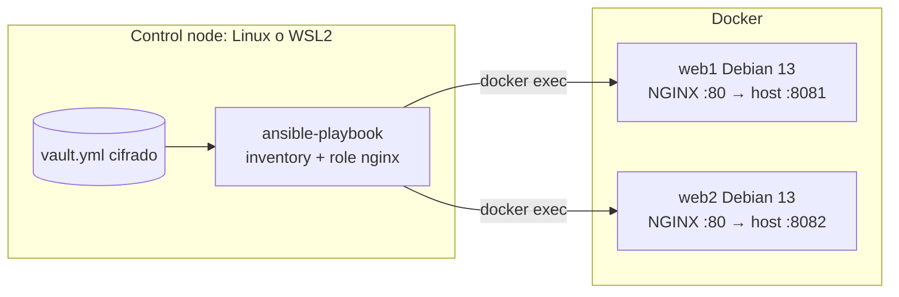

---
tags:
  - laboratorio
  - ansible
  - iac
---

# Lab 10: Configurar servidores con Ansible

> Configura dos "servidores" (contenedores Docker) con Ansible: inventario con grupos y variables, comandos ad-hoc, un role de NGINX con plantillas Jinja2 y handlers, un secreto con Ansible Vault, idempotencia comprobada y `ansible-lint` en verde.

| Nivel | Duración | Costo | Requisitos |
| --- | --- | --- | --- |
| Intermedio | ~75 min | Gratis | Lab 00, Lab 05, Linux o WSL2, Docker con Compose v2, Python 3.12+ |

!!! info "Qué vas a aprender"
    - Instalar un **control node** (nodo de control) de Ansible en un entorno virtual de Python.
    - Escribir un **inventory** (inventario) YAML con grupos, `group_vars` y `host_vars`.
    - Lanzar **ad-hoc commands** (comandos puntuales) y entender por qué los módulos necesitan Python en el host.
    - Crear un **role** con la estructura estándar: tasks, handlers, templates Jinja2, defaults y meta.
    - Guardar un secreto con **Ansible Vault** sin que aparezca en la salida ni en los diffs.
    - Comprobar la **idempotencia** con `--check --diff` y una segunda ejecución con `changed=0`, y pasar `ansible-lint`.

## Antes de empezar

- **Linux o WSL2** como control node: Ansible no se ejecuta de forma nativa en Windows. En Windows, abre una terminal de Ubuntu en WSL2 y trabaja **dentro del sistema de archivos de Linux** (`~/lab10`), no en `/mnt/c/...` (ver Problemas comunes).
- **Docker** con Compose v2 accesible desde esa terminal (`docker version`). Con Docker Desktop, activa *Settings → Resources → WSL integration* para tu distribución.
- **Python 3.12+**: `ansible-core` 2.21 lo exige en el control node. Ubuntu 24.04 trae 3.12; en Ubuntu 22.04 (Python 3.10) crea el entorno con `uv venv --python 3.12` ([uv](https://docs.astral.sh/uv/)).
- Versiones con las que se probó: `ansible-core` 2.21.5, `ansible-lint` 26.10.1, colección `community.docker` 5.4.0, imagen `debian:13-slim`.
- Teoría: [Configuration management con Ansible](../../devops/iac/ansible.md) y la [guía de comandos de Ansible](../../recursos/comandos/ansible.md).

!!! note "¿Por qué contenedores y no VMs?"
    Arrancan en segundos y no cuestan nada. Ansible se conecta a ellos con `docker exec` (connection plugin `community.docker.docker`) en vez de SSH, pero playbooks, roles, variables y Vault funcionan igual. Las diferencias reales con una VM están señaladas en el texto (SSH, `become`, systemd).

## Arquitectura



El mismo role configura los dos hosts; `web2` cambia un valor con `host_vars`. El token secreto de `/estado` vive cifrado en `vault.yml`.

## Paso a paso

### Paso 1: Preparar el control node

Instala Ansible en un **entorno virtual** para no tocar el Python del sistema y poder fijar versiones por proyecto.

```bash
mkdir -p ~/lab10 && cd ~/lab10
python3 -m venv .venv
source .venv/bin/activate
pip install ansible-core ansible-lint
ansible --version
```

```text
ansible [core 2.21.5]
  config file = None
  python version = 3.12.x
  jinja version = 3.1.6
```

`ansible-core` trae solo los módulos `ansible.builtin`. La conexión a contenedores está en la **collection** (colección) `community.docker`; decláralo en un archivo para que todo el equipo instale lo mismo:

```yaml title="requirements.yml"
collections:
  - name: community.docker
    version: ">=5.0.0,<6.0.0"
```

```bash
ansible-galaxy collection install -r requirements.yml
```

### Paso 2: Levantar los hosts de práctica

Dos contenedores Debian que solo "duermen". `init: true` hace que `docker compose down` los pare al instante.

```yaml title="compose.yaml"
# Dos "servidores" de práctica: contenedores Debian que solo duermen
services:
  web1:
    image: debian:13-slim
    container_name: web1
    command: ["sleep", "infinity"]
    init: true
    ports:
      - "8081:80"
  web2:
    image: debian:13-slim
    container_name: web2
    command: ["sleep", "infinity"]
    init: true
    ports:
      - "8082:80"
```

```bash
docker compose up -d
docker compose ps
```

```text
NAME   IMAGE            SERVICE   STATUS         PORTS
web1   debian:13-slim   web1      Up 3 seconds   0.0.0.0:8081->80/tcp
web2   debian:13-slim   web2      Up 3 seconds   0.0.0.0:8082->80/tcp
```

### Paso 3: Inventario, grupos y variables

`ansible.cfg` en la carpeta del proyecto evita repetir opciones en cada comando.

```ini title="ansible.cfg"
[defaults]
inventory = inventory/hosts.yml
roles_path = roles
# Muestra los resultados en YAML, más legible
callback_result_format = yaml
```

```yaml title="inventory/hosts.yml"
all:
  vars:
    # Conectarse a contenedores con "docker exec" en vez de SSH
    ansible_connection: community.docker.docker
  children:
    web:
      hosts:
        web1:
        web2:
    lab:
      children:
        web:
```

Los nombres `web1` y `web2` coinciden con los `container_name`: el plugin usa el nombre del host como contenedor. En servidores reales aquí irían `ansible_host`, `ansible_user` y la conexión SSH por defecto.

```yaml title="inventory/group_vars/web/vars.yml"
nginx_titulo: "Lab 10 - Ansible"
nginx_color: "#2e7d32"
nginx_puerto: 80
# El valor real vive cifrado en vault.yml
nginx_token: "{{ vault_estado_token }}"
```

```yaml title="inventory/host_vars/web2.yml"
nginx_color: "#1565c0"
```

`host_vars` gana a `group_vars`: `web2` tendrá otro color. Compruébalo sin conectarte a nada:

```bash
ansible-inventory --graph
ansible-inventory --host web2
```

```text
@all:
  |--@ungrouped:
  |--@web:
  |  |--web1
  |  |--web2
  |--@lab:
  |  |--@web:
  |  |  |--web1
  |  |  |--web2
{
    "ansible_connection": "community.docker.docker",
    "nginx_color": "#1565c0",
    "nginx_puerto": 80,
    "nginx_titulo": "Lab 10 - Ansible",
    "nginx_token": "{{ vault_estado_token }}"
}
```

### Paso 4: Comandos ad-hoc

Un **ad-hoc command** ejecuta un módulo una vez, sin playbook. Sirve para consultas rápidas o emergencias.

```bash
ansible lab -m ansible.builtin.raw -a "head -2 /etc/os-release"
ansible lab -m ansible.builtin.ping
```

```text
web1 | CHANGED | rc=0 >>
PRETTY_NAME="Debian GNU/Linux 13 (trixie)"
NAME="Debian GNU/Linux"
...
web1 | FAILED! =>
    ...  (el mensaje indica que no encuentra un intérprete de Python)
```

`raw` envía el comando tal cual, pero casi todos los módulos (incluido `ping`) son programas de Python que Ansible copia y ejecuta en el host. La imagen `slim` no trae Python, así que el playbook lo instalará primero con `raw`. Después de ejecutar el playbook (paso 7), repite `ansible lab -m ansible.builtin.ping` y verás `ping: pong`.

### Paso 5: Guardar el secreto con Ansible Vault

El token que protege `/estado` no debe estar en texto plano en Git. Guarda la contraseña de Vault **fuera** del repositorio, con permisos solo para ti:

```bash
read -rs -p "Contraseña de Vault: " VP && printf '%s\n' "$VP" > ~/.lab10-vault-pass && unset VP
chmod 600 ~/.lab10-vault-pass
export ANSIBLE_VAULT_PASSWORD_FILE=~/.lab10-vault-pass
```

Crea el archivo de secretos y cífralo:

```bash
printf 'vault_estado_token: "s3cr3to-lab10"\n' > inventory/group_vars/web/vault.yml
ansible-vault encrypt inventory/group_vars/web/vault.yml
head -1 inventory/group_vars/web/vault.yml
ansible-vault view inventory/group_vars/web/vault.yml
```

```text
Encryption successful
$ANSIBLE_VAULT;1.1;AES256
vault_estado_token: "s3cr3to-lab10"
```

La convención `vault_*` en el archivo cifrado y una referencia en `vars.yml` (paso 3) permite ver **qué** variables existen sin descifrar nada. Con `ANSIBLE_VAULT_PASSWORD_FILE` exportada no hace falta pasar `--vault-password-file` en cada comando, y `ansible-lint` también podrá leer el archivo.

### Paso 6: Crear el role nginx

`ansible-galaxy role init` crea la estructura estándar. Luego reemplaza el contenido de estos archivos (y borra `vars/`, `files/` y `tests/` si no los usas).

```bash
ansible-galaxy role init roles/nginx
```

```yaml title="roles/nginx/defaults/main.yml"
---
nginx_puerto: 80
nginx_conf_dir: /etc/nginx
nginx_pid: /run/nginx.pid
nginx_raiz: /var/www/lab10
nginx_titulo: "Sitio de ejemplo"
nginx_color: "#444444"
nginx_token: "cambia-este-token"
```

Todas las variables empiezan por `nginx_` (el nombre del role): `ansible-lint` lo exige (regla `var-naming[no-role-prefix]`) para evitar choques entre roles.

```yaml title="roles/nginx/tasks/main.yml"
---
- name: Instalar nginx
  ansible.builtin.apt:
    name: nginx
    state: present
    update_cache: true
    cache_valid_time: 3600
  tags: [paquetes]

- name: Quitar el sitio por defecto de Debian
  ansible.builtin.file:
    path: "{{ nginx_conf_dir }}/sites-enabled/default"
    state: absent
  notify: Recargar nginx

- name: Crear la carpeta del sitio
  ansible.builtin.file:
    path: "{{ nginx_raiz }}"
    state: directory
    mode: "0755"

- name: Publicar la página principal
  ansible.builtin.template:
    src: index.html.j2
    dest: "{{ nginx_raiz }}/index.html"
    mode: "0644"

- name: Configurar el sitio
  ansible.builtin.template:
    src: sitio.conf.j2
    dest: "{{ nginx_conf_dir }}/conf.d/lab10.conf"
    mode: "0644"
  notify: Recargar nginx

- name: Configurar el token de /estado (secreto)
  ansible.builtin.template:
    src: token.conf.j2
    dest: "{{ nginx_conf_dir }}/conf.d/lab10-token.conf"
    mode: "0640"
  no_log: true
  diff: false
  notify: Recargar nginx

- name: Arrancar nginx si no está corriendo
  ansible.builtin.command: nginx
  args:
    creates: "{{ nginx_pid }}"
```

```yaml title="roles/nginx/handlers/main.yml"
---
- name: Recargar nginx
  ansible.builtin.command: nginx -s reload
  changed_when: true
```

- Los **handlers** solo se ejecutan si una task con `notify` cambió algo, y una sola vez al final aunque los notifiquen varias tasks.
- `no_log` y `diff: false` impiden que el token aparezca en la salida o en `--diff`.
- Un contenedor no tiene systemd, por eso se arranca y recarga NGINX con su propio binario. En una VM usarías `ansible.builtin.service` con `state: started`, `enabled: true` y `state: reloaded`, como en la [nota de Ansible](../../devops/iac/ansible.md#playbooks-tasks-y-modules).
- `creates:` hace idempotente al módulo `command`: si existe el PID, no se ejecuta.

Las **plantillas Jinja2** generan cada archivo con las variables del host:

```jinja title="roles/nginx/templates/sitio.conf.j2"
# {{ ansible_managed }}
server {
    listen {{ nginx_puerto }} default_server;
    root {{ nginx_raiz }};
    index index.html;

    location = /estado {
        if ($token_ok = 0) {
            return 403;
        }
        default_type text/plain;
        return 200 "ok {{ inventory_hostname }}\n";
    }
}
```

```jinja title="roles/nginx/templates/token.conf.j2"
# {{ ansible_managed }}
map $http_x_token $token_ok {
    default 0;
    "{{ nginx_token }}" 1;
}
```

```jinja title="roles/nginx/templates/index.html.j2"
<!doctype html>
<html lang="es">
<head><meta charset="utf-8"><title>{{ nginx_titulo }}</title></head>
<body style="background: {{ nginx_color }}; color: #fff; font-family: sans-serif">
  <h1>{{ nginx_titulo }}</h1>
  <p>Servidor: {{ inventory_hostname }}</p>
  <p>Sistema: {{ ansible_facts['distribution'] }} {{ ansible_facts['distribution_version'] }}</p>
</body>
</html>
```

```yaml title="roles/nginx/meta/main.yml"
---
galaxy_info:
  author: dani
  description: Instala NGINX y publica un sitio de ejemplo
  license: MIT
  min_ansible_version: "2.17"
  platforms:
    - name: Debian
      versions:
        - trixie
dependencies: []
```

### Paso 7: El playbook y la primera ejecución

El playbook tiene dos plays: el primero instala Python con `raw` (sin recopilar facts, porque eso también necesita Python); el segundo aplica el role.

```yaml title="site.yml"
---
- name: Preparar Python en los hosts
  hosts: lab
  gather_facts: false
  tasks:
    - name: Instalar python3 si falta (sin módulos, con raw)
      ansible.builtin.raw: >-
        test -e /usr/bin/python3 ||
        (apt-get update -qq && apt-get install -y -qq python3 >/dev/null && echo INSTALADO)
      register: bootstrap
      changed_when: "'INSTALADO' in bootstrap.stdout"

- name: Servidores web
  hosts: web
  roles:
    - role: nginx
```

`changed_when` hace que `raw` solo cuente como cambio cuando de verdad instaló algo: sin eso, la segunda ejecución nunca daría `changed=0`.

```bash
ansible-playbook site.yml --syntax-check
ansible-playbook site.yml
```

```text
playbook: site.yml

PLAY [Preparar Python en los hosts] ***********************
TASK [Instalar python3 si falta (sin módulos, con raw)] ***
changed: [web1]
changed: [web2]
...
RUNNING HANDLER [nginx : Recargar nginx] ******************
changed: [web1]
changed: [web2]

PLAY RECAP ************************************************
web1 : ok=10   changed=8    unreachable=0    failed=0    skipped=0
web2 : ok=10   changed=8    unreachable=0    failed=0    skipped=0
```

(Los números exactos de `ok` y `changed` pueden variar; lo importante es `failed=0`.) En una VM real añadirías `become: true` al play para usar `sudo`; en estos contenedores ya eres `root`.

### Paso 8: Idempotencia: segunda ejecución y check mode

Ejecuta el playbook otra vez sin cambiar nada:

```bash
ansible-playbook site.yml
```

```text
PLAY RECAP ************************************************
web1 : ok=9    changed=0    unreachable=0    failed=0    skipped=0
web2 : ok=9    changed=0    unreachable=0    failed=0    skipped=0
```

`changed=0`: cada módulo comprobó que el estado ya era el deseado y no hizo nada, ni siquiera recargar NGINX. Ahora simula un cambio **antes** de aplicarlo. Edita `inventory/host_vars/web2.yml` y pon `nginx_color: "#6a1b9a"`:

```bash
ansible-playbook site.yml --check --diff --limit web2
```

```text
TASK [nginx : Publicar la página principal] ***************
--- before: /var/www/lab10/index.html
+++ after: .../index.html.j2
@@ -1,7 +1,7 @@
 <!doctype html>
 <html lang="es">
 <head><meta charset="utf-8"><title>Lab 10 - Ansible</title></head>
-<body style="background: #1565c0; color: #fff; font-family: sans-serif">
+<body style="background: #6a1b9a; color: #fff; font-family: sans-serif">
...
changed: [web2]

TASK [nginx : Configurar el token de /estado (secreto)] ***
ok: [web2]

PLAY RECAP ************************************************
web2 : ok=9    changed=1    unreachable=0    failed=0    skipped=0
```

Check mode no tocó el servidor: solo enseñó el diff. Fíjate en que la task del token no muestra contenido. Aplica de verdad con `ansible-playbook site.yml --limit web2`.

### Paso 9: Comprobar el resultado y pasar ansible-lint

```bash
curl -s http://localhost:8081 | grep Servidor
curl -s -o /dev/null -w '%{http_code}\n' http://localhost:8081/estado
curl -s -H "X-Token: s3cr3to-lab10" http://localhost:8082/estado
ansible web -m ansible.builtin.command -a "nginx -t"
ansible-lint
```

```text
  <p>Servidor: web1</p>
403
ok web2
web1 | CHANGED | rc=0 >>
nginx: the configuration file /etc/nginx/nginx.conf syntax is ok
nginx: configuration file /etc/nginx/nginx.conf test is successful
...
Passed: 0 failure(s), 0 warning(s) in 15 files processed of 16 encountered.
Last profile that met the validation criteria was 'production'.
```

`ansible-lint` revisa buenas prácticas (FQCN, nombres de tasks, `changed_when` en `command`, prefijos de variables…). El perfil `production` es el más exigente.

## Verificación

| Comprobación | Resultado esperado |
| --- | --- |
| `ansible lab -m ansible.builtin.ping` | `ping: pong` en `web1` y `web2` |
| Segunda ejecución de `ansible-playbook site.yml` | `changed=0` en ambos hosts |
| `curl -s http://localhost:8081` y `:8082` | Página con `Servidor: web1` / `web2` y colores distintos |
| `curl -s -o /dev/null -w '%{http_code}' http://localhost:8081/estado` | `403` sin token |
| `curl -s -H "X-Token: s3cr3to-lab10" http://localhost:8081/estado` | `ok web1` |
| `head -1 inventory/group_vars/web/vault.yml` | `$ANSIBLE_VAULT;1.1;AES256` |
| `ansible-lint` | `Passed: 0 failure(s), 0 warning(s)` |

## Retos extra

1. Añade una task que valide la configuración con `nginx -t` **antes** de recargar (pista: un handler con `listen` o el parámetro `validate` del módulo `template`, que solo sirve para archivos completos).
2. Cambia los contenedores por dos VMs locales (Multipass, Vagrant o Hyper-V) con SSH: ajusta el inventario (`ansible_host`, `ansible_user`), añade `become: true` y usa `ansible.builtin.service`.
3. Prueba el role con **Molecule** y su *idempotence test*. Pista: [Pruebas de infraestructura](../../devops/iac/pruebas-infraestructura.md#molecule-para-roles-de-ansible).
4. Ejecuta `ansible-lint` en un workflow de GitHub Actions como en el [Lab 07](github-actions-ci.md).

## Limpieza

```bash
docker compose down
rm -f ~/.lab10-vault-pass
deactivate
```

```text
[+] Running 3/3
 ✔ Container web2         Removed
 ✔ Container web1         Removed
 ✔ Network lab10_default  Removed
```

Si no vas a repetir el lab, borra la carpeta `~/lab10` (incluye el entorno virtual) y la imagen con `docker image rm debian:13-slim`. La colección instalada vive en `~/.ansible/collections`.

## Problemas comunes

| Síntoma | Causa | Solución |
| --- | --- | --- |
| `[WARNING]: Ansible is being run in a world writable directory ... ignoring it as an ansible.cfg source` | Trabajas en `/mnt/c/...` desde WSL: los archivos de Windows aparecen con permisos 777 | Trabaja en `~/lab10` (sistema de archivos de Linux) |
| `Problem running vault password script ... Exec format error` | El archivo de contraseña tiene bit de ejecución (típico en `/mnt/c`) y Ansible lo trata como script | Guárdalo en `~` con `chmod 600` |
| `couldn't resolve module/action 'community.docker.docker'` o conexión desconocida | Falta la colección | `ansible-galaxy collection install -r requirements.yml` |
| `ping` u otro módulo falla con un error sobre el intérprete de Python (`python3: not found`) | La imagen no trae Python | Ejecuta el play de bootstrap con `raw` (ya está en `site.yml`) |
| `Attempting to decrypt but no vault secrets found` | No indicaste la contraseña de Vault | `export ANSIBLE_VAULT_PASSWORD_FILE=~/.lab10-vault-pass` o `--ask-vault-pass` |
| `--check` falla en la primera ejecución con `Destination directory ... does not exist` | En check mode NGINX no se instaló de verdad y su carpeta no existe | Normal: usa `--check` para cambios sobre hosts ya configurados |
| `docker: command not found` en WSL | Falta la integración de Docker Desktop con tu distribución | Actívala en Docker Desktop o instala Docker Engine en Linux |
| `curl` a `localhost:8081` no responde | NGINX no arrancó o el puerto está ocupado | `ansible web -m ansible.builtin.command -a "nginx -t"` y `docker compose ps`; ver [Troubleshooting](../../devops/operacion/troubleshooting.md#contenedores) |

## Información complementaria

- **Agentless e idempotencia**: Ansible no instala agentes; copia módulos y los ejecuta. Su valor está en que repetir el playbook no cambia nada si ya está bien. Ver [Idempotencia](../../devops/iac/ansible.md#idempotencia).
- **Precedencia de variables**: `defaults` del role < `group_vars` < `host_vars` < `-e`. Ver [Variables y precedencia](../../devops/iac/ansible.md#variables-y-precedencia).
- **Vault frente a un gestor de secretos**: Vault vale para equipos pequeños; a escala se leen los secretos de HashiCorp Vault, AWS Secrets Manager, Azure Key Vault o Google Secret Manager. Ver [Secretos e identidades](../../devsecops/identidades-y-pipeline/secretos-identidades.md).
- **Terraform y Ansible juntos**: Terraform crea las máquinas, Ansible las configura. Ver [Ansible vs Terraform](../../devops/iac/ansible.md#ansible-vs-terraform) y [IaC vs configuration management](../../devops/iac/infraestructura-como-codigo.md#iac-vs-configuration-management).
- **En el trabajo real**: inventarios dinámicos desde la nube, roles versionados en Git, `ansible-lint` y Molecule en CI, y ejecuciones periódicas de hardening (CIS) para corregir desviaciones. Ver [Cumplimiento y gobierno](../../devsecops/gobierno-y-respuesta/cumplimiento.md).

## Documentación oficial

- [Instalar Ansible](https://docs.ansible.com/ansible/latest/installation_guide/intro_installation.html)
- [Construir un inventario](https://docs.ansible.com/ansible/latest/inventory_guide/intro_inventory.html)
- [Comandos ad-hoc](https://docs.ansible.com/ansible/latest/command_guide/intro_adhoc.html)
- [Roles](https://docs.ansible.com/ansible/latest/playbook_guide/playbooks_reuse_roles.html) y [handlers](https://docs.ansible.com/ansible/latest/playbook_guide/playbooks_handlers.html)
- [Check mode y diff mode](https://docs.ansible.com/ansible/latest/playbook_guide/playbooks_checkmode.html)
- [Ansible Vault](https://docs.ansible.com/ansible/latest/vault_guide/index.html)
- [Connection plugin `community.docker.docker`](https://docs.ansible.com/ansible/latest/collections/community/docker/docker_connection.html)
- [ansible-lint](https://docs.ansible.com/projects/lint/)

## Preguntas para verificar el aprendizaje

??? question "1. ¿Por qué `ansible.builtin.raw` funciona en un host sin Python y `ansible.builtin.ping` no?"
    `raw` envía el comando directamente por la conexión (aquí `docker exec`). Casi todos los demás módulos son código Python que Ansible copia y ejecuta en el host, así que necesitan un intérprete allí.

??? question "2. ¿Qué pasaría si en `site.yml` quitaras el `changed_when` de la task `raw`?"
    `raw` siempre se reporta como `changed`, así que la segunda ejecución nunca daría `changed=0` aunque no hubiera hecho nada. Se perdería la señal de idempotencia.

??? question "3. Cambias solo `nginx_titulo` en `group_vars`. ¿Se recarga NGINX? ¿Por qué?"
    No. El título solo cambia `index.html`, cuya task no notifica al handler. NGINX sirve el archivo nuevo sin recargar. Solo los cambios en la configuración (`lab10.conf`, el token, el sitio por defecto) notifican `Recargar nginx`.

??? question "4. ¿Dónde pondrías un valor que solo cambia en `web2` y por qué no en `defaults/main.yml`?"
    En `inventory/host_vars/web2.yml`. `defaults` tiene la prioridad más baja y es para valores por defecto del role, comunes a todos los que lo usen.

??? question "5. ¿Por qué la task del token lleva `no_log: true` y `diff: false`?"
    Para que el valor descifrado no aparezca en la salida de Ansible, en los logs del pipeline ni en el diff de `--check --diff`. Cifrar el archivo no basta si luego se imprime.

??? question "6. Un compañero dice que `--check --diff` garantiza que el playbook funcionará. ¿Tiene razón?"
    No del todo. Check mode no ejecuta los cambios, así que las tasks que dependen de un paso anterior (instalar un paquete y luego configurarlo) pueden fallar o dar resultados incompletos. Es una vista previa, no una prueba completa; para eso están Molecule o un entorno efímero.

??? question "7. ¿Qué diferencias tendría este inventario con servidores reales por SSH?"
    Sin `ansible_connection: community.docker.docker` (SSH es la conexión por defecto), con `ansible_host`, `ansible_user` y una llave SSH, y `become: true` para escalar privilegios con `sudo`.

??? question "8. ¿Por qué `ansible-lint` pide que las variables del role empiecen por `nginx_`?"
    Las variables de Ansible son globales para el host. Con un prefijo por role se evitan choques entre roles que usen nombres genéricos como `puerto` o `color`.

## Notas relacionadas

**DevOps**

- [Configuration management con Ansible](../../devops/iac/ansible.md)
- [Infrastructure as Code: panorama y herramientas](../../devops/iac/infraestructura-como-codigo.md)
- [Pruebas de infraestructura](../../devops/iac/pruebas-infraestructura.md)
- [Docker: imágenes, multi-stage builds y Compose](../../devops/contenedores/docker.md)
- [Linux, redes y scripting](../../devops/fundamentos/linux-redes-scripting.md)
- [Guía de comandos de Ansible](../../recursos/comandos/ansible.md)

**DevSecOps**

- [Secretos e identidades](../../devsecops/identidades-y-pipeline/secretos-identidades.md)
- [Cumplimiento y gobierno](../../devsecops/gobierno-y-respuesta/cumplimiento.md)

**Python**

- [Entorno de trabajo](../../python/fundamentos/entorno-python.md)

**Labs**

- Lab anterior: [Lab 09: Terraform en AWS con remote state en S3](terraform-aws-backend-remoto.md)
- Lab siguiente: [Lab 11: Observabilidad con Prometheus y Grafana](observabilidad-prometheus-grafana.md)
