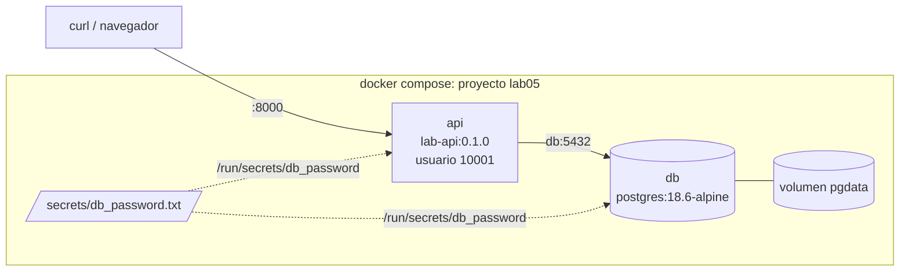

---
tags:
  - laboratorio
  - docker
  - contenedores
---

# Lab 05: Imagen multi-stage y Docker Compose

> Empaquetas una API pequeña en Python con un Dockerfile multi-stage que corre sin root, comparas tamaños de imagen y la levantas junto a PostgreSQL con Docker Compose, volúmenes, healthchecks y secretos.

| Nivel | Duración | Costo | Requisitos |
| --- | --- | --- | --- |
| Intermedio | ~75 min | Gratis | [Lab 04](git-flujo-pull-request.md), Docker Desktop o Docker Engine con Compose v2, Python 3.12+ |

!!! info "Qué vas a aprender"
    - Escribir un **Dockerfile multi-stage** (de varias etapas) con una etapa de tests y una imagen final que corre con un usuario sin privilegios.
    - Usar `.dockerignore` para que secretos y basura no entren en la imagen.
    - Medir cuánto pesa una imagen "ingenua" frente a una optimizada.
    - Levantar la API y **PostgreSQL** con `docker compose`, con un **volume** (volumen) para los datos y **healthchecks** para el orden de arranque.
    - Separar configuración (variables de entorno) de secretos (archivos montados) y depurar con `logs`, `exec` e `inspect`.

## Antes de empezar

| Herramienta | Versión mínima | Comprobar |
| --- | --- | --- |
| Docker Engine / Docker Desktop | Engine 25+ (probado con el cliente 28.5) | `docker version` (debe responder también el *Server*) |
| Docker Compose | v2.20+ (probado con v2.40) | `docker compose version` |
| Python | 3.12+ para probar la app sin Docker | `python3 --version` / `py --version` |
| Git | El repo `lab-devops-app` del Lab 04 | `git remote -v` |

Teoría recomendada: [Docker: imágenes, multi-stage builds y Compose](../../devops/contenedores/docker.md) y [Seguridad de contenedores](../../devsecops/infraestructura-y-contenedores/seguridad-contenedores.md). Chuleta: [comandos de Docker](../../recursos/comandos/docker.md).

Trabaja en una rama nueva del repositorio del Lab 04:

```bash
cd lab-devops-app
git switch main && git pull
git switch -c feat/api-docker
```

## Arquitectura



La API guarda tareas en PostgreSQL. Compose crea una red privada donde cada servicio se llama por su nombre (`db`), monta la contraseña como archivo en ambos contenedores y no arranca la API hasta que la base de datos responde.

## Paso a paso

### Paso 1: Crea la app

Es una API de tareas con FastAPI. Si hay `DB_HOST` usa PostgreSQL; si no, guarda en memoria (así puedes probarla sin base de datos y reutilizarla en el [Lab 06](kubernetes-local-kind.md)). Tiene dos endpoints de salud: `/health` (el proceso vive) y `/ready` (puede atender, la base de datos responde).

```text
lab-devops-app/
├── app/
│   ├── __init__.py        (vacío)
│   ├── main.py
│   └── storage.py
├── tests/
│   ├── __init__.py        (vacío)
│   └── test_api.py
├── requirements.txt
└── requirements-dev.txt
```

```python title="app/main.py"
"""API de tareas: lo justo para practicar contenedores, Kubernetes y CI."""

import os
from pathlib import Path

from fastapi import FastAPI, Header, HTTPException
from pydantic import BaseModel

from app.storage import crear_storage

VERSION = os.getenv("APP_VERSION", "dev")
MENSAJE = os.getenv("APP_MENSAJE", "Hola desde el lab")


def leer_secreto(nombre: str) -> str | None:
    """Lee NOMBRE_FILE (ruta a un archivo) o, si no existe, la variable NOMBRE."""
    ruta = os.getenv(f"{nombre}_FILE")
    if ruta:
        return Path(ruta).read_text(encoding="utf-8").strip()
    return os.getenv(nombre)


API_TOKEN = leer_secreto("API_TOKEN")
storage = crear_storage(leer_secreto("DB_PASSWORD"))
app = FastAPI(title="Lab API", version=VERSION)


class TareaNueva(BaseModel):
    titulo: str


@app.get("/health")
def health() -> dict:
    """Liveness: el proceso responde."""
    return {"status": "ok"}


@app.get("/ready")
def ready() -> dict:
    """Readiness: el proceso puede atender (la base de datos responde)."""
    if not storage.disponible():
        raise HTTPException(status_code=503, detail="storage no disponible")
    return {"status": "ready", "storage": storage.nombre}


@app.get("/info")
def info() -> dict:
    return {
        "version": VERSION,
        "mensaje": MENSAJE,
        "storage": storage.nombre,
        "token_configurado": API_TOKEN is not None,
        "hostname": os.getenv("HOSTNAME", "local"),
    }


@app.get("/tareas")
def listar() -> list[dict]:
    return storage.listar()


@app.post("/tareas", status_code=201)
def crear(tarea: TareaNueva, x_api_token: str | None = Header(default=None)) -> dict:
    if API_TOKEN and x_api_token != API_TOKEN:
        raise HTTPException(status_code=401, detail="token inválido")
    return storage.crear(tarea.titulo)
```

```python title="app/storage.py"
"""Guarda tareas en PostgreSQL si hay DB_HOST; si no, en memoria."""

import os


class MemoriaStorage:
    nombre = "memoria"

    def __init__(self) -> None:
        self._tareas: list[dict] = []

    def disponible(self) -> bool:
        return True

    def listar(self) -> list[dict]:
        return self._tareas

    def crear(self, titulo: str) -> dict:
        tarea = {"id": len(self._tareas) + 1, "titulo": titulo}
        self._tareas.append(tarea)
        return tarea


class PostgresStorage:
    nombre = "postgres"

    def __init__(self, password: str | None) -> None:
        import psycopg  # solo se importa si de verdad se usa PostgreSQL

        self._psycopg = psycopg
        self._dsn = {
            "host": os.environ["DB_HOST"],
            "dbname": os.getenv("DB_NAME", "tareas"),
            "user": os.getenv("DB_USER", "app"),
            "password": password,
            "connect_timeout": 3,
        }

    def _conectar(self):
        return self._psycopg.connect(**self._dsn)

    def disponible(self) -> bool:
        try:
            with self._conectar() as conn:
                conn.execute(
                    "CREATE TABLE IF NOT EXISTS tareas (id SERIAL PRIMARY KEY, titulo TEXT NOT NULL)"
                )
            return True
        except self._psycopg.OperationalError:
            return False

    def listar(self) -> list[dict]:
        with self._conectar() as conn:
            filas = conn.execute("SELECT id, titulo FROM tareas ORDER BY id").fetchall()
        return [{"id": i, "titulo": t} for i, t in filas]

    def crear(self, titulo: str) -> dict:
        with self._conectar() as conn:
            (nuevo_id,) = conn.execute(
                "INSERT INTO tareas (titulo) VALUES (%s) RETURNING id", (titulo,)
            ).fetchone()
        return {"id": nuevo_id, "titulo": titulo}


def crear_storage(password: str | None):
    if os.getenv("DB_HOST"):
        return PostgresStorage(password)
    return MemoriaStorage()
```

```python title="tests/test_api.py"
from fastapi.testclient import TestClient

from app.main import app

client = TestClient(app)


def test_health():
    respuesta = client.get("/health")
    assert respuesta.status_code == 200
    assert respuesta.json() == {"status": "ok"}


def test_crear_y_listar_tareas():
    respuesta = client.post("/tareas", json={"titulo": "Aprender Docker"})
    assert respuesta.status_code == 201
    assert {"id": 1, "titulo": "Aprender Docker"} in client.get("/tareas").json()


def test_titulo_obligatorio():
    assert client.post("/tareas", json={}).status_code == 422
```

Dependencias con versión exacta (**version pinning**), para que el build de hoy y el de dentro de un mes instalen lo mismo:

```text title="requirements.txt"
fastapi==0.162.0
uvicorn==0.54.0
psycopg[binary]==3.3.6
```

```text title="requirements-dev.txt"
-r requirements.txt
pytest==9.1.1
httpx2==2.16.0
ruff==0.17.2
```

### Paso 2: Pruébala sin Docker

Antes de contenerizar, comprueba que la app funciona. Si falla aquí, el problema no es Docker.

=== "Linux/macOS"

    ```bash
    python3 -m venv .venv
    source .venv/bin/activate
    pip install -r requirements-dev.txt
    ruff check . && pytest -q
    APP_VERSION=0.1.0 uvicorn app.main:app --port 8000
    ```

=== "Windows (PowerShell)"

    ```powershell
    py -m venv .venv
    .\.venv\Scripts\Activate.ps1
    pip install -r requirements-dev.txt
    ruff check . ; pytest -q
    $env:APP_VERSION = "0.1.0"; uvicorn app.main:app --port 8000
    ```

```text
All checks passed!
...                                                                      [100%]
3 passed in 0.66s
INFO:     Uvicorn running on http://127.0.0.1:8000 (Press CTRL+C to quit)
```

En otra terminal (en PowerShell escribe `curl.exe`, porque `curl` es un alias de `Invoke-WebRequest`):

```bash
curl -s localhost:8000/info
```

```json
{"version":"0.1.0","mensaje":"Hola desde el lab","storage":"memoria","token_configurado":false,"hostname":"local"}
```

Detén uvicorn con `Ctrl+C`.

### Paso 3: Construye una imagen "ingenua" para comparar

Este Dockerfile es lo que muchas personas escriben la primera vez: imagen base completa, todo el directorio copiado, dependencias de desarrollo incluidas y ejecución como root. Lo usas solo como referencia.

```dockerfile title="Dockerfile.simple"
# Versión "ingenua" solo para comparar tamaños: imagen completa, root, todo el contexto
FROM python:3.14.9
WORKDIR /app
COPY . .
RUN pip install -r requirements-dev.txt
CMD ["uvicorn", "app.main:app", "--host", "0.0.0.0", "--port", "8000"]
```

```bash
docker build -f Dockerfile.simple -t lab-api:simple .
docker run --rm lab-api:simple id
```

```text
uid=0(root) gid=0(root) groups=0(root)
```

Corre como **root** y, como no hay `.dockerignore`, `COPY . .` metió también `.venv/`, `.git/` y cualquier `.env` que tuvieras. Cualquier archivo con secretos que esté en la carpeta acaba dentro de la imagen.

### Paso 4: Añade `.dockerignore`

El **build context** (contexto de build) es todo lo que envías a Docker al construir. El `.dockerignore` lo recorta: el build es más rápido y la imagen no hereda secretos ni archivos locales.

```text title=".dockerignore"
# Control de versiones y CI
.git
.github
# Entornos y cachés de Python
.venv
__pycache__/
*.pyc
.pytest_cache/
.ruff_cache/
# Secretos y configuración local: nunca dentro de la imagen
.env
secrets/
# Archivos que no hacen falta para ejecutar
k8s/
compose.yaml
*.md
```

### Paso 5: Escribe el Dockerfile multi-stage

Tres etapas: `build` instala las dependencias en un **virtualenv** (entorno virtual) en `/opt/venv`; `test` parte de ella, instala lo de desarrollo y ejecuta lint y tests; `runtime` parte de una imagen limpia y copia **solo** el virtualenv y el código. La imagen final no lleva pip cacheado, ni herramientas de test, ni tus tests.

```dockerfile title="Dockerfile"
# syntax=docker/dockerfile:1

# ---------- Etapa 1: instalar dependencias en un virtualenv ----------
FROM python:3.14.9-slim AS build
ENV PIP_NO_CACHE_DIR=1 PIP_DISABLE_PIP_VERSION_CHECK=1
RUN python -m venv /opt/venv
ENV PATH="/opt/venv/bin:$PATH"
WORKDIR /src
COPY requirements.txt .
RUN pip install -r requirements.txt

# ---------- Etapa 2: tests (solo se construye si la pides con --target test) ----------
FROM build AS test
COPY requirements-dev.txt .
RUN pip install -r requirements-dev.txt
COPY . .
# Desde un disco de Windows, Docker Desktop envía los archivos con permiso de ejecución;
# se quita para que ruff vea los mismos permisos que en Linux/macOS (regla EXE002)
RUN find . -type f -exec chmod a-x {} + \
    && ruff check . && pytest -q

# ---------- Etapa 3: imagen final, sin pip ni herramientas de build ----------
FROM python:3.14.9-slim AS runtime
ARG APP_VERSION=dev
ENV APP_VERSION=${APP_VERSION}
ENV PYTHONDONTWRITEBYTECODE=1 PYTHONUNBUFFERED=1 PATH="/opt/venv/bin:$PATH"
RUN groupadd --system --gid 10001 app \
    && useradd --system --uid 10001 --gid app --no-create-home app
WORKDIR /app
COPY --from=build /opt/venv /opt/venv
COPY app/ ./app/
USER 10001:10001
EXPOSE 8000
HEALTHCHECK --interval=15s --timeout=3s --start-period=10s --retries=3 \
    CMD ["python", "-c", "import urllib.request; urllib.request.urlopen('http://127.0.0.1:8000/health', timeout=2)"]
CMD ["uvicorn", "app.main:app", "--host", "0.0.0.0", "--port", "8000"]
```

Por qué cada decisión:

- **Copiar `requirements.txt` antes que el código**: si solo cambias código, Docker reutiliza la capa de `pip install` de la caché y el build tarda segundos.
- **Usuario con UID numérico (10001)**: Kubernetes puede comprobar `runAsNonRoot` con un UID numérico; con un nombre no puede.
- **`HEALTHCHECK` con Python**: la imagen *slim* no trae `curl`, y no merece la pena instalarlo solo para esto.
- **Tag concreto `3.14.9-slim`** en vez de `latest`: el build es reproducible. Para fijarla del todo, usa el **digest** (ver [Tags y digests](../../devops/contenedores/docker.md#tags-y-digests)).
- **`find ... chmod a-x` antes de ruff**: cuando construyes desde una carpeta de Windows, Docker Desktop envía el *build context* con el permiso de ejecución activado en todos los archivos (NTFS no guarda permisos de Unix). Dentro del contenedor, ruff aplica la regla **EXE002** (*executable file without shebang*) y el lint falla con `EXE002 The file is executable but no shebang is present` en cada `.py`; fuera del contenedor no lo ves porque ruff no evalúa esa regla en Windows ni en WSL. Quitar el bit de ejecución a los archivos copiados deja la etapa `test` igual en Windows, Linux y macOS, sin desactivar la regla (que sí detecta un problema real si alguien marca un módulo como ejecutable en Linux). Solo afecta a la etapa `test`: la imagen final no cambia.

!!! note "Por qué no `COPY --chmod=644 . .`"
    Parece más corto, pero `--chmod` se aplica también a los **directorios**, que quedan como `drw-r--r--` (sin permiso para entrar en ellos). En la etapa `test` funciona solo porque se ejecuta como root, que ignora esos permisos; con cualquier otro usuario fallaría. Ignorar la regla (`ruff check --extend-ignore EXE002`) también funciona, pero esconde el síntoma en vez de igualar los permisos. Otra opción es trabajar con el repositorio dentro del sistema de archivos de WSL (`\\wsl$\...`), donde los permisos de Unix se conservan.

Construye primero la etapa de tests (si fallan, el build falla) y después la imagen final:

```bash
docker build --target test -t lab-api:test .
docker build --build-arg APP_VERSION=0.1.0 -t lab-api:0.1.0 .
docker run --rm lab-api:0.1.0 id
```

```text
uid=10001(app) gid=10001(app) groups=10001(app)
```

### Paso 6: Compara tamaños

```bash
docker images lab-api
```

```text
REPOSITORY   TAG      IMAGE ID       CREATED          SIZE
lab-api      0.1.0    …              …                ~200MB
lab-api      test     …              …                ~240MB
lab-api      simple   …              …                ~1.2GB
```

Los tamaños son orientativos (dependen de la versión y de tu plataforma); anota los tuyos. La mayor diferencia viene de la imagen base: `python:3.14.9` incluye compiladores y cabeceras de Debian que tu app no usa en ejecución. Menos paquetes significa menos vulnerabilidades que parchear; lo comprobarás con Trivy en el [Lab 12](../devsecops/escaneos-en-pipeline.md). Para ver de qué capas se compone cada imagen: `docker history lab-api:0.1.0`.

### Paso 7: Prepara configuración y secretos

Distingue dos cosas: la **configuración** (versión, mensajes, nombres de host) puede ir en variables de entorno y en el repo; los **secretos** (contraseñas, tokens) no van en el repo ni en la imagen, y mejor como **archivo** que como variable, porque las variables se filtran con facilidad (`docker inspect`, volcados de error, procesos hijos).

```text title=".env.example"
APP_VERSION=0.1.0
APP_MENSAJE=Hola desde Compose
```

=== "Linux/macOS"

    ```bash
    cp .env.example .env
    mkdir -p secrets
    openssl rand -base64 24 | tr -d '\n' > secrets/db_password.txt
    chmod 644 secrets/db_password.txt   # los contenedores leen el archivo con su propio UID
    git status --short                 # .env y secrets/ no deben aparecer (.gitignore del Lab 04)
    ```

=== "Windows (PowerShell)"

    ```powershell
    Copy-Item .env.example .env
    New-Item -ItemType Directory -Force secrets | Out-Null
    $bytes = [byte[]]::new(24); [Security.Cryptography.RandomNumberGenerator]::Create().GetBytes($bytes)
    [IO.File]::WriteAllText("$PWD\secrets\db_password.txt", [Convert]::ToBase64String($bytes))
    git status --short
    ```

`.env.example` sí va al repo (documenta qué variables existen); `.env` y `secrets/` no.

### Paso 8: Escribe el `compose.yaml`

```yaml title="compose.yaml"
name: lab05

services:
  api:
    build:
      context: .
      target: runtime
      args:
        APP_VERSION: ${APP_VERSION:-dev}
    image: lab-api:${APP_VERSION:-dev}
    ports:
      - "8000:8000"
    environment:
      APP_MENSAJE: ${APP_MENSAJE:-Hola desde Compose}
      DB_HOST: db
      DB_NAME: tareas
      DB_USER: app
      DB_PASSWORD_FILE: /run/secrets/db_password
    secrets:
      - db_password
    depends_on:
      db:
        condition: service_healthy
    restart: unless-stopped

  db:
    image: postgres:18.6-alpine
    environment:
      POSTGRES_DB: tareas
      POSTGRES_USER: app
      POSTGRES_PASSWORD_FILE: /run/secrets/db_password
    secrets:
      - db_password
    volumes:
      - pgdata:/var/lib/postgresql
    healthcheck:
      test: ["CMD-SHELL", "pg_isready -U app -d tareas"]
      interval: 5s
      timeout: 3s
      retries: 10
      start_period: 10s
    restart: unless-stopped

volumes:
  pgdata:

secrets:
  db_password:
    file: ./secrets/db_password.txt
```

Puntos clave:

- **`depends_on` con `condition: service_healthy`**: sin la condición, Compose solo espera a que el contenedor *arranque*, no a que PostgreSQL acepte conexiones.
- **`secrets`**: Compose monta el archivo en `/run/secrets/db_password`. La imagen oficial de PostgreSQL lee `POSTGRES_PASSWORD_FILE` y la app lee `DB_PASSWORD_FILE`; la contraseña nunca aparece como variable de entorno.
- **Volumen en `/var/lib/postgresql`**: desde PostgreSQL 18 la imagen oficial declara ahí su volumen (los datos van en `/var/lib/postgresql/18/docker`). En la 17 y anteriores la ruta era `/var/lib/postgresql/data`.
- La base de datos **no publica puertos**: solo la API llega a ella por la red interna de Compose.

Valida el archivo (no necesita que el daemon esté corriendo) y verás las variables ya sustituidas desde `.env`:

```bash
docker compose config
```

```text
name: lab05
services:
  api:
    build:
      context: /ruta/a/lab-devops-app
      dockerfile: Dockerfile
      args:
        APP_VERSION: 0.1.0
      target: runtime
    depends_on:
      db:
        condition: service_healthy
        required: true
    environment:
      APP_MENSAJE: Hola desde Compose
      DB_HOST: db
      ...
    image: lab-api:0.1.0
  ...
```

### Paso 9: Levanta el stack y pruébalo

```bash
docker compose up -d --build
docker compose ps
```

```text
NAME           IMAGE                  SERVICE   STATUS                    PORTS
lab05-api-1    lab-api:0.1.0          api       Up 20 seconds (healthy)   0.0.0.0:8000->8000/tcp
lab05-db-1     postgres:18.6-alpine   db        Up 31 seconds (healthy)
```

```bash
curl -s localhost:8000/ready
curl -s -X POST localhost:8000/tareas -H "Content-Type: application/json" -d '{"titulo":"Aprender Compose"}'
curl -s localhost:8000/tareas
```

```text
{"status":"ready","storage":"postgres"}
{"id":1,"titulo":"Aprender Compose"}
[{"id":1,"titulo":"Aprender Compose"}]
```

En PowerShell usa `curl.exe` y escapa las comillas del JSON (`-d '{\"titulo\":\"Aprender Compose\"}'`) o usa `Invoke-RestMethod -Method Post -ContentType application/json -Body '{"titulo":"Aprender Compose"}' http://localhost:8000/tareas`.

Ahora comprueba que los datos sobreviven a los contenedores:

```bash
docker compose down          # borra contenedores y red, NO el volumen
docker compose up -d
curl -s localhost:8000/tareas
```

```text
[{"id":1,"titulo":"Aprender Compose"}]
```

### Paso 10: Logs, exec e inspect

Estas son las tres herramientas que vas a usar cada vez que algo falle:

```bash
docker compose logs --tail 20 api        # añade -f para seguirlos en vivo
docker compose exec db psql -U app -d tareas -c "SELECT * FROM tareas;"
docker inspect --format '{{json .State.Health.Status}}' lab05-api-1
docker inspect --format '{{.Config.User}}' lab05-api-1
docker compose exec api sh -c 'env | grep -i -E "pass|token"'
```

```text
lab05-api-1  | INFO:     Uvicorn running on http://0.0.0.0:8000 (Press CTRL+C to quit)
lab05-api-1  | INFO:     127.0.0.1:41234 - "GET /health HTTP/1.1" 200 OK
 id |      titulo
----+------------------
  1 | Aprender Compose
(1 row)
"healthy"
10001:10001
DB_PASSWORD_FILE=/run/secrets/db_password
```

La última línea es la prueba de que la contraseña no está en el entorno: solo la ruta del archivo.

### Paso 11: Sube los cambios con un PR

```bash
git add app tests requirements*.txt Dockerfile Dockerfile.simple .dockerignore compose.yaml .env.example
git status --short     # comprueba que NO aparecen .env ni secrets/
git commit -m "feat: API de tareas con Dockerfile multi-stage y Compose"
git push -u origin feat/api-docker
```

Abre el PR, espera al check `verificar` del Lab 04 e intégralo con squash merge.

## Verificación

| Comprobación | Comando | Resultado esperado |
| --- | --- | --- |
| La imagen no corre como root | `docker run --rm lab-api:0.1.0 id` | `uid=10001(app)` |
| La imagen final es mucho menor | `docker images lab-api` | `0.1.0` varias veces más pequeña que `simple` |
| No hay secretos en la imagen | `docker run --rm lab-api:0.1.0 ls -a /app` | Solo `app` (sin `.env`, `secrets`, `.git`, `tests`) |
| Los servicios están sanos | `docker compose ps` | Ambos `(healthy)` |
| La API usa PostgreSQL | `curl -s localhost:8000/ready` | `"storage":"postgres"` |
| Los datos persisten | `docker compose down && docker compose up -d` y `GET /tareas` | Las tareas siguen ahí |

## Retos extra

1. Fija las dos imágenes base por **digest** (`python:3.14.9-slim@sha256:...`). Pista: `docker buildx imagetools inspect python:3.14.9-slim`.
2. Cambia la etapa `runtime` a una imagen **distroless** o *chiseled* de Python y compara tamaño y número de paquetes. ¿Qué pasa con el `HEALTHCHECK` y con `docker compose exec api sh`?
3. Añade `read_only: true`, `cap_drop: [ALL]` y `security_opt: ["no-new-privileges:true"]` al servicio `api`. ¿Sigue funcionando? ¿Por qué no necesita escribir en disco?
4. Para la base de datos (`docker compose stop db`) y observa `/ready`, `/health` y el estado del healthcheck. ¿Qué haría Kubernetes con cada probe?

## Limpieza

```bash
docker compose down -v                  # -v borra también el volumen pgdata (y los datos)
docker image rm lab-api:simple lab-api:test
docker image prune -f                   # capas intermedias sin etiqueta
docker volume ls --filter name=lab05    # no debe listar nada
```

Conserva `lab-api:0.1.0`: la cargas en el clúster del [Lab 06](kubernetes-local-kind.md).

## Problemas comunes

| Síntoma | Causa | Solución |
| --- | --- | --- |
| `Cannot connect to the Docker daemon` o `open //./pipe/dockerDesktopLinuxEngine` | Docker Desktop no está iniciado | Inícialo y espera a que el *Engine* esté en verde; `docker version` debe mostrar *Server* |
| `Bind for 0.0.0.0:8000 failed: port is already allocated` | Otro proceso usa el puerto 8000 (quizá el uvicorn del Paso 2) | Detenlo o cambia el mapeo a `"8080:8000"` |
| `dependency failed to start: container lab05-db-1 is unhealthy` | PostgreSQL no arranca; a menudo un volumen viejo con otra contraseña o versión | `docker compose logs db`; si son datos de prueba, `docker compose down -v` |
| `PermissionError` al leer `/run/secrets/db_password` | En Linux, Compose monta el archivo con los permisos del host y el UID 10001 no puede leerlo | `chmod 644 secrets/db_password.txt` |
| `password authentication failed for user "app"` | Cambiaste la contraseña pero el volumen ya estaba inicializado con la anterior | La contraseña solo se aplica al crear la base: `docker compose down -v` y vuelve a levantar |
| `pip install` vuelve a ejecutarse con cada cambio de código | Copiaste el código antes que `requirements.txt` | Respeta el orden del Paso 5 |
| `docker build --target test` falla en `ruff check` con `EXE002 The file is executable but no shebang is present` en todos los `.py` (solo en Windows) | Docker Desktop envía los archivos de un disco de Windows con permiso de ejecución, y ruff, dentro del contenedor Linux, aplica la regla EXE002 | Usa el `Dockerfile` del Paso 5, que quita el bit de ejecución (`find . -type f -exec chmod a-x {} +`) antes de ruff; si copiaste una versión anterior sin esa línea, añádela. Alternativa: clonar el repositorio dentro de WSL y construir desde ahí |
| `exec: "uvicorn": executable file not found` | El `PATH` no incluye `/opt/venv/bin` en la etapa final | Revisa el `ENV PATH=...` de la etapa `runtime` |

Para más casos, ver la sección de contenedores de [Troubleshooting](../../devops/operacion/troubleshooting.md#contenedores).

## Información complementaria

- **Multi-stage build**: separa construir de ejecutar; la imagen final solo lleva lo necesario. Ver [Multi-stage builds](../../devops/contenedores/docker.md#multi-stage-builds).
- **Ejecutar sin root**: si alguien explota la app, no es root dentro del contenedor ni en el host. Ver [Dockerfile endurecido](../../devsecops/infraestructura-y-contenedores/seguridad-contenedores.md#dockerfile-endurecido).
- **Healthcheck vs readiness**: `/health` dice "estoy vivo" y `/ready` "puedo atender". Kubernetes usa la misma idea con *liveness* y *readiness probes* en el Lab 06.
- **Secretos como archivos**: el mismo patrón `*_FILE` lo usan Kubernetes (Secrets montados como volumen) y los gestores de secretos de cada nube. Ver [Secretos e identidades](../../devsecops/identidades-y-pipeline/secretos-identidades.md).
- **Compose en el trabajo real**: se usa para desarrollo local y pruebas de integración en CI; en producción la misma imagen se despliega en Kubernetes o en un servicio gestionado (ver [Contenedores gestionados](../../cloud/computo/contenedores-gestionados.md)).

## Documentación oficial

- [Dockerfile reference](https://docs.docker.com/reference/dockerfile/)
- [Multi-stage builds](https://docs.docker.com/build/building/multi-stage/)
- [Build context y `.dockerignore`](https://docs.docker.com/build/concepts/context/)
- [Compose file reference](https://docs.docker.com/reference/compose-file/)
- [Secrets en Compose](https://docs.docker.com/compose/how-tos/use-secrets/)
- [Control del orden de arranque en Compose](https://docs.docker.com/compose/how-tos/startup-order/)
- [Imagen oficial de PostgreSQL](https://hub.docker.com/_/postgres)
- [Imagen oficial de Python](https://hub.docker.com/_/python)

## Preguntas para verificar el aprendizaje

??? question "1. ¿Por qué copias `requirements.txt` y ejecutas `pip install` antes de copiar el código?"
    Por la caché de capas: si cambias solo el código, Docker reutiliza la capa de dependencias y no reinstala nada. Si copias todo primero, cualquier cambio invalida la caché de `pip install`.

??? question "2. ¿Qué contiene la imagen final y qué se queda en las otras etapas?"
    La final solo tiene la imagen base *slim*, el virtualenv con las dependencias de producción y la carpeta `app/`. pytest, ruff, los tests y el `requirements-dev.txt` se quedan en la etapa `test`, que no se publica.

??? question "3. ¿Qué pasaría si borras `secrets/` del `.dockerignore` y usas `COPY . .`?"
    El archivo con la contraseña quedaría dentro de una capa de la imagen. Aunque lo borres en una instrucción posterior, sigue en la capa anterior y cualquiera con la imagen puede extraerlo.

??? question "4. ¿Por qué `depends_on` sin `condition: service_healthy` no basta?"
    Porque solo espera a que el contenedor de la base de datos se cree y arranque, no a que PostgreSQL acepte conexiones. La API podría arrancar antes y fallar al conectar.

??? question "5. Cambias la contraseña en `secrets/db_password.txt` y reinicias. La API da `password authentication failed`. ¿Por qué?"
    `POSTGRES_PASSWORD_FILE` solo se usa al **inicializar** un directorio de datos vacío. El volumen ya tenía la base creada con la contraseña anterior. En un entorno real cambiarías la contraseña con `ALTER ROLE`; en el lab, `docker compose down -v`.

??? question "6. ¿Qué diferencia hay entre `docker compose down` y `docker compose down -v`?"
    `down` borra contenedores y red, pero conserva los volúmenes con nombre. `down -v` también borra los volúmenes, es decir, los datos de PostgreSQL.

??? question "7. ¿Por qué el usuario del contenedor se define con un UID numérico (10001) y no solo con el nombre `app`?"
    Porque sistemas como Kubernetes (`runAsNonRoot`) solo pueden verificar que no es root si el UID es numérico; con un nombre tendrían que leer `/etc/passwd` de la imagen, y no lo hacen.

??? question "8. ¿Por qué el `HEALTHCHECK` usa Python en vez de `curl`?"
    La imagen *slim* no incluye `curl`. Instalarlo añade paquetes (y posibles vulnerabilidades) solo para el healthcheck; Python ya está en la imagen.

## Notas relacionadas

**Cloud**

- [Contenedores gestionados](../../cloud/computo/contenedores-gestionados.md)

**DevOps**

- [Docker: imágenes, multi-stage builds y Compose](../../devops/contenedores/docker.md)
- [Integración continua (CI)](../../devops/ci-cd/integracion-continua.md)
- [Troubleshooting](../../devops/operacion/troubleshooting.md)

**DevSecOps**

- [Seguridad de contenedores](../../devsecops/infraestructura-y-contenedores/seguridad-contenedores.md)
- [Secretos e identidades](../../devsecops/identidades-y-pipeline/secretos-identidades.md)
- [Software supply chain](../../devsecops/codigo-y-dependencias/cadena-suministro.md)

**Python**

- [Calidad y seguridad de scripts](../../python/scripting/calidad-codigo.md)

**Recursos**

- [Comandos de Docker](../../recursos/comandos/docker.md)

**Labs**

- Lab anterior: [Lab 04: Flujo Git con ramas, pull requests y code review](git-flujo-pull-request.md)
- Lab siguiente: [Lab 06: Desplegar una app en Kubernetes local con kind](kubernetes-local-kind.md)
